# 第四单元知识点整理

Unit 4 Cell Communication and Cell Cycle

## 信号与靶细胞

Signal通常是化学分子。Ligand（配体）与特定 receptor（受体）结合；具有相应受体的细胞才可能成为 target cell（靶细胞）。 注意——信号到达某处该处细胞不一定产生反应必须有 receptor才行（A cell can respond to a signal only if it has an appropriate receptor.）

## 信号传递的方式：

- Direct contact：相邻细胞直接接触或连通 eg：动物 gap junctions；植物 plasmodesmata（胞间连丝）；两个细胞接触的 cell-cell recognition。 （下列名字不用全记住但要知道有这些东西）
- Paracrine signaling：分泌物在局部扩散
- Autocrine signaling：分泌物作用于分泌细胞自身
- Synaptic signaling：神经元释放信号
- Endocrine signaling：Hormone经血液到达远处
- Neuroendocrine signaling：神经分泌细胞释放 hormone进入血液

## Three stages of cell signaling

Reception（接收）：ligand 与 receptor结合，通常引起 receptor的形状改变 Transduction（转导）：receptor 状态变化通过 relay molecules传入细胞，常包含多个步骤。 Response（反应）：最终改变细胞活动，如 enzyme activity、gene expression、分泌或细胞分裂。

总结：Ligand——Receptor（on target cell）——Relay molecules——细胞核等信号最终作用的地方

常见考法：可能给出一系列信号传递的图片注意辨认 Ligand Receptor Relay molecules等注意他们之间的关系（促进/抑制）

## 2 Receptor受体与信号接收

| 比较 | Cell-surface receptor | Intracellular receptor |
| --- | --- | --- |
| 位置 | Plasma membrane（细胞膜） | Cytoplasm or nucleus（细胞质或细胞核） |
| 常见信号 | hydrophilic molecules（亲水性分子） | hydrophobic molecules（疏水性分子） |
| 跨膜情况 | 信号通常不穿过脂双层，由受体将信息传入细胞 | 信号可进入细胞并结合受体 |
| 常见结果 | 启动胞内 signal transduction pathway | 受体复合物可直接调节 transcription |

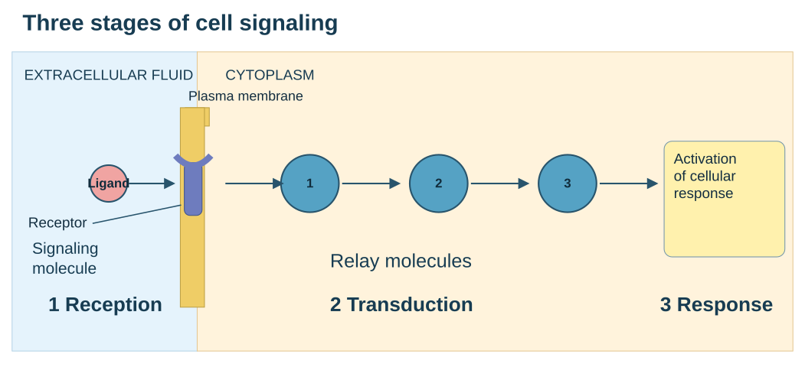

EXTRACELLULAR FLUID；Plasma membrane；CYTOPLASM。1 Reception：Signaling molecule → Receptor；2 Transduction：Relay molecules（1 → 2 → 3）；3 Response：Activation of cellular response。

| 比较 | Cell-surface receptor | Intracellular receptor |
| --- | --- | --- |
| 例子 | Epinephrine；polypeptide hormones | Steroid hormones；thyroid hormones |

## 1.G protein-coupled receptor GPCR

① Ligand 结合 GPCR，使受体变形。
② 受体促进 G protein将 GDP 交换为 GTP。
③ 活化的 G protein调节下游 enzyme，启动反应。
④ G protein将 GTP 水解为 GDP，回到不活跃状态。 A G protein acts as a molecular switch: GTP-bound is active, and GDP-bound is inactive.

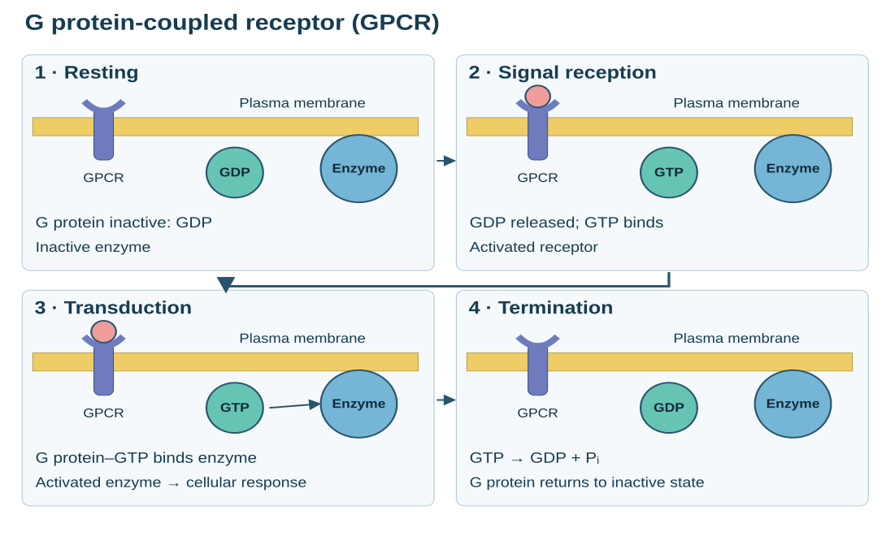

G protein-coupled receptor；Plasma membrane；CYTOPLASM；G protein (inactive)，GDP；Enzyme；Activated receptor；Signaling molecule；Inactive enzyme；GTP；Activated enzyme；Cellular response。

## 2.Receptor tyrosine kinase RTK

在课件的典型模型中，ligand 结合促使两个受体形成 dimer（二聚体），受体利用 ATP 相互磷酸化（添加一个 phosphate group），再结合并激活 relay proteins。 One activated RTK can activate multiple signaling pathways.

## 3.Ligand-gated ion channel

Ligand结合改变通道形状，使 Na⁺、Ca²⁺等特定离子顺 electrochemical gradient（电化学梯度） 通过，改变膜电位或细胞内离子浓度。Ligand 离开后通道可关闭。

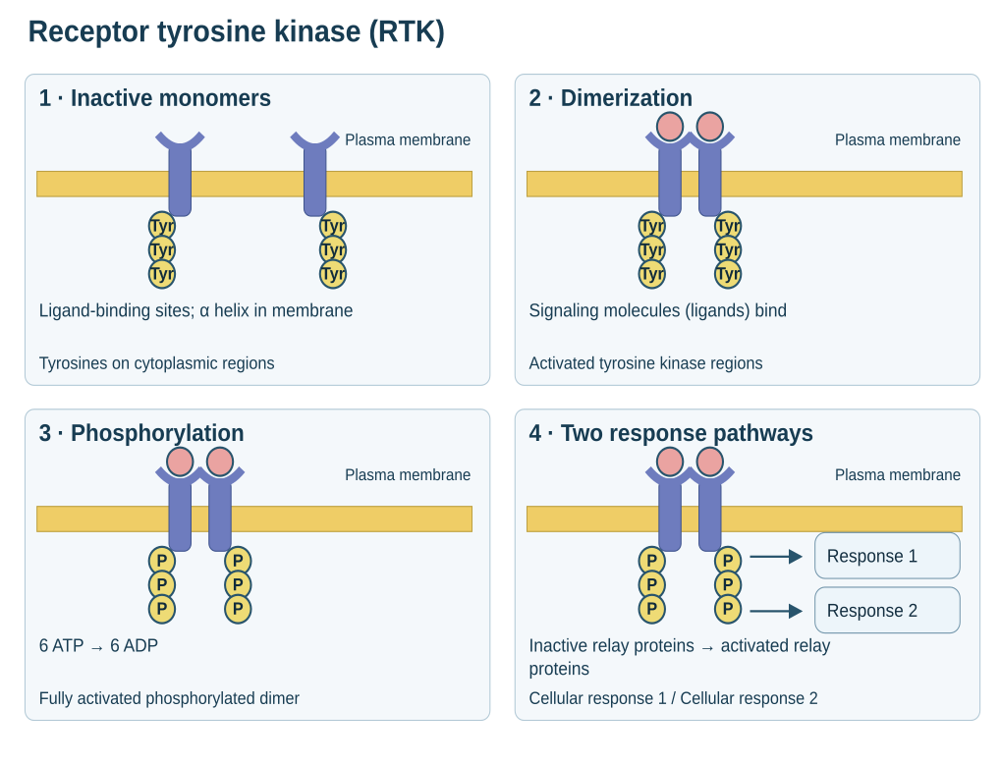

Signaling molecule (ligand)；α helix in the membrane；Tyrosines；CYTOPLASM；Ligand-binding site；Receptor tyrosine kinase proteins (inactive monomers)；Dimer；Activated tyrosine kinase regions (unphosphorylated dimer)；6 ATP → 6 ADP；Fully activated receptor tyrosine kinase (phosphorylated dimer)；Inactive relay proteins → Activated relay proteins；Cellular response 1 / Cellular response 2。

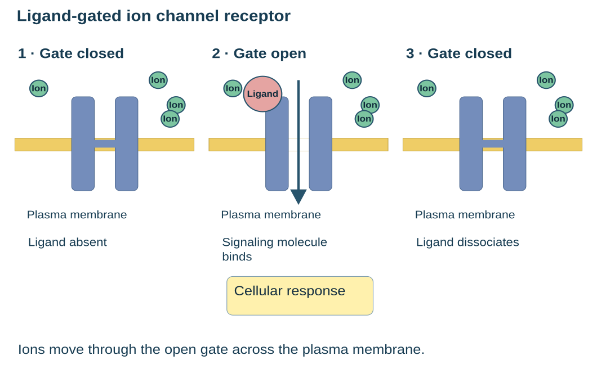

Ligand-gated ion channel receptor；Signaling molecule (ligand)；Ions；Plasma membrane；1 Gate closed → 2 Gate open，产生 Cellular response → 3 Gate closed。

## Intracellular receptor

脂溶性激素进入细胞 → 结合受体 → hormone-receptor complex调节特定基因的 transcription→ 形成 mRNA → 合成蛋白质。 脂溶性激素在血液中通常由 transport proteins携带。

## Phosphorylation磷酸化与 Dephosphorylation

Protein kinase（蛋白激酶）把 ATP 的磷酸基团转移到蛋白质上。Protein phosphatase（蛋白磷酸酶）移除蛋白质上的磷酸基团。这种可逆修饰改变蛋白质的形状和活性。 Phosphorylation can activate or inhibit a protein, depending on the protein. Phosphorylation cascade是连续的激酶反应。一个活化酶可以作用于许多个底物，产生 signal amplification。多步骤也提供更多调节位置。 （做题时注意箭头→与横杠—| 对应促进和抑制） （A 抑制 B, B抑制 C 效果等同于 A 促进 C——做题式理清关系）

## First messenger与 Second messenger

First messenger是最初的胞外信号（Ligand） Second messenger是参与胞内信号传递的小分子或离子；不是 receptor，也不是 protein kinase。
- 最常见：cAMP——（由 Adenylyl cyclase将ATP转得到）；常用于活化 protein kinase A （PKA）

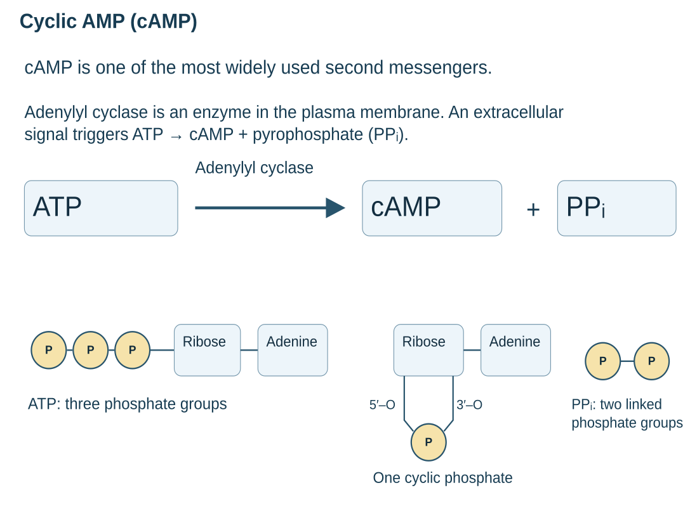

Cyclic AMP。a) Cyclic AMP (cAMP) is one of the most widely used second messengers. b) Adenylyl cyclase, an enzyme in the plasma membrane, converts ATP to cAMP in response to an extracellular signal. 图：ATP —Adenylyl cyclase→ cAMP + Pyrophosphate。

## cAMP pathway

Ligand→GPCR → G protein→（Adenylyl cyclase）→cAMP → PKA → Response

## 不同类型的反应

Cytoplasmic response：改变已有蛋白质的活性，如调节代谢酶、离子通道或细胞骨架。 Nuclear response：活化transcription factor（转录因子），改变特定基因的表达，进而改变蛋白质合成。 The same signal can produce different responses in different cell types. 原因：细胞的 receptors、relay proteins和target proteins不同。Pathway branching可让一个信号触发多个反应；cross-talk 可让不同通路相互促进或抑制。Scaffolding proteins把同一通路的蛋白质聚集起来，提高效率。

## Termination信号终止

Ligand浓度下降或与受体解离；GTP hydrolysis 使 G protein失活；protein phosphatases移除磷酸；phosphodiesterase将cAMP转为 AMP；Ca²⁺ 被泵回储存区或胞外。这些机制帮助系统恢复并响应下一次信号。

## 预测突变或药物作用

- Receptor无法结合 ligand：该受体介导的反应通常减弱或消失。
- G protein无法水解 GTP：可能长期保持活跃，下游反应持续。
- 阻断某个必要的 kinase：经该 kinase传递的下游反应减弱。
- 减慢 cAMP 的降解：cAMP 信号可能更强或持续更久。
- 下游蛋白持续活跃：即使缺少上游信号，也可能产生反应。

## Apoptosis程序性细胞死亡

Apoptosis通过受控的酶级联拆解细胞，碎片被包裹并清除，减少内容物泄漏对邻近细胞的伤害。它参与胚胎发育、组织维护和异常细胞清除。 ]Apoptosis is a regulated process that removes unnecessary or damaged cells.

## Homeostasis是动态稳定

Homeostasis（稳态）是将内环境变量维持在正常范围，不是保持绝对不变。Set point是调节参考值；偏离产生 stimulus，由sensor检测，并经控制系统引发 response。 Homeostasis is a dynamic equilibrium maintained mainly by negative feedback.

| 比较 | Negative feedback（负反馈） | Positive feedback（正反馈） |
| --- | --- | --- |
| 反应方向 | Counteracts the initial change（抵消最初的变化） | Reinforces the initial change（增强最初的变化） |
| 结果 | 减少偏差，使变量回到正常范围 | 扩大原始变化，推动过程继续 |
| 例子 | Thermoregulation（体温调节）；secretin 调节肠道 pH | Oxytocin 与婴儿吸吮引起的 milk ejection（排乳） |
| 停止条件 | 原始刺激减弱后，反应减弱 | 通常需要刺激移除或过程完成 |

Negative/positive表示反馈方向，不表示有害 /有益。一个让血糖上升的反应也可以是负反馈：关键是它是否纠正了最初的血糖下降。

## Regulator与Conformer

Regulator通过内部机制抵抗外界变化；conformer 的某项内部变量随外界改变。同一动物可以调节某些变量，同时让另一些变量随环境变化。

## 6 Cell Cycle 与 Chromosomes

细胞分裂为什么重要: Cell division可用于单细胞生物繁殖，也用于多细胞生物的 growth、 development和tissue repair。正常mitosis通常保持染色体数，并产生遗传信息基本相同的子细胞。

- Genome：一个细胞的全部遗传物质。
- Chromatin染色质：DNA 与蛋白质形成的复合物。
- Chromosome染色体：由 Chromatin在细胞分裂时高度凝缩形成。
- Sister chromatids姐妹染色单体：同一条染色体复制后形成由 Centromere连接分开前视为一条染色体。
- Centromere着丝粒：连接 Sister chromatids其上附有 Kinetochore Sister chromatids完全不同于 homologous chromosomes（同源染色体在 meiosis时考虑） 前者来自复制；后者为同一类型的两条染色体，通常一条来自父方、一条来自母方。

## Cell cycle的阶段

- G₁ phase：主要事件：细胞生长，合成蛋白质和细胞组分。
- S phase：主要事件：DNA replication；每条染色体复制成两条 sister chromatids。
- G₂ phase：主要事件：继续生长，准备分裂，检查复制状态。
- M phase：主要事件：Mitosis（细胞核遗传物质分配）与 cytokinesis（胞质分裂）。 Interphase includes G₁, S, and G₂; DNA replication occurs during S phase. Interphase是活跃的生长和准备阶段，不是“什么也不做的休息期”。

## 染色体数量的核心规则

DNA replication doubles the DNA content but does not immediately double the chromosome number. 染色体按 centromeres计数。复制后的一个 X 形结构仍是一条 chromosome，含两条 chromatids。姐妹染色单体分离后，每一条才作为独立 chromosome计数。

## 7 Mitosis与 Cytokinesis

- Prophase 前期：Chromatin 凝缩；spindle（纺锤体） 开始形成；centrosome 中心体移向两极； 识图线索：染色体开始清楚可见。 *Prometaphase 前中期（有时不考虑这个视作从 prophase直接到 metaphase）关键变化： Nuclear envelope破裂；spindle连接 Chromosome（连接在 Centromere的 kinetochores）；
- Metaphase 中期：Chromosome 排列于 metaphase plate；Sister chromatids连接相反两极； 识图线索：Chromosome 在细胞中央排成一列。

- Anaphase 后期：Sister chromatids分离，移向两极；细胞伸长；识图线索：两组染色体分开移动。
- Telophase 末期：Chromosome到达两极并解凝缩变回 Chromatin；新核膜和核仁形成；识图线索：出现两个新细胞核。

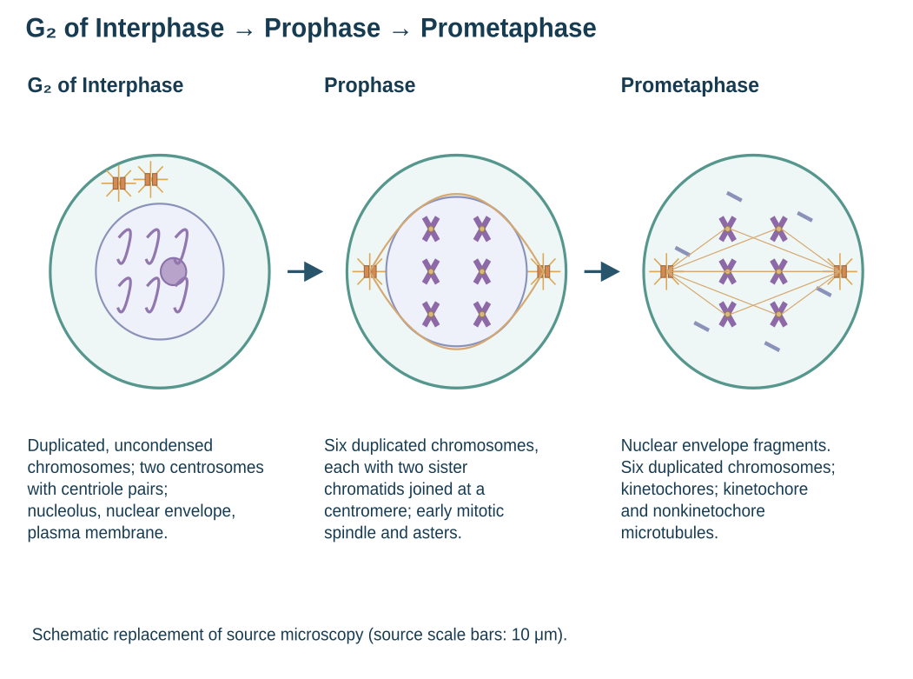

G₂ of Interphase → Prophase → Prometaphase。Centrosomes (with centriole pairs)；Chromosomes (duplicated, uncondensed)；Early mitotic spindle；Aster；Centromere；Fragments of nuclear envelope；Nonkinetochore microtubules；Nucleolus；Nuclear envelope；Plasma membrane；Two sister chromatids of one chromosome；Kinetochore；Kinetochore microtubule；10 μm。

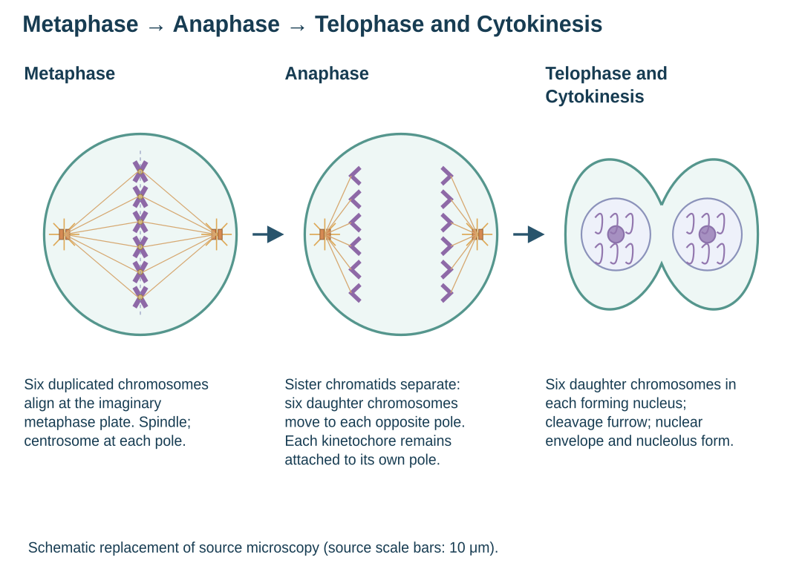

Metaphase → Anaphase → Telophase and Cytokinesis。Metaphase plate；Spindle；Centrosome at one spindle pole；Daughter chromosomes；Cleavage furrow；Nucleolus forming；Nuclear envelope forming；10 μm。

## Mitotic spindle纺锤体

由 microtubules（微管） 构成。由 Centrosome发出，aster是其周围的星状微管。 Kinetochore microtubules参与染色体移动；nonkinetochore microtubules相互作用，帮助两极分开。

Metaphase plate是假想平面，不是细胞中真实存在的板。

## 以人类二倍体细胞为例

- G₁一个细胞：Chromosomes：46；DNA molecules：46。
- G₂或 metaphase一个细胞：Chromosomes：46；DNA molecules：92。
- Anaphase整个尚未分裂的细胞：Chromosomes：92；DNA molecules：92。
- 完成分裂后每个 daughter cell：Chromosomes：46；DNA molecules：46。 后期每一极各得到 46 条染色体。回答题目时先明确是“整个细胞”“每一极”还是“每个子细胞”， 不要将短暂的全细胞计数增加理解为产生四倍体子细胞。

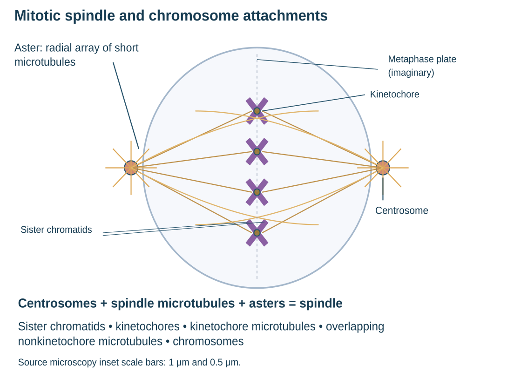

a) An aster (a radial array of short microtubules) extends from each centrosome. b) The spindle includes the centrosomes, the spindle microtubules, and the asters. Sister chromatids；Aster；Centrosome；Metaphase plate (imaginary)；Kinetochores；Kinetochore microtubules；Overlapping nonkinetochore microtubules；Microtubules；Chromosomes。

## Binary fission二分裂

细菌等原核生物通过 binary fission分裂。没有细胞核，因此不是 mitosis。

## Checkpoint检查点

Checkpoints接收internal signals与external signals，决定细胞是否继续下一阶段。Growth factors 是促进分裂的外部信号；DNA 状态和纺锤体连接状态属于内部监控信息。
- G₁ checkpoint：主要检查内容：生长条件、营养、细胞大小及 DNA 状态等；未通过时：可暂停周期；一些细胞进入 G₀。
- G₂ checkpoint：主要检查内容：DNA 是否完成复制，是否存在损伤；未通过时：延迟进入 mitosis。
- M checkpoint：主要检查内容：所有染色体是否正确连接纺锤体；未通过时：阻止进入 anaphase。 G₀ phase是不进行周期性分裂的状态，不等于细胞死亡或完全没有代谢。某些细胞可重新进入周期，另一些长期保持 G₀。 The spindle checkpoint prevents anaphase until chromosomes are properly attached to the spindle.

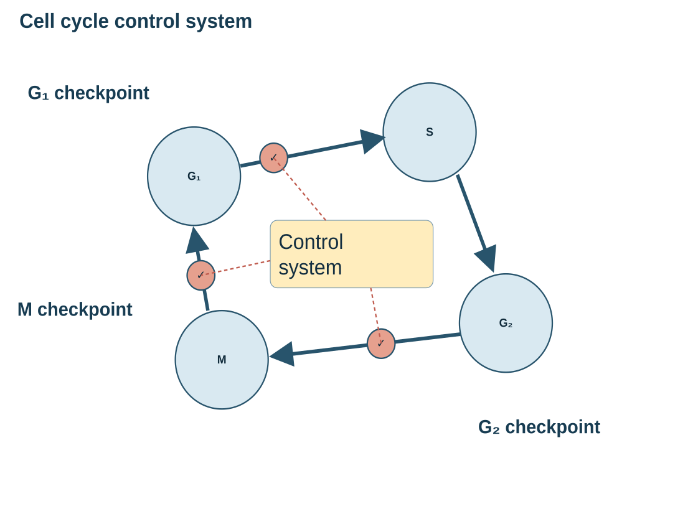

Figure 12.15：G₁ checkpoint；G₂ checkpoint；M checkpoint；Control system；G₁ → S → G₂ → M。

## Cyclins 与 Cyclin-dependent kinases

Cyclin（周期蛋白）的浓度随周期升降。Cdk（周期蛋白依赖性激酶）结合适当 cyclin后形成有活性的调节复合物，通过 phosphorylation改变靶蛋白的功能。典型模型中，Cdk 含量较稳定， 变化主要体现在活性。 Cyclin concentrations fluctuate, regulating the activity of cyclin-dependent kinases. MPF（maturation-promoting factor）是促进细胞进入 M phase的 cyclin-Cdk complex。Cyclin积累 → MPF 活化 → 促进有丝分裂；之后 cyclin被降解 → MPF 活性下降 → 帮助细胞退出 M phase。Cdk可被再次利用。

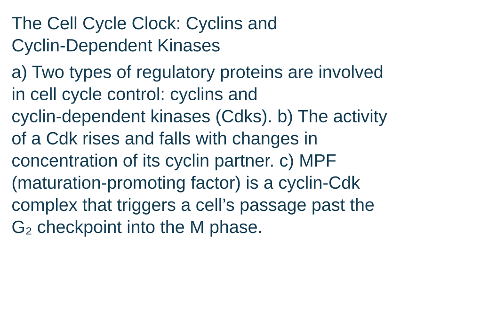

The Cell Cycle Clock: Cyclins and Cyclin-Dependent Kinases。a) Two types of regulatory proteins are involved in cell cycle control: cyclins and cyclin-dependent kinases (Cdks). b) The activity of a Cdk rises and falls with changes in concentration of its cyclin partner. c) MPF (maturation-promoting factor) is a cyclin-Cdk complex that triggers a cell’s passage past the G₂ checkpoint into the M phase.

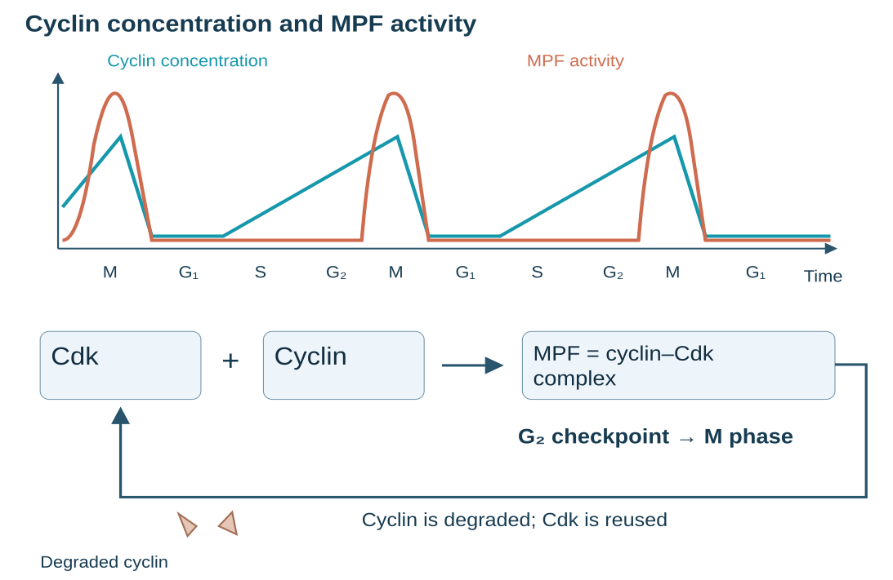

(a) Fluctuation of MPF activity and cyclin concentration during the cell cycle：MPF activity；Cyclin concentration；Time；M、G₁、S、G₂。(b) Molecular mechanisms that help regulate the cell cycle：Cdk；Cyclin；MPF；G₂ checkpoint；Degraded cyclin；Cyclin is degraded。

## 高频易错点

- Ligand与receptor：正确理解：Ligand 是被识别的信号；receptor 是识别并传递信息的受体。
- Amplification（放大）与更多 ligand：放大可以发生在细胞内部，不要求外界配体数量增加。
- Phosphorylation与activation：加磷酸不一定激活；必须看具体蛋白和通路。
- DNA replication与mitosis：S phase复制DNA；M phase分配复制后的染色体。
- Sister chromatids与chromosomes：复制后Sister chromatids仍算一条染色体；分离后各算一条。
- Cyclin与Cdk：正确理解：Cyclin 浓度变化影响复合物活性；Cdk 不必同步被降解。
