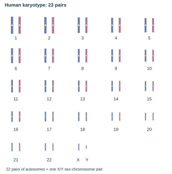
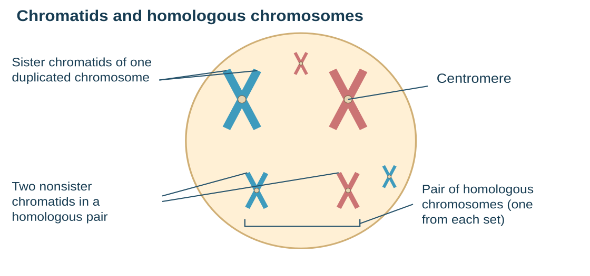
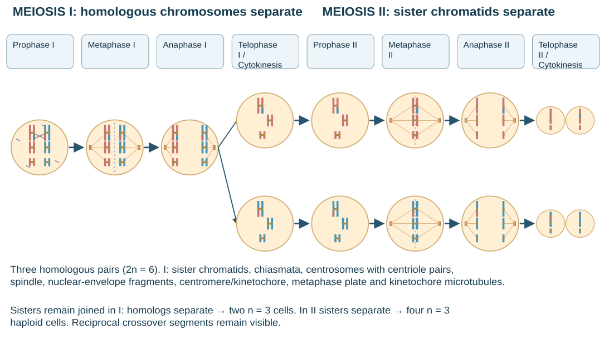
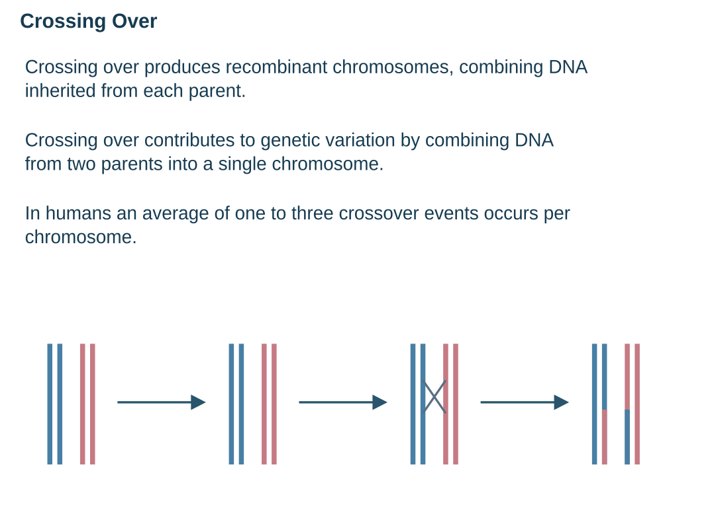
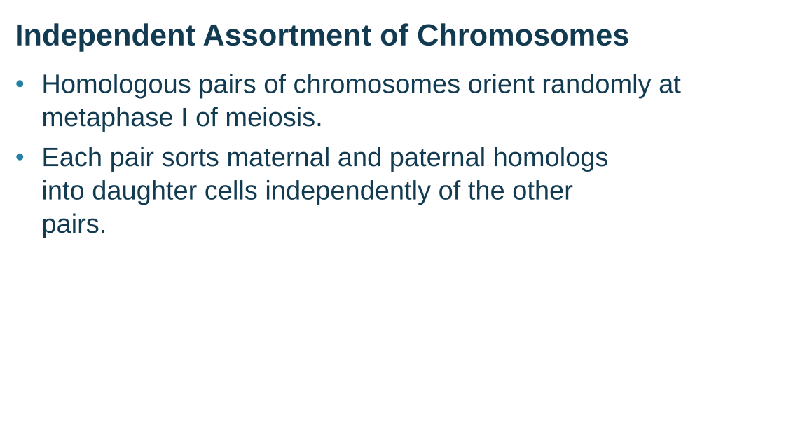
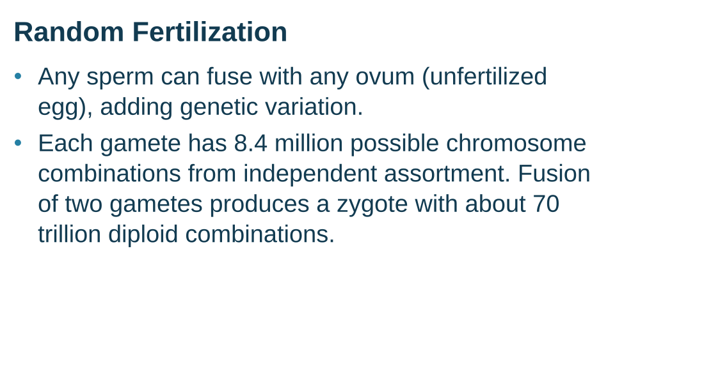
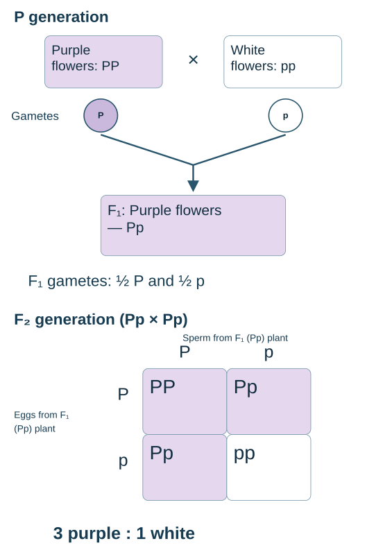
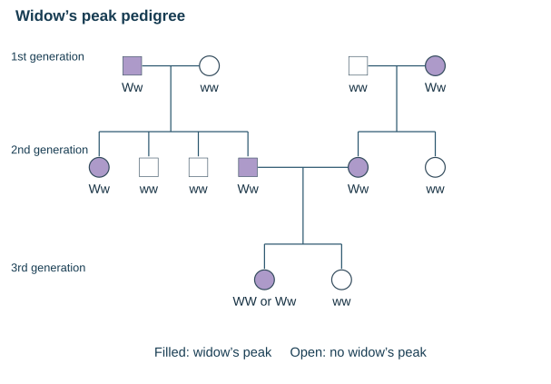

# 第五单元知识点整理

Unit 5 Heredity

## 1 Basic Concepts

| Keyword | 中文解释 |
| --- | --- |
| Heredity / Variation | 遗传：性状在亲代与子代间传递；变异：个体之间的差异。 |
| Gene / Allele / Locus | 基因是遗传信息单位；等位基因是同一基因的不同版本（常见的 Aa 等控制的是同一个性状）；基因座是基因在染色体上的位置。 |
| Homologous chromosomes (homologs) | 同源染色体：一条来自父方、一条来自母方，对应位置有相同种类的基因，等位基因可以不同。 |
| Sister chromatids | 姐妹染色单体：一条染色体复制形成的两份拷贝；本身完全相同，但 crossing over 后可能不再完全相同。 |
| Diploid (2n) / Haploid (n) | 二倍体有两套染色体；单倍体有一套。人类通常体细胞 $2n=46$（意思是一共有 46 条 chromosomes，有 23 对 Homologous chromosomes）；Gamete $n=23$。 |
| Autosomes / Sex chromosomes | 人类通常有 22 对常染色体与 1 对性染色体；典型组合为 XX 或 XY。部分物种为 ZW 和 ZZ。 |
| Gamete | 配子，如精子与卵细胞；受精卵由两个配子融合形成。 |

注意区分 Homologous chromosomes和 Sister chromatids Homologous chromosomes本身就存在一直是两条独立的染色体只是对应位置有 Alleles Sister chromatids是cell division时DNA复制后才产生的 mitosis的Anaphase和 meiosis的Anaphase II时Sister chromatids分离此前视为一条染色体

人类染色体核型图，展示 23 对染色体（1–22、X、Y）。

Sister chromatids of one duplicated chromosome；Centromere；Two nonsister chromatids in a homologous pair；Pair of homologous chromosomes (one from each set)。

## Life Cycle｜生活史

Meiosis reduces chromosome number; fertilization restores it. 二倍体细胞经减数分裂产生单倍体细胞；受精使 n +n → 2n；受精卵再通过 mitosis生长发育。 动物通常通过减数分裂形成配子，植物生活史中减数分裂产生孢子。 Asexual reproduction：单亲繁殖，通常产生遗传上相同的后代（突变可带来差异）。Sexual reproduction：配子融合，产生新的遗传组合。

## 2 Meiosis｜减数分裂过程

One DNA replication is followed by two cell divisions. DNA 只在减数分裂前的 interphase 的S phase复制一次。Meiosis I与 Meiosis II之间没有再次复制。通常最终形成 4 个 Haploid。

| Stage | 主要事件 |
| --- | --- |
| Prophase I | Homologous chromosomes synapsis（联会），形成 tetrad / bivalent。非姐妹染色单体之间发生 crossing over。 |

MEIOSIS I: Separates homologous chromosomes；Prophase I → Metaphase I → Anaphase I → Telophase I and Cytokinesis。MEIOSIS II: Separates sister chromatids；Prophase II → Metaphase II → Anaphase II → Telophase II and Cytokinesis。Centrosome (with centriole pair)；Sister chromatids；Chiasmata；Spindle；Homologous chromosomes；Fragments of nuclear envelope；Centromere (with kinetochore)；Metaphase plate；Microtubules attached to kinetochore；Sister chromatids remain attached；Homologous chromosomes separate；Cleavage furrow；Sister chromatids separate；Haploid daughter cells forming。

| Stage | 主要事件 |
| --- | --- |
| Metaphase I | 同源染色体对排列在赤道板；每对的朝向随机，为 independent assortment 提供基础。 |
| Anaphase I | Homologous chromosomes 分离并移向两极；Sister chromatids 仍相连。染色体套数在第一次分裂完成后减半（$2n\to n$）。 |
| Telophase I + Cytokinesis | 通常形成两个 Haploid 细胞；每条染色体仍由两条 Sister chromatids 组成。 |
| Prophase II | spindle 形成，准备第二次分裂；没有新的 S phase。 |
| Metaphase II | 染色体单独排列在 metaphase plate；Sister chromatids 连接相反两极。 |
| Anaphase II | Sister chromatids 分离；分离后每条称为一条独立染色体。 |
| Telophase II + Cytokinesis | 形成 4 个 Haploid 细胞，染色体不再含成对的 Sister chromatids。 |

Homologous chromosomes separate in meiosis I; sister chromatids separate in meiosis II. Crossing over发生在同源染色体的 nonsister chromatids之间。

Crossing Over。- Crossing over produces recombinant chromosomes, which combine DNA inherited from each parent. - Crossing over contributes to genetic variation by combining DNA from two parents into a single chromosome. - In humans, an average of one to three crossover events occurs per chromosome.

## Chromosome Number vs.DNA Content｜染色体数与 DNA 含量

以人类细胞为例，按着丝粒数计算染色体数。每条染色单体含 1个双链 DNA 分子；n 表示染色体套数，C 表示相对于一套未复制基因组的 DNA 含量。

| 阶段（每个细胞） | 染色体数 | DNA 分子数 | 状态 |
| --- | --- | --- | --- |
| S phase 前 | 46 | 46 | $2n$ |
| S phase 后 / Meiosis I 前 | 46 | 92 | $2n$ |
| Meiosis I 完成后 | 23 | 46 | $n$ |
| Meiosis II 完成后 | 23 | 23 | $n$ |

Anaphase II姐妹染色单体刚分离、细胞尚未分开时，整个细胞暂时有 46条染色体

| 比较 | Mitosis | Meiosis |
| --- | --- | --- |
| 分裂次数 / 产物 | 1 次；通常 2 个子细胞 | 2 次；通常 4 个单倍体产物 |
| 染色体套数 | 通常保持不变 | 通常从 $2n$ 减为 $n$ |
| Synapsis & Crossing over | 无 | Prophase I 发生 |
| 遗传结果 | 与母细胞基本相同 | 通常产生不同遗传组合 |
| 主要作用 | 生长、修复、无性繁殖 | 有性生殖生活史中的减数过程 |

## Sources of Genetic Variation｜遗传变异来源

Mutation产生新的等位基因；Independent assortment、Crossing over与Random fertilization重新组合已有等位基因。

Crossing over见上文

Independent Assortment of Chromosomes。- Homologous pairs of chromosomes orient randomly at metaphase I of meiosis. - In independent assortment, each pair of chromosomes sorts maternal and paternal homologs into daughter cells independently of the other pairs.

Random Fertilization。- Random fertilization adds to genetic variation because any sperm can fuse with any ovum (unfertilized egg). - The fusion of two gametes (each with 8.4 million possible chromosome combinations from independent assortment) produces a zygote with any of about 70 trillion diploid combinations.

## 4 Mendelian Genetics｜孟德尔遗传

Mendel选择豌豆：世代时间较短、后代多、性状便于区分，且可控制自交和杂交。True- breeding指相关性状能稳定遗传的纯种品系。P 是亲本代，F₁ 是子一代，F₂ 是子二代。

| Keyword | 含义 / 例子 |
| --- | --- |
| Genotype / Phenotype | 基因型是等位基因组合，如 Aa；表型是表现出的性状。 |
| Homozygous / Heterozygous | 纯合：AA 或 aa；杂合：Aa。 |
| Dominant / Recessive | 完全显性时，Aa 表现显性性状；隐性性状通常在 aa 中出现。 |

## Law of Segregation｜分离定律

The two alleles for a gene segregate during gamete formation. 二倍体个体的一对等位基因在配子形成时分开，每个配子得到一个。Aa 产生 A与 a配子的概率各为 1/2。

| Cross | Genotypic ratio | Phenotypic ratio |
| --- | --- | --- |
| AA × aa | 全部 Aa | 完全显性时全部显性 |
| Aa × Aa | 1 AA : 2 Aa : 1 aa | 完全显性时 3 : 1 |
| Aa × aa | 1 Aa : 1 aa | 完全显性时 1 : 1 |

P Generation：Appearance: Purple flowers × White flowers；Genetic makeup: PP × pp；Gametes: P、p。F₁ Generation：Appearance: Purple flowers；Genetic makeup: Pp；Gametes: ½ P、½ p。F₂ Generation：Sperm from F₁ (Pp) plant 与 Eggs from F₁ (Pp) plant 形成 PP、Pp、Pp、pp；表型 3 : 1。

## Testcross｜测交

将显性表型但基因型未知的个体 A_与纯合隐性 aa杂交。若未知亲本是 AA，子代全部 Aa；若是 Aa，期望为 1Aa :1aa。 A recessive offspring reveals that the dominant parent carries a recessive allele.

## Law of Independent Assortment｜自由组合定律

Alleles of unlinked genes assort independently during gamete formation. 不同非同源染色体上的基因通常自由组合；同一染色体上距离很远的基因也可能表现为不连锁。位置接近的 linked genes通常不满足独立假设。 AaBb在两基因不连锁时产生 AB、Ab、aB、ab 四种配子，各占 1/4。自由组合对应 Metaphase I同源染色体对的随机朝向。

| Cross / 条件 | Expected result |
| --- | --- |
| AaBb × AaBb | 9 A_B_ : 3 A_bb : 3 aaB_ : 1 aabb |
| AaBb × aabb | 1 AaBb : 1 Aabb : 1 aaBb : 1 aabb |

## Pedigree Analysis｜家系图分析

Square：男性；Circle：女性；Shaded symbol：表现目标性状；水平连线表示亲本关系，竖线连接后代。优先用已知表型限制基因型，再计算概率。 Autosomal recessive：在标准单基因模型下，两个未患病亲本生出患病孩子，亲本应为 Aa× Aa。Carrier是携带隐性等位基因的杂合个体。 For Aa × Aa, an unaffected child has a 2/3 probability of being a carrier. 因为未患病子代只包括 AA、Aa、Aa，3 种等可能组合中 2 种是携带者。不要将有条件的 2/3 与全部子代中 Aa 的概率 1/2混淆。

1st generation (grandparents)：两组亲本为 Ww × ww、ww × Ww。2nd generation (parents, aunts, and uncles)：左支四名子代 Ww、ww、ww、Ww，右支两名子代 Ww、ww；中间两个 Ww 组成亲本。3rd generation (two sisters)：WW or Ww（Widow’s peak）；ww（No widow’s peak）。

## 6 Degrees of Dominance

| Pattern | 杂合子表型 | 典型例子 / F₂ 比例 |
| --- | --- | --- |
| Complete dominance | 与显性纯合子相同 | Aa × Aa：表型 3 : 1，基因型 1 : 2 : 1。 |
| Incomplete dominance | 介于两个纯合子之间 | 红花 × 白花 → 粉花；粉花自交，红 : 粉 : 白 = 1 : 2 : 1。 |
| Codominance | 两种等位基因的效应均可观察到 | AB 血型同时具有 A 抗原与 B 抗原；不是两者混成中间类型。 |

Dominance describes the phenotype of a heterozygote; it does not change allele segregation. 不完全显性与共显性仍符合分离定律。显性关系取决于所观察的表型层次；不能把“显性”理解为隐性等位基因消失或不再遗传。

## Multiple Alleles｜复等位基因

同一基因在群体中可以有两种以上的等位基因；一个普通二倍体个体在该基因座通常仍只有两个等位基因。

## ABO Blood Groups｜ABO 血型

三个常见等位基因为 Iᴬ、Iᴮ和 i。Iᴬ与 Iᴮ互为 codominant，二者都对 i显性。

| Blood type | Possible genotypes | 红细胞表面相关抗原 |
| --- | --- | --- |
| A | $I^A I^A$ 或 $I^A i$ | A antigen |
| B | $I^B I^B$ 或 $I^B i$ | B antigen |
| AB | $I^A I^B$ | A and B antigens |
| O | $ii$ | 无 A、B 抗原 |

例：Iᴬi ×Iᴮi，子代 IᴬIᴮ、Iᴬi、Iᴮi、ii各占1/4，因此 AB、A、B、O 四种血型都可能出现。 例：IᴬIᴮ× ii，子代 Iᴬi与 Iᴮi各占 1/2；在标准 ABO 模型下不出现 AB 或 O 型。

## 7 Gene Interactions｜基因与性状的关系

| Concept | 核心关系 | 例子 |
| --- | --- | --- |
| Pleiotropy | One gene → multiple traits；一个基因影响多个性状 | Sickle-cell disease：血红蛋白相关基因的变异可影响红细胞形状、氧运输等多个方面。 |
| Epistasis | One gene modifies another gene’s expression；一个基因座影响另一基因座的表型效应 | 拉布拉多犬的色素沉积基因可掩盖毛色基因的效应。 |
| Polygenic inheritance | Multiple genes → one trait；多个基因共同影响一个性状 | 身高、肤色等数量性状；常呈连续变异，也受环境影响。 |

*Example拉布拉多犬毛色简化模型：B 对 b 显性，决定黑色或棕色色素；E 允许色素在毛发中沉积，ee 阻止相应沉积， 表现为黄色。因此 ee会掩盖 B/b的效应。

| Genotype | Phenotype | BbEe × BbEe 中的比例 |
| --- | --- | --- |
| B_E_ | Black（黑色） | 9/16 |
| bbE_ | Brown（棕色） | 3/16 |
| B_ee 或 bbee | Yellow（黄色） | 4/16 |

Recessive epistasis can modify a 9:3:3:1 ratio into a 9:3:4 ratio. 基因仍可以独立分离，但不同基因型被归入同一表型类别，因此表型比例改变。不要把所有偏离 9:3:3 :1的结果都判断为连锁。

## Polygenic Inheritance｜多基因遗传

在加性简化模型中，每个贡献等位基因都增加一定表型效应。参与基因越多，可能的表现等级通常越多；真实性状还常受环境与基因相互作用影响。

## Environmental Effects｜环境对表型的影响

The same genotype can produce different phenotypes in different environments. Phenotypic plasticity（表型可塑性）：相同基因型在不同环境中表现出不同表型。环境因素可影响 gene expression；表型改变不一定意味着 DNA 序列发生改变。例如营养条件会影响身高。

## 8 Sex-Linked Inheritance｜伴性遗传

Sex-linked gene位于性染色体上；X-linked 位于 X 染色体，Y-linked 位于 Y 染色体。XY 个体对多数 X 染色体基因只有一份，称为 hemizygous。 Fathers pass their X chromosome to daughters, not to sons. 典型人类 XY 系统中，父亲给儿子 Y、给女儿 X；母亲给儿子和女儿的都是 X。Y-linked性状可由父亲传给儿子；X-linked 性状没有直接的父传子路径。

## X-Linked Recessive｜X连锁隐性遗传

用 Xᴺ表示正常等位基因，Xⁿ 表示隐性目标等位基因。男性 XⁿY 即表现性状；女性通常需要 XⁿXⁿ，XᴺXⁿ通常为携带者。

| Mother 母亲 | Father 父亲 | Daughters 女儿 | Sons 儿子 | 全部子代的患病概率 |
| --- | --- | --- | --- | --- |
| $X^N X^N$ 正常、非携带者 | $X^N Y$ 正常 | 100% $X^N X^N$：正常、非携带者 | 100% $X^N Y$：正常 | 0% |
| $X^N X^N$ 正常、非携带者 | $X^n Y$ 患病 | 100% $X^N X^n$：携带者 | 100% $X^N Y$：正常 | 0% |
| $X^N X^n$ 携带者 | $X^N Y$ 正常 | 50% $X^N X^N$：正常、非携带者；50% $X^N X^n$：携带者 | 50% $X^N Y$：正常；50% $X^n Y$：患病 | 25% |
| $X^N X^n$ 携带者 | $X^n Y$ 患病 | 50% $X^N X^n$：携带者；50% $X^n X^n$：患病 | 50% $X^N Y$：正常；50% $X^n Y$：患病 | 50% |
| $X^n X^n$ 患病 | $X^N Y$ 正常 | 100% $X^N X^n$：携带者 | 100% $X^n Y$：患病 | 50% |
| $X^n X^n$ 患病 | $X^n Y$ 患病 | 100% $X^n X^n$：患病 | 100% $X^n Y$：患病 | 100% |

第一种杂交中：P(患病 |儿子) =1/2；若男女概率相等，P(一个孩子患病) =1/2×1/2=1/4。

## *X Inactivation｜X染色体失活

雌性哺乳动物胚胎早期通常随机使一条 X 大部分失活，形成 Barr body。失活状态可随细胞分裂保持，使个体出现 mosaic（嵌合式斑块），如玳瑁猫毛色。失活不等于染色体被删除，且部分基因可逃逸失活。

| Sex-determination system | 典型组合 |
| --- | --- |
| X–Y | XX 为雌性，XY 为雄性；如人类的典型情况。 |
| X–0 | XX 为雌性，X0 为雄性；0 表示缺少另一条性染色体。 |

| Sex-determination system | 典型组合 |
| --- | --- |
| Z–W | ZW 为雌性，ZZ 为雄性；如鸟类。 |
| Haplodiploidy | 典型情况下，未受精卵发育成单倍体雄性，受精卵发育成二倍体雌性。 |

总结：看到一个遗传图谱先判断 dominant还是 recessive—— 无中生有（亲代全部无病子代患病）为 recessive 有中生无（亲代全部患病子代无病）为 dominant 再判断 autosomal还是 sex-linked—— 若为 sex-linked recessive女性患病父子必患病若为 sex-linked dominant男性患病母女必患病

## Chi-Square Test｜卡方检验

Chi-square goodness-of-fit test用于判断观察结果与预期遗传比例的差异是否大到足以拒绝模型。Observed (O)是观察数；Expected (E)是根据假设比例计算的期望数。

$$\chi^2 = \sum \frac{(O-E)^2}{E}$$

H₀(null hypothesis)：观察值符合所假设的遗传比例，偏差可以用随机抽样解释。固定比例且未额外估计参数时，degrees of freedom(df)= 类别数 − 1。

Worked Example AaBb ×aabb；假设两基因不连锁，预期比例为 1:1 :1: 1。总后代 900，因此每类 E = 900× 1/4 =225。

| Phenotype | O | E | $(O-E)^2/E$ |
| --- | --- | --- | --- |
| Purple stem / short petals | 220 | 225 | $25/225 \approx 0.111$ |
| Green stem / short petals | 210 | 225 | $225/225 = 1.000$ |
| Purple stem / long petals | 231 | 225 | $36/225 = 0.160$ |
| Green stem / long petals | 239 | 225 | $196/225 \approx 0.871$ |

χ²=482/225≈ 2.14；df = 4− 1= 3。在 α= 0.05时，critical value= 7.815。因为 2.14< 7.815，所以 fail to reject H₀。 Fail to reject H₀: the data are consistent with the expected ratio.

结论：数据与 1:1:1:1的预期比例相容，差异不足以拒绝该模型；这不是“证明两基因一定不连锁”。

## Decision Rules｜判断规则

| Comparison | Conclusion |
| --- | --- |
| $\chi^2$ 大于临界值（$p<\alpha$） | Reject H₀：观察偏差达到统计显著。 |
| $\chi^2$ 小于临界值（$p>\alpha$） | Fail to reject H₀：证据不足以拒绝模型。 |

常见错误：用观察数计算期望比例；把 df写成总个体数减 1；认为拒绝假设就能直接证明某种机制。期望频数太小时，普通卡方近似可能不可靠。

## Non-Nuclear Inheritance｜核外遗传

Mitochondria与chloroplasts含有自己的DNA，相关性状可能不遵循简单的孟德尔核基因遗传比例。细胞器分配与不同细胞器基因组的比例可影响表型。 In humans, mitochondrial DNA is typically maternally inherited. 人类线粒体 DNA 通常来自卵细胞。母亲可以传给儿子和女儿，父亲通常不传递；能继续经母系传递的是女儿。子代不一定表现完全相同，因为变异线粒体的比例可能不同。植物细胞器遗传常为母系，但不同物种也有例外。
