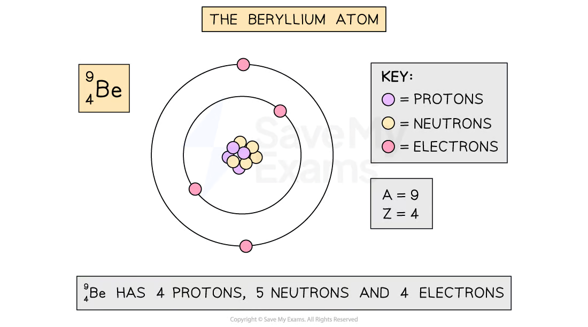
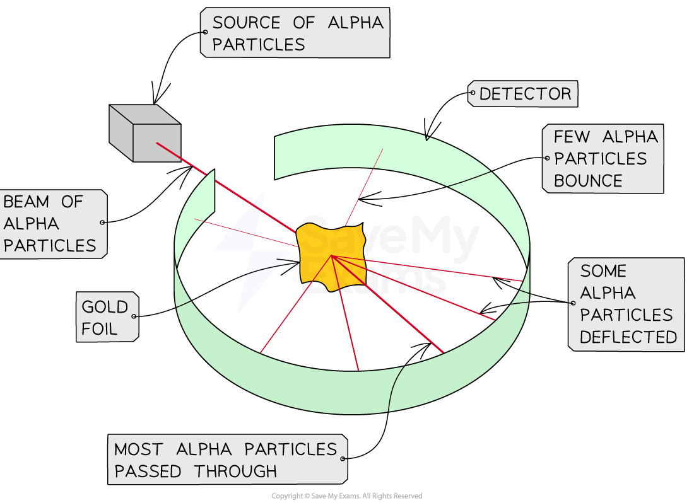
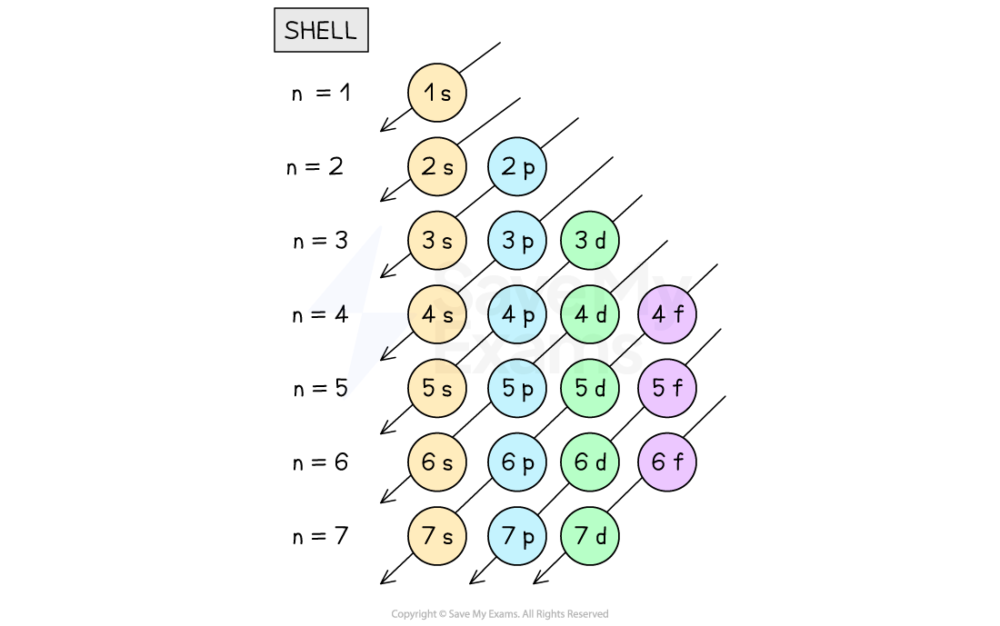
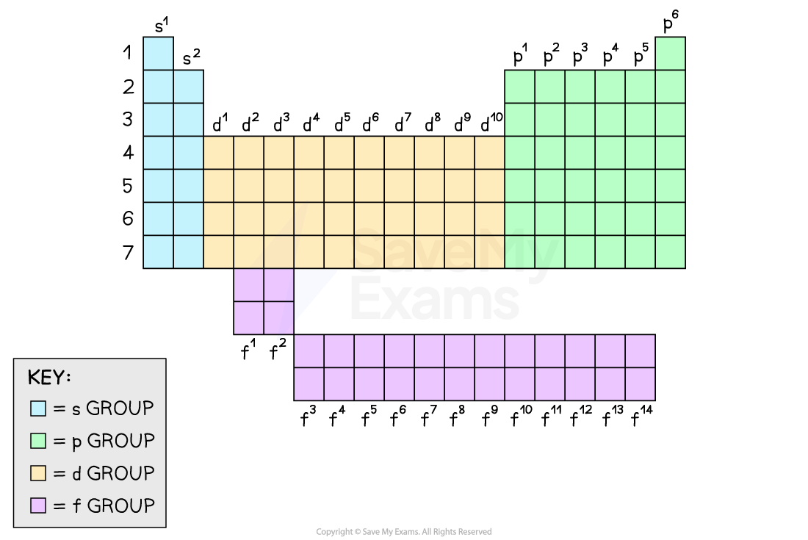
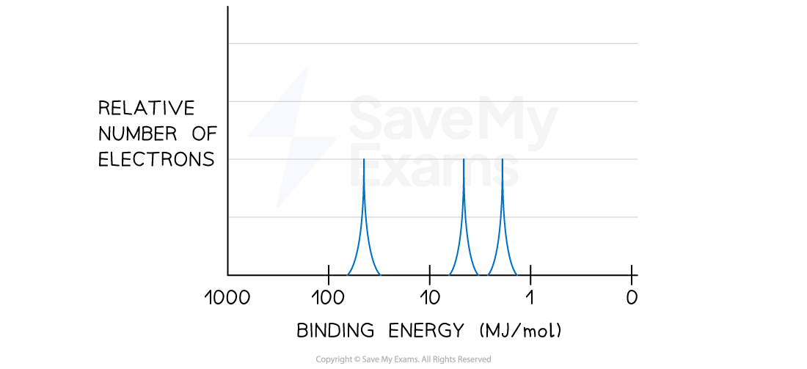
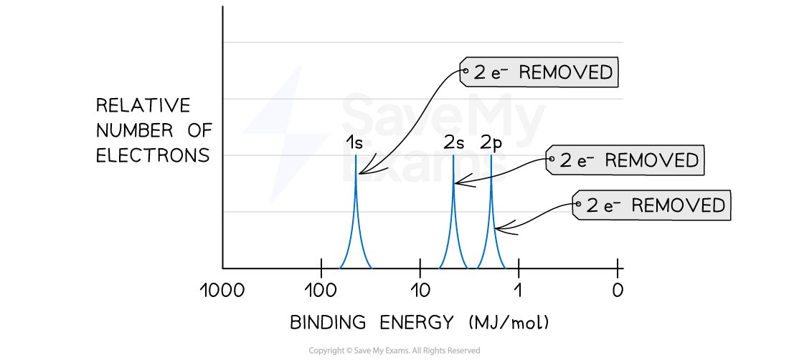

<!-- Source: page 1 -->

## Atoms & Electrons

## Contents

- Atomic Structure
- Using Coulomb’s Law
- Electron Configuration
- The Aufbau Principle
- Ionization Energy
- Photoelectron Spectroscopy

<!-- Source: page 2 -->

## Atomic Structure

## The Atom

- The atom is the smallest building block of matter

- It consists of three subatomic particles

- Protons are positive particles found in the nucleus

- Neutrons are neutral particles found in the nucleus

- Electrons are negative particles that orbit the nucleus in electron shells

- The electrons determine the chemical properties of the element

- Neutral atoms have the same amount of protons and electrons

## Atomic Number and Mass Number

- The atomic number (Z) of an element is the number of protons in its nucleus

- It defines the element's identity and it always a whole number in the periodic table

- Z = Number of protons

- The mass number (A) is the sum of protons and neutrons in the nucleus

- It represents the atom's mass

- Electrons do not contribute to the mass of the atom because they are too light
compared with protons or neutrons

- A = Number of protons + Number of neutrons

- Isotopes are atoms of the same element with the same atomic number but different
mass numbers. Therefore, protons are the same but neutrons are different

- Elements are usually represented with the A/Z notation

$$ {}^{A}_{Z}\mathrm{Atomic\ symbol} $$

## The beryllium atom

<!-- Source: page 3 -->

The beryllium atom contains 4 protons, 5 neutrons and 4 electrons

## Worked Example

Calculate the atomic number and mass number for an atom with 17 protons and 20 neutrons. After this, identify the element and write it down using the A/Z notation.

Answer:

- Step 1: Identify the given information

- The problem provides the number of protons (17) and neutrons (20).
- Step 2: Determine the atomic number (Z)

- The atomic number (Z) represents the number of protons in an atom. It also
defines the element's identity.
- Z = 17
- So, the atomic number is 17, which corresponds to the element chlorine (Cl)
on the periodic table.
- Step 3: Calculate the mass number (A)

- The mass number (A) is the sum of protons and neutrons in the nucleus.
- A = Number of protons + Number of neutrons
- A = 17 protons + 20 neutrons
- A = 37
- The mass number (A) for this atom is 37.
- Step 4: Identify the element

- With an atomic number of 17 (Z = 17), we can determine that the element is
chlorine (Cl).
- So, the atom in question is a chlorine atom with 17 protons, 20 neutrons, an
atomic number (Z) of 17, and a mass number (A) of 37.

<!-- Source: page 4 -->

- Step 5: Write it down with the A/Z notation

$$ {}^{A}_{Z}\mathrm{Atomic\ symbol} $$

$$ {}^{37}_{17}\mathrm{Cl} $$

## The Rutherford Experiment

- Rutherford performed an experiment to understand the structure of the atom

- He bombarded a gold foil with tiny positive particles, called alpha particles

- Most alpha particles passed through the foil, but some were significantly deflected, and
a few of them bounced back

- Since particles with the same charge repel, Rutherford concluded that the atoms should
contain an small, dense, and positively charged core at the center

- This core was named nucleus

- The nucleus contain protons and neutrons

## The Rutherford Experiment

The Rutherford experiment showed atoms contain a small, dense, and positively charged core at the center

<!-- Source: page 5 -->

## Using Coulomb’s Law

- Coulomb's law describes the electrostatic force between two charged particles

- It states that the force is directly proportional to the product of their charges and
inversely proportional to the square of the distance between them

$$F_{\mathrm{coulombic}}\ \alpha\ (q_1 \times q_2)$$

$$F_{\mathrm{coulombic}}\ \alpha\ \frac{1}{r^2}$$

The formula for Coulomb's law is $F_{\mathrm{coulombic}} = k\frac{q_1q_2}{r^2}$, where:

- Fcoulombic is the force between the charges in Newtons (N)

- k is Coulomb's constant (approximately 8.99 x 109 N·m² C-²)

- q1 and q2 are the value of the charges in Coulombs (C), which is the unit of
measurement for charge

- r is the distance between the charges in meters (m)

- The force is attractive for opposite charges and repulsive for like charges

## Examiner Tips and Tricks

Always verify the units before any calculation. If the units are not consistent, make sure to perform any transformation before replacing the values into the Coulomb's Law formula

## Worked Example

Calculating the force that exists between a proton and an electron given the following information.

Charge of a proton = +1.602 x 10-19 C Charge of an electron = -1.602 x 10-19 C Distance between them = 1 x 10-10 m

Answer:

- Step 1: Write down the values and the Coulomb's law formula
q1 = +1.602 x 10-19 C

<!-- Source: page 6 -->

q2= -1.602 x 10-19 C

r = 1 x 10-10 m k = 8.99 x 109 N·m² C-²

$$F_{\mathrm{coulombic}}=k\frac{q_1q_2}{r^2}$$

- Step 2: Replace the value in the Coulomb’s Law

$$F_{\mathrm{coulombic}}=k\frac{q_1q_2}{r^2}$$

$$F_{\mathrm{coulombic}}=8.99\times10^9\ \mathrm{N\,m^2\,C^{-2}}\frac{(+1.602\times10^{-19}\ \mathrm{C})(-1.602\times10^{-19}\ \mathrm{C})}{(1\times10^{-10}\ \mathrm{m})^2}$$

- Step 3: Calculate the force.
Fcoulombic = -2.31 x 10-8 N

- The negative sign indicates an attractive force since proton and electron have
opposite charges

## Examiner Tips and Tricks

If the problem does not state the charge of the electron, you can find it in the AP Chemistry Equations and Constants that appear at the beginning of your examination. The charge of the proton has the same value but with a positive sign

<!-- Source: page 7 -->

## Electron Configuration

## Shells & Subshells

## Electrons and Light

- Electrons exist in distinct shells within an atom and they can interact with light

- Light can behave as a wave or as a particle

Since light can behave as a wave, it has frequency ($v$) and wavelength ($\lambda$)

Frequency and wavelength are related by $c=\lambda v$ where:

- $v$ is frequency
- $\lambda$ is wavelength
- $c$ is the speed of light which is approximately $3\times10^8\ \mathrm{m\,s^{-1}}$

- Particles of light are called photons

- When a photon is absorbed, electrons jump from an inner shell to an outer shell

- When a photon is emitted, electrons jump from an outer shell to an inner shell

- The energy of the photon (E) is proportional to its frequency (v)

$E\ \alpha\ v$

- The equation used to calculate the energy is E = hv where:

- E is the energy of the photon

h is the Planck’s constant which is approximately 6.626 x 10-34J s

- v is the frequency of the photon

## Worked Example

Calculate the wavelength of a photon when the energy emitted after an electron transition was 4.81 x 10-19J

Answer:

- Step 1: Write down the values and the equations needed
E = 4.81 x 10-19J

h = 6.626 x 10-34J s

c = 3 x 108ms-1

E = hv

<!-- Source: page 8 -->

$$c=\lambda v$$

Step 2: Rearrange $E=hv$ in terms of $v$

$$E=hv$$

$$v=\frac{E}{h}$$

Step 3: Replace the values and calculate $v$

$$v=\frac{E}{h}$$

$$v=\frac{4.81\times10^{-19}\ \mathrm{J}}{6.626\times10^{-34}\ \mathrm{J\,s}}$$

$$v=7.259\times10^{14}\ \mathrm{s^{-1}}$$

Step 4: Rearrange $c=\lambda v$ in terms of $\lambda$

$$c=\lambda v$$

$$\lambda=\frac{c}{v}$$

Step 5: Use $v$ calculated in Step 3 to calculate $\lambda$

$$\lambda=\frac{c}{v}$$

$$\lambda=\frac{3\times10^8\ \mathrm{m\,s^{-1}}}{7.259\times10^{14}\ \mathrm{s^{-1}}}$$

$$\lambda=4.13\times10^{-7}\ \mathrm{m}$$

## Shells and Subshells

- Electrons are organized into shells

- The farther the shell from the nucleus, the higher the energy of those electrons

- Each shell contains one or more subshells which are designated as s, p, d, and f

- Subshells are further divided into orbitals

- Orbitals are regions within a subshell where there is a high probability to find electrons

- The s subshell contains one spherical orbital (spherical shape)

- The p subshell contains three dumbbell-shaped orbitals (px, py, and pz)

- The d subshell contains five orbitals, and the f subshell contains seven orbitals

- Orbitals can hold a maximum of two electrons

## s orbital and p orbital shapes

<!-- Source: page 9 -->

The s orbital is spherical and the p orbital is a dumbbell shape

- The max number of electrons depends on the amount of subshells and orbitals that are
held in the shell

| Shell number | 1 | 2 | 3 | 4 |
| --- | --- | --- | --- | --- |
| Subshell designation | s | s, p | s, p, d | s, p, d, f |
| Number of orbitals | 1 | 1, 3 | 1, 3, 5 | 1, 3, 5, 7 |
| Max number of electrons | 2 | 8 | 18 | 32 |

Summary of the electronic distribution of an atom

## Electron configuration

- Electron configuration is a shorthand notation that describes the distribution of
electrons in an atom

- It uses the shell and subshell labels to represent the location of electrons

- Electrons in the outer shell are called valence electrons

- The number of principal group in the periodic table is equal to number of valence
electrons

- Electrons in the inner shell are called core electrons

<!-- Source: page 10 -->

## The Aufbau Principle

- The Aufbau Principle helps us understand how electrons are arranged in atoms

- It states that electrons fill the lowest energy orbitals first before moving to higher energy
ones

- Electrons follow the order of increasing energy

- The order of filling the subshells is determined by the arrows in Aufbau Diagram

## The Aufbau Diagram

Electrons fill the lowest energy orbitals first before moving to higher energy ones

## Writing Electron Configurations

- Electron configuration is a way to represent the arrangement of electrons in an atom's
orbitals

- Electrons occupy the lowest energy orbitals available following the Aufbau Diagram

- Each orbital can hold up to two electrons

- Electrons are represented as exponents

- A condensed electron configuration uses the closest previous noble gas to describe
the electron arrangement

<!-- Source: page 11 -->

## Worked Example

Write the full electron configuration and the condensed electron configuration for fluorine (F)

Answer:

- Step 1: Identify the element

- Fluorine has an atomic number of 9, which represents the number of protons.
Since F is a neutral atom, the number of electrons is the same as the number
of protons
- Step 2: Use the Aufbau Diagram to distribute the 9 electrons the electrons

- Start by filling the orbitals with electrons following the Aufbau Diagram
- The first two electrons will go into the 1s subshell
1s²
- Next, move to the 2s subshell and add 2 electrons more
2s²
- Finally, proceed to the 2p subshell. Since there are three p orbitals, the max
number of electrons is 6. Considering there are just 5 electrons remaining,
2p5
- Step 3: Combine the individual electron configurations and interpret the
information

- 1s² 2s² 2p5
- This tells us that fluorine has 9 electrons arranged as follows:

- 2 electrons in the 1s subshell
- 2 electrons in the 2s subshell
- 5 electrons in the 2p subshell
- This also implies, that fluorine has 2 core electrons and 7 valence electrons

- Step 4: Write down the condensed electron configuration using the closest
previous noble gas

- The closest previous noble gas is helium (He)
- The electron configuration for He is 1s²
- Therefore, the condensed electron configuration for F is,
[He] 2s² 2p5

## Electron configuration and the Periodic Table

- Elements in the same column (group) of the periodic table have similar electron
configurations in their valence shell

- This similarity explains why elements in the same group exhibit similar chemical
properties

- The periodic table is organized in a way that allows you to predict the electron
configuration of an element based on its position in the table

## The Periodic Table

<!-- Source: page 12 -->

Electron configuration in the periodic table

## Orbital diagrams

- Orbital diagrams are a visual representation of electron configurations

- Boxes are used to represent orbitals

- Arrows are used to represent electrons with their spins indicated as up (↑) or down (↓)

- Each orbital can hold a maximum of two electrons with opposite spins

- Electrons will fill orbitals with the same energy one at a time before pairing up with an
electron with opposite spin

- g. the orbital diagram for the atom of fluorine (F) is shown below

- Note that an orbital is filled first with (↑) and then paired with (↓)

- Electrons occupy first the lowest energy subshells

## Representing the electron configuration in a fluorine atom

Orbital diagram for the electron configuration of the fluorine (F) atom

<!-- Source: page 13 -->

## Ionization Energy

- Ionization energy is the energy required to remove an electron from an atom or ion in
gaseous state

- E.g. The equation for the ionization energy of sodium is shown below

- It is always positive because removing an electron always takes energy

- Coulomb’s Law helps to estimate the energy based on the distance from the nucleus
and the effective charge of the nucleus

## Factors affecting the Ionization Energy

- Nuclear Charge: The greater the positive charge in the nucleus, the stronger the
Coulombic attraction to electrons, leading to higher ionization energy

- Distance from Nucleus: Electrons closer to the nucleus experience stronger Coulombic
attraction, resulting in higher ionization energy

- Shielding (Effective Nuclear Charge): Core electrons shield outer electrons from the
full Coulombic attraction from the nucleus, reducing the ionization energy for valence
electrons

## Examiner Tips and Tricks

When analyzing the ionization energy between atoms, the shielding effect (effective nuclear charge) and the distance from the nucleus have more impact than the nuclear charge

## Worked Example

Estimate which first ionization energy is greater, F or Cl.

Answer:

- Step 1: Analyze nuclear charge

- The nuclear charge is determined by the number of protons in the nucleus

- Chlorine (Cl): Z = 17 (17 protons)
- Fluorine (F): Z = 9 (9 protons)
- Chlorine has more protons (Z) than fluorine, so its nuclear charge (Z) is greater
and the Coulombic attraction should be greater
- Step 2: Analyze distance from the nucleus

<!-- Source: page 14 -->

- Chlorine has its outermost electron in the 3p subshell
- Fluorine has its outermost electron in the 2p subshell
- The distance from the nucleus is greater in Cl, therefore the electron in Cl
experiences less Coulombic attraction from the nucleus
- Step 3: Analyzing the shielding effect (effective nuclear charge):

- The valence electrons in Cl experience more shielding from the core
electrons compared to fluorine, because there is an extra shell filled with
electrons in Cl. Therefore, the effective nuclear charge is weaker in Cl
- Step 4: Estimate ionization energy

- Based on the factors we've analyzed, we can make an estimation
- Even if the nuclear charge is greater in Cl,

- The distance from the nucleus is smaller in F
- The effective nuclear charge is greater in F
- Therefore, the coulombic force of attraction experienced by the valence
electrons is stronger in F. This means that it requires more energy to remove
a valence electron from a F atom compared to a Cl atom

## Examiner Tips and Tricks

It is compulsory to make reference to the Coulomb’s Law in every estimation of ionization energies between atoms

<!-- Source: page 15 -->

## Photoelectron Spectroscopy

- Photoelectron spectroscopy (PES) is an experimental technique that is used to
measure the relative energies of electrons ejected by a source of radiation

- Binding energy is the energy required to remove an electron by overcoming the
coulombic attraction to the nucleus

- A PES spectrum is diagram that shows the relation between the binding energy (x-axis)
and the relative number of electrons removed (y-axis)

- A PES spectrum is directly related to the electron configuration of an atom

- Peaks in the PES spectrum correspond to the energy needed to remove an electron
from each shell

- Electrons in different subshells experience different effective nuclear charge,
affecting the energy

- The height of the peaks in a PES spectrum determine the amount of electrons removed
from a subshell

## Interpreting a PES Spectrum

- Photoelectron Spectroscopy (PES) provides insight into the shells and subshells of
electrons within an atom or ion

- Higher binding energy indicates electrons in subshells closer to the nucleus, which
require more energy to remove

- Lower binding energy indicates electrons in subshells further from the nucleus, which
require less energy to remove

- Peaks with a greater number of electrons in a subshell will be taller

## Examiner Tips and Tricks

Interpreting a PES spectrum is assessed in most of the AP Chemistry Examinations, so make sure to understand its principles and how to predict the electron configuration of an element by analyzing the spectrum

## Worked Example

A PES analysis of an unknown element (X) was performed and the spectrum below was obtained. The sample does not contain any impurities. What is the identity of X?

<!-- Source: page 16 -->

Unknown sample PES Spectrum

Answer:

- Step 1: Analyze the number of peaks

- Since there are three peaks, this will correspond to the three first subshells of
an atom: 1s, 2s and 2p
- Step 2: Analyze the position of the peaks

- The peak with the highest binding energy will correspond to the 1s subshell
since it is the closest to the nucleus, and the coulombic attractions are
stronger
- The peak with the lowest binding energy will correspond to the 2p subshell
since it is the farthest to the nucleus, and the coulombic attractions are
weaker
- Therefore, the peak in the middle will correspond to the 2s subshell
- Step 3: Analyze the height of the peaks

- When comparing the height of the three peaks, they are all the same.
- Therefore, the same number of electrons have been removed in the 1s, 2s and
2p
- Since, subshells 1s and 2s can hold up to 2 electrons, the amount of electrons
in the 2p subshell for this atom was 2
- Step 4: Predict the electron configuration of the atom

- 1s2 2s2 2p2
- We can connect the electron configuration with the PES Spectrum labeled
below

<!-- Source: page 17 -->

PES Spectrum labeled

- Step 5: Identify the element using the periodic table

- There are two ways to identify the unknown element:
- Counting the electrons and calculating the protons

- 6 electrons and, since it was a neutral sample, there are 6 protons
OR
- Counting the valence electrons and identify the period

- There are 4 valence electrons, therefore the element should be in Group
14 of your AP Chemistry Periodic Table
- Since the valence electrons are in the second shell, the element should
be in the second period of the periodic table
- Therefore, element X is carbon (C)

> 来源：© 2025 Save My Exams, Ltd.
