## Contents

- Electronegativity Values
- Covalent Bonds
- Ionic vs Covalent
- Valence Electrons in a Metallic Solid
- Intramolecular Force & Potential Energy
- Coulomb's Law & Attractive Forces

## Electronegativity values

- Electronegativity is the tendency of an atom to attract a pair of electrons when it forms
a covalent bond, mainly involving valence electrons

- Electronegativity generally increases across a period

- Since the number of protons increase, there effective nuclear charge increase

- This makes the Coulombic attraction between the nucleus and the electrons from
the covalent bond stronger

- Therefore, the electronegativity value will increase

## Change in electronegativity across a period

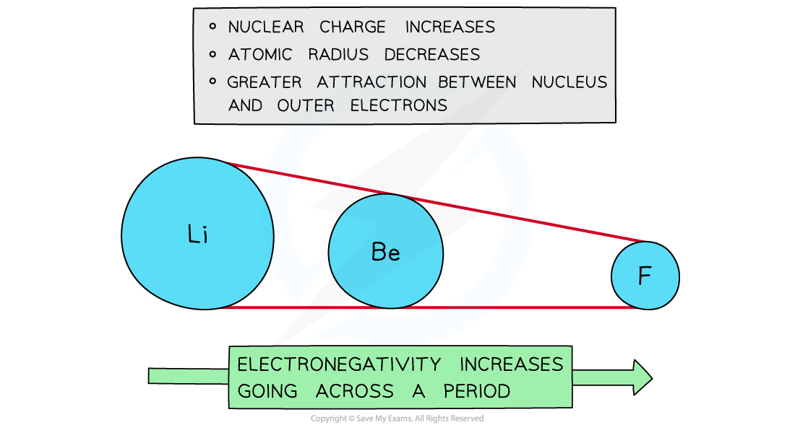

Electronegativity increases going across the periods of the periodic table

- Down a group, electronegativity decreases

The main responsible is the increase in the shielding effect

- Since the distance between the nucleus and the valence electrons increases, the
Coulombic forces attraction are considerably weaker

- In consequence, the effective nuclear charge decreases, the electrons from a
covalent bond are weakly attracted, and the electronegativity value decrease

## Change in electronegativity down a group

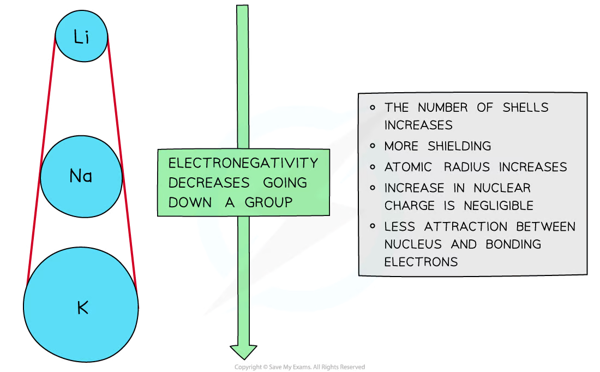

Electronegativity decreases going down the groups of the Periodic table

- The Pauling scale has the values of electronegativity for each atom

- Noble gasses does not appear in the Pauling scale since they do not form covalent
bonds because of their full valence shell

## The Pauling Scale

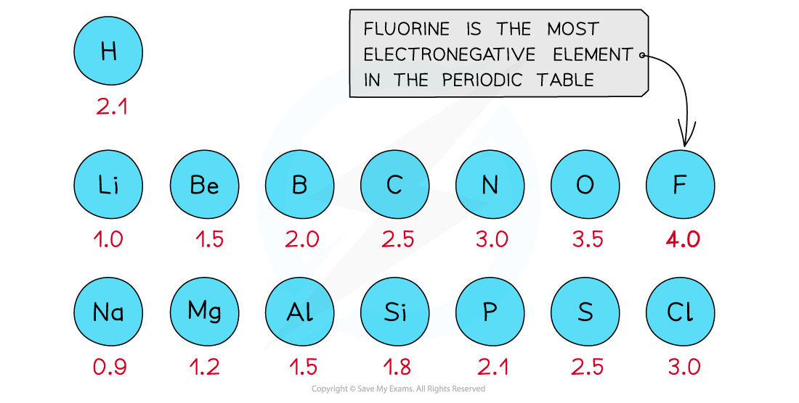

First three rows of the periodic table showing electronegativity values

- Fluorine (F) is the most electronegative atom in the periodic table

- It is the best when attracting electron density towards itself when it forms a covalent
bond with an atom

## Molecule of CH₃F

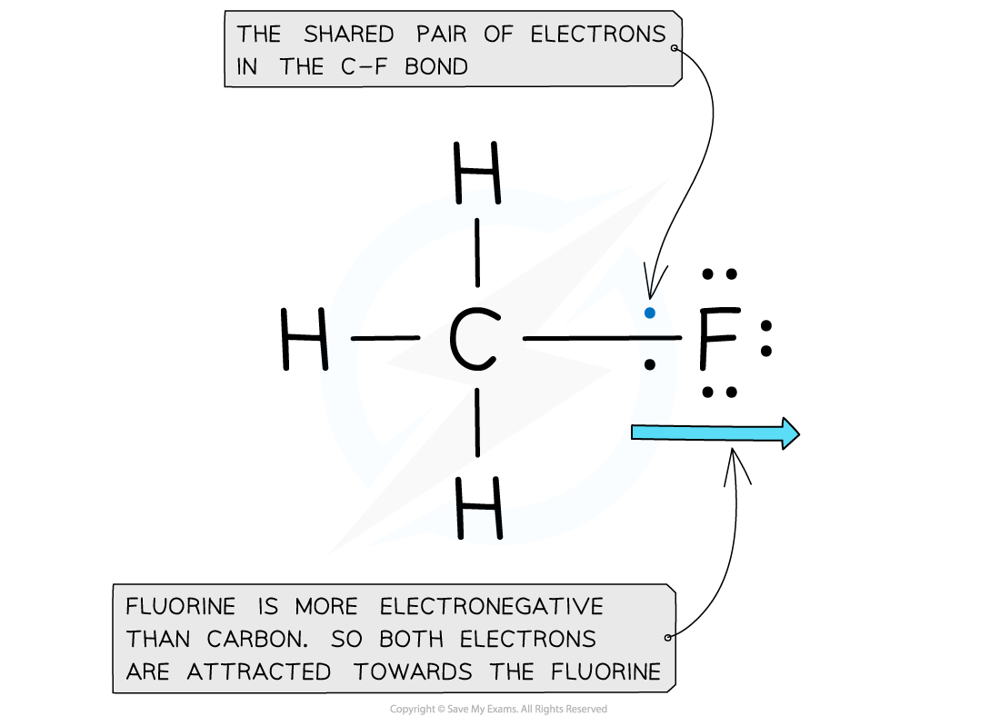

Electron distribution in the C-F bond of fluoromethane

## Non-polar Covalent bonds

- A covalent bond is formed when two nonmetals share a pair of electrons

- Atoms form covalent bonds to gain a full outer shell of electrons

- Compounds that are formed by elements joined by covalent bonds are molecules

- Covalent bonds come in different presentations:

- A single covalent bond occurs when one pair of electrons is shared, and each atom
contributes with one valence electron

- A double covalent bond occurs when two pairs of electrons are shared, and each
atom contributes with two valence electrons

- A triple covalent bond occurs when three pairs of electrons are shared, and each
atom contributes with three valence electrons

- The nature of the covalent bond depends in the difference of electronegativity
between the atoms that share the pairs of electrons

- Using the Pauling’s scale of electronegativity, if the difference is smaller than 0.4,
the covalent bond is nonpolar

- Nonpolar covalent bonds are formed when two elements with similar or equal
electronegativity share pairs of electrons

- E.g. Chlorine gas is a diatomic element. Therefore, it exists in nature as a molecule of
Cl2 instead of an individual atom Cl

- The two chlorine atoms form a single covalent bond sharing a pair of electrons as
shown in the image below

- Since both atoms are the same, their difference in electronegativity is 0

- Therefore, the nature of the covalent bond is nonpolar

## The Formation of a Chlorine Molecule, Cl₂

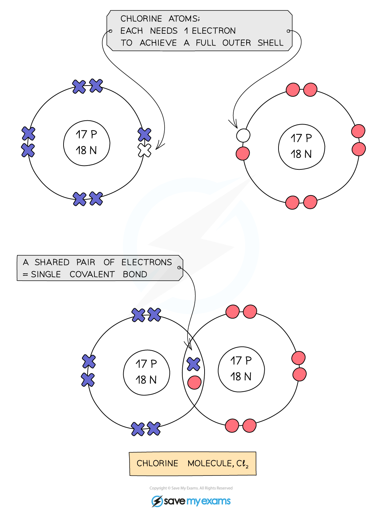

Diagram showing how a covalent bond forms between two chlorine atoms

## Examiner Tips and Tricks

The known diatomic elements are: H2, N2,F2, O2, I2, Cl2, Br2. You can remember them by using the mnemonic: Have No Fear Of Ice Cold Bear

## Polar covalent bonds

- A polar covalent bond is formed when the nonmetals that share pairs of electrons have a
greater electronegativity difference
Using the Pauling’s scale of electronegativity, if the difference is between than 0.4 - 2.0, the covalent bond is polar

- Electronegativity is ability of an atom to attract the pair electrons of a covalent bond

- One of the atoms will have greater Coulombic attraction to the electrons, pulling them
towards itself

When this occurs, a dipole moment ($\delta$) is formed because there was a separation of positive and negative charges

- A dipole moment is created when particles of equal magnitude but opposite sign
charges are separated

- E.g. This occurs in the molecule of hydrofluoric acid (HF) that is shown in the image
below

- The chlorine atom and the hydrogen atom form a single covalent bond sharing a pair
of electrons as shown in the image below

- Their difference in electronegativity is calculated as following

$$\Delta\ \mathrm{electronegativity}=\mathrm{Highest\ electronegativity}-\mathrm{Lowest\ electronegativity}$$

$$\Delta\ \mathrm{electronegativity}=4.0-2.1$$

$$\Delta\ \mathrm{electronegativity}=1.9$$

- Since the difference is between 0.4 and 2.0, the nature of the covalent bond is polar

Fluorine will acquire a negative dipole $\delta^-$

Hydrogen will acquire a negative dipole $\delta^+$

- If the difference in electronegativity is greater, the bond dipoles are greater too

- This occurs because one of the atoms is pulling the electrons with stronger
coulombic attrraction, therefore the distance between the charges is closer

## The H-F molecule

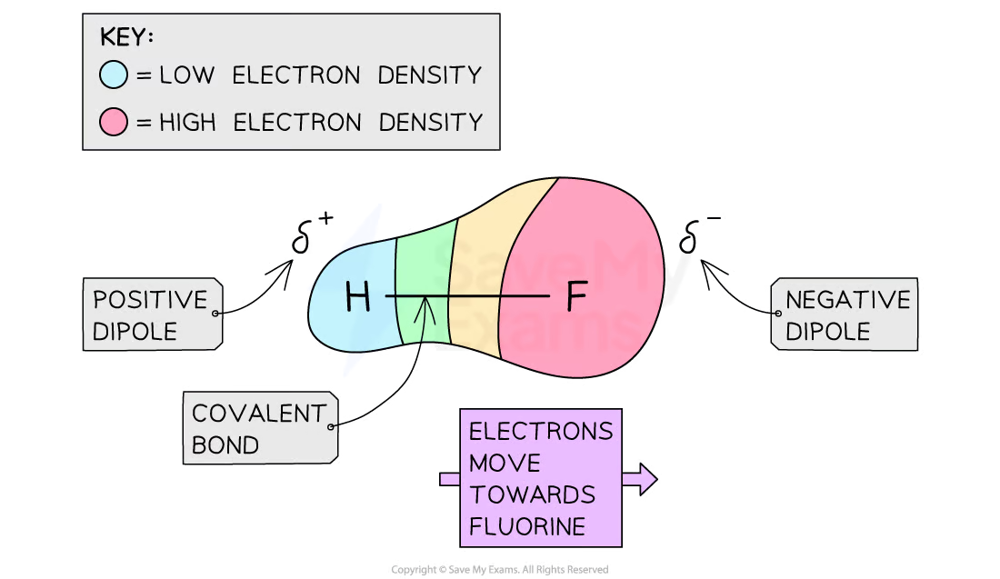

Polar covalent bond in hydrofluoric acid (HF)

## Ionic character

- Ionic bonds are formed when electrons are transferred from one atom to another

- In polar covalent bonds, there is a partial transfer of electrons towards the most
electronegative atom

- Therefore, polar covalent bonds have some ionic character

- The ionic character of a covalent bond increase if the difference of electronegativity
between the atoms is greater

## Ionic bonding

- An ionic bond is formed when a metal donates electrons to a non metal

- The metal becomes a positive ion (cation) because it has lost electrons

## Forming a Cation

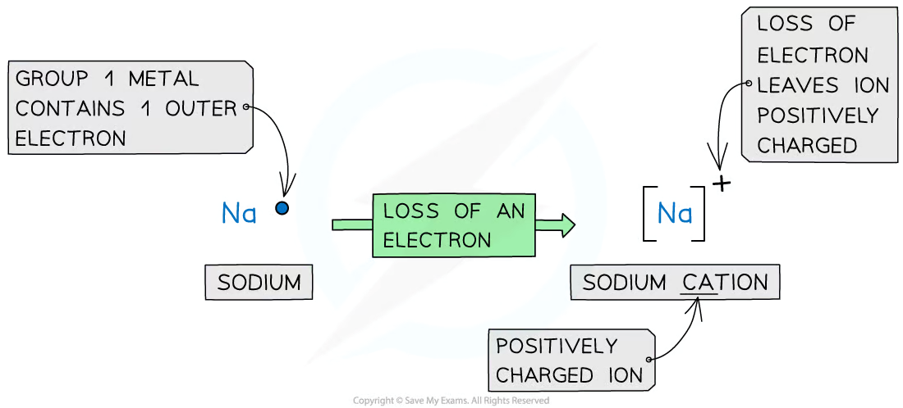

Forming cations by the removal of electrons from metals

- The non metal becomes a negative ion (anion) because it has gained electrons

## Forming an Anion

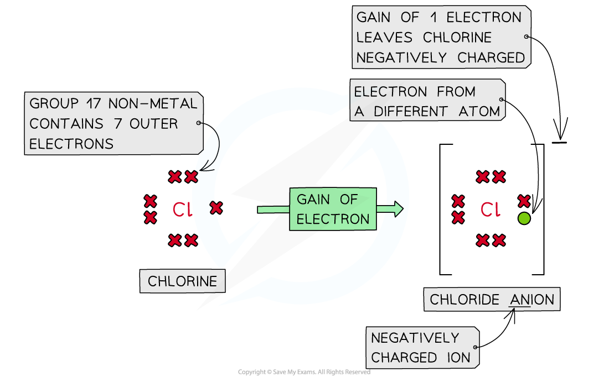

Forming anions by the addition of electrons to nonmetals

- The ionic bond is formed because metals and the non metals want to have a full outer
shell of electrons

- The difference in electronegativity, using the Pauling’s scale, between the atoms that
are part of an ionic bond is greater than 2.0

- A full outer shell implies more stability, that is why noble gasses do not form ions

- When the ionic bond is formed, their electron configurations are the same as their
closest noble gas. Sodium chloride will be used as the main example below

- Na has one valence electron. Na in sodium chloride (NaCl) loses one electron to
form Na+ Therefore, Na+ has the electron configuration 1s2 2s2 2p6, which is the same
as Ne

- Cl has seven valence electrons. Cl in sodium chloride (NaCl) gains one electron to
form Cl- Therefore, Cl- has the electron configuration 1s2 2s2 2p6 3s2 3p6, which is the
same as Ar

- When ions are formed, an strong Coulombic force of attraction is formed between
the oppositely charged ions

## Forming an Ionic Bond

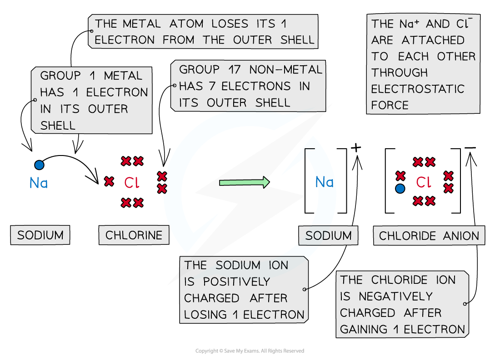

Cations and anions bond together using strong Coulombic forces of attraction, which require a lot of energy to overcome

## Covalent bonding

- A covalent bond is formed when two nonmetals share a pair of electrons

- Atoms form covalent bonds to gain a full outer shell of electrons

- There are two types of covalent bonds: polar and nonpolar
- This classification depends on the difference in electronegativities between the
atoms in the bond

## Ionic vs covalent compounds

- The best way to differentiate between ionic or covalent compounds is analyzing the
physical and chemical properties

## Table comparing the properties between ionic and covalent compounds

| | Ionic compounds | Covalent compounds |
| --- | --- | --- |
| Melting point/Boiling point | High | Low |
| Electrical conductivity | Only when molten or in solution | Do not conduct electricity |
| Solubility | Generally soluble in water | Usually insoluble unless they are polar covalent |
| Hardness | Hard, brittle | Soft |
| Physical state at room temperature | Solid | Solid, liquid or gasses depending on their intermolecular forces |
| Forces | Strong coulombic force of attraction between cations and anions | Weak forces between the molecules |
| Difference in electronegativity | Greater than 2.0 | Polar covalent: Between 0.4 and 2.0 Non polar covalent: Lower than 0.4 |
| Examples | NaCl | Polar covalent: HF Non polar covalent: H₂ |

## Examiner Tips and Tricks

Make sure to know how to differentiate the properties of ionic and covalent compounds since this section is usually assessed in Section 1 of your AP Chemistry Exam

## Valence electrons in a Metallic Solid

- The atoms in a metallic solid are arranged together in metallic lattices

- Since the atoms are tightly packed together, they lose valence electrons and become
positive ions

- Therefore, electrons are free to move throughout the structure

- The free-moving electron are called “delocalized” because they do not
correspond to particular atoms anymore

- The metallic solids are held together by the Coulombic forces of attraction between the
positively charged metal ions and a sea of delocalized electrons

- The interaction between ions and electrons is named metallic bonding

## The Structure of a Metal

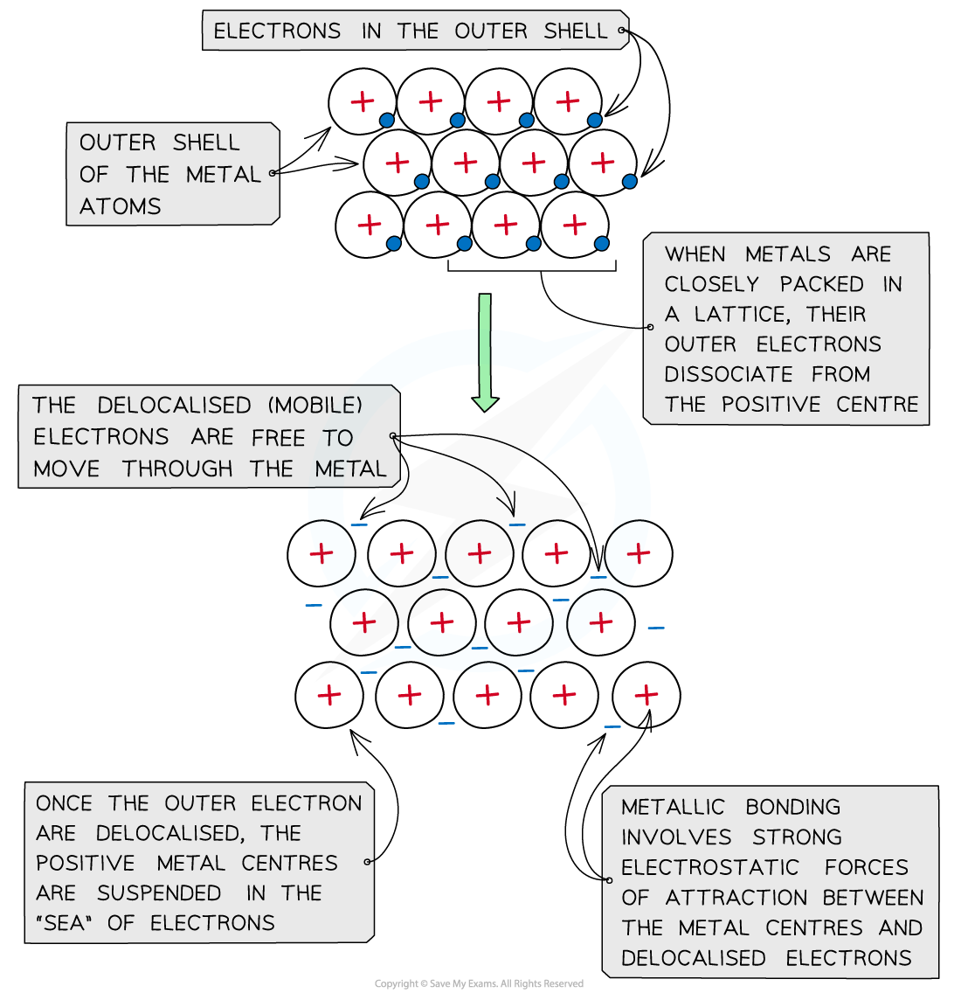

The positive metal centers interact with a Coulombic force of attraction with in a ‘sea’ of delocalised electrons

## Potential Energy & Interatomic Distance

- A potential energy diagram represents the potential energy as a function of internuclear
distance

- The distance at which the potential energy is at a minimum is the bond length of the
covalent bond

- The difference between the minimum potential energy and zero is the bond energy,
the amount of energy required to break the covalent bond

## Potential Energy Diagram

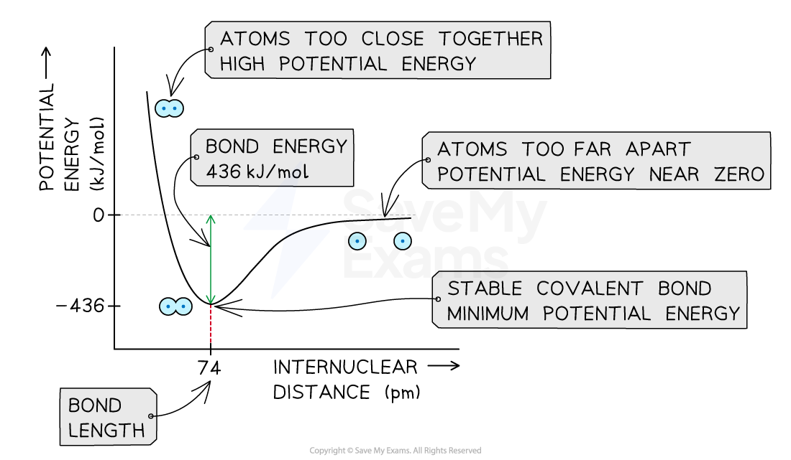

Potential energy diagram of hydrogen gas (H2) showing a minimum potential energy of -436 kJ/mol which corresponds to a bond length of 74 pm

- When two atoms are far away

- There is little attraction between the positively charged nucleus of one atom and the
negatively charged electrons of the other atom

- The potential energy is near zero

- When two atoms are very close

- The two positively charged nuclei and the two negatively charged electron clouds
strongly repel one another

- The potential energy is very high

- When two atoms form a stable covalent bond

- The attractive and repulsive forces between the two atoms are balanced

- The potential energy is at a minimum.

## Examiner Tips and Tricks

The minimum potential energy will always be a negative value. Bond energy is always a positive value as breaking chemical bonds is an endothermic process.

## Factors Influencing Bond Length

- As atomic radius increases, bond length increases

- Bond length is typically reported in units of picometers (pm)

- A picometer is 1 x 10-12m

## Bond length in halogens

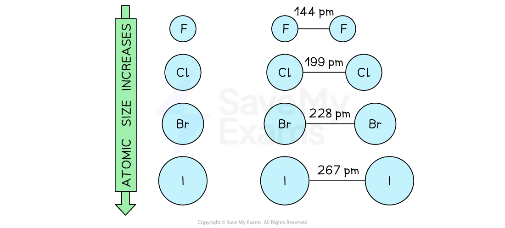

Diagram showing that the bond length of diatomic halogen molecules increases with increasing atomic radius

- Bond order indicates the number of electron pairs that are shared between two atoms

- As bond order increases, bond length decreases while bond energy increases

| Bond | Bond Order | Number of shared electron pairs | Bond length (pm) | Bond energy (kJ/mol) |
| --- | --- | --- | --- | --- |
| C-C | 1 | 1 | 154 | 347 |
| C=C | 2 | 2 | 133 | 620 |
| C≡C | 3 | 3 | 120 | 812 |

## Coulomb's Law & Attractive Forces

- Coulomb's law describes the electrostatic force between two charged particles

The formula for Coulomb's law is $F_{\mathrm{coulombic}}=k\frac{q_1q_2}{r^2}$, where:

- Fcoulombic is the force between the charges

- k is Coulomb's constant

- q1 and q2 are the value of the charges

- r is the distance between the charges

- For a cation and anion in an ionic bond, Fcoulombic

- increases with increasing charge of each ion

- decreases with increasing ionic radius

## Coulombic force between cations and anions

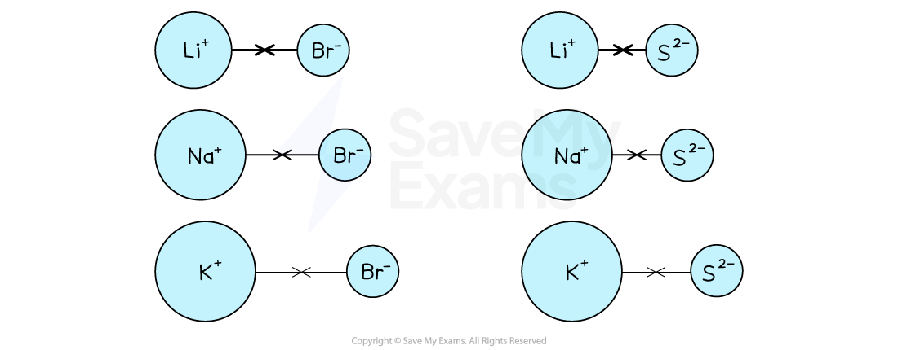

Diagram showing that the Coulombic force between a cation and anion decreases with increasing ionic radius and increases with increasing charge

- The greater the force between the charges

- the stronger the interaction between the ions

- the greater the bond energy (also known as lattice energy)

- the more negative the minimum potential energy of a stable ionic bond between
the two ions

## Worked Example

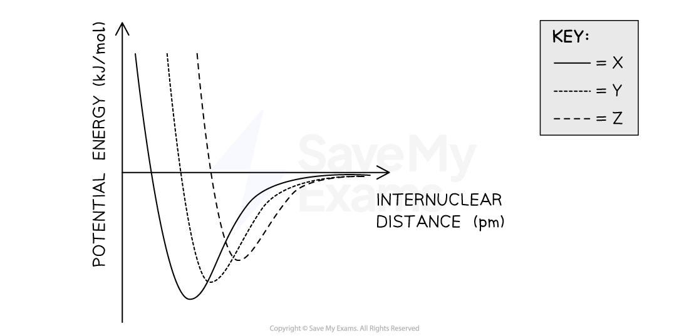

The graph shows the potential energy of three potassium salts, X, Y, and Z, as a function of internuclear distance. Based on the data, what are the most likely identities of compounds X, Y, and Z?

| | X | Y | Z |
| --- | --- | --- | --- |
| A. | KI | KBr | KCl |
| B. | KBr | KCl | KI |
| C. | KCl | KI | KBr |
| D. | KCl | KBr | KI |

Answer:

- Each potassium salt contains a K+ ion and a halide ion with a 1− charge

- So, we do not need to consider the effect that charge has on internuclear
distance or potential energy
- The ionic radius of the halide ions increases down the group, thus Cl- < Br- < I-
- As ionic radius increases

- the internuclear distance between the potassium and halide ions increases
Fcoulombic between the ions decreases
- the lattice energy decreases
- the potential energy minimum becomes less negative
- So, KCl with the smallest halide ion will have the smallest internuclear distance
and the most negative minimum potential energy
- KI with the largest halide ion will have the largest internuclear distance and the
least negative minimum potential energy
- Therefore, the answer is D
