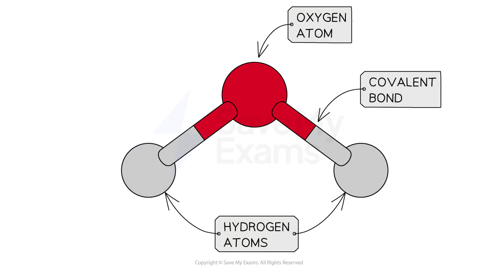
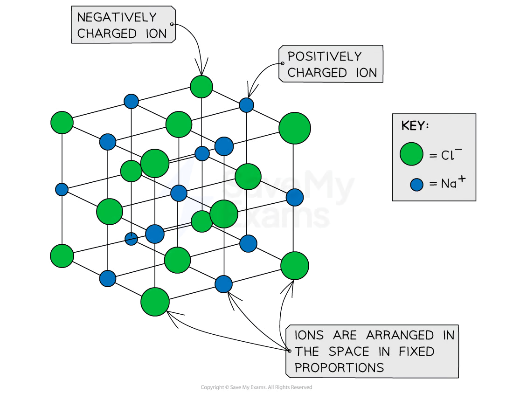
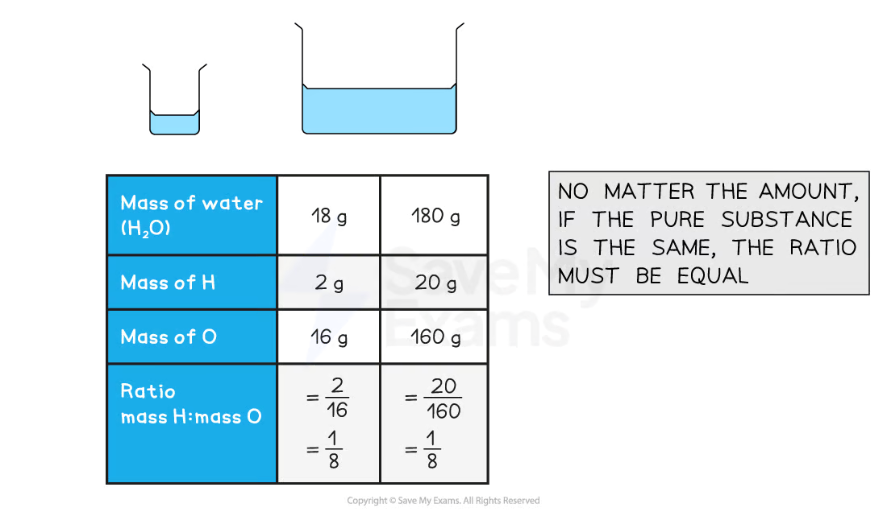
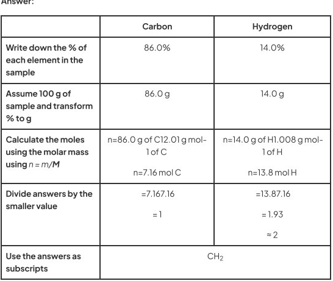
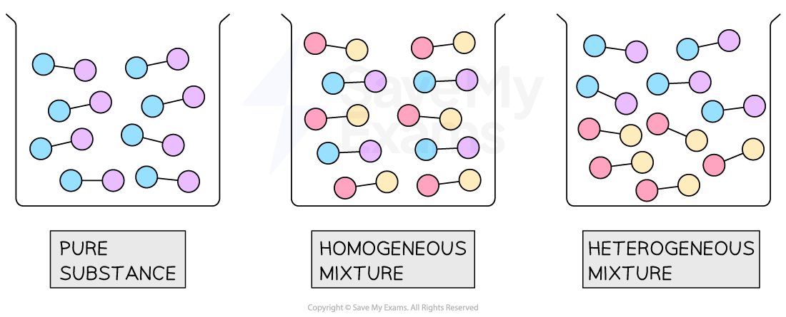

<!-- Source: page 1 -->

Your notes

# College Board AP® Chemistry

## Elements & Mixtures

## Contents

- Elemental Composition
- Composition of Mixtures
- Elemental Analysis

© 2025 Save My Exams, Ltd. Get more and ace your exams at savemyexams.com 1

<!-- Source: page 2 -->

Your notes

## Elemental Composition

## Formula Units

## Pure substances and chemical formula

- Atoms are the small building blocks of matter

- One of the broadest classifications of matter are pure substances

- Pure substances can be classified into elements or compounds

- Elements are composed of only one kind of atom

- Aluminum (Al) or oxygen (O2)

- Compounds have a unique combination of atoms and they can be split into molecular or
ionic

- This combination of atoms can be represented with a chemical formula, in which
atomic symbols identify the elements in the compound and subscripts are used to
show how many atoms are present

## Molecular compounds

- A molecular compound is composed of individual molecules.

- A molecule is formed when two or more atoms are bonded together with a covalent
bond

- Water is a molecular compound because its atoms are bonded with covalent bonds

- The chemical formula of water is H2O

## A molecule of water (H2O)

© 2025 Save My Exams, Ltd. Get more and ace your exams at savemyexams.com 2

<!-- Source: page 3 -->

Your notes

A molecule of water (H2O) showing 2 hydrogen atoms, 1 oxygen atom and the covalent bonds

## Ionic compounds

- An ionic compound consists of atoms or ions held together in a formula unit

- A formula unit is the arrangement of atoms or ions in fixed proportions by an ionic bond

- Salt (sodium chloride) is an ionic compound because its ions are held together in a
fixed arrangement by ionic bonds

- The chemical formula of sodium chloride is NaCl

## Formula unit of sodium chloride (NaCl)

A formula unit of sodium chloride (NaCl) showing the regular but alternating arrangement of sodium ions and chloride ions

## The Law of Definite Proportions

- Elements interact with other elements to form compounds

- The Law of Definite Proportions states that the ratio of the masses between the
elements in a compound is always the same

- Therefore, a pure compound has the same composition and properties regardless of
where it comes from

## Law of Definite Proportions

© 2025 Save My Exams, Ltd. Get more and ace your exams at savemyexams.com 3

<!-- Source: page 4 -->

Your notes

Understanding the Law of Definite Proportions with two samples of H2O with different masses

## Examiner Tips and Tricks

Most of the exam questions regarding the Law of Definite Proportions involve calculating the ratio between the masses of the elements in different compounds. This information can be used to identify if two unknown compounds are the same or not

## Empirical Formula

## Molecular and empirical formulae

- The chemical formula of a molecular compound is also known as molecular formula

- The molecular formula shows the actual number of atoms in a molecule

- Eg: the molecular formula of butene is C4H8

- The empirical formula is the simplest formula and shows the simplest ratio of the atoms
in a compound

- Eg: the empirical formula of butene is CH2

- The chemical formula of an ionic compound is both empirical and molecular formula at
the same time

© 2025 Save My Exams, Ltd. Get more and ace your exams at savemyexams.com 4

<!-- Source: page 5 -->

Your notes

## Examiner Tips and Tricks

The calculation of empirical and molecular formulae are assessed continuously. Expect at least one question related to this topic either in Section I or Section II of your exam

## Calculating the empirical formula

- The empirical formula shows the smallest ratio between the atoms in molecule or a
formula unit

- It can be calculated from the masses of each element in a sample of compound

- If percentages are given instead of masses, assume 100 g of sample and then transform
all your % to g

## Worked Example

Calculate the empirical formula of a compound which contains 8.0 g of calcium and 14.2 g of chlorine

Answer:

| | Calcium | Chlorine |
| --- | --- | --- |
| Write down the mass of each element in the sample | 8.0 | 14.2 |
| Calculate the moles using the molar mass using $n=m/M$ | $n=\frac{8.0\ \mathrm{g\ of\ Ca}}{40.08\ \mathrm{g\,mol^{-1}\ of\ Ca}}$ $n=0.20\ \mathrm{mol\ of\ Ca}$ | $n=\frac{14.2\ \mathrm{g\ of\ Cl}}{35.45\ \mathrm{g\,mol^{-1}\ of\ Cl}}$ $n=0.40\ \mathrm{mol\ of\ Cl}$ |
| Divide answers by the smaller value | $=\frac{0.2}{0.2}$ $=1$ | $=\frac{0.4}{0.2}$ $=2$ |
| Use the answers as subscripts | CaCl₂ | |

## Worked Example

Calculate the empirical formula of a compound which contains 86.0% of carbon and 14.0% g of hydrogen

© 2025 Save My Exams, Ltd. Get more and ace your exams at savemyexams.com 5

<!-- Source: page 6 -->

Your notes

Answer:

| | Carbon | Hydrogen |
| --- | --- | --- |
| Write down the % of each element in the sample | 86.0% | 14.0% |
| Assume 100 g of sample and transform % to g | 86.0 g | 14.0 g |
| Calculate the moles using the molar mass using $n=m/M$ | n=86.0 g of C12.01 g mol-1 of C n=7.16 mol C | n=14.0 g of H1.008 g mol-1 of H n=13.8 mol H |
| Divide answers by the smaller value | =7.167.16 = 1 | =13.87.16 = 1.93 ≈ 2 |
| Use the answers as subscripts | CH₂ | |

<!-- Transcription note: The original table prints the calculation and division expressions run together, with no fraction bars. Their printed strings are retained above; the original local crop below permits comparison. -->

## Calculating the molecular formula

- The molecular formula is a “factor” of the empirical formula

- It can be calculated by dividing the molar mass of the molecular formula and the molar
mass of the empirical formula

- This calculation will result in a whole number greater or equal than 1

$$\mathrm{whole\ number}=\frac{\mathrm{molar\ mass\ of\ the\ molecular\ formula}}{\mathrm{molar\ mass\ of\ the\ empirical\ formula}}$$

- Finally, all the subscripts from the empirical formula need to be multiplied times the
whole number, obtaining the molecular formula

## Worked Example

The empirical formula of an unknown compound is CH2O, and the molar mass of the compound is 180 g mol-1. Determine the molecular formula of the unknown compound

Answer:

- Step 1. Calculate the molar mass (M) of the empirical formula

- Mof empirical formula = (C x 1) + (H x 2) + (O x 1)
- Mof empirical formula = (12.01 x 1) + (1.008 x 2) + (16.00 x 1)

© 2025 Save My Exams, Ltd. Get more and ace your exams at savemyexams.com 6

<!-- Source: page 7 -->

Your notes

- M of empirical formula = 30.026 g mol-1
- Step 2. Calculate the whole number by dividing Mof the molecular formula by M
of the empirical formula. If the whole number has decimal places, round it to the
nearest integer

$$\mathrm{whole\ number}=\frac{180\ \mathrm{g\,mol^{-1}}}{30.026\ \mathrm{g\,mol^{-1}}}$$

$$\mathrm{whole\ number}=5.99$$

$$\mathrm{whole\ number}\approx6$$

- Step 3. Multiply the subscripts of the empirical formula times 6

- Molecular formula = 6 x CH2O
- Molecular formula = C6H12O6
- The molecular formula of the unknown compound is C6H12O6

© 2025 Save My Exams, Ltd. Get more and ace your exams at savemyexams.com 7

<!-- Source: page 8 -->

Your notes

## Composition of Mixtures

## Composition of Mixtures

## Classification of matter

- Matter is classified in pure substances and mixtures

- A pure substance is matter that has a fixed composition. They contain atoms, molecules
or formula units of a single type

- Aluminum (Al), water (H2O) or hydrogen gas (H2), sodium chloride (NaCl) or calcium
carbonate (CaCO3) are pure substances

- A mixture is matter whose composition is not fixed. Therefore, it contains two or more
types of atoms, molecules or formula units

- The molecules or formula units that are part of a mixture are called components

- g. The air we breathe is a mixture in which the components are oxygen, nitrogen and
small amounts of other gases

- g. Water and oil is a mixture between two liquids

## Types of Mixtures

- Homogeneous mixtures have the same composition throughout

- The composition is uniform because the components are mixed uniformly in the
space

- g. Air is an homogenous mixture

- Heterogeneous mixtures varies from one region of the mixture to another

- The composition is made from distinct regions because the components separate

- g. Water and oil is an heterogeneous mixture

## Molecules in a pure substance and mixtures

© 2025 Save My Exams, Ltd. Get more and ace your exams at savemyexams.com 8

<!-- Source: page 9 -->

Your notes

A pure substance, an homogeneous mixture and a heterogeneous mixture at the molecular level

© 2025 Save My Exams, Ltd. Get more and ace your exams at savemyexams.com 9

<!-- Source: page 10 -->

Your notes

## Elemental Analysis

## Elemental Analysis

## Analyzing the composition

- Elemental analysis is a technique that can be used to determine the relative
composition of elements in a substance and evaluate its purity

## Worked Example

A 4.1 g sample of a mixture of calcium chloride (CaCl2) and magnesium fluoride (MgF2) are found to contain 0.30 g of Ca. What is the percent of CaCl2 in the sample?

Answer:

- Step 1: Determine the moles of Ca in the sample

- n = m / M
- n = 0.30 g / 40.08 g mol-1
- n = 0.00749 mol of Ca
- Step 2: Determine the moles of CaCl2 using the moles of Ca

- The subscripts show that there is one atom of Ca in one formula unit of CaCl2.
Therefore,

$$0.00749\ \mathrm{mol\ of\ Ca}\times\frac{1\ \mathrm{mol\ of\ CaCl_2}}{1\ \mathrm{mol\ of\ Ca}}=0.00749\ \mathrm{mol\ of\ Ca}$$

- Step 3: Determine the mass of CaCl2 in the sample by rearranging

- n = m / M
- m = n x M
- m = 0.749 mol x 110.98 g mol-1
- m = 0.83 g of CaCl2
- Step 4: Calculate the percent of CaCl2 in the sample

- percent of CaCl2 = (mass of CaCl2 / total mass of sample) × 100
- percent of CaCl2 = (0.83 g of CaCl2 / 4.1 g of sample) × 100
- percent of CaCl2 = 20%

## Analyzing the purity

- Purity is the extent to which a substance contains only a desired chemical compound
without any foreign substances

- Purity is often shown as a percentage

- It can be calculated either using the mass (m) of the desired compound or its %
composition

© 2025 Save My Exams, Ltd. Get more and ace your exams at savemyexams.com 10

<!-- Source: page 11 -->

Your notes

$$\mathrm{Purity}=\frac{m\ \mathrm{of\ desired\ compound}}{\mathrm{total\ mass\ of\ sample}}\times100$$

$$\mathrm{Purity}=\frac{\%\ \mathrm{composition\ of\ desired\ compound}}{100\%\ \mathrm{of\ total\ sample}}\times100$$

## Worked Example

5.00 g of a sodium chloride sample were analyzed and it was found that it was contaminated with sulfur. The sample is determined to contain 1.35 g of sodium, 2.00 chlorine, and the rest is sulfur. What is the purity of the sample?

Answer:

- Step 1: Identify the desired compound

- The sample was intended to be sodium chloride so, NaCl is our desired
compound
- Step 2: Calculate the mass of the desired compound

- The statement lists the masses of sodium and chlorine. Since these are the
atoms that are part of NaCl, we add both masses
- m of desired compound = m of Na + m of Cl
- m of desired compound = 1.35 g + 2.00 g
- m of desired compound = 3.35 g
- Step 3: Determine the purity using formula that depends on m of desired
composition and the total mass of sample

$$\mathrm{Purity}=\frac{m\ \mathrm{of\ desired\ compound}}{\mathrm{total\ mass\ of\ sample}}\times100$$

$$\mathrm{Purity}=\frac{3.35\ \mathrm{g\ of\ NaCl}}{5.00\ \mathrm{g}}\times100$$

$$\mathrm{Purity}=67.0\%$$

© 2025 Save My Exams, Ltd. Get more and ace your exams at savemyexams.com 11
