## Contents

- The Ideal Gas Law
- Partial Pressure & Total Pressure
- Graphical Representations of the Gas Laws
- Kinetic Molecular Theory
- The Maxwell Boltzmann Distribution
- Non-Ideal Behavior of Gases

## The Ideal Gas Law

- The physical properties of a gas are defined by four important variables:

- Temperature, T

- Pressure, P

- Volume, V

- Amount of gas, which is expressed as number of moles, n

- An ideal gas is a hypothetical gas whose pressure, volume and temperature
relationships are described completely by the ideal-gas equation which is given as:

PV = nRT

- P is pressure with a value of 1 atm (SI unit)

- Other values and units include 760 mm Hg and 760 torr

- V is the volume with the SI unit of m3

n is the number of moles

R is the molar gas constant with a value of 8.314 J mol-1 K-1 (SI unit)

- Other values and units include 0.08206 L atm mol-1 K-1 and 62.36 L torr mol-1 K-1

- T is temperature which is expressed in Kelvin

- The characteristics of an ideal gas are defined by two important assumptions:

- The volume of an ideal gas is negligible compared to the volume of its container

- This is why the volume of an ideal gas is taken as the same as the volume of its
container

- The particles have zero intermolecular force of attraction

## Worked Example

Tennis balls are often filled with nitrogen gas, N2 (g), as this helps to keep the ball inflated for longer. To increase their bounce they can be filled with nitrogen to pressures above atmospheric pressure. If a tennis ball has a volume of 149 mL and contains 0.35 g of N2 gas, what is the pressure inside the ball at 24 ℃?

Analyze: We are asked to calculate the pressure of nitrogen gas given the volume (149mL), temperature (24 ℃) and mass (0.35 g) of nitrogen gas.

Plan: Using the ideal gas equation, we can determine the pressure. However, we must convert the given mass of nitrogen gas to moles and ensure the appropriate units of

temperature and volume before substituting these values into the ideal gas equation.

Answer:
- Step 1: Convert the mass of nitrogen to moles
n = mass/molar mass

n = 0.35/28 = 0.0125 moles

- Step 2: Convert temperature and volume into the correct units
T = 24 + 273 = 297 K

V = 149/1000 = 0.149L

R = 0.08206 L-atm mol-1K-1

- Step 3: Rearrange the ideal gas equation to find the pressure
P = nRT/V

- Step 4: Substitute values into the rearranged equation and determine the
pressure
P = 0.0125 × 0.08206 × 294 / 0.149 = 2.0 atm (2 sig figs)

## Examiner Tips and Tricks

Be careful about units…and significant figures

- Always ensure that the unit and value of R used correspond with the units of
pressure and volume
- Usually, your examiner typically reports pressure in atm or mmHg and volume in
mL or L
- The conversion factors for pressure are as follows:

- 1 atm = 760 mmHg or 760 torrs
- Also, ensure your final answer is in the correct number of significant figures. Best
practice involves doing all calculations until the final step before applying the
correct number of significant figures

## What is Pressure?

- Pressure is a measure of the collision of gas particles with the walls of its container

## Demonstrating Gas Pressure

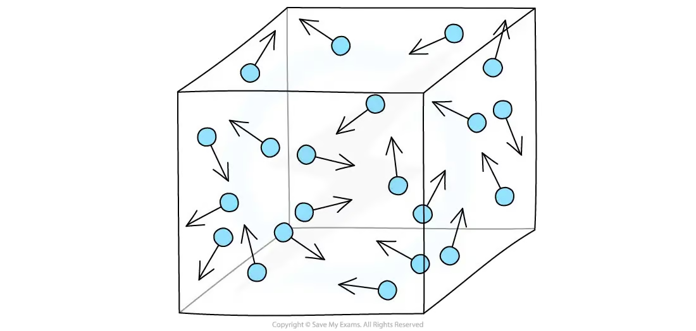

Gas particles exert pressure by constant collision with the walls of their container

- It is mathematically defined as force per unit area and measured in newtons per meter
square(Nm-2)

- The SI unit of atmospheric pressure is the Pascal (Pa):

- 1 Pa = 1 Nm-2

- Standard atmospheric pressure, often called atmospheric pressure, is the pressure
sufficient to support a column of mercury 760 mm high

- In SI units, this pressure is given as 1.01325 × 105 Pa

- It is also used to define some non-SI units of pressure such as atmosphere (atm) or
torr

- 1 atm = 760 mmHg = 760 torr = 1.01325 × 105 Pa = 101.325 kPa

## Dalton’s Law of Partial Pressure

- John Dalton while studying the properties of air observed that “the total pressure of a
mixture of gases equals the sum of the pressures that each would exert if it were present
alone”

- For example, the total pressure (PT) exerted by a mixture of gases A, B and C is given
by the relationship:

PT = PA + PB + PC where PA, PB, and PC are the partial pressures of the gases A, B
and C
- This observation is known as Dalton’s Law of Partial Pressure

- The partial pressure of a gas is the pressure exerted by the gas in a mixture of gases
- Since each gas in a mixture behaves independently, we can relate the amount of a given
gas in a mixture to its partial pressure

PA = XA × PT; where XA known as the mole fraction of gas A is a dimensionless number which expresses the ratio of the number of moles of gas A to the total number of moles of the gases in the mixture

- XA = nA/(nA + nB + nC)

- Partial pressure may also be determined using the volume fraction— the ratio of the
volume of gas A to the total volume of the gases in the mixture

## Worked Example

A 10.00 L vessel, at 25 ℃, contains the following mixture of the noble gases

- 0.765 mol helium.
- 0.330 mol neon.
- 0.110 mol argon.
1. Calculate the partial pressure of each of the gases in the mixture.
2. Calculate the total pressure of the mixture in atm.

Answer:

- Step 1: Determine the total number of moles of the gas mixture
- nT = nHe + nNe + nAr
- nT = 0.765 + 0.330 + 0.110 = 1.205 moles
- Step 2: Using the ideal gas equation, find the total pressure of the gas mixture
- PT = nTRT/V

- Remember: T must be in Kelvin, 25 + 273 = 298 K
- R = 0.08206 L.atm mol-1 K-1 since we are asked to determine the pressure in
atm
- PT = 1.205 × 0.08206 × 298/10.00
- PT = 2.95 atm
- Step 3: Determine the partial pressure for each gas using its mole fraction and
total pressure
- Helium

- PHe = nHe/nT × PT
- PHe = 0.765/1.205 × 2.95
- PHe = 1.87 atm
- Neon

- PNe = nNe/nT × PT
- PNe = 0.330/1.205× 2.95
- PNe = 0.807 atm
- Argon

- PAr = nAr/nT × PT
- PAr = 0.110/1.205× 2.95
- PAr = 0.269 atm

## Examiner Tips and Tricks

- Exam questions will often lay questions out in this order, where:

- Part a asks for the partial pressures
- Part b asks for the total pressure
- You can answer the questions in any order, as shown.
- For the worked example above, you have to calculate the total pressure first to be
able to calculate the partial pressures

## Worked Example

Consider the apparatus shown in the following drawing below

1. When the valve between the two containers is opened and the gases are allowed
to mix, how does the volume occupied by the H2 gas change? What is the partial
pressure of H2 after mixing?
2. How does the volume of the Ne gas change when the gases mix? What is the
partial pressure of Ne in the mixture?
3. What is the total pressure in the container after the gases mix?

Answer:

Answer 1: The volume of H2 increases from 1 L to 5 L on opening the valve because the particles of the gas spread out. To calculate the partial pressure of hydrogen:

- PH2 = (Volume of H2/Total volume) × Pressure of hydrogen gas
- PH2 = ⅕ × 0.5
- PH2 = 0.1 atm
Answer 2: The volume of Ne increases from 4 L to 5 L on opening the valve and mixing
of the gases.
To calculate the partial pressure of neon:

- PNe = (Volume of Ne/Total volume) × Pressure of hydrogen gas
- PNe = ⅘ × 3
- PNe = 2.4 atm
Answer 3: To calculate the total pressure:

- PT = PNe + PH2
- PT = 0.1 + 2.4
- PT = 2.5 atm

## Application of Dalton’s Law in Collection of Gas over Water

- A useful application of Dalton’s law of partial pressures arises when gases are collected
over water

- For example, when potassium chlorate, KClO3 is heated, the oxygen gas produced
can be collected over water because it does not react with water and is not
appreciably soluble in it

- However, the oxygen gas collected in this way is not pure because water vapor is
also present

- The total gas pressure is equal to the sum of the pressures exerted by the dry oxygen
gas and the water vapor:

- PT = Pdry O2 + PH2O

- This means we must account for the pressure of water when determining the
amount of oxygen gas produced

- The vapor pressure of water is usually constant at a given temperature

## Worked Example

The volume of hydrogen gas collected over water at 30°C and pressure of 988 mmHg when calcium reacts with hydrochloric acid is 641 mL.

What is the mass of hydrogen collected if the vapor pressure of water at 30°C is 31.82 mmHg?

Answer:

- Step 1: Determine the pressure of the dry hydrogen gas using Dalton’s Law:
- PT = Pdry H2 + PH2O
- Pdry H2 = PT - PH2O
- Pdry H2 = 988 - 31.82
- Pdry H2 = 956.18 mmHg
- Step 2: Using the ideal gas equation, determine the number of moles of
hydrogen gas produced:
- n = PV/RT

- P = 956.18 mmHg

- V = 641 mL/1000 = 0.641 L
- R = 62.36 L.mmHg mol-1 K-1 (R value used because of the units of P and V)
- T = 30 + 273 = 303 K
- n = 956.18 × 0.641/ 62.36 × 303
- n = 0.0324 mole
- Step 3: Use number of moles to determine the mass of hydrogen:
- n = mass/molar mass
- Mass = n × molar mass
- Mass = 0.0324 × 2.0 = 0.065 g

## Graphical Representations of the Gas Laws

- The relationship between any two of the variables which describe the properties of an
ideal gas can be established by keeping the other variables constant

- These variables are:

- Pressure

- Volume

- Temperature

- Amount of gas (moles)

- These relationships expressed mathematically and graphically are known as Gas
Laws

## Pressure-Volume Relationship: Boyle’s Law

- This relationship was first investigated by the British chemist, Robert Boyle, using a J-
tube, showing that the volume of gas decreased as the pressure increased

- This observation is summarized by the statement by Boyle’s Law which states that: the
volume of a fixed amount of gas at constant temperature is inversely proportional to
the pressure:

V ∝ 1/P ; PV = constant

- Simplifying the mathematical equation gives Boyle’s equation:

P1V1 = P2V2

## Pressure-Volume Relationship

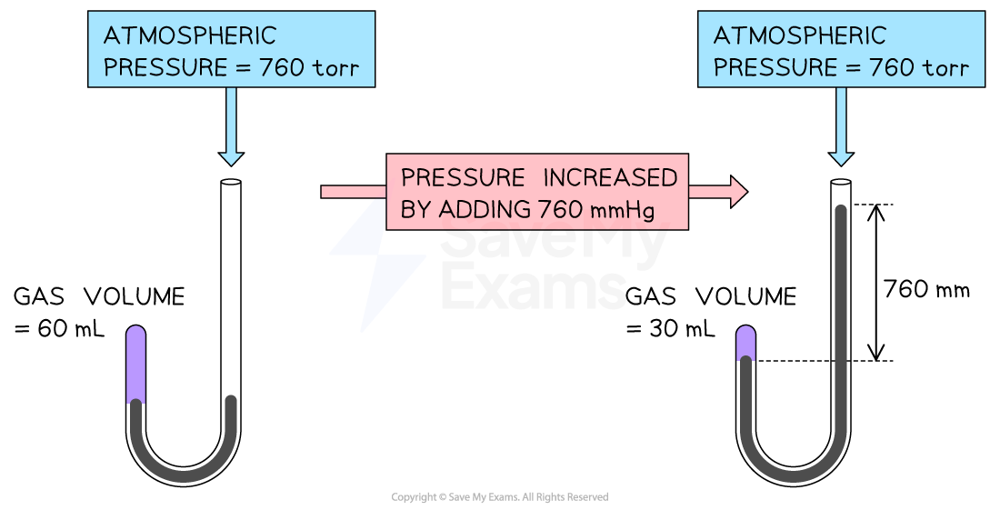

Boyle’s experiment uses a J-tube to demonstrate the volume-pressure relationship of a
gas. Gas volume decreases on increasing the pressure in the tube
- This relationship can also be visualized using two graphs:

- A plot of V against P gives a curve for a given quantity of gas at a fixed temperature

A straight line is obtained when V is plotted against 1/P or P against 1/V

## Graphical Representation of Pressure-Volume Relationship

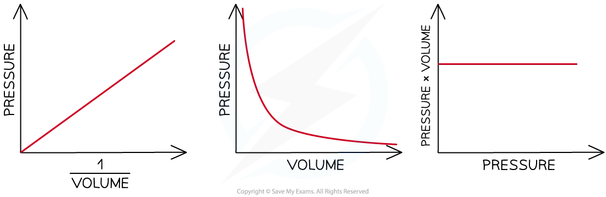

Graphical representations of Boyle’s Law

## Temperature-Volume Relationship: Charles’s Law

- The earliest investigator of the effect of temperature on volume was French scientist,
Jacques Charles

- He observed that at constant pressure, the volume of a gas sample expands when
heated and contracts when cooled

- At any given pressure, the plot of volume versus temperature yields a straight line

- By extrapolating the line to zero volume, we find the intercept on the temperature
axis to be -273.15 ℃

## Temperature-Volume Relationship on Celsius Scale

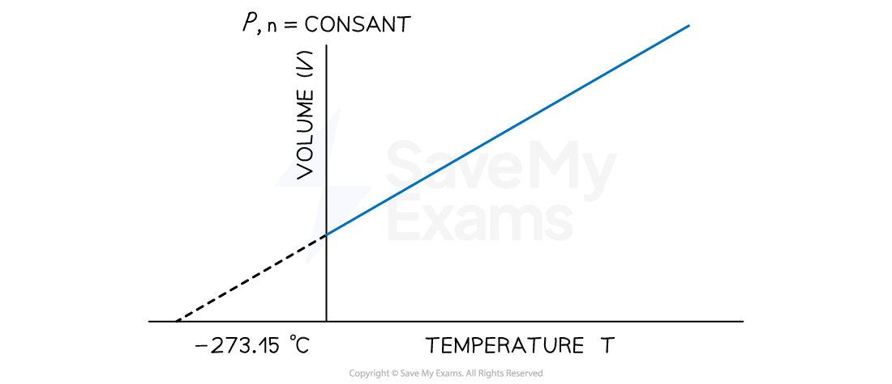

A graph showing the linear relationship between temperature (in degrees Celsius) and volume. The line intercepts the temperature axis at a value of 273.15 ℃ This implies that at a temperature of 273.15 ℃, the volume of a substance, if it remains gaseous will be zero

- However, this could not happen, given that gases liquefy before this temperature,
and the relationship does not apply to liquids

## Kelvin Temperature Scale

- In 1848, British physicist William Thomson, whose title was Lord Kelvin, realized the
significance of the volume-temperature relationship using the Celsius temperature
scale

- He identified the lowest possible temperature as absolute zero

- He then set up an absolute temperature scale, now called the Kelvin temperature
scale (K) with absolute zero as the starting point

On the absolute temperature scale, 0 K is equivalent to -273.15 ℃

- In terms of the Kelvin scale, the temperature-volume relationship known as Charles’s
Law can be stated as: the volume of a fixed amount of gas maintained at constant
pressure is directly proportional to its absolute temperature:

V∝ T or V/T = constant

- Simplifying the relationship gives:

V1/T1 = V2/T2

- A plot of volume against temperature in Kelvin also gives a straight line which intercepts
the volume and temperature axis at zero

## Temperature-Volume Relationship on the Kelvin Scale

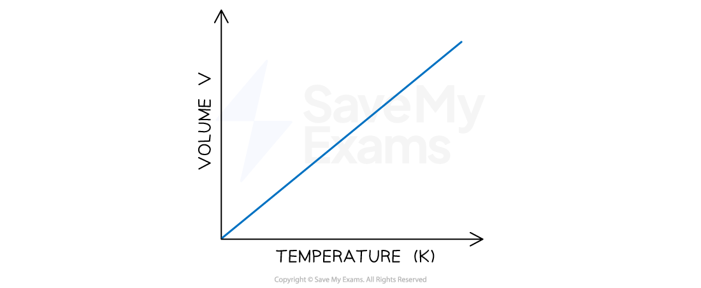

A graph showing the linear relationship between absolute temperature and volume. The line intercepts the temperature axis at a value of 0 K

## Quantity-Volume Relationship: Avogadro’s Law

- The relationship between the amount in moles of a gas and its volume follows from the
work of Joseph Louis Gay-Lussac and Amedeo Avogadro
- Gay-Lussac observed that at a given pressure and temperature, the volumes of
gases that react with one another are in the ratios of small whole numbers

- For example, two volumes of hydrogen gas react with one volume of oxygen gas to
form two volumes of water vapor:

2H2 (g) + O2 (g) → 2H2O(g)

- A few years later, Amedeo Avogadro interpreted Gay-Lussac’s observation by
proposing an important hypothesis which set the foundation for demonstrating the
mole-volume relationship and Avogadro’s Law

- The hypothesis states that: Equal volumes of gases at the same temperature and
pressure contain equal numbers of molecules

- For example, at 0 ℃ and 1 atm, 22.4 L of a gas contains 6.022 × 1023 gas molecule
which is equivalent to one mole

- Avogadro’s law follows from this hypothesis: the volume of a gas maintained at
constant temperature and pressure is directly proportional to the number of
moles of the gas:

V∝ n ; V/n = constant

- Simplifying the relationship gives:

V1/n1 = V2/n2

## Quantity-Volume Relationship

Graphical representation of Avogadro’s Law

## Worked Example

A chemical reaction produced 4.38 mL of hydrogen gas at 19 ℃ and 200 kPa pressure. What volume of the gas would be produced at 25 ℃ at the same pressure?

Answer:

Analyze: From the question, the following parameters were provided

V1 = 4.38 mL

T1 = 19 ℃

T2 = 25 ℃

P = 200 kPa

We are then asked to calculate the final volume while pressure is kept constant

Plan: Since the pressure remains constant, the problem requires the use of the volume-temperature relationship expressed by Charles’s equation

Solution:

Step 1: Convert temperature values in ℃ to K:

T1= 19 + 273 = 292 K

T2 = 25 + 273 = 298 K

Step 2: Rearrange Charles’s equation in terms of the final volume V2 and solve for V2:

V2 = V1 × T2 / T1

V2 = 4.38 × 298 / 292

V2 = 4.47 mL

## Worked Example

In a reaction involving the decomposition of limestone, CaCO3, 20.0L of CO2 at 23 ℃ and 1.00 atm were collected.

What would be the volume of CO2 collected if the pressure were halved at the same temperature?

Answer:

Analyze: We have the following parameters from the question:

P1 = 1.00 atm

V1 = 20.0 L

P2 = ½ P1 = 0.500 atm

T = 23 ℃

We are then asked to calculate the final volume while the temperature is kept constant

Plan: Since temperature is kept constant, the volume-pressure relationship using Boyle’s equation would be required to determine the new volume

Solution: Rearrange the Boyle’s equation in terms of V2 and solve for V2:

V2 = P1 × V1 / P2

V2 = 1.00 × 20.0/ 0.5

V2 = 40.0 L

## Worked Example

Sodium reacts with water at 25.0 ℃ to produce hydrogen gas. The equation of the reaction is given as follows:

$$2\mathrm{Na}\ (s)+2\mathrm{H_2O}\ (l)\rightarrow2\mathrm{NaOH}\ (aq)+\mathrm{H_2}\ (g)$$

246 mL of hydrogen gas is collected over water at 25.0 ℃ and 1.00 atm.

Calculate the mass of sodium used in the reaction. Vapor pressure of water at 25.0 °C is 0.0313 atm

Answer:

Analyze: This problem requires the application of stoichiometry, Dalton’s Law of partial pressure and the ideal gas equation.

Plan:

1. Determine the pressure of the dry hydrogen gas produced, using Dalton's partial
pressure equation
2. Use the ideal gas equation to determine the number of moles of hydrogen
obtained
3. Use the stoichiometric ratio from the balanced chemical equation to determine
the number of moles of sodium which must have reacted
4. Convert the number of moles of sodium to the mass of sodium
Solution

Step 1: Determine the pressure of the dry hydrogen gas produced:

- PH2= Ptotat - PH2O
- PH2= 1.00 - 0.0313
- PH2= 0.9687 atm

Step 2: Determine the number of moles of hydrogen gas using the ideal gas equation:

- PV = nH2RT

- PH2= 0.9687 atm

- VH2 = 246 mL/ 1000 = 0.246 L

- Remember: Volume must be in L
- R = 0.08206 L.atm mol-1 K-1
- T = 25 + 273 = 298 K

- Remember: Temperature must be in K
- nH2 = ?
- nH2 = PV/RT
- nH2 = 0.9687 × 0.246 / 0.08206 × 298
- nH2= 0.00974 mole

Step 3: Determine the number of moles of sodium required given a 2:1 ratio from the balanced chemical equation

- nNa = 2 × nH2
- nNa = 2 × 0.00974
- nNa = 0.0195 mole

Step 4: Convert number of moles determined in step 3 to mass of sodium by multiplying moles by the molar mass of sodium:

- MNa = nNa × MrNa
- MNa = 0.0195 × 22.99
- MNa = 0.45 g

## Kinetic Molecular Theory

- All of the gas laws and the ideal gas equation describe how gases behave but not why
they behave the way they do on the molecular level

- For example:

- Why does a gas expand when heated at constant pressure?

- Why does the pressure increase when a gas is compressed at a constant
temperature?

- In the nineteenth century, several physicists, notably James Clerk Maxwell and Ludwig
Boltzmann, found that the physical properties of gases can be explained in terms of the
motion of individual molecules

- This observation resulted in a number of basic assumptions about gas behavior that have
since been known as the kinetic molecular theory of gases

## The Basic Assumptions of Kinetic Molecular Theory

- Kinetic molecular theory is based on five basic assumptions:

- Gases are composed of molecules whose size is negligible compared with the
average distance between them

- These molecules are considered to be “points” which means they possess mass but
have negligible volumes

- It also explains why gases are easily compressed

- Gas molecules move randomly in straight lines in all directions and at various speed

- Hence, the properties of a gas which depend on the motion of the molecule, such
as pressure, will be the same in all directions

- The forces of attraction or repulsion between two molecules in a gas are very weak or
negligible, except when they collide

- Basically, gas molecules will continue moving in a straight line with undiminished
speed until they collide with another gas molecule or with the walls of the container

- When molecules collide with one another, the collisions are elastic

- Elastic collisions are collisions in which the total kinetic energy is conserved

- Hence, gas molecules will forever move with the same average kinetic energy per
molecule unless the kinetic energy is removed from them, for example as heat

- The average kinetic energy of a molecule is proportional to the absolute temperature

- This means the higher the temperature, the greater the average kinetic energy of the
molecules

For more information about the particulate model and its graphical representations, see Solids, Liquids and Gases and Graphical Representations of the Gas Laws

## Average Kinetic Energy

- The kinetic molecular theory explains both pressure and temperature at the molecular
level

- Gas pressure is caused by collisions of its molecules with the walls of the container

- The magnitude of the pressure is determined by how often and how forcefully
the molecules strike the walls

- The absolute temperature of a gas is a measure of the average kinetic energy of its
molecules

- If two gases are at the same temperature, then their molecules have the same
average kinetic energy

- An increase in temperature is an increase in average kinetic energy and an
increase in the molecular motion of the particles

- The average kinetic energy of a molecule is given as:

KE = ½ mv2

- m represents the mass of the molecule measured in grams

- v represents its average speed measured in ms-1

KE represents kinetic energy measured in Joules

- It is important to note that:

- Average kinetic energy is dependent on temperature

- Average velocity is dependent on the temperature and mass of the molecules

- Hence, while two different gases at the same temperature will have the same
average kinetic energies, they will not have the same average velocities
because of their different masses

## Worked Example

Two identical flasks, X and Y, containing 2 moles samples of N2 (g) are shown below.
Which of the following statements is true?

1. The rate of collision of N2 gas molecules with the walls of the flask in X and Y are
the same
2. The pressure exerted by N2 gas molecules is less in flask X than in flask Y
3. The average kinetic energy of N2 gas molecules is the same in flasks X and Y
4. The average kinetic energy of N2 gas molecules is less in flask Y than in flask X

Answer:

The correct answer to this question is D because:

- The average kinetic energy of gas molecules is directly proportional to its
absolute temperature
- Since the gas molecules in flask Y are at a lower temperature, the average kinetic
energy of the molecules is less than in flask X
Option A is incorrect because

- The rate of collision of N2 molecules with the flask walls is dependent on the
number of gas molecules and the average speed of the molecules

- Both flask X and flask Y contain the same number of molecules
- However, the molecules in flask X have higher average kinetic energy given
its higher temperature
- Hence, flask X has a higher rate of collision
Option B is incorrect because

- The pressure exerted by a gas is dependent on the frequency and intensity of
collision with container walls

In this case, both flask X and flask Y contain the same number of molecules
- However, the molecules in flask X have a higher average kinetic energy due to
the higher temperature
- Hence, the molecules in flask X have a higher average speed and will collide
more frequently and with more average force, resulting in greater pressure
Option C is incorrect because

- The gas molecules in both flasks are at different temperatures and so do not have
the same average kinetic energy.

## Kelvin Temperature

- According to the kinetic theory, the average kinetic energy of gas particles is indicated
by the magnitude of its absolute temperature, T

- The term absolute temperature is also known as thermodynamic temperature

- Based on the relationship between average kinetic energy and temperature, we can say
that:

K.E ∝ T

## Average Kinetic Energy-Temperature Graph

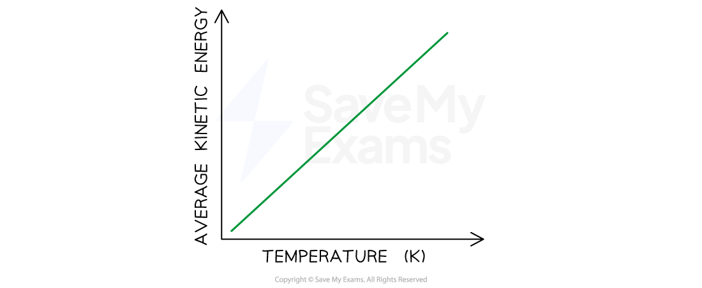

A graph showing the linear relationship between average kinetic energy and absolute temperature of a gas.

- The absolute temperature of an object is its temperature on a scale where the object is
at the lowest possible energy

- On the Kelvin scale, one Kelvin (K) has the same magnitude as one degree Celsius

- The main differences are:

The zero position is shifted, so 0 K is equivalent to -273.15 ℃

- Temperatures, in Kelvin, are not reported in degrees like the Celsius scale

- The Celsius scale is a relative scale based on the melting and boiling points of water

- Conversion from the Celsius scale to the Kelvin scale is given by the relationship:

- K = ℃ + 273.15

- Important points on the Kelvin and Celsius scales are given below:

| | Kelvin (K) | Celsius (℃) |
| --- | --- | --- |
| Absolute Zero | 0 | -273.15 |
| Melting point of water | 273.15 | 0 |
| Boiling point of water | 373.15 | 100 |

## Average Velocity (v) and Average Kinetic Energy

- According to the kinetic molecular theory, the average kinetic energy of gas molecules
is directly proportional to their absolute temperature

- However, some molecules will have more than the average kinetic energy and
others will have below the average

- Similar effects are observed for the velocities of the gas molecules

## Distribution of Molecular Velocity: Maxwell Boltzmann Distribution

- While the temperature of a gas indicates the average velocity or kinetic energy of the
gas molecules, at any instant, gas molecules are moving at a variety of velocities

- For example, at room temperature, the average speed of N2 molecules is given as
515 m/s but not all molecules have this speed at that temperature

- Given the chaotic motion of gas molecules, the velocity of a particle is constantly
changing

- Over a period of time, the velocity will vary from almost zero to some very high value,
considerably above the average

- In 1860 James Clerk Maxwell, a Scottish physicist, showed that different possible
velocities are distributed among particles in a definite way

- He developed a mathematical expression for this distribution referred as the
Maxwell-Boltzmann distribution

- A graphical representation of his results is shown below:

## Maxwell-Boltzmann Curve

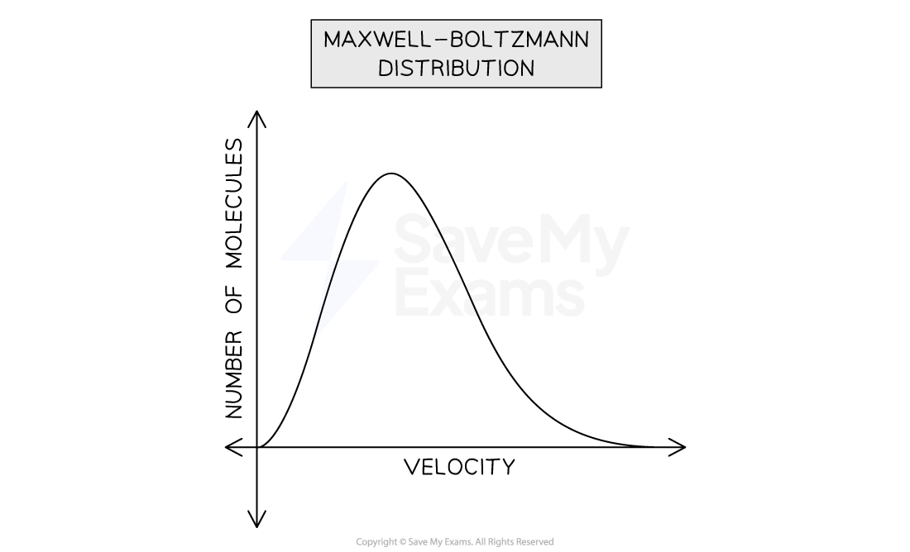

A graph showing the general distribution of the speed of gas molecules

## Distribution of Molecular Velocity and Temperature

- A key part of Maxwell’s observation was the dependence of the gas molecules’ speed
on temperature

- At any given temperature, the distribution curve shows the number of molecules
moving at a certain speed

- Consider the graph showing the distribution of O2 molecules at two different
temperatures:

## Distribution Curve for O₂

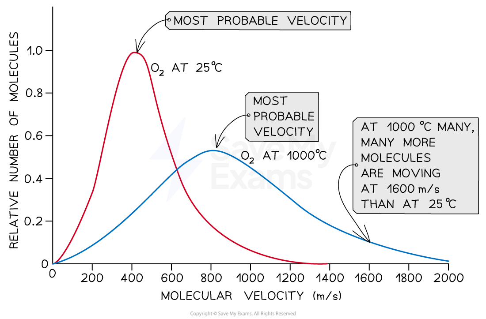

A graph showing the distribution of molecular velocities of oxygen molecules at 25℃ and 1000℃. At a higher temperature, more molecules of oxygen move at higher velocities.

- From this graph the following deduction can be made:

The peak of the curve represents the most probable velocity which describes the speed of the largest number of molecules

Note that the most probable velocity increases as temperature increases (the peak shifts toward the right at 1000 ℃)

- Furthermore, the curve also begins to flatten out with increasing temperature,
indicating that larger numbers of molecules are moving at greater speed

## Worked Example

Consider the Maxwell-Boltzmann distribution curve for O2 molecules at 300 K.

Which of the following statements about the curve is correct if the temperature of the O2 molecules was lowered to 200 K?

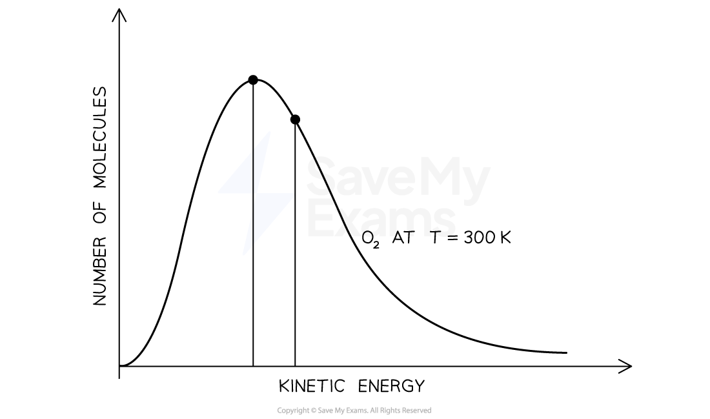

1. The curve shifts to the left with a lower peak corresponding to a decrease in the
number of molecules with the most probable kinetic energy
2. The curve shifts to the left with a higher peak corresponding to an increase in the
number of molecules with the most probable kinetic energy
3. The curve shifts to the right with a higher peak corresponding to an increase in the
number of molecules with the most probable kinetic energy
4. The curve shifts to the right with a lower peak corresponding to a decrease in the
number of molecules with the most probable kinetic energy

Answer:

The correct option is B because

- A decrease in temperature results in a decrease in the average kinetic energy of
the oxygen molecules
- This means the value of the most probable kinetic energy will decrease, causing
the curve to shift to the left and a higher peak to show more gas molecules
having the corresponding kinetic energy
Option A is incorrect because

- There will be a higher peak, as the temperature decreases and the value of most
probable kinetic energy decreases

- This shows more gas molecules will have the corresponding kinetic energy
Option C is incorrect because

- A decrease in temperature results in a decrease in the average kinetic energy of
the oxygen molecules

- This should make the curve shift left and a corresponding higher peak to
show more gas molecules with the corresponding kinetic energy
Option D is incorrect because

- A decrease in temperature results in a decrease in the average kinetic energy of
the oxygen molecules

- This should make the curve shift left and a corresponding higher peak to
show more gas molecules with the corresponding kinetic energy

## Examiner Tips and Tricks

Don’t panic…

- Your examiner may draw the Maxwell-Boltzmann curve with the x-axis labeled as
kinetic energy as seen in the question above
- This is because the effect of temperature on the average velocity and kinetic
energy of gas molecules are the same
- Hence, the terms velocity and energy are used interchangeably

## Non-Ideal Behavior of Gases

- The kinetic molecular theory and gas laws assume that molecules in the gaseous state
have two important properties:

- They exert no attractive or repulsive force on one another

- They have negligible volumes compared to that of the container

- From the ideal gas equation, we can see what it means for a gas to have an ideal behavior
by rearranging the ideal-gas equation to solve for n:

n = PV/RT

- This means that for 1 mol of an ideal gas, the quantity PV/RT equals 1 at all pressures

- Hence, a graph plot of PV/RT against pressure should give a straight line parallel to
the pressure axis

## Graph Representation of an Ideal Behavior

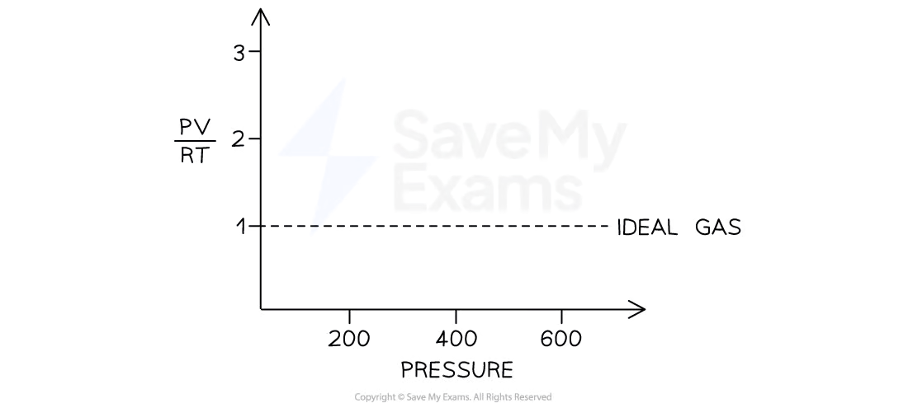

A graph showing an ideal gas behavior for one mole of a gas at different pressures

## Deviation from Ideal Behavior

- Although we can assume that real gases behave like an ideal gas, they do not do so
under all conditions

- For example, without intermolecular forces present, gases will not condense to
form liquids

- Hence the ideal behavior described by the assumptions of the kinetic molecular theory
and the ideal gas equation are only true under certain conditions

- For real gases, this is true only at moderately low pressures and high temperature

- However, at high pressures and low temperatures, real gases deviate from the ideal
behavior
- At low temperatures, gas molecules have lower kinetic energy and begin to
experience some intermolecular attraction

- At high pressures, intermolecular attraction also comes into play because of the
shorter distance seen when gas molecules are crowded

- This means the combined volume of the gas molecules is not negligible relative
to the container volume

## Effect of High Pressure on Volume of Real Gases

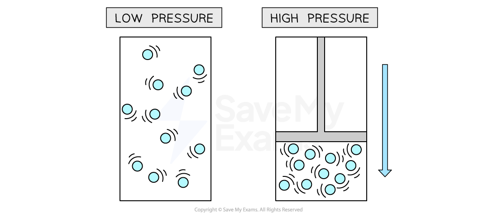

At high pressure, the volume of molecules of real gases is not negligible

- For real gases, a graph plot of PV/RT against pressure does not have the same shape as
that of an ideal gas

- From the graph below, we can observe that at pressures below about 400 atm,
cooling (lower temperatures) increases the extent to which a gas deviates from ideal
behavior

- This is because lower temperatures mean the gas molecules do not have
sufficient kinetic energy to overcome the intermolecular force of attraction

- This makes them stick to one another rather than bounce off each other

- As temperature increases,

- The negative deviation from the ideal value of 1 decreases, as seen in the graph
from 200 K to 1000 K

- This is because gas molecules begin to behave ideally as they have sufficient
kinetic energy to overcome intermolecular attraction and their volumes
become negligible

## Deviation from Ideal Behavior

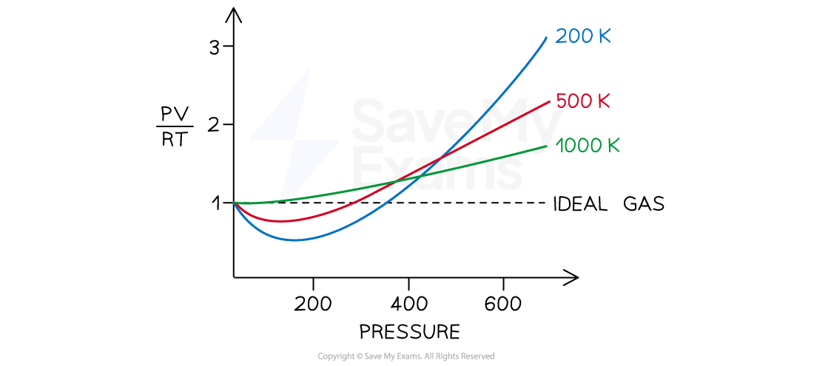

A graph showing the effect of temperature and pressure on real gases. The deviation is more significant at higher pressures and lower temperatures as seen by the direction of the curve away from the ideal gas.

## Worked Example

Which of the following conditions will make a gas behave more ideally?

1. Large volume and high average kinetic energy
2. High temperature and high average kinetic energy
3. Low volume and low average kinetic energy
4. Low temperature and low average kinetic energy

Answer:

Option A is correct because:

- Gases tend towards ideal behavior at high temperatures and low pressures
- Under these conditions, the gas molecules have energy energy to overcome
intermolecular force and their actual volume tends to become negligible
because of the distance between them
- This is synonymous with high average kinetic energies and large volumes
Options B and D are incorrect because

- Both conditions mean the same thing given that temperature is directly
proportional to average kinetic energy
Option C is incorrect because

- Low volume means high pressure while low average kinetic energy means the
molecules are at low temperatures and cannot overcome the intermolecular
force between them.
