<!-- Source: page 1 -->

## Intermolecular & Interparticle Forces

## Contents

- London Dispersion Forces
- Dipole-Induced Dipole Interactions
- Dipole-Dipole Interactions
- Ion-Dipole Interactions
- Molecular Dipole Moment
- Hydrogen Bonding
- Interactions in Large Biomolecules

<!-- Source: page 2 -->

## London Dispersion Forces

## What Are Intermolecular Forces?

- Intermolecular forces are weak forces that exist between electrically neutral molecules

- All intermolecular interactions are electrostatic

- This means that they involve attractions between positive and negative species,
much like ionic bonds

- Intermolecular forces are generally weaker than intramolecular attraction forces like
ionic bonds, covalent bonds and metallic bonds

- Intermolecular forces are responsible for the physical properties of covalent molecules
including:

- Boiling point

- Melting point

- Density

- Viscosity

- Solubility

- For example, the stronger the intermolecular force, the higher the boiling and melting
point of the molecule

## Intermolecular Forces Vs Intramolecular Forces

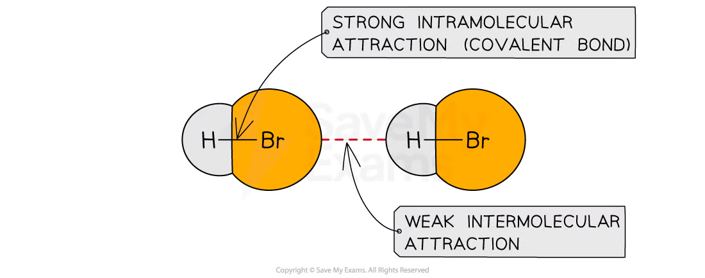

Weak intermolecular forces exist between molecules while stronger intramolecular forces exist between the atoms that make up the molecules

## London Dispersion Forces

- London dispersion forces are a weak type of intermolecular forces produced by small
instantaneous dipoles that occur in nonpolar molecules

<!-- Source: page 3 -->

- Instantaneous dipoles are the result of an electron's motion in one atom affecting
another atom
- The average distribution of electrons in a nonpolar molecule is symmetrical

- This means that they lack a permanent dipole moment

- However, at any instant due to their motion, these electrons become unevenly
distributed

This means that one side develops a partial negative charge, $\delta^-$ and the other side develops a partial positive charge, $\delta^+$

- The instantaneous dipole that develops in one molecule then influences another
molecule resulting in a weak attraction

## London Dispersion Forces

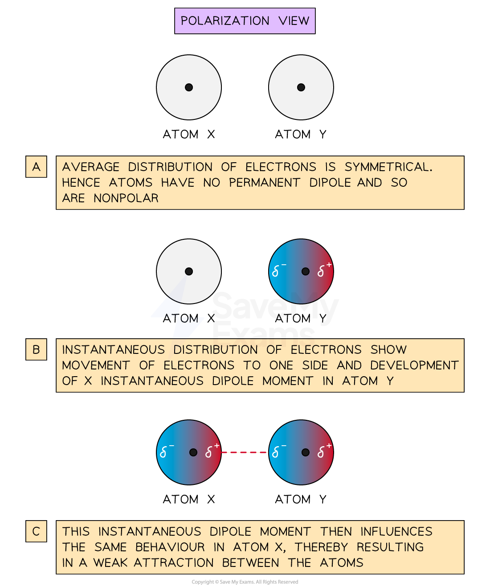

<!-- Source: page 4 -->

A snapshot of the average and instantaneous distribution of electrons in an atom to
demonstrate the development of London dispersion forces.
- The strength of London forces is influenced by polarizability

- Polarizability describes the ease of charge distortion in a molecule and the consequent
development of an instantaneous dipole

- The greater the polarizability, the more easily the electron cloud can be distorted to give
an instantaneous dipole

- This results in a stronger dispersion force

- Polarizability increases with increasing number of electrons in a molecule

- Hence, the strength of dispersion forces increases with increasing atomic or
molecular size

- For example, the boiling points of halogens and noble gases increase as you go down
the group, where dispersion forces are the only forces responsible for this property

## Boiling Points of Halogens & Noble Gases

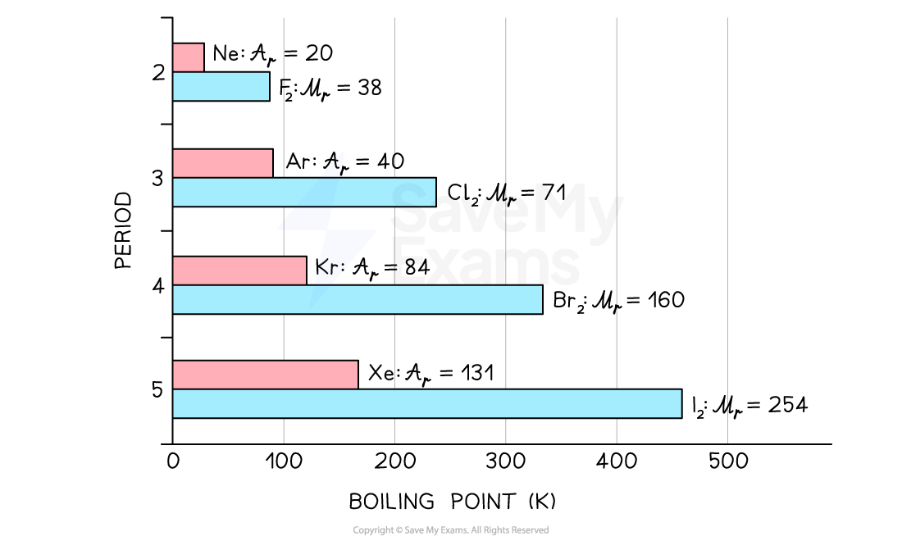

The boiling point of halogens and noble gases increases with the number of electrons

- For molecules of about the same molecular mass, polarizability is influenced by
branching/compactness

- The more branched the molecule, the less polarizable the molecule is and the
smaller its dispersion force

- For example, the compounds pentane, 2−methylbutane, and 2,2−dimethylpropane all
have the same molecular formula, C5H12, and same molecular mass, 72.15 g mol-1

- However, they differ in the arrangement of their atoms

<!-- Source: page 5 -->

- Pentane has no branching and is the least compact

- 2−methylbutane has one branch making it more compact than pentane
- 2,2−dimethylpropane has two branches making it more compact than 2−
methylbutane

- This increase in the branching/compactness results in a decrease in boiling point as
you move from pentane to 2−methylbutane to 2,2−dimethylbutane

## Branching & Polarizability

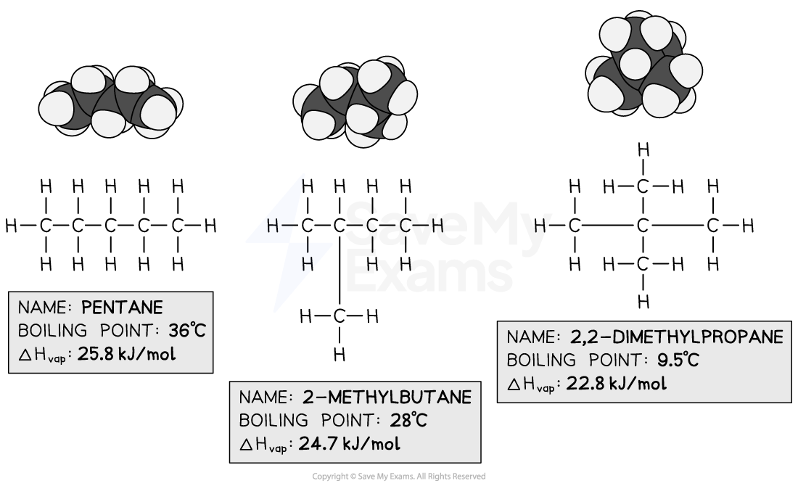

The effect of branching on the strength of dispersion forces for molecules of the same molecular size.

## Examiner Tips and Tricks

Dispersion forces are typically present in all covalent molecules but are the only forces present in nonpolar molecules like hydrocarbons.

<!-- Source: page 6 -->

## Dipole-Induced Dipole Interactions

- This is a weak attraction that results from the interaction between a polar molecule and a
nonpolar molecule

- The polar molecule induces, or causes, a temporary dipole in the nonpolar molecule by
distorting its electron distribution

- For example, in the interaction between polar water molecules and nonpolar iodine
molecules:

- There is a partial negative charge on the oxygen atom of the polar O—H bond in
water

- This causes a distortion in the electron cloud distribution in the iodine molecules

- This distortion creates an induced dipole in the iodine molecule

- This induced dipole is then weakly attracted to the negative oxygen atom, allowing
some degree of iodine dissolution in water

- However, because this force is weak, the iodine molecules are not very soluble in water

- If the water becomes supersaturated with iodine, then there are not enough water
molecules to cause this attraction

## Dipole-induced dipole interactions

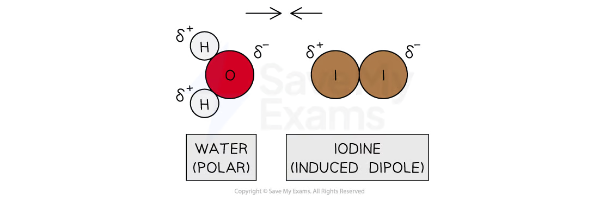

Dipole-induced dipole interaction between polar water molecules and iodine molecules

- The strength of this interaction is dependent on two factors:

- The magnitude of the dipole moment in the polar molecule

- The polarizability of the nonpolar molecule

<!-- Source: page 7 -->

## Dipole-Dipole Interactions

- Dipole-dipole interactions are a consequence of permanent dipole moments in polar
molecules

- The dipole–dipole force is an attractive intermolecular force

- This is because polar molecules tend to arrange themselves so that the positive end
of one molecule is near the negative end of another

- Repulsions can also occur when the positive (or negative) ends of two molecules are in
close proximity

- To illustrate this force, consider the way the molecules of acetonitrile, CH3CN are
packed in the liquid and solid states

- In the solid state, they are arranged with the negatively charged nitrogen end of the
molecule aligned with the positively charged —CH3 end

- In the liquid state, however, as a result of less restriction in the movement of
molecules, the arrangement is disordered

- This means both attractive and repulsive forces are present at any instant

## Dipole-Dipole Interactions

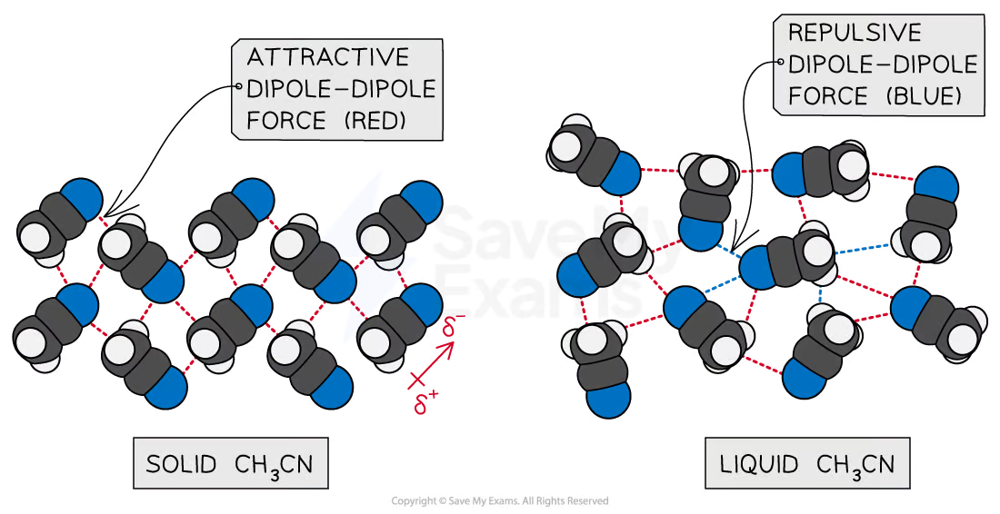

Dipole-dipole interactions between molecules of acetonitrile, CH3N in solid and liquid states.

- We can see the effect of dipole-dipole interactions in polar molecules by comparing the
boiling points of acetonitrile and propane, C3H8

- Acetonitrile is a polar molecule with a molecular weight of 41 amu that boils at 355 K

<!-- Source: page 8 -->

- Propane is a nonpolar molecule with a molecular weight of 44 amu that boils at 213
K
- Dispersion forces are present in both molecules

- Since both molecules have a similar molecular weight, the strength of dispersion
forces will be similar

- However, the additional presence of a dipole-dipole force in acetonitrile gives it a higher
boiling point

- Generally, the strength of dipole-dipole interaction is dependent on the magnitude of
the dipole and the proximity of the molecules

<!-- Source: page 9 -->

## Ion-Dipole Interactions

- This force which exists between an ion and a polar molecule, accounts for the dissolution
of ionic compounds in polar solvents like water

- For example, in a solution of sodium chloride, NaCl, in water:

The oxygen atom has a partial negative ($\delta^-$) charge

The hydrogen atoms have a partial positive charge ($\delta^+$)

- Overall, there is a dipole moment within the water molecule

- The Na+ ion is attracted to the negative end of the dipole

- The Cl- ion is attracted to the positive end of the dipole

## Ion-Dipole Interactions

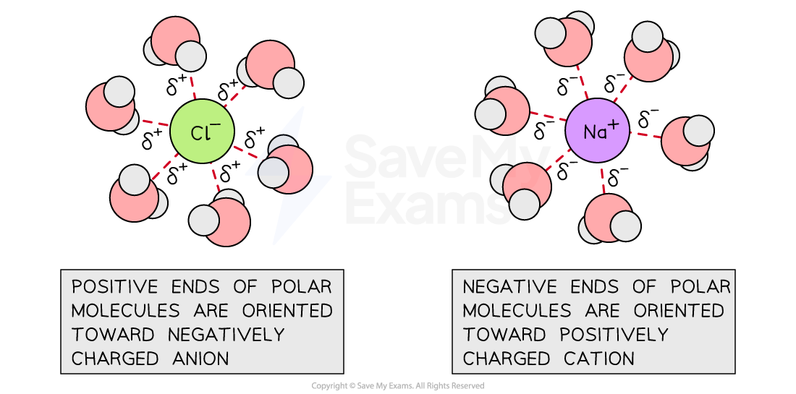

Ion-dipole interaction between sodium and chloride ions with water

- The magnitude of ion-dipole interactions increases as either the ionic charge or the
magnitude of the dipole moment increases

<!-- Source: page 10 -->

## Molecular Dipole Moment

- Molecular dipole moments give information about the separation of charges in a
molecule

- The dipole moment (?) is a measure of the net polarity in a molecule and is measured in
Debyes (D)

- It is a product of the charge, Q, at the end of a dipole and the distance, r, between
the charge

- The greater the difference in electronegativity between the bonded atoms of the
molecule, the greater the dipole moment of that molecule

- For example, in chloromethane, the C—Cl bond has a dipole moment because chlorine
is more electronegative than carbon

The chlorine atom develops a partial negative ($\delta^-$) charge

The carbon atom develops a partial positive charge ($\delta^+$)

- Therefore, the C—Cl bond is described as a polar bond

- The dipole moment in the molecule is represented using an arrow with a plus at the end

- The plus end of the arrow represents the positive atom or end of the polar bond /
dipole moment

- The arrowhead represents the negative atom or end of the polar bond / dipole
moment

## Molecular Dipole Moment

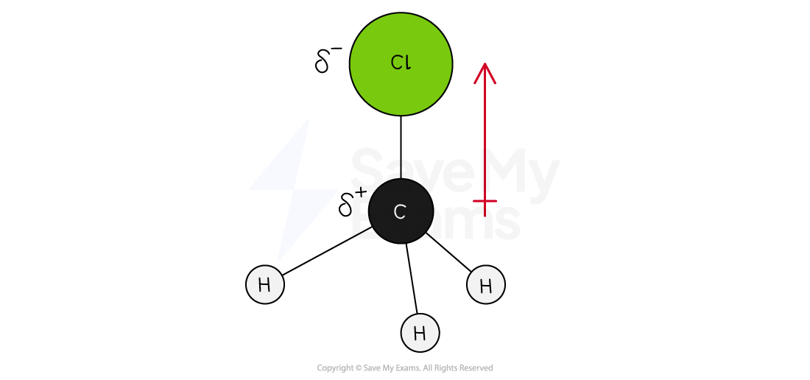

A dipole moment exists between C-Cl bonds due to the large difference in electronegativity between the carbon and chlorine atoms.

<!-- Source: page 11 -->

## Hydrogen Bonding

- This is a special type of dipole-dipole interaction found in covalent molecules in which
hydrogen is directly bonded to either a nitrogen, oxygen or fluorine atom

- These elements are very electronegative

- Therefore, they form polar bonds with hydrogen

## Polar covalent bond H—F bond

A polar covalent bond in hydrogen fluoride is described by the presence of δ+ on the hydrogen and δ- charges on the electronegative fluorine atom

- The hydrogen atom is significantly less electronegative than a nitrogen, oxygen or
fluorine atom

Therefore, the hydrogen atom has a partial positive ($\delta^+$) charge

The very electronegative element has a partial negative charge ($\delta^-$)

Hydrogen bonding describes the attraction between the $\delta^+$ hydrogen atom (Hδ+) in this polar bond and the nonbonding electron pairs on a nearby small electronegative atom or ion

- Compared to dipole-dipole or London dispersion forces, hydrogen bonds are a
stronger intermolecular force

## Hydrogen Bonding

<!-- Source: page 12 -->

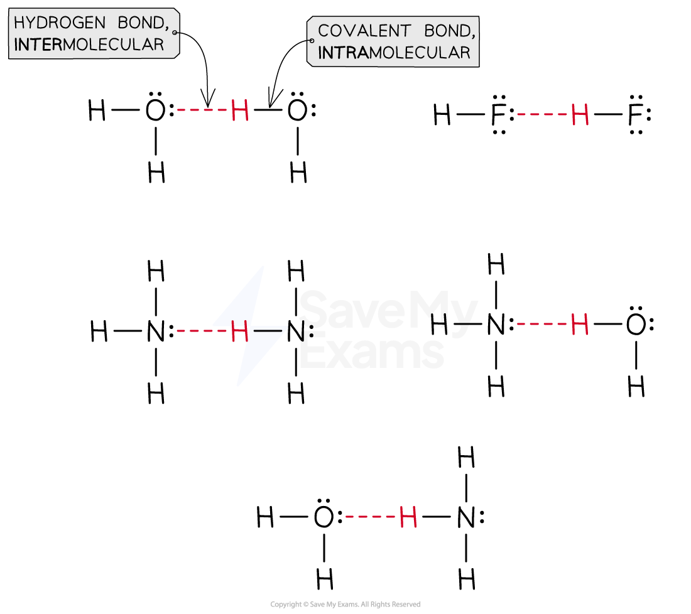

Hydrogen bonding between molecules of ammonia, water and hydrogen fluoride

- The strength of the hydrogen bond is highest in molecules where the hydrogen atom is
bonded to a fluorine atom

- This is because fluorine has the highest electronegativity

- Generally, the strength of hydrogen bonds increases in the order:
H—N < H—O < H—F

- However, the strength of hydrogen bond in a molecule is also dependent on how many
hydrogen bonds can be formed per pair of molecules

- For example, acetic acid, CH3COOH, and propanol, CH3CH2CH2OH:

- They both have the same molecular mass, 60 amu

- They are both capable of forming hydrogen bonds

- However, a pair of acetic acid molecules can form two hydrogen bonds, whereas a pair
of propanol molecules can form only one

- Hence, the boiling point of acetic acid is greater than propanol

## Multiple Hydrogen Bonds

<!-- Source: page 13 -->

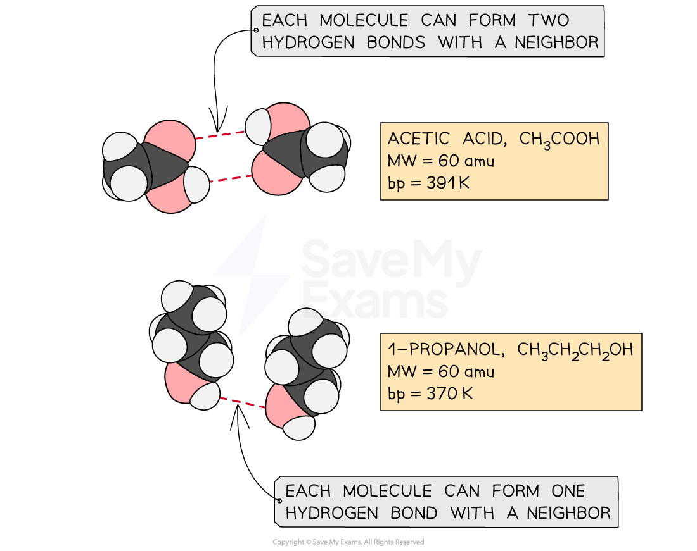

Hydrogen bonding in acetic acid and propanol. Each acetic acid can form two hydrogen bonds while propanol can form only one hydrogen bond.

- Similarly, the hydrogen bonds in water are greater than that in hydrogen fluoride.

- Water can form two hydrogen bonds

- This is because there are 2 lone pairs of electrons on the oxygen atom AND two
available $\delta^+$ hydrogen atoms

- Hydrogen fluoride forms only one hydrogen bond

- This is because, although there are 3 lone pairs of electrons on the fluorine
atom, there is only one available $\delta^+$ hydrogen atom

- Hence water has a higher boiling point than hydrogen fluoride

## Hydrogen Bonding in H₂O and HF

<!-- Source: page 14 -->

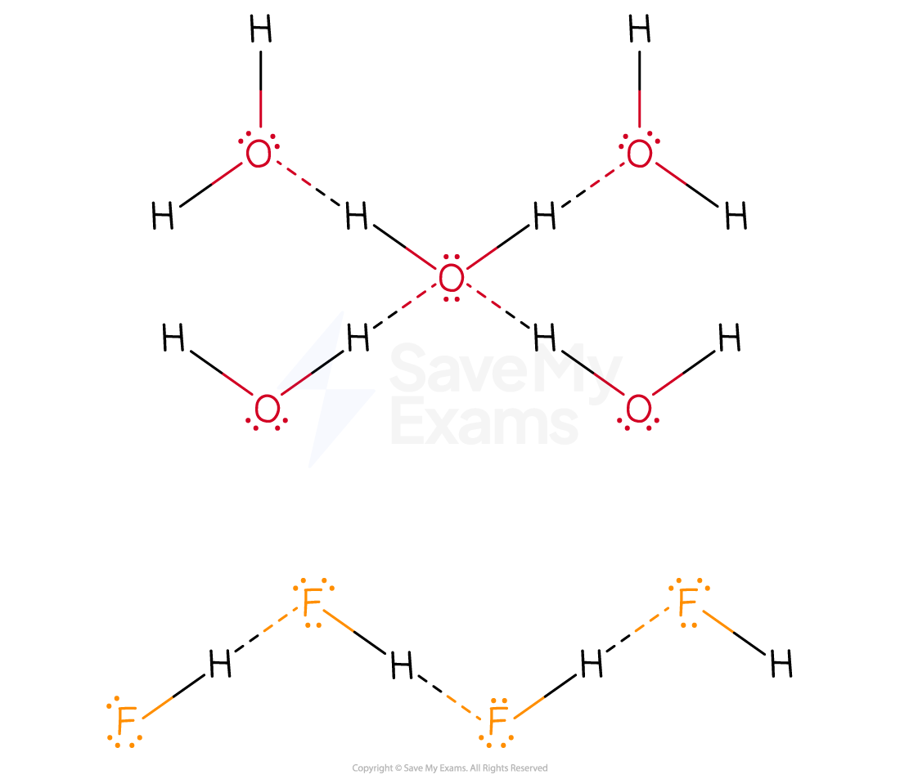

The diagram shows two hydrogen bonds per pair of water molecules compared to only one per pair of hydrogen fluoride

## Examiner Tips and Tricks

- A covalent molecule may not be able to form hydrogen bonds with itself due to
the lack of a polar hydrogen atom yet forms hydrogen bonds with another
molecule with a polar hydrogen atom
- For example, acetaldehyde, CH3CHO, can form hydrogen bonds with water
molecules which makes it soluble in water

<!-- Source: page 15 -->

## Interactions in Large Biomolecules

- Intermolecular interactions are also found in large biomolecules like proteins,
carbohydrates and lipids

- These interactions are possible either between biomolecules or within different regions
of the same molecule

- For example, double-helix DNA molecules are held together by hydrogen bonds

- The hydrogen bonding involves the nitrogenous base components between each
DNA molecule strand

## Hydrogen Bond in DNA Strands

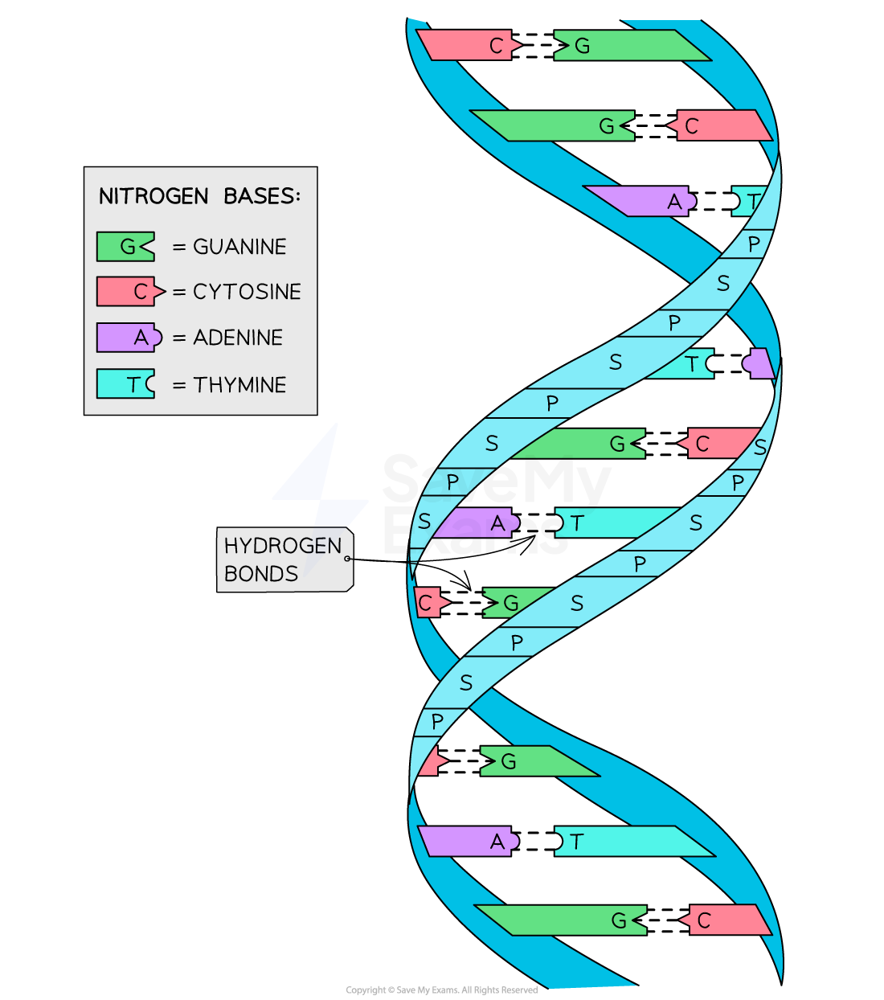

<!-- Source: page 16 -->

Double helix DNA strands show the hydrogen bonds between the nitrogenous base
components of each strand
- Interaction between different biomolecules is seen between:

- The hydrophobic —“water fearing”— tails of lipids and water molecules, which
makes lipids insoluble in water due to the lack of hydrogen bond

- The hydrophilic — “water loving” — interaction between carbohydrates and water
molecules, which makes them soluble in water

## Lipids Interaction with Water

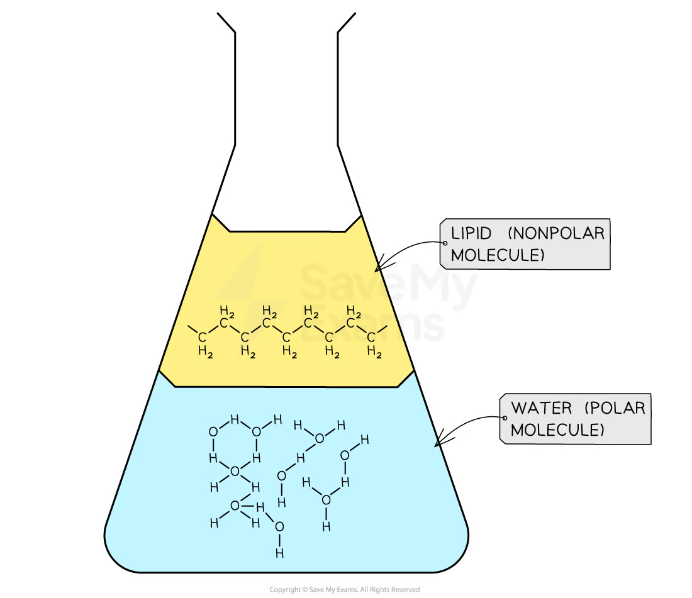

Nonpolar oil molecules do not mix with water due to a lack of polar hydrogen

## Carbohydrate Interaction with Water

<!-- Source: page 17 -->

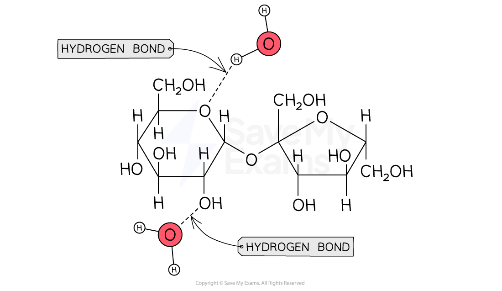

The presence of polar hydrogen atoms on sugar molecules makes glucose dissolve in water

> 来源：© 2025 Save My Exams, Ltd.
