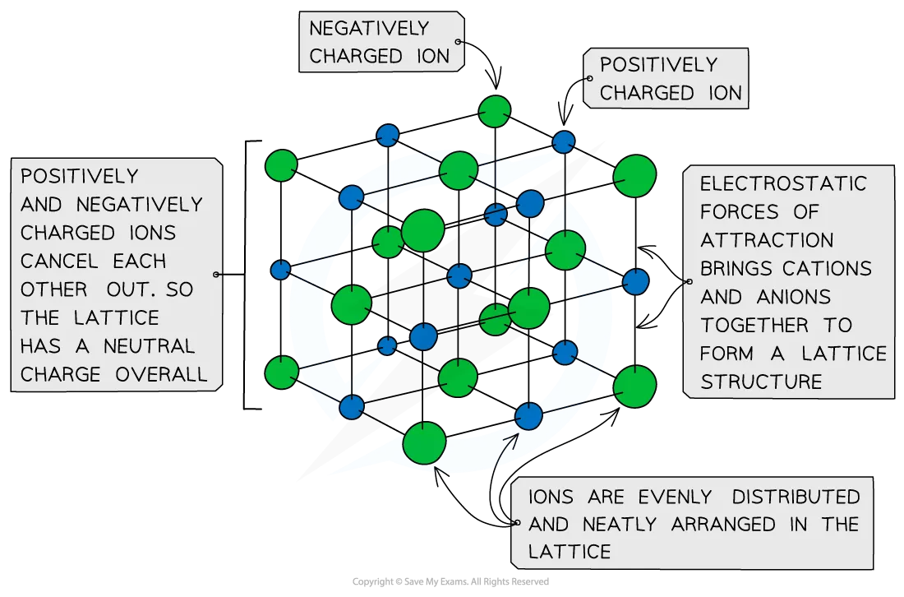
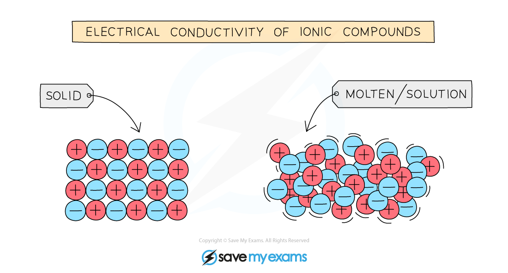
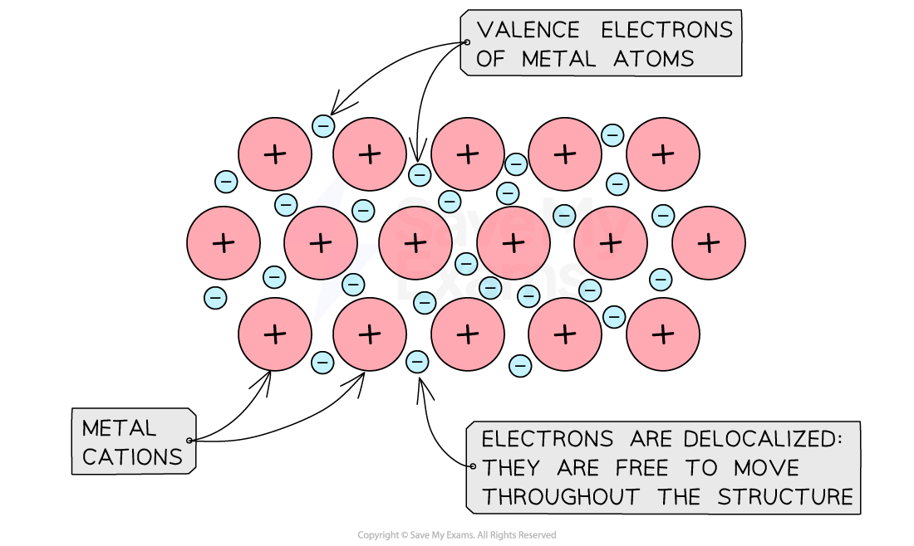
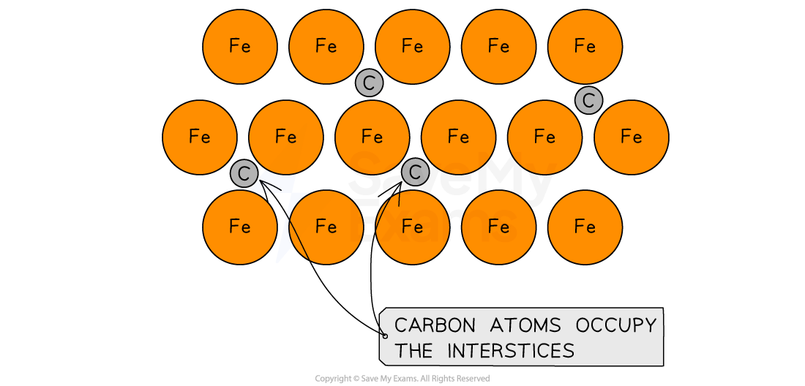
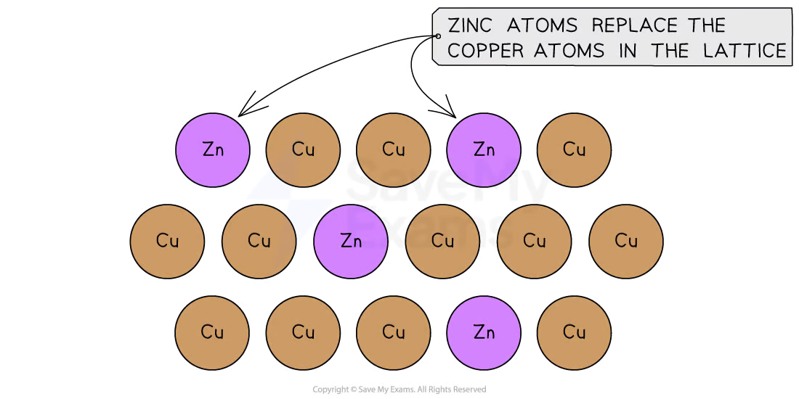

## Contents

- Ionic Crystals
- Representing Metallic Bonding
- Interstitial Alloys
- Substitutional Alloys

## Ionic Crystals

- Ionic crystals are arranged in a lattice structure of positive and negative ions

- The lattice structure is the responsible of the crystalline nature of ionic compounds

- The ions in the lattice are arranged in a three dimensional array with a regular repeating
pattern

- This systematic arrangement maximizes the Coulombic forces of attraction
between positively charged ions and negatively charged ions

- This arrangement also minimizes the Coulombic forces of repulsion between
equally charged ions

- Ionic lattices tend to be close-packed and symmetric arrangements

- The overall charge of an ionic lattice is neutral

## Ionic Lattice

Ionic crystals are arranged in lattice structures

## Properties of Ionic Crystals

- The physical properties of ionic crystals depend on the strength of the Coulombic
attraction between the positive and negative ions

- The strength of the Coulombic forces increase if:

- The charge of the ions increase because the force of attraction is proportional to
the magnitude of the charge
- g. The coulombic force of attraction is stronger in MgCl2 than in NaCl

- This occurs because Mg2+has a 2+ charge and Na+ a 1+ charge

- The ionic radius decrease because it is easier to attract an smaller ion rather than a
bigger ion

- g. The coulombic force of attraction is stronger in NaCl than in KCl

- This occurs becauseNa+ has an smaller radius than K+

## Table listing the characteristics of ionic crystals

| Property | Explanation |
| --- | --- |
| Brittle | Ions can be splitted apart |
| High melting and boiling points | The Coulombic attraction between positive and negative ions in the lattice are strong |
| Generally soluble in water | The lattice is broken down and the ions can form ion-dipole interactions with the water molecules |
| Conduct electricity when in solution or molten | The lattice is broken down and there is free movement of ions |

## Ionic Compound in a Solid and Molten / Solution

Molten or aqueous ions move freely but cannot in solid form

## Examiner Tips and Tricks

It is important for your AP Chemistry exam that you know the physical properties of ionic crystals, and it is key to understand how to explain them using Coulomb’s Law and Periodic trends.

## Worked Example

Based on Coulomb’s Law and using the information in the table below, which of the following anions is most likely to have the strongest attraction towards Na+ ions in a lattice structure?

| Ion | Ionic Radius (pm) |
| --- | --- |
| S²⁻ | 185 |
| Cl⁻ | 182 |
| Te²⁻ | 147 |
| Br⁻ | 195 |

1. S2−
2. Cl-
3. Te2−
4. Br-

Answer:

- The correct answer is A since S2− has the combination of most negative charge
and the smallest radius, therefore the interactions with Na+ are going to be
stronger
- B and D are not correct since both of them are cations with a 1+ charge.
Therefore, the Coulombic attractions are weaker
- C is not correct. Even if Te2− has a 2− negative charge, its radius is bigger
compared to S2−. Therefore, the forces of attractions are weaker in Te2−

## Representing Metallic Bonding

- In a metal, metal cations arranged in a fixed lattice are surrounded by delocalized
valence electrons

- The delocalized electrons are often referred to as a sea of electrons

## A metallic lattice

Diagram showing metallic lattice structure with delocalized electrons

- Because the sea of electrons is free to move throughout the structure, metals are:

- Good conductors of electricity

- Good conductors of heat and have a low heat capacity

- Malleable

- Ductile

- Because there are very strong electrostatic forces between the metal cations and the
sea of delocalized electrons, most metals tend to have high melting points

## Table of metal melting points

| Metal | Magnesium | Copper | Gallium | Platinum |
| --- | --- | --- | --- | --- |
| Melting Point (°C) | 649.85 | 1084.62 | 29.76 | 1768.40 |

## Examiner Tips and Tricks

Network covalent solids also have high melting points. However, metals are good conductors of electricity while most network covalent solids (excluding graphite) are not.

## Interstitial Alloys

- Metals can be melted, physically mixed in their liquid states, and cooled together to form
a homogeneous mixture called an alloy

- Alloys can also be made from metals mixed with non-metals such as carbon

- The properties of an alloy are often different than those of the metals it contains

- An interstitial alloy is composed of atoms with vastly different radii

- The larger atoms are arranged in an orderly lattice and the smaller atoms occupy the
interstices or spaces between the larger atoms

- Steel, composed of iron and carbon, is an example of an interstitial alloy

## Diagram of an interstitial alloy

Diagram of steel showing carbon atoms occupying the interstices in a lattice of iron atoms

## Examiner Tips and Tricks

Alloys containing elements found in the first two periods of the periodic table are typically interstitial alloys.

## Substitutional Alloys

- An substitutional alloy is composed of atoms with similar radii

- Atoms of the substituting element can take the place of some of the original metal’s
atoms in the lattice

- Brass, composed of copper and zinc, is an example of a substitutional alloy

## Diagram of a substitutional alloy

Diagram of brass showing zinc atoms occupying some of the positions in a lattice of carbon atoms
