## Contents

- Lewis Diagrams
- Resonance & Lewis Structures
- Formal Charge
- Limitations of Lewis Structures

## Lewis Diagrams

- A Lewis Diagram is used to represent molecular compounds by showing the valence
electrons around atoms

- Electrons are drawn in pairs and they are represented by For example, the water
molecule can be represented as:

## Lewis Diagrams for Water

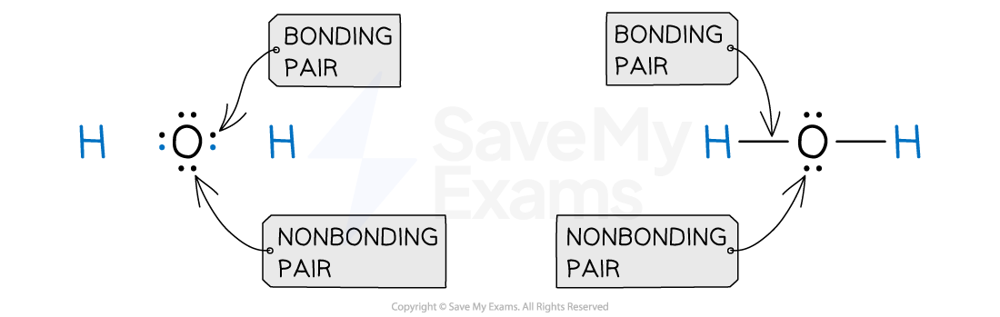

Different Lewis Diagrams for the water molecule showing bonding pairs as lines or dots

- Lewis diagrams must show all the electron pairs even if they are bonding or nonbonding
electrons

- A bonding pair is a shared pair of electrons

- A nonbonding pair is a lone pair of electrons that is not involved in bonding

Double bonds are represented with two lines connecting the two atoms involved (＝)

- This implies that 4 electrons are being shared between them

Triple bonds are represented with three lines connecting the two atoms involved (≡)

- This implies that 6 electrons are being shared between them

- Atoms form covalent compounds to have a full valence shell of electrons

- The octet rule is the tendency that explain why atoms are most stable when they
complete their valence shell with 8 electrons

- However, there are some exceptions to the octet rule:

- The hydrogen atom (H) completes a This means it can only complete its valence shell
with 2 electrons

- The boron atom (B) completes a This means it can only complete its valence shell
with 6 electrons

## Steps for drawing Lewis Diagrams

1. Calculate the total number of valence electrons using your periodic table

2. Draw a correct skeletal structure to show how the atoms are linked between them
3. Distribute one pair of electrons between each atom to represent single bonds

4. Add electron lone pairs to complete octets (except H which completes two valence
electrons). It is a good practice to start on terminal atoms and finish with the central
atom

5. If there are still atoms which lack an octet, form double or triple bonds

6. When the structure is finished, check if all the atoms have completed an octet (except
from H) and check if the amount of electrons distributed is the same as the total number
of valence electrons

## Worked Example

Draw a Lewis structure for CCl4

Answer:

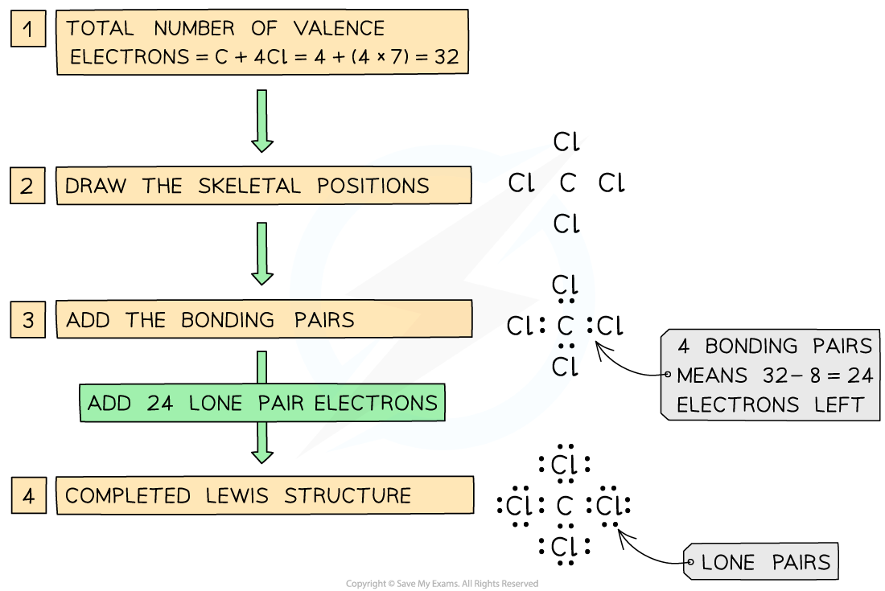

Steps in drawing the Lewis Structure for CCl4

## Further examples of drawing Lewis Diagrams

- By following six simple steps, the Lewis Diagrams of these common molecules can be
drawn

| Molecule | Total number of valence electrons | Lewis Diagram |
| --- | --- | --- |

| Molecule | Total number of valence electrons | Lewis Diagram |
| --- | --- | --- |
| CH₄ | C + 4H 4 + (4 x 1) = 8 | 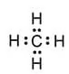 |
| NH₃ | N + 3H 5 + (3 x 1) = 8 | 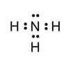 |
| H₂O | 2H + O (2 x 1) + 6 = 8 | 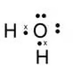 |
| CO₂ | C + 2O 4 + (2 x 6) = 16 |  |
| HCN | H + C + N 1 + 4 + 5 = 10 | 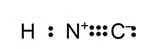 |

Lewis diagrams for common molecules

## Worked Example

Which of the following Lewis electron-dot diagrams is drawn incorrectly?

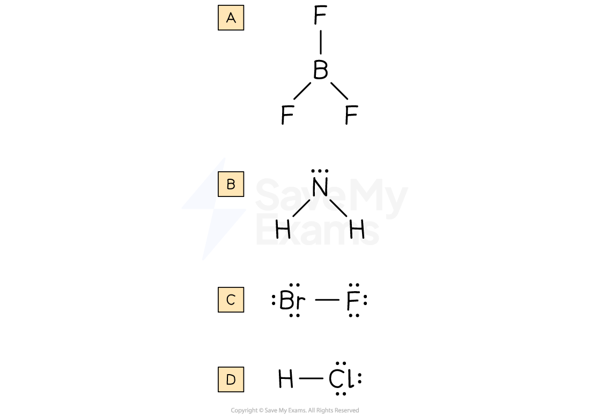

Answer:

- The correct answer is B.
- This is because the nitrogen atom does not complete its octet. It has just 6
electrons, 2 bonding pairs and 1 nonbonding pair. Therefore, the Lewis Diagram is
not correctly drawn.
- The boron atom in A completes its sextet.The fluorine atoms in A and C, and the
bromine atom in C, and the chlorine atom in D complete their octets. In the case
of D, all hydrogen atoms complete their duet. Therefore, their Lewis Diagrams
are drawn correctly

## Resonance & Lewis Structures

- Some molecules can be represented by more than one Lewis structure

- Resonance structures are different variations of the same molecule, but with different
arrangement of electrons

- The resonance hybrid is the actual structure of a molecule, and it is a mixture of all its
resonance structures

- Resonance occurs because electrons are often delocalized

- Delocalized electrons are not fixed to a single atom or covalent bond, therefore they can
be spread through the molecule

- The resonance hybrid is the most stable form of a molecule because the delocalization
of electrons stabilize the structure

## Resonance structures of the nitrate(V) ion

- To draw the resonance structure of the nitrate(V) ion, the first step is to count the valence
electrons that are present in the ion

- There is one nitrogen atom, three oxygen atoms and a negative charge

- Nitrogen in group 15 contributes with 5 valence electrons

- Oxygen in group 16 contributes with 6 valence electrons

- The negative charge means that an electron has been gained

$$\mathrm{Valence\ electrons}=\mathrm{N}+(3\times\mathrm{O})+1e^{-}$$

$$\mathrm{Valence\ electrons}=5+(3\times6)+1e^{-}$$

$$\mathrm{Valence\ electrons}=24e^{-}$$

- After drawing an skeletal structure (N as the central atom) and placing the bonding and
nonbonding electrons, three Lewis structures are possible

- These Lewis structures consist of a double bond and two single bonds. However, a pair
of electrons from the double bond and lone pairs of electrons can oscillate between
three different positions

- These oscillation allows the double bond to migrate from one part of the molecule to
another

## Resonance in the Nitrate(V) ion

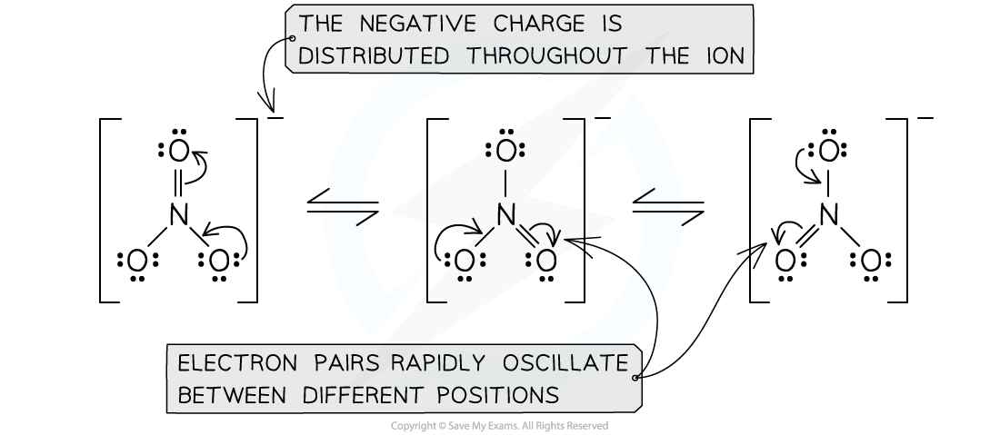

Resonance structures in the nitrate ion

- One the resonance structures are identified, the resonance hybrid can be drawn using
dotted lines to show the position of delocalised electrons

- The three resonance structures have more energy than the resonance hybrid of
nitrate(V) ion

- Therefore, the resonance hybrid is is the most stable and the actual structure of the
nitrate(V) ion

## The Nitrate(V) Ion

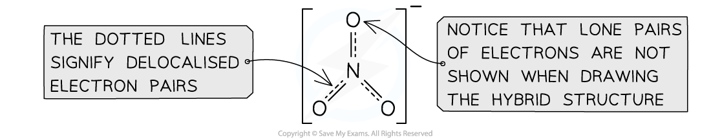

Resonance hybrid nitrate(V) ion

- Some common examples of resonance are the carbonate ion, benzene, ozone, and the
carboxylate ion which are showed in the table below

| Species | Lewis Diagram | Resonance Hybrid |
| --- | --- | --- |
| Carbonate ion, CO₃²⁻ | 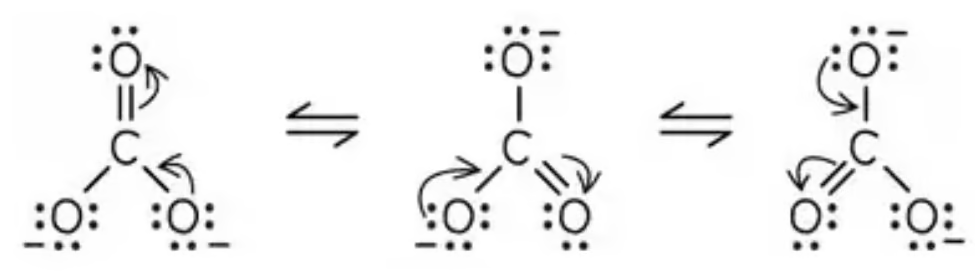 | 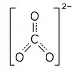 |

| Species | Lewis Diagram | Resonance Hybrid |
| --- | --- | --- |
| Benzene, C₆H₆ |  | 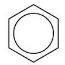 |
| Ozone, O₃ | 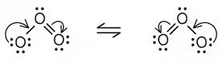 | 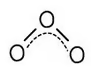 |
| Carboxylate ion, RCOO⁻ | 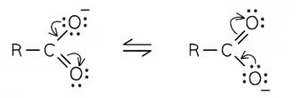 | 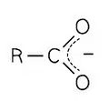 |

## The Octet Rule & Formal Charge

- Atoms form chemical bonds to get the electron configuration of their closest noble gas

- The octet rule explains why atoms usually want eight electrons in their valence shell in
order to have more stability

- In some cases, it is possible to have multiple Lewis structures while still following the
octet rule

- Each of these variations is a resonance structure and they contribute to the formation of
the hybrid of resonance

- In order to figure out the resonance structure that contributes the most, the formal
charge (FC) of all the atoms in the molecule is determined

## Formal Charge

- Formal charge is a charge assigned to all the atoms in a molecule by assuming that all
the bonding electrons are shared equally between the atoms, regardless of differences
in electronegativity

- The formula of FC is

$$FC=V-\frac{1}{2}B-N$$

- V is the number of valence electrons

- B is the number of bonding electrons

- N is the number of nonbonding electrons

## Worked Example

What is the formal charge of boron in the BH4− ion?

Answer:

- Boron is a Group 13 element, by using the periodic table information it can be
deduced that it has 3 valence electrons.
- Hydrogen is in Group 1, therefore it has one valence electron.
- Since the BH4− ion has lost one electron, the total number of valence electrons in
the structure is 8.
- By following the steps to draw a Lewis diagram, the structure should look like this:

Lewis formula of BH4–

- The number of bonding electrons in B is 8 and the number of nonbonding
electrons in B is 0

$$FC=V-\frac{1}{2}B-N$$

$$FC=3-\frac{1}{2}\times8-0$$

$$FC=-1$$

## Choosing the preferred resonance structure

- The concept of formal charge can help select competing resonance structures

- The following rules should be applied when analyzing which of the resonance structures
contributes the most

- The sum of the formal in neutral molecules is zero

- The sum of the formal charges in ions is the charge of the ion

- The smaller the formal charge (or 0), the better it is. Large formal charges are not
common in atoms

- Negative formal charges should be assigned to the most electronegative atom

## Worked Example

What is the formal charge on the two resonance structures shown?

Resonance structures of hydrogen cyanide

Deduce which is the preferred structure

Answer:

### Structure 1

$$FC=V-\frac{1}{2}B-N$$

$$\mathrm{FC\ on\ hydrogen}=1-\frac{1}{2}(2)-0=0$$

$$\mathrm{FC\ on\ carbon}=4-\frac{1}{2}(8)-0=0$$

$$\mathrm{FC\ on\ nitrogen}=5-\frac{1}{2}(6)-2=0$$

### Structure 2

$$FC=V-\frac{1}{2}B-N$$

$$\mathrm{FC\ on\ hydrogen}=1-\frac{1}{2}(2)-0=0$$

$$\mathrm{FC\ on\ carbon}=4-\frac{1}{2}(6)-2=-1$$

$$\mathrm{FC\ on\ nitrogen}=5-\frac{1}{2}(8)-0=+1$$

- Structure 1 is the preferred structure because

- The sum of the formal charges is zero since its a neutral molecule
- All the formal charges on the atoms are 0
- It has the least electronegative atom (the carbon atom) in the central
position
- Structure 2 has +1 on N and -1 on C

- The negative formal charge in Structure 2 is not on the most electronegative
ion, therefore, the structure is unstable

## Examiner Tips and Tricks

The terms Lewis Diagrams, Lewis Structures or Lewis Formulas mean the same thing

## Limitations of Lewis Structures

- There are some chemical compounds that cannot be represented with Lewis diagrams
accurately

- This occurs because the elements involved do not follow the octet rule

## Molecules with odd number of electrons

- One of the most common cases occurs when there is an odd number of electrons in the
molecule

- There are actually few stable molecules in nature with odd number of electrons, because
an molecules with unpaired electrons are highly reactive and unstable

- These odd electron species are called free radicals

## Examples of Free Radicals

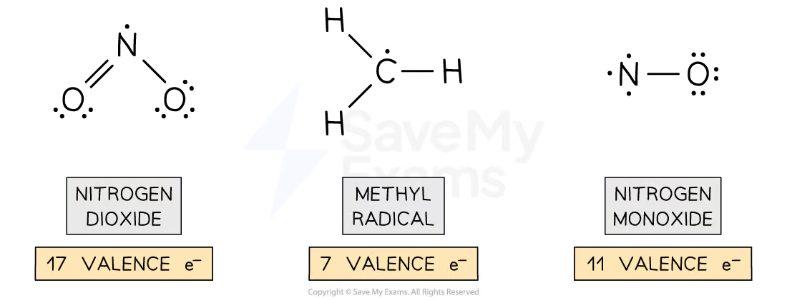

Molecules with an odd number of electrons

## Molecules with expanded valence shells

- There are some molecules that exceed the eight electrons in their valence shell

- An atom with an expanded octet can hold up to ten electrons, or even twelve

- These expansion occurs because there are empty f-orbitals available for bonding after
the third energy shell

- Therefore, the third period elements can occasionally exceed the octet to
accommodate additional electrons

- Expanded octets occurs occasionally when a non metal central atom from the third
period or below, is surrounded by terminal atoms with high electronegativity values

- The most common atoms that form expanded octets are: S and P

## The PCl₅ molecule

The octet of the central phosphorus atom has been expanded to hold 10 electrons

## The SF₆ molecule

The octet of the central sulfur atom has been expanded to hold 12 electrons
