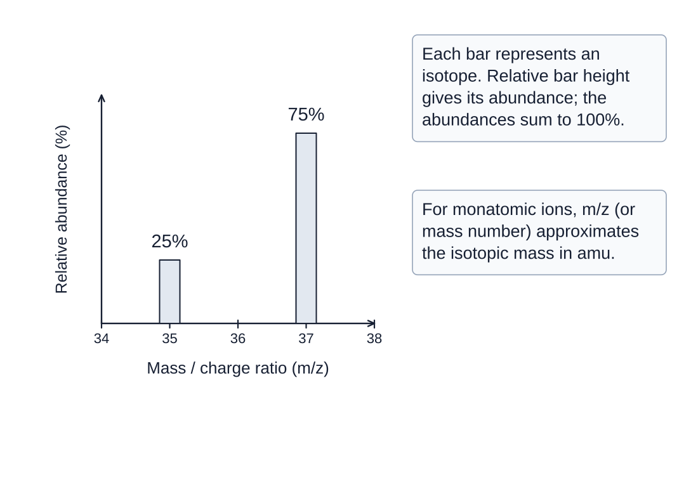
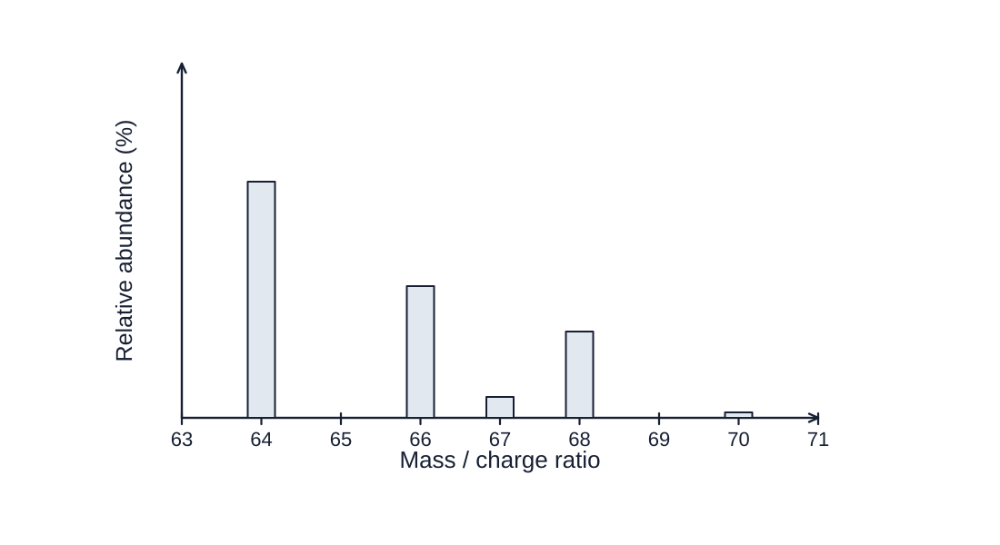

## Contents

- Mass Spectrum of an Element
- Average Atomic Mass

## Mass Spectrum of an Element

- The mass and relative abundance of each isotope of an element in a sample can be
determined using a mass spectrometer

- A mass spectrometer provides this information in the form of a mass spectrum

## Sample mass spectrum

The mass spectrum of chlorine with peaks for the isotopes chlorine-35 and chlorine-37 have abundances of 25% and 75% respectively

- The average atomic mass can be estimated and the identity of an element determined
using the approximate isotopic mass and abundance from a mass spectrum

## Worked Example

Based on the mass spectrum of a pure element shown above, what is the most likely identity of the element?

1. Cu
2. Zn
3. Ga
4. Ni

Answer:

- The average atomic mass of an element must fall between the masses of its
lightest and heaviest isotopes

- The element cannot be Ni (58.69 amu)
- The average atomic mass will most likely be close in value to the mass of the
isotope with the highest abundance

- The element cannot be Ga (69.72 amu)
- The average atomic mass of the element will be near 64 amu, but the element also
has isotopes of significant abundance with masses of 66 and 68

- This will skew the average atomic mass to be greater than 64 amu
- So, the element is Zn (65.38 amu), not Cu (63.55 amu)

## Examiner Tips and Tricks

Note that some textbooks will use the terms relative abundance and percent abundance interchangeably.

## Average Atomic Mass

- Isotopes are different atoms of the same element that have:

- The same number of protons

- A different number of neutrons

- A different mass number

- Most naturally occurring elements have more than one isotope

- The percentage of each isotope in a sample is called relative abundance

- The average atomic mass of an element is a weighted average of the masses of all of the
naturally occurring isotopes of that element

$$\mathrm{average\ atomic\ mass}=\sum(\mathrm{isotope\ mass}\times\mathrm{relative\ abundance})_{1\ldots n}$$

- The relative abundance percentage must be converted to a decimal value by dividing by
100 before proceeding with an average atomic mass calculation

- In decimal form, the sum of the relative abundances will equal 1

## Worked Example

The average atomic mass of boron is 10.81 amu. The two naturally occurring isotopes of boron are listed in the table below.

| Isotope | Mass (amu) |
| --- | --- |
| boron-10 | 10.01 |
| boron-11 | 11.01 |

Using the information provided, calculate the percent abundance of each isotope.

Answer:

- The sum of the relative abundances in decimal form is

- x + y = 1
- Rearranging the equation to solve for x

- x = 1 – y
- The average atomic mass of boron is

- average atomic mass = (isotope mass × relative abundance)1 + (isotope mass
× relative abundance)2
$10.81 = 10.01x + 11.01y$

- Substituting the value of x

- 10.81 = 10.01(1–y) + 11.01y
- 10.81 = 10.01 – 10.01y + 11.01y
- 10.81 = 10.01 + 1y
- 0.80 = y
- Substituting y into the equation for x

- x = 1 – 0.80
- x = 0.20
- The percent abundance of boron-10 is 20% and the percent abundance of
boron-11 is 80%

## Worked Example

| Sample Mass (amu) | Relative abundance (%) |
| --- | --- |
| 125.91 | 51.80 |
| 127.90 | 48.20 |

The results of the analysis of a pure sample of AgF using mass spectroscopy are shown in the table above. Fluorine only has one naturally occurring isotope. Based on this information, what is the average atomic mass of silver?

Answer:

- The average atomic mass of fluorine is 19.00 amu
- The mass of each silver isotope must be

- isotope mass1 = 125.91 amu - 19.00 amu
- isotope mass1 = 106.91 amu
- isotope mass2 = 127.90 amu - 19.00 amu
- isotope mass2 = 108.90 amu
- The average atomic mass of silver is

- average atomic mass = (isotope mass × relative abundance)1 + (isotope mass
× relative abundance)2
- average atomic mass = (106.91 amu × 0.5180) + (108.90 amu × 0.4820)
- average atomic mass = 55.38 amu + 52.49 amu
- average atomic mass = 107.87 amu
