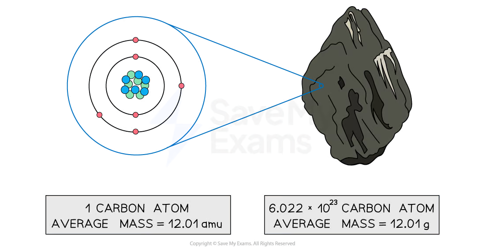

## Moles & Molar Mass

### Contents

- The Mole Concept
- Masses & Particles
- Molar Mass

## The Mole Concept

- The number of particles that react in a chemical experiment cannot be directly determined because the size and mass of an individual particle is so small
- Moles are used to relate the mass of a sample to the number of particles it contains
- The **mole** (mol) is the SI unit for the amount of substance
- The number of moles ($n$) of a substance and the number of constituent particles or formula units it contains are related by **Avogadro’s number** ($N_A$)

$$N_A = 6.022 \times 10^{23}\ \mathrm{mol^{-1}}$$

Number of constituent particles = $N_A \times n$

| 1 mole of… | Fe atoms | H₂O molecules | Al₂(SO₄)₃ formula units |
| --- | --- | --- | --- |
| Contains… | $6.022 \times 10^{23}$ Fe atoms | $1.2044 \times 10^{24}$ H atoms $6.022 \times 10^{23}$ O atoms | $1.2044 \times 10^{24}$ Al³⁺ ions $1.8066 \times 10^{24}$ SO₄²⁻ ions |

### Examiner Tips and Tricks

Note that some textbooks will use the terms Avogadro’s constant and Avogadro’s number interchangeably.

## Masses & Particles

- The average mass of an individual atom, molecule, or formula unit is reported in atomic mass units (amu)
- **Molar mass** ($M$) is the mass of one mole of a substance
- Molar mass has the same numerical value as the corresponding atomic mass but is reported in units of g/mol

| Species | Zn | SO₂ | Ca(C₂H₃O₂)₂ |
| --- | --- | --- | --- |
| Molar mass (g/mol) | 65.38 | 64.06 | 158.168 |

Comparing average atomic mass and molar mass

*The mass of one carbon atom versus one mole of carbon atoms*

### Examiner Tips and Tricks

To solve multiple choice questions involving molar mass more quickly, use rounded atomic masses and memorize the atomic mass of common elements such as H, O, N, C, S, and Cl. However, be sure to use the atomic mass as written on the provided periodic table for all free response questions.

## Molar Mass

The mass of a substance ($m$), the number of moles it contains, and its molar mass are related by

$$n = \frac{m}{M}$$

### Worked Example

How many molecules of C₆H₁₄ does a 42.0 g sample of C₆H₁₄ contain?

**Answer:**

Molar mass of C₆H₁₄

- $M = (6 \times 12.01\ \mathrm{g/mol}) + (14 \times 1.008\ \mathrm{g/mol})$
- $M = 72.06\ \mathrm{g/mol} + 14.112\ \mathrm{g/mol}$
- $M = 86.172\ \mathrm{g/mol}$

Number of moles of C₆H₁₄

$$n = \frac{m}{M}$$

$$n = \frac{42.0\ \mathrm{g}}{86.172\ \mathrm{g/mol}}$$

$$n = 0.4874\ \mathrm{mol}$$

Number of molecules of C₆H₁₄

- Number of molecules = $N_A \times n$
- Number of molecules = $6.022 \times 10^{23}\ \mathrm{mol^{-1}} \times 0.4874\ \mathrm{mol}$
- Number of molecules = $2.94 \times 10^{23}$

**Alternate Answer**

Molar mass of C₆H₁₄

- $M = (6 \times 12.01\ \mathrm{g/mol}) + (14 \times 1.008\ \mathrm{g/mol})$
- $M = 72.06\ \mathrm{g/mol} + 14.112\ \mathrm{g/mol}$
- $M = 86.172\ \mathrm{g/mol}$

Solve for number of molecules of C₆H₁₄ using the factor-label method

$$42.0\ \mathrm{g} \times \frac{1\ \mathrm{mol}}{86.172\ \mathrm{g}} \times \frac{6.022 \times 10^{23}}{1\ \mathrm{mol}} = 2.94 \times 10^{23}$$

### Examiner Tips and Tricks

The factor-label method uses conversions between units that are equivalent to convert from one unit to another. The original number is multiplied by a fraction made up of the equivalent units so that the units of the original number cancel with one of the units in the conversion. If this leads to the units for the answer then the problem is complete. If not, another conversion can be added.
