## Contents

- Structure of the Periodic Table
- Periodic Trends
- Predicting Properties of Elements
- Valence Electrons & Ionic Compounds

## Structure of the Periodic Table

- The periodic table is a tabular arrangement of chemical elements organized based on
their increasing atomic number, from 1 to 118

- The periodic table is organized into horizontal rows called periods and vertical columns
called groups

## The Periodic Table

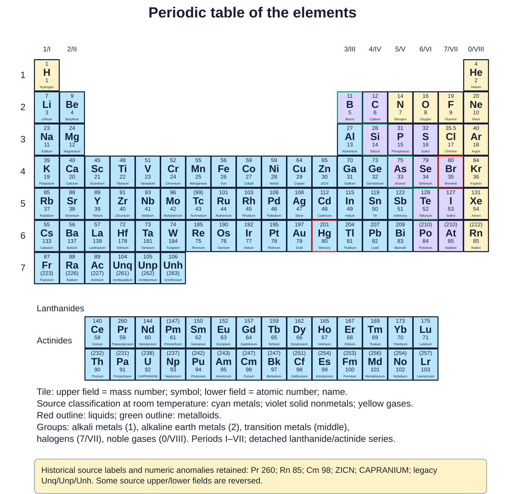

- Periods represent the principal energy shells of an element

- Groups are columns that share similar chemical properties due to the number of
valence electrons

## The Structure of the Beryllium Atom

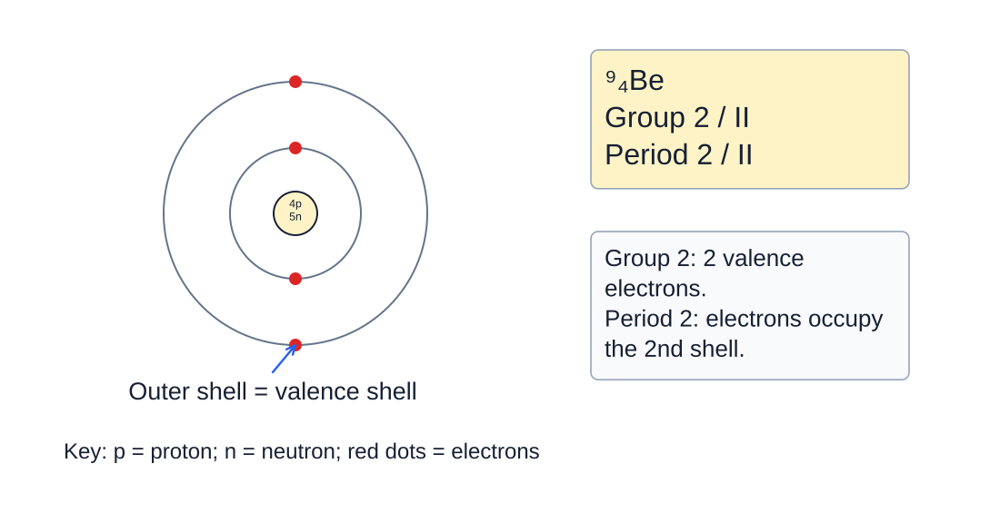

The beryllium atom in the periodic table

- The periodic table is divided into four block types: s-block, p-block, d-block, and f-
block

- s-block elements have only s electrons in their valence shell

- p-block elements have at least one p-electron in their valence shell

- d-block elements have at least one d-electron and one s-electron, but no p or f
electrons in their outer shell (up to 5d)

- f-block elements have at least one f-electron and one s-electron, but not p or f
electron in their outer shell

## Blocks in the Periodic Table

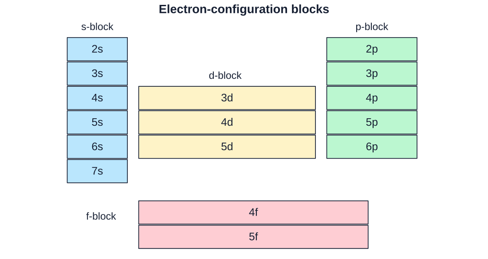

s-block, p-block, d-block, and f-blocks in the Periodic Table

## Electron Configurations

- The arrangement of electrons in the energy shells and subshells of an atom is described
by its electron configuration

- The electron configuration of an element can be predicted by using the periodic table

- The image below shows how this can be done for the germanium atom:

## Electron Configuration of the Germanium Atom

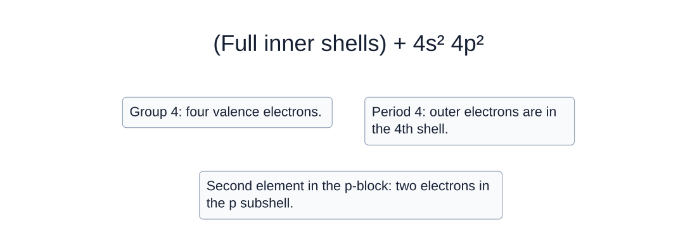

Deducing the electron configuration of germanium as 1s2, 2s2, 2p6, 3s2, 3d10, 4s2, 4p2

- Germanium is in the Group 4 (skipping the transition metals) and in Period 4

- Group 4 tells you that it has 4 valence electrons

- Period 4 tells you that it has the 4 valence electrons in the fourth shell

- Finally, germanium is in the second position of the p-block of the periodic table,
therefore, two electrons must be in the p subshell

## Periodic Trends

- Periodicity refers to the recurring and predictable trends in the properties of elements
as you move across the periodic table

- These trends can be understood through principles such as Coulomb's law, the shell
model, and the concept of shielding/effective nuclear charge

## Ionization Energy

- Ionization energy is the energy required to remove one mole of electrons in gaseous
state from one mole of neutral gaseous atoms, forming one mole of positively charged
gaseous ions

- e.g. The equation below shows the first ionization energy of sodium (Na)

$$\mathrm{Na}_{(g)}\rightarrow\mathrm{Na}^{+}_{(g)}+e^{-}$$

- As you move across a period (from left to right), the ionization energy generally
increases

- There is an increase in the effective nuclear charge because the number of protons
increase

- Therefore, the coulombic attraction between the nucleus and the valence
electrons is stronger, so it is harder to remove an electron

- The shielding does not play an important role along the periods, since atoms in the
same group have the same shielding effect because the number of inner shells is
the same

- The distance between the nucleus and the valence electrons is reasonably the
same

## A graph showing the ionization energies of the elements hydrogen to sodium

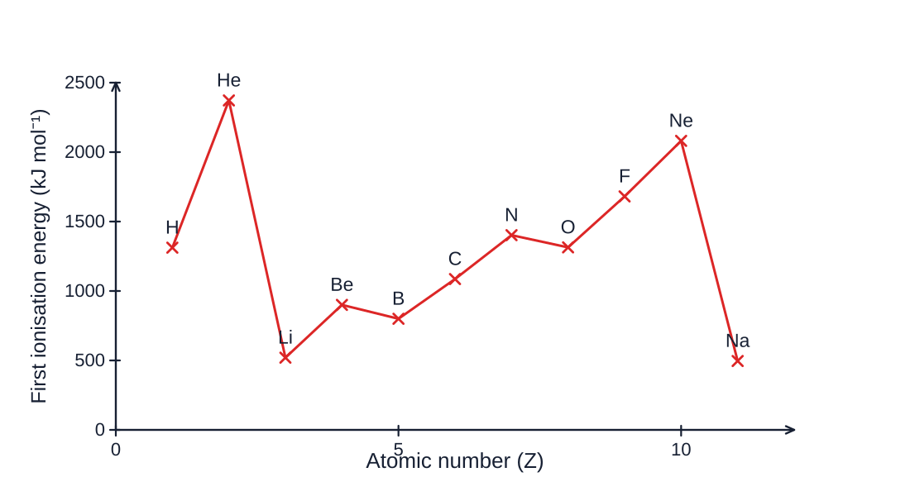

There is a general increase in ionization energy from left to right

- As you move down a group (from top to bottom), the ionization energy decreases

- This occurs because the shielding effect increases because the number of inner
shells increases

- The distance between the nucleus and the valence electrons increases, making the
Coulombic attraction considerably weaker

- Therefore, the effective nuclear charge decreases and its easier to remove an
electron

## A Beryllium and Magnesium Atom

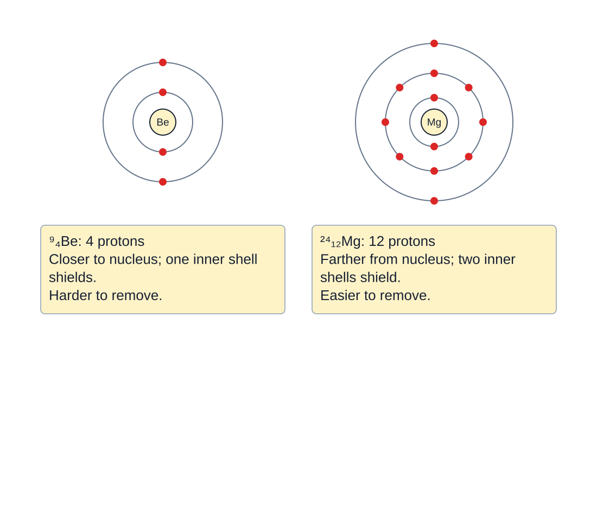

Comparison, between beryllium and magnesium, of the factors that affect the ionization energy

## Atomic Radius

- Atomic radius is the size of an atom

- It can also be defined as the distance from the nucleus to the outermost electron

## Atomic Radius

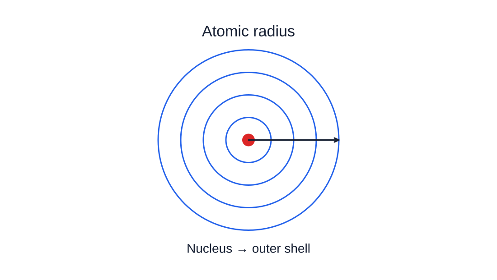

The atomic radius of an atom is the typical distance between the nucleus and the outermost electron shell

- Atomic radius and ionization energy have opposite trends

- As you move across a period (from left to right), the atomic radius generally decreases

- There is an increase in the effective nuclear charge because the number of protons
increase

- Therefore, the Coulombic attraction between the nucleus and the valence
electrons is stronger, which results in smaller atoms

- The shielding does not play an important role along the periods, since atoms in the
same group have the same shielding effect because the number of inner shells is
the same

- As you move down a group, the atomic radius increases

- This occurs because the shielding effect increases because the number of inner
shells increases

- The distance between the nucleus and the valence electrons increases, making the
Coulombic attraction considerably weaker

- Therefore, the effective nuclear charge decreases and the valence electrons are
not pulled strongly, meaning bigger atoms

## Atomic Radii in the Periodic Table

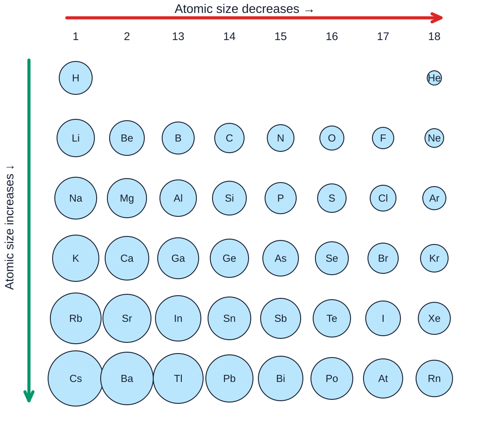

Trends in the atomic radii across a period and down a group

## Ionic Radius

- Ionic radius is the size of an ion, which can be larger or smaller than the corresponding
neutral atom

- Down a group it follows the same pattern as atomic radius

- Ionic radii increase as energy shells are added, decreasing the effective nuclear
charge and the Coulombic attraction from the nucleus

- However, there is a different periodic trend for positive ions (cations) and negative ions
(anions)

- The ionic radius increase with an increasing negative charge

- Negative ions are formed when electrons are accepted, while the nuclear charge is
the same

- Adding electrons creates extra repulsion with the other valence electrons, which
means a bigger ionic radius

- The greatest the negative charge, the largest the ionic radius

- The ionic radius decreases with an increasing positive charge

- Positive ions are formed when electrons are lost, while the nuclear charge is the
same
- Removing electrons decreases the repulsion within the valence electrons, which
means a smaller ionic radius

- The greatest the positive charge, the smallest the ionic radius

## Sizes of Atoms and their Ions in pm

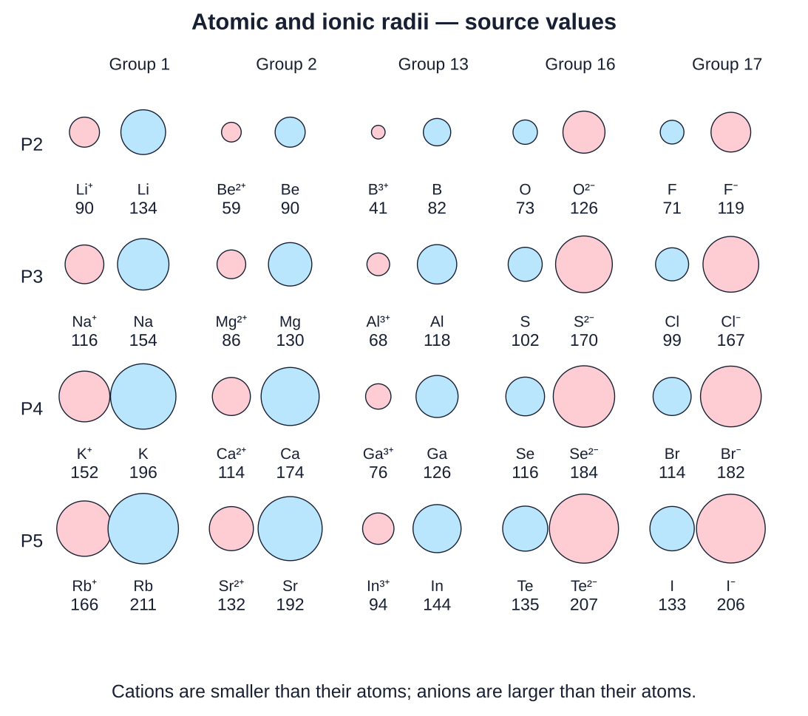

Trends in the ionic radii across a period and down a group

## Electron Affinity

- Electron affinity is the energy change when one mole of electrons are added to one
mole of a neutral atom in gaseous state, forming one mole of negatively charged ions

- E.g. The equation below shows the first ionization energy of sodium (Na)

$$\mathrm{Cl}_{(g)}+e^{-}\rightarrow\mathrm{Cl}^{-}_{(g)}$$

- Electron affinity is an exothermic process, this means that energy is released

- When a process release energy, the sign of the energy is negative

- Elements on the Group 7 (F, Cl, Br, I) of the periodic table have the most negative
electron affinities

- This occurs because these elements tend to be stable as ions with a -1 charge, by
completing the p subshell
- Electron affinity generally decreases down the group

- This occurs because the shielding effect increases because the number of inner
shells increases

- The distance between the nucleus and the valence electrons increases, making the
Coulombic attraction considerably weaker

- Therefore, the effective nuclear charge decreases and the coulombic attraction to
additional electrons is less

- An exception to this rule is fluorine since an additional electron in the 2p subshell
create a considerable repulsion with the other valence electrons

## Electron Affinities

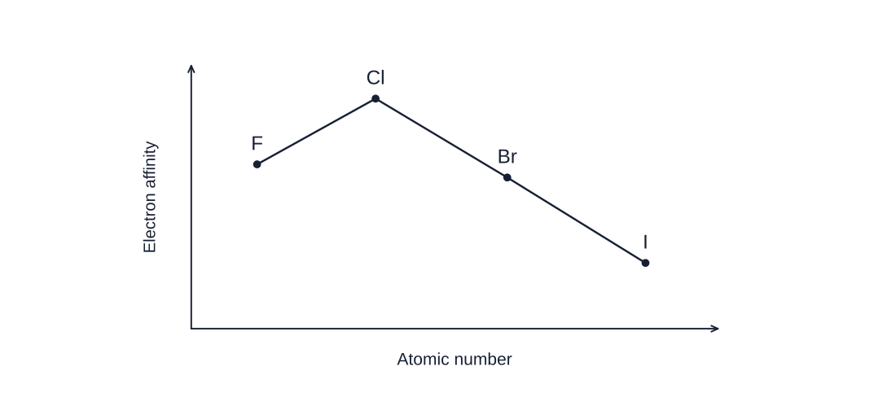

Electron affinities down Group 17 from F to I

## Electronegativity

- Electronegativity measures the ability of an atom to attract a pair of electrons when it
forms a covalent bond

- Electronegativity generally increases across a period (from left to right)

- There is an increase in the effective nuclear charge because the number of protons
increase

- For that reason, the Coulombic attraction between the nucleus and the electrons
from the covalent bond is stronger

- The shielding does not play an important role along the periods, since atoms in the
same group have the same shielding effect because the number of inner shells is
the same

- Down a group, electronegativity decreases

- This occurs because the shielding effect increases because the number of inner
shells increases

- The distance between the nucleus and the valence electrons increases, making the
Coulombic attraction considerably weaker
- Therefore, the effective nuclear charge decreases and the coulombic attraction to
the electrons from a covalent bond decrease
- Electronegativity does not apply to noble gasses since they do not form covalent
bonds

## Trends in Electronegativity

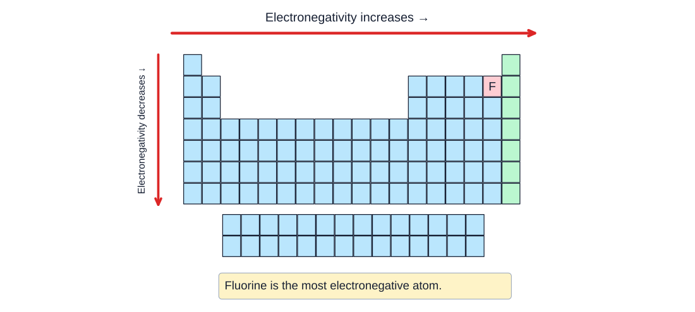

Periodicity of electronegativity - there is an increase from left to right and a decrease from top to bottom

## Examiner Tips and Tricks

When answering free-response questions from Section 2 regarding periodic trends, make sure to always mention: Coulomb’s Law, the shell model (inner shells and valence shell), and the shielding/effective nuclear charge. This is a must if you want to be awarded with full credit for the question

## Predicting Properties of Elements

- The periodic table is a tool that can be used to predict or estimate chemical properties
when information is missing.

- The predictions need to be based in the position of the element in the table

## Worked Example

According to periodic trends, which of the following elements has the smallest atomic radius?

1. Potassium (K)
2. Calcium (Ca)
3. Bromine (Br)
4. Strontium (Sr)

Answer:

- The correct answer is Bromine is in period 3 at the far right side of the periodic
table. Bromine’s nuclear charge is greater than potassium and calcium, and it has
less shielding than Strontium
- Strontium is in period 4. Therefore, the shielding effect is bigger, the coulombic
attraction to the valence electrons weaker, and the atom is bigger. That is why C is
also incorrect
- B and A are not correct since they are in the same period but at the far left. Even if
the shielding effect is the same, the nuclear charge of Potassium and Calcium is
smaller compared to Bromine. Therefore, the coulombic attraction from the
nucleus to the valence electrons is smaller, meaning bigger atoms

## Examiner Tips and Tricks

Expect to be assessed in the prediction of periodic trends in both sections of your AP Chemistry Exam. Make sure to have the chemical principles behind the properties really clear

## Worked Example

Using your knowledge of atomic structure, predict if the ionization energy of Chlorine (Cl) would be greater, smaller or equal than the ionization energy of fluorine (F).

Answer:

- Chlorine has a larger atomic size and more electron shells.
- This leads to weaker coulombic attraction between the nucleus and outer
electrons
- Therefore, less energy is required to remove an electron compared to fluorine

- Fluorine has less shielding effect and the coulombic attraction to its valence
electrons are stronger

## Valence electrons

- Valence electrons are the electrons present in the outermost shell of an atom

- Valence electrons dictate an atom's reactivity and ability to form bonds

- The number of valence electrons can be obtained from the electron configuration of an
atom

## The Beryllium Atom

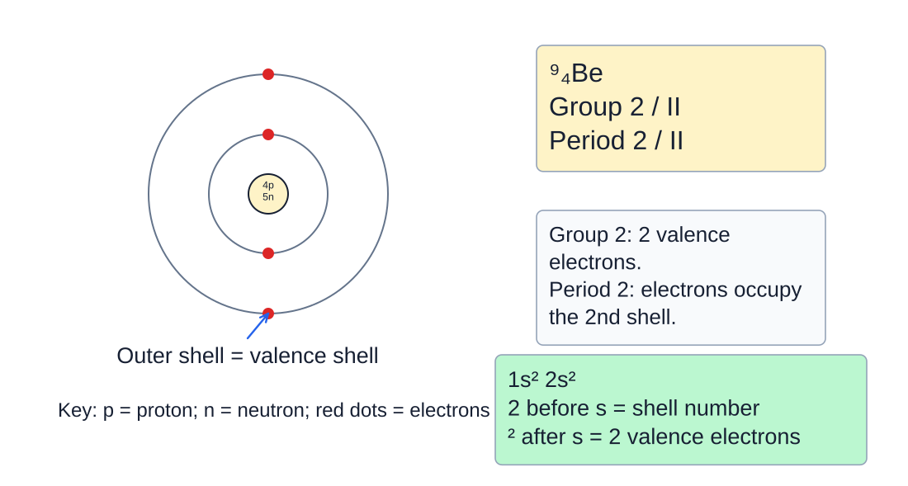

Beryllium electron configuration and valence electrons

- The interactions between the valence electrons and nuclei of elements determine if two
elements are likely to form a chemical bond

- There are two types of chemical bonds depending on the elements that take part in the
bonding process: ionic bond and covalent bond

- An ionic bond occurs between a metal and a nonmetal

- A covalent bond occurs between two nonmetals

## Valence Electrons and the Periodic Table

- Elements in the same group (columns) of the periodic table have the same number of
electrons in their valence shell

- The valence electrons determine the chemical behavior

- As you move across a period from left to right, without counting the transition metals,
the number of valence electrons increases by one

## Formation of Ions

- Ions are atoms that have lost or gained electrons

- Atoms form ions to achieve the electron configuration of their closest noble gas

Noble gasses have a stable electron configuration because of their full outer shell

- Atoms lose electrons to form cations

- Since a cation has more protons than electrons, it has a positive charge

- Cations are formed by elements metals which have few valence electrons

## Sodium Atom Becoming a Sodium Ion

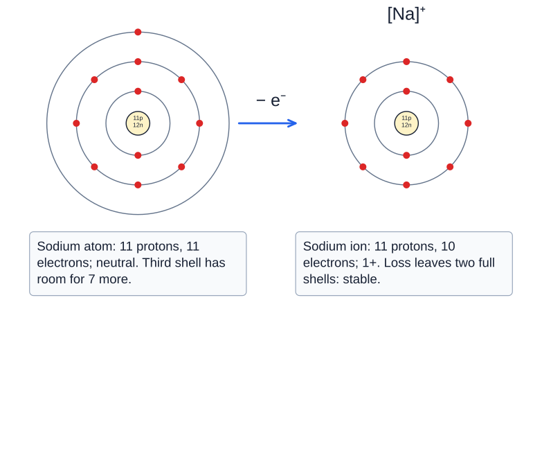

Formation of positively charged sodium ion - sodium loses 1 electron to become a sodium ion

- Atoms gain electrons to form anions

- Since an anion has less protons than electrons, it has a negative charge

- Anions are formed by non-metals which are elements that lack a few electrons

- The electrostatic attraction between a positive ion (cation) and a negative ion (anion) is
defined as an ionic bond

## Chlorine Atom Becoming a Chloride Ion

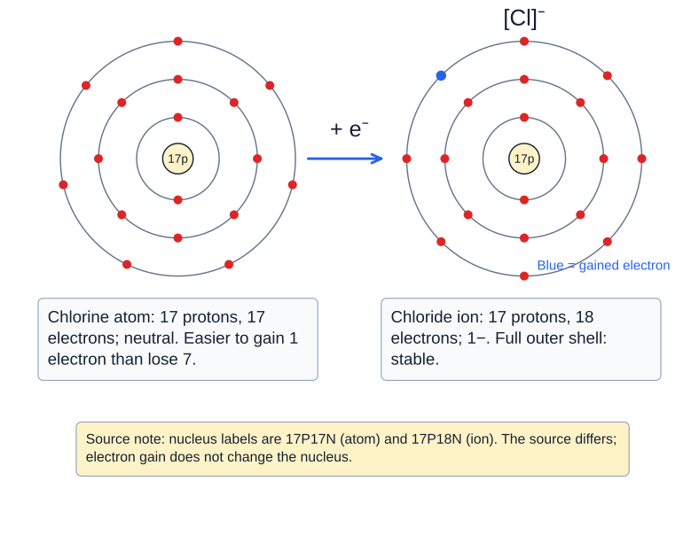

Formation of negatively charged chloride ion - it gains 1 electron to become a chloride ion

## Common ions and the Periodic Table

- The periodic table can help you to identify the typical charges of cations or ions

- Elements in Group 1 tend to lose their lonely electron from their valence shell, therefore,
the common charge for all the elements is 1+

- E.g. Sodium (Na) tend to form Na+ cation

- Elements in Group 2 tend to lose two electrons from their valence shell, therefore, the
common charge for all the elements is 2+

- E.g. Magnesium (Mg) tend to form Mg2+ cation

- Elements in the Group 3 (skipping the transition metals) tend to lose three electrons
from their valence shell, therefore, the common charge for all the elements is 3+

- E.g. Aluminum (Al) tend to form Al3+ cation

- Elements in the Group 5 (skipping the transition metals) tend to gain three valence
electrons, therefore, the common charge for all the elements is 3−

- E.g. Nitrogen (N) tend to form N3− anion

- Elements in the Group 6 (skipping the transition metals) tend to gain two valence
electrons, therefore, the common charge for all the elements is 2−

- E.g. Oxygen (O) tend to form O2− anion
- Elements in the Group 7 (skipping the transition metals) tend to gain one valence
electron, therefore, the common charge for all the elements is 1−

- E.g. Fluorine (F) tend to form F- anion

- Atoms in Group 4 tend not form ions, therefore it is not possible to form ionic
compounds with those elements

## Examiner Tips and Tricks

From Group 1 to Group 3, the positive charge is equal to: charge = number of group. From Group 5 to Group 7, the negative charge is equal to: charge = number of group - 8. This trick works only if the groups of the transition metals are not numbered
