<!-- Source: page 1 -->

## Properties of Solids, Liquids & Gases

## Contents

- Explaining the Properties of Solids & Liquids
- Properties of Ionic Solids
- Covalent Network Solids
- Molecular Solids
- Metallic Solids
- Noncovalent Interactions in Large Molecules
- The Structure of Solids
- The Liquid Phase
- The Gas Phase

<!-- Source: page 2 -->

## Explaining the Properties of Solids & Liquids

## Vapor Pressure & Boiling Point

- Intermolecular forces are broken or formed when solids and liquids change state

- The type and strength of the intermolecular forces can affect the observable properties
of solids and liquids, including:

- Melting point

- Boiling point

- Vapor pressure

- Solubility

- Viscosity

- Surface tension

- Vaporization is when a liquid changes its physical state into a gas

- The reverse of this process, converting a gas back to a liquid, is known as
condensation

## What is vapor pressure?

- Liquids, and even some solids, are continuously vaporizing.

- If we place a quantity of ethanol (CH3CH2OH) in an evacuated, closed container, it
quickly begins to vaporize

- This results in the development of an increasing pressure exerted by the vapor in the
space above the liquid

- After a short time, the pressure of the vapor attains a constant value.

- This constant value is known as vapor pressure

## Vapor Pressure

<!-- Source: page 3 -->

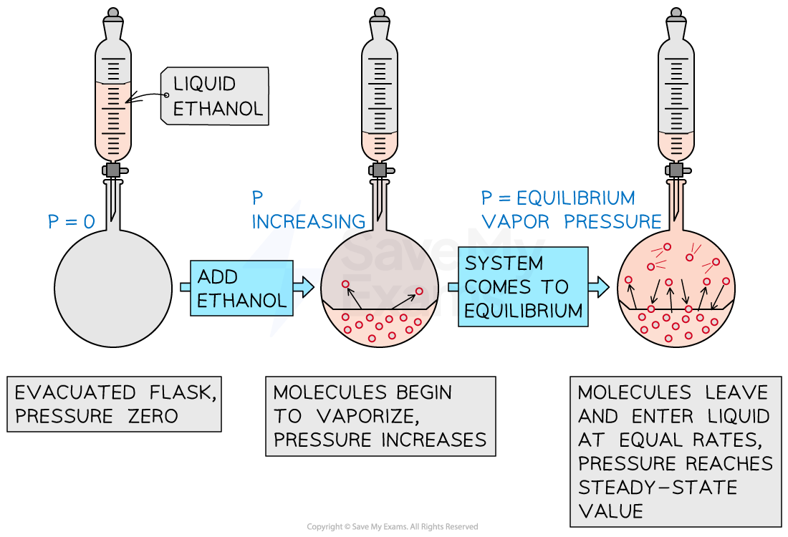

A vapor pressure develops in the evacuated closed container as an equilibrium is established between the rate of vaporization of liquid ethanol and the rate of condensation of gaseous ethanol.

## The vapor pressure of liquids

- The vapor pressure of a liquid is the pressure exerted by its vapor when the liquid and
vapor are in dynamic equilibrium

- A dynamic equilibrium describes a state in which the rate of vaporization and
condensation of a liquid are equal

- Volatile substances have high vapor pressures

- This means that they evaporate quicker than substances with low vapor pressure

- Generally, vapor pressure increases with temperature

- This is because more molecules of the liquid have sufficient energy to break the
intermolecular forces and change to vapor

- The vapor pressure of a liquid depends on intermolecular forces

- A liquid with stronger intermolecular forces has a lower vapor pressure because
there is a greater attraction between the molecules

## What is the Boiling Point?

- The temperature at which the vapor pressure of a liquid equals the pressure exerted on
the liquid (atmospheric pressure, unless the vessel containing the liquid is closed) is
called the boiling point of the liquid

<!-- Source: page 4 -->

- The temperature at which a given liquid boils increases with increasing external
pressure.
- When the pressure is 1 atm, the boiling point is known as normal boiling point
- At a given external pressure, liquids with low vapor pressures have a higher boiling point
while volatile liquids have low boiling points

- So, stronger intermolecular forces mean a lower vapor pressure AND a higher
boiling point

## Vapor Pressure Vs Temperature Graph

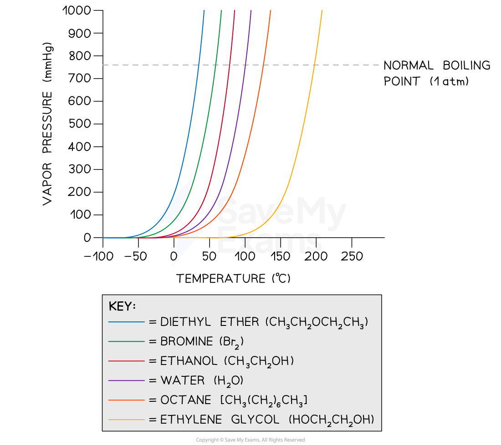

A graph showing the relationship between vapor pressure of several covalent compounds and their boiling points

## Melting Point & Intermolecular Interactions

- The conversion of liquid to solid is called freezing

- The reverse process is called melting or fusion

- The temperature at which a pure liquid freezes is called the freezing point

- The temperature at which a solid melts is called the melting point, which is identical
to the freezing point

<!-- Source: page 5 -->

- Melting or freezing occurs at the temperature where the liquid and solid are in dynamic
equilibrium
- Unlike boiling points, melting points are affected significantly only by large pressure
changes

- Hence, the melting points of crystalline solids cannot be categorized in as simple a
fashion as boiling points

- Melting and boiling points are both indicators of the strength of intermolecular forces

- Stronger intermolecular forces of attraction between the solid particles means that
more energy is required to overcome these forces

- This, in turn, leads to a higher melting point

- For example, the melting and boiling point of group 7A elements increases from
F2 < Cl2 < Br2 < I2 < At2

## Melting & boiling points of the Group 7a elements

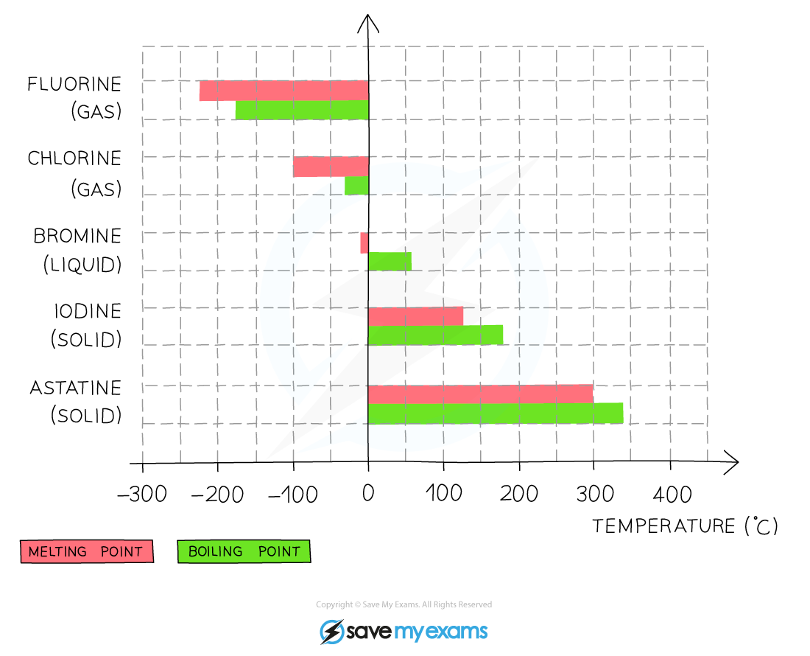

The melting & boiling points of the Group 7a elements increase going down the group as the strength of the intermolecular forces increase

## Particulate-Level Representations

- The properties of solids and liquids can be better understood by showing the
arrangement of particles in each state

<!-- Source: page 6 -->

- The particles in a solid experience intermolecular forces that are strong enough to
restrict their movement
- This means that particles can only vibrate or oscillate about their fixed positions

- Therefore, solids are rigid with well-defined structures that cannot be easily
compressed

- The particles in a liquid experience some intermolecular forces but these are not as
strong as those in a solid

- The arrangement and movement of particles in a liquid are influenced by the nature
and strength of the intermolecular forces

- Hence, the particles in a liquid can move relative to one another, which allows for
liquids to flow

- Similar to solids, liquids are not easily compressed due to a lack of empty space
between the particles

- The solid and liquid phases for a particular substance typically have similar volume

- This is because, in both phases, the constituent particles are in close contact at all
times

## Particulate Representation of Solid and Liquid

In a solid, particles are closely packed and can only exhibit vibrational motion about their fixed positions. However, in a liquid, particles are not as closely packed as solids and are capable of both vibrational and translational motion meaning the liquid substance can flow.

<!-- Source: page 7 -->

## Properties of Ionic Solids

- A solid consists of structural units that are attracted to one another strongly enough to
give a rigid substance

- These structural units can be atoms, molecules, or ions

- The physical properties and structure of solids are dictated by the type of bonds /
forces that hold the particles of solids together

- Based on these bonds / forces, we can classify solids into:

- Molecular solids

- Metallic solids

- Ionic solids

- Covalent network solids

## Structure of Ionic Solids

- An ionic solid is made up of cations (positive ions) and anions (negative ions) held
together by an electrostatic attraction between the oppositely charged ions

- This electrostatic attraction is commonly called an ionic bond

- The ions in an ionic solid are arranged in a regular pattern of alternating positive and
negative ions to give a solid crystal lattice

## Ionic Solid Crystal Lattice

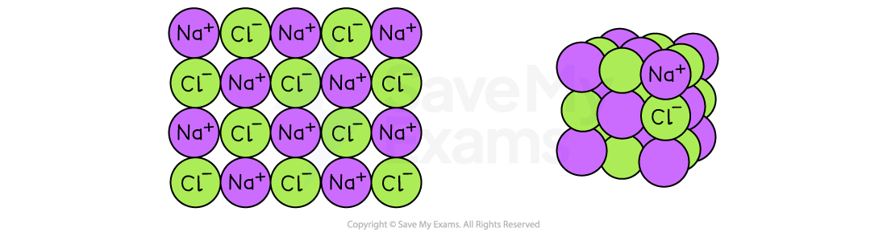

A diagram showing the regular arrangement of alternating positive and negative ions that make up an ionic solid

- The strength of an ionic bond increases as the magnitude of the charges increase and as
the ions get smaller

## Properties of Ionic Solids

- Ionic solids generally have high melting points and high boiling points

<!-- Source: page 8 -->

- This is a result of the strong electrostatic attraction between the oppositely
charged ions
- Despite the high melting and boiling points of ionic solids, they are poor conductors of
electricity in solid state

- This is because the valence electrons are confined to the negative ions and are not
free to move

- However, ionic solids can conduct electricity in solution and molten state due to the
presence of mobile ions

- Unlike metallic solids, ionic solids are brittle and break apart when stress is applied to
the solid

- The applied stress causes the regular cation-anion arrangement to change into
cation-cation and anion-anion arrangement

- This causes repulsion between the similar charged ions and the breakdown of the
crystal lattice

## Brittleness of Ionic Solids

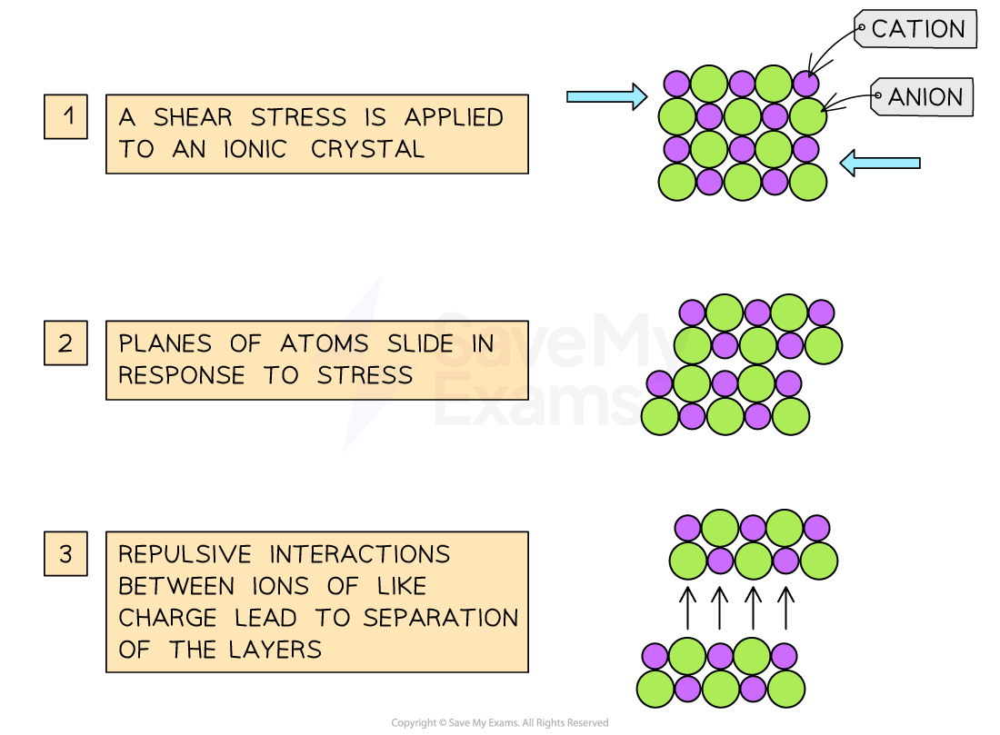

The image shows the effect of applying a shear stress to an ionic solid. The crystal separates along a plane of atoms and leads to repulsive interaction between ions with like charges

- Examples of ionic solids are:

- Cesium chloride

- Sodium chloride (Common salt)

<!-- Source: page 9 -->

- Zinc sulfide (also known as zinc blende)

<!-- Source: page 10 -->

## Covalent Network Solids

## Diamond

- Covalent network solids consist of atoms held together in large networks by covalent
bonds

- Covalent bonds are much stronger than intermolecular forces

- This means that covalent solids are much harder and have higher melting points than
molecular solids

- Examples of covalent network solids include:

- Silicon

- Germanium

- Silicon dioxide (quartz)

- Silicon carbide

- Two familiar examples of covalent network solids are diamond and graphite

- These are allotropes of carbon

- In diamond, each carbon atom is surrounded by a tetrahedral arrangement of other
carbon atoms to form a huge molecule

- These carbon atoms are sp3 hybridized and held together by strong carbon-carbon
single covalent bonds

## Diamond

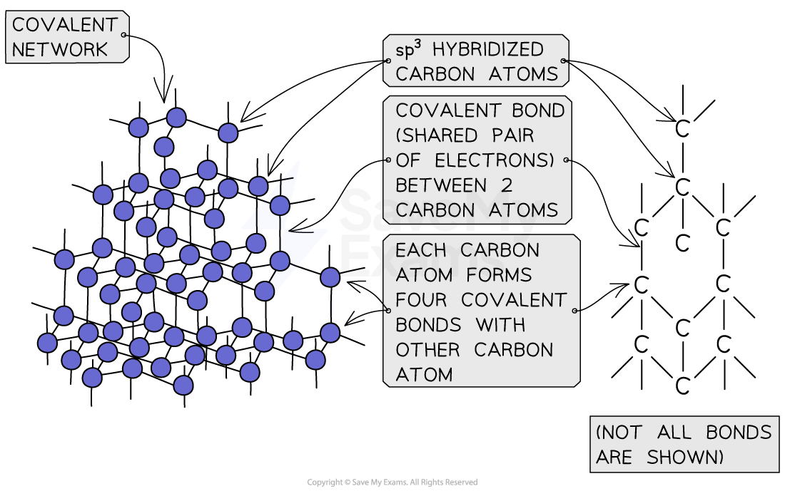

<!-- Source: page 11 -->

Diagram showing the tetrahedral structure of diamond

- Industrial grade diamonds are used as cutting tools because they are very hard
- This is due to the number, strength and directionality of the covalent bonds

- Diamond also has a very high melting point due to its hard, interconnected covalent
network structure

- This also makes diamond a good conductor of heat

- However due to a lack of mobile valence electrons, diamond is a poor conductor of
electricity

## Graphite

- In graphite, carbon atoms are arranged in layers of six-membered (hexagonal) rings
where each carbon atom forms covalent bonds to three other carbon atoms

- Hence, the carbon atoms are sp2 hybridized and have one unhybridized 2p orbital

- Graphite is a good conductor of electricity, unlike diamond

- This is due to the delocalised electrons, that are able to move, in the unhybridized 2p
orbital

- Graphite is brittle and used as a lubricant

- The brittle nature is because the layers of hexagonal carbon rings are held together
by weak London dispersion forces

- These weak forces mean that the layers can slide past one another, an advantage in
lubrication because the sliding layers allow for movement

- The enormous differences in physical properties of graphite and diamond—both of
which are pure carbon—arise from differences in their three-dimensional structure and
bonding

## Graphite

<!-- Source: page 12 -->

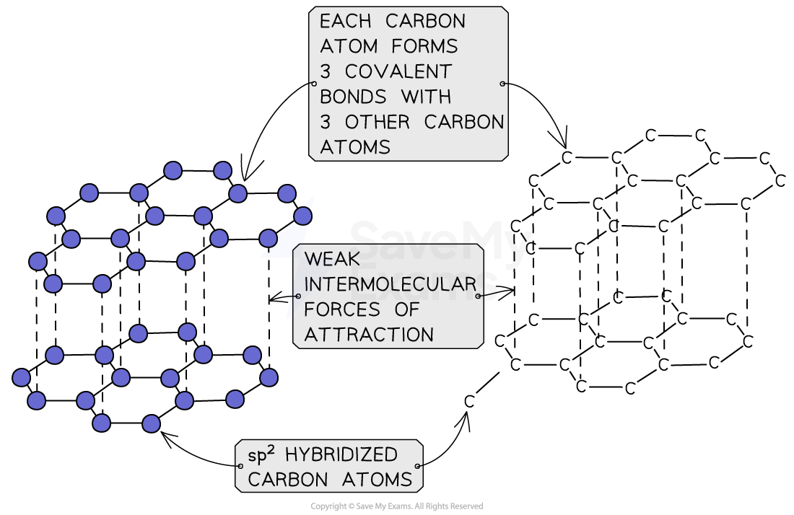

Diagram showing the bonding and structure of graphite

## Silicon Dioxide

- Silicon dioxide, SiO2, is also known as quartz or sand

- It is another example of a naturally occurring covalent network solid with a similar
structure to diamond

- Like diamond, it has a tetrahedral structure

- However, each silicon atom forms covalent bonds with four oxygen atoms while
each oxygen atom forms covalent bonds with two silicon atoms

- The strong covalent bonds in silicon dioxide are responsible for its hardness and high
melting point

- The high melting point is due to the large amount of energy required to break a large
number of strong covalent bonds in the solid

- It also explains its hardness and use as an abrasive and in the manufacture of glass

- Like diamond, silicon dioxide is unable to conduct electricity

- This is because all the valence electrons are involved in bonding

## Silicon Dioxide Structure

<!-- Source: page 13 -->

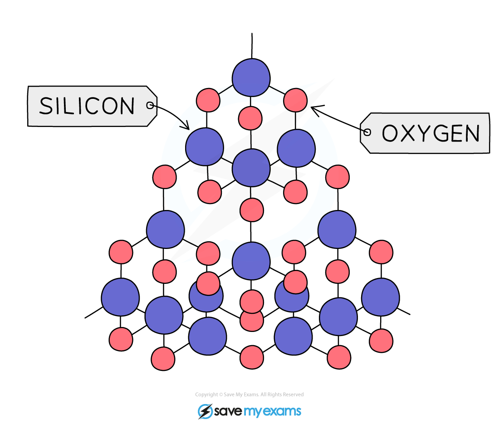

Diagram showing the tetrahedral structure of silicon dioxide. The red atoms are oxygen and the blue atoms are silicon

## Silicon Carbide

- Silicon carbide, SiC, is another example of a covalent network solid consisting of
covalently bonded silicon and carbon atoms

- Silicon carbide has a tetrahedral crystalline structure consisting of four carbon atoms
covalently bonded to a single silicon atom at the center

- Unlike other examples of covalent network solids which are naturally occurring, silicon
carbide is mostly synthetically made and only exist naturally in rare forms

## Properties of Silicon Carbide

- Pure silicon carbide behaves as an insulator

- This is because there are no free electrons which can act as mobile charge carriers

- But, it can exhibit the electrical properties of a semiconductor when impurities are
added

- Silicon carbide is very hard with a hardness close to that of diamond

- Like in diamond, the hardness of silicon carbide is derived from the tetrahedral
structure of silicon and carbon atoms which are held together by strong covalent

<!-- Source: page 14 -->

bonds
- This makes it useful as a cutting tool, bearings and mechanical seals
- Silicon carbide is resistant to high temperature

- Due to the strong silicon-carbon covalent bonds, silicon carbide has a low thermal
expansion and high temperature resistivity

- This means that it is used in the manufacture of fire bricks and other heat-resistant
materials

## Silicon Carbide Structure

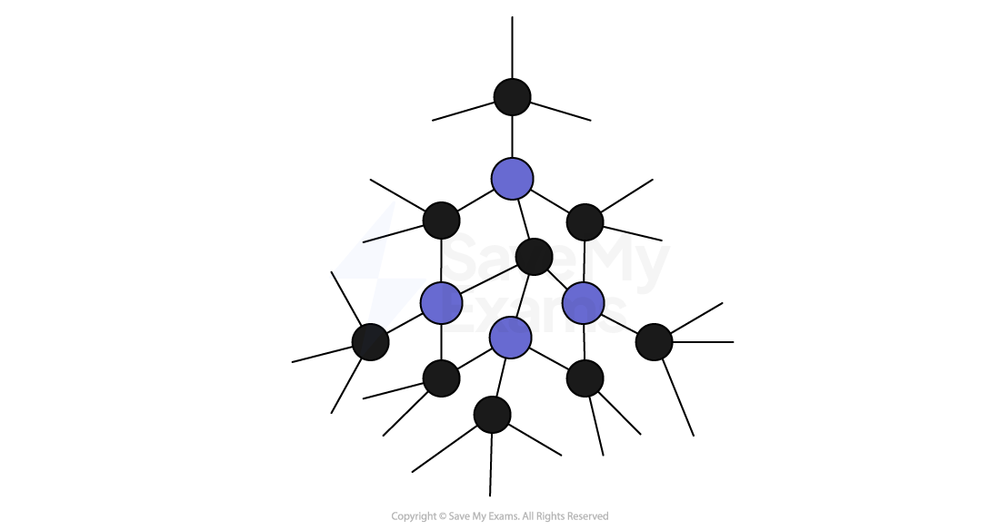

Diagram showing the compact crystal structure of silicon carbide. The black atoms are carbon and the blue atoms are silicon

<!-- Source: page 15 -->

## Molecular Solids

- Molecular solids such as ice, sucrose (table sugar) and iodine are composed of neutral
molecules

- Molecular solids are held together by attractive intermolecular forces with varying
strengths, which is indicated by the different melting points of the solids

- Small nonpolar molecules such as carbon dioxide, water hydrogen gas, fluorine and
nitrogen gas

- These have weak attractive forces and form molecular solids with very low
melting points

- Solid substances like iodine, fullerenes (C60), sulfur crystals (S8)

- These are made of larger, nonpolar molecules that have larger attractive forces
and melt at higher temperatures

- Molecular solids such as ice and sucrose

- These contain permanent dipole moments which means that they
melt/decompose(as in the case of sucrose) at higher temperatures

## Molecular Solid structure

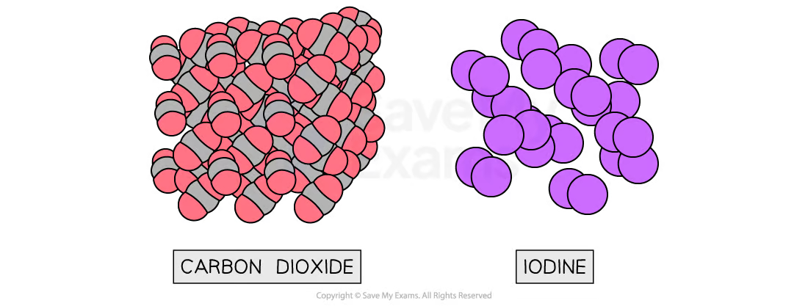

Solid carbon dioxide (CO2) consists of small, nonpolar molecules forming a molecular solid with a melting point of −78 °C, while iodine (I2) consists of larger, nonpolar molecules forms a molecular solid with a melting point of 114 °C

## Properties of Molecular Solids

- Molecular solids are generally non-conductors of electricity

- This is because their valence electrons are not free to move

- Unlike covalent network solids, molecular solids have variable hardness and brittleness
but can be considered to be generally soft and brittle

<!-- Source: page 16 -->

## Metallic Solids

- Metallic solids are made up of metal atoms held together by metallic bonds

- These metallic bonds result from the fact that the valence electrons are delocalized

- This means that the electrons are spread throughout the solid structure and not
fixed to specific atoms

- Metallic solids can be visualized as an array of positive ions immersed in a “sea” of
delocalized electrons

## Bonding in metallic solids

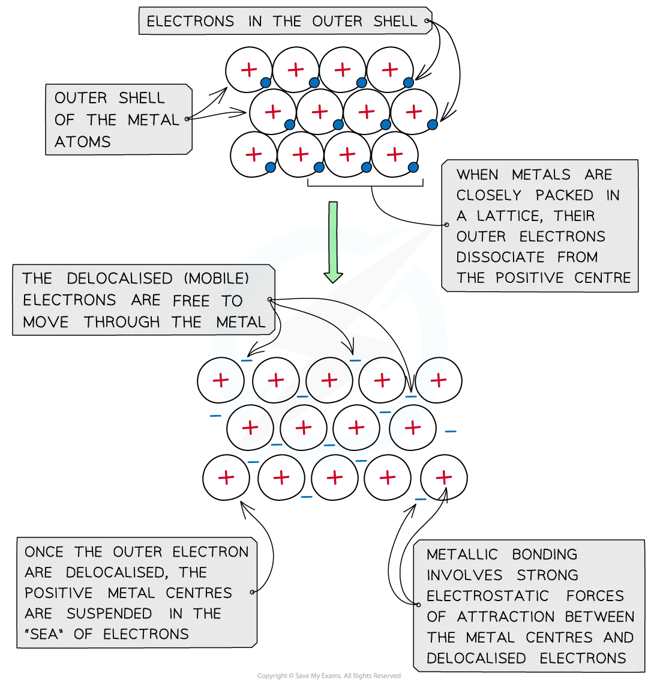

Diagram showing the interaction between the “sea” of delocalized valence electrons and positive metal ions

<!-- Source: page 17 -->

## Properties of Metallic Solids

- Unlike ionic and molecular solids, metallic solids are very good conductors of electricity

- This is due to the presence of the delocalized electrons

- They also have high thermal conductivity which means they have high melting points

- This is due to the strong electrostatic force of attraction between the positive metal
ions and the sea of delocalized valence electrons

- However, most metallic solids are malleable and ductile

- Malleable means that the metallic solid can be hammered into thin sheets

- Ductile means that the metallic solid can be pulled or drawn into wires

- This is due to the layers of positive ions being able to slide over each other

## Alloys

- Alloys are materials made from a mixture of two elements and possess metallic
properties

- The process of mixing metals to form alloys is one of the primary ways of modifying the
properties of pure metallic elements

- For example, pure gold is too soft to be used in jewelry, but alloys of gold are much
harder

- Alloys can be divided into two main categories:

- Substitutional alloys

- Interstitial alloys

- Substitutional and interstitial alloys are both homogeneous mixtures in which
components are uniformly and randomly dispersed

- The homogenous mixtures formed are called solid solutions

## Substitutional alloys

- Substitutional alloys are formed when the solute and solvent atoms have similar atomic
radii and chemical-bonding characteristics

- For example, in brass, one-third of the copper atoms (solvent atoms) are
substituted with zinc atoms

- Other examples of substitutional alloys include:

- Sterling silver - 93% silver and 7% copper

- Pewter - 85% tin, 7% copper, 6% bismuth and 2% antimony

- Plumber’s solder - 95% tin and 5% antimony

## Substitutional Alloy

<!-- Source: page 18 -->

Diagram of brass showing zinc atoms occupying some of the positions in a lattice of carbon atoms

## Interstitial alloys

- Interstitial alloys are formed when the solute atoms and solvent atoms have different
bonding atomic radii and chemical-bonding characteristics

- In these alloys, the solute atoms occupy interstitial positions in the “holes” between
solvent atoms

- Typically, the interstitial atom is a nonmetal that makes covalent bonds to the
neighboring metal atoms

- The presence of the interstitial atoms changes the properties of the solvent metal atoms

- The presence of the extra bonds provided by the interstitial atom causes the metal
lattice to become harder, stronger, less malleable and ductile

- For example, steel, which is much harder and stronger than pure iron, is an alloy of iron
that contains up to 3% carbon

- However, the ability of the metal to conduct electricity is not affected because the
delocalized electrons are retained in the alloys

## Interstitial Alloy

<!-- Source: page 19 -->

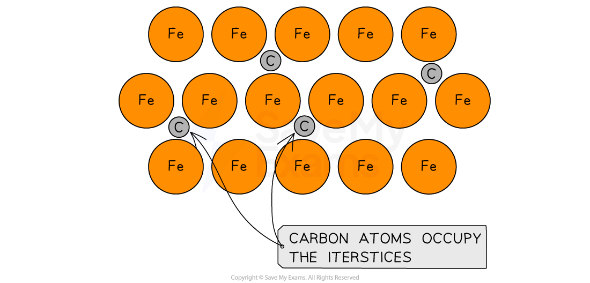

Diagram of steel showing carbon atoms occupying the “holes” in a lattice of iron atoms

<!-- Source: page 20 -->

## Noncovalent Interactions in Large Molecules

- Many substances with very large molecular weight make up the structure of living
organisms and tissues

- Some examples include starch and cellulose, which abound in plants, as well as
proteins, which are found in both plants and animals

- These molecules are known as polymers and are made of smaller molecules called
monomers

## Chemical Structures of Starch and Cellulose

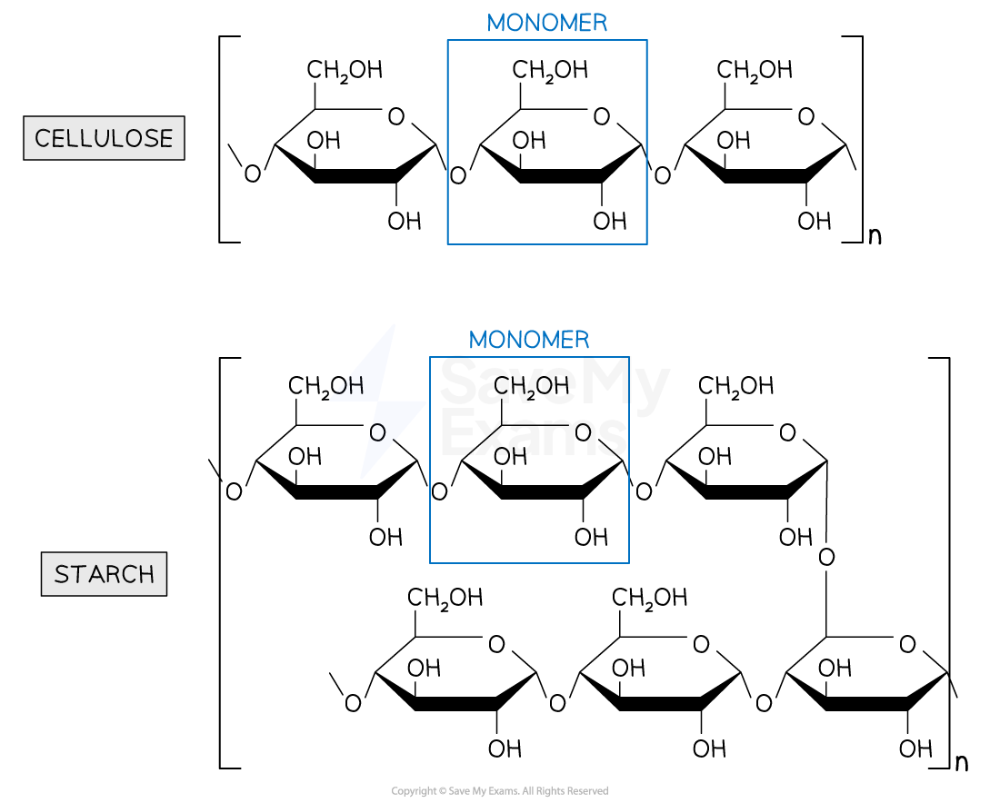

Diagram showing the structures of the starch polymer made from the α-glucose monomers while the cellulose polymer is made from β-glucose monomers

- Some important noncovalent interactions which occur in large molecules include:

- Hydrogen bonding

- Involves interaction between the polar hydrogen atom from an O-H or N-H
bond and the lone electron pairs of very electronegative atoms such as
nitrogen, oxygen and fluorine

- Electrostatic/Ionic interactions

<!-- Source: page 21 -->

- These are attractive interactions observed in molecules with permanent dipoles
- Hydrophobic interactions
- These interactions are seen between nonpolar molecules and polar molecules
such as water

- It explains why large biomolecules like oils do not dissolve in water

- Van der Waals interactions

- A type of interaction that involves polar molecules with permanent dipoles
(dipole-dipole) or nonpolar molecules with induced dipoles

- Some of these interactions have been studied and shown to be present between
proteins and phenolic compounds found in plant-based foods

- These interactions can affect the nutritional properties of food

## Noncovalent Interactions between Proteins and Ferulic Acid

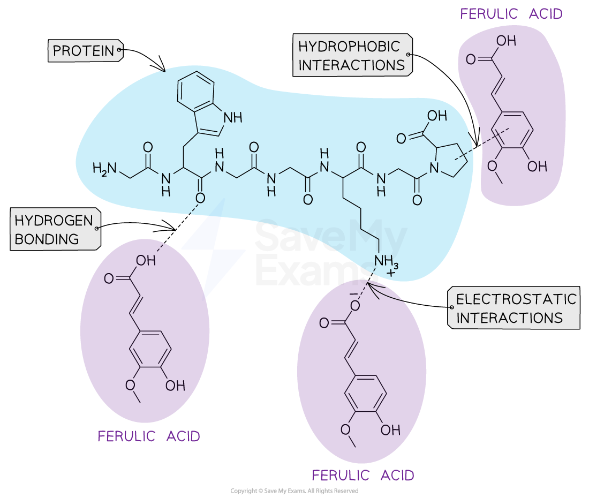

Diagram showing possible non-covalent interactions between proteins and Ferulic acid

<!-- Source: page 22 -->

## The Structure of Solids

- Solids are a nearly incompressible state of matter with well defined shapes

- This is because they are made of atoms, molecules and ions which are in close
contact and in fixed positions

- These particles do not move relative to each other

- This explains why solids do not flow, unlike liquids

- We can visualize a solid as being formed by stacking a large number of small, identical
structural units, in the same manner as building a wall by stacking identical bricks

- Structurally, solids can be divided into two categories:

- Crystalline

- Amorphous

- Solids in which atoms are arranged in an orderly repeating pattern are called crystalline
solids

- The arrangement of particles in a crystalline solid is such that the net attractive
intermolecular forces are at their maximum

- The forces responsible for the stability of a crystal can be

- Ionic forces

- Covalent bonds

- Van der Waals forces

- Hydrogen bonds

- Or a combination of these forces

- When most liquids are cooled, they eventually freeze and form crystalline solids

- Examples of crystalline solids include sodium chloride, sucrose, ice and diamond

- An amorphous solid has a disordered structure; it lacks the well-defined arrangement
of basic units found in a crystal

- The structures of amorphous solids are similar to those of liquids on an atomic level,
but the molecules, atoms and / or ions lack the freedom of motion they have in
liquids

- They may be formed when liquids cool too quickly before their molecules become
arranged in an orderly pattern

- Common examples of amorphous solids are rubber, glass and obsidian

## Structures of crystalline and amorphous solids

<!-- Source: page 23 -->

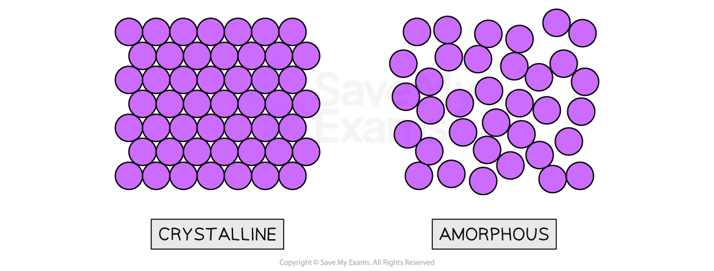

The particles in solids may be arranged in a regular repeating pattern (crystalline) or randomly (amorphous)

<!-- Source: page 24 -->

## The Liquid Phase

- The particles in liquids are in constant random motion but are more tightly packed and
have much less free space between them

- Unlike solids, the particles of liquids are able to move relative to one another, which
means that liquids can flow

## Liquid Phase

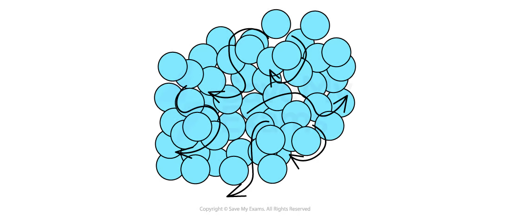

Diagram showing the arrangement and movement of particles that make up the liquid phase

- However, the lack of empty space between these particles makes them nearly
incompressible

- Unlike gases, the size of liquid and solid particles compared to the distance between
them cannot be ignored

- Hence, they have fixed volume and there are no equations to describe the
properties of liquid or solid state as they exist for gases

- The properties of liquids such as surface tension, viscosity, boiling point and vapor
pressure are dependent on two main factors:

- The nature and strength of the intermolecular forces between the particles of the
liquid

- Temperature

- Generally:

- Surface tension — the energy required to increase the surface area of a liquid by a
unit amount— increases with increasing strength of intermolecular force

- Viscosity, which measures the resistance to the flow of liquids also increases with
increasing intermolecular attraction but decreases with increasing temperature

<!-- Source: page 25 -->

- Vapor pressure and boiling point of a liquid are dependent on the strength of the
intermolecular force between the particles of the liquid
- The stronger the intermolecular force, the lower the vapor pressure and the
higher the boiling point of the liquid

## Molar Volume in the Solid and Liquid Phase

- The solid and liquid phases for a particular substance typically have similar molar volume

- This is because the distance between the particles of the substance in the solid
phase is approximately the same as the distance between the particles in the liquid
phase

- Molar volume refers to the volume of one mole of a substance under standard
conditions

## Table of Molar volumes for metals in solid and liquid states

| Metal | Molar Volume of Solid (L) | Molar Volume of Liquid (L) |
| --- | --- | --- |
| Silver (Ag) | 10.3 | 10.7 |
| Aluminum (Al) | 10.0 | 10.5 |
| Gold (Au) | 10.2 | 10.5 |
| Copper (Cu) | 7.1 | 7.3 |
| Nickel (Ni) | 6.6 | 6.8 |
| Lead (Pb) | 18.3 | 18.7 |
| Platinum (Pt) | 9.1 | 9.4 |
| Palladium (Pd) | 8.9 | 9.1 |

The table shows that the molar volumes of metals are similar in both solid and liquid states. The slight differences in value are due to the small space between the particles of the metals in the liquid state, allowing them to flow.

<!-- Source: page 26 -->

## The Gas Phase

- Gases have several characteristics that differentiate them from solids and liquids;

- Unlike solids and liquids, the particles of gases have very little intermolecular force
and are in constant linear random motion

- Given the little intermolecular force and constant random motion of the particles,
gases neither have fixed volume nor shape

- Gases are also highly compressible as a result of the large distance between
particles and

- Gases have much lower densities than liquids or solids

- Also for gases, unlike for liquids and solids, the relationship between pressure, volume,
temperature, and molar amount of substance can be established with fair accuracy by
one simple equation, the ideal gas law

- The pressure of a gas is a measure of the collisions of its particles with the walls of its
container

- The magnitude of the pressure is determined by how often (frequency) and how
forcefully the molecules strike the walls

- Temperature of gas is an indicator of the average kinetic energy possessed by the
particles of the gas

- Hence, an increase in temperature is an increase in average kinetic energy and
an increase in the molecular motion of the particles

- The molecular interpretations of the temperature and pressure of a gas are
explained by the kinetic molecular theory

## Gas Particles

Diagram showing the arrangement and movement of gas particles

> 来源：© 2025 Save My Exams, Ltd.
