<!-- Source: page 1 -->

Your notes

# College Board AP® Chemistry

## Solutions & Mixtures

## Contents

- Calculations About Solutions
- Homogeneous & Heterogeneous Mixtures
- Molarity
- Particulate Representations of Solutions
- Separation By Chromatography
- Separation by Distillation
- Solubility of Ionic & Molecular Compounds

© 2025 Save My Exams, Ltd. Get more and ace your exams at savemyexams.com 1

<!-- Source: page 2 -->

Your notes

## Calculations About Solutions

## Calculations About Solutions

- Usually in calculations involving solutions, we are required to determine:

- Number of moles or mass of solute

- Number of moles of ions that make up the solute

- Molarity of solution

- Volume of solution

- The calculation would involve dilution and require the use of the dilution formula

- Dilution formula: Ms× Vs = Md× Vd

- This is different from calculations involving mixing two solutions containing the same
solute or with a common ion and being asked to determine the concentration of the
mixed solution or the common ion

## Worked Example

What volume of 4.0 M lead(II) nitrate solution, Pb(NO3)2 (aq), contains 0.50 mol of Pb2+? What is the number of moles of NO3− ions present in this solution?

Analyse:

- We are provided with the concentration of the solution (4.0 M) and the number of
moles of Pb2+ ions (0.50 mol)
- We are required to determine the volume of the solution and the number of moles
of the nitrate ions
Plan:

- First, we determine the number of moles of the Pb(NO3)2 solute from the number
of moles of Pb2+ ions using the mole ratio from the dissociation ionic equation
- Use the same mole ratio to determine the number of moles of nitrate, NO3−, ions
- Then use the calculated number of moles of the solute and the concentration to
determine the volume of the solution

Answer:

- Step 1: Write the dissociation equation for the solute:

$$\mathrm{Pb(NO_3)_2}\ (aq)\rightarrow\mathrm{Pb}^{2+}\ (aq)+2\mathrm{NO_3}^{-}\ (aq)$$

- Step 2: From the equation, the mole ratio of Pb(NO3)2 : Pb2+ is 1:1 and Pb2+: NO3−
is 1:2, then:

$$n_{\mathrm{Pb(NO_3)_2}}=n_{\mathrm{Pb}^{2+}}=0.50\ \mathrm{mol}$$

$$n_{\mathrm{NO_3}^{-}}=2\times n_{\mathrm{Pb}^{2+}}=2\times0.50=1.0\ \mathrm{mol}$$

© 2025 Save My Exams, Ltd. Get more and ace your exams at savemyexams.com 2

<!-- Source: page 3 -->

Your notes

- Step 3: Determine the volume of the solution using the molarity expression

- n = M × V
- V = n/M
- V = 0.50/4.0
- V = 0.125 L or 125 mL

## Examiner Tips and Tricks

- This overall question contains more than one question but is not split into parts a,
b, etc

- When you encounter questions like this, you do not have to answer the
questions in the order they are asked
- For this question, you cannot answer the first actual question before the second
one because the number of moles of the solute, Pb(NO3)2, is required to calculate
the volume of the solution

## Worked Example

What is the molar concentration of the KOH solution obtained from mixing two solutions of KOH, A and B?

- Solution A: 55.0 mL of 0.10 M KOH
- Solution B: 75.0 mL of 0.15 M KOH
Analyse: We are provided with the concentration and volume of two aqueous KOH
solutions and asked to determine the concentration of the solution on mixing

Plan:

- Determine the number of moles of the solute in each solution using the molarity
equation
- Determine the total number of moles of the solute by adding the number of
moles from each solution
- Divide this total number of solute moles by the total volume of the solution

Answer:

- Step 1: Determine the number of moles of KOH in solutions A and B:

- For solution A:

- nKOH= M × V (Remember volume must be in L)
- nKOH = 0.1 × 0.0550
- nKOH= 0.0055 mol
- For solution B:

- nKOH= M × V (Remember volume must be in L)
- nKOH = 0.15 × 0.0750
- nKOH= 0.01125 mol

© 2025 Save My Exams, Ltd. Get more and ace your exams at savemyexams.com 3

<!-- Source: page 4 -->

Your notes

- Step 2: Add up the number of moles of KOH from each solution:

$$(n_{\mathrm{KOH}})_T=(n_{\mathrm{KOH}})_A+(n_{\mathrm{KOH}})_B$$

- (nKOH)T = 0.0055 + 0.01125
- (nKOH)T = 0.01675 mol
- Step 3: Determine the total volume of the mixture, in L:

- VT= 75.0 + 55.0
- VT = 130.0/1000

- Remember: volume must be in L
- VT = 0.130 L
- Step 4: Determine the molarity of the mixture by dividing the total number of
moles by the total volume:

- MT = nT/VT
- MT =0.01675/0.130
- MT = 0.129 M

## Worked Example

How much water would be required to dilute 500.0 mL of 2.4 M CaCl2 solution to make a 1.0 M solution?

Analyse: We are asked to determine the quantity of water required to be added to a stock solution (500 mL, 2.4 M) to give a 1.0 M dilute solution

Plan:

- Using the dilution formula, we determine the volume of the dilute solution
- Subtract the volume of the stock solution from the final volume to obtain the
volume of water added

Answer:

- Step 1: Rearrange the dilution formula to determine the volume of the dilute
solution (Vd):

- Vd= Ms × Vs / Md
- Vd= 2.4 × 500.0 / 1.0
- Vd= 1200 mL
- Step 2: Subtract the volume of the stock solution (Vs) from the volume of the
dilute solution (Vd) to obtain the volume of water:

- VH2O= Vd - Vs
- VH2O= 1200 - 500
- VH2O= 700 mLs

## Examiner Tips and Tricks

© 2025 Save My Exams, Ltd. Get more and ace your exams at savemyexams.com 4

<!-- Source: page 5 -->

Your notes

- When using the dilution formula, ensure the volume of the dilute and stock
solutions are in the same units
- When using the molarity expression, always change your volume to liters, L

© 2025 Save My Exams, Ltd. Get more and ace your exams at savemyexams.com 5

<!-- Source: page 6 -->

Your notes

## Homogeneous & Heterogeneous Mixtures

## Homogeneous & Heterogeneous Mixtures

- A mixture is a material that can be separated by physical means into two or more
substances

- For example, when you dissolve sodium chloride in water, you obtain a mixture
whose composition depends on the amount of sodium chloride dissolved

- This mixture can be separated into its components by the physical process of
distillation

- Mixtures are classified into two types:

- Heterogeneous mixtures which consist of physically distinct components with
different properties

- For example, a mixture of potassium dichromate and iron filings which can be
separated by the use of a magnet

- Homogeneous mixtures, also known as solution consist of components with
uniform properties

- Air is an example of a homogeneous mixture of 78 % nitrogen and 21% oxygen
gas as well as other gases

- A solution is a homogeneous mixture made up of:

- The substance being dissolved, the solute

- A medium of dissolution, the solvent

- Solutions exist in three physical states:

- Solids, e.g alloys

- Liquids, e.g sodium chloride in water

- Liquid solutions where the solute is an ionic compound and the solvent is water
are known as aqueous solutions

- Gaseous, e.g air

- A colloid is similar to a solution in that it appears to be homogeneous like a solution

- However, it consists of comparatively large particles of one substance dispersed
throughout another substance or solution

© 2025 Save My Exams, Ltd. Get more and ace your exams at savemyexams.com 6

<!-- Source: page 7 -->

Your notes

## Molarity

## Molarity

- A solution may be described qualitatively or quantitatively

Qualitatively, the terms dilute and concentrated are used to describe the amount of solute in a given quantity of the solvent

- A solution with a relatively small concentration of solute is said to be dilute

- A solution with a large concentration of solute is said to be concentrated

- Quantitatively, a solution is described in terms of its concentration

## Molarity

- Molarity (M) expresses the concentration of a solution as the number of moles of solute
in a litre of solution:

$$\mathrm{Molarity}\ (M)=\mathrm{Moles\ of\ Solute}\ (n)/\mathrm{Volume\ of\ Solution}\ (L)$$

M = n / V

- A 1.00 molar solution (1.00 M) contains 1.00 mol of solute in every 1.0 L of solution

- A solution can be prepared to a specified molarity by weighing out the calculated mass
of solute and dissolving it in enough solvent to form the desired volume of solution

- For example, to prepare 250.0 mL of a 1.00 M solution of CuSO4:

- Determine the number of moles of the solute (CuSO4) required

- In this case, this is given as n = Molarity × Volume

- n = 1.00 × 0.250 = 0.250 mol

- Determine and weigh the corresponding mass of CuSO4 required

- Using the expression: Mass = n × Mr

- The molar mass (Mr) of CuSO4 is calculated as:

- Mr = (Mr)cu + (Mr)S + 4(Mr)O

- Mr = 63.6 + 32.0 + 4 (16) = 159.6 g/mol

- Mass = 0.250 mol × 159.6 g/mol = 39.9 g

- Transfer 39.9 g of CuSO4 into a 250 mL flask and add some quantity of water to
dissolve the solute

- Add more water until the solution reaches the calibrated mark of the flask

## Preparing a Solution

© 2025 Save My Exams, Ltd. Get more and ace your exams at savemyexams.com 7

<!-- Source: page 8 -->

Your notes

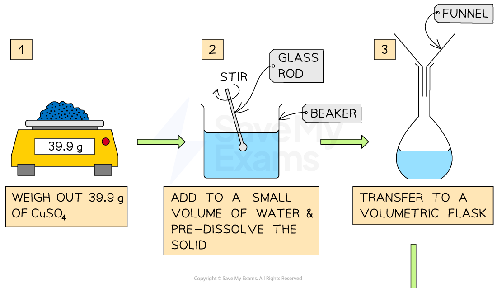

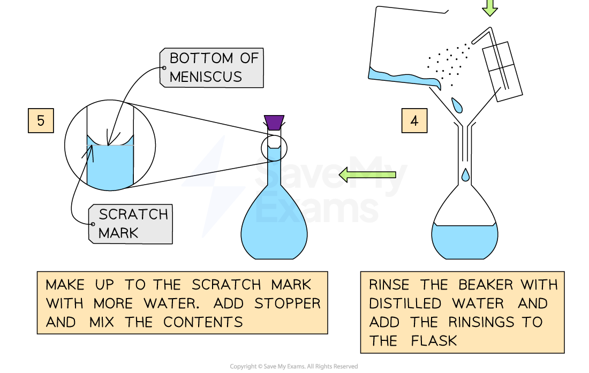

How to prepare a 250mL of 1.00 M solution of CuSO4

## Dilution

- Alternatively, you can start with a more concentrated solution, called the stock solution,
and dilute it with water to give a solution of the desired molarity

- The calculations are straightforward if you keep a simple point in mind: Adding
solvent cannot change the number of moles of solute

- That is:

nsolute (stock solution) = nsolute(dilute solution)

© 2025 Save My Exams, Ltd. Get more and ace your exams at savemyexams.com 8

<!-- Source: page 9 -->

Your notes

- In both solutions, n can be found by multiplying the molarity, M, by the volume in litres, V

- Hence, a dilution expression can be obtained:
Ms × Vs = Md × Vd

- Where the subscripts s and d stand for stock and dilute solutions, respectively

## Worked Example

Calculate the molarity of a solution made by dissolving 5.00 g of glucose (C6H12O6) in sufficient water to form exactly 100 mL of solution. (Mr glucose = 180.2 g/mol)

Answer:

Analyse: We are provided with the mass of glucose and the volume of solution and asked to determine the molarity of the solution

Plan: To determine the molarity of the solution the following steps are required:

Step 1: Convert the mass of glucose to moles and the volume of the solution to litres

- n = Mass/Molar Mass
- n = 5.00/180.2
- n = 0.0277 moles
- Volume = 100/1000
- Volume = 0.1L

Step 2: Substitute the values of the moles of glucose and the volume of the solution

- Molarity (M) = number of moles/volume of solution
- Molarity (M) = 0.0277/0.1
- Molarity (M) = 0.277 M

## Worked Example

1. How many grams of Na2SO4 are there in 15 mL of 0.50 M Na2SO4?
2. How many millilitres of 0.50 M Na2SO4 solution are needed to provide 0.038 mol
of this salt?
Analyse:

- In part a, we are given the volume of the solution and the concentration (Molarity)

- We are then asked to determine the mass of the solute(Na2SO4) required
- In part b, we are given the number of moles of solute and the molarity of the
solution

- We are then asked to determine the volume of solution in millilitres
Plan:

For part a:

© 2025 Save My Exams, Ltd. Get more and ace your exams at savemyexams.com 9

<!-- Source: page 10 -->

Your notes

- Use the molarity expression to determine the number of moles of the solute (n)
- Convert this number of moles to mass
For part b:

- Use the molarity expression to determine the volume of solution in litres
- Convert to millilitres using the appropriate conversion factor

Answer:

- Part a:

- Step 1: Convert volume in mL to L:

- Volume of solution = 15/1000 = 0.015L
- Step 2: Rearrange the concentration expression in terms of the number of
Na2SO4 (n):

- n = M × V
- n = 0.50 × 0.015
- n = 0.0075 moles
- Step 3: Using the mole-molar mass expression, convert the moles of solute
to mass:

- MNa2SO4= n × Mr
- MNa2SO4 = 0.0075× 142.04
- MNa2SO4 = 1.1g
- Part b:

- Step 1: Rearrange the concentration expression in terms of the volume of
solution:

- V = n/M
- V = 0.038/0.50
- V = 0.076 L
- Step 2: Convert volume in L to mL:

- V = 0.076 × 1000
- V = 76 mL

## Worked Example

How many millilitres of 5.0 M Na2Cr2O7 solution must be diluted to prepare 250 mL of 0.10 M solution? How much water needs to be added to this concentrated solution?

Analyse:

- We are given the volume and concentration of the diluted solution and asked to
determine the volume of the concentrated solution required to prepare
- We are then asked the volume of water required to make the dilute solution
Plan:

- Using the dilution formula, we can calculate the volume of the concentrated
solution required

© 2025 Save My Exams, Ltd. Get more and ace your exams at savemyexams.com 10

<!-- Source: page 11 -->

Your notes

- Then subtract that volume from the volume of the dilute solution to obtain the
volume of water required

Answer:

- Step 1: Using M1V1 = M2V2

- Rearrange the equation to V1 = (M2V2)/ M1

- V1 = ?
- M1 = 5.0 M
- V2 = 250 mL
- M2 = 0.10 M
- So, V1= (0.10 × 250)/5.0
- V1 = 5.0 mL
- Step 2: The volume of water added will be:

- VH2O= 250 - 5.0
- VH2O= 245 mL

© 2025 Save My Exams, Ltd. Get more and ace your exams at savemyexams.com 11

<!-- Source: page 12 -->

Your notes

## Particulate Representations of Solutions

## Particulate Representations of Solutions

- A solution is a homogeneous mixture of two substances

- The components of a solution are a solute and a solvent

- The solvent is the component that is in the highest amount

- Liquids usually act as solvents in solutions

- The solute is the component that is in the least amount

- E.g. A mixture of salt water is the best example for a solution. Salt is the solute and water
acts as a solvent

- Any solution in which water acts as a solvent is called an aqueous solution

- Concentration makes reference to the amount of particles of solvent into an specific
volume of solute

- The greater the amount of solute particles in a fixed volume, the greater the
concentration

- A concentrated solution has a large amount of solute particles

- A diluted solution has a relatively small amount of solute

## Examiner Tips and Tricks

Solutions are homogeneous mixtures, therefore the molecules of solute and solvent must be evenly spread in the container without forming regions. If individual regions of solute and solvent are formed, it is not a solution

## Worked Example

Which of the following samples of a salt + water solution has the highest concentration?

© 2025 Save My Exams, Ltd. Get more and ace your exams at savemyexams.com 12

<!-- Source: page 13 -->

Your notes

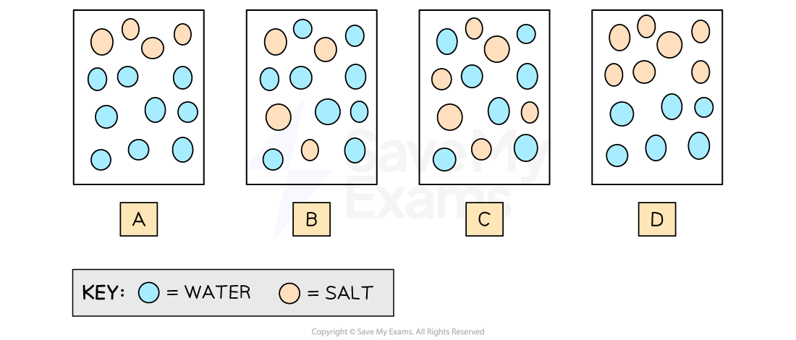

Answer:

The correct answer is C because:

- The particles of solute and solvent are evenly spread in the container
- It has a largest amount of solute particles (salt particles) compared to B which is
also a solution
- A and D are not correct. The particles are forming individual regions of solute and
solvent. Therefore, they are heterogenous mixtures which are not solutions

© 2025 Save My Exams, Ltd. Get more and ace your exams at savemyexams.com 13

<!-- Source: page 14 -->

Your notes

## Separation By Chromatography

## Paper Chromatography

## Principles of Paper Chromatography

- A solution is a mixture that cannot be separated by filtration, therefore an alternative
separation technique must be used

- Paper chromatography is used to separate a mixture of liquids that have different
intermolecular interactions in a given solvent (e.g. separate the coloured inks that were
used to make black ink)

- The substances can be identified by the distance they travel across a sheet of
chromatography paper

- The stronger the interaction with the solvent, the farther the distance the component will
travel up the chromatography paper

- The solvent will travel up the paper because the liquid molecules will have adhesive and
cohesive forces with the pores of the chromatography paper

- Since the solvent moves up the paper, the solvent is called the mobile phase

- Since the chromatography paper stays in a fixed position, it is called the stationary
phase

- The different components of the mixture will be separated because of the different
intermolecular interactions with the mobile and the stationary phases

## Conducting a Paper Chromatography analysis

1. Draw a pencil line at the bottom of the chromatography paper. A sample of the mixture
is placed as a spot on the top of the line. Additional spots of known reference
compounds are placed to identify the components of the mixture

2. Place the paper into the solvent container, making sure that the line sits above the level
of the solvent. This will prevent the samples from washing into the solvent container

3. Analyze the chromatography paper by comparing the sample with the reference
compounds

## Diagram to Show the Method of Chromatography

© 2025 Save My Exams, Ltd. Get more and ace your exams at savemyexams.com 14

<!-- Source: page 15 -->

Your notes

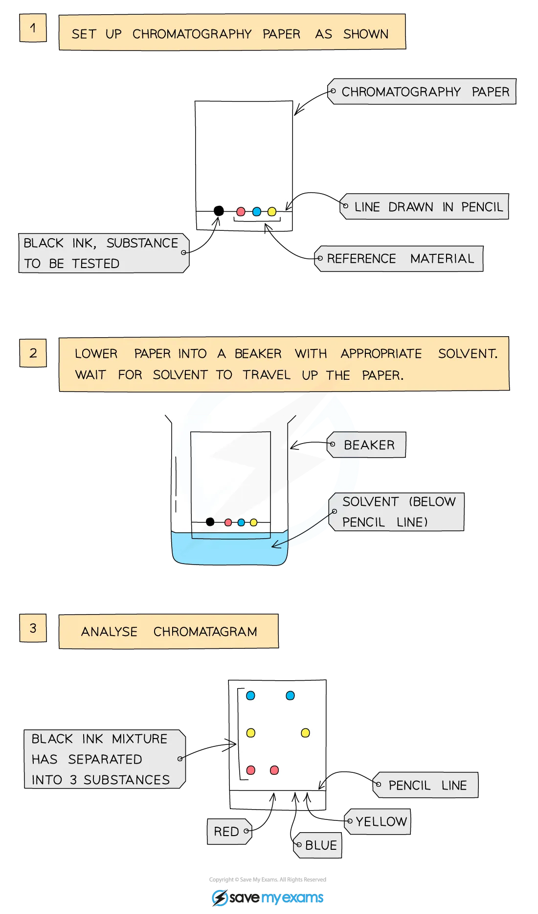

© 2025 Save My Exams, Ltd. Get more and ace your exams at savemyexams.com 15

<!-- Source: page 16 -->

Your notes

Analysis of the composition of ink that can be used using paper chromatography. Blue ink travels the most distance showing the strongest interaction with the solvent and the weakest interaction with the chromatography paper

- The component that travels the greatest distance along the paper has the strongest
intermolecular interaction with the mobile phase and the weakest interaction with the
stationary phase

- The component that travels the shortest distance along the paper has the weakest
intermolecular interaction with the mobile phase and the strongest interaction with
the stationary phase

## Thin Layer Chromatography

## Principles of Thin Layer Chromatography

- Thin Layer Chromatography (TLC) is a separation technique used to analyze the
components of a mixture by exploiting their different affinities towards a material

- In the same way as paper chromatography, there are two phases involved in TLC: an
stationary phase and a mobile phase

## Commonly used stationary phases

- The most common material is a thin metal sheet coated in silica (SiO2) or alumina (Al2O3)

- The different components from the mixture will be separated because of the different
intermolecular interactions with the coating

- Each component will travel a distance that depends on the interaction with the
stationary phase

## Commonly used mobile phases

- It could be polar or nonpolar liquids

- Polar solvents (water or alcohol)

- Nonpolar solvents (liquid alkanes)

- The mobile phase will flow over the stationary phase by adhesive and cohesive forces
with the mobile phase

## Conducting a TLC analysis

1. Draw a pencil line at the bottom of a TLC plate

2. A sample of the mixture is placed as a spot on the top of the line. Additional spots of
known reference compounds are placed to identify the components of the mixture

3. Place the TLC plate into the solvent container and place a lid to cover the beaker, making
sure that the line sits above the level of the solvent. This will prevent the samples from
washing into the solvent container

4. The solvent will begin to travel up the plate

© 2025 Save My Exams, Ltd. Get more and ace your exams at savemyexams.com 16

<!-- Source: page 17 -->

Your notes

5. When the solvent almost reaches the top, draw another pencil line where the solvent has
reached. This indicates the solvent font
6. Analyze the TLC plate and identify the components of the mixture by using the reference
compounds

## Method for TLC Analysis

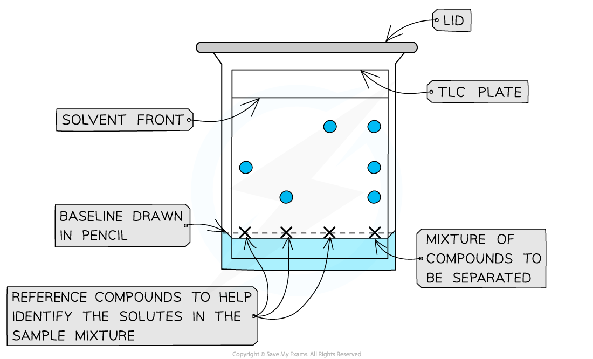

A dot of the sample is placed on the baseline and allowed to separate as the mobile phase flows through the stationary phase; The reference compound/s will also move with the solvent

- The component that travels the most distance has the strongest intermolecular
interaction with the mobile phase and the weakest interaction with the stationary
phase

- The component that travels the less distance has the weakest intermolecular
interaction with the mobile phase and the strongest interaction with the stationary
phase

## Rf values

- The TLC plate can be analyzed to calculate the Rf values for each compound

$$R_f=\frac{\mathrm{Distance\ traveled\ by\ the\ component}}{\mathrm{Distance\ traveled\ by\ the\ solvent}}$$

- These values gives important information about the identity of the components and
their polarities

- Since the stationary phase is polar, the higher the Rf values the more polar the
component

- The Rf value and the difference between the separated substances will also depend on
their solubility in the solvent that acts as the mobile phase

© 2025 Save My Exams, Ltd. Get more and ace your exams at savemyexams.com 17

<!-- Source: page 18 -->

Your notes

## Calculating the Rf value

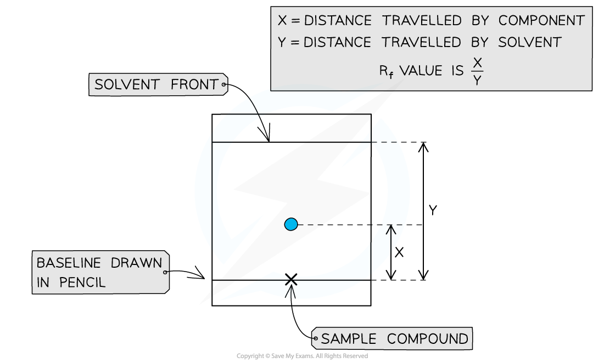

Rf values can be calculated by taking 2 measurements from the TLC plate

## Column Chromatography

## Principles of Column Chromatography

- Column chromatography is the most sophisticated chromatography technique

- In the same way as paper chromatography and TLC, it separates a mixture in its
components by exploiting their different affinities towards a stationary phase and a
mobile phase

- This technique takes more time, but it allows to separate

## Commonly used stationary phases

- In Column chromatography, silica (SiO2) or alumina (Al2O3) are packed in the column

- The different components from the mixture will be separated because of the different
intermolecular interactions with the polar packaging

- Each component will have different movement rates that depends on the interaction
with the stationary phase

## Commonly used mobile phases

- It could be polar or nonpolar liquids, and they need to be compatible with the packing of
the

- The mobile phase will flow down the stationary phase

## Conducting a Column Chromatography analysis

© 2025 Save My Exams, Ltd. Get more and ace your exams at savemyexams.com 18

<!-- Source: page 19 -->

Your notes

1. Pack the column with a stationary phase and ensure an even packing to facilitate uniform
flow. Dissolve the sample in a solvent that is compatible with the stationary phase. Apply
the sample onto the top of the column using a pipette, ensuring a concentrated and
narrow band

2. Choose an appropriate solvent (mobile phase). Pour the solvent mixture into the column
slowly to allow the sample to start moving down the column

3. As the sample moves down the column, different components will separate based on
the interactions for the stationary phase

4. Collect the different mixture components in tubes or vials

5. Label and record all the components of the sample for later analysis

## Column Chromatography

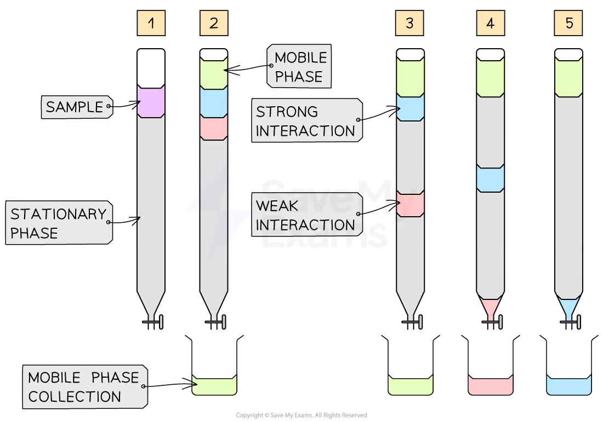

Steps for performing a Column chromatography analysis

© 2025 Save My Exams, Ltd. Get more and ace your exams at savemyexams.com 19

<!-- Source: page 20 -->

Your notes

## Separation by Distillation

## Separation by Distillation

## Principles of Distillation

- A liquid solution is mixture of two miscible liquids that cannot be separated through
filtration, therefore, an alternative separation technique must be used

- Distillation is a technique that exploits the differences in boiling points between the
components of a liquid solution

- The boiling point of the liquids is influenced by the intermolecular forces within the
molecules of the substance

- The stronger the intermolecular forces, the higher the boiling point of the liquid

## Conducting a separation by distillation

- A distillation of a liquid solution of water-ethanol can be carried in simple steps:

1. Place the mixture in a round-bottom flask, and connect it to a fractionating column
followed by a condenser

2. Apply heat to the flask to increase the vapor pressure of the components in the mixture.
Using an electric heater is mandatory when flammable liquids are present in the mixture

3. When the vapor pressure of one of the components of the mixture is equal to the
atmospheric pressure, it will boil. This is the most volatile compound and it vaporizes
first because of its weak intermolecular forces

4. The vapor passes through the condenser, where it cools down, turning itself into a liquid
again

5. As the vapor condenses, the component with the stronger intermolecular forces,
remains in the round bottomed flask

6. Finally, the cooled liquid is collected in a separate container

- For water and ethanol, ethanol has a boiling point of 78 ºC and water of 100 ºC. The
mixture is heated until it reaches 78 ºC, at which point the ethanol boils and distills out of
the mixture and condenses into the beaker

- The temperature should not reach 100 ºC, to prevent water molecules to evaporate

- The fractional column is not necessary if there is a big difference between the boiling
points of the components from the mixture

## Method of Separation by Distillation

© 2025 Save My Exams, Ltd. Get more and ace your exams at savemyexams.com 20

<!-- Source: page 21 -->

Your notes

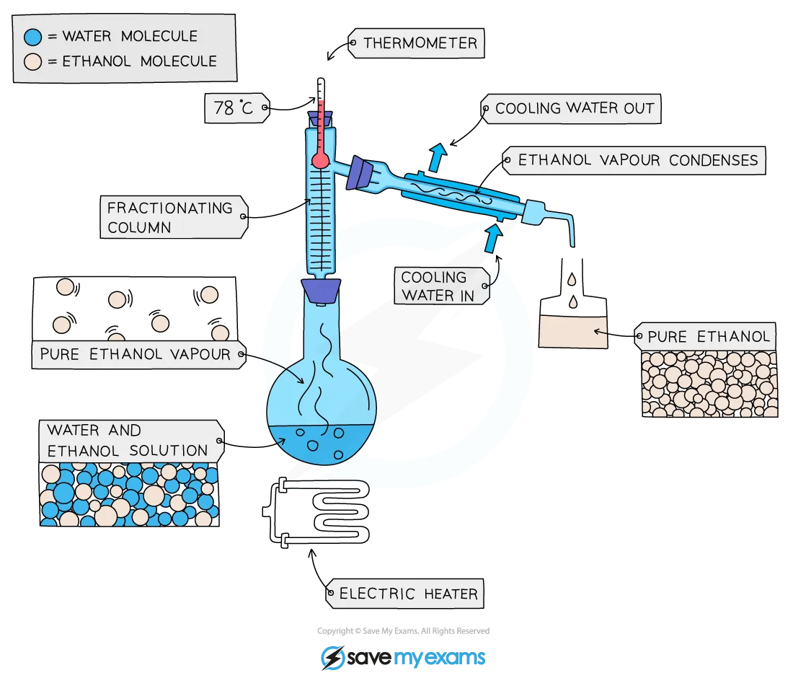

Separation of a mixture of ethanol and water is best achieved by fractional distillation when the two components are close together in boiling point or there are multiple components

© 2025 Save My Exams, Ltd. Get more and ace your exams at savemyexams.com 21

<!-- Source: page 22 -->

Your notes

## Solubility of Ionic & Molecular Compounds

## Solubility of Ionic & Molecular Compounds

- The solubility of two substances depends on their intermolecular interactions

- Ions and molecules can exhibit can exhibit the following interactions:

## Relative strength comparison between the intermolecular interactions

| Interaction | Relative strength |
| --- | --- |
| Ion-dipole | Strongest |
| Hydrogen bonding | |
| Dipole-dipole | |
| London dispersion forces | Weakest |

- A solution is made from two components a solvent and a solute

- In a solution system, intermolecular interactions exists in three possible scenarios:

- Solvent-solute, i.e solvent particles with solute particles

- Solvent-solvent, i.e. solvent particles with themselves

- Solute-solute, i.e.solute particles with themselves

## When does a solution form?

- A solution is formed when solvent-solvent interactions and the solute-solute
interactions are the same

- When this happens, the substances are said to be miscible

- E.g. Ethanol and water present hydrogen bonding interactions. Therefore, they are
miscible in one another

- When the solvent-solvent interaction and the solute-solute interaction are not equal,
the strength of the solvent-solute interaction must be considered

## The three interactions between the particles of solute and solvent

© 2025 Save My Exams, Ltd. Get more and ace your exams at savemyexams.com 22

<!-- Source: page 23 -->

Your notes

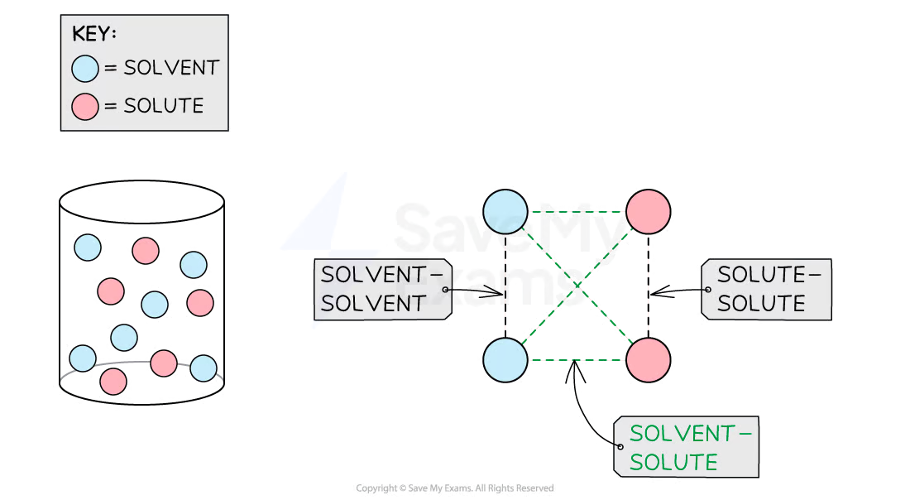

Solvent-solvent, solvent-solute and solute-solute interactions must be considered for solubility

- A solution is formed when the solvent-solute interactions are stronger than the solvent-
solvent interactions

- E.g. Salt and water present ion-dipole interactions. Water molecules present
hydrogen bonding between themselves

ion-dipole > hydrogen bonding

- Therefore, they are miscible in one another

- A solution will not be formed when the solvent-solute interactions are weaker than the
solvent-solvent interactions

- E.g. Hexane and water present London Dispersion Forces. Water molecules present
hydrogen bonding themselves

London-Dispersion Forces < hydrogen bonding

- Therefore, they are not miscible in one another

- The rules of solution formation are summarized in the table below

## Rules of Solution Formation by comparing the intermolecular interactions strengths

| Comparison of the strength between intermolecular interactions | Solution formed? |
| --- | --- |
| Solvent-solute = Solvent-solvent | Yes |
| Solvent-solute > Solvent-solvent | Yes |

© 2025 Save My Exams, Ltd. Get more and ace your exams at savemyexams.com 23

<!-- Source: page 24 -->

Your notes

| Comparison of the strength between intermolecular interactions | Solution formed? |
| --- | --- |
| Solvent-solute < Solvent-solvent | May or may not form |

## Worked Example

Predict if a solution will be formed when chloroform is mixed with an acetone solvent.

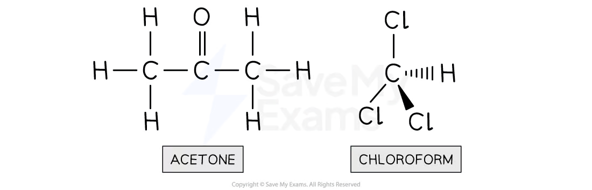

Answer:

Step 1 (Optional): Draw the molecular structure of the solvent molecules and the solute molecules. This step is not applicable to ions since they exist as lattice structures

Step 2: Identify the solvent-solvent intermolecular interactions

- Acetone is our solvent. Since oxygen is more electronegative than carbon, a
dipole moment will be formed

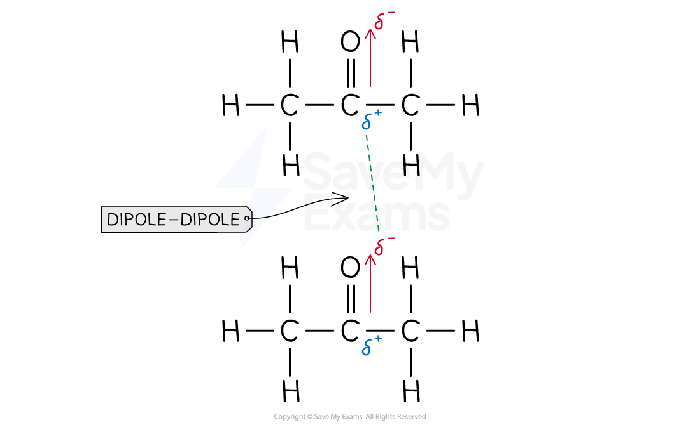

- Therefore, the solvent-solvent intermolecular interaction is dipole-dipole

Step 3: Identify the solute-solute intermolecular interactions

© 2025 Save My Exams, Ltd. Get more and ace your exams at savemyexams.com 24

<!-- Source: page 25 -->

Your notes

- Chloroform is our solute. Since it is a non-symmetrical molecule and chlorine is
more electronegative than carbon, dipole moments will be formed

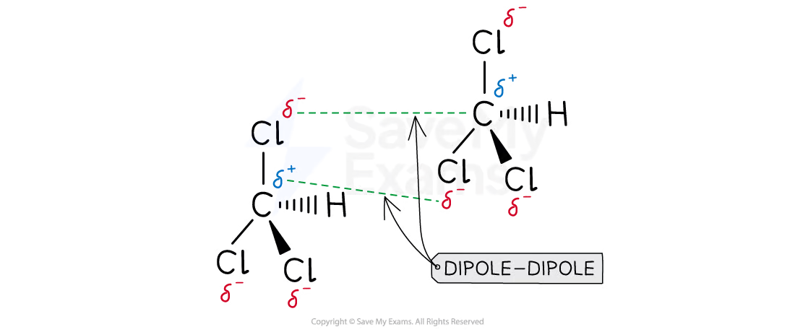

- Therefore, the solute-solute intermolecular interaction is dipole-dipole

Step 4: If the solute-solute interaction and the solvent-solvent interactions are the same, they are miscible. Otherwise, the table should be used and the solvent-solute interactions must be considered

- Since acetone presents dipole-dipole interactions and chloroform presents
dipole-dipole interactions, both solute and solvent will be miscible in one another

## Worked Example

Predict if a solution will be formed when hexane is mixed with water as solvent.

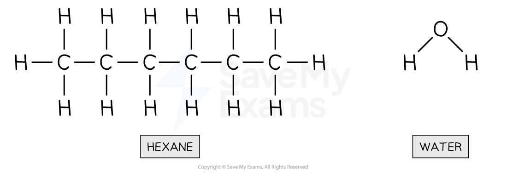

Answer:

Step 1 (Optional): Draw the molecular structure of the solvent molecules and the solute molecules. This step is not applicable to ions since they exist as lattice structures

Step 2: Identify the solvent-solvent intermolecular interactions

- Water is our solvent. Since hydrogen is bonded to a highly electronegative atom
such as oxygen, a strong dipole moment will be formed
- Therefore, the solvent-solvent intermolecular interaction is hydrogen bonding

© 2025 Save My Exams, Ltd. Get more and ace your exams at savemyexams.com 25

<!-- Source: page 26 -->

Your notes

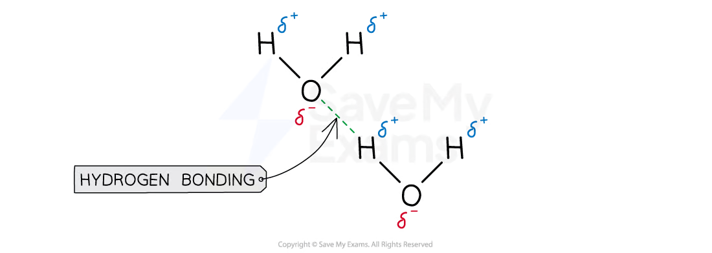

Step 3: Identify the solute-solute intermolecular interactions

- Hexane is our solute. Since hexane is a symmetrical molecule, all its dipole
moments are canceled out

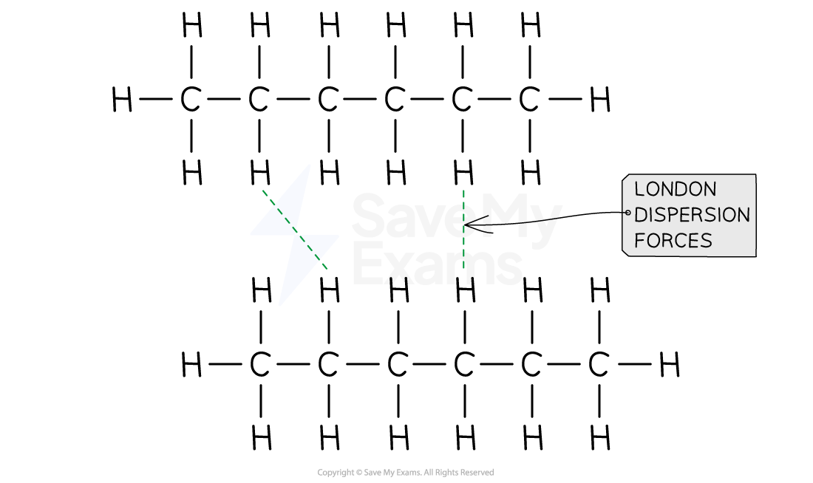

- Therefore, the solute-solute intermolecular interaction are London dispersion
forces

Step 4: If the solute-solute interaction and the solvent-solvent interactions are the same, they are miscible. Otherwise, the table should be used and the solvent-solute interactions must be considered

- The solvent-solvent interaction is not the same as solute-solute interaction
- The solvent-solute interaction must be considered

© 2025 Save My Exams, Ltd. Get more and ace your exams at savemyexams.com 26

<!-- Source: page 27 -->

Your notes

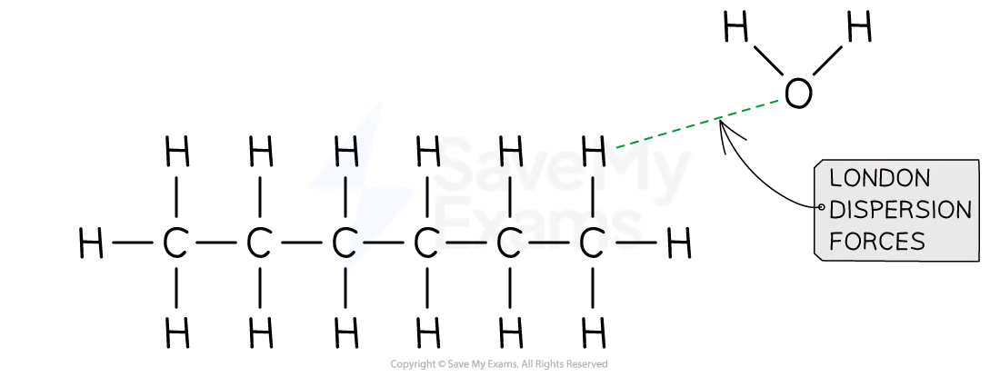

- As shown in the image below, hexane and water present London dispersion
forces interactions because oxygen induces momentaneous dipoles in hexane
- Using the rules of solution, if solvent-solute < solvent-solvent, a solution will not
be formed
- Since London-dispersion forces < hydrogen bonding in terms of relative
strength, hexane and water are not miscible, and a solution will not be formed

© 2025 Save My Exams, Ltd. Get more and ace your exams at savemyexams.com 27
