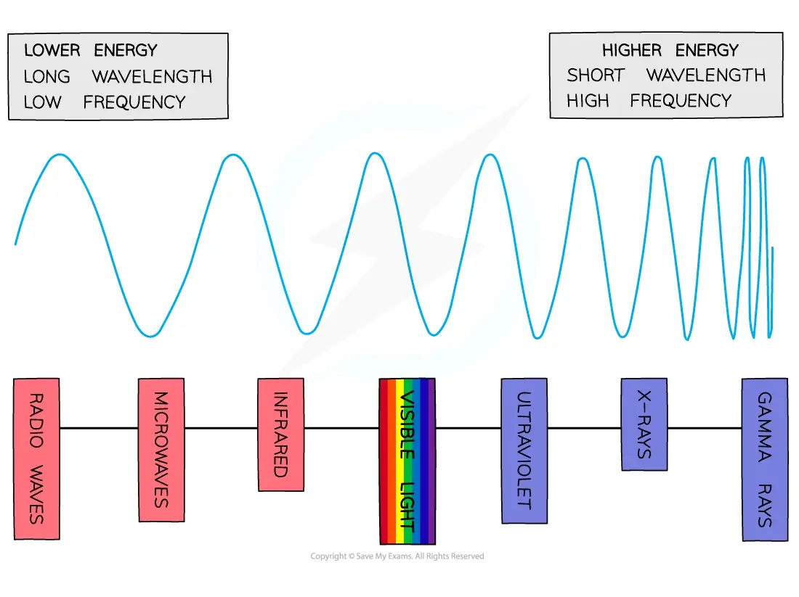
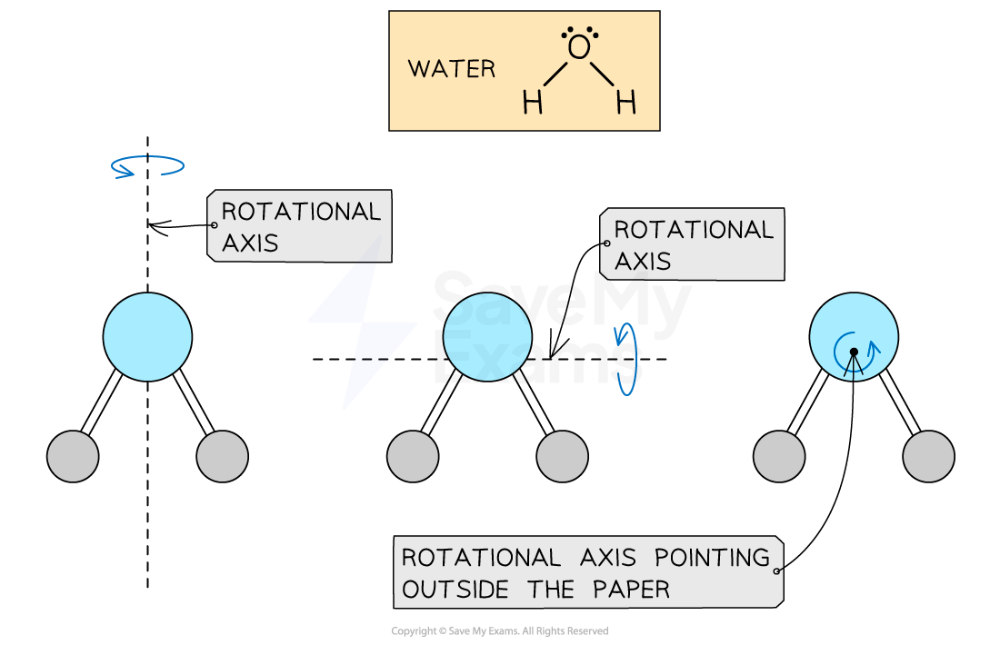
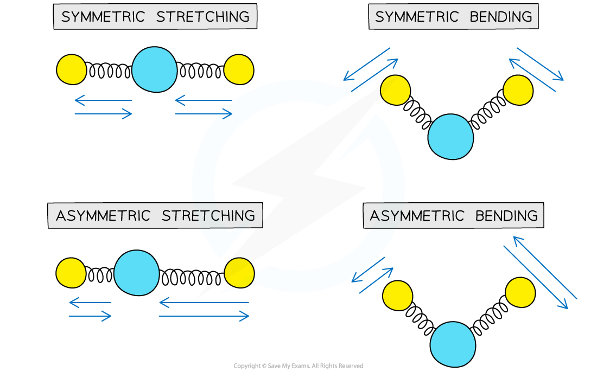
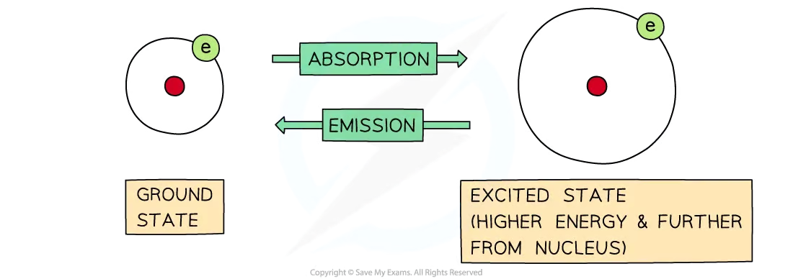
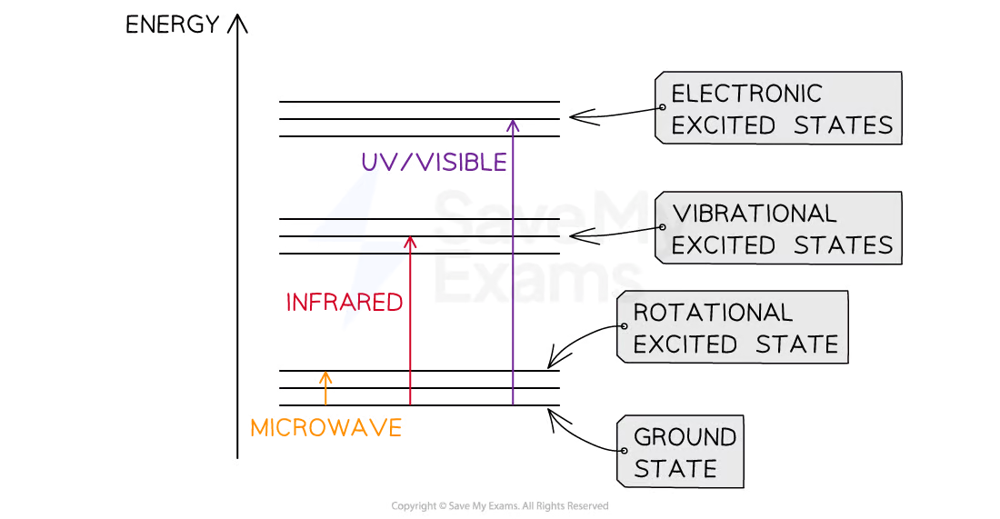
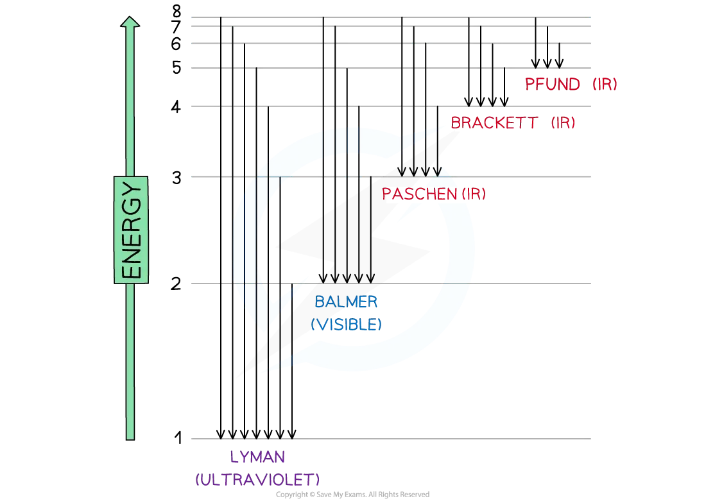
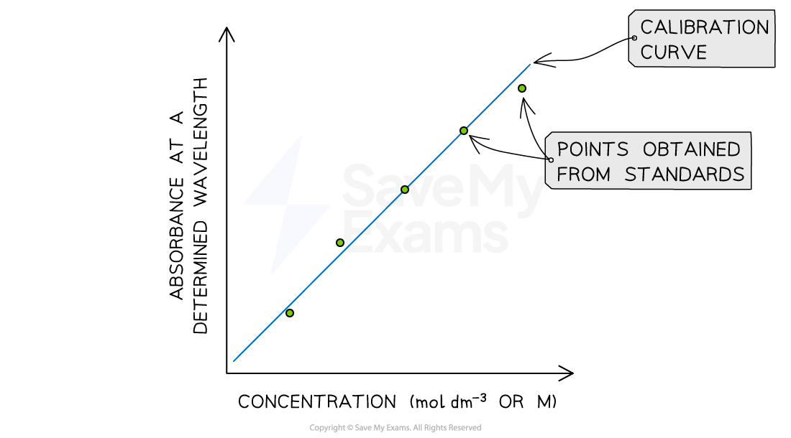
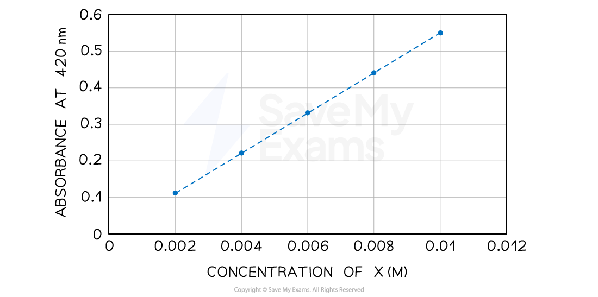
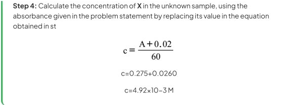

<!-- Source: page 1 -->

Your notes

# College Board AP® Chemistry

## Spectroscopy

## Contents

- The Electromagnetic Spectrum
- Transitions Associated with Radiation
- Properties of Photons
- Beer-Lambert Law

© 2025 Save My Exams, Ltd. Get more and ace your exams at savemyexams.com 1

<!-- Source: page 2 -->

Your notes

## The Electromagnetic Spectrum

## The Electromagnetic Spectrum

- The electromagnetic spectrum is a range of frequencies that includes all wavelengths
of electromagnetic radiation

- The spectrum connects three important variables in the study of light: frequency,
wavelength and energy

- Wavelength is the distance between two consecutive crests on a wave

- Frequency is how many waves occur per second

- The higher energy radiations correspond to the shorter wavelengths

- High energy and high frequency radiation is very damaging for living beings

## The electromagnetic spectrum diagram

The electromagnetic spectrum spans a broad spectrum from very long radio waves to very short gamma rays

- All the light waves travel at the same speed, the only thing that is different is their
frequencies

- The speed of light (c) is a constant and it has a value of 998 x 108 ms-1

© 2025 Save My Exams, Ltd. Get more and ace your exams at savemyexams.com 2

<!-- Source: page 3 -->

Your notes

- Molecules behave in particular ways when they are exposed to radiation of different
frequencies
- When exposed to microwaves, molecules will rotate

- When exposed to infrared radiation, molecules will vibrate

- When exposed to ultraviolet or visible radiation, the electrons will jump between
energy shells

© 2025 Save My Exams, Ltd. Get more and ace your exams at savemyexams.com 3

<!-- Source: page 4 -->

Your notes

## Transitions Associated with Radiation

## Transitions Associated with Microwave Radiation

- Molecules and atoms can absorb light particles (photons)

- When they absorb light, the molecule or atom is promoted to an excited state

- Infrared photons have low energy

- When photons of microwave radiation are absorbed the rotational behavior of a
molecule is stimulated

- Therefore, the molecule is promoted to an excited rotational state

- The different rotational axis of a molecule can be analyzed by thinking atoms as points in
a 3−dimensional system of coordinates

- A rotation will change the orientation of the molecule

- The orientation will depend on the frequency of the photon with microwave
radiation that is absorbed

## Rotational axis in a water molecule

Different rotational axis in a water molecule

- One of the most used examples regarding excited rotational states is the use of the
microwave oven

- The microwave oven transfer rotational energy to the water molecules in your food

© 2025 Save My Exams, Ltd. Get more and ace your exams at savemyexams.com 4

<!-- Source: page 5 -->

Your notes

## Transitions Associated with Infrared Radiation

- Molecules and atoms can absorb low energy infrared photons

- When they absorb a photon, they are promoted to an excited state

- When photons of infrared radiation are absorbed, the vibrational behavior of a molecule
is stimulated

- Therefore, the molecule is promoted to an excited vibrational state

- The modes of vibration of molecules can be analyzed by understanding the covalent
bonds as springs

- In the same ways as springs, there are multiple ways in which a molecule can vibrate

- This will depend on the frequency of the photon with infrared radiation that is
absorbed

## Modes of vibration for the CO₂ molecule

Different modes of vibration in a CO2 molecule. Each mode has a characteristic frequency of vibration

- The analytical technique that exploits the changes in vibrations of atoms to identify
compounds is called infrared spectroscopy

## Transitions Associated with Ultraviolet/Visible Radiation

- Molecules and atoms can absorb photons in the visible and the ultraviolet region of the
spectrum

- When they absorb a photon, they are promoted to an excited state

© 2025 Save My Exams, Ltd. Get more and ace your exams at savemyexams.com 5

<!-- Source: page 6 -->

Your notes

- The energy of visible and ultraviolet photons is high enough to stimulate electronic
transitions
- Therefore, the electrons are promoted from low energy orbitals to high energy
orbitals

- When electrons return to the ground state, energy is emitted

## Absorption and Emission diagram

The difference between absorption and emission depends on whether electrons are jumping from lower to higher energy levels or the other way around

- When an electronic transition occurs, it is usually followed by changes in the rotational
and vibrational states in a molecule

- The image below shows a summary that connects the specific regions of the
electromagnetic spectrum and the types of molecular and electronic transitions
associated with them

- Photons with higher energy are needed to reach electronic excited states.

- On the other hand, lower energy photons (infrared and microwave) can be absorbed
to reach vibrational and rotational excited states

## Summary of the molecular and electronic transitions

© 2025 Save My Exams, Ltd. Get more and ace your exams at savemyexams.com 6

<!-- Source: page 7 -->

Your notes

Electronic, vibration and rotational excited states associated with an specific region of the electromagnetic spectrum

© 2025 Save My Exams, Ltd. Get more and ace your exams at savemyexams.com 7

<!-- Source: page 8 -->

Your notes

## Properties of Photons

## Photons

- One of the main characteristics of light is its wave-particle duality

- This means that light can behave as a wave, but also as a particle

- As seen in previous sections, a light wave has frequency, wavelength and energy

- However, the discovery of the photoelectric effect suggested that light can also
behaves as a particle

- The photoelectric effect was observed when some metals emit electrons when light
was shone on them

- The results of this experiment suggested that light must come into particles

- A light particle is called a photon

## Absorption and Emission of photons

- Electrons move around the nucleus of the atoms in energy shells

- Atoms and molecules can absorb photons, and the electrons will jump to higher energy
shells

- When this occurs, the energy of the atom or molecule increases by an amount equal
to the energy of the photon

- A moment later, a photon will be emitted, and the electrons will return to their original
shell which is also called the ground state

- When this occurs, the energy of the atom or molecule will decrease by an amount
equal to the energy of the photon

## Absorption and Emission diagram

The difference between absorption and emission depends on whether electrons are jumping from lower to higher energy levels or the other way around

## The Hydrogen Emission Spectrum

© 2025 Save My Exams, Ltd. Get more and ace your exams at savemyexams.com 8

<!-- Source: page 9 -->

Your notes

- Niels Bohr constructed the hydrogen emission spectrum where he showed the energy
released when electrons jump from higher shells to lower shells
- Bohr suggested that electrons can only exist in fixed energy shells

- This means that electronic transitions can only occur when photons with an specific
amount of energy are absorbed or released

- Each electronic transition has to do with photons from specific regions of the
electromagnetic spectrum

## Regions of the electromagnetic spectrum

Electron jumps in the hydrogen spectrum

- The jumps can be summarized in table below:

## Electron transitions summary

| Jumps | Region | Energy |
| --- | --- | --- |
| $n_{\infty}\rightarrow n_3$ | Infrared | Low |
| $n_{\infty}\rightarrow n_2$ | Visible | ↓ |
| $n_{\infty}\rightarrow n_1$ | Ultraviolet | High |

## Energy of Photons

© 2025 Save My Exams, Ltd. Get more and ace your exams at savemyexams.com 9

<!-- Source: page 10 -->

Your notes

## Frequency, Wavelength and Energy

- As it was shown in the electromagnetic spectrum, the shorter the frequency of an
electromagnetic wave, the longer its wavelength

Frequency ($\nu$) and wavelength ($\lambda$) are inversely proportional

- The equation that links them is:

$$c=\lambda v$$

- In this equation c is the speed of light which is 2.998 x 108 ms-1

- The spectrum also shows that, the shorter the frequency, the lower the energy of the
radiation

Frequency ($\nu$) and energy (E) are directly proportional

- The equation that links the energy emitted or absorbed by a photon and its
frequency is:

$$E=hv$$

- In this equation h is the Planck’s constant, which is 6.626 x 10-34J s

- These two equations can be used to calculate frequency, wavelength or energy when
one of them is given

## Examiner Tips and Tricks

Both equations and constants can be found in the AP Chemistry Constants and Equations section in your examination

## Worked Example

Calculate the wavelength of the photon emitted when an electron transition has released 1.632 x 10 -18 J

Answer:

Step 1: Calculate the frequency of the photon by using the Planck’s equation

$$E=hv$$

$$v=\frac{E}{h}$$

$$v=\frac{1.632\times10^{-18}\ \mathrm{J}}{6.626\times10^{-34}\ \mathrm{J\,s}}$$

© 2025 Save My Exams, Ltd. Get more and ace your exams at savemyexams.com 10

<!-- Source: page 11 -->

Your notes

v = 2.463 × 1015 s-1

Step 2: Use the frequency calculated in Step 1 to calculate the wavelength of the photon

$$c=\lambda v$$

$$\lambda=\frac{c}{v}$$

$$\lambda=\frac{2.998\times10^8\ \mathrm{m\,s^{-1}}}{2.463\times10^{15}\ \mathrm{s^{-1}}}$$

$$\lambda=1.217\times10^{-7}\ \mathrm{m}$$

© 2025 Save My Exams, Ltd. Get more and ace your exams at savemyexams.com 11

<!-- Source: page 12 -->

Your notes

## Beer-Lambert Law

## Beer-Lambert Law

## Principles of the Beer-Lambert Law

- Every chemical species absorbs light at a given wavelength

- Chemists use the absorbing properties of chemical compounds for quantitative
analysis, using solutions as samples

- The amount of light absorbed by a sample is called absorbance

- Absorbance (A) depends on three variables:

Molar absorptivity in mol-1 dm3 ($\varepsilon$): How strongly a molecule or ion absorbs light of a specific wavelength

- Length in cm (b): The length of the path in which light travels through the sample

- Concentration in M(c); How much absorbing material is present in the sample

- Absorbance does not have units of measurement. and it is directly proportional to molar
absorptivity, length, and concentration. Therefore, the Beer-Lambert Law is given by:

$$A=\varepsilon bc$$

## Beer-Lambert Law in Experiments

In most experiments, molar absorptivity ($\varepsilon$) and the length (b) are constant, therefore, Absorbance (A) is proportional just to the concentration of molecules or ions present in the sample

- This mathematical relation can be used to build a calibration curve

- A calibration curve is a method used to calculate the concentration of an unknown
sample, by comparing its absorbance with the absorbance of standards

- Standards are solutions with known concentration

## How to build a calibration curve?

1. Prepare a series of standard solutions

2. Measure the absorbance at the best possible wavelength

3. Plot an Absorbance vs Concentration curve

4. Draw a line of best fit (it must have a linear positive correlation)

## Example of Calibration Curve

© 2025 Save My Exams, Ltd. Get more and ace your exams at savemyexams.com 12

<!-- Source: page 13 -->

Your notes

Graph showing a calibration curve Absorbance vs Concentration

## Examiner Tips and Tricks

There is a high probability that you will be assessed in Beer-Lambert Law either in Section I or II. In most scenarios, they will give you the calibration curve and the absorbance of an unknown sample. Therefore, you will need to calculate the concentration of the sample using the line equation for the calibration curve

## Worked Example

A student has prepared an experiment to determine the concentration of X (aq) in an
unknown sample. The absorbance at different concentrations is shown below:

© 2025 Save My Exams, Ltd. Get more and ace your exams at savemyexams.com 13

<!-- Source: page 14 -->

Your notes

Calibration curve built using standard samples of X

If the absorbance of the unknown sample is 0.275 at 420 nm, what is the concentration of X in the unknown sample?

Answer:

Step 1: Set up the equation of the line to show the relation between absorbance and concentration

$$A=mc+b$$

Step 2: Calculate the gradient (m) for the equation of the line of the calibration curve, using the data for two nearest standard solutions

Data point 1 $(0.002,0.10)$

Data point 2 $(0.004,0.22)$

$$m=\frac{A_2-A_1}{c_2-c_1}$$

$$m=\frac{0.22-0.1}{0.004-0.002}$$

$$m=60$$

Step 3: Calculate the y axis intercept (b) for the calibration curve by replacing A and c with one of the data points used in Step 1

Data point 1 $(0.002,0.10)$

$$A=60c+b$$

$$0.10=60(0.002)+b$$

$$0.10-60(0.002)=b$$

$$b=-0.02$$

Step 4: Complete the equation of the line for the calibration curve using the calculated values of m and b

$$A=60c-0.02$$

Step 5: Rearrange the equation of the line in terms of the concentration (c)

$$A=60c-0.02$$

$$A+0.02=60c$$

$$c=\frac{A+0.02}{60}$$

© 2025 Save My Exams, Ltd. Get more and ace your exams at savemyexams.com 14

<!-- Source: page 15 -->

Your notes

Step 4: Calculate the concentration of X in the unknown sample, using the absorbance given in the problem statement by replacing its value in the equation obtained in st

$$c=\frac{A+0.02}{60}$$

c=0.275+0.0260

c=4.92×10−3 M

<!-- Transcription note: The final two source expressions are printed with a run-together denominator and baseline -3. They are retained as printed, with the original calculation crop below. -->

© 2025 Save My Exams, Ltd. Get more and ace your exams at savemyexams.com 15
