<!-- Source: page 1 -->

## VSEPR & Hybridization

## Contents

- VSEPR Theory
- Hybridization
- Sigma & Pi Bonds

<!-- Source: page 2 -->

## VSEPR Theory

- The valence shell electron pair repulsion (VSEPR) theory is based on the principle that
electron groups such as single bonds, double bonds, triple bonds, or single electrons
repel one another through Coulombic forces

- The minimize this repulsion, the valence shell electrons should be placed as far apart in
the space as possible

- VSEPR theory consist of three rules:

1. Bonding pairs and lone pairs should be arranged as far apart in space as possible

2. Double and triple bonds are one electron group

3. The Coulombic repulsion forces from lone pairs are stronger than the bonding pairs

- The VSEPR theory and the number of electron groups in an atoms is a useful tool that
can be used to predict the structural and electron properties of the molecules

## Two electron groups

- If there are two electron groups around the central atom, the angle between the bond is
180° which maximize their separation

- The geometry of this molecules is LINEAR

g. BeCl₂, CO₂, and ethyne (HC≡CH)

## Examples of Linear Molecules

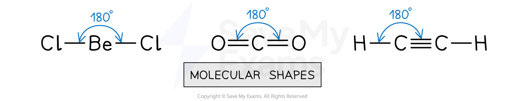

Beryllium chloride, carbon dioxide and ethyne all have two electron groups

## Three electron groups

- If there are three electron groups around the central atom, the angle between the bonds
is 120° which maximize their separation

- The geometry of this molecule is TRIGONAL PLANAR

- E.g. BF3, CH2CH2 and CH2O

## Examples of Trigonal Planar Molecules

<!-- Source: page 3 -->

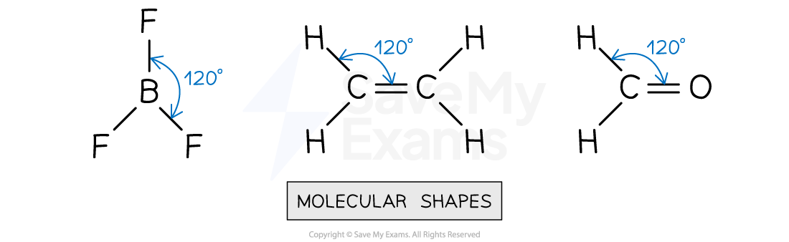

Boron trifluoride, ethene and methanal all have three electron groups

## Four electron groups

- Molecules with four electron groups have three dimensional geometries

- If there are four electron groups around the central atom, there are three case scenarios:

- If the four electron groups are bonding groups, the angle between the bonds is
109.5° which maximize their separation

- The geometry of this molecules is TETRAHEDRAL

- E.g. CH4, NH4+

## Examples of Tetrahedral Molecules

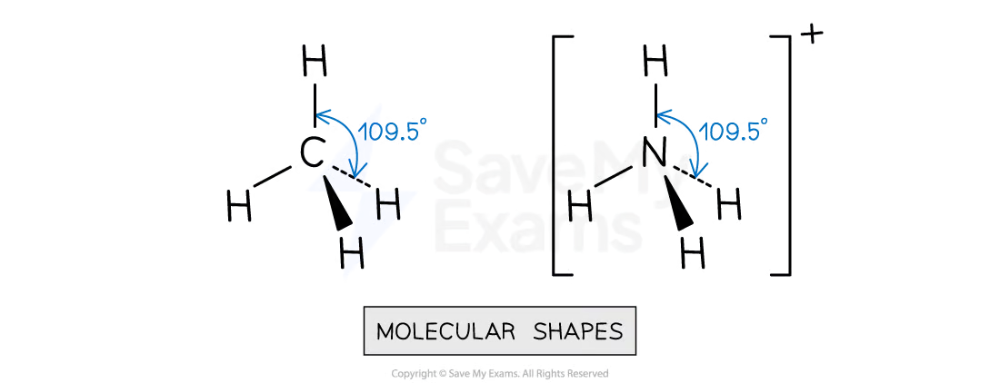

Methane and ammonium ions have four electron domains

- If three electron groups are bonding groups and one is a lone pair, the angle is
approximately 107° which is slightly less than 109.5° due to the Coulombic force of
repulsion generated by the lone pair

- The geometry of this molecules is TRIGONAL PYRAMIDAL

- E.g. NH3

## NH₃ has a Trigonal Pyramidal Geometry

<!-- Source: page 4 -->

The molecular geometry of ammonia

- If two electron groups are bonding groups and two are lone pairs, the angle is
approximately 104.5° which is less than 109.5° due to the Coulombic force of repulsion
generated by the two lone pairs

## Bond Angles in Water

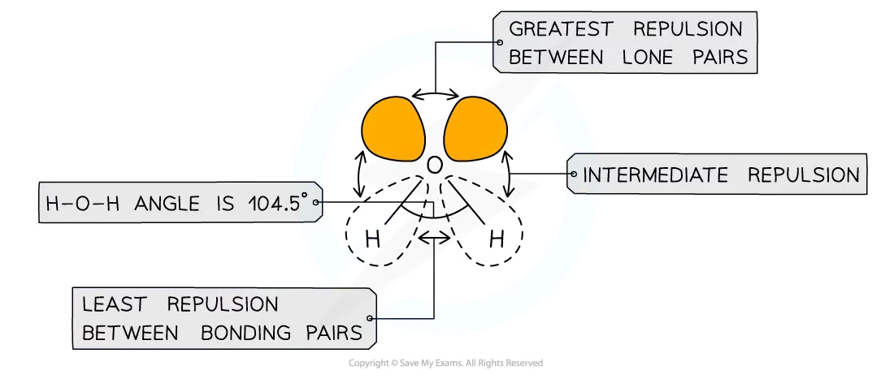

The order of electron pair repulsion is lone pairs > lone pair: bonding pair > bonding pairs

- The geometry of this molecules is BENT or ANGULAR

- E.g. H2O

## Water Has a Bent Geometry

The molecular geometry of water

## Five electron groups

<!-- Source: page 5 -->

- Molecules with five electron groups have three dimensional geometries

- If there are five electron groups around the central atom, there are four case scenarios:
- If the five electron groups are bonding groups, the angle between the equatorial
bonds is 120° and the angle between the axial bonds is 90° which maximize their
separation

- The geometry of this molecules is TRIGONAL BIPYRAMIDAL

- E.g. PCl5

## PCl₅ Has a Trigonal Bipyramidal Geometry

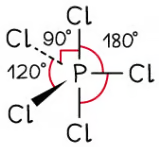

The molecular geometry of phosphorus pentachloride

- If four electron groups are bonding groups and one of them is a lone pair, the angle
between the equatorial bonds is slightly less than 120° and the angle between the axial
bonds is slightly less than 90° due to the Coulombic force of repulsion generated by
the lone pair

- The geometry of this molecules is SEESAW

- E.g. SF4

## SF₄ Has a Seesaw Geometry

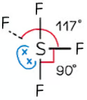

The molecular geometry sulfur tetrafluoride

- If three electron groups are bonding groups and two of them are lone pairs, it is a flat
molecule

- The angle between bonds is slightly less than 90° due to the Coulombic force of
repulsion generated by the lone pairs

- The geometry of this molecules is T-SHAPED

<!-- Source: page 6 -->

- E.g. ClF3

## ClF₃ Has a T-shaped Geometry

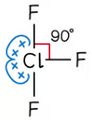

The molecular geometry of chlorine trifluoride

- If two electron groups are bonding groups and three of them are lone pairs, it is a flat
molecule

- The angle between bonds is slightly 180° due to the Coulombic force of repulsion
generated by the lone pairs

- The geometry of this molecules is LINEAR

- E.g. I3−

## I₃⁻ Has a Linear Geometry

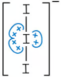

The molecular geometry of the triiodide ion

## Six electron groups

- Molecules with five electron groups have three dimensional geometries

- If there are six electron groups around the central atom, there are three case scenarios:

- If the six electron groups are bonding groups, the angle between the bonds is 90°
which maximize their separation

- The geometry of this molecules is OCTAHEDRAL

- E.g. SF6

## SF₆ Has an Octahedral Geometry

<!-- Source: page 7 -->

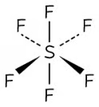

The molecular geometry of sulfur hexafluoride

- If five electron groups are bonding groups and one of them is a lone pair, the angle
between the bonds is slightly less than 90° due to the Coulombic force of repulsion
generated by the lone pair

- The geometry of this molecules is SQUARE PYRAMIDAL

- E.g. BrF5

## BrF₅ Has a Square Pyramidal Geometry

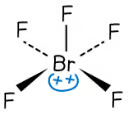

The molecular geometry of bromine pentafluoride

If four electron groups are bonding groups and two of them are lone pairs, it is a flat molecule

- The angle between the bonds is 90° and the lone pairs are place at 180° minimizing the
repulsion interaction between them

- The geometry of this molecules is SQUARE PLANAR

- E.g. XeF4

## XeF₄ Has a Square Planar Geometry

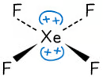

The molecular geometry of xenon tetrafluoride

In the table below it is a summary of the molecules that are part of the VSEPR

<!-- Source: page 8 -->

## Summary of the VSEPR theory

| Electron groups | Bonding groups | Lone Pairs | Molecular Geometry | Bond angles |
| --- | --- | --- | --- | --- |
| 2 | 2 | 0 | Linear | 180° |
| 3 | 3 | 0 | Trigonal planar | 120° |
| 3 | 2 | 1 | Bent | <120° |
| 4 | 4 | 0 | Tetrahedral | 109.5° |
| 4 | 3 | 1 | Trigonal pyramidal | 107° |
| 4 | 2 | 2 | Bent | 104.5° |
| 5 | 5 | 0 | Trigonal bipyramidal | 120° (equatorial) 90° (axial) |
| 5 | 4 | 1 | Seesaw | <120° (equatorial) <90° (axial) |
| 5 | 3 | 2 | T-shaped | <90° |
| 5 | 2 | 3 | Linear | 180° |
| 6 | 6 | 0 | Octahedral | 90° |
| 6 | 5 | 1 | Square pyramidal | <90° |
| 6 | 4 | 2 | Square planar | 90° |

## Examiner Tips and Tricks

VSEPR theory is one of the most assessed topics in AP Chemistry. The molecular geometry, bond angles, bond order, relative bond energies, relative bond lengths, presence of dipole moment, and hybridization of valence orbitals can be predicted by using this model. Therefore, it is important that you understand its main principles

<!-- Source: page 9 -->

and know how to explain them in terms of the Coulombic repulsion between the electron groups

## Molecular Geometry

## Predicting molecular geometry

- The molecular geometry of any molecule can be determined following simple steps:

1. Draw an accurate Lewis structure for the molecule or ion

2. Count the number of electron groups

3. Count the number of bonding groups and the number of lone pairs

4. Apply the VSEPR theory to predict the molecular geometry

## Worked Example

Predict the molecular geometry in the following molecules or ions:

1. H2S
2. NH2Cl
3. ICl4−
Answers:

- Answer 1: The total number of valence electrons in H2S is = 1 + 1 + 6 = 8, so there
are four pairs of electrons around S

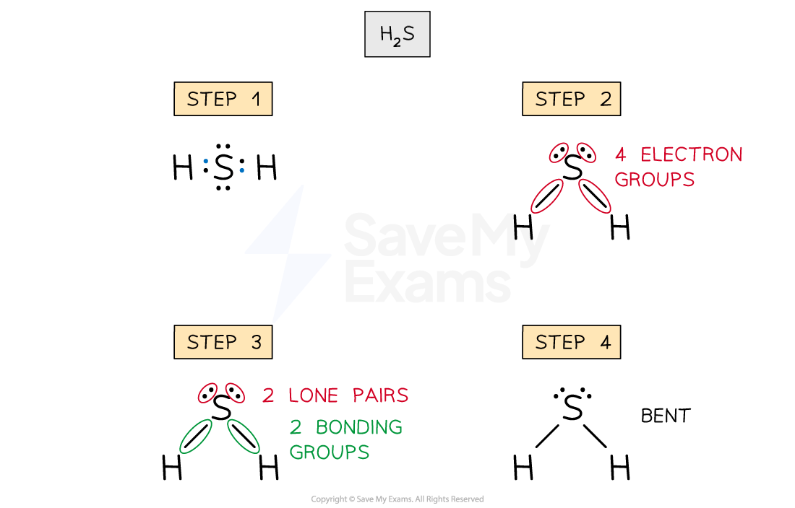

- Answer 2: The total number of valence electrons in NH2Cl is = 5 + 1 + 1 + 7 = 14

<!-- Source: page 10 -->

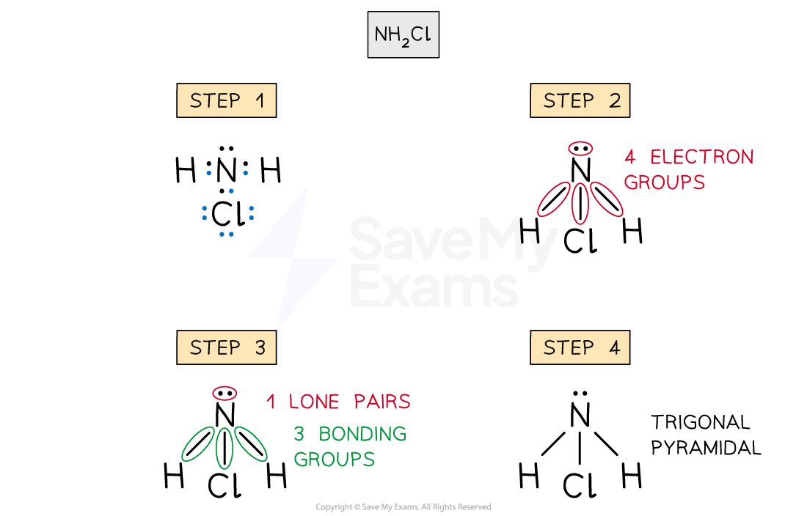

- Answer 3: The total number of valence electrons in ICl4− is = 7 x 5 + 1 = 36

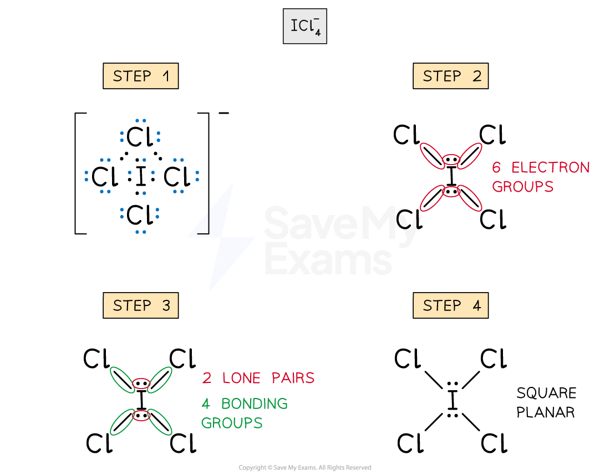

## Bond Angles

## Predicting bond angles

- The bond angle of any molecule can be determined following simple steps:

1. Draw an accurate Lewis structure for the molecule or ion

2. Count the number of electron groups and place them as far as possible

3. Count the number of bonding groups and the number of lone pairs

4. Apply the VSEPR theory to predict the bond angle

<!-- Source: page 11 -->

## Worked Example

Predict the bond angles in the following molecules or ions:

1. H2S
2. NH2Cl
3. ICl4−
Answers:

- Answer 1: The total number of valence electrons in H2S is = 1 + 1 + 6 = 8, so there
are four pairs of electrons around S

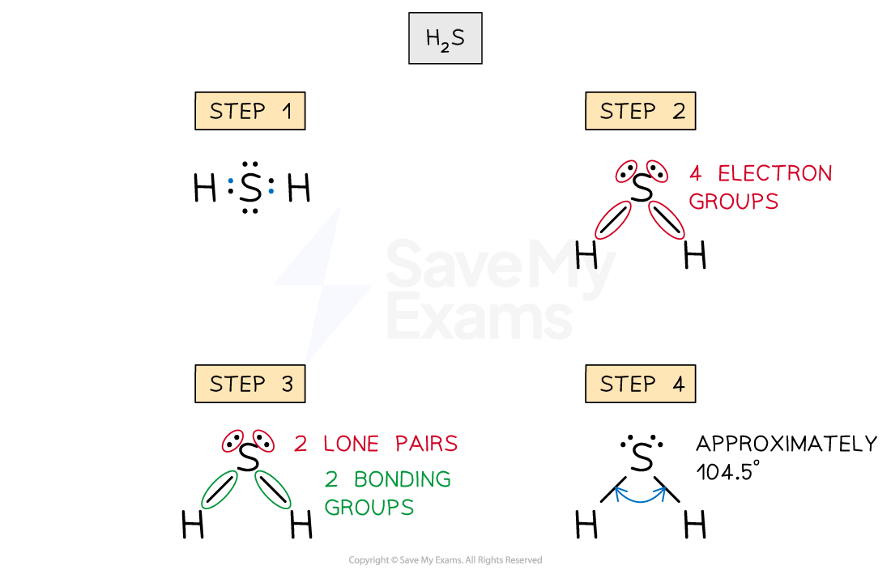

- Answer 2: The total number of valence electrons in NH2Cl is = 5 + 1 + 1 + 7 = 14

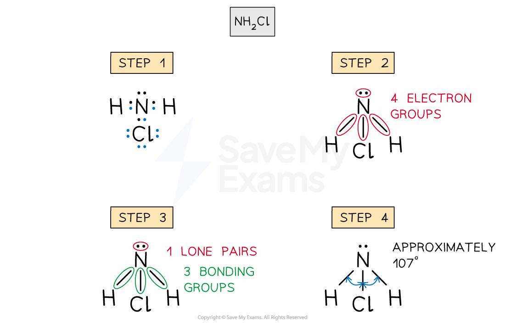

- Answer 3: The total number of valence electrons in ICl4− is = 7 x 5 + 1 = 36

<!-- Source: page 12 -->

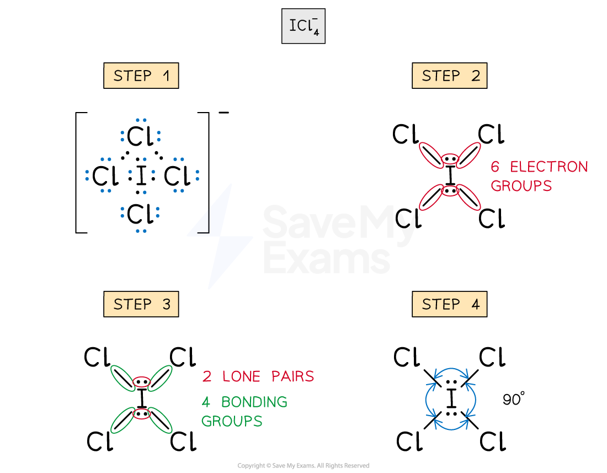

## Relative Bond Energies

## Bond energy

- The bond energy is the amount of energy required to break 1 mol of bonds in the gas
phase

- It reflects the strength of a chemical bond between two atoms. The higher the
energy, the stronger the bond

- It is influenced by factors such as bond type (ionic or covalent), bond length, and the
presence of multiple bonds

- There are some important rules to follow when predicting the relative bond energy:

- Single bonds are generally weaker than double bonds, and double bonds are
weaker than triple bonds. Therefore, single bonds have smaller bond energy

- The presence of multiple bonds increases bond strength because there is a greater
Coulombic attraction between the electrons and the nuclei of the atoms

## Bond lengths

<!-- Source: page 13 -->

Triple bonds has the highest bond energy (in red) and therefore they are the strongest
ones
- Bond order is also a great chemical tool used to compare the bond energies between
molecules

## Bond order

- The bond order is the amount of bonding pairs of electrons between atoms

- Higher bond orders indicates greater stability and higher bond energy

- Bond order is usually an integer

- When a molecule has resonance, the bond order does not need to be an integer

- The bond order can be calculated by using three simple steps

1. Draw an accurate Lewis structures

2. Count the number of bonding pairs in the molecule

3. Count the number of bonding groups

4. Divide the number of bonding pairs by the number of bonding groups

## Worked Example

Predict which of the following molecules has a the highest relative bond energy

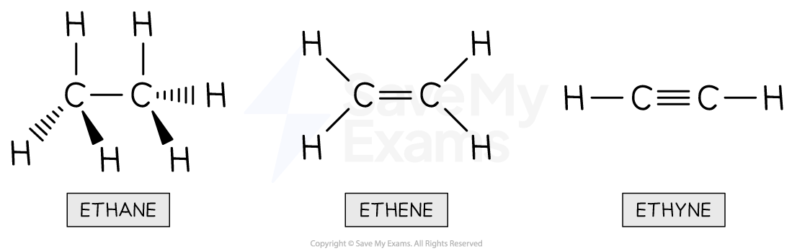

Answer:

In order to predict the molecule with the highest bond energy, the bond order of each molecule can be calculated

- Ethane

- Bonding pairs = 7
- Bonding groups = 7
- Bond order = Bonding pairs / Bonding groups
- Bond order = 7 / 7 = 1
- Ethene

<!-- Source: page 14 -->

- Bonding pairs = 6
- Bonding groups = 5
- Bond order = Bonding pairs / Bonding groups
- Bond order = 6 / 5 = 1.2
- Ethyne

- Bonding pairs = 5
- Bonding groups = 3
- Bond order = Bonding pairs / Bonding groups
- Bond order = 5 / 3 = 1.7
As seen in the calculations, the molecule with the highest bond order is ethyne. Since
higher bond order correlates with higher stability, the molecule that needs the
biggest amount of energy to break its bonds is ethyne.

## Relative Bond Lengths

## Bond length

- The bond energy refers to the distance between the nuclei of two atoms that are
chemical bonded

- It is influenced by factors such as bond type (ionic or covalent), bond length, the
presence of multiple bonds, and the atomic radius of the atoms

- There are some important rules to follow when predicting the relative bond lengths:

- If the atomic radius of the atoms involved increases, the bond length will increase

- This occurs because the valence electrons are pulled with less Coulombic force
of attraction by the nuclei of the atoms

- The presence of multiple bonds decreased the bond length because there is a
greater Coulombic attraction between the electrons and the nuclei of the atoms

## Bond Lengths

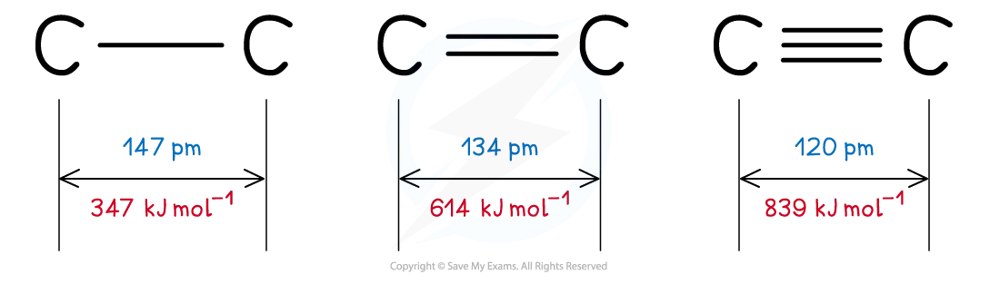

Triple bonds have the smallest bond length (in blue) because of the greater Coulombic forces of attraction

- Bond order is also a great chemical tool used to compare the bond lengths between
molecules

- If you want to know how to calculate the bond order, check the previous section
about Relative Bond Energy

<!-- Source: page 15 -->

## Worked Example

Which of the following molecules will have the longest single covalent bond?

1. HCl
2. HF
3. HBr
4. HI

Answer:

- The correct answer is D

- This is because the iodine atom has the largest radius compared to Cl, F, and
Br

- This information can be obtained using the periodic table. Iodine is the
down Group 17 under F, Cl and Br
- Therefore, the coulombic attraction between the nucleus of the iodine atom
and the valence electrons is the smallest, compared to the other halogens

## Dipole Moments

- Dipole moment measures the separation of positive and negative charge within a
molecule

- If a molecule exhibits dipole moments, it is said that the molecule is polar

- There are two important factors to consider if a molecule is polar or not:

- The presence of polar covalent bonds in the molecule

- The molecular geometry

- There are cases of molecules that have polar covalent bond, but their polarity its
neutralized by the molecular geometry

- This occurs because the atoms are arranged in a particular way, so the individual
dipole moments cancel each other out

- You can think of a dipole moment as a “tug of war game”. If the atoms pull the
electrons with the same force in opposite directions, the net dipole moment of the
molecule is zero

- E.g. The molecule below CH3Cl is a polar molecule. The net dipole moment of the
molecule points towards the chlorine atom which attracts the electrons with the
strongest Coulombic force of attraction

## The CH₃Cl Molecule

<!-- Source: page 16 -->

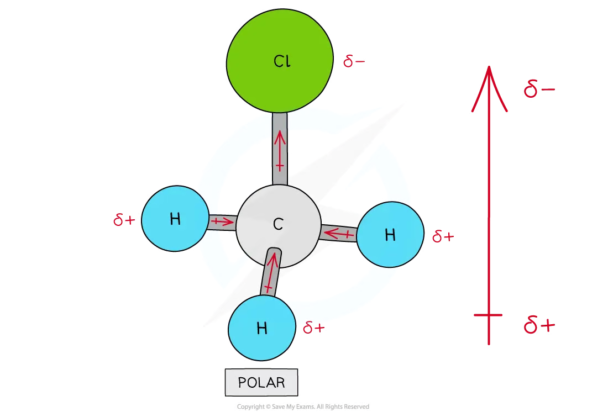

There are four polar covalent bonds in CH3Cl which do not cancel each other out causing CH3Cl to be a polar molecule; the overall dipole is towards the electronegative chlorine atom

- E.g. The molecule below CCl4 is a nonpolar molecule. Even if the C-Cl bonds are highly
polar due to the difference in electronegativity between C and Cl, the net dipole
moment cancels out because all the chlorine nuclei are pulling the electrons with the
same Coulombic force of attraction

## The CCl₄ molecule

<!-- Source: page 17 -->

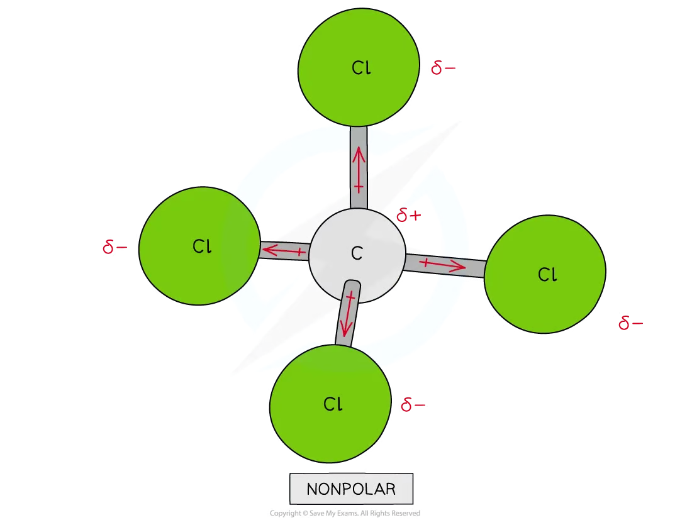

Though CCl4 has four polar covalent bonds, the individual dipole moments cancel each other out causing CCl4 to be a nonpolar molecule

<!-- Source: page 18 -->

## Hybridization

## Hybridization of Valence Orbitals

- Covalent bonds are formed when atomic orbitals overlap that together contain a pair of
electrons

- Hybridization occurs when atomic orbitals (s and p) are combined to form hybrid orbitals

- Hybrid orbitals are still localized in the individual atoms, but their shapes and energies
are different

- The hybridization of valence orbitals is important to explain the molecular geometry of
different carbon compounds

## sp³ hybridization

- Carbon ground state electron configuration is defined by 1s22s22p2

- It is represented by the following box diagram

## Box Diagram in Ground State

Orbital box diagram for carbon in the ground state

- By looking at the box diagram, there are two unpaired electrons which implies that only
two covalent bonds can be formed

- The 2s electrons are paired so there is no reason that suggest that they will be involved in
bonding

- The study of carbon compounds shows that the carbon atom tend to form four covalent
bonds

- Since, 2s and 2p subshells are close in energy, one electron of the 2s subshell can be
promoted to the 2p subshell giving the following new arrangement

## Box Diagram in Excited State

<!-- Source: page 19 -->

Orbital box diagram for carbon in when a 2s electron is promoted to the 2p subshell

- Therefore, the s orbital from the 2s subshell and the three orbitals from the 2p subshell
will merge together to form four hybrid orbitals

- It is important to remember the shapes of the orbital involved in the hybridization

- An s orbital has an spherical shape

- A p orbital is dumbbell or figure-of-eight shaped

- There are three p orbitals depending on their orientation in the xyz plane

- They are perpendicular between themselves

## s and p Orbitals

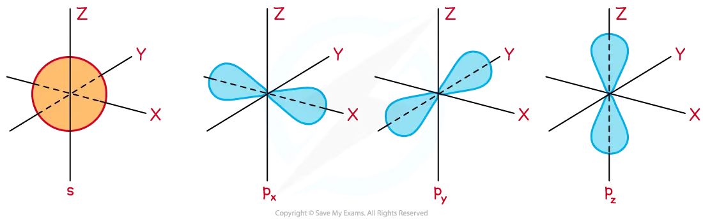

The s orbital is spherical and the three dumbbell-shaped p orbitals lie at right angles to each other

- This new hybrid orbitals will be of equal energy and this explain how four covalent bonds
are formed

They are named sp3 hybrid orbitals, because it is the combination of one s orbital and three p orbitals

## sp³ hybrid orbitals

<!-- Source: page 20 -->

Orbital box diagram for carbon showing sp3 hybrid orbitals

- These new hybrid orbitals have 1⁄4 s character and ¾ p character. Therefore, their shape
would have a club shape, like an enlarged p orbital

The four sp3  hybrid orbitals can be arranged in space within a tetrahedron. Therefore, this is the origin of the 109.5° angle of the molecular geometry

- The carbon atom in methane shows sp3

- The sp3 orbitals in the carbon atom, overlaps with the s orbital of hydrogen forming four
equal covalent bonds

## Formation of sp³ Hybridized Orbitals

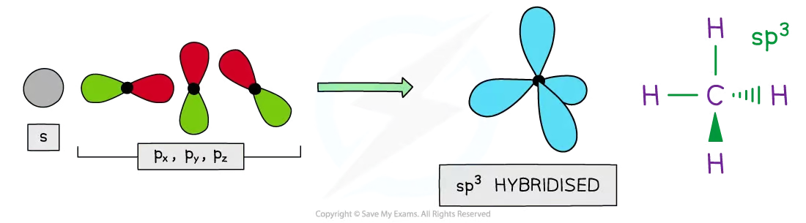

4 x sp3 hybrid orbitals are formed from one s orbital and three p orbitals

- It is not just bonding pairs of electrons that can be accommodate in the hybrid orbitals,
lone pairs can also be present

- One of the clearest examples is the ammonia molecule. The nitrogen atom is sp3
hybridized, but three of the hybrid orbitals are used to arrange bonding pairs and
one of them for a lone pair

## sp² hybridization

sp2 hybrid orbitals are formed when one s orbital and two p orbitals are combined together

- One of the p orbitals of the 2p subshell remains unchanged after hybridization

- The sp2 orbitals have the same energy, while the p orbital from the 2p subshell is higher
in energy than the hybridized orbitals

These new hybrid orbitals have ⅓ s character and ⅔ p character

The three sp2  hybrid orbitals can be arranged in space within a trigonal planar geometry. Therefore, this is the origin of the 120° angle of the molecular geometry

The carbon atom in alkenes shows sp2  hybridization when it forms two single bonds and a double bond with another carbon

- The sp2 orbitals in the carbon atom overlap with the s orbital of two hydrogen atoms and
one hybrid sp2 orbital of the adjacent carbon forming three equal sigma bonds

<!-- Source: page 21 -->

- The double bond is created when the unhybridized p-orbitals from adjacent carbons
sideways overlap
- Sideways overlap is a lateral interaction between the p-orbitals of two adjacent
atoms

## Formation of sp² Hybridized Orbitals

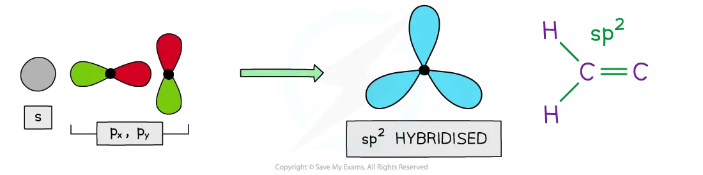

3 x sp2 hybrid orbitals are formed from one s orbital and three p orbitals

## sp hybridization

sp hybrid orbitals are formed when one s orbital and one p orbital are combined together

- Two of the p orbitals of the 2p subshell remains unchanged after hybridization

- The sp orbitals have the same energy, while the two p orbitals from the 2p subshell is
higher in energy than the hybridized orbitals

- These new hybrid orbitals have ½ s character and ½ p character

The two sp hybrid orbitals can be arranged in space forming a linear geometry. Therefore, this is the origin of the 180° angle of the molecular geometry

The carbon atom in alkynes shows sp hybridization when it forms one single bond and a triple bond with another carbon

The sp orbitals in the carbon atom overlap with the s orbital of the hydrogen atom and one hybrid sp2 orbital of the adjacent carbon forming two equal sigma bonds

- The triple bond is created when the two unhybridized p-orbitals from adjacent carbons
sideways overlap

- Sideways overlap is a lateral interaction between two adjacent atoms

## Formation of sp Hybridized Orbitals

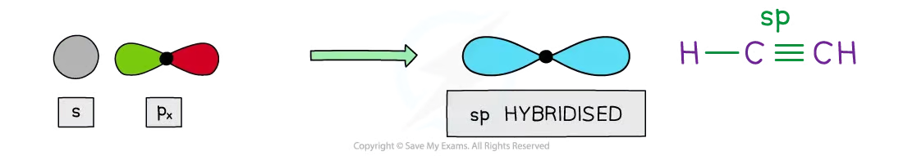

2 x sp hybrid orbitals are formed from one s orbital and two p orbitals

<!-- Source: page 22 -->

## Worked Example

Compound X has the following Lewis diagram:

Lewis diagram of compound X

What is the hybridization of the atoms I, II, III, and IV?

Answer:

- Atom I

- The carbon atom is forming two single bonds and a double bond. The
presence of the double bond indicates that it has an sp2  hybridization
- Atom II

- The carbon atom is forming two single bonds and a double bond. The
presence of the double bond indicates that it has an sp2 Additionally, it is and
adjacent carbon atom to an sp2 carbon
- Atom III

- The carbon atom is forming four single bonds.Therefore, it has an sp3
hybridization
- Atom IV

- The oxygen atom is forming two single bonds and it has two lone pairs. Even
if the the atom is just forming two bonds, the oxygen atom has an sp3
hybridization because two of the hybrid orbitals are used for bonding
electrons and the other two are used for nonbonding electrons

<!-- Source: page 23 -->

## Sigma & Pi Bonds

## Orbital overlapping in bonds

- A single covalent bond is formed when two nonmetals share a pair of electrons

- Each atom contributes with one unpaired electron from a valence atomic orbital

- The overlapping between atomic orbitals form a molecular orbital

- The overlapping can occur between hybrid orbitals too

- The type of the covalent bond depends on the type of overlapping

- There are two types of interaction:

End to end overlapping which form sigma bonds (σ)

Sideways or lateral overlapping which form pi bonds (π)

Since a σ bond is formed by an end to end overlapping the bond is stronger and have greater bond energy than a π bond

## Sigma bonds

A sigma bond (σ) is formed when there is an end to end overlapping of atomic orbitals

- The interaction can occur between any type of atomic orbital (non hybridized or
hybridized)

- The atoms are free to rotate around a sigma bond

- A single covalent bond is always a sigma bond

- g. In the case of methane (CH4), the four sp3 hybrid orbitals overlap with the s-orbital of
the hydrogen atoms to form four σ covalent bonds

## Sigma and Pi Bonds

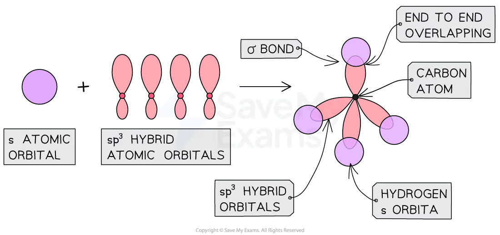

<!-- Source: page 24 -->

Sigma bonds in methane

## Pi bonds

A pi bond (π) is formed when there is sideways (lateral) overlapping of adjacent atomic p-orbitals

- The pi bond occurs perpendicular to the plane in which the sigma bonds are being
formed

A single π bond is drawn as two electron clouds, one above the plane and one below the plane of the sigma bond

- The electron clouds above and below the plane prevents the rotation around the
sigma bond

Double bonds has always one π bond and triple bonds has always two π bonds

- g. In the case of ethene (C2H4),

- Ethene has a double bond

- The two sp2 hybrid orbitals overlap end to end with the s-orbital of the hydrogen
atoms to form two σ covalent bonds.

The sp2 hybrid orbitals of both adjacent carbons overlap end to end to form one σ covalent bond.

While at the same time, the p orbitals of both adjacent carbon atoms sideways overlap to form one π bond

## Bonding in Ethene

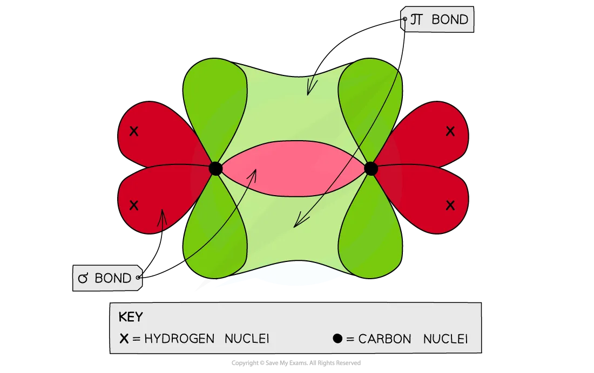

Each carbon atom in ethene forms two sigma (σ) bonds with hydrogen atoms and one sigma (σ) bond with another carbon atom. The fourth electron is used to form a pi (π) bond

<!-- Source: page 25 -->

between the two carbon atoms

E.g. In the case of ethyne (C₂H₂),

- Ethyne has a triple covalent bond

- One sp hybrid orbital overlaps end to end with the s-orbital of hydrogen to form
one σ covalent bonds.

The sp hybrid orbital of both adjacent carbons overlap end to end to form one σ covalent bond.

- While at the same time, the 4 p orbitals of both adjacent carbon atoms sideways
overlap to form two π bonds

## Bonding in Ethyne

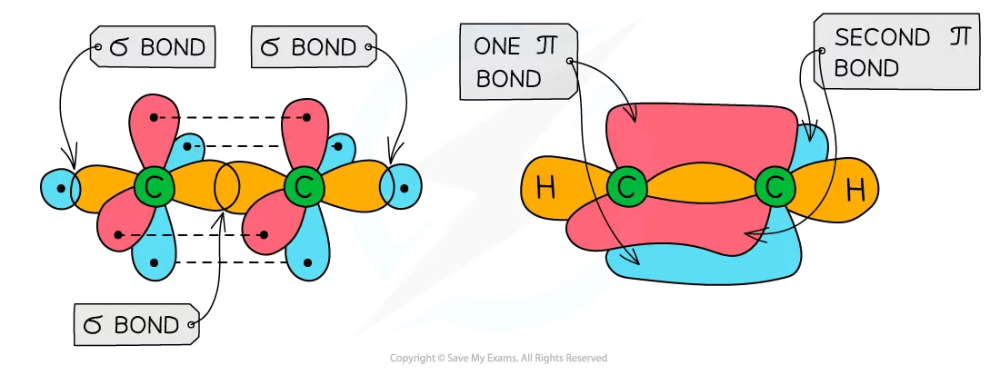

Ethyne has a triple bond formed from two π bonds and one σ bond between the two carbon atoms

## Examiner Tips and Tricks

The number of pi bonds is always the number of bonds - 1. This occurs because there is always one sigma bond

> 来源：© 2025 Save My Exams, Ltd.
