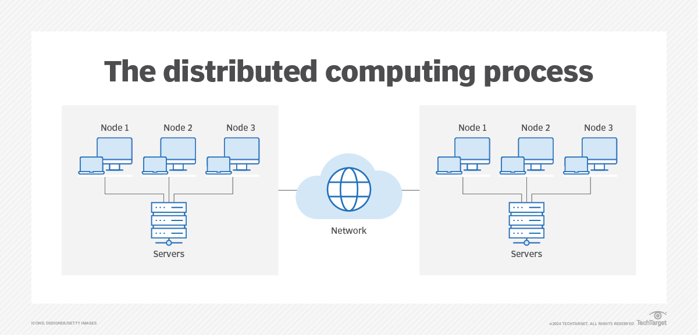
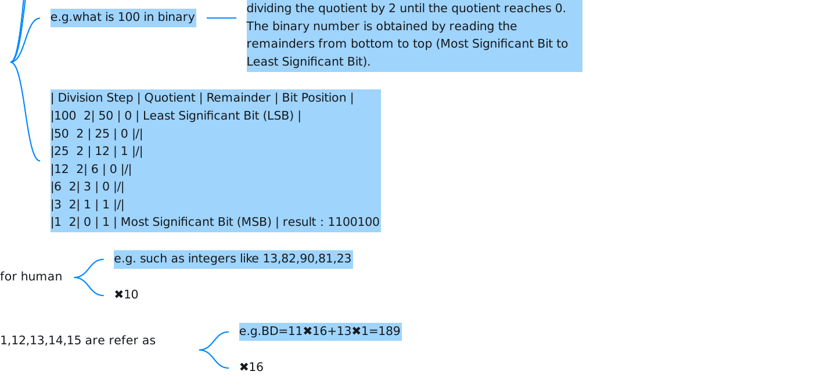
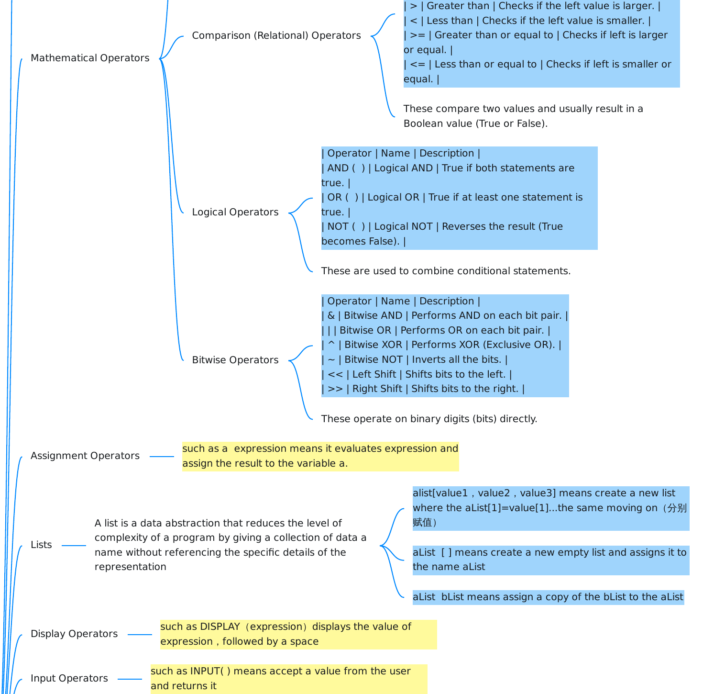
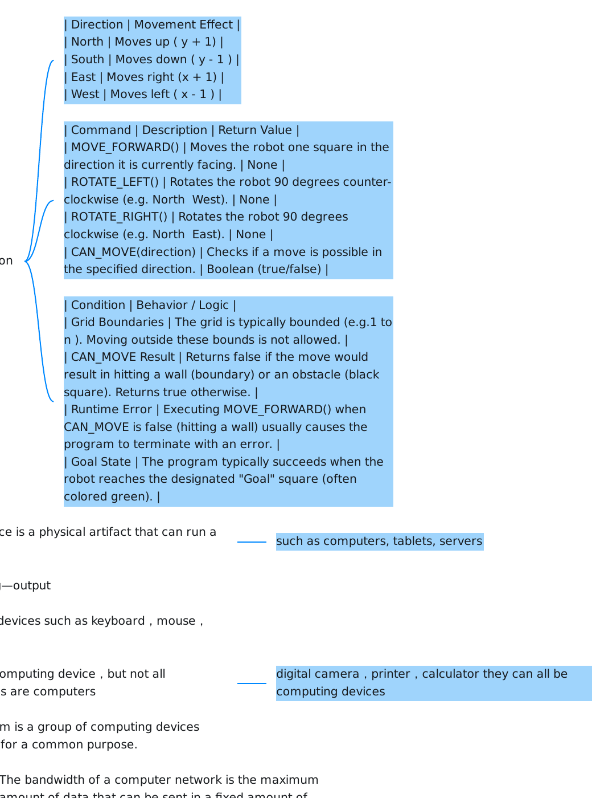

# AP CSP Revision

## Big idea 1 : Creative Development

### Computing Innovation

- Inspiration for computing innovations can be found anywhere

- People are those ones who create innovations

- They are constantly changing and building on themselves

- Advances in computing have generated and increased creativity in other fields

- examples:data mapping,tracking,and biometrics technologies

### Hardware & Software

- Hardware is the physical components of a computing device

- Software is the instructions in a program-computing language to the computing device

- computing innovation is about the software more, not the hardware

- Computing hardware is smaller and more powerful

- examples:Softare:Dual monitor programs for Windows Hardware:monitor

### Collaboration

- Collaboration helps people learn from each other

- Collaboration includes diverse perspectives helps to avoid bias in the development of computing innovations

- Note: Humans have inherent bias, whereas computers execute tasks consistently based on code.

- Effective collaboration can help one gain insight and knowledge by applying multiple perspectives,experiences,and skill sets

- Collaboration can help the programmer more self-aware

- Collaboration facilitates the solving of computational problems by applying multiple perspectives

- Collaboration combines different individuals’ resources , talents , experiences

- Collaboration has no limited location

- examples : collaboration

- communication

- consensus building

- conflict resolution

- negotiation

### Programs Function

- A program is a collection of program statements that performs a specific task when run by a computer , is often see as software

- A code segment refers to a collection of program statements that are part of a program

- A programmer can never have too many test cases

- A complex program can be described broadly by what it does

### Program Input

- Program input is data sent to a computer for processing by a program :输入值

- examples : It has a variety of forms : texts visual audio

### Development Process

#### Four stages

- Investigating and reflecting : figure out what customers need and find out some problems

- Collecting data through surveys

- User testing

- Interviews

- Direct observations

- Designing : design the steps needed to develop multiple algorithms that allow for certain functionalities——video conferencing

- Brainstorming

- Planning and storyboarding

- Organizing the program into modules and functional components

- Creating diagrams that represent the layouts of the user interface

- Developing a testing strategy for the program

- Prototyping : write the program

- Testing : play the program and find errors

### Program Documentation

- Program documentation is a written description of the function of a code segment , event , procedure , or program and how it was developed

- It helps in developing and maintaining correct programs,they can either work individually or work in a collaborative programming environment

- Comments are a form of program documentation written into the program——they do not effect how the program run and the running speed of the program

- Program documentation can be used to acknowledge code segments written by someone else

### Program Errors

#### Logic error

- The program runs without crashing, but it gives the wrong result because the code doesn’t do what you intended. ( such as 2+3=5 but play as 2×3=6 )

#### Syntax error

- Broke the rules of the programming language — like misspelling a keyword or forgetting a bracket. The program won’t even start. ( such as “prnt Hello“ instead of ”print Hello“ )

#### Runtime error

- The code looks correct and starts running, but something goes wrong while it’s executing — like dividing by zero or opening a file that doesn’t exist.

## Big idea 2 : Data

### Bits Represent Data

- A bit is shorthand for a single binary digit and is either 0 or 1.

- 1 byte=8 bits

- e.g.0110 1111 contains 8 bits or 1 byte

- It can be used in to represent all digital data

- e.g. colors,Boolean logic,lists,and so on

- Some data take many bits to represent it

- e.g. 10 MP(1 MP=1 million pixels)=10000000pixels

- 1 pixel=6 bytes=48 bits

### Abstractions

- Bits are grouped to represent abstractions

- Abstractions find common features to generalize the program

- This can help shrink the code

- e.g.1234+4321=5555 without abstractions may look like 10111001.......00000000(26 bytes)

- High-level languages contain the most abstractions ———it‘s easier for coding and easier debugging

### Analog and Digital data

- Analog data:has intervals that change smoothly overtime,rather than in discrete intervals/They are continuous signals,form a smooth curve in charts

- e.g.the volume of music, the colors in paintings

- Digital data:A digital signal is an analog signal has been broken up into steps/The pattern is rough in charts

- e.g. MP4 MP3 pictures

- The higher the sample rate,the more accurately the digital signal represents the analog signals

### Consequences of Using Bits to Represent Data

- A variable is an abstraction inside a program that can hold a value

- Each variable represents one value at a time

- e.g. integers,Boolean,string,and list

- Some programming languages have limits of range such as JAVA has a range of -2,147,483,648 to 2,147,483,648,if bigger might cause an overflow error

- they have 4 bytes in each number which means the limit is 2 to the power of 32

### Number Systems

#### Binary Numbers

- 0 and 1,multiply 2 between bits

- e.g. 0110 0✖ 1+1✖ 2+1✖ 4+0✖ 8=6

- ✖ 2

- e.g.what is 100 in binary

- To convert a decimal number to binary, divide the number by 2 and record the remainder. Continue dividing the quotient by 2 until the quotient reaches 0. The binary number is obtained by reading the remainders from bottom to top (Most Significant Bit to Least Significant Bit).

| Division Step | Quotient | Remainder | Bit Position |
| --- | --- | --- | --- |
| 100 ÷ 2 | 50 | 0 | Least Significant Bit (LSB) |
| 50 ÷ 2 | 25 | 0 | / |
| 25 ÷ 2 | 12 | 1 | / |
| 12 ÷ 2 | 6 | 0 | / |
| 6 ÷ 2 | 3 | 0 | / |
| 3 ÷ 2 | 1 | 1 | / |
| 1 ÷ 2 | 0 | 1 | Most Significant Bit (MSB) |

result : 1100100

#### Decimal Numbers

- 0-9,number system designed for human

- e.g. such as integers like 13,82,90,81,23

- ✖ 10

#### Hexadecimal Numbers

- 0-15 , among which 10,11,12,13,14,15 are refer as A,B,C,D,E,F

- e.g.BD=11✖ 16+13✖ 1=189

- ✖ 16

### Roundoff Errors

- e.g.1/3 does not always equal 1/3—such as 0.3333333 loop is rounded to 0.33 in computers

### Lossy and Lossless Data Compression

- Data compression is reducing the size (number of bits)of transmitted or stored data.

- Lossy compression:They significantly reduce the file size while decreasing resolution,some data will be lost.( 有损 压缩)

- e.g. JPG,MP4,MP3

- Lossless compression:There algorithms are typically chosen,in situations where minimizing data size of transmission time is really important( 无损压缩)

- e.g. PNG,GIF,WAV

### Information Extracted from Data

- People generate significant anounts of digital data daily

- People can use computer programs to process information as well as to gain insight and knowledge.

- Gaining insight from this valuable data involves a combination of statistics,mathematics,programming,and problem solving.

- the size of the data set affects the amount of information that can be extracted from it.

- the 4 types of the data that need to be clean:The need to clean data,incomplete data,invalid data,the need to combine data sources——this is the process that makes the data uniform without changing their meaning.

- Bias—Human made—data

- Algorithms—data—reflect the bias

- a large sample size can magnify the bias associated with the data being used.

### Predicting Algorithms

- They use information collected from big data to influence our daily lives.

- e.g. Social media sites can use patterns to target advertising based on viewing habits( 根据兴趣或搜索个性化 推荐)

- e.g. An entertainment application may recommend an additional movie to watch based on the viewer‘s interests.( 影视软件得知你喜欢哪种类型的电影后就给你推送)

### Visualization of Data

- Using appropriate visualizations when presenting digitally processed data can help one gain insight and knowledge.

- ways of presenting:line graphs,pine charts,radar charts

- Predicting trends is not a guarantee of future usage

- Predicting algorithms use historical data to predict future events

### Privacy Concerns

- Privacy concerns arise through the mas collection of data

- Anything done online is likely to lead to sharing of private data

### Metedata

- Metedata are data that describe your data

- e.g. a picture of you standing in front of a sculpture

- Metedata are:the picture's file name

- the location where the picture was taken

- the time you took this picture

- the author of the picture

- By using the metedata,pictures can be sorted based on where the picture was taken or sorted or all the ways it was made of.

## Big idea 3 : Algorithms and Programming

### Abstraction

- an abstraction is a way to represent essential features without including the background details or explanations

- abstraction reduce complexity it's both essential and efficient for programming,it also hide details and allow users to focus on the problem

- e.g. Output the word for Hello World(abstraction),without abstraction it would be like 10111000 00100001......

- the purpose of abstraction is to hide coding details so the programmer can focus on the current problem

- abstractions allow for programmers to use semihuman language to program

### Mathematical Operators

#### Arithmetic Operators

| Operator | Name | Description | Example |
| --- | --- | --- | --- |
| + | Addition | Adds two numbers together. | 5 + 3 = 8 |
| - | Subtraction | Subtracts the second number from the first. | 5 - 3 = 2 |
| × | Multiplication | Multiplies two numbers. | 5 * 3 = 15 |
| / | Division | Divides the first number by the second. | 6 / 2 = 3 |
| MOD | Modulo | Returns the remainder of a division. | 7 MOD 2 = 1 |
| ^ | Exponentiation | Raises a number to the power of another. | 2^3 = 8 |
| // | Floor Division | Divides and rounds down to the nearest integer. | 7 // 2 = 3 |

- These are used for basic numerical calculations.

#### Comparison (Relational) Operators

| Operator | Name | Description |
| --- | --- | --- |
| = | Equal to | Checks if two values are equal. |
| ≠ or `<>` | Not equal to | Checks if two values are different. |
| > | Greater than | Checks if the left value is larger. |
| < | Less than | Checks if the left value is smaller. |
| >= | Greater than or equal to | Checks if left is larger or equal. |
| <= | Less than or equal to | Checks if left is smaller or equal. |

- These compare two values and usually result in a Boolean value (True or False).

#### Logical Operators

| Operator | Name | Description |
| --- | --- | --- |
| AND ( ) | Logical AND | True if both statements are true. |
| OR ( ) | Logical OR | True if at least one statement is true. |
| NOT ( ) | Logical NOT | Reverses the result (True becomes False). |

- These are used to combine conditional statements.

#### Bitwise Operators

| Operator | Name | Description |
| --- | --- | --- |
| & | Bitwise AND | Performs AND on each bit pair. |
| \| | Bitwise OR | Performs OR on each bit pair. |
| ^ | Bitwise XOR | Performs XOR (Exclusive OR). |
| ~ | Bitwise NOT | Inverts all the bits. |
| `<<` | Left Shift | Shifts bits to the left. |
| `>>` | Right Shift | Shifts bits to the right. |

- These operate on binary digits (bits) directly.

### Assignment Operators

Assignment evaluates an expression and assigns its result to the variable a.

### Lists

- A list is a data abstraction that reduces the level of complexity of a program by giving a collection of data a name without referencing the specific details of the representation

- alist[value1 , value2 , value3] means create a new list where the aList[1]=value[1]...the same moving on (分别 赋值)

Creating an empty list assigns [ ] to the name aList.

Assigning bList to aList gives aList a copy of bList.

### Display Operators

- such as DISPLAY ( expression ) displays the value of expression , followed by a space

### Input Operators

- such as INPUT( ) means accept a value from the user and returns it

### Relational and Boolean Operators

#### Relational Operators

- Relational operators compare two values to determine the relationship between them. The result of these operations is always a Boolean value (True or False).

| Operator | Name | Description | Example (Python/Math) | Result |
| --- | --- | --- | --- | --- |
| = | Equal to | Checks if two values are the same. | 5=5 | True |
| ≠ | Not equal to | Checks if two values are different. | 5≠3 | True |
| > | Greater than | Checks if the left value is larger than the right. | 3 > 5 | False |
| < | Less than | Checks if the left value is smaller than the right. | 3 < 5 | True |
| >= | Greater than or equal to | Checks if the left value is larger or equal. | 5 >= 5 | True |
| <= | Less than or equal to | Checks if the left value is smaller or equal. | 3 <= 5 | True |

#### Boolean (Logical) Operators

- Boolean operators are used to combine multiple conditional statements (which usually involve relational operators). They determine if a complex condition is True or False.

| Operator | Symbol (Common) | Name | Description | Truth Table Logic |
| --- | --- | --- | --- | --- |
| AND | and | Logical Conjunction | Returns True only if both operands are true. | True AND True → True True AND False→ False False AND False → False |
| OR | or or | Logical Disjunction |  |  |
| NOT | not | Logical Negation | Reverses the state of the operand. | NOT True → False NOT False → True |

### Numeric Procedures

- such as RANDOM(a,c) means evaluates to a random integer from a to c,including a and c. ( a,b,c )

### Boolean Tables

- The following tables illustrate the logical behavior of the three fundamental Boolean operators: AND, OR, and NOT. Ture is 1 and False is 0

#### Logical Conjunction (AND)

| Input A | Input B | Result (A and B) |
| --- | --- | --- |
| False | False | False |
| False | True | False |
| True | False | False |
| True | True | True |

- The AND operator yields a result of True if and only if all of its operands are True. If any input is False, the entire expression evaluates to False.

#### Logical Disjunction (OR)

| Input A | Input B | Result (A or B) |
| --- | --- | --- |
| False | False | False |
| False | True | True |
| True | False | True |
| True | True | True |

- The OR operator results in True if at least one of its operands is True. It only evaluates to False when both inputs are False.

### The Robot

#### Coordinate System & Orientation

| Direction | Movement Effect |
| --- | --- |
| North | Moves up ( y + 1) |
| South | Moves down ( y - 1 ) |
| East | Moves right (x + 1) |
| West | Moves left ( x - 1 ) |

| Command | Description | Return Value |
| --- | --- | --- |
| `MOVE_FORWARD()` | Moves the robot one square in the direction it is currently facing. | None |
| `ROTATE_LEFT()` | Rotates the robot 90 degrees counter-clockwise (e.g. North → West). | None |
| `ROTATE_RIGHT()` | Rotates the robot 90 degrees clockwise (e.g. North → East). | None |
| `CAN_MOVE(direction)` | Checks if a move is possible in the specified direction. | Boolean (true/false) |

| Condition | Behavior / Logic |
| --- | --- |
| Grid Boundaries | The grid is typically bounded (e.g.1 to n ). Moving outside these bounds is not allowed. |
| CAN_MOVE Result | Returns false if the move would result in hitting a wall (boundary) or an obstacle (black square). Returns true otherwise. |
| Runtime Error | Executing MOVE_FORWARD() when CAN_MOVE is false (hitting a wall) usually causes the program to terminate with an error. |
| Goal State | The program typically succeeds when the robot reaches the designated "Goal" square (often colored green). |

## Big Idea 4 : Computer Systems and Networks

### Computing Devices

- A computing device is a physical artifact that can run a program

- such as computers, tablets, servers

- Input—processing—output

- Computing input devices such as keyboard , mouse , scanner

- A computer is a computing device , but not all computing devices are computers

- digital camera , printer , calculator they can all be computing devices

- A computer system is a group of computing devices working together for a common purpose.

### Autonamous Systems of the Internet

- The bandwidth of a computer network is the maximum amount of data that can be sent in a fixed amount of time.

- A path between two computing devices on a computer network(a sender and a receiver)is a sequence of directly connected computing devices that begins at the sender and ends at the receiver.

- The whole process is called routing

- If the path from sender to receiver is shut down,the path will be rerouted.This fault tolerance of the internet makes connections between computing devices more reliable.

- The internet is a physical network of fiber optics,radio transmitters,and cabling.Devices and networks make up the internet

- Open communication protocols standardized internet.A protocol is an agreed-upon set of rules that specify the behavior of a system.( 协议)

### Internet Protocol

- IP is responisble for addressing and routnig your online requests.

- It's unique to each device,it is not permanently assigned to a user's device and can change at any time

- The IPv4 use 32 bits to store IP addresses while the newer one IPv6 use 128 bits to store IP addresses

### TCP/UDP

- TCP: This is a protocol that defines how computers send packets of data to each other, it's divided into small chunks of data called packets.And it is really percise.

- UDP: This is a protocol that allows computer applications to send without checking for missing packets to save on time needed to retransmit missing packets.It's fast but not percise.

### Fault tolerance & Redundancy

- Fault Tolerance : if a system fails , a different path can be chosen between the sending computer and the receiving computer.

- Redundancy: This is the inclusion of extra paths that can mitigate the failure of a system if other components fail. ( 简单来说,这就是常说的 “ 留后路 ” 或 “ 备份机制 ” 。比如为了防止 服务器崩溃而准备的备用服务器,或者为了防止断网而准备的备 用网络连接,都属于 Redundancy 的范畴 .)

The Internet refers to the hardware and the World Wide Web refers to the software

### Squential Computing/Parallel Computing/Distributed Computing

- Squential Computing:A problem is broken into discrete instructions/They are executed one-by-one by a single computing device having a single CPU

- Processor 4 1 6 2 3 1 5 1 Processed Data : 4+1+6+2+3+1+5+1=23 seconds

- Parallel Computing : A problem is broken into discrete insturctions/They are executed by using multiple CPUs

- imagine you have 1000 high-resolution pictures to solve with the parellel computing systems the time can be 10 times faster because it divides a large problem into smaller, independent sub- problems that can be solved concurrently.

- Distributed Computing : This is a computational model in which a multiple devices are used to run a program

The distributed computing process；Node 1、Node 2、Node 3；Servers；Network。

## Big Idea 5 : Impact of Computing

### The Internet and The World Wide Web

- Origins: The Internet began as ARPAnet in the 1960s for scientific information exchange. The first message was "LO" (an attempt at "LOGIN") in 1969.

- Distinction: The Internet is the global network connection (硬件) ; the World Wide Web (WWW) is the collection of information accessed via the Internet. (软 件)

- Impact: It has created "global villages," changed business communication, and allowed users to reach large audiences via social media.

### The Digital Divide

- This refers to the gap between those who have access to technology (computers/Internet) and those who do not.

#### Variables affecting the divide

- Infrastructure: Lack of physical access (cables/towers) in some regions.

- Education: Lack of knowledge on how to use the Internet effectively. ( elder people and people from the mountain cites )

- Indifference: Choosing not to use the Internet despite having access. ( newpaper , radio )

- Cost: Internet access being unaffordable.

- Solutions: Initiatives like Google’s Project Loon (balloons) and free community Wi-Fi aim to bridge this gap.

### Beneficial and Harmful Effects

- Computing innovations often have dual effects depending on the context.

- Unintended Impacts: Innovations may be used in ways not originally planned (e.g., GPS used for navigation vs. police tracking).

- Example (GoFundMe): Beneficial: Facilitates fundraising for disaster victims (e.g. Pulse Nightclub shooting). Harmful: Enables fraud where individuals set up fake accounts to steal donations.

- Example (Social Media/X): Beneficial: Spreads awareness for causes (e.g. veteran suicide prevention). Harmful: Allows terror groups to spread propaganda and recruit members.

### Bias in Computing

- Human Bias: Algorithms can reflect the existing biases of their programmers or the data they are fed.

- e.g. Using salary history to determine new salaries can perpetuate gender bias (sexism) if the historical data is already biased.

- Crowdsourcing: While useful for gathering data (e.g., citizen science counting fireflies), it can be inaccurate or manipulated.

### Legal and Ethical Concerns

- Intellectual Property (IP): Digital material belongs to its creator. Unauthorized use is plagiarism or piracy.( 产权问 题)

#### Licensing Models

- Creative Commons (CC): Allows creators to share work with specific rights reserved (e.g., attribution required, non-commercial use).

- Open Source: Software is freely available for redistribution and modification.

- Open Access: Research output is free of access restrictions.

### Safe Computing and Security

- Security focuses on the Confidentiality, Integrity, and Availability of information

- Personally Identifiable Information (PII): Data that identifies an individual (SSN, biometrics, phone numbers). This data has monetary value and is often sold to advertisers.

- Metadata: Data about data (e.g., geolocation, time stamps) that can reduce privacy.

- Authentication such as passwords should be hard to guess but easy to remember.

- Multifactor Authentication (MFA) Requires at least two types of evidence: Knowledge: Something you know (password). Possession: Something you have (phone/token). Inherence: Something you are (fingerprint/face ID).

### Encryption

- The process of encoding data to prevent unauthorized access.

- Symmetric Key Encryption: Uses the same key for both encryption and decryption. It relies on keeping that single key secret.

- Public Key Encryption (Asymmetric): Uses two keys.

- Public Key: Used to encrypt data (available to everyone).

- Private Key: Used to decrypt data (kept secret by the receiver).

#### Malware and Cyber Threats

- Malware: Malicious software intended to damage systems.

- Virus: Copies itself and attaches to legitimate programs (like Word or Excel).

- Phishing: Tricking users into giving personal data via fake emails or websites.

- Keylogging: Recording every keystroke to steal passwords (can be software or physical hardware).

- Rogue Access Point: A wireless access point set up by attackers to intercept data on public networks.

