# CSP Computer Science Principle

## Big idea 1: creative development

### 1. Inspiration of computer innovations/modern computing innovations/positive and negative effects on society…

- 它无处可见在生活当中

- 有些时候难以找到受众群体

- 发生在很多领域上 eg. 医学，工程等等

（computer simulation can model real-world situation and predict outcomes based on changing variables）

| Positive | Negative |
| --- | --- |
| Enhanced Productivity | Privacy and Security Issues |
| Improved Communication | Digital Divide (Developed, Developing, Underdeveloped) |
| Revolutionized Healthcare | Employment Impact (people instead by robot) |
| Facilitated Education | Increased Dependency (over-reliance on A.I.) |
| Accelerated Innovation | Ethical and Moral Issues (A.I. decision, algorithm bias) |
| Enhanced Quality of Life | Environmental Impact (energy consumption) |
| | Useless innovations (real needs) |

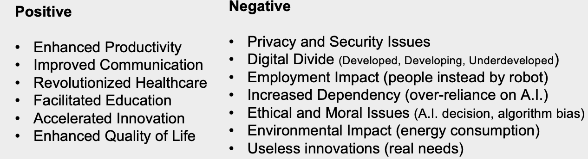

### 2. Hardware vs. software

说白了，一个摸得到一个摸不到

Hardware-\>指的是物理组成的部分（self-driving car）

Software-\>指的是编程语言编写的语言（driverless vehicle software）

**Computer innovation就是software**

((Moore’s law, 很生僻但是考到过，摩尔定律：芯片上的晶体管数量每 2 年翻倍，成本同时减半。) 就是越来越便宜，越来越牛逼

### 3. Collaboration (communication, consensus building, conflict resolution, negotiation…）

Collaboration helps people learn from each other.

Collaboration that includes diverse perspectives helps to **avoid bias** in the development of computing innovations.

Effective collaboration can help one gain insight and knowledge by **applying multiple perspectives, experiences, and skill sets.**

这都是基本是很常见的了，还有两个注意的点collaboration不会被location限制，并且合作的话别人也可以看出来你的问题并且帮你纠正

### 4. How program function

A program is a collection of **program statement** that performs a specific task when run by a computer.

AP考试分为两种一种是text-based 还有一种就是graphical-based

**Text-Based Code**

Input: A list of numbers called myList.

```text
Line 1: Procedure countEven(myList)
Line 2: {
Line 3:   count ← 0
Line 3:   FOR EACH item IN myList
Line 4:   {
Line 5:     IF(item MOD 2 = 0)
Line 6:       count ← count + 1
Line 7:   }
Line 8:   RETURN(count)
Line 9: }
```

Output: A number that indicates how many even numbers are in the list called myList.

Same Code Written in Graphical-Based Form:

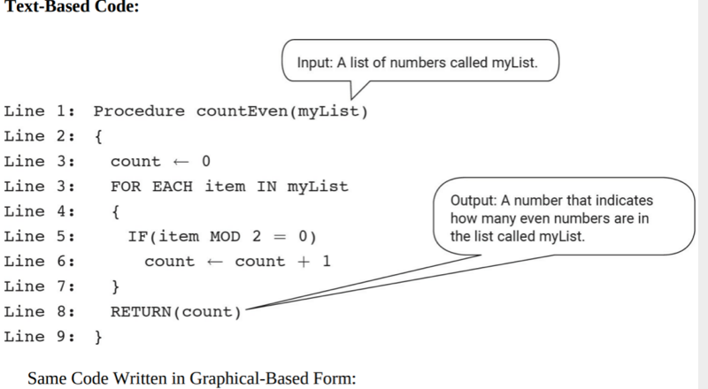

这个就是来测量有多少个偶数的一个程序

**Example of a program written in graphical form**

Input: A list of numbers called myList.

```text
PROCEDURE countEven(mylist)
{
  count ← 0
  FOR EACH item IN mylist
  {
    IF (item MOD 2 = 0)
    {
      count ← count + 1
    }
  }
  RETURN count
}
```

Output: A number that indicates how many even numbers are in the list called myList.

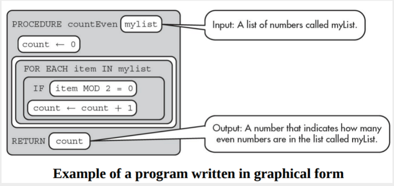

同理

整两个错误的看看：

Input: A list of numbers called myList and a number called val.

```text
Line 1: Procedure countEven(myList, val)
Line 2: {
Line 3:   count ← 0
Line 3:   FOR EACH item IN myList
Line 4:   {
Line 5:     IF(item = val)
Line 6:       count ← count + 1
Line 7:   }
Line 8:   RETURN(count)
Line 9: }
```

Output: A number that indicates how many times val is in the list called myList.

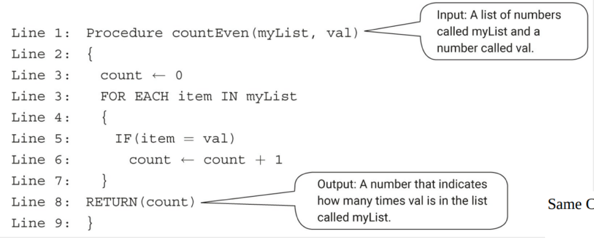

这个就是一个错误的程序，为什么呢因为他虽然程序没问题，但是并不是counteven，他是一个探测一个数字在一个list里面出现了几次的这个程序

**Text-Based Code**

Input: A list of numbers called myList.

```text
Line 1: Procedure getTotal(myList)
Line 2: {
Line 3:   total ← myList[1]
Line 3:   FOR EACH item IN myList
Line 4:   {
Line 5:     total ← total + item
Line 6:   }
Line 7:   RETURN(total)
Line 8: }
```

Output: The total of all numbers in the list added together.

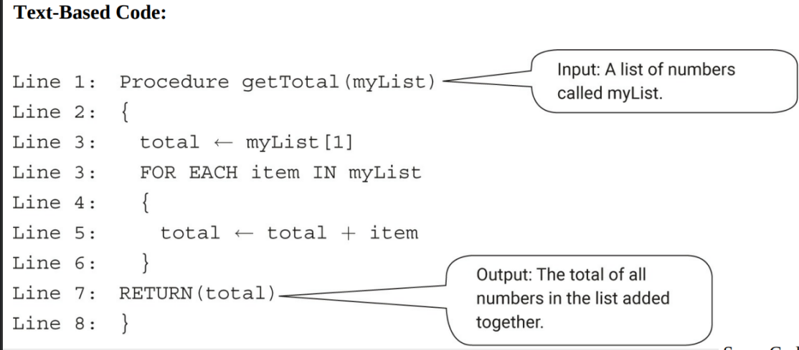

这个错在哪里了呢 错在了第三行的

为什么？ 因为他一开始就把total赋值成为了这个list的第一项，但是这不对的，应该一开始为0，否则的话他会重复算两遍第一个数字，所以total会变大

### 5. Abstraction/program input/program output

这个啥意思呢，说简单点就是把程序的复杂的内部代码藏起来，用程序的时候，不需要知道是怎么写，怎么算的，只需要focus on using the program就好了

Eg. 说洗衣机，你不需要知道电机怎么转，水怎么循环，只需要知道按开始按键，就可以洗衣服

Program input is data sent to a computer for processing by a program. Input can come in a variety of forms, such as tactile, audio, visual, or text. 他可以是各种形态，只要是发送给电脑的数据就可以

（event-The event is the action that supplies input data to a program. Events can be generated when a key is pressed, a mouse is clicked, a program is started, or by any other defined action that affects the flow of execution. 你的给程序提供输入数据的动作，按键盘，按鼠标就都是，都触发了程序）

### 6. Development process

**Development Process**

Investigating and reflecting → Designing → Prototyping → Testing → 回到 Investigating and reflecting。

- Investigating and reflecting：meet the needs of the users；Think about how to investigate?
- Designing：Collaboration physically and mentally；Planning；Organizing the program into modules and functional components。
- Prototyping：Programming；Base on planning；Large programs are broken up into small steps；Reduce the level of complexity；makes sure each piece works before adding it to the whole。
- Testing：User Tesing；Direct Observations；No project can be perfect at the first time。

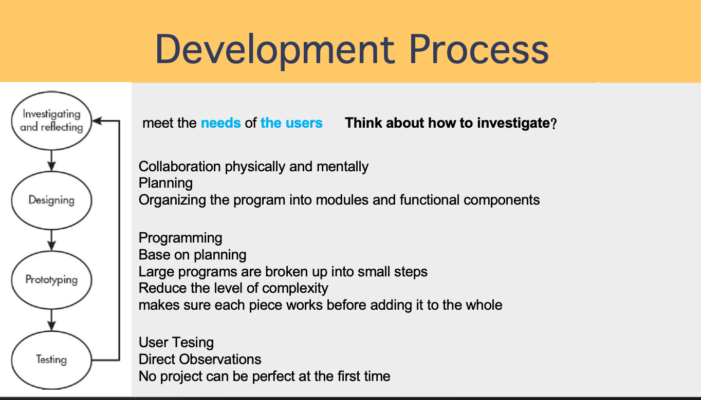

Some ways to investigate:

### 4. Direct observations

Design phrase will include:

### 5. Developing a testing strategy for the program

一个越大的项目，就越有可能分为各种小块（可以debugging也可以减少他的复杂度），因为这个项目越大，越会让错误发生，并且也会更难找到这些错误（collaboration的重要性！！！）

### 7. Program documentation

Program documentation is a written description of the function of a code segment, event, procedure, or program and how it was developed. 不是我说白了这个说大白话就是注释

这个有什么用？

### 2. 告诉自己的合作伙伴他们想的是什么

（他并不会影响他的run of speed，他也可以承认有些部分是别人写的，然后把这个origin还有作者的名字写上去就好了）

### 8. Program errors

三种分别是：logic errors, syntax errors, runtime errors

第一种logic errors指的是逻辑错误（错的是算法，说白了就是逻辑出问题了，他让你加你写成减了）

第二种是syntax errors指的是语法错误，顾名思义就是语法有问题比如说没有打；这个符号等等

```cpp
#include<iostream>
using namespace std;

int main(){
    int a=5,b=3
    cout<<a-b<<endl;
    return 0;
}
```

编译错误：In function 'int main()': [Error] expected ',' or ';' before 'cout'。

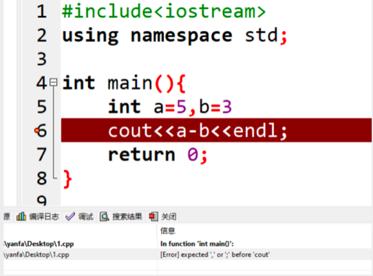

第三种就是runtime error，这个有点不一样指的是当你执行指令的时候，突然执行到了解决不了的问题了，这下面是五个常见的问题

1\. Incorrect input

2\. Memory issue

3\. Infinite loop or recursion

4\. Divided by Zero

5\. Uninitialized variable

```cpp
#include<iostream>
using namespace std;

int main(){
    int a=5,b=0;
    cout<<a/b<<endl;
    return 0;
}
```

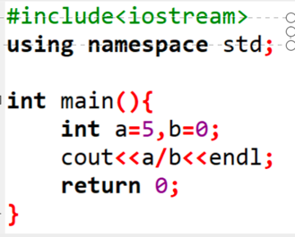

这个就是分母为0了，会导致无意义runtime error

## Big idea 2：DATA

### Bit vs byte

(bit=binary digit, byte=8 bits)

Binary sequences can be used to represent all digital data（colors, picture, etc.）

### Abstractions(可以shrink code，如果有大量重复):

Eg. x=1234+4321 (high-level language eg. python, c++人类看得懂的语言)

如果without abstractions 会变成一堆1和0（low-level language，人类看不懂的语言，机器码这种）

### Analog data vs. digital data

Analog data连续的

Digital间断的

**Consequences of Using Bits to Represent Data**

Examples:

| Type | Example |
| --- | --- |
| Integer | 4 |
| Real Number | 4.00 |
| Boolean | True or False |
| String | “Novack the third” |
| List | [1, 1, 35, 6] |

In JAVA, the range of the value of an integer is from −2,147,483,648 to +2,147,483,647. Trying to store a number bigger than the limits will result in an overflow error.

Some languages like Python do not have limits on number size but, instead, expand to the limit of the available memory.

The language used on the AP exam, similar to the language Python, does not have a limit on the size of numbers. On the exam, the size of representable integers is limited only by the size of the computer’s memory.

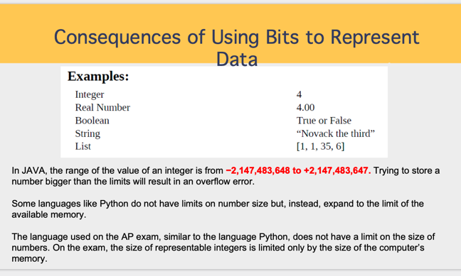

自己看这个吧 主要是Boolean这个他是只输入对或错的，可以被0，1代表着

### Number systems：

2进制之间的转换

10进制（这两个比较简单就不讲了用的就是瞪眼法，或者是短除法比较好用）

16进制

0123456789ABCDEF 有字母自己注意

### Overflow error vs. Roundoff error

Eg 比如有2 bits

他只能储存0-3这个四个数字 如果我要存4或者以上的 就不行

这个就叫做overflow error

Eg 1/3

电脑无法用有限位数来表达一个无限小数

对数字进行截断、四舍五入后产生的微小误差，就叫 roundoff error

### Lossy and lossless data compression

Lossy compression就是降低分辨率 然后呢可以减小这个文件大小，而且不可以recover the original data

Lossless compression 就是正常的

### Information extracted from data

Data-\>原始的数字/符号（eg. 某某买了一双鞋）

Information-\>从数据中推断出来的事实和模式（eg. 夏天买鞋的人变多了）

但是提取data的时候会出现问题：

The need to clean data-\>格式不一样 比如有些人写时间是2021-01-01，还有人会写2021/01/01

Incomplete data-\>调查100个人 有几个人没有写自己的年龄

Invalid data-\>有人写自己1000岁

The need to combine data sources-\>调查全国销量，得结合着所有城市的数据融合

**Predicting Algorithms**

- A credit card company can use purchasing patterns to identify when to extend credit or flag a purchase for possible fraud.
- Social media sites can use patterns to target advertising based on viewing habits.
- An online store analyzing customers’ past purchases can suggest new products the customer may be interested in buying.
- An entertainment application may recommend an additional movie to watch based on the viewer’s interests.
- Algorithms can be used to prevent crimes by identifying crime “hot spots.” The police can then step up patrols in those areas.

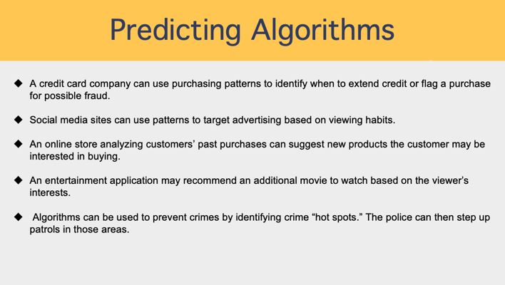

Predict algorithms：就是预测算法 根据过去的数据找规律，来预测未来的情况

### Privacy Concern：

The content of the data may contain personal information and can affect the choice in storage and transmitting.

Eg. Using Gmail to order a pair of shoes from Clarks could result in ads for shoes showing up in your search engine.

Eg. Geolocation, when used within a program, helps you find the approximate geographic location of an IP address along with some other useful information, including ISP, time zone, area code, state, and so on.

### Metadata(元数据-描述数据的数据)：

Eg. 拍的照片（data）

你的拍摄时间+地点+文件名（metadata）

Changes and deletions made to metadata do not change the primary data.

## Big idea 3: Algorithms and programming

### Abstractions（high level language比low language的abstraction用的更多）：

abstraction is a way to represent **essential features** without including the background details or explanations.

Abstractions **reduce complexity** and allow for efficient design and implementation of complex software systems.

Abstractions become a necessity as systems become more complex.

With the use of abstractions, you **can focus on content, not on the technical details of how the application works. （这个是最重要的）**

Abstractions allow for programmers to use semihuman language to program.

| Text / Block | Explanation |
| --- | --- |
| `DISPLAY (expression)`；Block: DISPLAY expression | Displays the value of expression, followed by a space. |

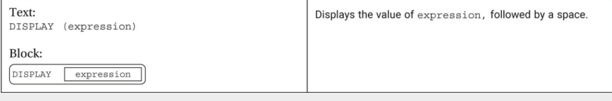

| Text / Block | Explanation |
| --- | --- |
| `RANDOM (a, b)`；Block: RANDOM a, b | Evaluates to a random integer from a to b, including a and b. For example, RANDOM(1, 3) could evaluate to 1, 2, or 3. |

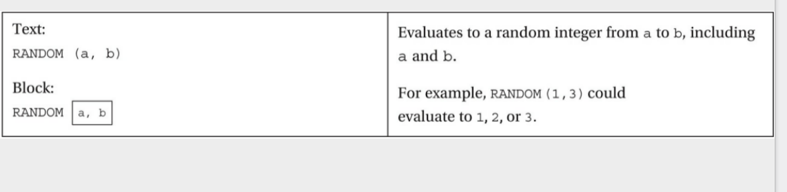

这几种就都是abstraction其实

运算符就不讲了太简单了

### List：

| Text / Block | Explanation |
| --- | --- |
| `aList ← [value1, value2, value3…]` | Creates a new list where the aList[1] = value1, aList[2] = value2 and aList[3] = value3. |
| `aList ← []` | Creates a new empty list and assigns it to the name aList. |
| `aList ← bList` | Assigns a copy of the bList to aList. |

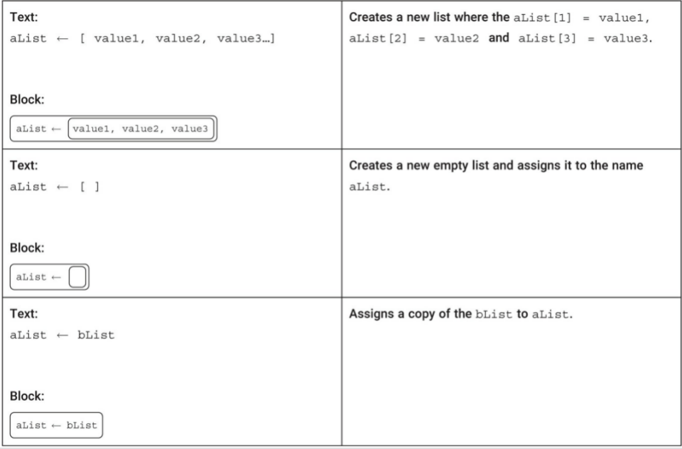

不是alist\[0\] 否则会产生error

**Boolean Table (Logic Operator)**

| Instruction (Text and Block) | Explanation |
| --- | --- |
| `NOT condition` | Evaluates to “true” if condition is false; otherwise evaluates to “false.” |
| `condition1 AND condition2` | Evaluates to “true” if both condition1 and condition2 are true; otherwise, evaluates to “false.” |
| `condition1 OR condition2` | Evaluates to “true” if either condition1 is true or condition2 is true or if both condition1 and condition2 are true; otherwise, evaluates to “false.” |

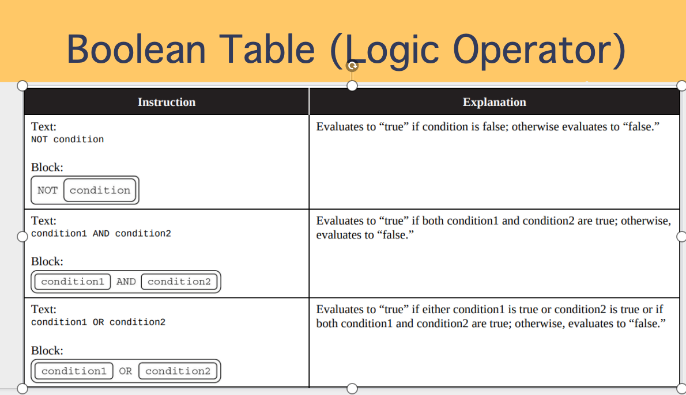

True and true-\>true true or true-\>true

True and false-\>false true or false-\>true

False and true-\>false false or true-\>true

False and false-false false or false-false

Robot那个太简单了就不讲了就讲一个点

**REPEAT_UNTIL LOOP**

- Loops will repeat a section of code until a condition is met.
- For example, this robot in example thirty-eight will repeat lines 1, 2, 3 and 4 until the condition in line 1 executes as true. Once line 1 executes to “true,” the program is over.

```text
Line 1: REPEAT_UNTIL(CAN_MOVE(forward) = false)
Line 2: {
Line 3:   MOVE_FORWARD()
Line 4: }
```

The current robot can move forward so CAN_MOVE(forward) will equal true. To end the loop, the CAN_MOVE(forward) must equal “false.”

图示：机器人在一排五个方格中依次向右移动，停在最右侧方格。

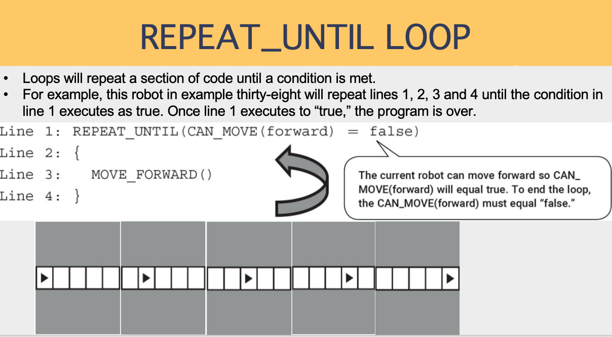

一直动 知道他不能再动了这个意思是 所以要等到这个equal to false才可以

Swap也太简单了 没什么知识点

### Linear Search vs. Binary search

A linear search (or sequential search) is an algorithm for finding an element in a list.

This search starts from the beginning of a list and sequentially checks each element of the list until a match is found or the entire list is searched without finding the element.

A linear search can be used for either a sorted list or an unsorted list.

就是按照顺序一个一个找

**Binary Search**

- A binary search is a search algorithm that halves the number of elements that need to be searched after every comparison.
- To use a binary search, the list must be sorted.

```text
numList ← [1, 3, 5, 8, 56, 76, 300, 330, 900, 1870, 5444]
```

What steps are needed for a binary search to find the number 300?

```text
[1, 3, 5, 8, 56, 76, 300, 330, 900, 1870, 5444]
→ [300, 330, 900, 1870, 5444]
→ [300, 330]
→ 300 = target
```

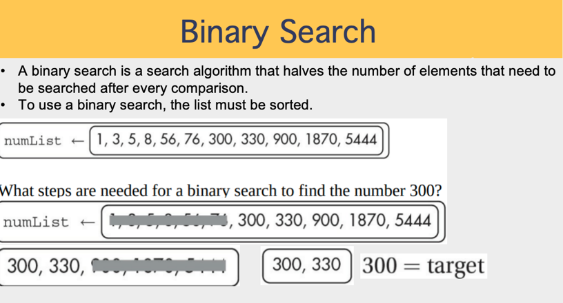

Binary search必须有顺序 从大到小或者从小到大

然后呢就是一半一半

比如说有100个数字 最多多少次

$2^n=100$，$n$ 为 7

最多7次

### Programming

考点：

### 1. Program changes had to be made to accommodate so many people and to target it toward a wide market of people that might use it（可以改变，会根据需求灵活调整）

**Programming Design Steps**

Designing → Implementing → Testing → Debugging → Maintaining → 回到 Designing。

Investigating and reflecting → Designing → Prototyping → Testing → 回到 Investigating and reflecting。

A development process that is iterative requires refinement and revisions based on feedback, testing, or reflection throughout the process. This may require revisiting earlier phases of the process.

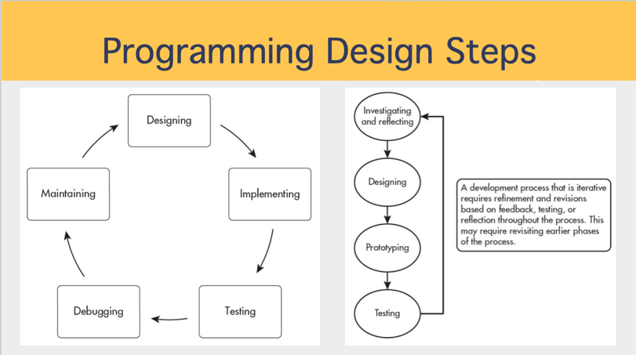

顺序

### 2. Program documentation指为一段程序、软件或项目编写的**说明性文档**，用来让人看懂，他全阶段都有用，不会影响程序的运行，而且协作的时候或者单独的时候都需要

这个挺重要的得要会看：

| Text / Block | Explanation |
| --- | --- |
| `list[i]` | Refers to the element of list at index i. The first element of list is at index 1. |
| `list[i] ← list[j]` | Assigns the value of list[j] to list[i]. |
| `list ← [value1, value2, value3]` | Assigns value1, value2, and value3 to list[1], list[2], and list[3], respectively. |

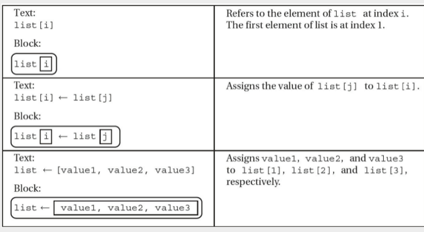

| Text / Block | Explanation |
| --- | --- |
| `INSERT(list, i, value)` | Any values in list at indexes greater than or equal to i are shifted to the right. The length of list is increased by 1, and value is placed at index i in list. |
| `APPEND(list, value)` | The length of list is increased by 1, and value is placed at the end of list. |

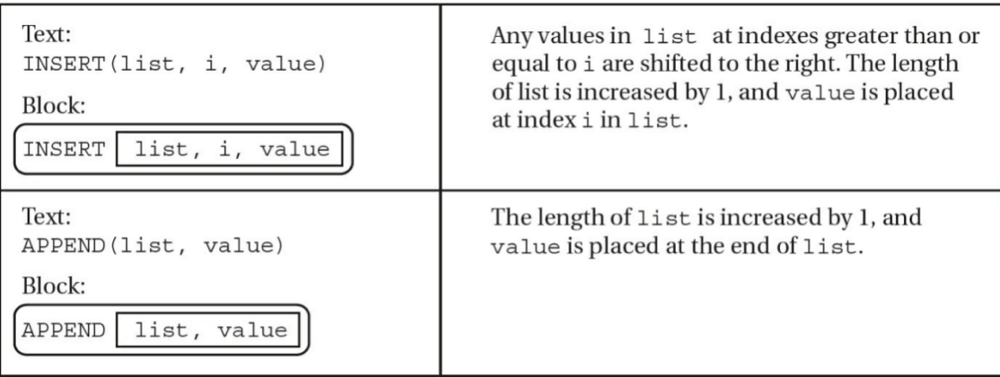

这个insert就是想插哪就插哪

Append是只能最后

### Procedure：

就是把一段你常用的代码封装起来，然后呢起个名字，然后你就可以一直调用了

Ppt Big3里面有很多这样子的例子可以去看看 但是都是围绕着procedure这个讲述

## Big idea 4: Computer systems and Networks

### Computer devices：

Input（computing input device）→ Processing（computing device）→ Output（computing output device）。

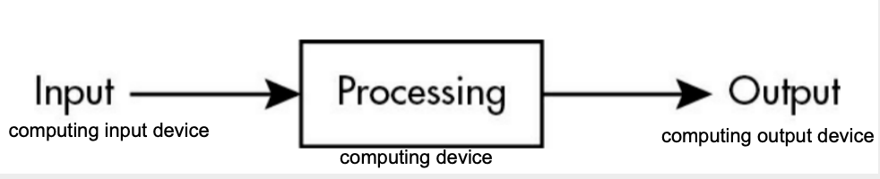

The device must be able to take inputs, process the inputs, and then calculate results based on those inputs.能运行程序的物理设备 eg. 电脑 手表 路由器

（Computer system is a group of computing devices and programs working together for a common purpose）然后呢有一种computer system就是computer network 他是一组interconnected computing devices然后呢一直发送或者收到数据

### Autonomous Systems of the Internet

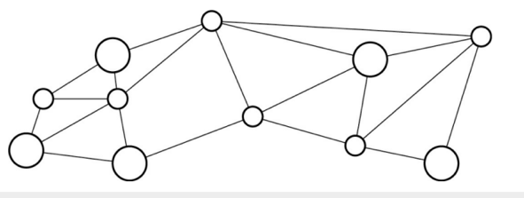

（The larger circles represent systems that have a higher bandwidth capacity measured in bits per second. ）

Bandwidth：带宽指的是在固定时间内能传的最大数据量

A path between two computing devices on a computer network (a sender and receiver) is a sequence of directly connected computing devices that begins at the sender and ends at the receiver.

Routing is the process of **finding a path** from sender to receiver.

### Fault- tolerance:

**Autonomous Systems of the Internet**

If the path from sender to receiver is broken, the path will be rerouted. This fault-tolerant nature of the internet makes connections between computing devices more reliable.

Sender；Path；Receiver；Broken node。粗箭头由 Sender 经未损坏的替代节点抵达 Receiver。

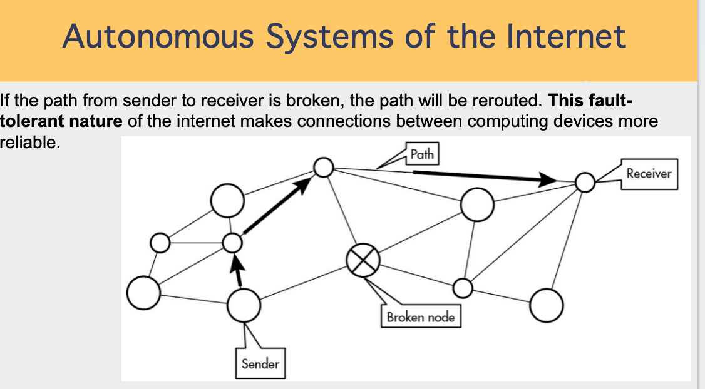就是说如果path坏了话，就走另外一条

Redundancy is the inclusion of extra paths that can mitigate the failure of a system if other components fail. 就是设计很多额外路径

### Internet protocol：

Protocol：就是大家公认的规则，规定了网络系统该如何工作

Scalability：系统会根据需求不断做出调整（因为协议会不断的优化）

Internet protocol（IP）：负责给设备分配地址，以及指导数据该怎么找路径传输

### IPV4 vs IPV6

IPV4 hold $2^{32}$ 个 IP address

IPV6 hold $2^{128}$ 个 IP address

内网 IP（本地 IP）

- 样子：192.168.x.x、10.x.x.x

- 作用：路由器给你手机、电脑分配的**内部编号**

- 分配方式：**动态 DHCP**，重启路由器 / 设备就可能变

- 范围：只在你家 WiFi 里有效

2\. 公网 IP（外网 IP）

- 作用：互联网上识别你家网络的地址

- 普通家庭 / 手机：**动态 IP**，断网重连就可能换

- 服务器 / 公司专线：**静态 IP**，固定不变

3\. 动态 IP vs 静态 IP

- **动态 IP**：自动分配、会变、普通人默认用

- **静态 IP**：手动设置、不变、多用于服务器

（一般不会考，总之一句话IP地址不是一直永久的，他会动态分配）

### Transmission control Protocol：

传送数据的时候，很多data都会被分为不同的packet

TCP：可靠，会确认重发packet，但是慢

UDP：不可靠 不会确认 但是快（直播）

### Internet vs World Wide Web:

简单一点internet focus的是在hardware上 比如说电脑，电缆，路由器

但是world wide web focus的是在software 比如说程序，文件等等

HTTP is a protocol used by the World Wide Web **to transmit data.** The internet allows access to the World Wide Web, which is **a system of linked pages, programs, and files.**

### Efficiency of solution：

Sequential computing-\>任务按顺序一件件执行，一次只做一个事情

Parallel computing-\>同时做，比如说烧水10秒，回消息5秒，一共只用10秒，因为可以在烧水的时候回消息

**Why Is Parallel Computing Used?**

- In the real world, many things happen at the same time in different places concurrently.
- Parallel computing is needed for real-world simulations and modeling.

Some examples of complex computer simulations that benefit from parallel computing include weather forecasting, flight simulators, car crash modeling, seismic surveying, and so on. The “speedup” of a parallel solution is measured in the time to complete the task sequentially divided by the time to complete the task when done in parallel:

$$\text{Speedup}=\frac{\text{sequential run time}}{\text{parallel run time}}$$

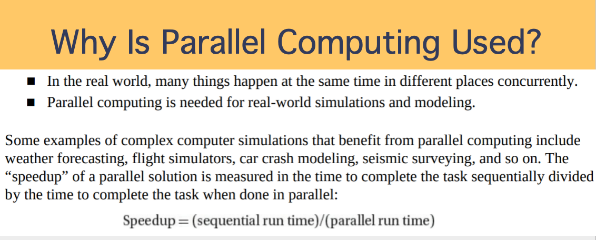

Speedup（加速比）：算出来的结果越大，说明并行计算效果越好。

但并行处理器到一定数量，再加的话效率会变得越来越小

### Distributed computing：

Many problems are so large and complex that it is impractical to solve them on a single computer, especially given limited computer memory. Distributed computing is a computational model in which **multiple devices are used to run a program.**

他和parallel computing的差异就是他用的是很多台设备，但是parallel就用一个单独的电脑，但是有这不同的处理器

## Big idea 5: Impact of computing

### Digital Divide：

**Digital Divide**

The digital divide is the difference in access to technology including access to computers and the internet. Several variables affect the digital divide:

- Infrastructure—Some parts of the world do not have access to the internet.
- Education—A person could have access to the internet but not have the education to use it.
- Indifference—A person could have access to the internet but choose not to use it.
- Cost—The cost of accessing the internet could make using it unaffordable.

For example, Google X’s Project Loon was using balloons traveling at the edge of space to provide internet infrastructure to people living in unserved communities around the world.

Some communities are also providing education classes and free Wi-Fi to decrease the digital divide.

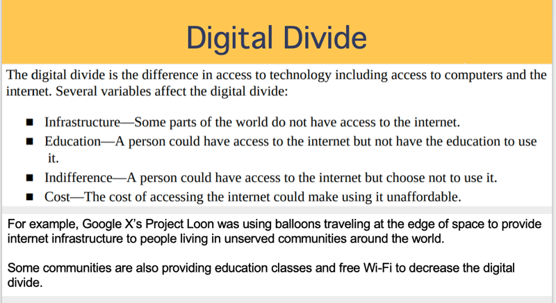

数字鸿沟并不是所有人都能平等的使用这些资源因为各种原因 比如经济负担，education等等

### Beneficial and harmful effect：

A computing innovation can have both a beneficial and a harmful effect on societies, cultures, or economies.

Single effect can be viewed as both beneficial and harmful by different people or even by the same person.

比如说短视频他的好处是帮我们放松，但是坏处就是容易沉迷，其实这些都挺简单的

### An impact beyond their intended purpose：

有一些设计创新超过了它原本最初设计的目的（internet就是其中一个例子The internet’s original purpose was to be used exclusively by academic, government, and scientific communities. Today the internet can be used by anyone who has the tools to access it. ）

Greedy algorithm-贪婪算法，每一步都做当下看起来最优的选择，不回头只关注当下

### Human bias：

**Human Bias**

Computing innovations can reflect existing human bias. Algorithms are helping people make decisions that can have extreme ramifications.

- An algorithm can determine where to place police resources;
- it may decide who gets into a college or who will get a job.

Since computing innovations are created by people, the innovations created can reflect bias that the programmers bring with them.

- Variables such as age are appropriate in some calculations, such life insurance and auto insurance,
- but inappropriate in other calculations, such as hiring and mortgage lending.

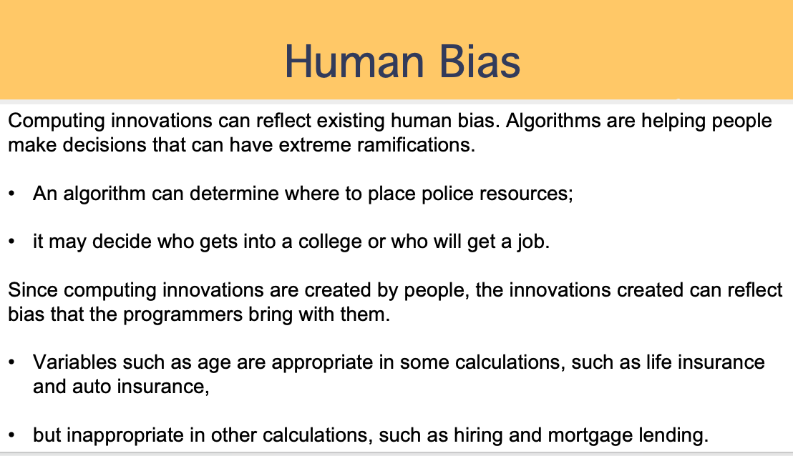

计算创新是人类创造的，所以会带有程序员自己的偏见，偏见很多时候都会存在就对了，然后具体问题具体分析

### Crowdsourcing（众包）：

把原本由公司、机构或个人做的任务，**公开交给一大群人（大众）来一起完成**，就叫众包。

Eg. 维基百科 但是也会存在弊端

### Citizen Science：

**Citizen Science**

- Citizen science is scientific research using public participation in scientific research.
- The research is conducted in whole or part by distributed individuals, many of whom may or may not be scientists.
- They contribute relevant data to research using their own computing devices.
- For example, citizen science could be used to calculate the firefly population on the east coast of the United States. Firefly counting needs lots of people but not a lot of technical skills or expensive equipment.
- An example of an experiment not suited for citizen science is testing a vaccine on human volunteers. When testing on humans, a trained professional scientist is needed.

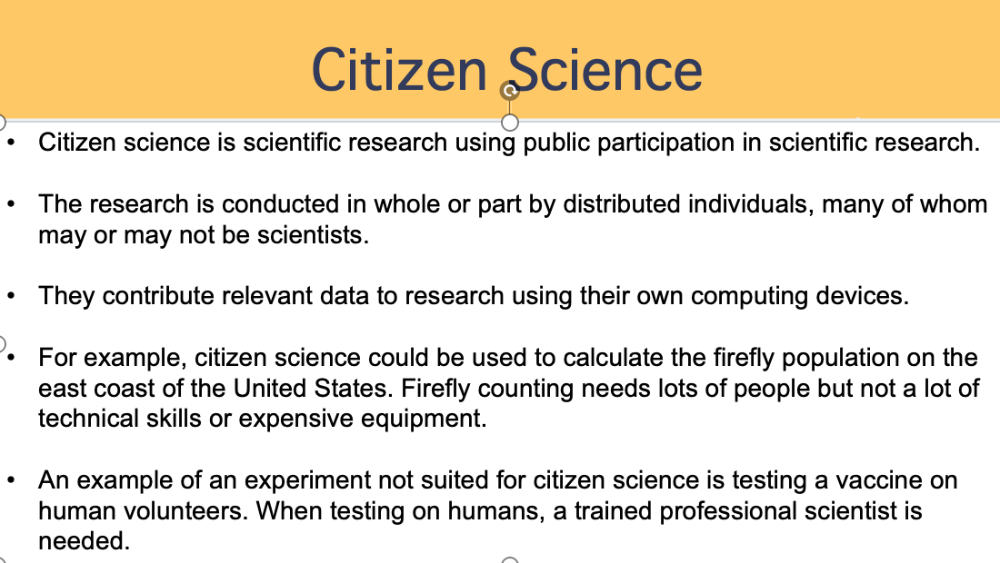

这个就相当于做实验，但是老百姓也可以参与其中，他们也不需要很多的技巧或者昂贵的设备，但是需要人手之类的

### Creative Commons：

**Creative Commons（合法分享，让别人在其基础上创造）** is an American nonprofit organization that is dedicated to expanding the range of creative works available for others to build upon and share legally.

**Open source（都可以修改）** are programs that are made freely available and may be redistributed and modified.

**Open access（免费访问）** is online research output free of all restrictions on access and free of many restrictions on use, such as copyright or license restrictions.

### Safe Computing：

Security is needed to protect the confidentiality, integrity, and availability of information.

**Confidentiality（保密性）**：信息只能被授权的人看到，不能泄露（比如你的银行卡密码不能被别人知道）

**Integrity（完整性）**：信息不能被篡改、伪造（比如转账金额不能被黑客改掉）

**Availability（可用性）**：授权的人需要时，信息能正常访问、使用（比如网站不能被攻击到打不开）

（个人可识别信息（PII），是指能识别、关联、描述某个人的信息，也就是能直接 / 间接定位到你是谁的数据。 Eg. race, phone numbers, medical information等等）

### Multifactor authentication：

**Multifactor authentication**

Multifactor authentication is a method of computer access control in which a user is granted access only after successfully presenting several pieces of evidence to an authentication mechanism, typically in at least two of the following categories:

- Knowledge—something the user knows
- Possession—something the user has
- Inherence—something the user is

图注：Digital Certificate。

Multifactor authentication requires at least two steps to unlock protected information. Each step adds a new layer of security that must be broken to gain unauthorized access.

Digital certificate authorities issue digital certificates that validate the ownership of encryption keys used in secure communications and are based on a trust model.

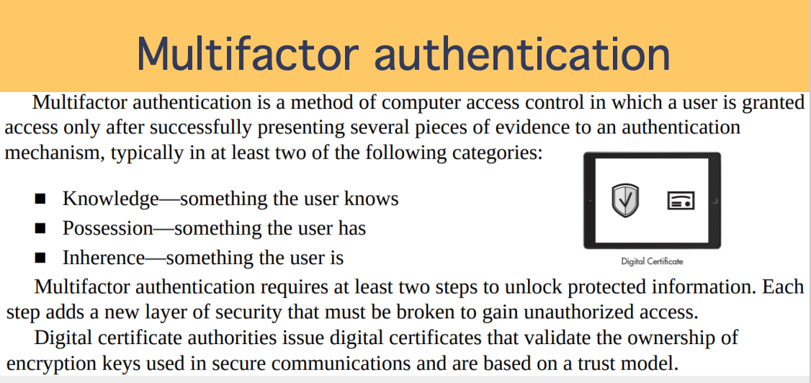

多因素认证是一种计算机访问控制方法：用户只有成功向认证系统提供至少两类不同的验证凭证，才能获得访问权限

Knowledge:只有你本人知道的秘密信息

Possession：只有你本人持有的实体/数字信息

Inherence：你独一无二的生物特征

### Symmetric encryption vs asymmetric encryption（public key encryption）

1\. Symmetric encryption

- 加密 **用一把密钥**

- 解密 **还用同一把密钥**

- 加密和解密的钥匙是 **一样的**

就像：

你用一把钥匙锁箱子，别人也用**同一把钥匙**开箱。

优点：快、简单

缺点：钥匙必须安全传给对方，万一被截胡就完了。

Symmetric key encryption uses the same key for both encryption and decryption. The one key is a shared secret and relies on both sides keeping their key secret.

Same key to encrypt and decrypt；One key to encrypt data；Same key to decrypt data。

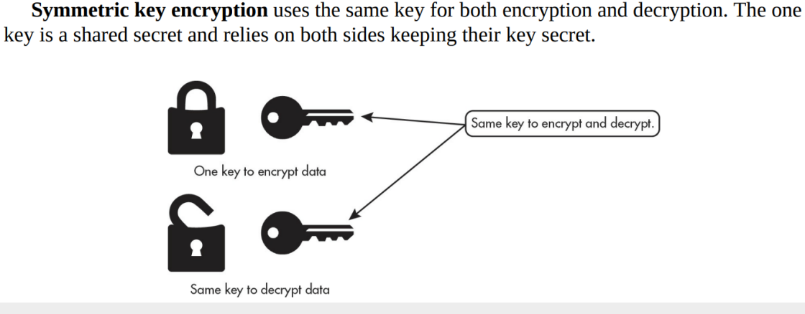

2\. Asymmetric encryption

**非对称加密**

- 有 **两把钥匙**：

  - **公钥（public key）**：公开，谁都能拿

  - **私钥（private key）**：自己藏好，绝不外传

- 用公钥加密 → **只能用私钥解密**

- 用私钥加密 → **只能用公钥解密**

就像：

你给别人一个**打开的挂锁（公钥）**，别人把信锁进去寄给你，

只有你手里的**钥匙（私钥）** 能打开。

优点：超级安全，不用传密钥

缺点：速度慢

Public key encryption (also called asymmetric encryption) uses two keys—one private and one public. Anyone with the public key can encrypt data, and the public key is public. To decrypt, a second key, which is private, is needed.

Key one；One public key to encrypt data；Key two；Second private key to decrypt data；One key to encrypt and a separate second key to decrypt。

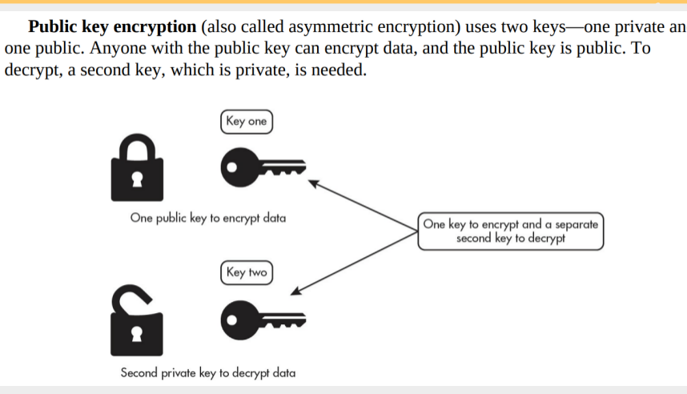

### 最后一些病毒：

1\. Malware（恶意软件）

**所有坏软件的总称**

- 病毒、木马、勒索软件、间谍软件…… 全都叫 malware

- 只要是**故意破坏、偷数据、控制电脑**的软件，都是 malware

2\. Computer virus（计算机病毒）

**一种会自我复制的 malware**

- 像生物病毒一样，会**复制自己、感染其他文件 / 电脑**

- 会破坏文件、拖慢系统、扩散传播

3\. Phishing（网络钓鱼）

**假装成正规网站 / 邮件骗你信息**

- 假银行网站、假支付宝、假邮件

- 目的：骗你输**账号密码、身份证、银行卡**

4\. Keylogging（键盘记录）

**偷偷记录你按的每一个键**

- 你输密码、聊天、搜东西，它全都记下来发给黑客

- 属于间谍类 malware

5\. Rogue access point（恶意接入点 / 假 WiFi）

**黑客建的假免费 WiFi**

- 名字像：Airport-Free、Hotel-Guest

- 你一连，黑客就能**窃听你所有上网数据、偷密码**
