# AP Macroeconomics Review Notes

## 1. GDP

### (1)

Definition: The market value of all final goods and services produced within a country in a given period of time.

### (2) 三种计算方式

1. **Expenditures Approach** — Add up all the spending on final goods and services produced in a given year.
2. **Income Approach** — Add up all the income earned from selling all final goods and services produced in a given year.
3. **Value-added Approach** — Add up the dollar value added at each stage of the production process.

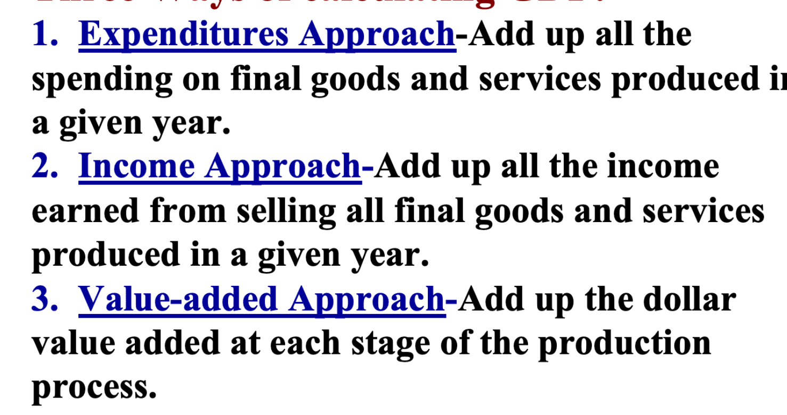

可能会专门出一道选择题，给你五个选项问哪个能算出正确的GDP，所以要每个都理解

Expending approach的公式

可能会给你个表格让你算gdp，只看公式里包含的就可以

$$GDP=C+I+G+NX$$

C Consumption: total spending by households on goods and services

I Investment:

Includes spending on:
- capital equipment (e.g., machines, tools)
- structures (factories, office buildings, houses)
- inventories (goods produced but not yet sold)

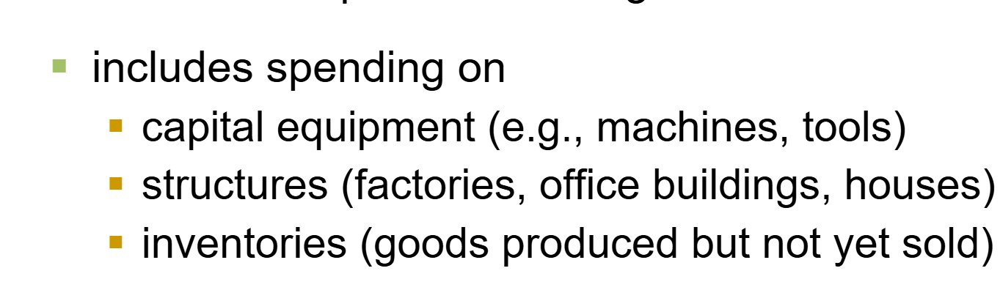

**Investment does not mean the purchase of financial assets like stocks and bonds**

G Government Spending

NX Net Exports: Exports – Imports

### （3）Real/Nominal GDP & GDP deflator

会出大题给一张价格表算GDP，类似下面

| Good | 2011 (base yr) $P$ | 2011 $Q$ | 2012 $P$ | 2012 $Q$ | 2013 $P$ | 2013 $Q$ |
| --- | --- | --- | --- | --- | --- | --- |
| Good A | \$30 | 900 | \$31 | 1000 | \$36 | 1050 |
| Good B | \$100 | 192 | \$102 | 200 | \$100 | 205 |

A. Compute nominal GDP in 2011.

\[ \text{\$30}\times900+\text{\$100}\times192=\text{\$46,200} \]

B. Compute real GDP in 2012.

\[ \text{\$30}\times1000+\text{\$100}\times200=\text{\$50,000} \]

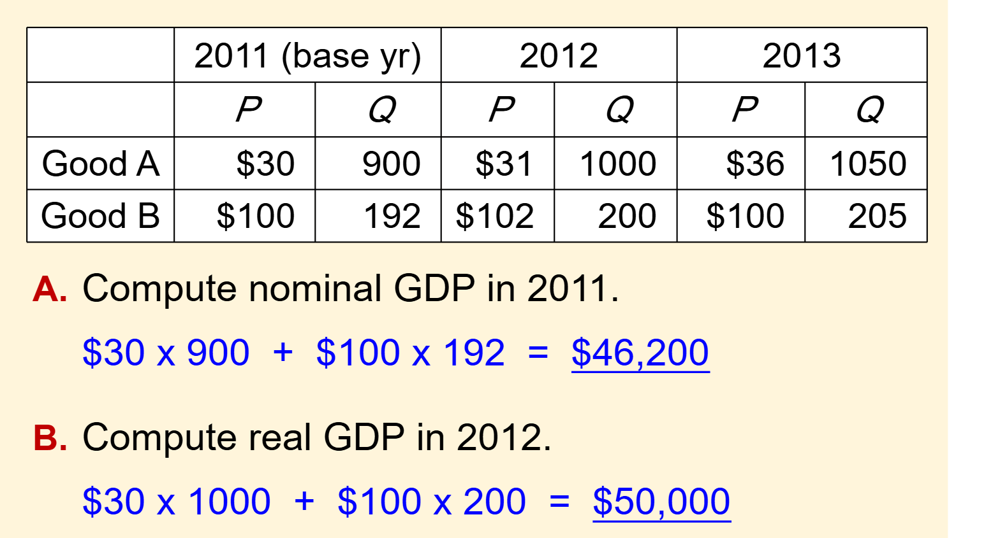

注意Real GDP是当年Q乘上base year P, Nomial GDP是当年P乘上当年Q

然后就是让你算GDP deflator，再让你算inflation

Definition:

$$\text{GDP deflator}=100\times\frac{\text{nominal GDP}}{\text{real GDP}}$$

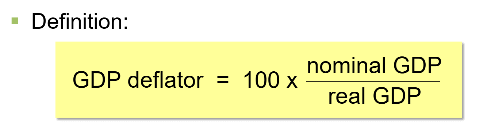

注意要乘100！！！！

$$\text{Inflation}=\frac{\text{GDP deflator current year}-\text{GDP deflator base year}}{\text{GDP deflator base year}}\times100\%$$

One way to measure price level and calculate inflation

还有的选择题会给你nominal/real GDP的其中一个是多少，再给你GDP deflator，别被绕晕了，公式背熟就可以

### （4）Circular flow diagram

图中流向：
- firms (businesses) → factor incomes (wages, rents, interest, profit) → households (consumers)
- households → consumer expenditure (spending on goods and services) → firms
- leakages：households → saving → financial markets；households → taxes → government；households → spending on imports → other countries
- injections：financial markets → investment → firms；government → government spending → firms；other countries → spending on exports → firms

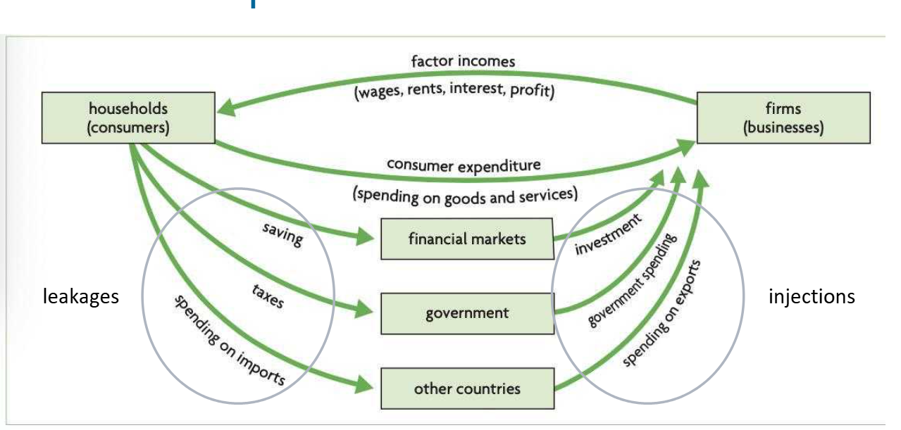

图中流向：
- households (consumers) → land, labour, capital, entrepreneurship → resource markets → land, labour, capital, entrepreneurship → firms (businesses)
- firms → costs of production → resource markets → household income (rent, wages, interest, profit) → households
- firms → goods and services → product markets → goods and services → households
- households → household expenditure → product markets → revenues → firms

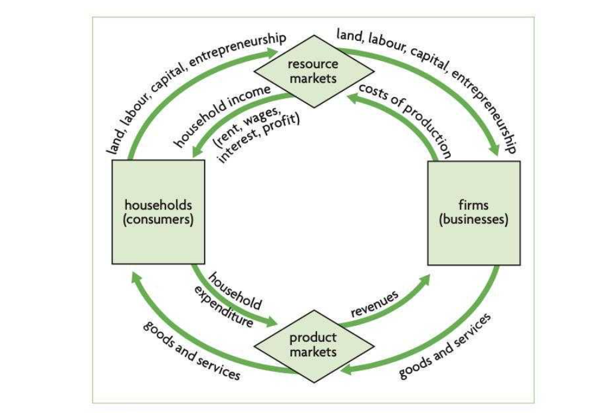

这张表里要记住不同东西的流向，会考的

Factors of production → Factors payments

Land → Rent

Labor → Wages

Capital → Interest

Entrepreneurship → Profit

## 2. CPI & Inflation

### How the CPI Is Calculated

1. **Fix the “basket.”** The Bureau of Labor Statistics (BLS) surveys consumers to determine what’s in the typical consumer’s “shopping basket.”
2. **Find the prices.** The BLS collects data on the prices of all the goods in the basket.
3. **Compute the basket’s cost.** Use the prices to compute the total cost of the basket.

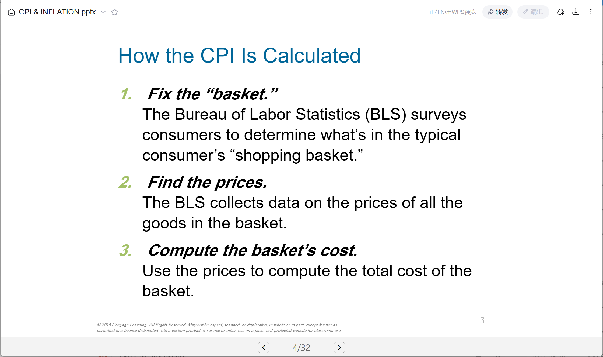

4. **Choose a base year and compute the index.** The CPI in any year equals

$$100\times\frac{\text{cost of basket in current year}}{\text{cost of basket in base year}}$$

5. **Compute the inflation rate.** The percentage change in the CPI from the preceding period.

$$\text{Inflation rate}=\frac{\text{CPI this year}-\text{CPI last year}}{\text{CPI last year}}\times100\%$$

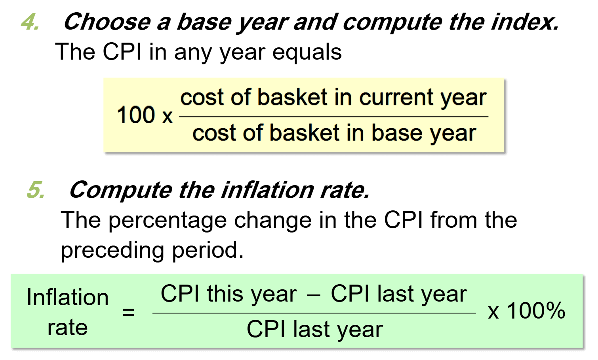

简而言之就是选一个固定的basket，然后观察篮子中物品物价的变化来算CPI，衡量物价水平。**定义**和公式都会考

## Problems with the CPI:

Substitution Bias（产品价格变化速度不一，消费者会倾向更便宜的产品而篮子固定→overstate cost of living）

Introduction of New Goods（新产品引入，旧篮子中的物品本应该被替代→overstate cost of living）

Unmeasured Quality Change（质量变化难以充分测量）

## Real vs. Nominal Interest Rates

$$\text{Real interest rate}=(\text{nominal interest rate})-(\text{inflation rate})$$

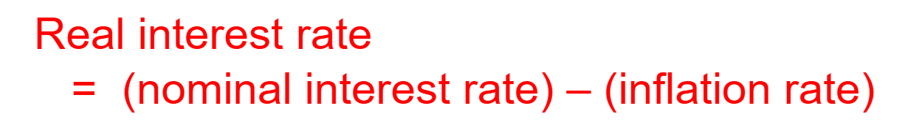

直接减inflation就可以，肯定会考的

## Unemployment

这部分背背公式就行，应该会单独出大题

1. **Labor Force（劳动力）**

$$\text{Labor Force}=\text{Employed}+\text{Unemployed}$$

失业者是指没有工作、能够工作并且正在积极找工作的人。

不找工作的人通常被归为 Not in the Labor Force（非劳动力人口），而不是 Unemployed。

2. **Unemployment Rate（失业率）**

$$\text{Unemployment Rate}=\frac{\text{Unemployed}}{\text{Labor Force}}\times100\%$$

3. **Labor Force Participation Rate（劳动参与率）**

$$LFPR=\frac{\text{Labor Force}}{\text{Adult Population}}\times100\%$$

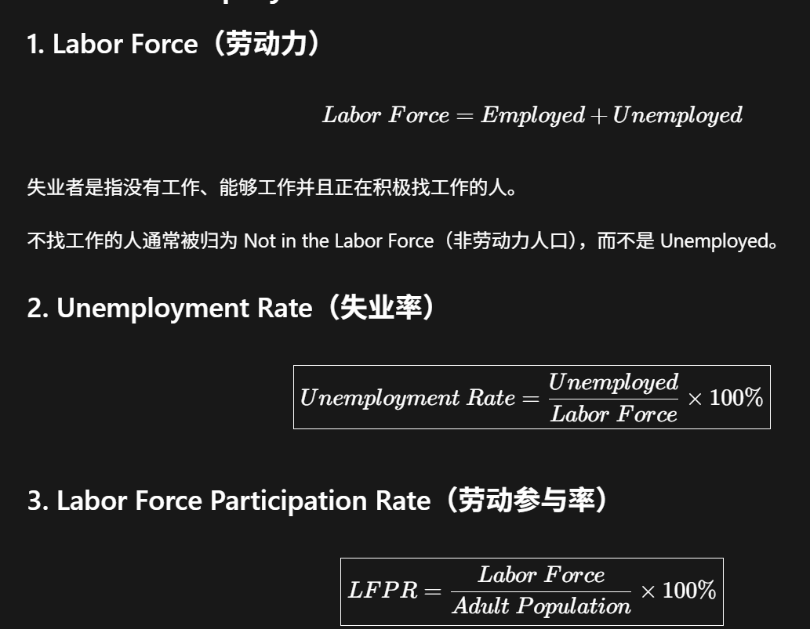

公式2，3不要混淆

## 三种失业

Frictional Unemployment

大学毕业生正在寻找第一份工作

Structural Unemployment

技术改变导致部分职业技能不再符合需求

Cyclical Unemployment

经济衰退导致企业裁员

Natural rate of unemployment= Structural Unemployment+ Frictional Unemployment (不是0%)

## The business cycle

**The Business Cycle**

The national economy goes up and down like a roller coaster over time.

纵轴 Real GDP，横轴 Time；上升直线 Full Employment；波动曲线 Real GDP；高点 Peak，低点 Trough；高于直线为 Positive Output Gap，低于直线为 Negative Output Gap；Peak 到 Trough 为 Recession (Contraction)，Trough 到下一 Peak 为 Recovery (Expansion)。

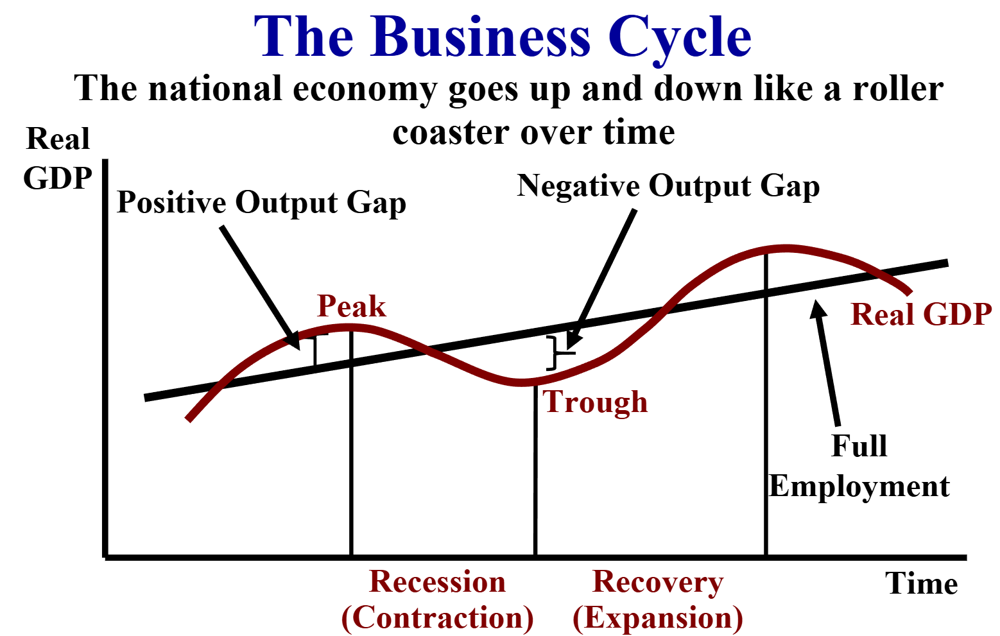

这个图理解然后背下来就可以，考试一般会直接给你这个图让你identify哪个点是处于什么状态，在不在full employment，属于什么gap这样的问题，或者反过来问你ABCD哪个点符合要求

ADAS应该还没学到
