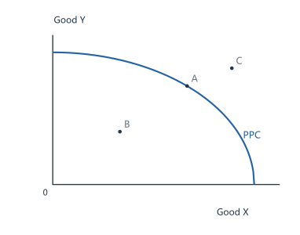
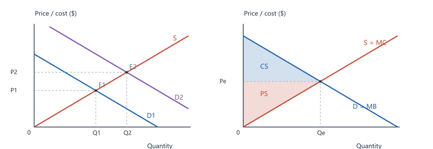
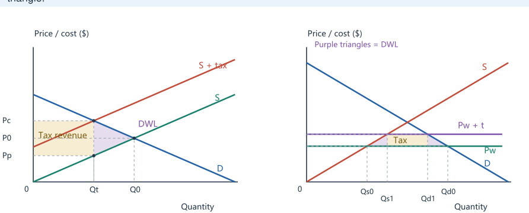
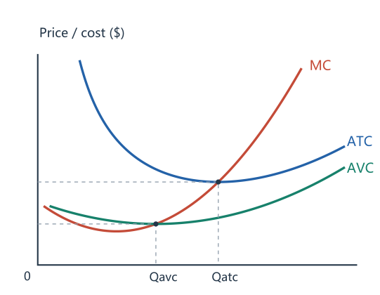
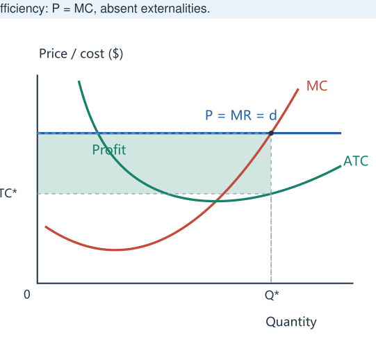
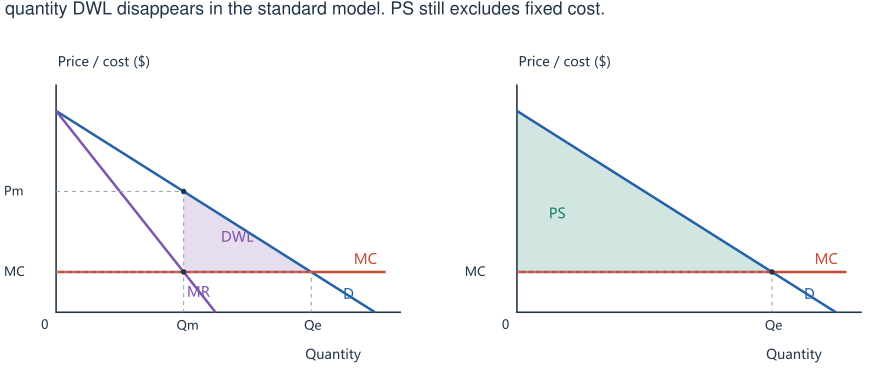
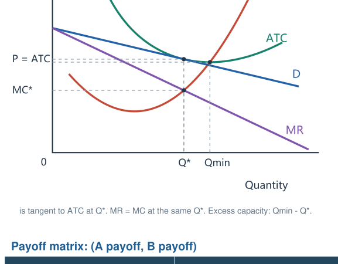
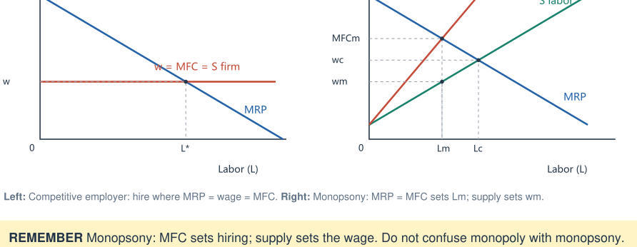
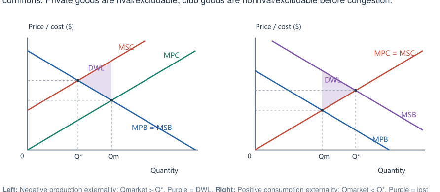
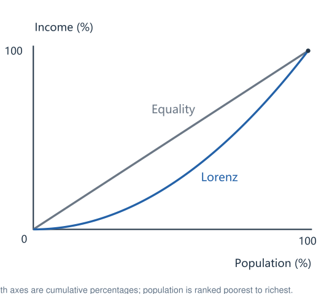

# AP Microeconomics | Concise English Review

**AP MICROECONOMICS / CONCISE REVIEW / UNIT 1 Basic Economic Concepts**

All 36 topics. Read the rule, inspect the graph, then recall it without looking.

### 1.1 Scarcity & opportunity cost

Limited resources force choices. Factors: land, labor, physical capital and entrepreneurship. Opportunity cost is the value of the next-best alternative. Positive statements are testable; normative statements express value judgments.

### 1.2 Allocation & economic systems

Every economy chooses what, how and for whom to produce. Markets use prices; command systems use central decisions; mixed systems use both. Households sell factors and buy goods; firms do the reverse.

### 1.3 Production possibilities curve (PPC)

On the curve: productively efficient. Inside: underused resources. Outside: currently unattainable. Bowed-out PPC: increasing opportunity cost. More resources or better technology shift PPC outward; lower unemployment moves the production point toward it.

$$\text{Opportunity cost of X}=\frac{\text{Y forgone}}{\text{X gained}}$$

### 1.4 Comparative advantage & trade

Absolute advantage: more output per input. Comparative advantage: lower opportunity cost. Specialize by comparative advantage. Mutually beneficial trade terms lie between the two opportunity costs. Trade can expand consumption beyond a country's PPC, not its production.

Output table: $\text{OC of X}=\text{Y output}/\text{X output}$. Time table: $\text{OC of X}=\text{time for X}/\text{time for Y}$.

### 1.5 Relevant costs & benefits

Include explicit payments and implicit opportunity costs. Ignore sunk costs: past costs that cannot be recovered. Fixed costs do not vary with current output; they are not necessarily sunk.

### 1.6 Marginal analysis & consumer choice

Increase an activity while marginal benefit exceeds marginal cost. Diminishing MU means each extra unit adds less satisfaction; total utility still rises if MU > 0. A price fall creates substitution and real-income effects.

Interior optimum: MB = MC. Consumer: $MU_x/P_x=MU_y/P_y$, subject to the budget. Discrete choices may not satisfy exact equality.

Graph labels: Good Y; Good X; 0; A; B; C; PPC.

PPC: A is efficient; B is feasible but inefficient; C is currently unattainable.

> **REMEMBER** A change in productive capacity shifts the PPC; a change in resource use moves the point.

**AP MICROECONOMICS / CONCISE REVIEW / UNIT 2 / A Demand, Supply & Elasticity**

### 2.1 Demand

Own price changes cause movement along D. Income, tastes, related-good prices, expectations and buyer numbers shift D. Income rises: normal-good D rises; inferior-good D falls. Substitute price rises: D rises. Complement price rises: D falls.

### 2.2 Supply

Own price changes cause movement along S. Lower input costs, better technology, more sellers or per-unit subsidies shift S right. Higher variable costs or per-unit taxes shift S left. Market demand and supply add individual quantities horizontally.

### 2.3 Price elasticity of demand

Classify by |Ed|: elastic > 1; unit elastic = 1; inelastic < 1. More substitutes, longer adjustment time and a larger budget share usually increase elasticity. A downward-sloping linear demand curve has constant slope, not constant elasticity.

$$|E_d|=\left|\frac{\%\Delta Q_d}{\%\Delta P}\right|=\left|\frac{\frac{Q_2-Q_1}{(Q_1+Q_2)/2}}{\frac{P_2-P_1}{(P_1+P_2)/2}}\right|$$

Total revenue: $TR=P\times Q$. Elastic: P and TR move in opposite directions; inelastic: same direction; unit elastic: TR is unchanged.

### 2.4 Price elasticity of supply

Es measures producers' percentage quantity response to price. More time, spare capacity and flexible inputs generally increase Es. Vertical S: Es = 0. Horizontal S: perfectly elastic.

$$E_s=\frac{\%\text{ change in }Q_s}{\%\text{ change in }P}$$

### 2.5 Other elasticities

Cross-price elasticity: positive = substitutes; negative = complements. Income elasticity: positive = normal good; negative = inferior good. Keep the signs for these measures.

$$E_{xy}=\frac{\%\text{ change in }Q_x}{\%\text{ change in }P_y},\qquad E_i=\frac{\%\text{ change in }Q}{\%\text{ change in income}}$$

Graph labels: Price / cost (\$); Quantity; S; E₁; E₂; P₁; P₂; Q₁; Q₂; D₁; D₂; S = MC; CS; PS; Pe; Qe; D = MB; 0.

Left: Demand rises: D1 to D2. With supply unchanged, price and quantity both rise. Right: Surplus preview (2.6): CS above Pe; PS below Pe, up to Qe.

> **REMEMBER** Own price changes quantity demanded/supplied. Other determinants shift demand/supply.

**AP MICROECONOMICS / CONCISE REVIEW / UNIT 2 / B Welfare & Market Policy**

### 2.6 Equilibrium & surplus

Equilibrium: Qd = Qs. CS is below D and above the buyer price. PS is above S and below the seller price, up to quantity traded. Without market failure, competitive equilibrium maximizes total surplus.

$TS=CS+PS$. $\text{Triangle area}=\frac12\times\text{base}\times\text{height}$. $PS=TR-TVC$; $\text{economic profit}=PS-TFC$.

### 2.7 Disequilibrium & shifts

Below equilibrium price: shortage (Qd > Qs). Above it: surplus (Qs > Qd). D rises: P and Q rise. S rises: P falls, Q rises. With simultaneous shifts, the opposing effect requires information about relative magnitudes.

### 2.8 Controls, taxes & subsidies

Binding ceiling < equilibrium price: shortage. Binding floor > equilibrium price: surplus. Without government purchases, the short side limits trade. A unit tax reduces Q; the less elastic side bears more. A subsidy usually increases Q; without externalities it can cause overproduction.

Tax = buyer price - seller price. Revenue = tax x Q after tax. Linear-model DWL = 1/2 x tax x reduction in Q. Subsidy spending = subsidy x Q.

### 2.9 Trade, tariffs & quotas

Small-country model: world price below the closed-economy price means imports; above means exports. Imports = Qd - Qs. A tariff raises domestic P, increases domestic output and reduces consumption/imports. A quota limits imports; quota rents do not automatically go to government.

Tariff revenue = tariff x imports after tariff. DWL = production-distortion triangle + consumption-distortion triangle.

Graph labels: Price / cost (\$); Quantity; S + tax; S; D; Pc; P0; Pp; Qt; Q0; Tax revenue; DWL; Purple triangles = DWL; Pw + t; Pw; Tax; Qs0; Qs1; Qd1; Qd0; 0.

Left: Pc - Pp = tax. Qt is at D and S + tax. Yellow = tax revenue; purple = DWL. Right: Imports shrink from Qd0 - Qs0 to Qd1 - Qs1. Yellow = revenue; purple = DWL.

Two shifts: D up + S up: Q rises, P unclear. D up + S down: P rises, Q unclear. Reverse both directions for the opposite results.

> **REMEMBER** Ceiling below equilibrium: shortage. Floor above equilibrium: surplus. Tax burden depends on elasticity, not who legally pays.

**AP MICROECONOMICS / CONCISE REVIEW / UNIT 3 / A Production, Costs & Profit**

### 3.1 Production function

Short run: at least one fixed input. Long run: all inputs adjustable. Diminishing marginal returns: MP eventually falls as a variable input is added to fixed inputs. Falling MP does not imply falling total output.

$MP=\Delta Q/\Delta\text{input}$. $AP=Q/\text{input}$. MP > AP raises AP; MP < AP lowers AP.

### 3.2 Short-run costs

MC crosses AVC and ATC at their minima. AFC falls as Q rises. A fixed-cost increase raises ATC and AFC, not MC or AVC. With fixed wages and labor as the only variable input, falling MP raises MC.

$TC=TFC+TVC$. $ATC=TC/Q=AFC+AVC$. $MC=\Delta TC/\Delta Q$. $MC=w/MP$; $AVC=w/AP$.

### 3.3 Long-run costs

LRATC is the lowest achievable average cost at each output. Economies of scale: LRATC falls; constant returns: flat; diseconomies: rises. Minimum efficient scale is the smallest output reaching minimum LRATC. Scale effects adjust all inputs; diminishing marginal returns holds some inputs fixed.

### 3.4 Profit

Accounting profit subtracts explicit costs. Economic profit subtracts explicit and implicit costs. Zero economic profit includes a normal return; it is not zero income.

$\text{Economic profit}=TR-TC=(P-ATC)Q$. Example: P = 12, ATC = 10, Q = 5 gives profit = 10.

Graph labels: Price / cost (\$); Quantity; MC; ATC; AVC; Qavc; Qatc; 0.

MC crosses AVC and ATC at their minima. ATC - AVC = AFC.

> **REMEMBER** Zero economic profit includes the opportunity cost of the owner's resources.

**AP MICROECONOMICS / CONCISE REVIEW / UNIT 3 / B Firm Decisions & Competition**

### 3.5 Profit maximization

Increase output if MR > MC; reduce it if MR < MC. Use the rising-MC intersection. With discrete units, produce the last unit with MR at least MC; check shutdown and other feasible choices. Revenue maximization is a different objective.

Choose MR = MC, then check whether operating is preferable to shutdown.

### 3.6 Shutdown versus exit

Short run: produce if revenue covers variable cost; losses can still be minimized by operating. Competitive firm: shut down if P < minimum AVC; indifferent at equality. Long run: persistent economic losses cause exit; positive profit attracts entry when permitted.

AVC < P < ATC: operate at a loss. P = ATC: zero economic profit. P > ATC: positive economic profit.

### 3.7 Perfect competition

Many firms, identical products and free entry/exit. Industry S and D set price; each firm faces horizontal d = P = MR. Firm short-run supply is rising MC at/above minimum AVC. Entry shifts industry S right and reduces profit.

Standard long-run equilibrium: P = MR = MC = minimum ATC. Productive efficiency: minimum ATC. Allocative efficiency: P = MC, absent externalities.

Graph labels: Price / cost (\$); Quantity; MC; ATC; P = MR = d; P; Profit; ATC*; Q*; 0.

Q* is where MC = MR. Profit = (P - ATC*)Q*. MC crosses ATC at its minimum.

Quick check P = 8, AVC = 6, ATC = 11, Q = 10: operating loss = 30; shutdown loss = TFC = 50. Operate in the short run.

> **REMEMBER** Find output using MC, then judge profit using ATC and shutdown using AVC.

**AP MICROECONOMICS / CONCISE REVIEW / UNIT 4 / A Market Power & Monopoly**

### 4.1 Market power & barriers

Imperfect competitors face downward demand. Uniform pricing makes MR < P because extra sales require price cuts on existing units. Entry barriers include patents, resource control and scale economies. Monopoly has one seller; oligopoly has a few interdependent sellers; monopolistic competition has many differentiated sellers.

### 4.2 Monopoly

Choose Q at MR = MC, then move up to D to read P. Usually P > MC and output is below the efficient level D = MC, creating DWL. Monopoly has no unique demand-independent supply curve. Entry barriers can sustain profits, but do not guarantee them.

If P = a - bQ, then MR = a - 2bQ. Example: P = 30 - Q, MC = 6 gives Q = 12 and P = 18.

### 4.3 Price discrimination

Requires market power, separation of buyers and limited resale. Charge more to less price-sensitive groups. Perfect discrimination charges each unit's willingness to pay: output reaches D = MC, CS = 0 and monopoly quantity DWL disappears in the standard model. PS still excludes fixed cost.

Graph labels: Price / cost (\$); Quantity; Pm; MC; DWL; MR; D; Qm; Qe; PS; 0.

Left: P = 30 - Q; MC = 6. Qm = 12, Pm = 18; efficient Qe = 24. Purple = DWL. Right: Perfect discrimination: produce to D = MC. CS = 0; shaded area = PS.

> **REMEMBER** Monopoly: MR = MC -> Q -> up to demand for P. Do not read price from MR.

**AP MICROECONOMICS / CONCISE REVIEW / UNIT 4 / B Competition & Strategy**

### 4.4 Monopolistic competition

Differentiated products, many firms and free entry. Short run: choose MR = MC and read P from D. Entry reduces each incumbent's demand. Long run: D is tangent to ATC; P = ATC but P > MC. Output is below minimum-ATC output: excess capacity.

### 4.5 Oligopoly & game theory

A dominant strategy is best regardless of the rival's choice. A Nash equilibrium is a set of mutual best responses: nobody gains by changing alone. Collusion can raise joint profit, but cheating incentives undermine it. Nash outcomes need not maximize joint profit; a dominant strategy need not exist.

Graph labels: Price / cost (\$); Quantity; MC; ATC; P = ATC; MC*; D; MR; Q*; Qmin; 0.

D is tangent to ATC at Q*. MR = MC at the same Q*. Excess capacity: Qmin - Q*.

Payoff matrix: (A payoff, B payoff)

| A / B | B: high price | B: low price |
| --- | --- | --- |
| A: high price | (8, 8) | (2, 10) |
| A: low price | (10, 2) | (4, 4) |

Low price is dominant for each firm. Nash equilibrium: (low, low), earning (4, 4). Joint profit is higher at (high, high), but either firm can gain by undercutting.

> **REMEMBER** Zero long-run profit does not guarantee productive or allocative efficiency.

**AP MICROECONOMICS / CONCISE REVIEW / UNIT 5 Factor Markets**

### 5.1 Derived factor demand

Firms demand labor because it helps sell output. MP measures extra physical output; MRP measures extra revenue. Product-market competition and labor-market competition are separate assumptions.

$MRP=MP\times MR$. Only when the product market is competitive does $MRP=MP\times P$.

### 5.2 Factor-market shifts

Higher product demand/price or higher productivity usually raises labor demand. More available qualified workers raises labor supply. Wage changes move along curves. Another input's price can create substitution and output effects; the net labor-demand effect depends on the situation.

### 5.3 Competitive factor markets

Market S and D determine wage. An individual competitive employer faces horizontal labor supply, so MFC = w. A binding minimum wage above competitive equilibrium usually lowers employment and creates excess labor supply.

Hire where MRP = MFC. Competitive labor market: MRP = w. Cost-minimizing input mix: $MP_L/w=MP_K/r$ (interior solution).

### 5.4 Monopsony

A powerful buyer faces upward labor supply. With a uniform wage, hiring more requires raises for existing workers, so MFC > wage. Choose L at MRP = MFC, then read wage from labor supply. Compared with competition, wage and employment are lower. A suitably set minimum wage can raise both.

Graph labels: Wage / MRP (\$); Labor (L); w; w = MFC = S firm; MRP; L*; MFC; S labor; MFCm; wc; wm; Lm; Lc; 0.

Left: Competitive employer: hire where MRP = wage = MFC. Right: Monopsony: MRP = MFC sets Lm; supply sets wm.

> **REMEMBER** Monopsony: MFC sets hiring; supply sets the wage. Do not confuse monopoly with monopsony.

**AP MICROECONOMICS / CONCISE REVIEW / UNIT 6 / A Efficiency & Externalities**

### 6.1 Social efficiency

Social efficiency maximizes total social benefit minus total social cost. If MSB > MSC, increase activity; if MSB < MSC, reduce it. DWL lies between MSB and MSC over the distorted quantity range. Efficiency and distributional fairness are different judgments.

Social optimum: MSB = MSC. Private market: MPB = MPC.

### 6.2 Externalities

Negative production externality: MSC > MPC, so output is too high. Positive consumption externality: MSB > MPB, so output is too low. Negative consumption: MSB < MPB. Positive production spillovers can make MSC < MPC. Standards, tradable permits or bargaining may help; bargaining needs clear rights and low transaction costs.

Corrective unit tax = MEC at Q*. Corrective subsidy = marginal external benefit at Q*. $MSC=MPC+MEC$; $MSB=MPB+MEB$.

### 6.3 Public goods & common resources

Public goods are nonrival and nonexcludable: free riding causes underprovision. Add willingness to pay vertically for public goods. Common resources are rival but nonexcludable: overuse is the tragedy of the commons. Private goods are rival/excludable; club goods are nonrival/excludable before congestion.

Graph labels: Price / cost (\$); Quantity; MSC; MPC; DWL; MPB = MSB; Q*; Qm; MPC = MSC; MSB; MPB; 0.

Left: Negative production externality: Qmarket > Q*. Purple = DWL. Right: Positive consumption externality: Qmarket < Q*. Purple = lost net benefit.

> **REMEMBER** Private equilibrium: MPB = MPC. Social optimum: MSB = MSC.

**AP MICROECONOMICS / CONCISE REVIEW / UNIT 6 / B Policy & Inequality**

### 6.4 Government policy & market structure

A lump-sum tax/subsidy changes profit, not MC; short-run output is unchanged if the firm keeps operating. A per-unit tax raises MC and usually lowers monopoly output. Natural monopoly: scale economies favor one supplier. Antitrust seeks to protect competition.

P = MC regulation: allocatively efficient, but may require subsidy = (ATC - P)Q. P = ATC regulation: zero economic profit, usually below efficient output.

### 6.5 Inequality

Income is a flow; wealth is a stock of assets minus liabilities. Lorenz curves farther below equality generally show greater inequality; higher Gini means more inequality. Sources include skills, inheritance, discrimination, access and bargaining power. Progressive/regressive/proportional taxes have rising/falling/constant average tax rates.

$\text{Average tax rate}=\text{total tax}/\text{income}$. Understand Lorenz/Gini comparisons; drawing Lorenz curves and calculating Gini are outside the AP requirement.

Graph labels: Income (%); Population (%); 100; 0; Equality; Lorenz.

Both axes are cumulative percentages; population is ranked poorest to richest.

FRQ checklist Draw: label axes, curves, equilibrium, prices and quantities. Calculate: formula, substitution, units. Explain: state the curve/condition, its change and the resulting outcome.

Official scope & practice [College Board: course framework, effective Fall 2026](https://apcentral.collegeboard.org/media/pdf/ap-microeconomics-course-and-exam-description.pdf)

[Official FRQs and scoring guidelines](https://apcentral.collegeboard.org/courses/ap-microeconomics/exam/past-exam-questions)

[OpenStax: cost-curve relationships](https://openstax.org/books/principles-microeconomics-2e/pages/7-3-costs-in-the-short-run)

All 36 topics covered. Curves rebuilt from consistent functions; graphs use independent example scales. Revised graphics: 2026-10-16.

> **REMEMBER** Fairness and efficiency are separate. Compare average tax rates, not just dollars paid.
