# AP Physics C: Electricity & Magnetism Review Notes

## 1 Electric Charges and Fields

### 1.1 电荷的基本性质

电荷分为正电荷与负电荷。同种电荷相斥，异种电荷相吸。电荷无法被创造或消灭，只能在物体之间转移。

基本电荷量：

$$e=1.60\times10^{-19}\ \mathrm{C}.$$

### 1.2 导体与绝缘体

- **导体（Conductor）**：电荷可在其中自由移动。
- **绝缘体（Insulator）**：电荷不能自由移动，但在电场作用下，内部正、负电荷可发生极化（polarization），产生微小分离。
- **半导体（Semiconductor）**：导电能力介于导体与绝缘体之间。

### 1.3 起电的三种方式

1. **摩擦（by Friction）**：两绝缘体摩擦时，由于对电子吸引力不同，电子从一个物体转移到另一个。
2. **传导（by Conduction）**：带电体与中性导体接触，电荷发生转移。
3. **感应（by Induction）**：不需要接触，导体通过感应在靠近带电体的一侧产生相反的电荷。

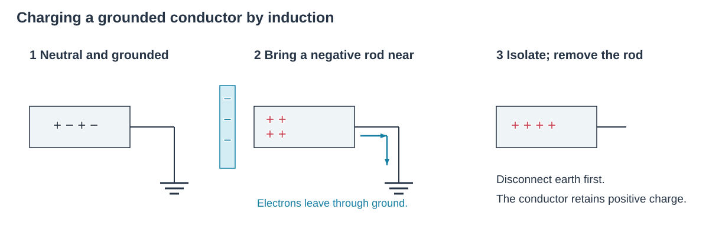

### 1.4 极化（Polarization）

极化后，近带电体一侧出现异号电荷，远侧出现同号电荷。由于近端引力大于远端斥力，不带电物体也能被带电物体吸引。

在绝缘体中，正、负束缚电荷只能在原位置附近发生局部位移，形成极化；在导体中，自由电子能在整个导体内移动，重新分布直至静电平衡。

### 1.5 库仑定律

$$F=k\frac{|q_1q_2|}{r^2},\qquad k=\frac{1}{4\pi\varepsilon_0},$$

其中 $\varepsilon_0$ 为真空介电常数。

适用条件为点电荷；带电物体为球体时，$r$ 取两球心间距。

### 1.6 电场

电场强度的定义式：

$$\mathbf E=\frac{\mathbf F}{q}.$$

电场方向规定为正电荷在电场中的受力方向。

### 1.7 点电荷的电场

点电荷在距离 $r$ 处产生的电场：

$$E=\frac{kQ}{r^2}.$$

### 1.8 电场线（Electric Field Lines）

电场线是描述电场的假想线：起于正电荷，止于负电荷。线上每点的切线方向为电场方向，线条的疏密反映场强大小。

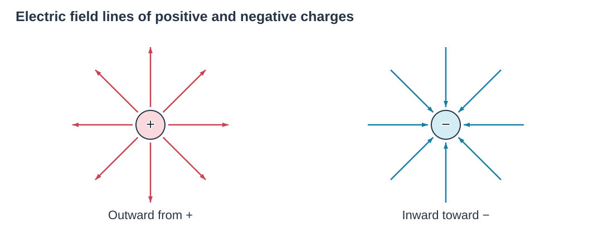

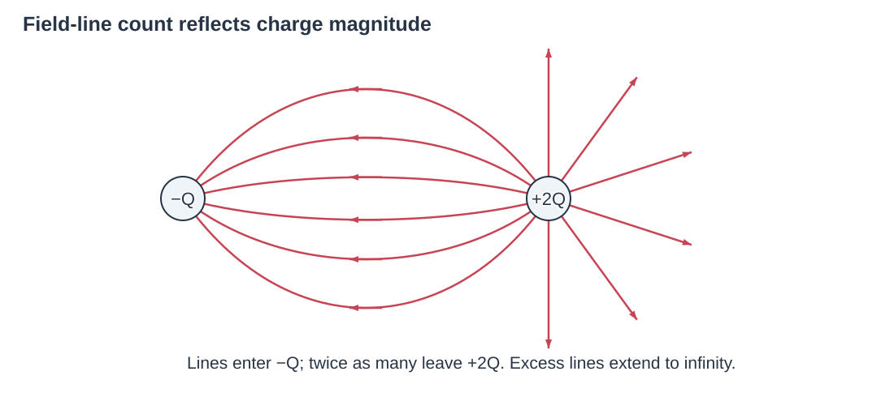

**匀强电场（Uniform Electric Field）**的大小、方向处处相同，电场线平行且等距，可由两平行带电板近似产生。当板面积足够大、板间距相对极板尺寸很小时，可忽略边缘效应。

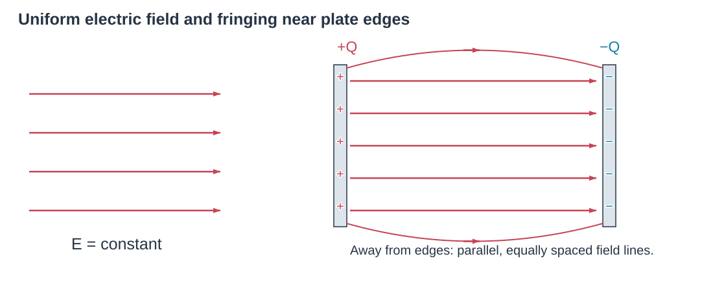

### 1.9 静电平衡导体与屏蔽

当导体内没有电荷的净移动时，导体处于静电平衡，此时：

1. 导体内任意处电场为零。
2. 导体上的净电荷全部分布在表面。
3. 导体表面外紧邻处的电场垂直于表面。
4. 导体越尖锐、越细的地方，电荷越密集，表面电场也越强。

**屏蔽（Shielding）**：静电平衡时导体内部电场为零，外电场无法穿透导体，从而屏蔽内部空腔。空腔无电荷时，腔内电场也为零；空腔内有电荷时，腔内电场只取决于腔内电荷。

## 2 Gauss’s Law

### 2.1 高斯面（Gaussian Surface）

开放的表面（如矩形）不包围体积，闭合的表面（如球面）包围体积。高斯面是假想的闭合表面。

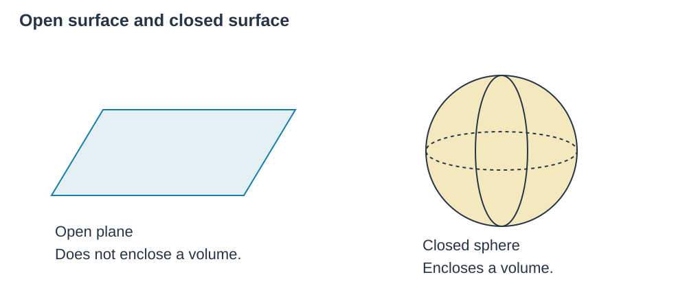

### 2.2 电通量（Electric Flux）

电通量反映电场的强弱，正比于穿过某曲面的电场线条数。

均匀电场与平面：

$$\Phi_E=\mathbf E\cdot\mathbf A=EA\cos\theta,$$

其中 $\theta$ 为 $\mathbf E$ 与面法线方向 $\mathbf A$ 的夹角。单位为 $\mathrm{N\,m^2/C}$。

一般情况：

$$d\Phi_E=\mathbf E\cdot d\mathbf A,\qquad\Phi_E=\oint\mathbf E\cdot d\mathbf A.$$

积分圈号表示对整个闭合面积分。

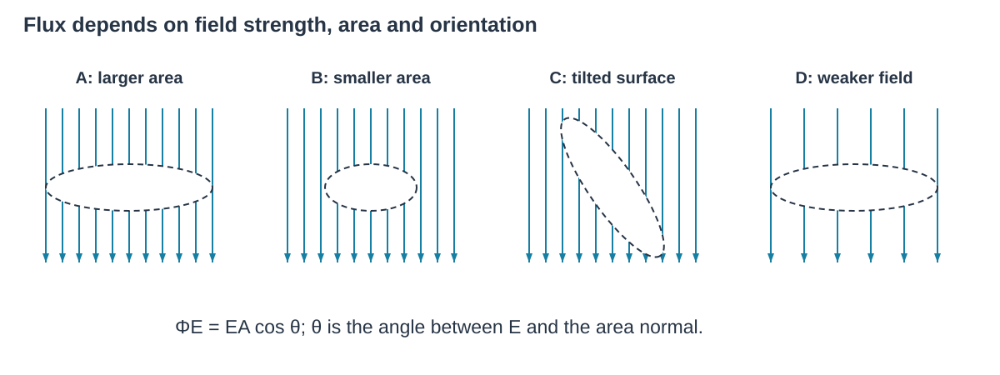

### 2.3 高斯定律（Gauss’s Law）

$$\Phi_E=\oint\mathbf E\cdot d\mathbf A=\frac{q_{\mathrm{in}}}{\varepsilon_0}.$$

$q_{\mathrm{in}}$ 为高斯面包含在内的净电荷量，$\varepsilon_0$ 为真空介电常数。总通量只取决于面内净电荷，与面外电荷无关。

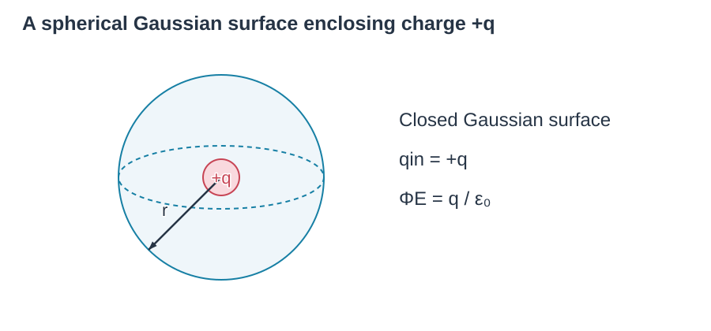

- **球对称分布的球外场强**：

  $$E=\frac{kQ}{r^2}=\frac{Q}{4\pi\varepsilon_0r^2}.$$

- **无限大均匀带电平面**：

  $$E=\frac{\sigma}{2\varepsilon_0}.$$

- **平行板**：

  $$E=\frac{\sigma}{\varepsilon_0}.$$

其中 $\sigma=Q/A$ 为面电荷密度。

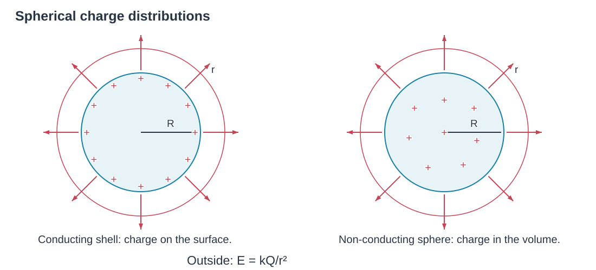

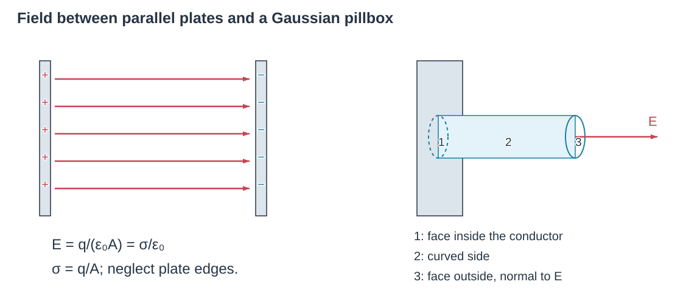

## 3 Electric Potential

### 3.1 电势能（Electric Potential Energy）

电场力做功与路径无关。电场力做功等于系统电势能变化的负值：

$$W_E=-\Delta U_E.$$

电场力做正功，系统的电势能减少；电场力做负功，电势能增加。电势能 $U_E$ 属于“电荷—场”系统，SI 单位为焦耳（J）。

### 3.2 电势与电势差（Electric Potential）

某点电势等于该点单位电荷的电势能：

$$V=\frac{U_E}{q}.$$

电势为标量，$1\ \mathrm V=1\ \mathrm{J/C}$。

电势差：

$$\Delta V=\frac{\Delta U_E}{q}=-\frac{W_E}{q}.$$

### 3.3 均匀电场中的电势差

$$\Delta V=-\mathbf E\cdot\Delta\mathbf s=-E\,\Delta s\cos\theta=-E\,\Delta s_{\parallel},$$

其中 $\Delta s_{\parallel}$ 为沿电场方向的位移分量。

沿电场方向，电势线性降低；垂直电场方向，电势不变。

$$1\ \mathrm{N/C}=1\ \mathrm{V/m}.$$

### 3.4 等势面与等势线（Equipotential Surfaces / Lines）

等势面是电势处处相同的面，二维则是等势线。电场线垂直于等势面，并指向电势降低的方向。

当相邻等势线的电势差相同时，等势线越密，该处场强越大：

$$E\approx\frac{\Delta V}{d}.$$

只在电场力作用下，正电荷自发向低电势处加速，负电荷自发向高电势处加速。

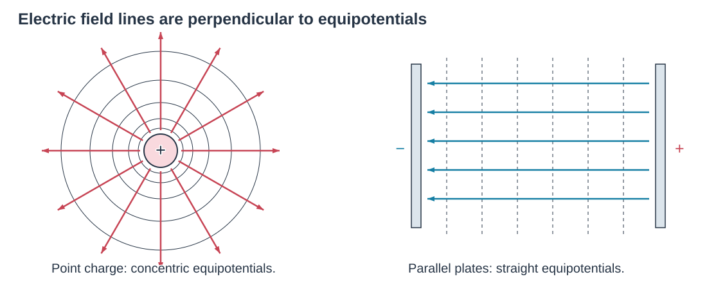

### 3.5 电势与电场的关系

电场等于电势位置函数的负斜率：

$$E_x=-\frac{dV}{dx}.$$

电势能函数的负斜率给出电场力：

$$F_E=-\frac{dU_E}{dx}.$$

### 3.6 点电荷的电势

取无穷远处电势为零，点电荷 $Q$ 在距离 $r$ 处产生的电势为：

$$V=\frac{kQ}{r}.$$

电势随距离按 $1/r$ 衰减，场强按 $1/r^2$ 衰减。多个点电荷在某点的总电势等于各电荷电势之和。

### 3.7 电势能

两电荷系统的电势能：

$$U_E=\frac{kq_1q_2}{r},$$

其中电荷带符号。

多电荷系统需要对所有电荷对的电势能求和：

$$U_E=\sum_{i<j}\frac{kq_iq_j}{r_{ij}}.$$

### 3.8 电子伏特（eV）

电子伏特定义为电子经 $1\ \mathrm V$ 电势差加速获得的动能：

$$1\ \mathrm{eV}=1.6\times10^{-19}\ \mathrm J.$$

## 4 Conductors and Capacitors

### 4.1 静电平衡导体再认识

静电平衡导体是等势体，表面与内部任意两点的电势都相同。电荷全部分布于表面，内部 $E=0$，表面外电场垂直于表面，电荷在越尖锐的地方越密集。

### 4.2 电容（Capacitance）

电容器由两个彼此靠近但不接触的导体构成，可以储存电荷。

$$C=\frac{Q}{\Delta V},$$

即任一极板电荷量 $Q$ 与两极板间电势差 $\Delta V$ 之比。SI 单位为法拉（F）：$1\ \mathrm F=1\ \mathrm{C/V}$。

电容只取决于电容器的几何因素及介质（极板面积、间距、介质），与 $Q$、$\Delta V$ 无关。

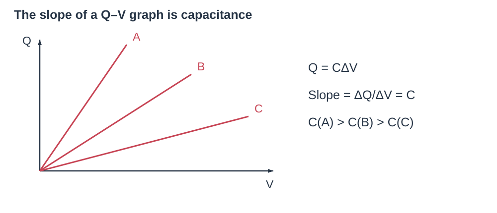

### 4.3 平行板电容器

**充电**：电池驱动电子经外电路转移，两板最终带等量异号电荷。充电停止条件为：

$$\Delta V_C=\Delta V_{\mathrm{battery}}.$$

平行板电容：

$$C=\frac{\varepsilon_0A}{d}.$$

**击穿（Electrical Breakdown）**：当电场超过介质承受极限时，绝缘体突然变为导体而放电。

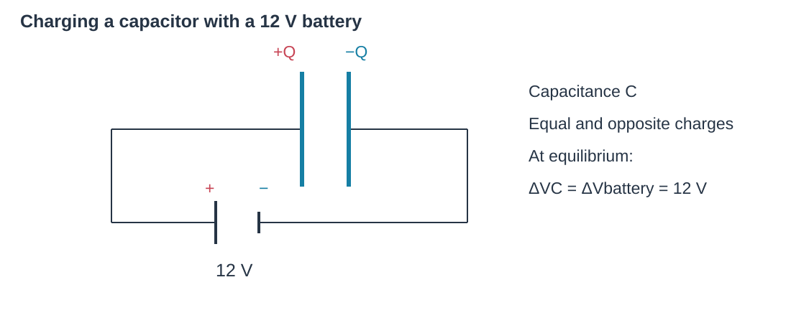

### 4.4 电介质（Dielectric）

电介质是填充在电容器极板间的绝缘材料，其用处包括：

1. 比空气更耐击穿，可以承受更高电压。
2. 允许极板靠得更近。
3. 使电容增大 $\kappa$ 倍。

$$C=\frac{\kappa\varepsilon_0A}{d}=\frac{\varepsilon A}{d},\qquad\varepsilon=\kappa\varepsilon_0,$$

其中 $\kappa$ 为相对介电常数，$\varepsilon$ 为介质的介电常数。

- **接电池，$\Delta V$、$E$ 不变**：介质被极化，极板吸引更多电荷，$C$ 和 $Q$ 同时增大，$C=Q/\Delta V$。
- **断开电池，$Q$ 不变**：介质极化产生反向电场，使 $E$、$V$ 减小，因此 $C$ 增大：

  $$E=\frac{\sigma}{\kappa\varepsilon_0}=\frac{E_0}{\kappa}.$$

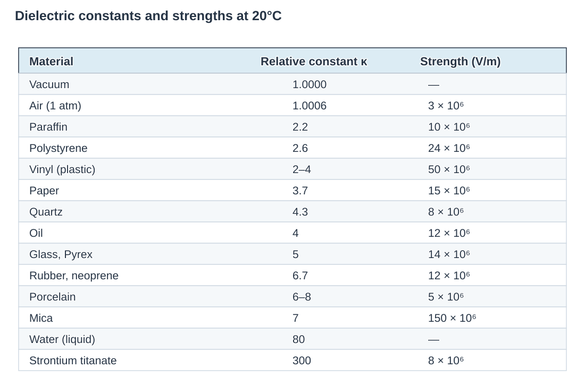

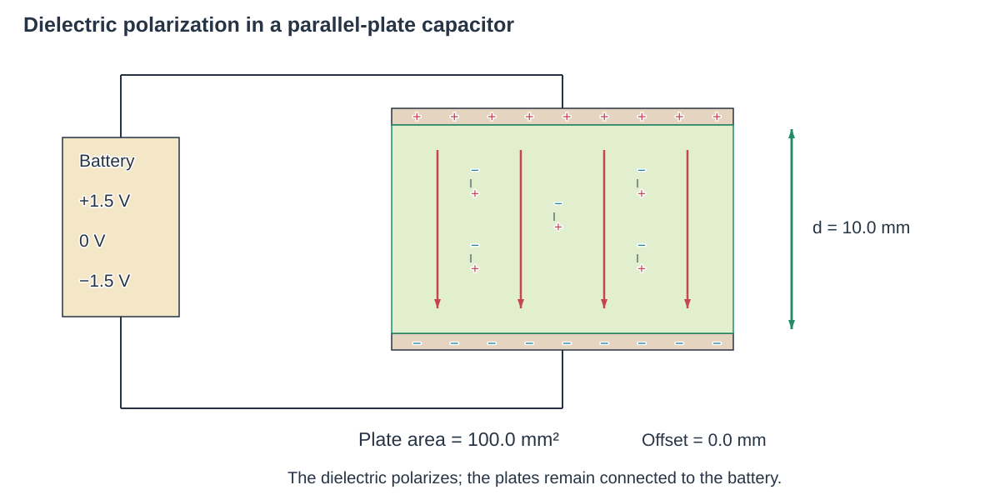

### 4.5 电容器的储能

充电过程外界做功全部转化为电势能储存：

$$U_C=\frac12Q\Delta V=\frac12C(\Delta V)^2=\frac{Q^2}{2C}.$$

能量密度（单位体积储能）：

$$u=\frac12\kappa\varepsilon_0E^2.$$

### 电容器变化比较

| 改变 | 电容 $C$ | 接电池：$\Delta V$ 不变 | 断开电池：$Q$ 不变 |
|---|---|---|---|
| 插入电介质，$\kappa\uparrow$ | 增大 | $Q=C\Delta V$ 增大；$E=\Delta V/d$ 不变；$U=\frac12Q\Delta V$ 增大 | $\Delta V=Q/C$ 减小；$E=Q/(\kappa\varepsilon_0A)$ 减小；$U=Q^2/(2C)$ 减小 |
| 增大板面积 $A$ | 增大 | $Q$ 增大；$E$ 不变；$U$ 增大 | $\Delta V$ 减小；$E$ 减小；$U$ 减小 |
| 增大板间距 $d$ | 减小 | $Q$ 减小；$E=\Delta V/d$ 减小；$U$ 减小 | $\Delta V=Q/C$ 增大；$E=Q/(\varepsilon_0A)$ 不变；$U$ 增大 |
