# AP Physics C: Mechanics — Unit 1 & Unit 2 Review

**Unit 1 Kinematics** (10–15% of AP exam)

**Unit 2 Force and Translational Dynamics** (20–25% of AP exam)

## Unit 1 Kinematics

### 1.1 Scalars and Vectors

- Scalar: magnitude only, no direction. Examples: mass, time, distance, speed, energy.

- Vector: magnitude + direction. Examples: displacement, velocity, acceleration, force, momentum.

Vector operations:

- Components: $A_{x} = A\cos\theta,A_{y} = A\sin\theta$

- Magnitude and direction: $A = \sqrt{A_{x}^{2} + A_{y}^{2}},\tan\theta = \frac{A_{y}}{A_{x}}$

- Tail to tip method

Figure 3–5. The resultant of three vectors: $\vec V_R=\vec V_1+\vec V_2+\vec V_3$. The arrows are arranged tail to tip.

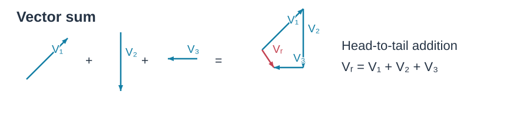

- Parallelogram method

Figure 3–6. Vector addition by two different methods, (a) and (b). Part (c) is incorrect. Labels: (a) Tail to tip; (b) Parallelogram; (c) Wrong, INCORRECT. The first two construct $\vec V_R=\vec V_1+\vec V_2$.

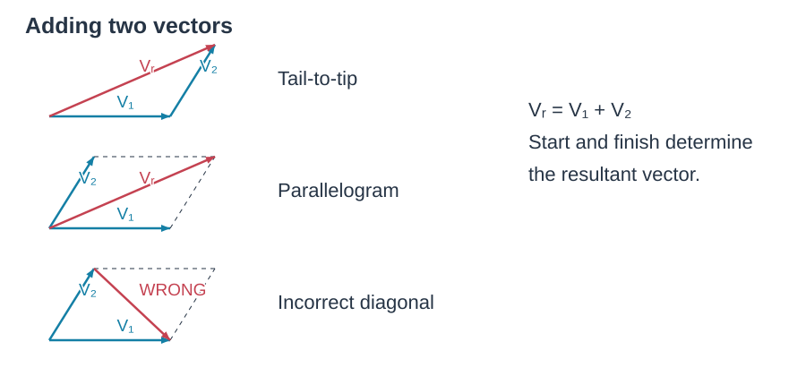

- We can now define the subtraction of one vector from another: the difference between two vectors V 2- V 1 is defined as V 2- V 1 = V 2 +(-V 1 ).

1. We can give its components, $V_x$ and $V_y$.
2. We can give its magnitude $V$ and the angle $\theta$ it makes with the positive $x$ axis.

We can shift from one description to the other using Eqs. 3–2, and, for the reverse, by using the theorem of Pythagoras and the definition of tangent:
$$V=\sqrt{V_x^2+V_y^2}\tag{3–3a}$$
$$\tan\theta=\frac{V_y}{V_x}\tag{3–3b}$$

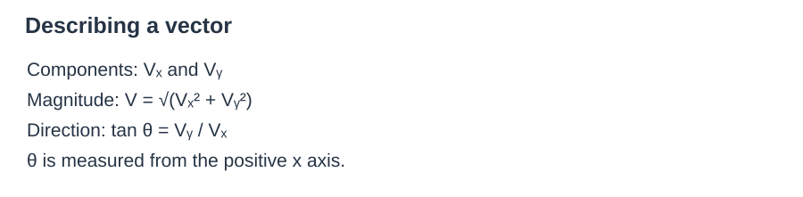

AP C focus: vector addition/subtraction, component method, dot product and cross product basics.

### 1.2 Displacement, Velocity, and Acceleration (Calculus Core)

- Distance: total path length traveled (scalar).

- Displacement Δx: final position − initial position (vector). $\Delta x = x_{f} - x_{i}$

- Average velocity: $\overline{v} = \frac{\Delta x}{\Delta t}$

- Instantaneous velocity: $v(t) = \frac{dx}{dt}$ (derivative of position).

- Average acceleration: $\overline{a} = \frac{\Delta v}{\Delta t}$

- Instantaneous acceleration: $a(t) = \frac{dv}{dt} = \frac{d^{2}x}{dt^{2}}$ (derivative of velocity).

Kinematic equations for constant acceleration only!

$$
v = v_{0} + at
$$

$$
\Delta x = v_{0}t + \frac{1}{2}at^{2}
$$

$$
v^{2} = v_{0}^{2} + 2a\Delta x
$$

$$
\Delta x = \frac{v + v_{0}}{2} \cdot t
$$

Speed is simply a positive number, with units. Velocity, on the other hand, is used to signify both the magnitude (numerical value) of how fast an object is moving and also the direction in which it is moving. Velocity is therefore a vector.

### 1.3 Representing Motion (Graphs)

1.  Position–time (x–t) graph

- Slope = instantaneous velocity; sign of slope = direction of velocity.

- More precisely, the instantaneous velocity at any moment is defined as the average velocity over an infinitesimally short time interval.

- Curvature indicates acceleration; intersection point = two objects at the same position (meeting)

Position $x$ (m) versus $t$ (s) graph (b). $P_1$ to $P_2$ straight-line slope $\bar v=16.8\ \mathrm{m/s}$; tangent at $P_2$ slope $v_2=21.0\ \mathrm{m/s}$; $\Delta t=2.00\ \mathrm s$, $\Delta x=33.6\ \mathrm m$.

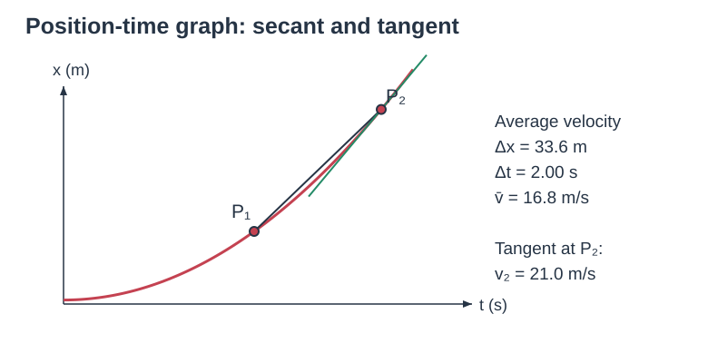

Figure 2–10. Graph of a particle's position $x$ vs. time $t$. The slope of the straight line $P_1P_2$ represents the average velocity of the particle during the time interval $\Delta t=t_2-t_1$. Graph labels: $x_1,x_2,t_1,t_2$, $\Delta x=x_2-x_1$.

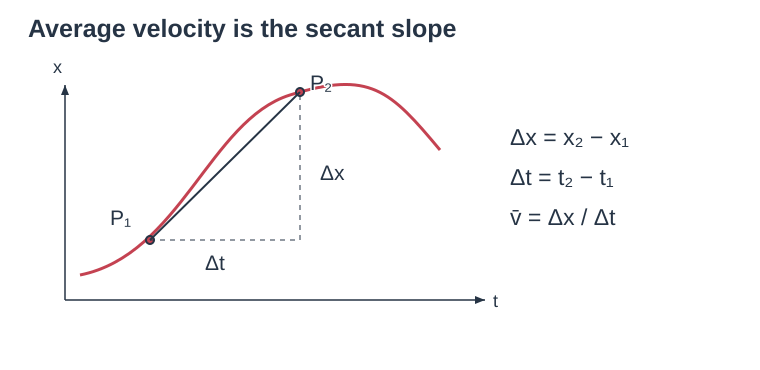

Figure 2–12. Same $x$ vs. $t$ curve as in Figs. 2–10 and 2–11 but here showing the slope at four different points: At $P_3$, the slope is zero, so $v=0$. At $P_4$ the slope is negative, so $v<0$. The other marked points are $P_1,P_2$, at times $t_1,t_2$; the maximum is at $t_3$.

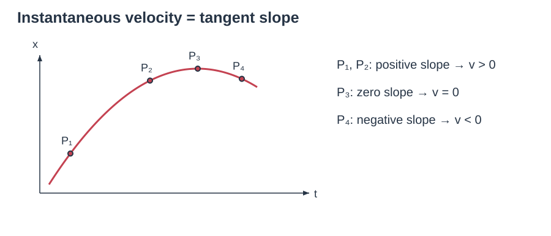

2.  Velocity–time (v–t) graph

- Slope = acceleration.

- Area under the curve = displacement (area below the t-axis is negative).

- Intersection point = two objects have the same instantaneous velocity.

Figure 2–9. Velocity of a car as a function of time: (a) at constant velocity; (b) with velocity varying in time. Vertical axes Velocity (km/h), horizontal axes Time (h), 0–0.5. Graph (a) is constant 40 km/h; graph (b) has a dashed Average velocity line.

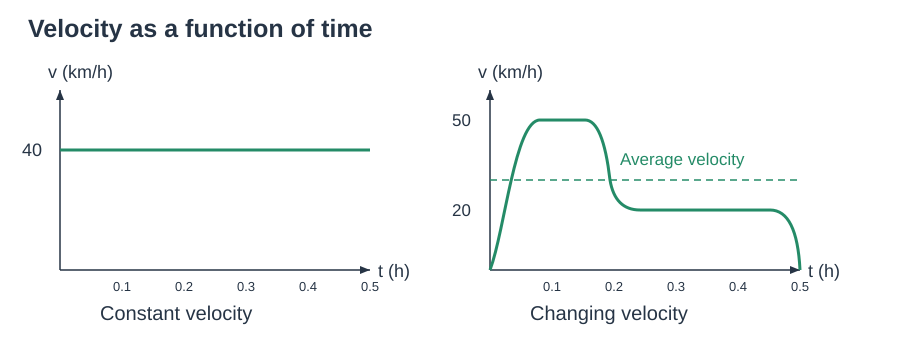

3.  Acceleration–time (a–t) graph

- Area = change in velocity $\Delta v$.

**Average Acceleration**

Average acceleration is defined as the change in velocity divided by the time taken to make this change.
$$\text{average acceleration}=\frac{\text{change of velocity}}{\text{time elapsed}}.$$
In symbols, the average acceleration over a time interval $\Delta t=t_2-t_1$ during which the velocity changes by $\Delta v=v_2-v_1$ is defined as
$$\bar a=\frac{v_2-v_1}{t_2-t_1}=\frac{\Delta v}{\Delta t}.\tag{2–5}$$
Because velocity is a vector, acceleration is a vector too. But for one-dimensional motion, we need only use a plus or minus sign to indicate acceleration direction relative to a chosen coordinate axis.

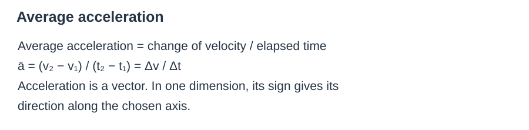

- This can be expressed in equation form: since a = dv/dt and v = dx/dt, the acceleration is equal to the first order derivative of velocity and equals the second order derivative of displacement.

AP C emphasis: use calculus to find slopes and areas; handle non-linear graphs.

### 1.4 Reference Frames and Relative Motion

Relative velocity formula:

$$
{\overset{\rightarrow}{v}}_{A/C} = {\overset{\rightarrow}{v}}_{A/B} + {\overset{\rightarrow}{v}}_{B/C}
$$

- ${\overset{\rightarrow}{v}}_{A/C}$: velocity of A relative to C.

- Vector operation — always keep track of direction; in 1-D, use positive/negative signs.

Example 1

The same boat (V = 1.85 m/s) now heads directly across the river whose current is still 1.20 m/s. (a) What is the velocity (magnitude and direction) of the boat relative to the shore? (b) If the river is 110 m wide, how long will it take to cross and how far downstream will the boat be then?

Figure 3–34. Example 3–14. A boat heading directly across a river whose current moves at 1.20 m/s. Vector labels: $\vec v_{WS}$ along the current, $\vec v_{BW}$ directly across, $\vec v_{BS}$ resultant; angle $\theta$ between the last two.

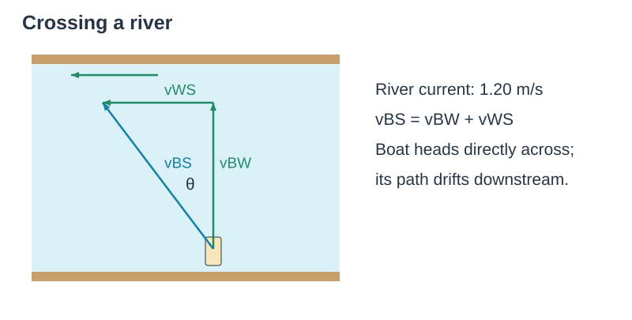

 

$$\vec v_{BS}=\vec v_{BW}+\vec v_{WS}.$$
**SOLUTION (a)** Since $\vec v_{BW}$ is perpendicular to $\vec v_{WS}$, we can get $v_{BS}$ using the theorem of Pythagoras:
$$v_{BS}=\sqrt{v_{BW}^2+v_{WS}^2}=\sqrt{(1.85\ \mathrm{m/s})^2+(1.20\ \mathrm{m/s})^2}=2.21\ \mathrm{m/s}.$$
We can obtain the angle (note how $\theta$ is defined in Fig. 3–34) from:
$$\tan\theta=v_{WS}/v_{BW}=(1.20\ \mathrm{m/s})/(1.85\ \mathrm{m/s})=0.6486.$$
A calculator with a key such as INV TAN or ARC TAN or TAN$^{-1}$ gives $\theta=\tan^{-1}(0.6486)=33.0^\circ$. Note that this angle is not equal to the angle calculated in Example 3–13.

(b) To find the travel time for the boat to cross the river, recall the river's width $D=110\ \mathrm m$, and use the velocity component that points directly across the river, $v_{BW}=D/t$. Solving for $t$, we get $t=110\ \mathrm m/(1.85\ \mathrm{m/s})=59.5\ \mathrm s$. Also, the boat will have been carried downstream, in this time, a distance
$$d=v_{WS}t=(1.20\ \mathrm{m/s})(59.5\ \mathrm s)=71.4\ \mathrm m\approx71\ \mathrm m.$$

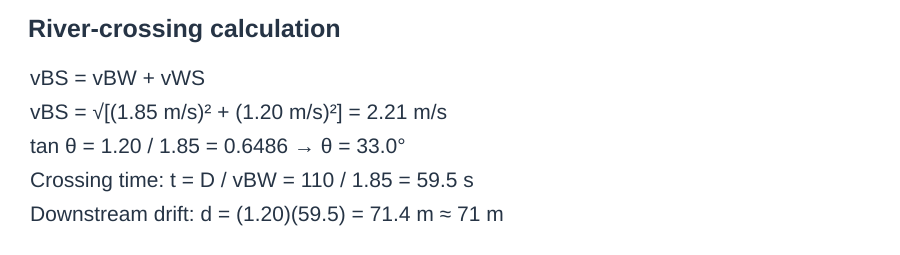

### 1.5 Motion in Two or Three Dimensions

Key principle: horizontal and vertical motions are independent.

**Free fall**

- Galileo’s specific contribution to our understanding of the motion of falling objects can be summarized as follows: at a given location on the Earth and in the absence of air resistance, all objects fall with the same constant acceleration.

- We call this acceleration the acceleration due to gravity at the surface of the Earth, and we give it the symbol g.

- Its magnitude is approximately g = 9.80 m/second squared

Example 1

Suppose that a ball is dropped (v0 = 0) from a tower. How far will it have fallen after a time t1 = 1.00 s, t2 = 2.00 s, and t3 = 3.00 s? Ignore air resistance.

**APPROACH** Let us take $y$ as positive downward, so the acceleration is $a=g=9.80\ \mathrm{m/s^2}$. We set $v_0=0$ and $y_0=0$. We want to find the position $y$ of the ball after three different time intervals. Equation 2–12b, with $x$ replaced by $y$, relates the given quantities ($t,a,v_0$) to the unknown $y$.

**SOLUTION** We set $t=t_1=1.00\ \mathrm s$ in Eq. 2–12b:
$$y_1=v_0t_1+\frac12at_1^2=0+\frac12at_1^2=\frac12(9.80\ \mathrm{m/s^2})(1.00\ \mathrm s)^2=4.90\ \mathrm m.$$
The ball has fallen a distance of 4.90 m during the time interval $t=0$ to $t_1=1.00\ \mathrm s$. Similarly, after 2.00 s ($=t_2$), the ball's position is
$$y_2=\frac12at_2^2=\frac12(9.80\ \mathrm{m/s^2})(2.00\ \mathrm s)^2=19.6\ \mathrm m.$$
Finally, after 3.00 s ($=t_3$), the ball's position is (see Fig. 2–3a)
$$y_3=\frac12at_3^2=\frac12(9.80\ \mathrm{m/s^2})(3.00\ \mathrm s)^2=44.1\ \mathrm m.$$

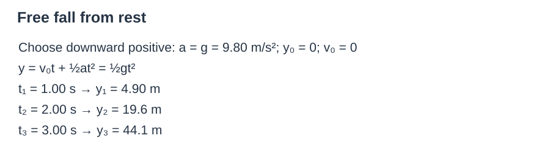

Example 2

(III) A falling stone takes 0.28 s to travel past a window 2.2 m tall (Fig. 2–49). From what height above the top of the window did the stone fall?

Figure 2–49. Problem 69. Labels: 2.2 m; To travel this distance takes 0.28 s.

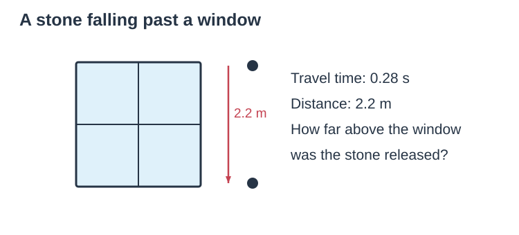

Answer:

Let $v_0=$ speed of the stone when it reaches the top of the window.

Use the kinematic equation for displacement:
$$y=v_0t+\frac12gt^2.$$
Given $y=2.2\ \mathrm m$, $t=0.28\ \mathrm s$, $g=9.8\ \mathrm{m/s^2}$.
$$2.2=v_0(0.28)+\frac12(9.8)(0.28)^2,\quad 2.2=0.28v_0+0.38416,\quad0.28v_0=1.81584,\quad v_0\approx6.485\ \mathrm{m/s}.$$
The stone falls from rest to reach speed $v_0$. Use $v^2=2gh$:
$$h=\frac{v_0^2}{2g},\qquad h=\frac{(6.485)^2}{2(9.8)}\approx2.1\ \mathrm m.$$

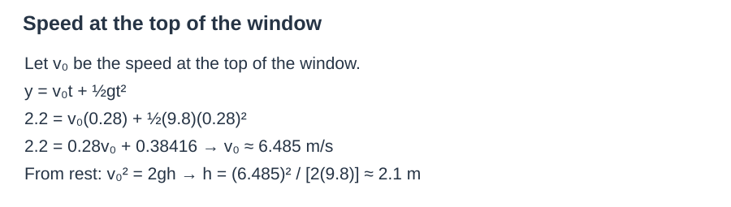

**Projectile motion**

- Horizontal (x): no air resistance, $a_{x} = 0$, constant velocity $v_{x} = v_{0x} = v_{0}\cos\theta$.

- Vertical (y): constant acceleration $a_{y} = - g$

- $v_{y} = v_{0}\sin\theta - gt$

- $\Delta y = v_{0}\sin\theta \cdot t - \frac{1}{2}gt^{2}$

- Range (launch and land at same height): $R = \frac{v_{0}^{2}\sin 2\theta}{g}$

- Velocity at any time: $\overset{\rightarrow}{v} = (v_{x},v_{y})$; acceleration: $\overset{\rightarrow}{a} = (0, - g)$ (constant downward).

Figure 3–22. Path of a projectile fired with initial velocity $\vec v_0$ at angle $\theta_0$ to the horizontal. Path is shown dashed in black, the velocity vectors are green arrows, and velocity components are dashed. The acceleration $\vec a=d\vec v/dt$ is downward. That is, $\vec a=\vec g=-g\hat j$ where $\hat j$ is the unit vector in the positive $y$ direction. Not shown is where the projectile hits the ground (at that point projectile motion ceases).

Figure labels include $v_y=0$ at this point (top); $\vec a=\vec g=-g\hat j$ downward; $v_x,v_y,\vec v$ along the trajectory.

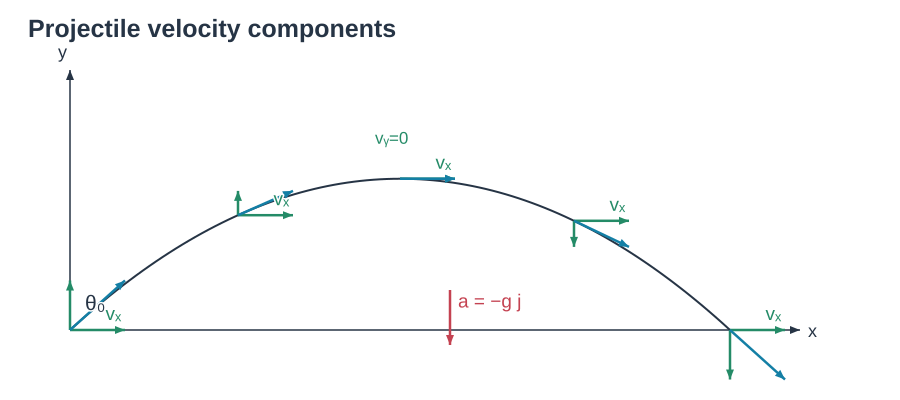

- Vx is constant through the whole motion process

- Vy changes due to gravity at the surface of the earth g

**Level Horizontal Range**

The total distance the football traveled in Example 3–8 is called the horizontal range $R$. We now derive a formula for the range, which applies to a projectile that lands at the same level it started ($=y_0$): that is, $y(\text{final})=y_0$ (see Fig. 3–27a).

Looking back at Example 3–8 part (c), we see that $x=R=v_{x0}t$ where (from part b) $t=2v_{y0}/g$. Thus
$$R=v_{x0}t=v_{x0}\left(\frac{2v_{y0}}g\right)=\frac{2v_{x0}v_{y0}}g=\frac{2v_0^2\sin\theta_0\cos\theta_0}g\qquad[y=y_0],$$
where $v_{x0}=v_0\cos\theta_0$ and $v_{y0}=v_0\sin\theta_0$. This can be rewritten, using the trigonometric identity $2\sin\theta\cos\theta=\sin2\theta$ (Appendix A or inside the rear cover):
$$R=\frac{v_0^2\sin2\theta_0}g\qquad[\text{only if }y(\text{final})=y_0].$$
Note that the maximum range, for a given initial velocity $v_0$, is obtained when $\sin2\theta$ takes on its maximum value of 1.0, which occurs for $2\theta_0=90^\circ$; so
$$\theta_0=45^\circ\text{ for maximum range, and }R_{\max}=v_0^2/g.$$
The maximum range increases by the square of $v_0$, so doubling the initial velocity of a projectile increases its maximum range by a factor of 4.

When air resistance is important, the range is less for a given $v_0$, and the maximum range is obtained at an angle smaller than 45°.

Figure 3–27. (a) The range $R$ of a projectile. (b) There are generally two angles $\theta_0$ that will give the same range. If one angle is $\theta_{01}$, the other is $\theta_{02}=90^\circ-\theta_{01}$. Also see Example 3–10. Figure labels: $x_0=0,y_0=0$; $y=0$ again here (where $x=R$); 30°, 45°, 60° trajectories.

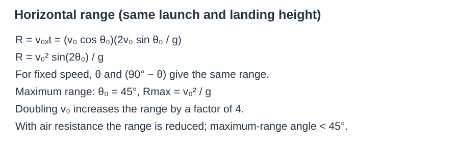

Example 1

60. (III) A person stands at the base of a hill that is a straight incline making an angle $\phi$ with the horizontal (Fig. 3–52). For a given initial speed $v_0$, at what angle $\theta$ (to the horizontal) should objects be thrown so that the distance $d$ they land up the hill is as large as possible?

Figure 3–52. Problem 60. Given $\phi$ and $v_0$, determine $\theta$ to make $d$ maximum.

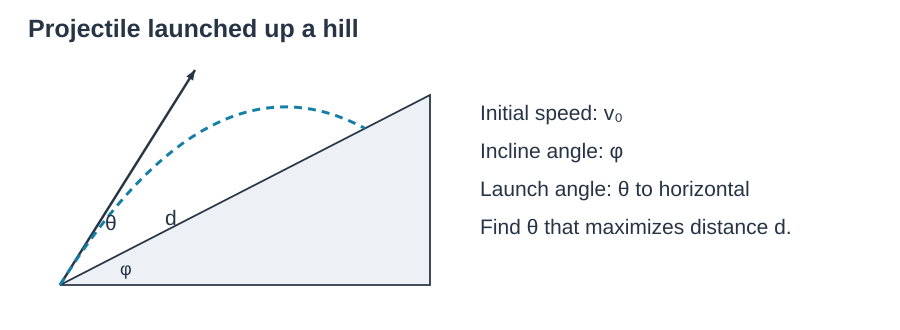

**Solution**

Horizontal motion: $x = v_{0}\cos\theta \cdot t$

Vertical motion: $y = v_{0}\sin\theta \cdot t - \frac{1}{2}gt^{2}$

From the hill geometry: $\tan\phi = \frac{y}{x}$. Substitute x and y:

$$
\tan\phi = \frac{v_{0}\sin\theta \cdot t - \frac{1}{2}gt^{2}}{v_{0}\cos\theta \cdot t}
$$

Cancel t and solve for flight time t:

$$
\tan\phi = \tan\theta - \frac{gt}{2v_{0}\cos\theta}
$$

$$
t = \frac{2v_{0}(\sin\theta - \cos\theta\tan\phi)}{g}
$$

The distance along the slope is $d = \frac{x}{\cos\phi} = \frac{v_{0}\cos\theta \cdot t}{\cos\phi}$. Substitute t:

$$
d = \frac{2v_{0}^{2}\cos\theta(\sin\theta - \cos\theta\tan\phi)}{g\cos\phi}
$$

Rewrite $\tan\phi = \frac{\sin\phi}{\cos\phi}$:

$$
d = \frac{2v_{0}^{2}\left( \sin\theta \cos\theta \cos\phi - \cos^{2}\theta \sin\phi \right)}{g\cos^{2}\phi}
$$

Use trigonometric identities $2\sin\theta\cos\theta = \sin 2\theta$, $2\cos^{2}\theta = 1 + \cos 2\theta$:

$$
d = \frac{v_{0}^{2}\left\lbrack \sin2\theta \cos\phi - (1 + \cos2\theta)\sin\phi \right\rbrack}{g\cos^{2}\phi}
$$

$$
d = \frac{v_{0}^{2}\left\lbrack \sin(2\theta - \phi) - \sin\phi \right\rbrack}{g\cos^{2}\phi}
$$

To maximize d, maximize $\sin(2\theta - \phi)$. The maximum value of sine is 1, achieved when:

$$
2\theta - \phi = 90^{\circ}
$$

$$
\theta = 45^{\circ} + \frac{\phi}{2}
$$

**Vectors in three dimensions**

- In one dimension, we defined displacement as the change in position of the particle. In the more general case of two or three dimensions, the displacement vector is defined as the vector representing change in position. We call it ∆r, where ∆r= r2- r1. This represents the displacement during the time interval ∆t = t2- t1.

In unit vector notation, we can write
$$\vec r_1=x_1\hat i+y_1\hat j+z_1\hat k,\tag{3–6a}$$
where $x_1,y_1$, and $z_1$ are the coordinates of point $P_1$. Similarly,
$$\vec r_2=x_2\hat i+y_2\hat j+z_2\hat k.$$
Hence
$$\Delta\vec r=(x_2-x_1)\hat i+(y_2-y_1)\hat j+(z_2-z_1)\hat k.\tag{3–6b}$$
If the motion is along the $x$ axis only, then $y_2-y_1=0$, $z_2-z_1=0$, and the magnitude of the displacement is $\Delta r=x_2-x_1$, which is consistent with our earlier one-dimensional equation (Section 2–1). Even in one dimension, displacement is a vector, as are velocity and acceleration.

The average velocity vector over the time interval $\Delta t=t_2-t_1$ is defined as
$$\text{average velocity}=\frac{\Delta\vec r}{\Delta t}.\tag{3–7}$$
Now let us consider shorter and shorter time intervals—that is, we let $\Delta t$ approach zero so that the distance between points $P_2$ and $P_1$ also approaches zero, Fig. 3–17a. We define the instantaneous velocity vector as the limit of the average velocity as $\Delta t$ approaches zero:
$$\vec v=\lim_{\Delta t\to0}\frac{\Delta\vec r}{\Delta t}=\frac{d\vec r}{dt}.\tag{3–8}$$
The direction of $\vec v$ at any moment is along the line tangent to the path at that moment (Fig. 3–17b).

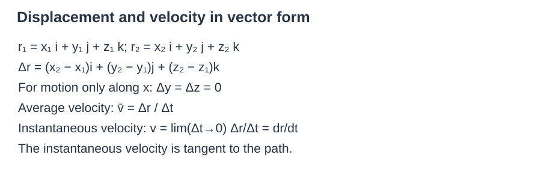

Example 1

31. (III) A particle starts from the origin at $t=0$ with an initial velocity of 5.0 m/s along the positive $x$ axis. If the acceleration is $(-3.0\hat i+4.5\hat j)\ \mathrm{m/s^2}$, determine the velocity and position of the particle at the moment it reaches its maximum $x$ coordinate.

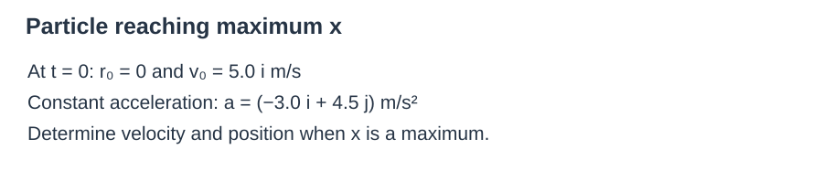

**Solution**

Initial velocity: ${\overset{\rightarrow}{v}}_{0} = 5.0\hat i\text{m/s}$, acceleration: $\overset{\rightarrow}{a} = ( - 3.0\hat i + 4.5\hat j)\text{m/s}^{2}$.

Velocity components as functions of time:

$$
v_{x} = v_{0x} + a_{x}t = 5.0 - 3.0t
$$

$$
v_{y} = v_{0y} + a_{y}t = 4.5t
$$

At the maximum x coordinate, the x-component of velocity is zero (the particle stops moving in the +x direction and begins moving backward):

$$
5.0 - 3.0t = 0 \Rightarrow t = \frac{5}{3}\text{s}
$$

**Velocity at maximum x**

Substitute $t = \frac{5}{3}\text{s}$ into velocity components:

$$
v_{x} = 0,v_{y} = 4.5 \times \frac{5}{3} = 7.5\text{m/s}
$$

$$
\overset{\rightarrow}{v} = 7.5\hat j\text{m/s}
$$

**Position at maximum x**

Use the kinematic equations for position:

$$
x = v_{0x}t + \frac{1}{2}a_{x}t^{2}
$$

$$
y = v_{0y}t + \frac{1}{2}a_{y}t^{2}
$$

Substitute $t = \frac{5}{3}\text{s}$:

$$
x = 5.0 \times \frac{5}{3} + \frac{1}{2}( - 3.0)\left( \frac{5}{3} \right)^{2} = \frac{25}{6} \approx 4.17\text{m}
$$

$$
y = 0 + \frac{1}{2}(4.5)\left( \frac{5}{3} \right)^{2} = 6.25\text{m}
$$

$$
\overset{\rightarrow}{r} = (4.17\hat i + 6.25\hat j)\text{m}
$$

## Unit 2 Force and Translational Dynamics

### 2.1 Systems and Center of Mass

Center of mass of a system of particles:

$$
x_{cm} = \frac{m_{1}x_{1} + m_{2}x_{2} + \ldots}{m_{1} + m_{2} + \ldots}
$$

Center of mass theorem: the net external force determines the acceleration of the center of mass.

$$
\sum{\overset{\rightarrow}{F}}_{ext} = M_{total}{\overset{\rightarrow}{a}}_{cm}
$$

- Internal forces do not change the motion of the center of mass; only external forces accelerate the CM.

**Example 9–14 CM of three guys on a raft.** Three people of roughly equal masses $m$ on a lightweight (air filled) banana boat sit along the $x$ axis at positions $x_A=1.0\ \mathrm m$, $x_B=5.0\ \mathrm m$, and $x_C=6.0\ \mathrm m$, measured from the left-hand end as shown in Fig. 9–24. Find the position of the CM. Ignore the boat's mass.

**APPROACH** We are given the mass and location of the three people, so we use three terms in Eq. 9–10. We approximate each person as a point particle. Equivalently, the location of each person is the position of that person's own CM.

**SOLUTION** We use Eq. 9–10 with three terms:
$$x_{CM}=\frac{mx_A+mx_B+mx_C}{m+m+m}=\frac{m(x_A+x_B+x_C)}{3m}=\frac{(1.0\ \mathrm m+5.0\ \mathrm m+6.0\ \mathrm m)}3=\frac{12.0\ \mathrm m}3=4.0\ \mathrm m.$$
The CM is 4.0 m from the left-hand end of the boat. Figure 9–24. Example 9–14.

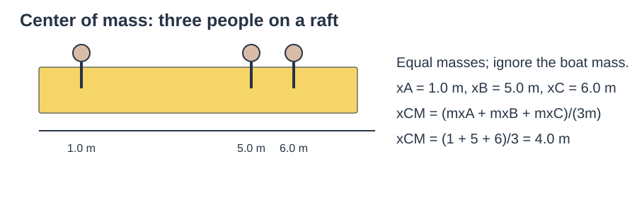

### 2.2 Forces and Free-Body Diagrams (FBD)

Figure 4–18. (a) Two horizontal forces, $\vec F_A$ and $\vec F_B$, exerted by workers A and B, act on a crate (we are looking down from above). (b) The sum, or resultant, of $\vec F_A$ and $\vec F_B$ is $\vec F_R$. The arrows have $F_A=100\ \mathrm N$, $F_B=100\ \mathrm N$; resultant angle 45°.

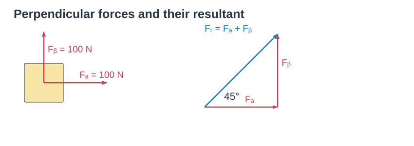

When solving problems involving Newton’s laws and force, it is very important to draw a diagram showing all the forces acting on each object involved. Such a diagram is called a free-body diagram, or force diagram: choose one object, and draw an arrow to represent each force acting on it. Include every force acting on that object. Do not show forces that the chosen object exerts on other objects. To help you identify each and every force that is exerted on your chosen object, ask yourself what other objects could exert a force on it.

How to draw an FBD:

1. Draw only forces acting ON the object — never forces it exerts on others.
2. Label each force: weight $F_g$, normal force $F_N$, tension T, friction f, spring force $F_s$.
3. Set up a coordinate system and resolve forces into x and y components.
4. Write equations: $\sum F_x=ma_x$, $\sum F_y=ma_y$.

### 2.3 Newton's Third Law

Action–reaction pair: ${\overset{\rightarrow}{F}}_{A \rightarrow B} = - {\overset{\rightarrow}{F}}_{B \rightarrow A}$

**Newton’s third law of motion: Whenever one object exerts a force on a second object, the second object exerts an equal force in the opposite direction on the first.**

- Equal magnitude, opposite direction; they act on TWO DIFFERENT objects and NEVER cancel each other in a single FBD!

- They are always of the same type: gravity pairs with gravity, normal pairs with normal, etc. 

Figure 4–8. If your hand pushes against the edge of a desk (the force vector is shown in red), the desk pushes back against your hand (this force vector is shown in a different color, violet, to remind us that this force acts on a different object).

Labels: Force exerted on hand by desk; Force exerted on desk by hand.

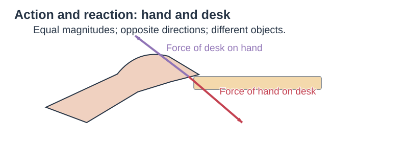

One way to keep clear which force acts on which object is to use double subscripts. For example, the force exerted on the Person by the Ground as the person walks in Fig. 4–11 can be labeled $\vec F_{PG}$. And the force exerted on the ground by the person is $\vec F_{GP}$. By Newton's third law
$$\vec F_{GP}=-\vec F_{PG}.\tag{4–2}$$
$\vec F_{GP}$ and $\vec F_{PG}$ have the same magnitude (Newton's third law), and the minus sign reminds us that these two forces are in opposite directions.

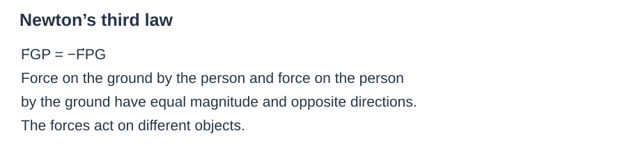

Diagram labels: Force on assistant exerted by sled, $\vec F_{AS}$, leftward; Force on assistant exerted by ground, $\vec F_{AG}$, rightward.

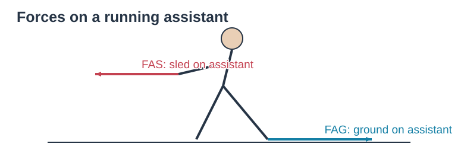

### 2.4 Newton's First Law (Law of Inertia)

$$
\sum\overset{\rightarrow}{F} = 0 \Longleftrightarrow a = 0
$$

- Net force = 0 → object remains at rest or moves with constant velocity (translational equilibrium).

- In fact, newton’s first law of motion is close to Galileo’s conclusions. It states that every object continues in its state of rest, or of uniform velocity in a straight line, as long as no net force acts on it. The tendency of an object to maintain its state of rest or of uniform velocity in a straight line is called inertia. Newton’s first law is thus often called the law of inertia.

- Inertia: the tendency of an object to resist changes in its motion; mass is the only measure of inertia.

- Physics is easier in reference frames in which Newton’s first law does hold, and they are called inertial reference frames (the law of inertia is valid in them).

- Reference frames where the law of inertia does not hold, such as the accelerating reference frames discussed above, are called noninertial reference frames.

### 2.5 Newton's Second Law (AP C Core)

- Basic form: $\sum\overset{\rightarrow}{F} = m\overset{\rightarrow}{a}$

- Calculus form: $\sum\overset{\rightarrow}{F} = \frac{d\overset{\rightarrow}{p}}{dt}$ (net force = rate of change of momentum).

The acceleration of an object is directly proportional to the net force acting on it, and is inversely proportional to the object's mass. The direction of the acceleration is in the direction of the net force acting on the object.

This is Newton's second law of motion.

Newton's second law can be written as an equation:
$$\vec a=\frac{\sum\vec F}{m}.$$
Margin: NEWTON'S SECOND LAW OF MOTION.

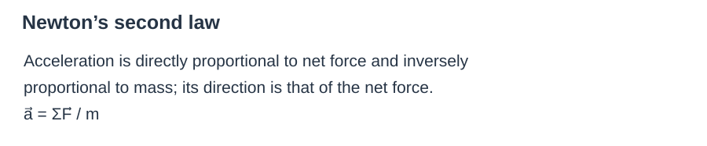

### 2.6 Gravitational Force

1.  Near Earth's surface: $F_{g} = mg$, directed vertically downward.

2.  Newton's law of universal gravitation: $F_{g} = G\frac{m_{1}m_{2}}{r^{2}},G = 6.67 \times 10^{- 11}N \cdot m^{2}/{kg}^{2}$

- r = distance between the centers of mass; gravity is always attractive.

**Example 4–7 Accelerating the box.** What happens when a person pulls upward on the box in Example 4–6c with a force equal to, or greater than, the box's weight? For example, let $F_P=100.0\ \mathrm N$ (Fig. 4–16) rather than the 40.0 N shown in Fig. 4–15c.

**APPROACH** We can start just as in Example 4–6, but be ready for a surprise.

**SOLUTION** The net force on the box is
$$\sum F_y=F_N-mg+F_P=F_N-98.0\ \mathrm N+100.0\ \mathrm N,$$
and if we set this equal to zero (thinking the acceleration might be zero), we would get $F_N=-2.0\ \mathrm N$. This is nonsense, since the negative sign implies $F_N$ points downward, and the table surely cannot pull down on the box (unless there's glue on the table). The least $F_N$ can be is zero, which it will be in this case, $F_N=0$. What really happens here is that the box leaves the table and accelerates upward ($a\ne0$, see gold vector in Fig. 4–16) because the net force is not zero. The net force (setting the normal force $F_N=0$) is
$$\sum F_y=F_P-mg=100.0\ \mathrm N-98.0\ \mathrm N=2.0\ \mathrm N$$
upward. See Fig. 4–16. We apply Newton's second law and see that the box moves upward with an acceleration
$$a_y=\frac{\sum F_y}{m}=\frac{2.0\ \mathrm N}{10.0\ \mathrm{kg}}=0.20\ \mathrm{m/s^2}.$$
Figure 4–16. Example 4–7. The box accelerates upward because $F_P>mg$.

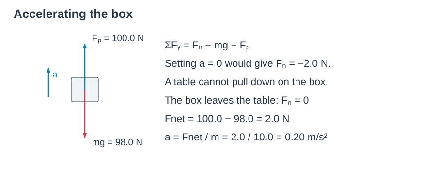

> Example 1
>
> 

PHYSICS APPLIED — Accelerometer.

**Example 4–15 Accelerometer.** A small mass $m$ hangs from a thin string and can swing like a pendulum. You attach it above the window of your car as shown in Fig. 4–25a. When the car is at rest, the string hangs vertically. What angle does the string make (a) when the car accelerates at a constant $a=1.20\ \mathrm{m/s^2}$, and (b) when the car moves at constant velocity, $v=90\ \mathrm{km/h}$?

**APPROACH** The free-body diagram of Fig. 4–25b shows the pendulum at some angle $\theta$ relative to the vertical, and the forces on it: $mg$ downward, and the tension $F_T$ in the cord (including its components). These forces do not add up to zero if $\theta\ne0$; and since we have an acceleration $a$, we expect $\theta\ne0$.

**SOLUTION (a)** The acceleration $a=1.20\ \mathrm{m/s^2}$ is horizontal ($=a_x$), and the only horizontal force is the $x$ component of $F_T$, $F_T\sin\theta$ (Fig. 4–25b). Then from Newton's second law,
$$ma=F_T\sin\theta.$$
The vertical component of Newton's second law gives, since $a_y=0$,
$$0=F_T\cos\theta-mg,\qquad mg=F_T\cos\theta.$$
Dividing the two equations involving $F_T$, we obtain
$$\tan\theta=\frac{F_T\sin\theta}{F_T\cos\theta}=\frac{ma}{mg}=\frac ag,$$
or
$$\tan\theta=\frac{1.20\ \mathrm{m/s^2}}{9.80\ \mathrm{m/s^2}}=0.122,$$
so $\theta=7.0^\circ$.

(b) The velocity is constant, so $a=0$ and therefore $\tan\theta=0$. Hence the pendulum hangs vertically ($\theta=0^\circ$).

**NOTE** This simple device is an accelerometer: it can be used to determine acceleration by measuring the angle $\theta$. Figure 4–25. Example 4–15.

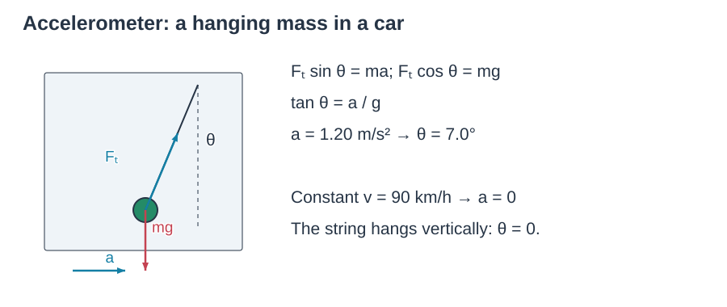

>
> Example 1
>
> 

27. (II) A person jumps from the roof of a house 2.8 m high. When he strikes the ground below, he bends his knees so that his torso decelerates over an approximate distance of 0.70 m. If the mass of his torso (excluding legs) is 42 kg, find (a) his velocity just before his feet strike the ground, and (b) the average force exerted on his torso by his legs during deceleration.

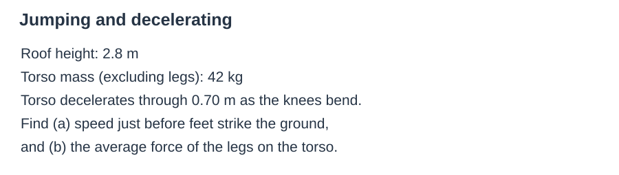

**Part (a) — Velocity Just Before Hitting the Ground**

Use conservation of mechanical energy for the free-fall drop of height $h_{1} = 2.8m$. Initial velocity is zero; gravitational potential energy converts to kinetic energy:

$$
mgh_{1} = \frac{1}{2}mv^{2}
$$

Mass cancels out:

$$
v = \sqrt{2gh_{1}}
$$

With $g = 9.8m/s^{2}$ and $h_{1} = 2.8m$:

$$
v = \sqrt{2(9.8)(2.8)} = \sqrt{54.88} \approx 7.41m/s
$$

**(a)** $v \approx 7.4m/s$ **downward.**

**Part (b) — Average Force from the Legs**

**Method 1 — Kinematics + Newton's Second Law**

The torso decelerates from $v_{0} = 7.41m/s$ to $v_{f} = 0$ over displacement $d = 0.70m$:

$$
v_{f}^{2} = v_{0}^{2} + 2ad
$$

$$
0 = v_{0}^{2} + 2ad
$$

$$
a = - \frac{v_{0}^{2}}{2d}
$$

Substituting $v_{0}^{2} = 2gh_{1}$:

$$
a = - \frac{2gh_{1}}{2d} = - \frac{gh_{1}}{d}
$$

The negative sign means acceleration points upward. Plugging in numbers:

$$
a = - \frac{(9.8)(2.8)}{0.70} = - 39.2m/s^{2}
$$

Magnitude of upward acceleration: $39.2m/s^{2}$.

**Forces on the torso:** upward average force $F_{legs}$, downward weight $mg$. Take upward as positive:

$$
F_{legs} - mg = m|a|
$$

$$
F_{legs} = mg + m|a| = m(g + |a|)
$$

$$
F_{legs} = 42(9.8 + 39.2) = 42(49) = 2058N
$$

**Method 2 — Work-Energy Principle (AP Alternative)**

Total vertical displacement from roof to the lowest crouched position: $H = 2.8 + 0.70 = 3.5m$. Work done by gravity plus work done by the legs equals the change in kinetic energy ($\Delta K = 0$):

$$
mgH - F_{avg} \cdot d = 0
$$

$$
F_{avg} = \frac{mgH}{d} = \frac{42 \times 9.8 \times 3.5}{0.70} = 2058N
$$

**(b)** $F_{avg} \approx 2100N$ **upward** (i.e. $2.1 \times 10^{3}N$ to 2 significant figures).

Example 2

**Part (a) — Pulling Force at Constant Speed**

At constant speed, $a = 0$, so the net force on the system is zero. Two upward tension forces balance the downward weight $mg$. Taking upward as positive:

$$
2F - mg = 0
$$

$$
F = \frac{mg}{2}
$$

Plug in $m = 78kg$ and $g = 9.8m/s^{2}$:

$$
mg = 78 \times 9.8 = 764.4N
$$

$$
F = \frac{764.4}{2} = 382.2N \approx 380N
$$

**(a) She must pull downward with about** $380N$**.**

**Part (b) — Acceleration after a 15% Force Increase**

New pulling force:

$$
F' = 1.15F = 1.15 \times 382.2 = 439.53N
$$

Now the net force is not zero. Apply Newton's second law again — two upward tension forces $2F'$ against the downward weight $mg$:

$$
2F' - mg = ma
$$

$$
a = \frac{2F' - mg}{m}
$$

Substitute the values:

$$
2F' = 2 \times 439.53 = 879.06N
$$

$$
a = \frac{879.06 - 764.4}{78} = \frac{114.66}{78} \approx 1.47m/s^{2}
$$

**Shortcut (Algebraic Insight)**

Since $F = \frac{mg}{2}$ and $F' = 1.15\frac{mg}{2}$:

$$
a = \frac{2\left( 1.15\frac{mg}{2} \right) - mg}{m} = \frac{1.15mg - mg}{m} = 0.15g
$$

$$
a = 0.15 \times 9.8 = 1.47m/s^{2}
$$

**(b) Her acceleration is about** $1.5m/s^{2}$ **upward.**

### 2.7 Kinetic and Static Friction

- Static friction $f_{s}$: adjusts to match the applied force — it is NOT a fixed value!

- $0 \leq f_{s} \leq f_{s,max},f_{s,max} = \mu_{s}F_{N}$

- When the object is stationary, $f_{s}$ equals the applied force along the contact surface; it reaches its maximum only when the object is about to slide.

- Kinetic friction $f_{k}$: constant once sliding begins.

- $f_{k} = \mu_{k}F_{N}$

- $\mu_{k} < \mu_{s}$; friction always acts parallel to the contact surface, opposing relative motion.

- When an object slides along a rough surface, the force of kinetic friction acts opposite to the direction of the object’s velocity.

- There is also static friction, which refers to a force parallel to the two surfaces that can arise even when they are not moving.

**Example 5–3 Pulling against friction.** A 10.0 kg box is being pulled along a horizontal surface by a force $F_P$ of 40.0 N applied at a 30.0° angle above horizontal. This is like Example 4–11 except now there is friction, and we assume a coefficient of kinetic friction of 0.30. Calculate the acceleration.

**APPROACH** The free-body diagram is shown in Fig. 5–5. It is much like that in Fig. 4–21, but with one more force, that of friction.

**SOLUTION** The calculation for the vertical ($y$) direction is just the same as in Example 4–11, $mg=(10.0\ \mathrm{kg})(9.80\ \mathrm{m/s^2})=98.0\ \mathrm N$ and $F_{Py}=(40.0\ \mathrm N)(\sin30.0^\circ)=20.0\ \mathrm N$. With $y$ positive upward and $a_y=0$, we have
$$F_N-mg+F_{Py}=ma_y,$$
$$F_N-98.0\ \mathrm N+20.0\ \mathrm N=0,$$
so the normal force is $F_N=78.0\ \mathrm N$. Now we apply Newton's second law for the horizontal ($x$) direction (positive to the right), and include the friction force:
$$F_{Px}-F_{fr}=ma_x.$$
The friction force is kinetic as long as $F_{fr}=\mu_kF_N$ is less than $F_{Px}=(40.0\ \mathrm N)\cos30.0^\circ=34.6\ \mathrm N$, which it is:
$$F_{fr}=\mu_kF_N=(0.30)(78.0\ \mathrm N)=23.4\ \mathrm N.$$
Hence the box does accelerate:
$$a_x=\frac{F_{Px}-F_{fr}}m=\frac{34.6\ \mathrm N-23.4\ \mathrm N}{10.0\ \mathrm{kg}}=1.1\ \mathrm{m/s^2}.$$
In the absence of friction, as we saw in Example 4–11, the acceleration would be much greater than this.

**NOTE** Our final answer has only two significant figures because our least significant input value ($\mu_k=0.30$) has two. Figure 5–5. Example 5–3.

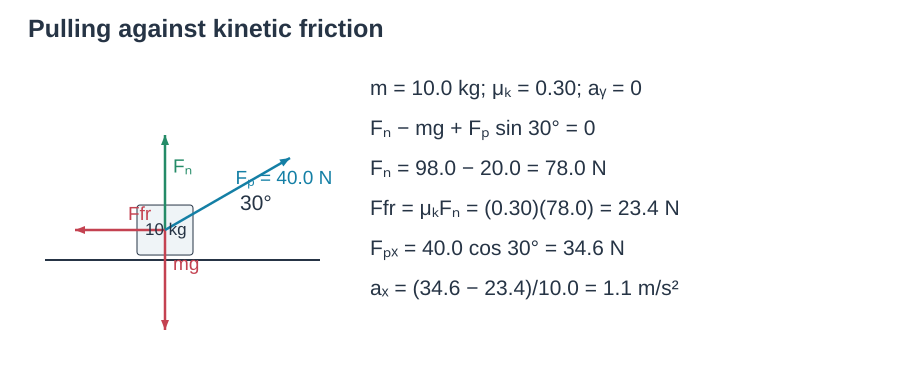

Inclined-plane diagram: axes $x$ down the plane and $y$ normal to it; $\vec F_N$ outward, $\vec F_{fr}$ uphill, $\vec F_G$ vertically downward, components $F_{Gx}$ downhill and $F_{Gy}$ into the plane; $(F_{fr}=\mu_kF_N)$; angles $\theta$ and $90^\circ-\theta$.

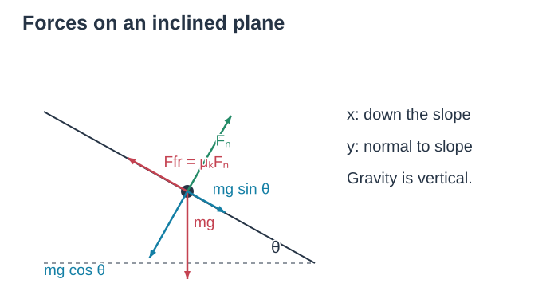

**CAUTION — Directions of gravity and the normal force.** In problems involving a slope or “inclined plane,” avoid making errors in the directions of the normal force and gravity. The normal force is not vertical: it is perpendicular to the slope or plane. And gravity is not perpendicular to the slope—gravity acts vertically downward toward the center of the Earth.

Diagrams (a)–(c): $m_A=10.0\ \mathrm{kg}$ on incline $\theta=37^\circ$ attached by cord over pulley to $m_B$; free-body diagrams of $m_A$ for case i and case ii show reversed friction; $m_B$ has upward $F_T$ and downward $m_Bg$.

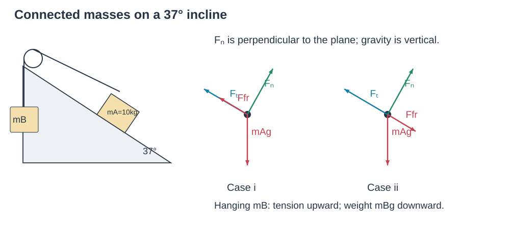

> Example 1
>
> A box of mass mA = 10.0 kg rests on a surface inclined at u = 37° to the horizontal. It is connected by a lightweight cord, which passes over a massless and frictionless pulley, to a second box of mass mB, which hangs freely as shown in Fig. 5 9 9a. (a) If the coefficient of static friction is ms = 0.40, determine what range of values for mass mB will keep the system at rest. (b) If the coefficient of kinetic friction is mk = 0.30, and mB = 10.0 kg, determine the acceleration of the system.

**Part (a) — Static Equilibrium: Range of m_B**

There are two limiting cases depending on which way the system is about to slide. Static friction reverses direction between them.

**Case 1 — m_B at Maximum (m_A about to slide UP the ramp)**

$m_{B}$ falls down, pulling $m_{A}$ up the incline. Static friction acts **down the ramp**.

For $m_{A}$ along the ramp:

$T = m_{A}g\sin\theta + f_{s}$, with $f_{s} = \mu_{s}N = \mu_{s}m_{A}g\cos\theta$

For the hanging mass $m_{B}$:

$$
T = m_{B,max}g
$$

Combine and cancel $g$:

$$
m_{B,max} = m_{A}(\sin\theta + \mu_{s}\cos\theta)
$$

$$
m_{B,max} = 10.0(0.6 + 0.40 \times 0.8) = 10.0(0.6 + 0.32) = 9.2kg
$$

**Case 2 — m_B at Minimum (m_A about to slide DOWN the ramp)**

$m_{A}$ slides down the ramp, lifting $m_{B}$. Static friction acts **up the ramp**.

For $m_{A}$ along the ramp:

$$
T + f_{s} = m_{A}g\sin\theta \Rightarrow T = m_{A}g\sin\theta - \mu_{s}m_{A}g\cos\theta
$$

For the hanging mass:

$$
T = m_{B,min}g
$$

Cancel $g$:

$$
m_{B,min} = m_{A}(\sin\theta - \mu_{s}\cos\theta)
$$

$$
m_{B,min} = 10.0(0.6 - 0.40 \times 0.8) = 10.0(0.6 - 0.32) = 2.8kg
$$

**(a) The system stays at rest when** $2.8kg \leq m_{B} \leq 9.2kg$**.**

**Part (b) — Kinetic Friction: Find the Acceleration**

Since $m_{B} = 10.0kg > 9.2kg$, $m_{B}$ accelerates downward and $m_{A}$ accelerates up the ramp. Kinetic friction points down the ramp.

Newton's second law for each block:

$$
m_{B}g - T = m_{B}a
$$

$$
T - m_{A}g\sin\theta - \mu_{k}m_{A}g\cos\theta = m_{A}a
$$

Add the two equations to eliminate tension $T$:

$$
m_{B}g - m_{A}g\sin\theta - \mu_{k}m_{A}g\cos\theta = (m_{A} + m_{B})a
$$

$$
a = \frac{m_{B}g - m_{A}g(\sin\theta + \mu_{k}\cos\theta)}{m_{A} + m_{B}}
$$

Substitute values:

$$
a = \frac{10(9.8) - 10(9.8)(0.6 + 0.3 \times 0.8)}{10 + 10}
$$

$$
a = \frac{98 - 98(0.84)}{20} = \frac{98 - 82.32}{20} = \frac{15.68}{20} = 0.784m/s^{2}
$$

**(b)** $a \approx 0.78m/s^{2}$ — $m_{B}$ accelerates downward; $m_{A}$ accelerates up the incline.

Example 2

33. (III) A 4.0 kg block is stacked on top of a 12.0 kg block, which is accelerating along a horizontal table at $a=5.2\ \mathrm{m/s^2}$ (Fig. 5–43). Let $\mu_k=\mu_s=\mu$. (a) What minimum coefficient of friction $\mu$ between the two blocks will prevent the 4.0 kg block from sliding off? (b) If $\mu$ is only half this minimum value, what is the acceleration of the 4.0 kg block with respect to the table, and (c) with respect to the 12.0 kg block? (d) What is the force that must be applied to the 12.0 kg block in (a) and in (b), assuming that the table is frictionless? Figure 5–43. Problem 33.

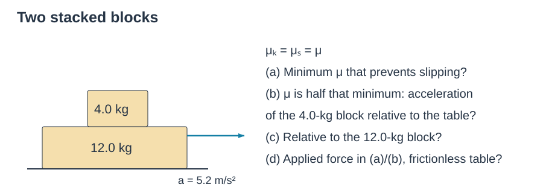

**Part (a) — Minimum Coefficient of Static Friction**

The upper block gets its acceleration **only from static friction** between the two blocks.

Newton's second law for the top block:

$$
f_{s} = m_{1}a
$$

Maximum static friction:

$$
f_{s} = \mu_{s}m_{1}g
$$

Equate them:

$$
\mu_{s}m_{1}g = m_{1}a
$$

The mass cancels:

$$
\mu_{s} = \frac{a}{g} = \frac{5.2}{9.8} \approx 0.53
$$

**(a)** $\mu_{s} \approx 0.53$

**Part (b) — Top Block's Acceleration Relative to the Table**

Set $\mu' = \frac{1}{2}\mu_{s} = \frac{0.53}{2} = 0.265$. Now the blocks slip, and kinetic friction accelerates the top block:

$$
f_{k} = \mu'm_{1}g = m_{1}a_{1}
$$

Mass cancels:

$$
a_{1} = \mu'g = 0.265 \times 9.8 \approx 2.6m/s^{2}
$$

**(b)** $a_{1} \approx 2.6m/s^{2}$ **to the right (relative to the table).**

**Part (c) — Top Block's Acceleration Relative to the Bottom Block**

First find the applied force $F$ from case (a) (it stays the same in case (b)):

$$
F = (m_{1} + m_{2})a = (4.0 + 12.0) \times 5.2 = 83.2N
$$

For the bottom block $m_{2}$, the kinetic friction opposes the motion:

$$
F - f_{k} = m_{2}a_{2}
$$

with $f_{k} = \mu'm_{1}g = 0.265 \times 4.0 \times 9.8 \approx 10.4N$:

$$
a_{2} = \frac{F - f_{k}}{m_{2}} = \frac{83.2 - 10.4}{12.0} \approx 6.07m/s^{2}
$$

Relative acceleration of the top block with respect to the bottom block:

$$
a_{rel} = a_{1} - a_{2} = 2.6 - 6.07 = - 3.5m/s^{2}
$$

The negative sign means that relative to the 12-kg block, the 4-kg block accelerates **to the left**.

**(c)** $3.5m/s^{2}$ **to the left (relative to the 12.0-kg block).**

**Part (d) — Applied Force on the 12.0-kg Block**

**Case (a): No Slipping**

Both blocks move together as a single system:

$$
F_{a} = (m_{1} + m_{2})a = 16.0 \times 5.2 = 83.2N
$$

**Case (b): Slipping**

The applied force is held the same as in case (a):

$$
F_{b} = 83.2N
$$

Example 3

29. (II) Two blocks made of different materials connected together by a thin cord slide down a ramp inclined at an angle $\theta$ to the horizontal, Fig. 5–40 (block B is above block A). The masses of the blocks are $m_A$ and $m_B$ and the coefficients of friction are $\mu_A$ and $\mu_B$. If $m_A=m_B=4.0\ \mathrm{kg}$, and $\mu_A=0.20$ and $\mu_B=0.30$, determine (a) the acceleration of the blocks and (b) the tension in the cord, for an angle $\theta=32^\circ$. Figure 5–40. Problems 29 and 30.

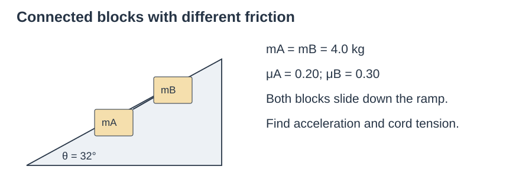

**Part (a) — Acceleration of the Blocks**

Treat A + B as one combined system. Internal tension cancels, so we only need external forces along the slope.

Total downhill gravity component: $(m_{A} + m_{B})g\sin\theta$

Total uphill kinetic friction: $\mu_{A}m_{A}g\cos\theta + \mu_{B}m_{B}g\cos\theta$

Newton's second law for the whole system:

$$
(m_{A} + m_{B})g\sin\theta - \left( \mu_{A}m_{A}g\cos\theta + \mu_{B}m_{B}g\cos\theta \right) = (m_{A} + m_{B})a
$$

Total mass $M = m_{A} + m_{B} = 8.0kg$. Substitute numbers:

$$
8.0 \times 9.8 \times 0.5299 - (0.20 \times 4 \times 9.8 \times 0.8480 + 0.30 \times 4 \times 9.8 \times 0.8480) = 8.0a
$$

$$
41.54 - (6.65 + 9.97) = 8a
$$

$$
41.54 - 16.62 = 8a
$$

$$
24.92 = 8a
$$

$$
a \approx 3.1m/s^{2}
$$

**(a)** $a \approx 3.1m/s^{2}$ **down the ramp.**

**Part (b) — Tension in the Cord**

Isolate block A (the lower block). Along the slope:

- Downhill: gravity component $m_{A}g\sin\theta$

- Uphill: kinetic friction $\mu_{A}m_{A}g\cos\theta$ and tension $T$ (B pulls A uphill)

$$
m_{A}g\sin\theta - \mu_{A}m_{A}g\cos\theta - T = m_{A}a
$$

Rearrange for $T$:

$$
T = m_{A}g\sin\theta - \mu_{A}m_{A}g\cos\theta - m_{A}a
$$

Substitute:

$$
T = 4.0 \times 9.8 \times 0.5299 - 0.20 \times 4.0 \times 9.8 \times 0.8480 - 4.0 \times 3.1
$$

$$
T = 20.77 - 6.65 - 12.4 \approx 1.7N
$$

**(b)** $T \approx 1.7N$**.**

**Verification (using block B)**

For block B, gravity and tension both pull downhill while friction opposes:

$$
m_{B}g\sin\theta + T - \mu_{B}m_{B}g\cos\theta = m_{B}a
$$

$20.77 + 1.7 - 9.97 = 12.5$, and $m_{B}a = 4 \times 3.1 = 12.4$ — consistent within rounding.

### 2.8 Spring Forces (Hooke's Law)

$$
F_{s} = - kx
$$

- k = spring constant (stiffness).

- x = displacement from the equilibrium / natural length (stretch or compression).

- The negative sign means the force opposes the deformation, always pointing toward the equilibrium position.

**Work Done by a Spring Force**

Let us determine the work needed to stretch or compress a coiled spring, such as that shown in Fig. 7–10. For a person to hold a spring either stretched or compressed by a displacement $x$ from its normal (relaxed) length requires a force $F_P$ that is directly proportional to $x$. That is,
$$F_P=kx,$$
where $k$ is a constant, called the spring constant (or spring stiffness constant), and is a measure of the stiffness of the particular spring. The spring itself exerts a force in the opposite direction (Fig. 7–10b or c):
$$F_S=-kx.\tag{7–8}$$
This force is sometimes called a “restoring force” because the spring exerts its force in the direction opposite to the displacement (hence the minus sign), and thus acts to restore the spring to its normal length. Equation 7–8 is known as the spring equation or Hooke's law, and is accurate for springs as long as $x$ is not too great (see Section 12–5) and no permanent deformation occurs.

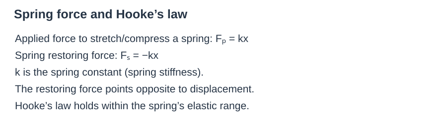

Figure 7–10. (a) Spring in normal (unstretched) position. (b) Spring is stretched by a person exerting a force $\vec F_P$ to the right (positive direction). The spring pulls back with a force $\vec F_S$ where $F_S=-kx$. (c) Person compresses the spring ($x<0$), and the spring pushes back with a force $F_S=-kx$ where $F_S>0$ because $x<0$. Diagram labels: (a) Unstretched, $x=0$; (b) Stretched; (c) Compressed.

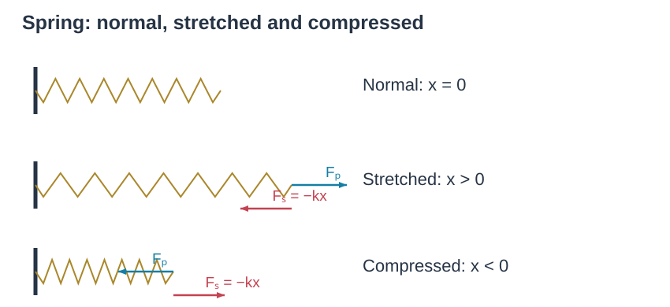

Figure 7–11. Work done to stretch a spring a distance $x$ equals the triangular area under the curve $F=kx$. The area of a triangle is $\frac12\times\text{base}\times\text{altitude}$, so $W=\frac12(x)(kx)=\frac12kx^2$. Graph labels $F$, $x$, height $kx$, base $x$.

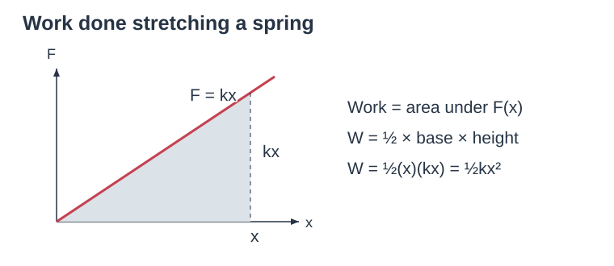

$$W=\frac12(kx)(x)=\frac12kx^2.$$

Work is proportional to x squared

Example1

7. (II) A particle is constrained to move in one dimension along the $x$ axis and is acted upon by a force given by
$$\vec F(x)=-\frac{k}{x^3}\hat i$$
where $k$ is a constant with units appropriate to the SI system. Find the potential energy function $U(x)$, if $U$ is arbitrarily defined to be zero at $x=2.0\ \mathrm m$, so that $U(2.0\ \mathrm m)=0$.

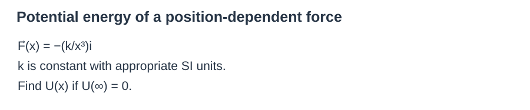

**Key Relation**

For a one-dimensional conservative force:

$$
F(x) = - \frac{dU}{dx}
$$

Rearranged for integration:

$$
U(x) - U(x_{0}) = - \int_{x_{0}}^{x}{}F(x')dx'
$$

**Given:**

- $F(x) = - \frac{k}{x^{3}}$

- $U(2.0m) = 0$

- Reference point $x_{0} = 2.0m$

**Step 1 — Substitute the Force into the Integral**

$$
U(x) - U(2) = - \int_{2}^{x}{}F(x')dx'
$$

$$
U(x) - 0 = - \int_{2}^{x}{( - \frac{k}{x^{'3}})}dx'
$$

The two negatives cancel:

$$
U(x) = k\int_{2}^{x}{}x^{' - 3}dx'
$$

**Step 2 — Evaluate the Definite Integral**

$$
\int x^{' - 3}dx' = - \frac{1}{2x^{'2}}
$$

Apply the upper limit $x$ and lower limit $2$:

$$
U(x) = k\left\lbrack - \frac{1}{2x^{'2}} \right\rbrack_{2}^{x}
$$

$$
U(x) = k\left\lbrack \left( - \frac{1}{2x^{2}} \right) - \left( - \frac{1}{2(2)^{2}} \right) \right\rbrack
$$

$$
U(x) = k\left( - \frac{1}{2x^{2}} + \frac{1}{8} \right)
$$

**Final Result**

$$
\mathbf{U}\mathbf{(}\mathbf{x}\mathbf{) =}\frac{\mathbf{k}}{\mathbf{8}}\mathbf{-}\frac{\mathbf{k}}{\mathbf{2}\mathbf{x}^{\mathbf{2}}}
$$

**Verification**

Differentiate $U(x)$:

$$
\frac{dU}{dx} = \frac{k}{x^{3}}
$$

$$
F(x) = - \frac{dU}{dx} = - \frac{k}{x^{3}}
$$

This matches the given force. At $x = 2.0m$:

$$
U(2) = \frac{k}{8} - \frac{k}{8} = 0
$$

which satisfies the zero-potential boundary condition
