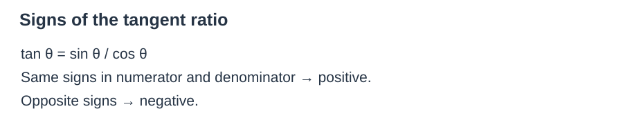
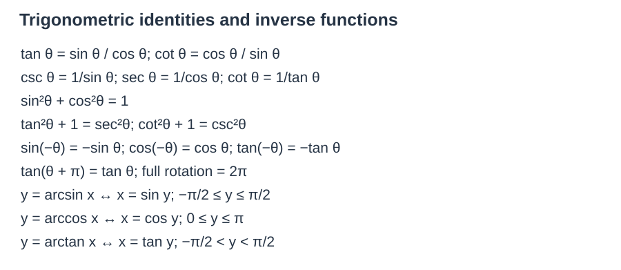
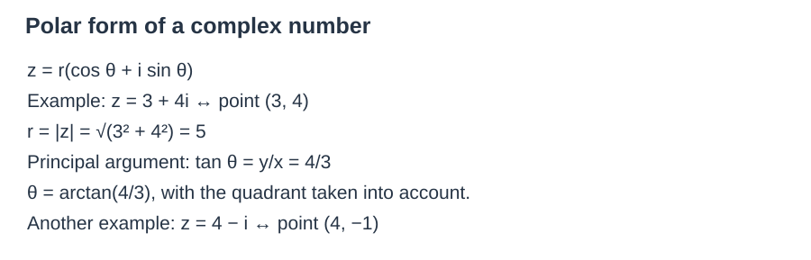
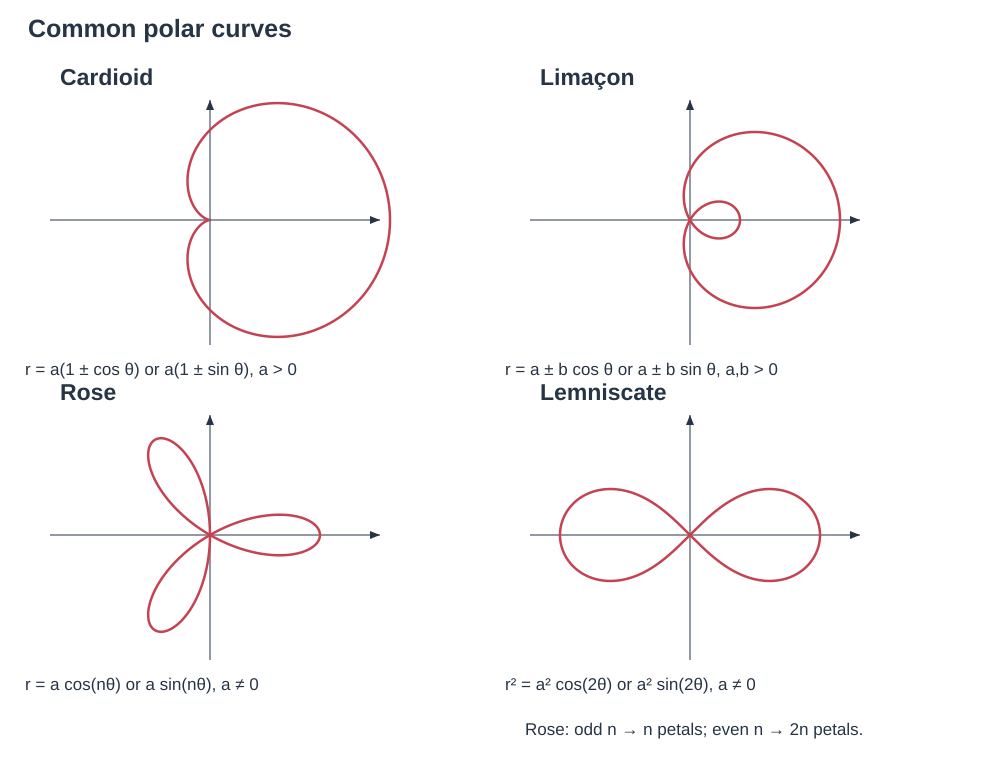

# AP Precalculus Notes and Formulas

## Unit 1 Polynomial and Rational Functions

| 中文 | English | 公式 |
|---|---|---|
| 函数 | Function | $f(x)$: 每个 $x$ 对应唯一一个 $y$ |
| 定义域 | Domain | 自变量 $x$ 的取值范围 |
| 值域 | Range | 函数值 $y$ 的取值集合 |
| 平均变化率 | Average Rate of Change | $\frac{f(b)-f(a)}{b-a}$（$\frac{y_2-y_1}{x_2-x_1}$） |
| 多项式函数 | Polynomial Function | $f(x)=a_nx^n+\cdots+a_0$ |
| 复数 | Complex Number | $a+bi$, $i^2=-1$ |
| 共轭复数 | Complex Conjugate | $\overline{a+bi}=a-bi$ |
| 有理函数 | Rational Function | $R(x)=\frac{p(x)}{q(x)}$, $q(x)\ne0$ |
| 垂直渐近线 | Vertical Asymptote | 分母为 0 且分子不为 0 的点 |
| 水平渐近线 | Horizontal Asymptote | $n=m\Rightarrow y=a_n/b_m$; $n<m\Rightarrow y=0$ |
| 函数变换 | Function Transformation | 平移、伸缩、反射 |
| 二项式定理 | Binomial Theorem | $(x+a)^n=\sum_{j=0}^n\binom njx^{n-j}a^j$ |
| 差商 | Difference Quotient | $\frac{f(x+h)-f(x)}h$ |
| 零点/根 | zero/root | $f(r)=0$ |
| 重数 | Multiplicity | Exponent of factor $(x-r)$ |
| 偶/奇函数 | Even/Odd Function | $f(-x)=f(x)$ (even) / $f(-x)=-f(x)$ (odd) |

1. Function: A relation where each input $x$ has exactly one output $y$. 判定：同一 $x$ 不出现两个不同 $y$。$x^2+y^2=1$、$x=y^2$、圆方程都不是函数。
2. Domain of Function: All real $x$ that make the function defined. Denominator $\ne0$, Even Root: inside $\ge0$, zero exponent: base $\ne0$.
3. Even & Odd Functions: $f(-x)=f(x)$, symmetric over $y$ axis / $f(-x)=-f(x)$, symmetric over origin.
4. Multiplicity & Polynomial Zeros: If $r$ is a zero, then $(x-r)$ is a factor. Even multiplicity: graph touches $x$ axis. Odd multiplicity: graph crosses $x$ axis.

Vertical Asymptote: denominator $=0$ (simplified function).

$n=$ 分子次数，$m=$ 分母次数。

- $n<m$: $y=0$.
- $n=m$: $y=\frac{\text{leading coefficient of top}}{\text{leading coefficient of bottom}}$.
- $n=m+1$: have slant (oblique) asymptote（长除法求斜率）.

### Function Transformation

1. Vertical shift: $f(x)+k$ → up $k$; $f(x)-k$ → down $k$.
2. Horizontal shift: $f(x+h)$ → left $h$; $f(x-h)$ → right $h$.
3. Vertical stretch: $a\cdot f(x)$; $|a|>1$, stretch; $0<|a|<1$, compress.
4. Horizontal stretch: $f(bx)$; $|b|>1$, compress; $0<|b|<1$, stretch.
5. Reflect（翻折）: $-f(x)$，$x$ 轴；$f(-x)$，$y$ 轴。

### Polynomial and Rational Inequalities

1. Move all terms to left → set $\ge0$ or $\le0$. 移项使一边为 0。
2. Factor completely.
3. Find critical numbers (zeros, undefined points).
4. Test intervals（区间验号）.

### Binomial Theorem

$$\binom nj=\frac{n!}{j!(n-j)!},\qquad (x+a)^n=\sum_{j=0}^n\binom njx^{n-j}a^j.$$
Example $(2y-3)^4$: $n=4$, $x=2y$, $a=-3$.
$$=16y^4-96y^3+216y^2-216y+81.$$

### Complex Zeros and Conjugate Pairs

For polynomial with real coefficients, complex zeros come in conjugate pairs. If $a+bi$ is zero, then $a-bi$ 也是零点。

### Graph Rational Functions Completely

1. Find domain.
2. Find intercepts.
3. Find VA, HA, holes.
4. Test sign in intervals.
5. Plot points & sketch.

## Unit 2

| 中文 | English Name | 公式 |
|---|---|---|
| 复合函数 | Composite Function | $(f\circ g)(x)=f(g(x))$ |
| one to one | one to one function | 不同 $x$ 对应不同 $y$ |
| 反函数 | Inverse Function | $f^{-1}(y)=x\iff f(x)=y$ |
| 指数函数 | exponential function | $y=a^x$ |
| 对数函数 | logarithmic function | $y=\log_a x\iff x=a^y$ |
| 自然对数 | natural log | $\ln x=\log_e x$ |
| 常用对数 | common log | $\log x=\log_{10}x$ |
| 对数 + | product rule | $\log_a(MN)=\log_aM+\log_aN$ |
| − | quotient rule | $\log_a(M/N)=\log_aM-\log_aN$ |
| 对数幂法则 | power rule | $\log_aM^r=r\log_aM$ |
| 残差 | residual | 观测值 − 预测值 |

例题：
$$x=2000\cdot2^{t/8},\qquad\frac{x}{2000}=2^{t/8}.$$
Note: $x=a^y$, $y=\log_ax$.
$$\frac t8=2\log_2\left(\frac x{2000}\right),\qquad t=8\log_2\left(\frac x{2000}\right).$$

## Formulas for U3 Precalculus

### 1 Sum and Differences Formulas

$$\cos(\gamma\pm\beta)=\cos\gamma\cos\beta\mp\sin\gamma\sin\beta,$$
$$\sin(\gamma\pm\beta)=\sin\gamma\cos\beta\pm\cos\gamma\sin\beta,$$
$$\tan(\gamma\pm\beta)=\frac{\tan\gamma\pm\tan\beta}{1\mp\tan\gamma\tan\beta}.$$

Expanded formulas:
$$\cos(\gamma+\beta)=\cos\gamma\cos\beta-\sin\gamma\sin\beta,$$
$$\cos(\gamma-\beta)=\cos\gamma\cos\beta+\sin\gamma\sin\beta.$$
cos: 同名相乘，符号相反。+ to −, − to +.

①
$$\sin(\gamma+\beta)=\sin\gamma\cos\beta+\cos\gamma\sin\beta,$$
$$\sin(\gamma-\beta)=\sin\gamma\cos\beta-\cos\gamma\sin\beta.$$
sin: 异名相乘，符号相同。+ stay +, − stay −.

②
$$\tan(\gamma+\beta)=\frac{\tan\gamma+\tan\beta}{1-\tan\gamma\tan\beta},\qquad
\tan(\gamma-\beta)=\frac{\tan\gamma-\tan\beta}{1+\tan\gamma\tan\beta}.$$
tan: 上同下反，分子同号。

### 2 Double Angle Formulas

$$\sin(2\theta)=2\sin\theta\cos\theta,$$
$$\cos(2\theta)=\cos^2\theta-\sin^2\theta=1-2\sin^2\theta=2\cos^2\theta-1,$$
$$\tan(2\theta)=\frac{2\tan\theta}{1-\tan^2\theta}.$$

### 3 Power Reducing Formulas

$$\sin^2\theta=\frac{1-\cos2\theta}{2},\qquad\cos^2\theta=\frac{1+\cos2\theta}{2}.$$

### 4 Fundamental Identities

Pythagorean: $\sin^2\theta+\cos^2\theta=1$, $\tan^2\theta+1=\sec^2\theta$, $\cot^2\theta+1=\csc^2\theta$.

Quotient: $\tan\theta=\frac{\sin\theta}{\cos\theta}$, $\cot\theta=\frac{\cos\theta}{\sin\theta}$.

Reciprocal: $\csc\theta=\frac1{\sin\theta}$, $\sec\theta=\frac1{\cos\theta}$, $\cot\theta=\frac1{\tan\theta}$.

Even odd: $\sin(-\theta)=-\sin\theta$, $\cos(-\theta)=\cos\theta$, $\tan(-\theta)=-\tan\theta$.

### 5 Periods and Domains

sin, cos, sec, csc: period $=2\pi$.

tan, cot: period $=\pi$.

tan, sec: $x\ne\pi/2+k\pi$; cot, csc: $x\ne k\pi$.

### 6 Inverse Functions

1. $\sin^{-1}x$: domain $[-1,1]$, range $[-\pi/2,\pi/2]$.
2. $\cos^{-1}x$: domain $[-1,1]$, range $[0,\pi]$.
3. $\tan^{-1}x$: domain $[x\in\mathbb R]$, range $[-\pi/2,\pi/2]$.

### 7 Polar Coordinate Conversions

1. $x=r\cos\theta$.
2. $y=r\sin\theta$.
3. $r=\sqrt{x^2+y^2}$.
4. $r^2=x^2+y^2$.

### 8 Polar Graphs Quick Identification

1. Circle: $r=a$; $r=2a\cos\theta$.
2. Cardioid: $r=a(1\pm\cos\theta)$; $r=a(1\pm\sin\theta)$.
3. Rose Curve: $r=a\cos(n\theta)$; even $n$: $2n$ petals; odd $n$: $n$ petals.
4. Lemniscate: $r^2=a^2\cos2\theta$; $r^2=a^2\sin2\theta$.

### 9 Steps for solving Trigonometric Equation

1. Reduce to a single trigonometric function.
2. Find the principal solutions in the interval $[0,2\pi)$.
3. Add the period to write the general solution.
4. If squared both sides, always check for extraneous roots.

### 10 Common Special Angles

| | 30 | 45 | 60 |
|---|---|---|---|
| sin | $1/2$ | $\sqrt2/2$ | $\sqrt3/2$ |
| cos | $\sqrt3/2$ | $\sqrt2/2$ | $1/2$ |
| tan | $\sqrt3/3$ | $1$ | $\sqrt3$ |

Additional identities:

1. $\tan\theta=\sin\theta/\cos\theta$, $\cot\theta=\cos\theta/\sin\theta$.
2. $\csc\theta=1/\sin\theta$, $\sec\theta=1/\cos\theta$, $\cot\theta=1/\tan\theta$.
3. $\sin^2\theta+\cos^2\theta=1$; $\tan^2\theta+1=\sec^2\theta$; $\cot^2\theta+1=\csc^2\theta$.
4. $\sin(-\theta)=-\sin\theta$; $\cos(-\theta)=\cos\theta$.
5. $\tan(\theta+\pi)=\tan\theta$.
6. $2\pi$.
7. Inverse sine: $y=\sin^{-1}x\to x=\sin y$, $-\pi/2\le y\le\pi/2$.
8. Inverse cosine: $y=\cos^{-1}x$, $x=\cos y$, $0\le y\le\pi$.
9. Inverse tangent: $x=\tan y$, $-\pi/2<y<\pi/2$.

$$y=A\sin(Bx+C)+D.$$
$$a=\frac{\max-\min}{2}.$$
$$P=\frac{2\pi}{|B|}\quad(\sin,\cos,\sec,\csc),\qquad P=\frac\pi{|B|}\quad(\tan,\cot).$$
Phase shift: $-C/B$.

$D$ 上移下移：$(\max+\min)/2$.

$$|B|=\frac{2\pi}{\text{Period}}\quad/\quad\frac\pi{\text{Period}}.$$

## 3.10 3.11

| Chinese | English | Formula/Definition |
|---|---|---|
| 极坐标系 | Polar Coordinate System | A coordinate system that locates points on a plane using distance from a fixed point and angle from a fixed direction, rather than horizontal/vertical position. $(r,\theta)$ → the form. |
| 极点 | Pole | The fixed point in the polar system as reference, equivalent to the origin $(0,0)$ in the rectangular coordinate system. 本质：原点；$(0,0)$. |
| 极轴 | Polar Axis | The fixed reference direction in the polar system, equivalent to the positive $x$ axis in the rectangular coordinate system. 本质：$x$ 轴；0 base line. |
| 极径 | Radius ($r$) | The straight line distance from a point to the pole; can be positive or negative. 本质：点与点间的距离；可正可负。 |
| 极角 | Polar Angle ($\theta$) | The straight line rotated from the polar axis to the line connecting the pole & the point; counterclockwise = positive $\theta$, clockwise = negative $\theta$. Sketches: 逆时针正、顺时针负。 |
| 直角坐标系 | Rectangular/Cartesian Coordinate System | Use $(x,y)$ to demonstrate the positions. |
| 极→直坐标转换 | Polar to Rectangular Conversion | $x=r\cos\theta$, $y=r\sin\theta$ |
| 直→极坐标转换 | Rectangular to Polar Conversion | $r=\sqrt{x^2+y^2}$, $\tan\theta=y/x$ ($x\ne0$); $r\ge0$, $0\le\theta<2\pi$ |
| 复数的极坐标形式 | Polar Form of a Complex number | $z=r(\cos\theta+i\sin\theta)$ |

① e.g. the complex number $z=\sqrt3-i$ (coordinate $(\sqrt3,-1)$):
$$\text{radius}=\sqrt{(\sqrt3)^2+(-1)^2}=2,$$
$$\arg:\ \tan\theta=\frac yx=-\frac1{\sqrt3}=-\frac{\sqrt3}3.$$
(Quadrant IV) $\Rightarrow\theta=11\pi/6$.
$$z=r(\cos\theta+i\sin\theta)=2\left(\cos\frac{11\pi}6+i\sin\frac{11\pi}6\right)\quad\star\to\text{result}.$$

Examples: $z=3+4i$; $z=4-i$, $(4,-1)$. For $(3,4)$:
$$r=|z|=\sqrt{3^2+4^2}=5\quad(\text{两点间距离公式}),$$
$$\text{辐角 principal argument}:\ \tan\theta=\frac yx=\frac43.$$

## 对称性测试 Symmetry test

1. About the $x$ axis: flipping the graph over the $x$ axis leaves the graph unchanged.
2. About the $y$ axis: flipping the graph over the $y$ axis leaves it unchanged.
3. About the pole: rotating the graph 180° around the origin leaves it unchanged.

Symmetry examples:

- The mirror point $(r,\theta)\to(r,-\theta)$ or $(r,\pi-\theta)$ ($x$ axis).
- The mirror point $(r,\theta)\to(-r,-\theta)$ ($y$ axis).
- The mirror point $(r,\theta)\to(-r,\theta)$ (pole).

| 中文 | English | Equations of this Function |
|---|---|---|
| 心形线 | Cardioid | $r=a(1\pm\cos\theta)$ / $r=a(1\pm\sin\theta)$ ($a>0$) |
| 蜗牛线 | Limaçon | $r=a\pm b\cos\theta$ / $r=a\pm b\sin\theta$ ($a>0,b>0$) |
| 玫瑰线 | rose curve | $r=a\cos(n\theta)$ / $r=a\sin(n\theta)$ ($a\ne0$) |
| 双纽线 | lemniscate | $r^2=a^2\sin(2\theta)$ / $r^2=a^2\cos(2\theta)$ ($a\ne0$) |

Curve labels: Cardioid: cos $\theta$, sin $\theta$. Limaçon: sin $\theta$, cos $\theta$. Rose: (even) (sin, cos), (odd) (sin, cos). Lemniscate: the same (cos/sin).

**平均变化率 AROC**:
$$\mathrm{AROC}=\frac{r(\theta_2)-r(\theta_1)}{\theta_2-\theta_1}.$$

**相对极值 Relative Extrema**: Points where the radius $r$ switches from increasing to decreasing or decrease decreasing to increasing.（找离极点最远 or 最近的点。）

Examples:

- Circle: $r=a$ ($a>0$).
- Straight line: $r\sin\theta=b$ / $r\cos\theta=a$.
- 有内环蜗牛线: $r=a\pm b\cos\theta$ / $r=a\pm b\sin\theta$ ($0<a<b$), inner-loop sketch.
- $a>b>0$, no-inner-loop sketch → 无内环蜗牛线。
