> **转写核对说明（非原文）**：以下按所提供的 81 页 PDF 转写。原件内容在这些位置直接跳转或结束，未自行补写：
>
> - 第 49 页在脑结构表的 Temporal Lobe 行后结束，第 50 页直接接 ESP 表格末行及 Unit 4 FRQ 清单；目录所列 Modules 16–21 的完整正文未见于原件。
> - 第 79 页止于 Big Five Personality Traits 标题，第 80 页直接接 Drive Reduction 的中文释义并进入第 27 条 Incentive；第 23–26 条的完整条目未见于原件。
> - 第 81 页在第 35 条 Sarcomere 的英文定义处结束，没有后续中文释义及目录所列的其余神经肌肉条目。
>
> 少量无法可靠辨认的手写内容已明确标记并保留局部原图。

<!-- Source: page 1 -->

# AP Psychology 期中复习笔记（中英文对照）

# AP Psychology 期中复习笔记（中英文对照）

教材： Myers' Psychology for AP®, 2e（David G. Myers）

覆盖范围： Unit 2 研究方法 · Unit 3 生物基础 · Unit 4 感觉与知觉 · Unit 5 意识状态 · 社会认知/人格动机情绪/神经肌肉补充术语

标注说明： ⭐ = AP 考试高频考点；⚠️ = 易混淆概念对比；📝 = 例子 / FRQ 答题要点

## 📚 目录

第一部分　Unit 2：Research Methods 研究方法（Modules 4–8，44 个核心术语）

- Module 4 心理学科学的必要性

- Module 5 科学方法与描述

- Module 6 相关与实验

- Module 7 统计推理

- Module 8 心理学常见问题

- 易混淆概念对比总结 · 研究方法对比总表 · FRQ 高频考点清单

第二部分　Unit 3：Biological Bases of Behavior 生物基础（Modules 9–15，116 个概念）

- Module 9 生物心理学与神经传递

- Module 10 神经与内分泌系统

- Module 11 脑研究方法与旧脑结构

- Module 12 大脑皮层

- Module 13 大脑半球组织与意识生物学

- Module 14 行为遗传学

- Module 15 进化心理学

- 易混淆概念速查表 · 神经递质速记表 · 脑结构功能定位速记

第三部分　Unit 4：Sensation and Perception 感觉与知觉（Modules 16–21，76 个核心概念）

- Module 16 感觉与知觉基本原理

- Module 17 知觉的影响因素

- Module 18 视觉

<!-- Source: page 2 -->

- Module 19 视觉组织与解释

- Module 20 听觉

- Module 21 其他感觉

- 易混淆概念速查表 · 高频 FRQ 考点提醒

第四部分　Unit 5：States of Consciousness 意识状态（Modules 22–25，54 个核心概念）

- Module 22 理解意识与催眠

- Module 23 睡眠模式与睡眠理论

- Module 24 睡眠剥夺、睡眠障碍与梦

- Module 25 精神活性药物

- 睡眠阶段对比 · 催眠理论对比 · 梦的理论对比 · 三类药物对比

第五部分　补充：社会认知 · 人格动机情绪 · 神经肌肉术语

- Part 1 归因理论与人际知觉（17 个）

- Part 2 人格 / 动机 / 情绪 FRQ 术语（14 个）

- Part 3 肌肉结构 · 细胞膜 · 动作电位术语（29 个）

- 易混淆概念总对比表

# AP Psychology Unit 2: Research Methods 研究方法 复习笔记

教材： Myers' Psychology for AP®, 2e — Modules 4–8

Unit Overview： Research Methods: Thinking Critically With Psychological Science

考试占比： AP Psychology 考试中约占 8–10%（选择题 + FRQ 高频考点）

## 📋 目录

- Module 4: The Need for Psychological Science 心理学科学的必要性

- Module 5: The Scientific Method and Description 科学方法与描述

- Module 6: Correlation and Experimentation 相关与实验

- Module 7: Statistical Reasoning in Everyday Life 统计推理

- Module 8: Frequently Asked Questions About Psychology 心理学常见问题

- 易混淆概念对比总结

<!-- Source: page 3 -->

- 研究方法对比总表

## Module 4: The Need for Psychological Science 心理学科学的必要性

### 1. Hindsight Bias（后见之明偏差 / 事后聪明偏差）

- English Definition: The tendency to believe, after learning an outcome, that one would have foreseen it. Also known as the "I knew it all along" phenomenon.

- 中文释义： 在得知结果后，倾向于认为自己"早就预料到了"的心理偏差。俗称"我早就知道会这样"效应。

- 📝 Example/Key Point：

  - 一个灾难发生后，人们说"我早就知道这座海上钻井平台不安全"，但事前并没有人站出来预警。

  - ⭐ 考试重点： 这是 AP 考试最常考的概念之一！常与 overconfidence 一起出现在选择题中， 让你判断案例属于哪种偏差。

  - 它解释了为什么心理学研究结果看起来"显而易见"——因为我们总是在知道结果后才觉得它理所当然。

### 2. Overconfidence（过度自信）

- English Definition: The tendency to think we know more than we actually do; our self-confidence exceeds our actual accuracy.

- 中文释义： 人们倾向于高估自己的知识和能力，认为自己知道的比实际知道的更多。

- 📝 Example/Key Point：

  - Richard Goranson 的实验：让学生把乱序字母（如 WREAT → WATER, ETRYN → ENTRY, GRABE → BARGE）排列成单词，学生平均估计自己只需 10 秒，实际平均用了 3 分钟。

  - ⭐ 考试重点： Hindsight bias（事后觉得早知道）和 Overconfidence（事前觉得自己很行） 是两种不同的偏差，不要混淆！

  - 两者共同导致我们高估直觉和常识的可靠性。

### 3. Perceiving Order in Random Events（在随机事件中感知秩序）

- English Definition: Our natural tendency to perceive patterns or order in random events, stemming from our need to make sense out of the world.

#### 本页手写批注

<!-- Handwritten annotation: p03-01 -->

**原位置：1. Hindsight Bias 标题右侧。**

> → 事后诸葛亮。

<!-- Handwritten annotation: p03-02 -->

**原位置：1. Hindsight Bias 的灾难发生后例子下方，红笔。**

> hindsight bias：一个艺人终于有丑闻了，人们说：早知道他这么〔原文此处无法辨认〕肯定出事，但事先无人真正在意过。

辨认说明：“这么”后、“肯定出事”前的两个手写字未能可靠辨认。

<!-- Handwritten annotation: p03-03 -->

**原位置：2. Overconfidence 标题右侧，红笔。**

> 人们倾向于觉得自己在简单事会做好，过度相信自己的能力。

<!-- Source: page 4 -->

- 中文释义： 人类倾向于在随机、偶然的事件中寻找规律和模式，因为我们需要对世界建立理解和控制感。

- 📝 Example/Key Point：

  - 连续抛硬币出现 5 次正面后，人们会觉得"下一次一定是反面了"——这其实是赌徒谬误 （Gambler's Fallacy），但每次抛硬币都是独立的随机事件。

  - 摸到一手同花顺会觉得自己"运气好"，但随机发牌中任何特定手牌的概率都是一样的。

  - ⭐ 这也是为什么我们会产生错觉相关（Illusory Correlation）——在没有关系的地方"看出"关系。

### 4. The Scientific Attitude（科学态度）

- English Definition: The three main components of the scientific attitude: (1) curious eagerness to explore, (2) skeptically scrutinizing competing ideas, and (3) open-minded humility before nature.

- 中文释义： 科学态度包含三个核心要素：

  - a. 好奇心（Curiosity）——渴望探索和发现

  - b. 怀疑精神（Skepticism）——对 competing ideas 进行批判性审视

  - c. 谦逊（Humility）——对自然保持开放和敬畏，愿意承认自己错了

- 📝 Example/Key Point：

  - ⭐ 考试重点： 记住三个关键词：Curious, Skeptical, Humble。选择题常直接问"科学态度的三个组成部分是什么？"

  - Hindsight bias、overconfidence 和在随机事件中找规律，三者共同导致我们高估直觉的可靠性，因此需要科学态度来纠偏。

### 5. Critical Thinking（批判性思维）

- English Definition: Thinking that does not blindly accept arguments and conclusions. Rather, it examines assumptions, discerns hidden values, evaluates evidence, and assesses conclusions.

- 中文释义： 不盲目接受论点和结论的思维方式。它会：

  - 检验假设（examines assumptions）

  - 评估信息来源（assesses the source）

  - 辨别隐含价值观（discerns hidden values）

  - 验证证据（confirms evidence）

<!-- Source: page 5 -->

  - 评判结论（assesses conclusions）

- 📝 Example/Key Point：

  - ⭐ 批判性思维 ≠ 抬杠或否定一切。它是"smart thinking"——理性地审视信息，而不是全盘接受。

  - 例如：看到一则"某某药治愈了 90% 的病人"的广告，批判性思维会让你问：样本多大？有没有对照组？谁资助的研究？

## Module 5: The Scientific Method and Description 科学方法与描述

### 6. Theory（理论）

- English Definition: An explanation using an integrated set of principles that organizes observations and predicts behaviors or events.

- 中文释义： 用一套整合的原则来组织观察结果、预测行为或事件的解释体系。理论不是"mere hunch"（随便的猜测），而是有系统的解释框架。

- 📝 Example/Key Point：

  - 例子："睡眠增强记忆"（Sleep boosts memory）就是一个理论。

  - 一个好理论的标准：

  - i. 能有效地组织大量自我报告和观察数据

  - ii. 能引出清晰的、可检验的假设（预测）

  - iii. 能激发进一步研究，从而产生修正后的、预测力更强的新理论

  - ⭐ 考试重点： 理论 → 假设 → 研究观察 → 修正理论，这是一个循环（circular）过程。

### 7. Hypothesis（假设）

- English Definition: A testable prediction, often implied by a theory. It can be confirmed or refuted.

- 中文释义： 一个可检验的预测，通常由理论推导而来。假设是可以被证实或证伪的。

- 📝 Example/Key Point：

  - 从"睡眠增强记忆"这个理论，可以推导出假设："当睡眠被剥夺时，人们对前一天所学内容的记忆会减少。"

  - ⭐ Theory vs. Hypothesis 对比：

    - Theory = 宽泛的解释体系（如"运动改善心情"）

#### 本页手写批注

<!-- Handwritten annotation: p05-01 -->

**原位置：6. Theory 中文释义右侧，红笔括线对照。**

> hypothesis：一个假说（实验假说）。theory：一套学说（〔原文此处无法辨认〕，推断）。

辨认说明：theory 括号内第一词不能完全确认；后文“推断”可辨。

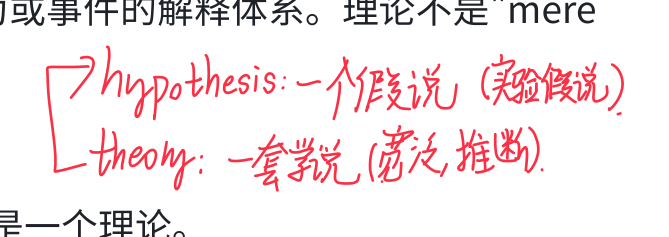

<!-- Source: page 6 -->

  - Hypothesis = 具体的、可检验的预测（如"每天跑步 30 分钟持续两周的人，抑郁评分会下降"）

  - 理论不能直接被检验，必须转化为假设才能验证。

### 8. Operational Definition（操作定义） ⭐

- English Definition: A carefully worded statement of the exact procedures (operations) used in a research study. It defines abstract variables in concrete, measurable terms.

- 中文释义： 对研究中使用的具体程序（操作）的精确、清晰的陈述。它把抽象的概念转化为可以测量的具体指标。

- 📝 Example/Key Point：

  - 例子：人类智力可以被操作定义为"智力测试所测量的东西"。

  - 例子："饥饿"可以被操作定义为"距离上次进食的小时数"；"睡眠剥夺"可以被操作定义为"睡眠时间 ≤ 4 小时"。

  - ⭐ 考试重点： 操作定义是 replication（重复）的前提——只有当别人知道你具体是怎么测量的，他们才能重复你的研究。

  - FRQ 高频考点！题目给你一个研究场景，让你写出某个变量的 operational definition。

### 9. Replication（重复/复制） ⭐

- English Definition: Repeating the essence of a research study, usually with different participants in different situations, to see whether the basic finding extends to other participants and circumstances.

- 中文释义： 重复研究的核心部分，通常使用不同的参与者、在不同的情境下，看基本发现是否适用于其他人群和环境。

- 📝 Example/Key Point：

  - ⭐ 考试重点： Replication 是科学可信度的基石。如果一个研究结果无法被重复，它就不可靠。

  - 没有清晰的 operational definition，就无法进行 replication。

  - 注意：Replication ≠ 一模一样地复制；而是重复"essence"（核心）。

### 10. Case Study（个案研究）

- English Definition: A descriptive technique in which one individual or group is studied in depth in the hope of revealing universal principles.

#### 本页手写批注

<!-- Handwritten annotation: p06-01 -->

**原位置：8. Operational Definition 例子上方，红笔。**

> abstract → quantify。

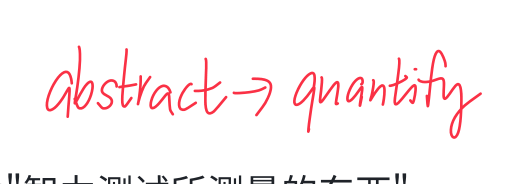

<!-- Source: page 7 -->

- 中文释义： 一种描述性研究技术，深入研究一个个体或一个小组，期望从中揭示普遍性的原则。

- 📝 Example/Key Point：

  - 经典例子：Phineas Gage 的脑损伤研究——通过他一个人的案例，揭示了额叶在人格和决策中的作用。

  - ⭐ 优点： 提供深入、丰富的细节；可以研究罕见现象。

  - ⭐ 缺点： 研究的是 atypical（非典型的）个体，可能无法推广到总体；单一个案可能具有误导性。

  - 关键局限：无法辨别 general truths（普遍真理），因为样本只有一个。

### 11. Naturalistic Observation（自然观察法）

- English Definition: Observing and recording behavior in naturally occurring situations without trying to manipulate and control the situation.

- 中文释义： 在自然发生的情境中观察和记录行为，不试图操纵或控制情境。

- 📝 Example/Key Point：

  - 例子：在动物园观察黑猩猩的社会行为；在教室里记录学生的互动模式。

  - ⭐ 核心特点： 只描述行为（describes behavior），不解释行为（does not explain behavior）。

  - 优点：研究行为在自然环境中的真实表现，生态效度高。

  - 缺点：无法控制变量，无法确定因果关系。

### 12. Survey（调查法）

- English Definition: A technique for ascertaining the self-reported attitudes or behaviors of a particular group, usually by questioning a representative, random sample of the group.

- 中文释义： 通过询问一个有代表性的随机样本，来了解某一特定群体的自我报告态度或行为的技术。

- 📝 Example/Key Point：

  - ⭐ Word Effects（措辞效应）： 问题的措辞会显著影响回答。例如："禁止香烟广告" vs "不允许香烟广告"——前者听起来更负面。

  - 调查法的关键在于样本质量。

  - 优点：可以同时研究大量案例；快速、经济。

  - 缺点：依赖自我报告，可能存在社会期望偏差。

<!-- Source: page 8 -->

### 13. Sampling Bias（抽样偏差） ⭐

- English Definition: A flawed sampling process that produces an unrepresentative sample.

- 中文释义： 有缺陷的抽样过程，导致样本不能代表目标总体。

- 📝 Example/Key Point：

  - 经典例子：1936 年《文学文摘》（Literary Digest）总统大选民意测验——他们从电话簿和汽车登记册中抽样，结果偏向富裕人群，错误地预测 Landon 会击败 Roosevelt。

  - ⭐ 考试重点： 抽样偏差意味着你的样本不能代表总体，研究结果就不能推广。

  - 与 Random Sample 对比：Random Sample 是解决方案，Sampling Bias 是问题。

### 14. Population（总体）

- English Definition: All the cases in a group being studied, from which samples may be drawn.

- 中文释义： 被研究群体中的所有个体，可以从中抽取样本。

- 📝 Example/Key Point：

  - ⭐ 重要提醒： Population 不一定指"全国人口"！它指的是你研究的目标群体。如果你研究的是你学校的学生，那 population 就是你学校的全体学生。

  - Sample（样本）是从 population 中抽取的一部分。

### 15. Random Sample（随机样本） ⭐

- English Definition: A sample that fairly represents a population because each member has an equal chance of inclusion.

- 中文释义： 因为总体中的每个成员都有同等的被选中机会，所以这个样本能够公平地代表总体。

- 📝 Example/Key Point：

  - ⭐ 考试重点： Random sample = 每个人被选中的概率相等。

  - Random Sample vs. Random Assignment（极易混淆！）：

|  | Random Sample 随机抽样 | Random Assignment 随机分配 |
| --- | --- | --- |
| 作用阶段 | 研究开始前，选择参与者 | 实验中，把参与者分组 |
| 目的 | 让样本代表总体 | 让实验组和控制组相等 |
| 用于 | 描述性/调查研究 | 实验研究 |

#### 本页手写批注

<!-- Handwritten annotation: p08-01 -->

**原位置：13. Sampling Bias 标题右侧，红笔。**

> 结果有明显倾向，不随机。

<!-- Handwritten annotation: p08-02 -->

**原位置：15. Random Sample 释义右下，红笔。**

> Random sample：实验开始前。Random assignment：实验后随机分。

<!-- Source: page 9 -->

  - 不要搞混！选择题常考这两个的区别。

## Module 6: Correlation and Experimentation 相关与实验

### 16. Correlation（相关）

- English Definition: A measure of the extent to which two factors change together, and thus of how well either factor predicts the other.

- 中文释义： 衡量两个因素共同变化的程度，以及一个因素能多好地预测另一个因素的指标。

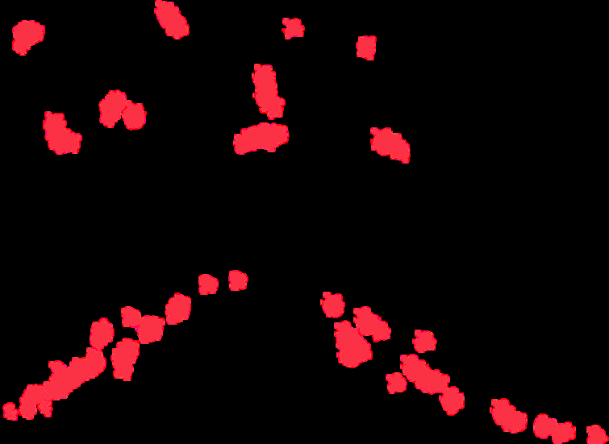

- 📝 Example/Key Point：

  - ⭐ 核心功能： Correlation helps predict（相关有助于预测），但 does NOT imply cause and effect（不意味着因果关系）。

  - 正相关（Positive Correlation）：两个变量同增同减（如身高和体重）。

  - 负相关（Negative Correlation）：一个增加另一个减少（如学习时间和考试错误数）。

### 17. Correlation Coefficient（相关系数） ⭐

- English Definition: A statistical index of the relationship between two things, ranging from -1.0 to +1.0.

- 中文释义： 衡量两个变量之间关系的统计指标，范围从 -1.0 到 +1.0。

- 📝 Example/Key Point：

  - ⭐ 考试重点：

    - +1.0 = 完全正相关（perfect positive correlation）

    - -1.0 = 完全负相关（perfect negative correlation）

    - 0.0 = 完全无关（no relationship）

    - 绝对值越大，相关越强（|0.8| 比 |0.3| 强）

  - 注意：符号只表示方向（正/负），绝对值才表示强度！

  - r = -0.90 比 r = +0.50 的相关更强。

### 18. Scatterplot（散点图） ⭐

#### 本页手写批注

<!-- Handwritten annotation: p09-01 -->

**原位置：16. Correlation 右侧，三幅手绘散点图。**

> 上图为无明显趋势的散点，标注“No correlation”；左下图散点由左下向右上，标注“Positive”；右下图散点由左上向右下，标注“Negative”。

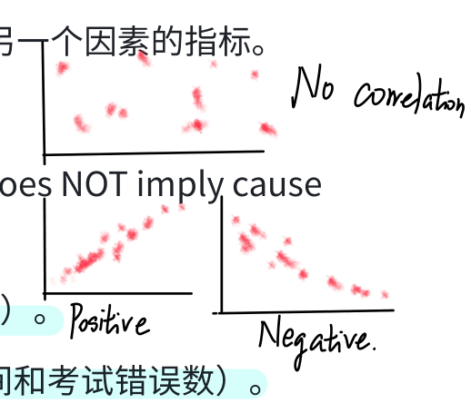

<!-- Source: page 10 -->

- English Definition: A graphed cluster of dots, each of which represents the values of two variables. The slope suggests the direction of the relationship; the amount of scatter suggests the strength of the correlation.

- 中文释义： 由点组成的图，每个点代表两个变量的值。点的斜率表示关系的方向；点的分散程度表示相关的强度。

- 📝 Example/Key Point：

  - ⭐ 考试重点：

    - 点从左下到右上 = 正相关（Positive Correlation）

    - 点从左上到右下 = 负相关（Negative Correlation）

    - 点越集中成线 = 相关越强（little scatter = high correlation）

    - 点越分散 = 相关越弱

  - 散点图可以直观判断相关的方向和强度。

### 19. Illusory Correlation（错觉相关） ⭐

- English Definition: The perception of a relationship where none exists; perceiving a random coincidence as a meaningful correlation.

- 中文释义： 在不存在关系的地方感知到关系；把随机的巧合误认为是有意义的相关。

- 📝 Example/Key Point：

  - 经典例子：想领养孩子的夫妇在领养后更容易怀孕——这其实是随机巧合，但人们"看到"了联系。

  - 我们之所以产生错觉相关，是因为我们更容易记住"确认证据"（confirming evidence），而忽略"不确认证据"。

  - ⭐ 考试重点： Illusory Correlation 是"我们在随机事件中感知秩序"倾向的具体表现。

  - 例子：觉得"戴幸运袜就会考好"——其实是错觉相关。

### 20. Correlation and Causation（相关与因果） ⭐⭐

- English Definition: Correlation indicates the possibility of a cause-effect relationship but does not prove such. Correlation helps predict but does not imply causation.

- 中文释义： 相关表明可能存在因果关系，但不能证明因果关系。相关有助于预测，但不意味着因果。

- 📝 Example/Key Point：

  - ⭐⭐ 超级高频考点！ 这是整个 Unit 2 最重要的概念之一。

#### 本页手写批注

<!-- Handwritten annotation: p10-01 -->

**原位置：19. Illusory Correlation 的领养后怀孕例子下方。**

> 根本没有关联，一次偶然就让人看到了希望。

<!-- Source: page 11 -->

  - 经典例子：低自尊（low self-esteem）和抑郁（depression）正相关。但到底谁导致谁？有三种可能：

  - i. 低自尊 → 导致抑郁

  - ii. 抑郁 → 导致低自尊

  - iii. 第三个变量（如压力事件或生物易感性）→ 同时导致低自尊和抑郁

  - 只有实验（Experiment）能确定因果关系。

### 21. Experiment（实验） ⭐

- English Definition: A research method in which an investigator manipulates one or more factors (independent variables) to observe the effect on some behavior or mental process (the dependent variable). By random assignment of participants, the experimenter aims to control other relevant factors.

- 中文释义： 研究者操纵一个或多个因素（自变量），观察其对某种行为或心理过程（因变量）的影响。通过随机分配参与者，实验者控制其他相关因素。

- 📝 Example/Key Point：

  - ⭐ 实验法的核心特征：

  - i. 操纵自变量（Manipulation）

  - ii. 控制其他变量（Control）

  - iii. 随机分配（Random Assignment）

  - 只有实验法能确定因果关系！ 描述法和相关法都不能。

### 22. Experimental Group（实验组）

- English Definition: In an experiment, the group that is exposed to the treatment, that is, to one version of the independent variable.

- 中文释义： 在实验中，接受处理（即接触自变量的某个版本）的那一组。

- 📝 Example/Key Point：

  - 例子：在一个测试新药的实验中，服用新药的那组就是实验组。

  - 在母乳喂养的研究中，"被鼓励母乳喂养"的那组是实验组。

### 23. Control Group（控制组）

#### 本页手写批注

<!-- Handwritten annotation: p11-01 -->

**原位置：20. Correlation and Causation 续文、“只有实验……”右侧。**

> Correlation 没有因果关系 indication。

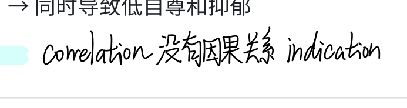

<!-- Handwritten annotation: p11-02 -->

**原位置：22. Experimental Group 的母乳喂养例子右侧。**

> 相对的就是不要 breast feeding。

<!-- Source: page 12 -->

- English Definition: In an experiment, the group that is NOT exposed to the treatment; contrasts with the experimental group and serves as a comparison for evaluating the effect of the treatment.

- 中文释义： 在实验中，不接受处理的那一组。它与实验组形成对比，作为评估处理效果的参照。

- 📝 Example/Key Point：

  - ⭐ Experimental Group vs. Control Group 对比：

    - 实验组 = 接受 treatment（处理）

    - 控制组 = 不接受 treatment，作为 baseline（基线）对比

  - 在母乳喂养研究中，"不被鼓励母乳喂养"的那组是控制组。

  - 控制组通常服用安慰剂（placebo）而不是完全不接受任何处理，以控制安慰剂效应。

### 24. Random Assignment（随机分配） ⭐⭐

- English Definition: Assigning participants to experimental and control groups by chance, thus minimizing preexisting differences between those assigned to the different groups.

- 中文释义： 通过随机方式将参与者分配到实验组和控制组，从而最大程度地减少两组之间预先存在的差异。

- 📝 Example/Key Point：

  - ⭐⭐ 考试重点：

    - Random Assignment = 实验中分组的随机化

    - 它的作用是消除备选解释（eliminates alternative explanations）

    - 它让两组在所有混淆变量上均等（equalizes the two groups）

    - 它减少混淆变量的影响（reduces the influence of confounding variables）

  - 再次强调：Random Assignment ≠ Random Sample！

    - Random Sample = 选人的过程（让样本代表总体）

    - Random Assignment = 分组的过程（让两组相等）

### 25. Double-Blind Procedure（双盲程序） ⭐

- English Definition: An experimental procedure in which both the research participants and the research staff are ignorant (blind) about whether the research participants have received the treatment or the placebo. Commonly used in drug-evaluation studies.

#### 本页手写批注

<!-- Handwritten annotation: p12-01 -->

**原位置：23. Control Group 右侧，placebo 说明。**

> placebo：把药 switch 成糖，让 patients 吃，patient 也会觉得被医治了。

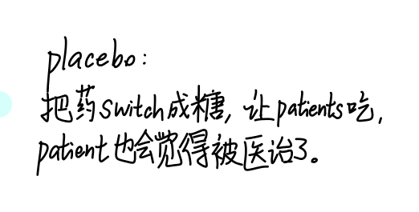

<!-- Source: page 13 -->

- 中文释义： 一种实验程序，其中研究参与者和研究人员双方都不知道参与者接受的是处理还是安慰剂。常用于药物评估研究。

- 📝 Example/Key Point：

  - ⭐ Single-Blind vs. Double-Blind：

    - Single-Blind：参与者不知道自己在实验组还是控制组

    - Double-Blind：参与者 和 实验人员都不知道

  - 双盲的目的：防止实验者期望效应（experimenter bias）和参与者的安慰剂效应影响结果。

### 26. Placebo Effect（安慰剂效应） ⭐

- English Definition: Experimental results caused by expectations alone; any effect on behavior caused by the administration of an inert substance or condition, which the recipient assumes is an active agent. Latin for "I shall please."

- 中文释义： 仅仅由期望所导致的实验结果；接受者以为自己得到了有效药物或处理，但实际上只是惰性物质或条件，却因此产生了行为改变。

- 📝 Example/Key Point：

  - 例子：给病人一颗糖丸，告诉他是止痛药，结果他真的感到疼痛减轻了——这就是安慰剂效应。

  - ⭐ 为什么需要控制组和双盲程序？就是为了分离出安慰剂效应的影响。

  - Placebo 的拉丁语意思是"我会取悦"（I shall please）。

### 27. Independent Variable（自变量） ⭐⭐

- English Definition: The experimental factor that is manipulated; the variable whose effect is being studied.

- 中文释义： 实验中被操纵的因素；其效果正在被研究的变量。

- 📝 Example/Key Point：

  - ⭐⭐ FRQ 超级高频考点！ 你必须能在具体研究中识别出自变量。

  - 记忆技巧：Independent variable = what I manipulate（我操纵的变量）

  - 例子：在母乳喂养研究中，自变量是"是否被鼓励母乳喂养"。

  - 自变量是研究者主动改变的那个变量。

### 28. Confounding Variable（混淆变量） ⭐

#### 本页手写批注

<!-- Handwritten annotation: p13-01 -->

**原位置：25. Double-Blind Procedure 对照条目右侧，带箭头。**

> 消除 experimental bias，placebo effect。箭头关联单盲/双盲对照区。

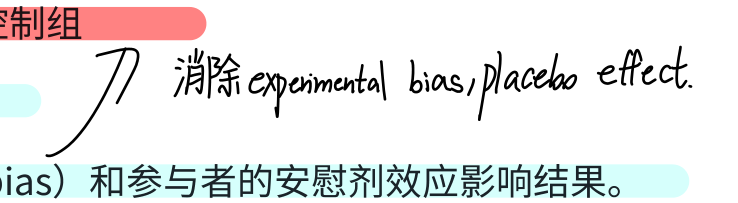

<!-- Handwritten annotation: p13-02 -->

**原位置：27. Independent Variable 标题右侧及红色箭头。**

> X → 自变量；y → 因变量。红色箭头指向自变量记号。

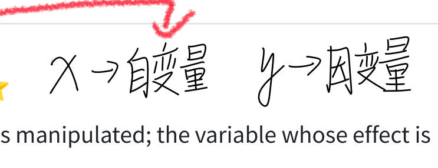

<!-- Handwritten annotation: p13-03 -->

**原位置：28. Confounding Variable 页脚附近，手绘分支。**

> 熬夜学习，第2天考试成绩很理想 → 前天晚上摄入咖啡因；另一下分支为“睡眠剥夺”；两项旁用括线合到“confounding variable”。

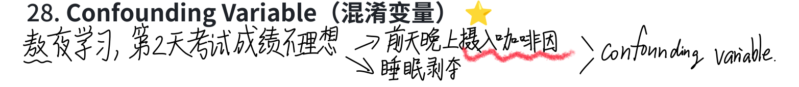

<!-- Source: page 14 -->

- English Definition: A factor other than the independent variable that might produce an effect in an experiment.

- 中文释义： 除自变量之外，可能在实验中产生影响的其他因素。

- 📝 Example/Key Point：

  - 例子：在母乳喂养研究中，父母的智力和家庭环境就是混淆变量——它们可能同时影响母乳喂养和孩子的智力。

  - ⭐ Random Assignment 的作用就是平衡这些混淆变量，让两组在混淆变量上大致相等。

  - 如果混淆变量没有被控制，你就无法确定结果是由自变量引起的，还是由混淆变量引起的。

### 29. Dependent Variable（因变量） ⭐⭐

- English Definition: The outcome factor; the variable that may change in response to manipulations of the independent variable.

- 中文释义： 结果因素；可能随着自变量的操纵而变化的变量。它是被测量的那个变量。

- 📝 Example/Key Point：

  - ⭐⭐ FRQ 超级高频考点！

  - 记忆技巧：Dependent variable = what is being measured（被测量的变量）；它"依赖"于自变量的变化。

  - 例子：在母乳喂养研究中，因变量是"6 岁时的智力测试分数"。

  - Independent vs. Dependent Variable 对比：

| Independent Variable（自变量） | Dependent Variable（因变量） |
| --- | --- |
| 被操纵、被改变 | 被测量、被观察 |
| 原因（推测的） | 结果（观测的） |
| "我改变什么" | "我测量什么" |

### 30. Validity（效度）

- English Definition: The extent to which a test or experiment measures or predicts what it is supposed to.

- 中文释义： 一个测试或实验能够测量或预测其应该测量/预测的内容的程度。

- 📝 Example/Key Point：

#### 本页手写批注

<!-- Handwritten annotation: p14-01 -->

**原位置：29. Dependent Variable 标题右侧。**

> y → 因变量。

<!-- Handwritten annotation: p14-02 -->

**原位置：30. Validity 页脚，与下一页圈注配合。**

> 无关联。

<!-- Source: page 15 -->

  - 如果一个"智力测试"实际上测的是阅读速度，那它就没有效度。

  - 实验的效度：实验结果是否真正反映了自变量对因变量的影响，而不是混淆变量的影响。

## Module 7: Statistical Reasoning in Everyday Life 统计推理

### 31. Descriptive Statistics（描述统计）

- English Definition: Numerical data used to measure and describe characteristics of groups. Includes measures of central tendency and measures of variation.

- 中文释义： 用于测量和描述群体特征的数值数据。包括集中趋势的测量和变异程度的测量。

- 📝 Example/Key Point：

  - 描述统计 = 总结和描述数据"长什么样"

  - 主要包括：

    - Measures of Central Tendency（集中趋势）：Mean, Median, Mode

    - Measures of Variability（变异性）：Range, Standard Deviation

### 32. Histogram（直方图）

- English Definition: A bar graph depicting a frequency distribution.

- 中文释义： 展示频数分布的柱状图。

- 📝 Example/Key Point：

  - ⭐ 考试重点： 图表的纵轴刻度可以被操纵来夸大或缩小差异。

  - 例子：汽车广告中，把纵轴从 95% 开始画，会让品牌 A 看起来比其他品牌好很多；但如果纵轴从 0% 开始，差异就很小。

  - 看图表时要注意：纵轴的起点是多少？刻度是否被截断了？

### 33. Mode（众数）

- English Definition: The most frequently occurring score(s) in a distribution.

- 中文释义： 在一组数据中出现次数最多的那个分数。

- 📝 Example/Key Point：

  - 例子：考试分数 [60, 70, 70, 80, 85, 90, 90, 90, 100]，众数是 90。

#### 本页手写批注

<!-- Handwritten annotation: p15-01 -->

**原位置：30. Validity 的“智力测试实际测阅读速度”例子。**

> “智力测试”与“阅读速度”被分别圈出并用两条线关联；红字“无效”。与第14页页脚“无关联”配合。

<!-- Source: page 16 -->

  - 是最简单的集中趋势指标，但可能不唯一（可以有多个众数）。

### 34. Mean（平均数）

- English Definition: The arithmetic average of a distribution, obtained by adding the scores and then dividing by the number of scores.

- 中文释义： 一组数据的算术平均值，通过把所有分数相加再除以分数个数得到。

- 📝 Example/Key Point：

  - ⭐ 考试重点： Mean 对极端值（extreme scores）非常敏感！

  - 例子：一个班级 9 个学生每人年收入 4 万，加上比尔·盖茨年收入 10 亿——平均收入会被拉高到接近 1 亿，但这不能代表"典型"学生的收入。

  - 这就是为什么在偏态分布中，Median 比 Mean 更能代表典型值。

### 35. Median（中数/中位数）

- English Definition: The middle score in a distribution; half the scores are above it and half are below it.

- 中文释义： 一组数据中位于中间位置的分数；一半的分数在它之上，一半在它之下。

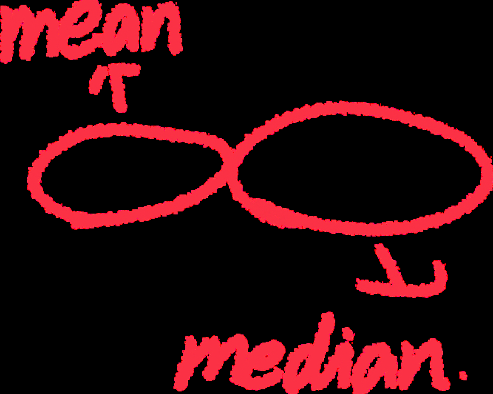

- 📝 Example/Key Point：

  - ⭐ Mean vs. Median 对比：

    - 对称分布（如正态分布）：Mean ≈ Median ≈ Mode

    - 偏态分布（如收入分布）：Mean 被极端值拉偏，Median 更能代表"典型"

  - 例子：家庭收入数据中，少数超级富豪会把 Mean 拉高，但 Median 更能反映普通家庭的收入水平。

### 36. Skewed Distribution（偏态分布）

- English Definition: A representation of scores that lack symmetry around their average value.

- 中文释义： 数据分布在平均值周围缺乏对称性的情况。

- 📝 Example/Key Point：

  - ⭐ 考试重点：

    - 正偏态（Positive Skew / 右偏）：长尾在右边（高分端），Mean > Median > Mode。例： 收入分布。

#### 本页手写批注

<!-- Handwritten annotation: p16-01 -->

**原位置：34. Mean 例子右侧，红笔。**

> mean 容易有极高与极低值影响。

<!-- Handwritten annotation: p16-02 -->

**原位置：35. Median 对照区，手绘收入轴与红笔标签。**

> “收入轴”箭头指向一条横轴，依次标 1000、3000、5000、8000–10000、10万；3000 附近有密集竖线，8000–10000 区段有波浪线。红色 mean 标签及箭头位于 3000 一带；红色 median 标签以弯箭头关联右侧 8000–10000 区段。按图保留标注位置，不代作者修正。

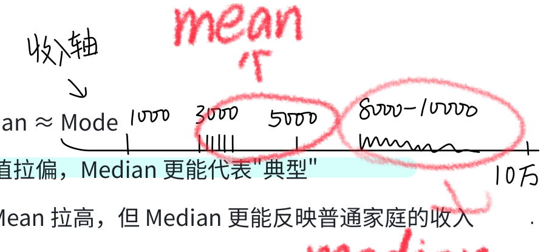

<!-- Source: page 17 -->

  - 负偏态（Negative Skew / 左偏）：长尾在左边（低分端），Mean < Median < Mode。 例：非常简单的考试分数。

  - 在偏态分布中，Median 是最好的集中趋势指标。

### 37. Range（全距/极差）

- English Definition: The difference between the highest and lowest score in a distribution.

- 中文释义： 一组数据中最高分和最低分之间的差值。

- 📝 Example/Key Point：

  - 计算简单：Range = Highest - Lowest

  - 缺点：只依赖两个极端值，不能反映中间数据的分布情况。

  - 例子：考试分数 [72, 74, 77, 79, 82, 84, 85, 87]，Range = 87 - 72 = 15。

### 38. Standard Deviation（标准差） ⭐⭐

- English Definition: A computed measure of how much scores vary around the mean score. Formula: √[Sum of (deviations)² / Number of scores]

- 中文释义： 计算出的衡量数据围绕平均数波动程度的指标。公式：√[（每个分数与均值的偏差）² 之和 ÷ 分数个数]

- 📝 Example/Key Point：

  - ⭐⭐ 考试重点： 标准差比平均数 alone 更能说明数据的分布情况。

  - 例子：A 班和 B 班的平均分都是 80，但：

    - A 班分数：72, 74, 77, 79, 82, 84, 85, 87 → SD ≈ 5.0（分数集中在均值附近）

    - B 班分数：60, 60, 70, 70, 90, 90, 100, 100 → SD ≈ 15.8（分数很分散）

  - ⭐ 标准差越大 = 数据越分散；标准差越小 = 数据越集中。

  - 计算步骤：① 求均值 → ② 每个分数减均值（deviation）→ ③ 平方 → ④ 求和 → ⑤ 除以个数 → ⑥ 开平方。

### 39. Normal Curve（正态曲线/钟形曲线） ⭐⭐

- English Definition: A symmetrical, bell-shaped curve that describes the distribution of many types of data; most scores fall near the mean (about 68 percent fall within one standard deviation of it) and fewer and fewer near the extremes. Also called Normal Distribution.

<!-- Source: page 18 -->

- 中文释义： 对称的、钟形的曲线，描述许多类型数据的分布。大多数分数落在均值附近（约 68% 落在均值上下一个标准差范围内），越往极端分数越少。

- 📝 Example/Key Point：

  - ⭐⭐ 考试重点（68-95-99.7 法则）：

    - 68% 的数据落在均值 ±1 个标准差范围内

    - 95% 的数据落在均值 ±2 个标准差范围内

    - 99.7% 的数据落在均值 ±3 个标准差范围内

  - 以 Wechsler 智力测试为例：均值 = 100，标准差 = 15

    - 68% 的人智商在 85–115 之间

  - 95% 的人智商在 70–130 之间

  - 各区间百分比：0.1% - 2% - 13.5% - 34% - 34% - 13.5% - 2% - 0.1%

### 40. Inferential Statistics（推论统计）

- English Definition: Numerical data that allow one to generalize — to infer from sample data the probability of something being true of a population.

- 中文释义： 让人们能够进行推广的数值数据——从样本数据推断某件事在总体中成立的概率。

- 📝 Example/Key Point：

  - Descriptive Statistics = 描述你手头的数据

  - Inferential Statistics = 从样本推广到总体

  - ⭐ 什么时候可以认为差异是可靠的（reliable）？

  - i. 代表性样本（representative samples）比有偏差的样本好

  - ii. 变异小的观察值（less-variable observations）比变异大的更可靠

  - iii. 样本量大（more cases）比样本量小好

### 41. Statistical Significance（统计显著性） ⭐

- English Definition: A statistical statement of how likely it is that an obtained result occurred by chance. In psychology, results are conventionally considered significant if the probability of occurring by chance is less than 5% (p < .05).

- 中文释义： 一个统计陈述，说明得到的结果由偶然因素导致的可能性有多大。在心理学中，如果结果由偶然发生的概率小于 5%（p < .05），就认为统计上显著。

- 📝 Example/Key Point：

#### 本页手写批注

<!-- Handwritten annotation: p18-01 -->

**原位置：39. Normal Curve 的68–95–99.7规则右侧。**

> → 严肃记住这2个数据!!!

<!-- Source: page 19 -->

  - ⭐ 考试重点： Statistical significance 意味着：

  - i. 两组的平均值是可靠的（the averages are reliable）

  - ii. 平均值之间的差异相对较大（the differences between averages is relatively large）

  - ⚠️ 注意： Statistical significance ≠ 结果的重要性（importance）！它只说明结果不太可能是偶然的。

  - p 值越小，结果越不可能是随机的。

## Module 8: Frequently Asked Questions About Psychology 心理学常见问题

### 42. Culture（文化）

- English Definition: The enduring behavior, ideas, attitudes, and traditions shared by a group of people and transmitted from one generation to the next.

- 中文释义： 一个群体共享的、世代相传的持久行为、观念、态度和传统。

- 📝 Example/Key Point：

  - 文化会影响行为的表达形式，但许多基本的心理过程是跨文化普遍存在的。

  - 实验室实验的简化条件之所以有价值，是因为它们揭示的是普遍的原则（principles），而不是具体的研究发现（findings）。

### 43. Informed Consent（知情同意） ⭐

- English Definition: An ethical principle that research participants be told enough to enable them to choose whether they wish to participate.

- 中文释义： 一项伦理原则，要求告知研究参与者足够的信息，使他们能够自主选择是否愿意参与研究。

- 📝 Example/Key Point：

  - ⭐ 人类研究伦理的四大原则：

  - i. Informed Consent（知情同意）——参与者在充分了解后自愿同意参与

  - ii. Protect from harm and discomfort（保护免受伤害和不适）

  - iii. Maintain confidentiality（保密）——保护参与者的个人信息

  - iv. Debriefing（事后解释/汇报）——研究结束后向参与者说明研究目的和任何欺骗

<!-- Source: page 20 -->

### 44. Debriefing（事后解释/汇报） ⭐

- English Definition: The postexperimental explanation of a study, including its purpose and any deceptions, to its participants.

- 中文释义： 实验结束后向参与者详细说明研究的全貌，包括研究目的以及任何欺骗性的安排。

- 📝 Example/Key Point：

  - 如果研究中使用了欺骗（deception），事后必须 debrief 参与者。

  - Debriefing 是研究伦理的重要环节，确保参与者离开时对研究有完整理解。

## 🔥 易混淆概念对比总结

### 1. Hindsight Bias vs. Overconfidence

| Hindsight Bias 后见之明 | Overconfidence 过度自信 |
| --- | --- |
| "我早就知道了"（事后） | "我肯定能行"（事前） |
| 在知道结果后觉得自己预见到了 | 在做事之前高估自己的能力 |

### 2. Theory vs. Hypothesis

| Theory 理论 | Hypothesis 假设 |
| --- | --- |
| 宽泛的解释体系 | 具体的可检验预测 |
| 组织观察、指导研究 | 可以被证实或证伪 |
| "睡眠增强记忆" | "睡眠剥夺后记忆测试分数下降" |

### 3. Random Sample vs. Random Assignment ⭐⭐

| Random Sample 随机抽样 | Random Assignment 随机分配 |
| --- | --- |
| 研究开始前选人的过程 | 实验中分组的过程 |
| 让样本代表总体 | 让实验组和控制组相等 |
| 用于调查/描述性研究 | 用于实验研究 |

<!-- Source: page 21 -->

### 4. Correlation vs. Causation ⭐⭐

| Correlation 相关 | Causation 因果 |
| --- | --- |
| 两个变量一起变化 | 一个变量导致另一个变化 |
| 可以预测 | 可以解释为什么 |
| 相关 ≠ 因果！ | 只有实验能确定因果 |

### 5. Independent Variable vs. Dependent Variable ⭐⭐

| Independent Variable 自变量 | Dependent Variable 因变量 |
| --- | --- |
| 被研究者操纵/改变 | 被研究者测量/观察 |
| 推测的原因 | 观测的结果 |
| "我改变什么？" | "我测量什么？" |

### 6. Experimental Group vs. Control Group

| Experimental Group 实验组 | Control Group 控制组 |
| --- | --- |
| 接受处理（treatment） | 不接受处理 |
| 接触自变量的某个水平 | 作为基线对比 |

### 7. Mean vs. Median vs. Mode

| Mean 平均数 | Median 中数 | Mode 众数 |
| --- | --- | --- |
| 算术平均 | 中间值 | 最频繁值 |
| 对极端值敏感 | 不受极端值影响 | 最简单但可能不唯一 |
| 对称分布中最常用 | 偏态分布中最可靠 | 适用于类别数据 |

### 8. Single-Blind vs. Double-Blind

| Single-Blind 单盲 | Double-Blind 双盲 |
| --- | --- |

<!-- Source: page 22 -->

| Single-Blind 单盲 | Double-Blind 双盲 |
| --- | --- |
| 参与者不知道分组 | 参与者和实验者都不知道分组 |
| 控制参与者期望 | 同时控制参与者和实验者的期望 |

## 📊 研究方法对比总表

| 研究方法 | 基本目的 | 如何进行 | 操纵什么 | 优点 | 缺点 |
| --- | --- | --- | --- | --- | --- |
| Descriptive 描述法 | 观察和记录行为 | 个案研究、自然观察、调查 | 什么都不操纵 | 个案只需一个参与者；自然观察在不能操纵变量时可用；调查快速经济 | 变量不受控，无法确定因果；单一个案可能误导 |
| Correlational 相关法 | 发现自然存在的关系；评估一个变量能多好地预测另一个 | 收集两个或更多变量的数据；不做操纵 | 什么都不操纵 | 可处理大量数据；在实验不合伦理或不可行时使用 | 不能确定因果关系 |
| Experimental 实验法 | 探索因果关系 | 操纵一个或多个变量；使用随机分配 | 自变量 | 确定因果关系；变量被控制 | 有时不可行；结果可能不能推广到其他情境；操纵某些变量不合伦理 |

## ⭐ 考试高频考点清单（FRQ 常考）

1. 识别研究方法：给一个研究场景，判断是 case study / naturalistic observation / survey /correlation / experiment

2. 识别变量：在实验中找出 IV、DV、confounding variable

3. 识别分组：实验组 vs. 控制组

4. 解释为何需要实验：correlation doesn't prove causation

5. 解释 operational definition 的重要性：如何让研究可重复

6. 解释 random assignment 的作用：平衡混淆变量

7. 解释 placebo effect 和 double-blind 的关系

8. 描述统计 vs. 推论统计的区别

<!-- Source: page 23 -->

9. 正态曲线的 68-95-99.7 法则

10. 研究伦理：informed consent, debriefing, confidentiality

复习建议： Unit 2 的概念之间联系非常紧密，建议把整个科学研究流程串起来记：

Theory → Hypothesis → Operational Definition → Research (Descriptive/Correlational/Experimental) → Results (Descriptive Statistics) → Conclusions (Inferential Statistics, Statistical Significance) → Revise Theory

理解这个循环，所有概念就都串起来了！

# AP Psychology — Unit 3: Biological Bases of Behavior 生物基础 复习笔记

来源：Myers' Psychology for AP® (2e), Unit 3 / Modules 9–15

结构：Module 9 神经传递 → Module 10 神经与内分泌系统 → Module 11 脑研究与旧脑结构 → Module 12 大脑皮层 → Module 13 大脑半球与意识 → Module 14 行为遗传学 → Module 15 进化心理学

标记说明：⭐ = AP考试高频考点；⚠️ = 易混淆概念对比

## Module 9: Biological Psychology and Neurotransmission 生物心理学与神经传递

### 1. Phrenology 颅相学

- English Definition: A now-defunct theory developed by Franz Gall in the early 1800s that claimed bumps on the skull could reveal mental abilities and character traits.

- 中文释义: 由Franz Gall在1800年代初提出的、现已被否定的理论，认为颅骨上的隆起可以反映人的心理能力与性格特征。

- 📝 Key Point: 虽然颅相学本身是错的，但它提醒了后人"脑的特定部位可能对应特定功能"这一思路。考试常考它是 Gall 提出、属于历史错误理论。⭐

### 2. Biological Psychology 生物心理学

- English Definition: The scientific study of the links between biological (genetic, neural, hormonal) and psychological processes.

- 中文释义: 研究生物因素（基因、神经、激素）与心理过程之间联系的科学。

#### 本页手写批注

<!-- Handwritten annotation: p23-01 -->

**原位置：1. Phrenology 标题右侧。**

> 错误理论！引出了人类对于脑子不同地方不同事的思考。

<!-- Handwritten annotation: p23-02 -->

**原位置：2. Biological Psychology 标题右侧。**

> 故名思义。

<!-- Source: page 24 -->

- 📝 Key Point: 别名包括 behavioral neuroscientist、neuropsychologist、behavior geneticist、 physiological psychologist、biopsychologist。核心信条："一切心理活动同时也是神经活动 （everything psychological is simultaneously biological）"。

### 3. Biopsychosocial Systems 生物-心理-社会系统

- English Definition: The idea that biological, psychological, and social-cultural factors operate together within a larger system, and that the whole is understood by studying its smaller parts in interaction.

- 中文释义: 认为生物、心理、社会文化因素在一个更大的系统中共同作用，需通过研究各部分的相互作用来理解整体。

- 📝 Key Point: 强调"由更小的组件构成、又反过来影响组件"的层级观——人体是从细胞→神经→ 脑→人→群体的多层系统。

### 4. Neuron 神经元

- English Definition: A nerve cell; the basic building block of the nervous system.

- 中文释义: 神经细胞；神经系统的基本结构与功能单位。

- 📝 Key Point: 全身约有860亿个神经元。理解神经元要按"接收→整合→传递"的方向记。⭐

### 5. Cell Body (Soma) 细胞体

- English Definition: The part of the neuron that contains the nucleus; the cell's life-support center.

- 中文释义: 神经元包含细胞核的部分，是细胞的生命维持中心。

- 📝 Key Point: 接收来自树突的信号，决定是否"放电"。

### 6. Dendrites 树突 ⭐

- English Definition: A neuron's bushy, branching extensions that receive messages and conduct impulses toward the cell body.

- 中文释义: 神经元茂密、分支状的延伸，负责接收信息并把冲动传向细胞体。

- 📝 Key Point: 记忆口诀——"Dendrites listen（接收）, Axon speak（发送）"。树突短而多分支；轴突长而少。AP常考二者功能方向的区分。⚠️

### 7. Axon 轴突 ⭐

- English Definition: The neuron extension that passes messages through its branches to other neurons or to muscles or glands.

- 中文释义: 神经元的长延伸，通过其分支把信息传递给其他神经元、肌肉或腺体。

#### 本页手写批注

<!-- Handwritten annotation: p24-01 -->

**原位置：5. Cell Body (Soma) 至6. Dendrites 旁的多色神经元手绘图。**

> 图中蓝字“轴突 axon.”以弯线指向向右延伸的长突起；紫字“dendrites”旁有黑字“（接收信息）”，紫色箭头指向树枝状突起。图包含胞体中心点、多条树枝状突起及突起内的箭头、向右延伸轴突、轴突上两个红色框、末端点状标记。

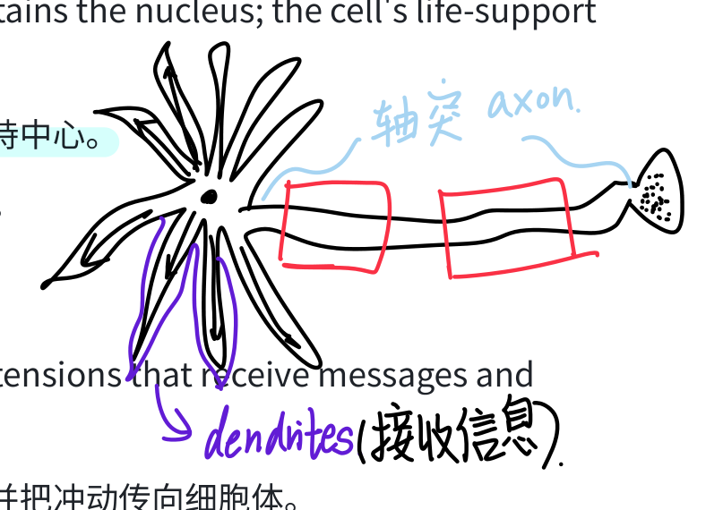

<!-- Source: page 25 -->

- 📝 Key Point: 轴突末端即 terminal buttons（突触小体/终扣），负责释放神经递质。轴突可长达数英尺（如脊髓到脚趾）。

### 8. Myelin Sheath 髓鞘 ⭐

- English Definition: A layer of fatty tissue segmentally encasing the axons of some neurons; enables vastly greater transmission speed as neural impulses hop from one sausage-like node to the next (saltatory conduction).

- 中文释义: 包裹在某些神经元轴突外的一层脂肪性组织，呈节段状；神经冲动在一个个"香肠状"节点间跳跃传导，从而大大提高传导速度（跳跃式传导）。

- 📝 Key Point: 由 glial cells（胶质细胞）构成。髓鞘在25岁左右才完全成熟。节点间的空隙叫 nodes of Ranvier。⭐

### 9. Multiple Sclerosis (MS) 多发性硬化症

- English Definition: A disease in which the myelin sheath degenerates, causing communication to muscles to slow and eventually leading to loss of muscle control.

- 中文释义: 髓鞘退化导致的疾病，神经与肌肉间的信息传递变慢，最终丧失肌肉控制能力。

- 📝 Key Point: 直接对应"髓鞘功能"考点——髓鞘损坏→传导变慢/中断。

### 10. Action Potential 动作电位 ⭐⭐

- English Definition: A neural impulse; a brief electrical charge that travels down an axon.

- 中文释义: 神经冲动；沿轴突传导的一次短暂电荷。

- 📝 Key Point: 本质是 Na⁺/K⁺ 离子跨膜流动造成的电位变化。神经元冲动速度范围约 2–180 MPH，以毫秒（千分之一秒）计。考试必考。⭐⭐

### 11. Resting Potential 静息电位

- English Definition: The state of a neuron when it is "polarized" and waiting to fire; the fluid interior of a resting axon carries mostly negatively charged ions, while the outside has mostly positively charged ions.

- 中文释义: 神经元处于"极化"、等待放电的状态；静息轴突内部主要带负离子、外部主要带正离子。

- 📝 Key Point: 像一根"充好电"的电池。内负外正。⚠️ 与 action potential（内正外负、去极化） 对比记忆。

### 12. Selectively Permeable 选择性通透

- English Definition: The axon's surface is selective about what it allows through its gates; it will not easily let positively charged sodium ions in when resting.

#### 本页手写批注

<!-- Handwritten annotation: p25-01 -->

**原位置：9. Multiple Sclerosis (MS) 标题右侧，浅蓝手写。**

> → myelin shealth 出问题了。

<!-- Source: page 26 -->

- 中文释义: 轴突膜对进出物质有选择性；静息时不让带正电的钠离子轻易进入。

- 📝 Key Point: 轴突膜是一道"有闸门的门"。

### 13. Depolarize 去极化

- English Definition: The process during the action potential when sodium gates open, allowing Na⁺ ions to rush in, making the inside of the axon temporarily more positive and causing the next channel to open (like a row of dominoes).

- 中文释义: 动作电位发生时钠闸门打开，Na⁺涌入，使轴突内部短暂变正，并引发下一个闸门依次打开（像多米诺骨牌）。

- 📝 Key Point: 去极化 = 由"内负外正"变成"内正外负"。

### 14. Refractory Period 不应期 ⭐

- English Definition: A period of inactivity after a neuron has fired; during this time the neuron pumps positively charged sodium ions back out, ready to fire again.

- 中文释义: 神经元放电后的一段不活动期；此期间神经元把涌入的钠离子泵出，恢复静息状态，准备再次放电。

- 📝 Key Point: 注意区分两个"不应期"在AP层面只需掌握：放电后短暂恢复、不能立刻再次放电。 ⭐

### 15. Excitatory vs. Inhibitory Signals 兴奋性 vs. 抑制性信号

- English Definition: Excitatory signals push the neuron's "accelerator" (telling it to fire); inhibitory signals push the "brake" (telling it to stop/restrain).

- 中文释义: 兴奋性信号像"油门"（促使神经元放电）；抑制性信号像"刹车"（阻止/抑制放电）。

- 📝 Key Point: 神经元是否放电，取决于兴奋性信号减去抑制性信号后能否达到 threshold。

### 16. Threshold 阈值 ⭐

- English Definition: A level of stimulation required to trigger a neural impulse.

- 中文释义: 触发一次神经冲动所需的最低刺激强度。

- 📝 Key Point: 当兴奋性信号 > 抑制性信号并超过阈值，神经元即放电。⭐

### 17. All-or-None Response 全或无反应 ⭐

- English Definition: A neuron's reaction of either firing (with a full-strength response) or not firing.

- 中文释义: 神经元要么以"满强度"放电，要么完全不放电。

- 📝 Key Point: 类比——像手枪扣扳机，不会"半发射"。刺激越强，不会让单次冲动更大，只会让更多神经元、以更高频率放电。⭐

#### 本页手写批注

<!-- Handwritten annotation: p26-01 -->

**原位置：16. Threshold 右侧，动作电位手绘曲线。**

> 绘有横纵轴、水平参考线、先升高成尖峰再下降并回稳的曲线。左侧竖向双箭头旁标“threshold”。图中未写明轴名称或单位。

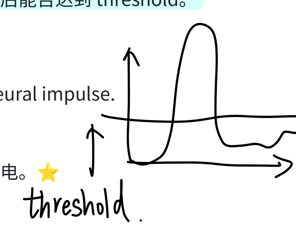

<!-- Handwritten annotation: p26-02 -->

**原位置：17. All-or-None Response 中文释义右侧。**

> 完整的爆发，不会一半一半。

<!-- Source: page 27 -->

### 18. Synapse 突触 ⭐

- English Definition: The junction between the axon tip of the sending neuron and the dendrite or cell body of the receiving neuron.

- 中文释义: 发送神经元的轴突末端与接收神经元的树突或细胞体之间的连接点。

- 📝 Key Point: 由 Charles Sherrington 发现并命名。

### 19. Synaptic Gap / Synaptic Cleft 突触间隙 ⭐

- English Definition: The tiny, fluid-filled gap at the synapse (less than a millionth of an inch wide) between the two neurons.

- 中文释义: 突触处两个神经元之间微小、充满液体的间隙。

- 📝 Key Point: 神经元之间并不真正相连，靠化学物质"跨桥"。⭐

### 20. Neurotransmitters 神经递质 ⭐⭐

- English Definition: Chemical messengers that cross the synaptic gaps between neurons. When released by the sending neuron, neurotransmitters travel across the synapse and bind to receptor sites on the receiving neuron, thereby influencing whether that neuron will generate a neural impulse.

- 中文释义: 跨越神经元间突触间隙的化学信使。由发送神经元释放后，穿过突触并与接收神经元上的受体位点结合，从而影响该神经元是否产生神经冲动。

- 📝 Key Point: 神经传递是"电化学"过程——神经元内部是电（动作电位），神经元之间是化学 （神经递质）。⭐⭐

### 21. Reuptake 再摄取 ⭐

- English Definition: A neurotransmitter's reabsorption by the sending neuron.

- 中文释义: 神经递质被发送神经元重新吸收的过程。

- 📝 Key Point: 很多抗抑郁药（如SSRI）就是抑制血清素的再摄取，让突触间隙里的血清素停留更久。⭐ 高频考点。

### 22. Acetylcholine (ACh) 乙酰胆碱 ⭐⭐

- English Definition: A neurotransmitter that enables muscle action, learning, and memory.

- 中文释义: 负责肌肉运动、学习与记忆的神经递质。

- 📝 Key Point:

  - 功能：激活肌肉（使肌肉收缩）、参与学习记忆。

  - 不足（不足）： Alzheimer's disease（阿尔茨海默症）时 ACh 水平下降。

#### 本页手写批注

<!-- Handwritten annotation: p27-01 -->

**原位置：19. Synaptic Gap / Synaptic Cleft 中文释义右侧。**

> Cross-bridge。

<!-- Source: page 28 -->

  - 例子：某些 snake venom / botulinum toxin（肉毒杆菌毒素）阻断 ACh 释放→肌肉麻痹； curare（箭毒）占据 ACh 受体→麻痹；尼古丁模拟 ACh。⭐⭐

### 23. Dopamine 多巴胺 ⭐⭐

- English Definition: A neurotransmitter that influences movement, learning, attention, and emotion/pleasure/reward.

- 中文释义: 影响运动、学习、注意以及情绪/愉悦/奖赏的神经递质。

- 📝 Key Point:

  - 过多：Schizophrenia（精神分裂症）。

  - 过少：Tremors 和 Parkinson's disease（帕金森症）。

  - 与奖赏回路、成瘾密切相关。⭐⭐ 必考。

### 24. Serotonin 血清素/5-羟色胺 ⭐⭐

- English Definition: A neurotransmitter that affects mood, hunger, sleep, and arousal.

- 中文释义: 影响情绪、食欲、睡眠和唤醒水平的神经递质。

- 📝 Key Point:

  - 过少：Depression（抑郁症）。

  - 治疗：SSRIs（选择性血清素再摄取抑制剂）。⭐⭐

  - 口诀"Serotonin = Sleep/mood/Serene（平静）"。

### 25. Norepinephrine 去甲肾上腺素 ⭐

- English Definition: A neurotransmitter that helps control alertness and arousal.

- 中文释义: 帮助控制警觉与唤醒的神经递质。

- 📝 Key Point: 也叫 noradrenaline。过少可导致 depressed mood。与应激、战斗-逃跑反应相关。

### 26. GABA (Gamma-Aminobutyric Acid) γ-氨基丁酸 ⭐

- English Definition: A major inhibitory neurotransmitter.

- 中文释义: 主要的抑制性神经递质。

- 📝 Key Point:

  - 过少：Seizures（癫痫）、tremors、insomnia。

  - 酒精（alcohol）抑制中枢的作用就是增强 GABA。⚠️ GABA 是抑制性（记住 G = Gone/抑制），Glutamate 是兴奋性。

#### 本页手写批注

<!-- Handwritten annotation: p28-01 -->

**原位置：26. GABA 的过少条目右侧，箭头指向文字。**

> 过少会抖，都是和抖有关的。

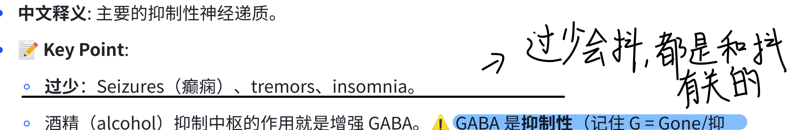

<!-- Source: page 29 -->

### 27. Glutamate 谷氨酸 ⭐

- English Definition: A major excitatory neurotransmitter; involved in memory.

- 中文释义: 主要的兴奋性神经递质；参与记忆。

- 📝 Key Point:

  - 过多：会过度刺激脑，导致 Migraines（偏头痛）或 seizures——所以有人建议少吃味精 （MSG 含谷氨酸钠）。

  - ⚠️ 对比：Glutamate = excitatory（兴奋性）；GABA = inhibitory（抑制性）。⭐

### 28. Endorphins 内啡肽 ⭐

- English Definition: "Morphine within" – natural, opiate-like neurotransmitters linked to pain control and to pleasure.

- 中文释义: "体内的吗啡"——天然的、类似鸦片的神经递质，与痛觉控制和愉悦感有关。

- 📝 Key Point: 剧烈运动后的"跑者愉悦感 runner's high"。人工鸦片（heroin/morphine）会让脑停止自产内啡肽→突然停药导致戒断痛。⭐

### 29. Agonist 激动剂/拟制剂 ⭐⭐

- English Definition: A molecule that, by binding to a receptor site, stimulates a response (it mimics/enhances a neurotransmitter's effect).

- 中文释义: 通过与受体位点结合、刺激（增强）反应的分子（模拟或增强神经递质作用）。

- 📝 Key Point: Agonist = "Accelerates / Adds"。例：鸦片类药物模拟 endorphins；尼古丁模拟 ACh。⭐⭐

### 30. Antagonist 拮抗剂/阻断剂 ⭐⭐

- English Definition: A molecule that, by binding to a receptor site, inhibits or blocks a response.

- 中文释义: 通过与受体位点结合、抑制或阻断反应的分子。

- 📝 Key Point: Antagonist = "Against"。例：botulinum toxin（肉毒杆菌，美容除皱用）阻断 ACh 释放→麻痹肌肉；curare 阻断 ACh 受体。⚠️ 必考对比：Agonist 增强 vs Antagonist 阻断。 ⭐⭐

## Module 10: The Nervous and Endocrine Systems 神经与内分泌系统

### 31. Nervous System 神经系统 ⭐

#### 本页手写批注

<!-- Handwritten annotation: p29-01 -->

**原位置：28. Endorphins 标题右侧。**

> 受伤后分泌抑制疼痛。

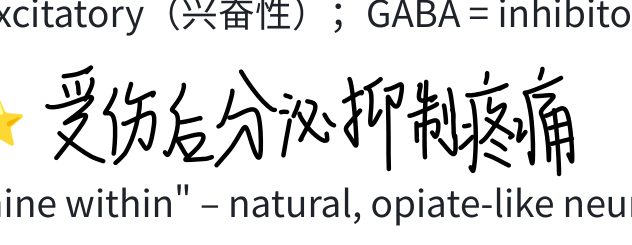

<!-- Source: page 30 -->

- English Definition: The body's speedy, electrochemical communication network, consisting of all the nerve cells of the peripheral and central nervous systems.

- 中文释义: 身体快速的电化学通讯网络，由外周神经系统和中枢神经系统的所有神经细胞组成。

- 📝 Key Point: "speedy（快速）"——与内分泌系统的"slow（缓慢）"对比。

### 32. Central Nervous System (CNS) 中枢神经系统 ⭐

- English Definition: The brain and spinal cord.

- 中文释义: 脑和脊髓。

- 📝 Key Point: CNS 是决策与信息整合中心。⚠️ 注意：CNS = brain + spinal cord，不包括外周神经。

### 33. Peripheral Nervous System (PNS) 外周神经系统 ⭐

- English Definition: The sensory and motor neurons that connect the central nervous system (CNS) to the rest of the body.

- 中文释义: 把中枢神经系统与身体其他部分连接起来的感觉和运动神经元。

- 📝 Key Point: PNS 负责"接线"——连接 CNS 与肌肉、腺体、感官。

### 34. Nerves 神经

- English Definition: Bundled axons that form neural "cables" connecting the central nervous system with muscles, glands, and sense organs.

- 中文释义: 成束的轴突，形成连接 CNS 与肌肉、腺体和感觉器官的神经"电缆"。

- 📝 Key Point: 神经 = 多条轴突捆成一束（像电缆里的铜线）。例：视神经 optic nerve。

### 35. Sensory (Afferent) Neurons 感觉（传入）神经元 ⭐⭐

- English Definition: Neurons that carry incoming information from the sensory receptors to the brain and spinal cord.

- 中文释义: 把信息从感觉感受器传入脑和脊髓的神经元。

- 📝 Key Point: 记忆口诀——"Afferent = Arrive（到达 CNS）"。走向是 感受器→CNS。⭐⭐ 必考方向。

### 36. Motor (Efferent) Neurons 运动（传出）神经元 ⭐⭐

- English Definition: Neurons that carry outgoing information from the brain and spinal cord to the muscles and glands.

- 中文释义: 把指令从脑和脊髓传出到肌肉和腺体的神经元。

- 📝 Key Point: 记忆口诀——"Efferent = Exit（离开 CNS）"。走向是 CNS→肌肉/腺体。⭐⭐

#### 本页手写批注

<!-- Handwritten annotation: p30-01 -->

**原位置：32. Central Nervous System 标题下、中文释义右侧。**

> CNS：only composed with spine & brain。

<!-- Handwritten annotation: p30-02 -->

**原位置：35. Sensory (Afferent) Neurons 中文释义右侧。**

> afferent = arrive。

<!-- Handwritten annotation: p30-03 -->

**原位置：36. Motor (Efferent) Neurons 中文释义右侧。**

> efferent → exit。

<!-- Source: page 31 -->

- ⚠️ 必考对比：Afferent (in) vs Efferent (out)。

### 37. Interneurons 中间神经元 ⭐

- English Definition: Neurons within the brain and spinal cord that communicate internally and intervene between the sensory inputs and motor outputs.

- 中文释义: 脑和脊髓内部的神经元，负责内部信息交流，在感觉输入与运动输出之间起中介作用。

- 📝 Key Point: 体内中间神经元数量最多（远多于感觉和运动神经元）。反射弧 = 感觉神经元→中间神经元→运动神经元。⭐

### 38. Somatic Nervous System 躯体神经系统 ⭐

- English Definition: The division of the peripheral nervous system that controls the body's skeletal muscles. Also called the skeletal nervous system.

- 中文释义: 外周神经系统中控制骨骼肌的分支，又称骨骼神经系统。

- 📝 Key Point: 负责随意动作（voluntary），如抬手、走路；也含牵张反射（如膝跳反射）。⭐

### 39. Autonomic Nervous System (ANS) 自主神经系统 ⭐⭐

- English Definition: The part of the peripheral nervous system that controls the glands and the muscles of the internal organs (such as the heart). Its sympathetic division arouses; its parasympathetic division calms.

- 中文释义: 外周神经系统中控制腺体和内脏器官（如心脏）肌肉的部分。其交感分支唤起身体，副交感分支让身体平静。

- 📝 Key Point: 负责不随意/自动功能（心跳、消化、呼吸）。它又分 sympathetic 和 parasympathetic。⭐⭐

### 40. Sympathetic Nervous System 交感神经系统 ⭐⭐

- English Definition: The division of the autonomic nervous system that arouses the body, mobilizing its energy in stressful situations.

- 中文释义: 自主神经系统中唤起身体、在应激情境下调动能量的分支。

- 📝 Key Point: "战斗或逃跑 fight-or-flight"。作用：加快心跳、升高血压、加快呼吸、抑制消化、 放大瞳孔。记忆"Sympathetic = Stress / Speed up"。⭐⭐

### 41. Parasympathetic Nervous System 副交感神经系统 ⭐⭐

- English Definition: The division of the autonomic nervous system that calms the body, conserving its energy.

- 中文释义: 自主神经系统中让身体平静、保存能量的分支。

#### 本页手写批注

<!-- Handwritten annotation: p31-01 -->

**原位置：38. Somatic Nervous System 标题右侧。**

> 肌肉随意运动。

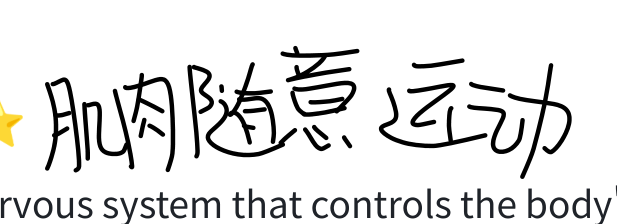

<!-- Handwritten annotation: p31-02 -->

**原位置：40. Sympathetic 与41. Parasympathetic 标题左侧。**

> “Sympathetic”开头部分与“Parasympathetic”的 Para 前缀被圈注，并以一条长弯线连在一起，构成两者的对照标记。

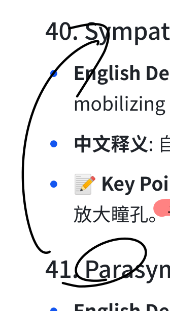

<!-- Source: page 32 -->

- 📝 Key Point: "休息与消化 rest-and-digest"。作用：降低心率、促消化、储存能量。记忆"Parasympathetic = Peace / Place"。

- ⚠️ 必考对比：Sympathetic（唤起/应激/加速）vs Parasympathetic（平静/恢复/减速）。⭐⭐

### 42. Neural Networks 神经网络

- English Definition: Clusters of many neurons that work together; experience strengthens these interconnections ("neurons that fire together wire together").

- 中文释义: 大量神经元聚集协同工作的集群；经验会强化这些连接（"一起放电的神经元会连在一起"）。

- 📝 Key Point: 脑通过训练形成精密的神经回路。

### 43. Reflex 反射 ⭐

- English Definition: A simple, autonomic response to a sensory stimulus, such as the knee-jerk response.

- 中文释义: 对感觉刺激的简单、自动反应，如膝跳反射。

- 📝 Key Point: 简单反射弧在脊髓水平完成，信号无需先上传大脑——这就是为什么手指碰到烫的东西时，先缩回手、之后才"感到疼"（疼的信号要再上传大脑）。⭐

### 44. Endocrine System 内分泌系统 ⭐

- English Definition: The body's "slow" chemical communication system; a set of glands that secrete hormones into the bloodstream.

- 中文释义: 身体"缓慢"的化学通讯系统；一组把激素分泌进血流的腺体。

- 📝 Key Point: ⚠️ 与神经系统对比：神经 = 快、电信号、点对点；内分泌 = 慢、激素经血液、作用持久。⭐

### 45. Hormones 激素 ⭐

- English Definition: Chemical messengers that are manufactured by the endocrine glands, travel through the bloodstream, and affect other tissues.

- 中文释义: 由内分泌腺体制造、经血流运输、影响其他组织的化学信使。

- 📝 Key Point: 某些激素（如 norepinephrine / epinephrine）与神经递质化学成分相同，只是运输方式不同（血液 vs 突触）。⭐

### 46. Adrenal Glands 肾上腺 ⭐

- English Definition: A pair of endocrine glands that sit just above the kidneys and secrete hormones (epinephrine and norepinephrine) that help arouse the body in times of stress.

#### 本页手写批注

<!-- Handwritten annotation: p32-01 -->

**原位置：42. Neural Networks 的释义和Key Point之间。**

> 做数学的时候。我就是缺乏训练的小猪脑，旁画一个不开心表情。

<!-- Handwritten annotation: p32-02 -->

**原位置：43. Reflex 右侧，连接示意与底部文字。**

> 遇到危险时，reflection arc 会〔原文此处无法辨认〕；末尾可见“spin…”但被右页边截断。向下箭头关联“大脑来不及 process”。

辨认说明：“会”后的动词无法可靠辨认；英语尾词被原页右边截断，不补成完整单词。

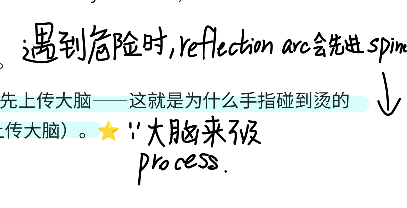

<!-- Handwritten annotation: p32-03 -->

**原位置：45. Hormones 中文释义右侧。**

> Ach。

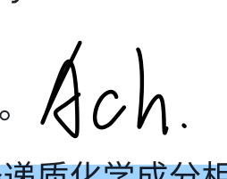

<!-- Source: page 33 -->

- 中文释义: 位于肾脏正上方的一对内分泌腺，分泌激素（肾上腺素和去甲肾上腺素），在应激时唤起身体。

- 📝 Key Point: 应激时释放 epinephrine（肾上腺素）和 norepinephrine（去甲肾上腺素）→ 加快心跳、升血压、升血糖。⭐

### 47. Epinephrine / Norepinephrine 肾上腺素/去甲肾上腺素

- English Definition: Stress hormones (also called adrenaline and noradrenaline) released by the adrenal glands; they increase heart rate and blood pressure to produce the fight-or-flight response.

- 中文释义: 由肾上腺释放的应激激素（又称 adrenaline 和 noradrenaline）；提高心率和血压，产生战斗-逃跑反应。

- 📝 Key Point: epinephrine = adrenaline（肾上腺素）；norepinephrine = noradrenaline（去甲肾上腺素）——同一物质两个名字，考试常混着出。

### 48. Fight-or-Flight Response 战斗或逃跑反应

- English Definition: The bodily reaction to threat in which the sympathetic nervous system and adrenal glands mobilize the body's energy resources.

- 中文释义: 面对威胁时，由交感神经系统和肾上腺调动身体能量资源的反应。

- 📝 Key Point: 与 sympathetic nervous system + adrenal glands 直接挂钩。

### 49. Pituitary Gland 垂体 ⭐⭐

- English Definition: The endocrine system's most influential gland. Under the influence of the hypothalamus, the pituitary regulates growth and controls other endocrine glands.

- 中文释义: 内分泌系统中最具影响力的腺体。在下丘脑的影响下，垂体调节生长并控制其他内分泌腺。

- 📝 Key Point: 被称为"主腺体 master gland"。受 hypothalamus（下丘脑）控制。分泌 growth hormone（生长激素）和 oxytocin（催产素）。⭐⭐

- ⚠️ 因果链：Hypothalamus → Pituitary → 其他腺体。

## Module 11: Studying the Brain, and Older Brain Structures 脑研究方法与旧脑结构

### 50. Lesion 损毁/病灶

- English Definition: Tissue destruction. A brain lesion is a naturally or experimentally caused destruction of brain tissue.

#### 本页手写批注

<!-- Handwritten annotation: p33-01 -->

**原位置：46. Adrenal Glands 续文、应激激素释放行上方。**

> ↑ 跳伞，过山车。

<!-- Handwritten annotation: p33-02 -->

**原位置：48. Fight-or-Flight Response 右侧，延伸到49标题附近。**

> 冒冷汗，肌肉紧绷。随时准备跑。

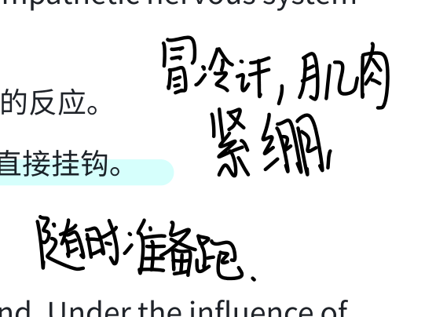

<!-- Source: page 34 -->

- 中文释义: 组织破坏。脑损伤指自然或实验造成的脑组织破坏。

- 📝 Key Point: 通过观察某部位损毁后行为的变化，来推断该部位功能（经典研究方法）。

### 51. EEG (Electroencephalogram) 脑电图 ⭐

- English Definition: An amplified recording of the waves of electrical activity sweeping across the brain's surface. These waves are measured by electrodes placed on the scalp.

- 中文释义: 对掠过大脑表面的电活动波的放大记录。通过放置在头皮上的电极测量。

- 📝 Key Point: 测电活动 waves（time-based），用于睡眠研究、癫痫诊断。⚠️ 它记录的是"脑波电信号"，不提供脑结构图像。⭐

### 52. CT / CAT Scan (Computed Tomography) CT扫描 ⭐

- English Definition: A series of X-ray photographs taken from different angles and combined by computer into a composite representation of a slice of the brain's structure. Also called CAT scan.

- 中文释义: 从不同角度拍摄的一系列 X 光照片，经计算机合成出脑某一层结构的复合图像。又称 CAT scan。

- 📝 Key Point: X射线，看结构，主要用于发现肿瘤、脑损伤。⚠️ 是结构成像，不是活动成像。⭐

### 53. PET Scan (Positron Emission Tomography) PET扫描 ⭐

- English Definition: A visual display of brain activity that detects where a radioactive form of glucose goes while the brain performs a given task.

- 中文释义: 显示脑活动的可视化技术；当脑执行任务时，探测放射性葡萄糖流向何处。

- 📝 Key Point: 看活动（哪个脑区在用葡萄糖/在工作）。葡萄糖"hot spots"亮起来。⚠️ 测活动， 不是结构。⭐

### 54. MRI (Magnetic Resonance Imaging) 磁共振成像 ⭐

- English Definition: A technique that uses magnetic fields and radio waves to produce computer-generated images of soft tissue. MRI scans show brain anatomy.

- 中文释义: 利用磁场和无线电波生成软组织计算机图像的技术。MRI 显示脑的解剖结构。

- 📝 Key Point: 磁场，看精细结构（软组织），比 CT 更清晰。例：用 MRI 发现精神分裂症患者脑室更大。⭐

### 55. fMRI (Functional MRI) 功能性磁共振 ⭐⭐

- English Definition: A technique for revealing bloodflow and, therefore, brain activity by comparing successive MRI scans. fMRI scans show brain function as well as its structure.

#### 本页手写批注

<!-- Handwritten annotation: p34-01 -->

**原位置：50. Lesion 中文释义右侧，页顶。**

> 摧毁脑子的一部分。

<!-- Handwritten annotation: p34-02 -->

**原位置：53. PET Scan / 54. MRI 之间，括线对照。**

> CT：结构；PET：活动。

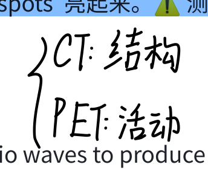

<!-- Handwritten annotation: p34-03 -->

**原位置：55. fMRI 标题右侧。**

> MRI 与 fMRI，本质都是核共振，fMRI 是高级一点的。

<!-- Source: page 35 -->

- 中文释义: 通过比较连续的 MRI 扫描来显示血流、进而显示脑活动的技术。fMRI 既显示脑功能也显示脑结构。

- 📝 Key Point: 看血流变化 → 既看结构又看活动/功能。

- ⚠️ 必考对比四件套：

  - EEG = 电活动（waves）

  - CT = X光结构

  - PET = 活动（葡萄糖）

  - MRI = 精细结构；fMRI = 结构 + 活动（血流）⭐⭐

### 56. Brainstem 脑干 ⭐

- English Definition: The oldest part and central core of the brain, beginning where the spinal cord swells as it enters the skull; the brainstem is responsible for automatic survival functions.

- 中文释义: 脑最古老、最核心的部分，从脊髓进入颅骨处开始膨大；负责自动生存功能。

- 📝 Key Point: 包含 medulla、pons、reticular formation。"最古老"→ 最基本的生存功能。动物即使切除大脑皮层，脑干仍能维持心跳呼吸。⭐

### 57. Medulla 延髓 ⭐⭐

- English Definition: The base of the brainstem; controls heartbeat and breathing.

- 中文释义: 脑干最底部；控制心跳和呼吸。

- 📝 Key Point: 一受伤即危及生命。记忆"Medulla = Matters of the heart and breathing"。⭐⭐

### 58. Pons 脑桥

- English Definition: Part of the brainstem that helps coordinate movements and plays a role in sleep/relaxation.

- 中文释义: 脑干的一部分，帮助协调运动，并参与睡眠与放松。

- 📝 Key Point: 像"桥"，连接脑各部；参与睡眠周期（REM）。

### 59. Thalamus 丘脑 ⭐⭐

- English Definition: The brain's sensory switchboard, located on top of the brainstem; it directs messages to the sensory receiving areas in the cortex and transmits replies to the cerebellum and medulla.

- 中文释义: 脑的"感觉交换机/中继站"，位于脑干上方；把信息导向皮层的感觉接收区，并把回复传给小脑和延髓。

#### 本页手写批注

<!-- Handwritten annotation: p35-01 -->

**原位置：55. fMRI续文的四种成像对照、EEG行右侧。**

> → 脑电图。

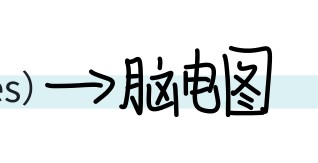

<!-- Source: page 36 -->

- 📝 Key Point: ⭐ 除了嗅觉(smell)之外，所有感觉信息都要先经过丘脑中转。这是AP超级高频考点！⭐⭐

### 60. Reticular Formation 网状结构 ⭐

- English Definition: A nerve network that travels through the brainstem and thalamus and plays an important role in controlling arousal.

- 中文释义: 穿过脑干和丘脑的神经网络，在控制唤醒水平方面起重要作用。

- 📝 Key Point: 像"网"一样穿过脑干；负责警觉/唤醒（arousal）。实验：刺激它→清醒；切断它 →昏迷（coma）。⭐

### 61. Cerebellum 小脑 ⭐⭐

- English Definition: The "little brain" at the rear of the brainstem; functions include processing sensory input and coordinating movement output and balance, enabling nonverbal learning and memory.

- 中文释义: 脑干后方的"小脑"；功能包括处理感觉输入、协调运动输出和平衡，并支持非言语学习与记忆。

- 📝 Key Point: 别名"little brain"。负责：平衡、协调精细运动、程序性记忆（如骑车、弹奏）。 酒精最先影响小脑→走路不稳。⭐⭐

### 62. Limbic System 边缘系统 ⭐⭐

- English Definition: Doughnut-shaped neural system (including the hippocampus, amygdala, and hypothalamus) located below the cerebral hemispheres; associated with emotions and drives.

- 中文释义: 位于大脑半球下方、甜甜圈形状的神经系统（含海马、杏仁核、下丘脑）；与情绪和动机驱力有关。

- 📝 Key Point: 三大件——Hippocampus（记忆）、Amygdala（情绪）、Hypothalamus（动机/奖赏）。记忆口诀"边缘系统管情绪与欲望"。⭐⭐

### 63. Hippocampus 海马 ⭐⭐

- English Definition: A neural center located in the limbic system that helps process explicit memories for storage.

- 中文释义: 位于边缘系统的神经中枢，帮助把外显记忆加工并储存。

- 📝 Key Point: 负责形成新的外显/陈述性记忆（explicit memories）。海马受损→无法形成新记忆（类似 H.M. 病人、Alzheimer's 早期先损伤海马）。⭐⭐

### 64. Amygdala 杏仁核 ⭐⭐

#### 本页手写批注

<!-- Handwritten annotation: p36-01 -->

**原位置：62. Limbic System Key Point 下方，多色补记。**

> Amygdala（情绪）下写“多数是负面！”；Hypothalamus（动机/奖励）下箭头写“四大本能”；红笔列出“flee / fight / food / fuck.”。

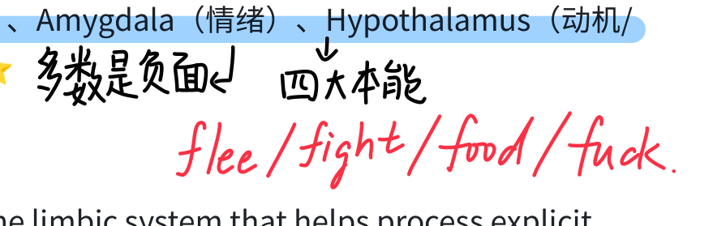

<!-- Source: page 37 -->

- English Definition: Two lima-bean-sized neural clusters in the limbic system; linked to emotion.

- 中文释义: 边缘系统中两个青豆大小的神经团块；与情绪有关。

- 📝 Key Point: 特别负责 aggression（攻击）和 fear（恐惧）。刺激杏仁核→暴怒或恐惧；切除 →变得异常温顺。⭐⭐

### 65. Hypothalamus 下丘脑 ⭐⭐

- English Definition: A neural structure lying below (hypo) the thalamus; it directs several maintenance activities (eating, drinking, body temperature), helps govern the endocrine system via the pituitary gland, and is linked to emotion and reward.

- 中文释义: 位于丘脑下方（hypo）的神经结构；指挥多种维持生命的活动（进食、饮水、体温）， 通过垂体调节内分泌系统，并与情绪和奖赏有关。

- 📝 Key Point: 四大功能口诀"4 Fs"：Fighting, Fleeing, Feeding, Fucking（性/奖赏）。控制 hunger、thirst、body temperature、sexual behavior，并通过 pituitary 控制激素。⭐⭐

### 66. Reward Centers / Reward Deficiency Syndrome 奖赏回路/奖赏缺陷综合征

- English Definition: Brain areas (largely in the hypothalamus) that provide pleasurable rewards; a "reward deficiency syndrome" may be a genetically disposed deficiency in the natural brain systems for pleasure and well-being, leading people to crave whatever provides that missing pleasure (e.g., addictive behaviors).

- 中文释义: 脑内（主要在下丘脑）提供愉悦奖赏的区域；"奖赏缺陷综合征"指天生脑内愉悦/幸福系统不足，使人渴求任何能补足这种愉悦的东西（如成瘾行为）。

- 📝 Key Point: Olds & Milner 的经典实验——老鼠按压踏板刺激自己的奖赏中枢，甚至不吃不喝。

## Module 12: The Cerebral Cortex 大脑皮层

### 67. Cerebrum 大脑

- English Definition: The two large cerebral hemispheres that contribute 85% of the brain's weight; the newer neural networks responsible for complex functions.

- 中文释义: 两个巨大的大脑半球，占脑重量的85%；负责复杂功能的较新神经网络。

- 📝 Key Point: 大脑皮层覆盖在大脑半球表面。

### 68. Cerebral Cortex 大脑皮层 ⭐⭐

- English Definition: The intricate fabric of interconnected neural cells covering the cerebral hemispheres; the body's ultimate control and information-processing center.

<!-- Source: page 38 -->

- 中文释义: 覆盖大脑半球的、由相互连接神经细胞构成的复杂织物；身体最高的控制与信息加工中心。

- 📝 Key Point: 人类思维、知觉、随意运动都在这里。是进化上最新、最发达的部分。⭐⭐

### 69. Glial Cells (Glia) 胶质细胞 ⭐

- English Definition: Cells in the nervous system that support, nourish, and protect neurons; they also play a role in learning and thinking.

- 中文释义: 神经系统中支持、滋养、保护神经元的细胞；也参与学习和思考。

- 📝 Key Point: 别名"glue cells（胶水细胞）"。数量远多于神经元；构成髓鞘。⚠️ 注意：胶质细胞不是神经元。⭐

### 70. Frontal Lobes 额叶 ⭐⭐

- English Definition: Portion of the cerebral cortex lying just behind the forehead; involved in speaking and muscle movements and in making plans and judgments.

- 中文释义: 位于额头正后方的皮层部分；参与言语、肌肉运动，以及制定计划和判断。

- 📝 Key Point: 三大功能——运动控制、言语表达、人格与决策（执行功能）。包含 motor cortex 和 prefrontal cortex。⭐⭐

### 71. Parietal Lobes 顶叶 ⭐

- English Definition: Portion of the cerebral cortex lying at the top of the head and toward the rear; receives sensory input for touch and body position.

- 中文释义: 位于头顶靠后方的皮层部分；接收触觉和身体位置的感觉输入。

- 📝 Key Point: 包含 sensory cortex（体感皮层），处理 touch。⭐

### 72. Occipital Lobes 枕叶 ⭐⭐

- English Definition: Portion of the cerebral cortex lying at the back of the head; includes areas that receive information from the visual fields.

- 中文释义: 位于脑后部的皮层部分；包含接收视觉野信息的区域。

- 📝 Key Point: 视觉中枢（visual cortex）所在地。⚠️ 枕叶 = 看（vision 在 occipital）。⭐⭐

### 73. Temporal Lobes 颞叶 ⭐⭐

- English Definition: Portion of the cerebral cortex lying roughly above the ears; includes the auditory areas, each receiving information primarily from the opposite ear.

- 中文释义: 大致位于耳朵上方的皮层部分；包含听觉区，每侧主要接收对侧耳朵的信息。

- 📝 Key Point: 听觉中枢（auditory cortex）所在地。⚠️ 听觉信息交叉投射（左耳→右颞叶）。 颞叶还含 Wernicke's area（语言理解）。⭐⭐

#### 本页手写批注

<!-- Handwritten annotation: p38-01 -->

**原位置：70. Frontal Lobes 标题右侧。**

> 你做为高级动物有的功能都在 frontal！

<!-- Handwritten annotation: p38-02 -->

**原位置：71. Parietal Lobes 中文释义右侧。**

> → 处理体感。

<!-- Source: page 39 -->

### 74. Motor Cortex 运动皮层 ⭐⭐

- English Definition: An area at the rear/back of the frontal lobes that controls voluntary movements.

- 中文释义: 位于额叶后部、控制随意运动的区域。

- 📝 Key Point: 位于额叶后缘；交叉控制（左脑运动皮层控制右侧身体）。身体越大/越精细的部位 （手、嘴）在皮层上占的映射面积越大（homunculus 侏儒图）。⭐⭐

### 75. Sensory Cortex 体感皮层 ⭐⭐

- English Definition: Area at the front of the parietal lobes that registers and processes body touch and movement sensations.

- 中文释义: 位于顶叶前部，记录并加工身体触觉和运动感觉的区域。

- 📝 Key Point: 位于顶叶前缘（运动皮层正后方）。也叫 somatosensory cortex。⚠️ 必考位置对比：Motor cortex = 额叶后缘；Sensory cortex = 顶叶前缘。二者之间以 central fissure 为界。 ⭐⭐

### 76. Association Areas 联合区 ⭐⭐

- English Definition: Areas of the cerebral cortex that are not involved in primary motor or sensory functions; rather, they are involved in higher mental functions such as learning, remembering, thinking, and speaking.

- 中文释义: 皮层中不参与初级运动或感觉功能、而参与高级心理功能（学习、记忆、思维、言语） 的区域。

- 📝 Key Point: 占皮层的大部分；"无声"区域（用电刺激不能直接触发反应）。高级思维都在联合区。⭐⭐

### 77. Prefrontal Cortex 前额叶皮层 ⭐

- English Definition: The forward part of the frontal lobes that enables judgment, planning, social control, and processing of new memories.

- 中文释义: 额叶最前部，负责判断、计划、社会行为控制以及新记忆加工。

- 📝 Key Point: 成熟最晚（20多岁才完全髓鞘化）。与 Phineas Gage 案例直接相关。⭐

### 78. Phineas Gage 菲尼亚斯·盖奇 ⭐⭐

- English Definition: A railroad worker whose frontal lobes were damaged by an iron rod through his head in an 1848 accident; his personality and behavior changed dramatically (from responsible to impulsive, irreverent) though his intellect and memory remained intact — showing the frontal lobes' role in personality and judgment.

#### 本页手写批注

<!-- Handwritten annotation: p39-01 -->

**原位置：74. Motor Cortex 标题右侧。**

> → frontal lobe 后边。

<!-- Handwritten annotation: p39-02 -->

**原位置：74–75. Motor / Sensory Cortex 右侧椭圆示意图。**

> 绘有一个椭圆轮廓，左侧蓝色短带、右侧红色短带。motor 的指示箭头指向红色短带，frontal 的箭头关联右侧；sensory 下箭头关联蓝色短带。保留手图原来的左右位置。

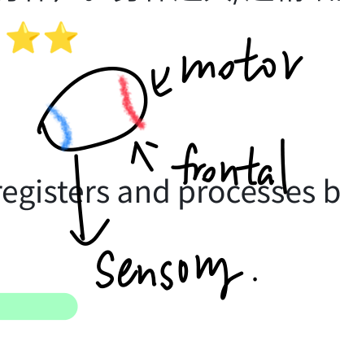

<!-- Handwritten annotation: p39-03 -->

**原位置：76. Association Areas 标题右侧。**

> ← 高级思考。

<!-- Source: page 40 -->

- 中文释义: 1848年事故中一根铁棍穿过他额叶的铁路工人；事故后智力、记忆完好，但人格和行为剧变（从负责稳重变得冲动、无礼）——证明额叶与人格、判断有关。

- 📝 Key Point: AP最经典案例题！结论：额叶（前额叶）管人格、决策、冲动控制。⭐⭐

### 79. Plasticity 可塑性 ⭐

- English Definition: The brain's ability to change, especially during childhood, by reorganizing after damage or by building new pathways based on experience.

- 中文释义: 脑改变的能力，尤其在童年期——在受损后重组，或根据经验建立新通路。

- 📝 Key Point: 儿童脑可塑性最强；损伤后可由其他脑区接管部分功能。⭐

### 80. Constraint-Induced Therapy 强制诱导疗法

- English Definition: A therapy that retrains brain-damaged people by forcing them to use the neglected (impaired) hand/limb, thereby rewiring the brain and reducing disabilities.

- 中文释义: 通过强迫脑损伤患者使用被忽视（受损）的手/肢体来重塑脑功能、减轻残疾的疗法。

- 📝 Key Point: 利用可塑性来恢复功能。

### 81. Neurogenesis 神经发生 ⭐

- English Definition: The formation of new neurons.

- 中文释义: 新神经元的形成。

- 📝 Key Point: 过去认为成人脑不能再生神经元，现已知脑（如海马）能产生新神经元。⚠️ 注意区分：Plasticity = 重组现有连接；Neurogenesis = 产生新神经元。⭐

## Module 13: Brain Hemisphere Organization and the Biology of Consciousness 大脑半球组织与意识生物学

### 82. Corpus Callosum 胼胝体 ⭐⭐

- English Definition: The large band of neural fibers connecting the two brain hemispheres and carrying messages between them.

- 中文释义: 连接两个大脑半球、在其间传递信息的粗大神经纤维束。

- 📝 Key Point: 裂脑手术就是切断它。⭐⭐

### 83. Split Brain 裂脑 ⭐⭐

- English Definition: A condition resulting from surgery that isolates the brain's two hemispheres by cutting the fibers (mainly those of the corpus callosum) connecting them.

#### 本页手写批注

<!-- Handwritten annotation: p40-01 -->

**原位置：80. Constraint-Induced Therapy 与79. Plasticity 之间。**

> 利用大脑可塑性。长弯箭头从80附近指回79. Plasticity。

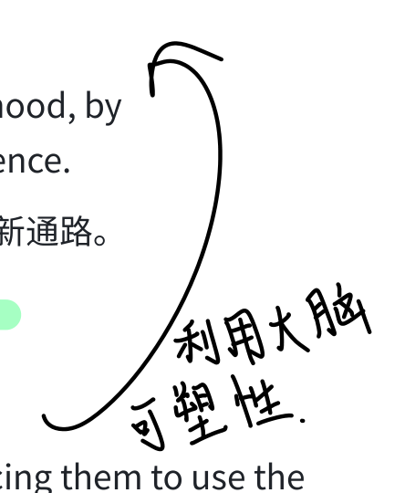

<!-- Source: page 41 -->

- 中文释义: 通过手术切断连接两半球的纤维（主要是胼胝体），使两半球彼此隔离而造成的状态。

- 📝 Key Point: 为治疗顽固性 epilepsy（癫痫）而切断胼胝体。⭐⭐

### 84. Vogel and Bogen 沃格尔与博根

- English Definition: Surgeons who, in the 1960s, decided to cut the corpus callosum in severe epilepsy patients to stop seizures from spreading between hemispheres.

- 中文释义: 1960年代的外科医生，决定对严重癫痫患者切断胼胝体，以阻止癫痫发作在两半球间扩散。

- 📝 Key Point: 裂脑手术的实施者。

### 85. Myers and Gazzaniga 迈尔斯与加扎尼加 ⭐

- English Definition: Researchers (working with Sperry) who conducted famous split-brain experiments revealing the specialized functions of the left and right hemispheres.

- 中文释义: 与 Sperry 合作的研究者，通过著名裂脑实验揭示左右半球的特化功能。

- 📝 Key Point: 经典实验：把"HE•ART"投影在裂脑患者视野——患者嘴上说看到"ART"（左半球语言控制），但左手（右半球）却指向"HE"。说明左半球管语言、右半球管空间。⭐

### 86. Hemispheric Specialization (Lateralization) 半球特化/偏侧化 ⭐

- English Definition: The tendency for some cognitive functions to be primarily processed by one cerebral hemisphere rather than the other.

- 中文释义: 某些认知功能主要由某一侧大脑半球加工的倾向。

- 📝 Key Point:

  - 左半球：语言、言语、逻辑、数学计算（language/speech）。

  - 右半球：空间知觉、面孔识别、艺术、情绪、感知任务、"sense of self"。⚠️ 流行文化夸大了"左脑人/右脑人"——正常人两半球协同工作。⭐

### 87. Handedness 利手

- English Definition: The preference for using one hand over the other (right-handed vs. left-handed); about 90% of humans are right-handed.

- 中文释义: 偏好使用某一只手（右利手 vs 左利手）；约90%的人是右利手。

- 📝 Key Point: 多数右利手语言中枢在左半球；左利手更分散。

### 88. Consciousness 意识 ⭐

- English Definition: Our awareness of ourselves and our environment.

- 中文释义: 我们对自身及周围环境的觉察。

#### 本页手写批注

<!-- Handwritten annotation: p41-01 -->

**原位置：86. Hemispheric Specialization 中文释义右侧。**

> 左理右艺。

<!-- Source: page 42 -->

- 📝 Key Point: 心理学曾一度（行为主义时期）回避研究意识，如今重新成为认知神经科学核心。 ⭐

### 89. Cognitive Neuroscience 认知神经科学 ⭐

- English Definition: The interdisciplinary study of the brain activity linked with cognition (including perception, thinking, memory, and language).

- 中文释义: 研究与认知（包括知觉、思维、记忆和语言）相关脑活动的交叉学科。

- 📝 Key Point: 结合脑成像 + 认知研究。⭐

### 90. Dual Processing 双重加工 ⭐⭐

- English Definition: The principle that information is often simultaneously processed on separate conscious and unconscious tracks.

- 中文释义: 信息常常同时在两条分离的轨道——意识轨道和无意识轨道——上被加工的原理。

- 📝 Key Point: "Two-Track Mind（双轨心智）"：

  - Visual perception track（视觉知觉轨道）：有意识地"看"、识别物体。

  - Visual action track（视觉行动轨道）：无意识地"用"视觉引导动作。

  - 例：盲视（blindsight）患者。⭐⭐

### 91. Two-Track Mind / Blindsight 双轨心智/盲视

- English Definition: The idea that much of our information processing occurs automatically, out of sight, off the radar of our conscious mind; blindsight patients can respond to visual stimuli they report not seeing.

- 中文释义: 我们大量信息加工是自动、在意识雷达之外进行的；盲视患者能对他们声称"看不见"的视觉刺激做出反应。

- 📝 Key Point: 证明无意识加工轨道独立运行。

## Module 14: Behavior Genetics: Predicting Individual Differences 行为遗传学

### 92. Behavior Geneticists / Behavior Genetics 行为遗传学家/行为遗传学 ⭐

- English Definition: Study of the relative power and limits of genetic and environmental influences on behavior.

- 中文释义: 研究遗传与环境对行为影响的相对强度和限度。

<!-- Source: page 43 -->

- 📝 Key Point: 核心问题：Heredity（遗传）vs. Environment（环境）哪个更重要？ 答案：二者相互作用，不是二选一。⭐

### 93. Environment 环境

- English Definition: Every external influence, from prenatal nutrition to the people and things around us.

- 中文释义: 一切外部影响，从产前营养到周围的人和事物。

- 📝 Key Point: 包括子宫内环境、家庭、文化、经验等。

### 94. Chromosomes 染色体 ⭐

- English Definition: Threadlike structures made of DNA molecules that contain the genes.

- 中文释义: 由 DNA 分子构成、含有基因的线状结构。

- 📝 Key Point: 人类每个细胞有 46条（23对） 染色体；其中23条来自父亲、23条来自母亲。⚠️ 层级关系：染色体 > DNA > 基因。⭐

### 95. DNA (Deoxyribonucleic Acid) 脱氧核糖核酸 ⭐

- English Definition: A complex molecule containing the genetic information that makes up the chromosomes.

- 中文释义: 构成染色体、含有遗传信息的复杂分子。

- 📝 Key Point: 双螺旋结构。⚠️ 层级：Chromosomes（染色体）由 DNA 组成，DNA 上有 Genes （基因）。⭐

### 96. Genes 基因 ⭐

- English Definition: The biochemical units of heredity that make up the chromosomes; segments of DNA capable of synthesizing proteins.

- 中文释义: 构成染色体的遗传生化单位；能够合成蛋白质的 DNA 片段。

- 📝 Key Point: 基因可分为 active (expressed) 活跃/表达 与 inactive 不活跃。约2万个基因。⚠️ 层级：Chromosomes → DNA → Genes。⭐

### 97. Genome 基因组

- English Definition: The complete instructions for making an organism, consisting of all the genetic material in that organism's chromosomes.

- 中文释义: 制造一个有机体的全部指令，包含该有机体染色体中的所有遗传物质。

- 📝 Key Point: 人类与黑猩猩基因组相似度约96%，与其他人类相似度高达99.9%。

### 98. Identical (Monozygotic) Twins 同卵（单卵）双胞胎 ⭐⭐

<!-- Source: page 44 -->

- English Definition: Twins who develop from a single fertilized egg that splits in two, creating two genetically identical organisms.

- 中文释义: 由一个受精卵分裂成两个而发育成的双胞胎，两个个体基因完全相同。

- 📝 Key Point: "Monozygotic = ME（同一个）"。基因100%相同。⭐⭐

### 99. Fraternal (Dizygotic) Twins 异卵（双卵）双胞胎 ⭐⭐

- English Definition: Twins who develop from separate fertilized eggs. They are genetically no closer than brothers and sisters, but they share a fetal environment.

- 中文释义: 由两个不同受精卵发育成的双胞胎。基因上与普通兄弟姐妹一样近（50%），但共享同一个胎儿环境。

- 📝 Key Point: "Dizygotic = Different"。基因相似度与普通兄弟姐妹相同（~50%）。

- ⚠️ 必考对比：Monozygotic（同卵，基因100%相同）vs Dizygotic（异卵，基因50%相同，像普通手足）。⭐⭐

### 100. Separated Twins / U of MN Twin Studies 分居双胞胎/明尼苏达大学双胞胎研究 ⭐

- English Definition: Studies of identical twins separated at birth and raised apart; researchers (e.g., Bouchard at University of Minnesota) found remarkable similarities in tastes, personality, abilities, and attitudes despite separate environments.

- 中文释义: 对出生即分离、在不同环境中长大的同卵双胞胎的研究；明尼苏达大学研究者（如 Bouchard）发现，尽管环境不同，他们在品味、人格、能力和态度上惊人相似。

- 📝 Key Point: 说明遗传对人格有强大影响。⚠️ 但批评者指出这些相似可能是 anecdotal evidence（轶事证据）、选择性记忆、双胞胎外表相似引起相似对待。⭐

### 101. Anecdotal Evidence 轶事证据

- English Definition: Evidence based on personal stories or isolated cases rather than on systematic, controlled data; often unreliable.

- 中文释义: 基于个人故事或孤立案例、而非系统对照数据的证据；往往不可靠。

- 📝 Key Point: 对"分居双胞胎奇迹般相似"故事的批评——人总爱找相似、忽略不同。

### 102. Biological vs. Adoptive Relatives 亲生亲属 vs. 收养亲属

- English Definition: Studies of adoptive children compare them with their genetic (biological) parents and their environmental (adoptive) parents; findings show adoptees' traits (e.g., personality) are often more like their biological parents than their adoptive ones.

- 中文释义: 对收养儿童的研究把他们与其亲生（遗传）父母和收养（环境）父母比较；发现被收养者的特质（如人格）往往更像亲生父母而非养父母。

<!-- Source: page 45 -->

- 📝 Key Point: 结论：遗传relatives预测人格；环境relatives影响价值观、信仰、政治态度。

### 103. Molecular Genetics 分子遗传学 ⭐

- English Definition: The subfield of biology that studies the molecular structure and function of genes.

- 中文释义: 研究基因分子结构与功能的生物学分支。

- 📝 Key Point: Molecular behavior genetics（分子行为遗传学） 是其应用——寻找特定基因如何影响行为、以及基因与疾病（如抑郁、精神分裂）的关联。⭐

### 104. Heritability 遗传力 ⭐⭐

- English Definition: The proportion of variation among individuals that we can attribute to genes. The heritability of a trait may vary, depending on the range of populations and environments studied.

- 中文释义: 个体间差异中可归因于基因的比例。某特质的遗传力会随所研究的人群和环境范围而变化。

- 📝 Key Point: ⚠️ 最易考陷阱：Heritability 描述的是"人与人之间差异（difference among people）"有多少可归因于基因，不是说某个个体的特质百分之多少来自基因。例：如果环境更相似，遗传力反而更高；如果基因更相似（如同卵双胞胎），环境差异贡献就更大。⭐⭐

### 105. Interaction 交互作用 ⭐

- English Definition: The interplay that occurs when the effect of one factor (such as environment) depends on another factor (such as heredity).

- 中文释义: 一个因素（如环境）的效果依赖于另一个因素（如遗传）时产生的相互作用。

- 📝 Key Point: "基因的效应依赖环境；环境的效应依赖基因"。例：同样的基因，在丰富环境 vs 贫瘠环境中结果不同。⭐

### 106. Epigenetics 表观遗传学 ⭐⭐

- English Definition: The study of environmental influences on gene expression that occur without a DNA change.

- 中文释义: 研究环境在不改变 DNA 序列的情况下影响基因表达的学科。

- 📝 Key Point: "表观"=在DNA序列之上。环境（压力、饮食、营养）像"开关"一样把基因打开/关闭。例：母鼠照料幼鼠的方式会改变幼鼠基因表达。⚠️ 对比：Genes（基因序列）不变； Epigenetics（表达开关）变。⭐⭐

### 107. Evocative Interactions 唤起式交互

<!-- Source: page 46 -->

- English Definition: The tendency of genetically influenced traits to evoke particular responses from the environment (e.g., an outgoing child evokes more social stimulation from others).

- 中文释义: 受遗传影响的特质会从环境中唤起特定反应的倾向（如外向的孩子会唤起他人更多社交刺激）。

- 📝 Key Point: 人不只是被动接受环境，还会主动"塑造/唤起"自己的环境。

## Module 15: Evolutionary Psychology: Understanding Human Nature 进化心理学

### 108. Evolutionary Psychology 进化心理学 ⭐

- English Definition: The study of the evolution of behavior and the mind, using principles of natural selection.

- 中文释义: 用自然选择原理研究行为和心理进化的学科。

- 📝 Key Point: 关注全人类共通的特质（而非个体差异）——为什么我们都有这样的脑和行为。⭐

### 109. Natural Selection 自然选择 ⭐⭐

- English Definition: The principle that, among the range of inherited trait variations, those contributing to reproduction and survival will most likely be passed on to succeeding generations.

- 中文释义: 在遗传特质变异的范围内，那些有助于繁殖和生存的特质最可能被传递给后代的原理。

- 📝 Key Point: 达尔文提出。核心逻辑：变异→竞争→适者生存繁殖→有利基因传给后代。⭐⭐

### 110. Mutation 突变 ⭐

- English Definition: A random error in gene replication that leads to a change.

- 中文释义: 基因复制过程中的随机错误，导致改变。

- 📝 Key Point: 突变是遗传变异的最终来源。多数突变无害或有害，极少数有利并被自然选择保留。⭐

### 111. Adaptation 适应

- English Definition: The (usually inherited) traits or behaviors that increase an organism's ability to survive and reproduce in a particular environment.

- 中文释义: 提高有机体在特定环境中生存与繁殖能力的（通常可遗传的）特质或行为。

- 📝 Key Point: 自然选择的结果。

<!-- Source: page 47 -->

### 112. Fitness 适应度

- English Definition: In evolutionary theory, the reproductive success of an organism; how well an organism survives and reproduces to pass its genes on.

- 中文释义: 在进化理论中，有机体的繁殖成功度；有机体生存并繁殖、传递基因的能力。

- 📝 Key Point: "fitness"在进化语境 = 繁殖成功，不是指体能好。

### 113. The "Second Darwinian Revolution" 第二次达尔文革命

- English Definition: The application of Darwinian principles of natural selection to psychology and neuroscience, explaining how our mental processes and behaviors evolved.

- 中文释义: 把达尔文自然选择原理应用于心理学和神经科学，解释我们的心理过程和行为如何进化。

- 📝 Key Point: 指进化心理学的兴起。

### 114. Gender Differences in Sexuality 性行为的性别差异

- English Definition: Observed patterns suggesting, on average, men tend to have a stronger/more frequent willingness toward sex and to perceive women's friendliness as sexual interest, while women's sexuality is typically more cautious.

- 中文释义: 观察到的模式——平均而言，男性对性有更强/更频繁的意愿、更容易把女性的友好误解为性兴趣；女性的性通常更谨慎。

- 📝 Key Point: 进化心理学解释：男性祖先通过广泛繁殖提高基因传递机会；女性通过精心选择配偶（投入孕育）提高后代存活概率。

### 115. Natural Selection and Mating Preferences 自然选择与择偶偏好

- English Definition: Evolutionary explanations for why males and females tend to prefer different partner traits: males prefer signs of fertility/youth; females prefer signs of resources, protection, and commitment.

- 中文释义: 对男女偏好不同配偶特质的进化解释：男性偏好生育力/年轻的标志；女性偏好资源、保护和承诺的标志。

- 📝 Key Point: Male preferences vs Female preferences 的差异。

### 116. Backward Theorizing 事后推论/反向理论化 ⚠️

- English Definition: A criticism of evolutionary psychology: the tendency to first observe an existing behavior and then work backward to invent an explanation ("after-the-fact" theorizing), which is hard to falsify.

- 中文释义: 对进化心理学的批评：先观察到某行为、再倒过来编一个解释（"事后诸葛"式理论化），难以证伪。

#### 本页手写批注

<!-- Handwritten annotation: p47-01 -->

**原位置：114. Gender Differences in Sexuality 英文释义右下。**

> 男性性欲比女性重（生理性别划分）。

<!-- Source: page 48 -->

- 📝 Key Point: ⚠️ 这是对进化心理学的主要批评之一——不能预测新现象、难以证伪；同时还忽视了社会文化影响（impact of social influence）。

# 附录：易混淆概念速查表 ⭐⭐⭐

| 概念对 | 区别 | 记忆法 |
| --- | --- | --- |
| Dendrite vs Axon | 树突接收(listen)；轴突发送(speak) | Dendrites listen, Axon speak |
| Afferent vs Efferent | 感觉传入(arrive)；运动传出(exit) | Afferent=Arrive, Efferent=Exit |
| Sympathetic vs Parasympathetic | 交感唤起/应激/加速；副交感平静/恢复/减速 | Sympathetic=Stress/Speed; Parasympathetic=Peace |
| Agonist vs Antagonist | 激动剂增强/模拟神经递质；拮抗剂阻断受体 | Agonist=Add; Antagonist=Against |
| GABA vs Glutamate | GABA=抑制性；Glutamate=兴奋性 | G=Gone(抑制); Glut=Glow(兴奋) |
| CT/MRI vs PET/fMRI | CT/MRI看结构；PET/fMRI看活动 | Structure vs Function |
| Motor vs Sensory Cortex | 运动皮层在额叶后缘；体感皮层在顶叶前缘 | Frontal-back vs Parietal-front |
| Occipital vs Temporal | 枕叶=视觉；颞叶=听觉 | Occipital=Eyes; Temporal=Ears(above Temples) |
| Plasticity vs Neurogenesis | 可塑性=重组现有连接；神经发生=产生新神经元 | Re-wire vs New cells |
| Monozygotic vs Dizygotic | 同卵基因100%相同；异卵基因50%(同普通手足) | Mono=ME; Di=Different |
| Chromosomes/DNA/Genes | 染色体由DNA组成，DNA片段=基因 | 大→中→小：染色体→DNA→基因 |
| Heritability | 指"人与人之间差异"的比例，不是单个人特质的比例 | Difference among people |
| Genes vs Epigenetics | 基因序列不变；表观遗传学调控基因表达开关 | DNA不变 vs 开关变 |

# 附录：神经递质速记表 ⭐⭐⭐

<!-- Source: page 49 -->

| Neurotransmitter | Function 功能 | 过多(Excess) | 过少(Deficit) |
| --- | --- | --- | --- |
| Acetylcholine (ACh) | 肌肉运动、学习、记忆 | — | Alzheimer's |
| Dopamine | 运动、注意、奖赏、愉悦 | Schizophrenia 精神分裂 | Parkinson's 帕金森 |
| Serotonin | 情绪、食欲、睡眠 | — | Depression 抑郁 |
| Norepinephrine | 警觉、唤醒 | — | Depressed mood |
| GABA | 主要抑制性神经递质 | — | 癫痫、失眠 |
| Glutamate | 主要兴奋性神经递质 | 偏头痛、癫痫 | — |
| Endorphins | 痛觉控制、愉悦（体内吗啡） | — | — |

# 附录：脑结构功能定位速记 ⭐⭐⭐

| 结构 | 位置 | 核心功能 |
| --- | --- | --- |
| Medulla | 脑干底部 | 心跳、呼吸 |
| Pons | 脑干 | 协调运动、睡眠 |
| Thalamus | 脑干上方 | 感觉中继（除嗅觉外所有感觉） |
| Reticular Formation | 穿过脑干 | 唤醒/警觉 |
| Cerebellum | 脑干后方"小脑" | 平衡、协调、程序性记忆 |
| Hippocampus | 边缘系统 | 形成新外显记忆 |
| Amygdala | 边缘系统 | 攻击、恐惧情绪 |
| Hypothalamus | 丘脑下方 | 饥渴体温、性、奖赏、控制垂体 |
| Pituitary | 下丘脑下方 | 主腺体、生长、控制其他腺体 |
| Frontal Lobe | 额头后 | 运动、言语、人格决策 |
| Parietal Lobe | 头顶后 | 触觉/体感 |
| Occipital Lobe | 脑后部 | 视觉 |
| Temporal Lobe | 耳上方 | 听觉 |

<!-- Source: page 50 -->

|  |  |
| --- | --- |
| ESP | 无科学证据；含 telepathy/clairvoyance/precognition |

### 📌 高频 FRQ 考点提醒

1. 给情境判断是 bottom-up 还是 top-down / perceptual set。

2. 画出从角膜到视觉皮层的光线路径，标出 rods/cones/fovea/blind spot。

3. 用 trichromatic 与 opponent-process 解释颜色视觉，并各给证据。

4. 列出 monocular cues 并在图中识别。

5. 用 place theory / frequency theory / volley principle 解释音高。

6. 用 gate-control theory + biopsychosocial 模型解释疼痛。

7. McGurk effect / sensory interaction 例子分析。

8. Weber's Law 计算题（按比例求 jnd）。

祝期中顺利！Good luck on your midterm! 🎯

# Unit 5: States of Consciousness — AP Psychology 期中复习笔记

# 第五单元：意识状态 — 中英文对照详细笔记

来源：Myers' Psychology for AP®, 2e — PowerPoint Slides (Modules 22–25)

标注说明：⭐ = 考试高频考点；⚠️ = 易混淆概念对比

## Module 22: Understanding Consciousness and Hypnosis

## 模块22：理解意识与催眠

### 1. Consciousness（意识）

- English Definition: Our subjective awareness of ourselves and our environment. It is the medium through which we experience the world, ourselves, and our mental processes.

<!-- Source discontinuity: page 49 ends with the Unit 3 brain-structure table; page 50 begins with an ESP table row and Unit 4 FRQ reminders. The listed Unit 4 Modules 16-21 body is absent from the supplied PDF. No missing content has been invented. -->

<!-- Source: page 51 -->

- 中文释义：我们对自身及周围环境的主观觉知/觉察。意识是我们体验世界、自我和心理过程的媒介。

- 📝 Example/Key Point: ⭐ Psychology's history shows the pendulum swinging — from early consciousness (Wundt, James), to behaviorism's denial of consciousness as a topic (1920s–1960s), back to "cognitive neuroscience" and consciousness study today. 心理学史中意识研究经历了：早期关注 → 行为主义否定 → 现代认知神经科学回归。

### 2. States of Consciousness（意识状态）

- English Definition: Different levels or forms of awareness that humans experience, ranging from normal waking awareness to altered states.

- 中文释义：人类体验到的不同觉知水平或形式，从正常清醒觉知到各种改变状态。

- 📝 Example/Key Point: ⭐ PPT 将意识状态分为三类：

  - Spontaneously occurring（自发产生）: Daydreaming 白日梦, Drowsiness 困倦, Dreaming 做梦

  - Physiologically induced（生理诱发）: Hallucinations 幻觉, Orgasm 性高潮, Food or oxygen starvation 食物/氧气饥饿

  - Psychologically induced（心理诱发）: Sensory deprivation 感觉剥夺, Hypnosis 催眠, Meditation 冥想

### 3. Hypnosis（催眠）

- English Definition: A social interaction in which one person (the hypnotist) suggests to another (the subject) that certain perceptions, feelings, thoughts, or behaviors will spontaneously occur.

- 中文释义：一种社会互动，催眠师向被试暗示某些知觉、感受、想法或行为会自发产生。

- 📝 Example/Key Point: ⭐ Not everyone can be hypnotized — only about 20% are "highly hypnotizable." 不是每个人都能被催眠，约20%的人高度易受催眠影响。

### 4. Hypnotic Induction（催眠诱导）

- English Definition: The process by which a hypnotist guides a subject into a state of hypnosis, typically through relaxation, focused attention, and suggestions.

- 中文释义：催眠师通过放松、集中注意力和暗示引导被试进入催眠状态的过程。

- 📝 Example/Key Point: Often involves staring at a spot, slow breathing, and repeated suggestions of relaxation. 通常包括凝视某一点、缓慢呼吸和反复放松暗示。

<!-- Source: page 52 -->

### 5. Postural Sway（姿势摇摆）

- English Definition: A test of hypnotic susceptibility where the subject stands with eyes closed and the hypnotist suggests they are falling backward; people who sway are more likely to be hypnotizable.

- 中文释义：一种催眠易感性测试，被试闭眼站立，催眠师暗示其后倒；会摇摆的人更易被催眠。

- 📝 Example/Key Point: Used as an initial indicator of hypnotic susceptibility. 用作催眠易感性的初步指标。

### 6. Hypnotic Susceptibility（催眠易感性）

- English Definition: The degree to which a person responds to hypnotic suggestions; it is a stable trait that varies among individuals.

- 中文释义：一个人对催眠暗示的反应程度；是一种稳定的个体差异特质。

- 📝 Example/Key Point: "Good hypnotic subjects" tend to be fantasy-prone, able to focus intensely, and responsive to social influence. "优秀的催眠被试"通常富于幻想、能高度集中注意力、对社会影响敏感。

### 7. Posthypnotic Suggestion（催眠后暗示） ⭐

- English Definition: A suggestion made during hypnosis that influences the subject's behavior afterward, after the hypnosis session has ended.

- 中文释义：在催眠过程中给出的、在催眠结束后仍影响被试行为的暗示。

- 📝 Example/Key Point: ⭐ Hypnotherapists use this to help people stop smoking, lose weight, or manage pain. 催眠治疗师用此帮助戒烟、减肥或控制疼痛。Hilgard 用它解释催眠的止痛效果。

### 8. Hypnotherapists（催眠治疗师）

- English Definition: Therapists who use hypnosis as part of their treatment, often to help clients overcome habits, manage pain, or explore psychological issues.

- 中文释义：将催眠作为治疗手段的治疗师，通常用于帮助来访者戒除习惯、控制疼痛或探索心理问题。

- 📝 Example/Key Point: Note — hypnosis alone is not a guaranteed cure; it works best as a complement to other therapies. 催眠本身不是万能疗法，最好作为其他治疗的辅助。

<!-- Source: page 53 -->

### 9. Social Influence Theory of Hypnosis（催眠的社会影响理论） ⭐

- English Definition: The theory that hypnosis is not an altered state of consciousness, but rather the subject is acting out the role of a "good hypnotic subject" — behaving in ways they believe a hypnotized person should act, driven by social expectations and role-playing.

- 中文释义：认为催眠不是意识的改变状态，而是被试在扮演"好的催眠被试"角色——按照他们认为被催眠者应有的方式行动，由社会期望和角色扮演驱动。

- 📝 Example/Key Point: ⭐ Explains hypnosis pain relief as: "The subject is so caught up in the hypnotized role that she ignores the cold." 被试完全投入催眠角色，以至于忽略了冷水的疼痛。 关键人物：基于社会心理学的角色理论。

### 10. Dissociation（分离/ dissociation） ⭐

- English Definition: A split in consciousness, which allows some thoughts and behaviors to occur simultaneously with others. Hilgard proposed that hypnotic pain relief involves a dissociation — the conscious mind is split, so the pain signal is sent but blocked from conscious awareness.

- 中文释义：意识的分裂，允许某些思维和行为与其他思维同时发生。Hilgard 提出催眠止痛涉及分离——意识分裂，疼痛信号被传递但被阻挡在意识觉知之外。

- 📝 Example/Key Point: ⭐ Hilgard's "hidden observer" experiment: hypnotized subjects placed hand in ice water — they reported no pain, but when asked to press a key if any part felt pain, they pressed it. This showed a "hidden" part of the mind still registered the pain. Hilgard 的"隐藏观察者"实验：被催眠者将手放入冰水中，口头说不痛，但被要求按键时却按了 ——证明意识中有一部分仍在记录疼痛。

### 11. Divided-Consciousness Theory（分裂意识理论） ⭐⚠️

- English Definition: Hilgard's theory that hypnosis causes a genuine split in awareness — a dissociation between the conscious executive and other mental processes. It is an altered state of consciousness, not just role-playing.

- 中文释义：Hilgard 的理论，认为催眠导致真正的觉知分裂——意识执行部分与其他心理过程之间的分离。这是一种意识改变状态，而不仅仅是角色扮演。

- 📝 Example/Key Point: ⭐⚠️ 对比 Social Influence Theory vs. Divided-Consciousness Theory:

  - Social Influence: 催眠 = 角色扮演/社会服从，不是真正的意识改变

<!-- Source: page 54 -->

  - Divided Consciousness (Hilgard): 催眠 = 真正的意识分离（dissociation），是改变状态

  - Modern view: "Unified account" — hypnosis involves BOTH role-playing AND dissociation, plus biological changes. 现代观点认为两者都有道理。

### 12. Levels of Analysis for Hypnosis（催眠的分析水平）

- English Definition: Hypnosis can be understood through three levels: biological (distinctive brain activity, unconscious information processing), psychological (focused attention, expectations, heightened suggestibility, dissociation), and social-cultural (authoritative person in legitimate context, role-playing "good subject").

- 中文释义：从三个水平理解催眠：生物水平（独特脑活动、无意识信息加工）、心理水平（集中注意、期望、高度暗示性、感觉与意识觉知的分离）、社会文化水平（合法情境中的权威人物、扮演"好被试"）。

- 📝 Example/Key Point: This is the biopsychosocial approach applied to hypnosis. 这是生物-心理-社会途径在催眠上的应用。

## Module 23: Sleep Patterns and Sleep Theories

## 模块23：睡眠模式与睡眠理论

### 13. Biological Rhythms（生物节律）

- \*\*English Definition): The periodic psychological and physiological fluctuations that occur in living organisms, governed by internal "biological clocks."

- 中文释义：生物体中发生的周期性心理和生理波动，由内部"生物钟"控制。

- 📝 Example/Key Point: Includes circadian rhythms (24-hour), sleep stages (90-minute), and other internal cycles. 包括昼夜节律（24小时）、睡眠阶段（90分钟）等内部周期。

### 14. Circadian Rhythm（昼夜节律/ circadian rhythm） ⭐

- English Definition: The biological clock; regular bodily rhythms (temperature, wakefulness) that occur on a 24-hour cycle.

- 中文释义：生物钟；以24小时为周期的规律身体节律（体温、觉醒度）。

<!-- Source: page 55 -->

- 📝 Example/Key Point: ⭐ Our body temperature rises in the morning, peaks during the day, dips in the afternoon, and drops at night. Morning types (larks) do better early; evening types (owls) peak later. 年轻人偏夜猫子，老年人偏早起鸟。年龄会影响昼夜节律。

### 15. Sleep（睡眠） ⭐

- English Definition: A periodic, natural loss of consciousness — distinct from unconsciousness resulting from a coma, general anesthesia, or hibernation.

- 中文释义：一种周期性的、自然的意识丧失——不同于昏迷、全身麻醉或冬眠导致的无意识。

- 📝 Example/Key Point: ⭐ We sleep in 90-minute cycles, repeating through the night. 睡眠以 90分钟为周期循环。EEG (electroencephalogram), EMG (electromyograph), and eye movement recordings measure sleep stages.

### 16. Measuring Sleep Activity（测量睡眠活动）

- English Definition: Researchers measure sleep using EEG (brain waves), EMG (muscle tension), and eye movement recordings (EOG).

- 中文释义：研究者通过脑电（EEG）、肌电（EMG）和眼动记录（EOG）测量睡眠。

- 📝 Example/Key Point: Three key measurements: Eye Movements 眼动, Muscle Tension 肌肉紧张度, EEG Patterns 脑电波模式。

### 17. Beta Waves（β波）

- English Definition: The relatively small, fast brain waves of a person who is alert and awake.

- 中文释义：人清醒警觉时相对较小、较快的脑电波。

- 📝 Example/Key Point: Associated with normal waking consciousness and active thought. 与正常清醒意识和主动思考相关。

### 18. Alpha Waves（α波）

- English Definition: The relatively slow brain waves of a relaxed, awake state (drowsy, relaxed wakefulness).

- 中文释义：放松清醒状态（昏昏欲睡、放松）下相对较慢的脑电波。

- 📝 Example/Key Point: ⭐ You produce alpha waves when you are awake but relaxed — e.g., when closing your eyes and beginning to drift toward sleep. 闭眼放松、即将入睡时出现α波。

#### 本页手写批注

<!-- Handwritten annotation: p55-01 -->

**原位置：17. Beta Waves 标题右侧。**

> → REM sleep。

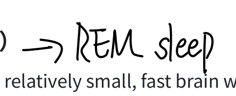

<!-- Source: page 56 -->

### 19. Delta Waves（δ波） ⭐

- English Definition: The large, slow brain waves associated with deep sleep (NREM-3).

- 中文释义：与深睡眠（NREM-3）相关的大而慢的脑电波。

- 📝 Example/Key Point: ⭐ Delta waves = deep sleep. The more delta waves, the deeper the sleep. Children spend more time in delta-wave deep sleep; elderly spend very little. δ波 = 深睡眠。

### 20. NREM-1 Sleep（非快速眼动睡眠第一阶段） ⭐⚠️

- English Definition: The brief, near-waking sleep stage that occurs as you first drift off; marked by irregular brain waves, slowed breathing, and hallucinatory sensations.

- 中文释义：刚入睡时短暂的、接近清醒的睡眠阶段；以不规则脑波、呼吸减慢和幻觉样感觉为特征。

- 📝 Example/Key Point: ⭐⚠️ Key features:

  - Hallucinations（幻觉）: Sensory experiences without a stimulus — e.g., feeling like you're falling.

  - Hypnagogic sensations（睡前幻觉/ 入睡前感觉）: Bizarre experiences like jerking, feeling of falling, or floating — these may later be incorporated into memories. 入睡前怪异体验， 如突然下坠感、抽动。

  - Lasts only a few minutes. 仅持续几分钟。

### 21. NREM-2 Sleep（非快速眼动睡眠第二阶段） ⭐

- English Definition: A deeper sleep stage that follows NREM-1; lasts about 20 minutes early in the night; characterized by sleep spindles.

- 中文释义：接在NREM-1之后的更深睡眠阶段；前半夜约持续20分钟；特征是睡眠纺锤波。

- 📝 Example/Key Point: ⭐ Sleep Spindles（睡眠纺锤波）: Bursts of rapid, rhythmic brain-wave activity. This is the stage where you are clearly asleep but can still be awakened without too much difficulty. 睡眠纺锤波 = 快速节律性脑波爆发。这是真正"睡着"的阶段。

### 22. NREM-3 Sleep（非快速眼动睡眠第三阶段 / 深睡眠） ⭐⚠️

- English Definition: Deep sleep, lasting about 30 minutes early in the night, characterized by large, slow delta waves. Hard to awaken from.

<!-- Source: page 57 -->

- 中文释义：深睡眠，前半夜约持续30分钟，以大而慢的δ波为特征。难以被唤醒。

- 📝 Example/Key Point: ⭐⚠️ 对比 NREM-1 vs NREM-2 vs NREM-3:

  - NREM-1: 最浅，幻觉/入睡前感觉，几分钟

  - NREM-2: 中等，睡眠纺锤波，约20分钟

  - NREM-3: 最深，δ波，约30分钟，睡行症（sleepwalking）和夜惊（night terrors）发生在此阶段！

  - As night progresses, NREM-3 gets SHORTER and REM gets LONGER. 后半夜深睡眠减少， REM增多。

### 23. REM Sleep（快速眼动睡眠） ⭐⚠️

- English Definition: Rapid eye movement sleep; a recurring sleep stage during which vivid dreams commonly occur. Also known as paradoxical sleep, because the muscles are relaxed (paralyzed) but other body systems are active.

- 中文释义：快速眼动睡眠；一个周期性睡眠阶段，通常出现生动梦境。也称"矛盾睡眠"，因为肌肉放松（瘫痪）但其他身体系统活跃。

- 📝 Example/Key Point: ⭐⚠️ 关键特征:

  - EEG looks like awake beta/alpha waves — brain is active! 脑波类似清醒状态

  - Eyes dart rapidly under closed lids 眼球快速转动

  - Heart rate rises, breathing rapid and irregular 心率上升、呼吸快而不规则

  - Genital arousal (penile erection, clitoral engorgement) 生殖器勃起

  - Motor cortex is active but muscles are paralyzed — you act out dreams only in your mind. 运动皮层活跃但肌肉瘫痪，所以不会把梦境演出来。

  - 80% of awakenings from REM yield dream reports. 从REM被唤醒，80%能报告梦境。

### 24. Paradoxical Sleep（矛盾睡眠） ⭐

- English Definition: Another name for REM sleep — the body is internally aroused (brain active, eyes moving) but externally calm (muscles paralyzed).

- 中文释义：REM睡眠的别名——身体内部被唤醒（脑活跃、眼动），但外部平静（肌肉瘫痪）。

- 📝 Example/Key Point: The "paradox" is that your brain is as active as when awake, but your body is immobile. 矛盾在于脑像清醒时一样活跃，但身体不动。

<!-- Source: page 58 -->

### 25. REM Rebound（REM反弹） ⭐

- English Definition: The tendency for REM sleep to increase following REM sleep deprivation (created by repeated awakenings during REM sleep).

- 中文释义：REM睡眠被剥夺后，REM睡眠会增加的趋势。

- 📝 Example/Key Point: ⭐ If you are repeatedly woken during REM, the next night you will spend more time in REM. This is used as evidence that REM/dreams serve a biological need. 反复在REM阶段被唤醒后，第二晚REM会补偿性增加。这证明REM有生理功能。

### 26. Suprachiasmatic Nucleus (SCN)（视交叉上核） ⭐

- English Definition: A pair of cell clusters in the hypothalamus that controls circadian rhythm. In response to light, the SCN causes the pineal gland to adjust melatonin production, thus modifying feelings of sleepiness.

- 中文释义：下丘脑中的一对细胞簇，控制昼夜节律。对光线做出反应，SCN使松果体调整褪黑素分泌，从而改变睡意。

- 📝 Example/Key Point: ⭐ Light → SCN → pineal gland → suppresses melatonin production (daytime) / increases melatonin (nighttime). 光信号 → SCN → 松果体 → 白天抑制褪黑素，晚上增加褪黑素。这就是为什么睡前看手机蓝光会抑制褪黑素分泌、影响入睡。

### 27. Melatonin（褪黑素）

- English Definition: A sleep-inducing hormone released by the pineal gland; production increases in the dark and decreases in light.

- 中文释义：由松果体释放的助眠激素；在黑暗中分泌增加，在光线下减少。

- 📝 Example/Key Point: Melatonin supplements are sometimes used to treat jet lag or insomnia. 褪黑素补充剂有时用于治疗时差或失眠。

### 28. Sleep Theories / Functions of Sleep（睡眠的功能理论） ⭐

- \*\*English Definition): Five proposed reasons why we sleep:

  - a. Sleep protects: Our ancestors were safer asleep at night than wandering around in the dark (safety theory).

  - b. Sleep helps recuperation: Sleep helps restore and repair brain tissue, immune system, and body.

  - c. Memory storage: Sleep consolidates and restores our memories of the day's experiences.

#### 本页手写批注

<!-- Handwritten annotation: p58-01 -->

**原位置：25. REM Rebound 右侧。**

> 这个我自己有体会！特别难受，并画不开心表情。（2个小时做了6个梦，头疼得快炸了，还会鬼压床）

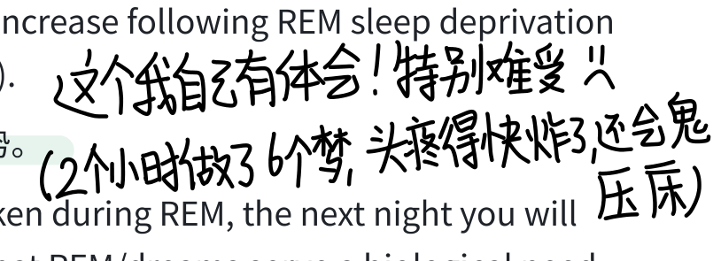

<!-- Source: page 59 -->

  - d. Sleep and creative thinking: Sleep boosts problem-solving and creative thinking.

  - e. Sleep and growth: Deep sleep (NREM-3) triggers pituitary gland to release growth hormone.

- 中文释义：睡眠的五大功能：

  - a. 保护：夜晚睡眠比在黑暗中乱走更安全（进化理论）

  - b. 恢复：睡眠帮助修复脑组织、免疫系统和身体

  - c. 记忆存储：睡眠巩固当天的记忆

  - d. 创造性思维：睡眠提升解决问题和创造性思维

  - e. 生长：深睡眠（NREM-3）刺激脑垂体释放生长激素

- 📝 Example/Key Point: ⭐ Sleep duration varies by species: bat 20hrs, cat 12hrs, human 8hrs, giraffe 2hrs. 不同动物睡眠时长差异大（蝙蝠20h，长颈鹿2h）。

## Module 24: Sleep Deprivation, Sleep Disorders, and Dreams

## 模块24：睡眠剥夺、睡眠障碍与梦

### 29. Effects of Sleep Loss / Sleep Deprivation（睡眠剥夺的影响） ⭐

- English Definition: Sleep loss produces wide-ranging physical and psychological effects.

- 中文释义：睡眠不足产生广泛的生理和心理影响。

- 📝 Example/Key Point: ⭐ PPT 列出的全身影响:

  - Brain: Diminished attentional focus, memory consolidation impaired, increased risk of depression. 注意力下降、记忆巩固受损、抑郁风险增加。

  - Heart: Increased risk of high blood pressure. 高血压风险增加。

  - Stomach: Increased ghrelin (hunger hormone) and decreased leptin (fullness hormone) → obesity. 饥饿素增加、瘦素减少 → 肥胖。

  - Fat cells: Increased production, greater risk of obesity. 脂肪细胞生成增加。

  - Immune system: Suppression of immune cell production, increased viral infections (colds). 免疫细胞生成被抑制，更易感冒。

  - Joints: Increased inflammation and arthritis. 炎症和关节炎增加。

  - Muscles: Reduced strength, slower reaction time, impaired motor learning. 力量下降、反应变慢、运动学习受损。

<!-- Source: page 60 -->

  - Spring forward daylight saving time: More traffic accidents the Monday after we lose one hour of sleep. 夏令时调快一小时后，周一交通事故增加。

### 30. Insomnia（失眠症） ⭐

- English Definition: Recurring problems in falling or staying asleep.

- 中文释义：反复出现的入睡困难或保持睡眠困难。

- 📝 Example/Key Point: ⭐ The most common sleep disorder. Affects about 1 in 10 adults. Treated with sleep hygiene, relaxation techniques, and sometimes sleeping pills (but pills reduce REM and can create dependence). 最常见的睡眠障碍。安眠药会减少REM并产生依赖。

### 31. Narcolepsy（发作性睡病） ⭐

- English Definition: A sleep disorder in which the person has uncontrollable sleep attacks, sometimes lapsing directly into REM sleep.

- 中文释义：一种睡眠障碍，患者出现不可控制的睡眠发作，有时直接进入REM睡眠。

- 📝 Example/Key Point: ⭐ Key: Narcolepsy = sudden, uncontrollable attacks of sleep, often directly into REM. Caused by lack of orexin (hypocretin), a neurotransmitter produced in the hypothalamus. 发作性睡病 = 突然不可控的睡眠发作，常直接进入REM。由下丘脑分泌的食欲素 （orexin）缺乏导致。

### 32. Sleep Apnea（睡眠呼吸暂停） ⭐

- English Definition: A sleep disorder in which the sleeping person repeatedly stops breathing during sleep, waking up gasping for air.

- 中文释义：一种睡眠障碍，睡眠中反复停止呼吸，醒来喘气。

- 📝 Example/Key Point: ⭐ Linked to obesity and high blood pressure. Treated with a CPAP machine (continuous positive airway pressure) — the mask device shown in the PPT. 与肥胖和高血压相关。用CPAP呼吸机（面罩）治疗。患者常自己不记得醒来，但白天极度疲劳。

### 33. Night Terrors（夜惊） ⭐⚠️

- English Definition: A sleep disorder characterized by high arousal and an appearance of being terrified; unlike nightmares, night terrors occur during NREM-3 (deep sleep), within 2–3 hours of falling asleep, and are seldom remembered.

#### 本页手写批注

<!-- Handwritten annotation: p60-01 -->

**原位置：31. Narcolepsy 标题右侧。**

> 比如开车开一半开始睡，很危险。

<!-- Source: page 61 -->

- 中文释义：一种以高度觉醒和恐惧表现为特征的睡眠障碍；与噩梦不同，夜惊发生在NREM-3（深睡眠），入睡后2-3小时内，很少被记住。

- 📝 Example/Key Point: ⭐⚠️ 对比 Night Terrors vs. Nightmares（噩梦）:

  - Night Terrors: NREM-3 深睡眠，儿童多见，心跳呼吸加速，尖叫但不记得，不是噩梦！

  - Nightmares: REM睡眠，生动可怕的梦，能记住，成人更多。

  - Key: Night terrors are NOT dreams — they occur in deep NREM-3 sleep. 夜惊不是梦！

### 34. Sleepwalking / Sleep Talking（梦游/梦话） ⭐

- English Definition: Walking or talking while asleep; usually occurs during NREM-3 deep sleep, early in the night. Generally harmless and not remembered.

- 中文释义：睡觉时行走或说话；通常发生在前半夜的NREM-3深睡眠。一般无害，不被记住。

- 📝 Example/Key Point: ⭐ Like night terrors, sleepwalking occurs in NREM-3 deep sleep, NOT REM. More common in children and runs in families. 梦游和夜惊一样发生在NREM-3，不是 REM。儿童多见，有家族遗传。

### 35. Dreams（梦） ⭐

- English Definition: A sequence of images, emotions, and thoughts passing through a sleeping person's mind. Dreams are notable for their hallucinatory quality, logical discontinuity, and our often-delusional acceptance of them while asleep.

- 中文释义：睡眠者脑海中经过的一系列意象、情绪和思想。梦以幻觉性、逻辑不连贯性、以及我们在睡梦中常常不疑有它为特征。

- 📝 Example/Key Point: ⭐ Most dreams are negative (failures, being attacked, chased, or falling). We dream of ordinary life events, not exotic fantasies. 大多数梦是负面的（失败、被攻击、追赶、坠落）。

### 36. Manifest Content（显梦/显性内容） ⭐

- English Definition: According to Freud, the literal, remembered story line of a dream (as distinct from its latent, hidden content).

- 中文释义：根据弗洛伊德，梦的字面的、被记住的故事情节（区别于隐藏的隐梦内容）。

- 📝 Example/Key Point: ⭐ If you dream of taking a math test naked, the manifest content is "taking a test naked." 梦见裸体考试，显梦内容就是"裸体考试"本身。

#### 本页手写批注

<!-- Handwritten annotation: p61-01 -->

**原位置：35. Dreams 的例子下方右侧。**

> 我做好梦比较多，并画笑脸。

<!-- Source: page 62 -->

### 37. Latent Content（隐梦/隐性内容） ⭐

- English Definition: According to Freud, the underlying, disguised, unconscious meaning of a dream — the hidden wishes or forbidden desires that the dream expresses symbolically.

- 中文释义：根据弗洛伊德，梦的深层的、伪装的、无意识的含义——梦以象征方式表达的隐藏愿望或被禁止的欲望。

- 📝 Example/Key Point: ⭐⚠️ Manifest vs. Latent:

  - Manifest = 字面内容（你记住的故事）

  - Latent = 隐藏含义（无意识愿望，象征表达）

  - Freud called dreams "psychic safety valve" — expressing otherwise unacceptable feelings. 弗洛伊德称梦为"心理安全阀"。

### 38. Dream Theories（梦的理论） ⭐⚠️

⭐ This is the MOST TESTED comparison in the whole unit. Know all 5 theories and their criticisms!

38a. Freud's Wish Fulfillment Theory（弗洛伊德的愿望满足理论） ⭐

- English Definition: Dreams provide a "psychic safety valve" — expressing otherwise unacceptable feelings; contain manifest (remembered) content and a deeper layer of latent content — a hidden meaning.

- 中文释义：梦提供"心理安全阀"——表达否则不可接受的感受；包含显梦（记住的）内容和更深层的隐梦内容——隐藏含义。

- 📝 Criticism: Lacks any scientific support; dreams may be interpreted in many different ways. 缺乏科学支持；梦可以被多种方式解读。

38b. Information-Processing Theory（信息加工理论） ⭐

- English Definition: Dreams help us sort out the day's events and consolidate our memories.

- 中文释义：梦帮助我们整理当天的事件并巩固记忆。

- 📝 Criticism: But why do we sometimes dream about things we have not experienced? 但为什么我们有时会梦见从未经历过的事情？

38c. Physiological Function Theory（生理功能理论） ⭐

- English Definition: Regular brain stimulation from REM sleep may help develop and preserve neural pathways.

- 中文释义：REM睡眠中规律的脑刺激可能帮助发展和保持神经通路。

<!-- Source: page 63 -->

- 📝 Criticism: This does not explain why we experience meaningful dreams. 这不能解释为什么我们体验到有意义的梦。

38d. Neural Activation / Activation-Synthesis Theory（神经激活/激活-合成理论） ⭐

- English Definition: REM sleep triggers neural activity that evokes random visual memories, which our sleeping brain weaves into stories.

- 中文释义：REM睡眠触发神经活动，唤起随机的视觉记忆，我们睡眠中的脑将这些编织成故事。

- 📝 Criticism: The individual's brain is weaving the stories, which still tells us something about the dreamer. 大脑在编织故事，这仍然告诉我们关于做梦者的信息。

- 📝 Example: ⭐ Also called Activation-Synthesis Theory — the brain tries to make sense of random neural firings by constructing a dream narrative. 大脑试图通过构建梦的叙事来解释随机神经放电。

38e. Cognitive Development Theory（认知发展理论） ⭐

- English Definition: Dream content reflects dreamers' cognitive development — their knowledge and understanding.

- 中文释义：梦的内容反映做梦者的认知发展——他们的知识和理解。

- 📝 Criticism: Does not address the neuroscience of dreams. 没有涉及梦的神经科学。

## Module 25: Psychoactive Drugs

## 模块25：精神活性药物

### 39. Psychoactive Drug（精神活性药物） ⭐

- English Definition: A chemical substance that alters perceptions, moods, and consciousness.

- 中文释义：一种改变知觉、情绪和意识的化学物质。

- 📝 Example/Key Point: ⭐ Three major categories: Depressants 抑制剂, Stimulants 兴奋剂, Hallucinogens 致幻剂. 三大类：抑制剂、兴奋剂、致幻剂。

### 40. Substance Use Disorder（物质使用障碍） ⭐

- English Definition: A disorder characterized by continued substance craving and use despite significant life disruption and/or physical risk.

- 中文释义：一种障碍，尽管生活受到严重扰乱和/或身体风险，仍持续渴望和使用某种物质。

<!-- Source: page 64 -->

- 📝 Example/Key Point: ⭐ Diagnostic criteria (11 symptoms, grouped in 4 categories):

  - Impaired Control（控制受损）: Uses more/longer than intended; can't regulate; spends much time; craves. 用量失控、无法调节、花大量时间、渴求。

  - Social Impairment（社会功能受损）: Disrupts work/school/home; continues despite social problems; reduces activities. 影响工作学业家庭、不顾社交问题继续用、活动减少。

  - Risky Use（危险使用）: Continues despite hazards; continues despite physical/psychological problems. 不顾危险继续用、不顾身心问题继续用。

  - Drug Action（药物作用）: Tolerance (needs more for effect); withdrawal when stopping. 耐药性、戒断反应。

  - Severity: mild (2-3 symptoms), moderate (4-5), severe (6+). 严重程度分轻、中、重。

### 41. Tolerance（耐药性/耐受性） ⭐

- English Definition: The diminishing effect with regular use of the same dose of a drug, requiring the user to take larger and larger doses before experiencing the drug's effect.

- 中文释义：常规使用同一剂量药物后效果递减，需要越来越大的剂量才能达到效果。

- 📝 Example/Key Point: ⭐ PPT graph: After repeated exposure, the drug-response curve shifts right — more drug needed to produce the same effect. 反复使用后，药物效应曲线右移 ——需要更多药物才能达到同等效果。This is the brain's neuroadaptation. 这是大脑的神经适应。

### 42. Addiction（成瘾） ⭐

- English Definition: Compulsive drug craving and use, despite adverse consequences.

- 中文释义：不顾负面后果，强迫性地渴求并使用药物。

- 📝 Example/Key Point: Brain circuit changes may persist long after quitting, leading to strong cravings when exposed to triggers (people/places associated with drug use). 戒断后脑回路改变仍可能持续，遇到触发线索会产生强烈渴求。

### 43. Withdrawal（戒断反应） ⭐

- English Definition: The discomfort and distress that follow discontinuing the use of an addictive drug.

- 中文释义：停止使用成瘾药物后出现的不适和痛苦。

<!-- Source: page 65 -->

- 📝 Example/Key Point: ⭐ Physical symptoms (aches, nausea, tremors) and psychological distress (anxiety, cravings). 躯体症状（疼痛、恶心、震颤）和心理痛苦（焦虑、渴求）。

### 44. Dependence（依赖）

- English Definition: A state in which the body has adapted to a drug such that absence of the drug causes withdrawal symptoms.

- 中文释义：身体已适应某种药物，停药会导致戒断症状的状态。

- 📝 Example/Key Point: Physical dependence = body needs the drug; psychological dependence = mind/habit needs the drug (often as a coping mechanism). 生理依赖 vs 心理依赖。

## 45. Depressants（抑制剂） ⭐⚠️

- English Definition: Drugs that reduce neural activity and slow body functions.

- 中文释义：降低神经活动、减缓身体功能的药物。

- 📝 Example/Key Point: ⭐⚠️ Three main types: Alcohol 酒精, Barbiturates 巴比妥类, Opiates 阿片类. 三大类：酒精、巴比妥类（镇静剂）、阿片类（鸦片类）。

### 45a. Alcohol（酒精） ⭐

- English Definition: A depressant that slows neural activity, impairs judgment, and disrupts memory.

- 中文释义：一种抑制剂，减缓神经活动，损害判断，扰乱记忆。

- 📝 Example/Key Point: ⭐ Five effects:

  - a. Disinhibition（去抑制）: Loosens inhibitions; makes people more likely to act on impulses. 降低抑制，冲动行为增加。

  - b. Slowed neural processing（神经加工减慢）: Reaction time slows, reflexes slow. 反应时间减慢、反射变慢。

  - c. Memory disruption（记忆扰乱）: Kills REM sleep; can produce blackouts. 抑制REM睡眠， 可导致断片（blackout）。

  - d. Reduced self-awareness and self-control（自我觉知和自控降低）: People focus on the immediate situation and ignore normal restraints. 只关注当下情境，忽视正常约束。

<!-- Source: page 66 -->

  - e. Expectancy effects（期望效应）: When people believe alcohol has affected them, they behave accordingly — even if they drank a placebo. 即使喝的是安慰剂，只要相信自己喝了酒，行为也会像醉酒一样。

### 45b. Barbiturates / Tranquilizers（巴比妥类/镇静剂） ⭐

- English Definition: Depressants that reduce anxiety and induce sleep by suppressing nervous system activity.

- 中文释义：通过抑制神经系统活动来减少焦虑、诱导睡眠的抑制剂。

- 📝 Example/Key Point: Also called tranquilizers. Prescribed for anxiety or insomnia, but highly addictive and dangerous when combined with alcohol. 也称镇静剂。用于焦虑或失眠， 但极易成瘾，与酒精混合使用非常危险。

### 45c. Opiates（阿片类） ⭐

- English Definition: Opium and its derivatives, such as morphine and heroin; they depress neural activity, temporarily lessening pain and anxiety.

- 中文释义：鸦片及其衍生物，如吗啡和海洛因；抑制神经活动，暂时减轻疼痛和焦虑。

- 📝 Example/Key Point: ⭐ Endorphins（内啡肽）: Opiates mimic endorphins (the body's natural painkillers). When flooded with artificial opiates, the brain stops producing its own endorphins — if the drug is withdrawn, the brain has no natural painkiller, causing agony. 阿片类模拟内啡肽。大量使用后，大脑停止自产内啡肽；停药后身体没有天然止痛剂，导致极度痛苦。Heroin = rush of euphoria, relief from pain; adverse: depressed physiology, agonizing withdrawal. 海洛因 = 快感冲击、止痛；副作用：生理抑制、痛苦的戒断。

## 46. Stimulants（兴奋剂） ⭐⚠️

- English Definition: Drugs that excite neural activity and speed up body functions.

- 中文释义：激发神经活动、加速身体功能的药物。

- 📝 Example/Key Point: ⭐⚠️ Types: Caffeine 咖啡因, Nicotine 尼古丁, Amphetamines 安非他明, Cocaine 可卡因, Methamphetamine 冰毒/甲基苯丙胺, Ecstasy (MDMA) 摇头丸. 所有兴奋剂都加速心率、呼吸、血糖，带来警觉和能量。

### 46a. Caffeine（咖啡因） ⭐

<!-- Source: page 67 -->

- English Definition: A stimulant found in coffee, tea, and energy drinks; increases alertness and wakefulness.

- 中文释义：存在于咖啡、茶和能量饮料中的兴奋剂；提高警觉和清醒度。

- 📝 Example/Key Point: Pleasurable: increased alertness and wakefulness. Adverse: anxiety, restlessness, insomnia in high doses; uncomfortable withdrawal (headaches, fatigue). 愉悦： 警觉清醒；副作用：焦虑、坐立不安、高剂量失眠；戒断不适（头痛、疲劳）。

### 46b. Nicotine（尼古丁） ⭐

- English Definition: A stimulant drug in tobacco; highly addictive.

- 中文释义：烟草中的兴奋剂；高度成瘾。

- 📝 Example/Key Point: ⭐ Physiological effects (PPT list):

  - a. Arouses brain to increased alertness. 唤起大脑、提高警觉。

  - b. Increases heart rate and blood pressure. 增加心率和血压。

  - c. At high levels, relaxes muscles and triggers release of neurotransmitters that may reduce stress. 高剂量时放松肌肉、释放神经递质减压。

  - d. Reduces circulation to extremities. 减少末梢循环。

  - e. Suppresses appetite for carbohydrates. 抑制对碳水化合物的食欲。

  - Adverse: Heart disease, cancer. 副作用：心脏病、癌症。Pleasurable: arousal and relaxation, sense of well-being. 愉悦：唤起与放松、幸福感。

### 46c. Cocaine（可卡因） ⭐

- English Definition: A powerful stimulant derived from the coca plant; produces a quick rush of euphoria by blocking the reuptake of dopamine, norepinephrine, and serotonin.

- 中文释义：从古柯叶提取的强效兴奋剂；通过阻断多巴胺、去甲肾上腺素和5-羟色胺的再摄取，产生快速的快感冲击。

- 📝 Example/Key Point: ⭐ Mechanism: Cocaine binds to reuptake sites → neurotransmitters (dopamine, norepinephrine, serotonin) stay in synapse → intensified mood-altering effects → euphoric rush. When cocaine drops, absence of these neurotransmitters produces a crash （崩溃/低谷）. 可卡因阻断再摄取 → 神经递质留在突触 → 快感冲击；药效退去后神经递质缺乏 → crash（情绪崩溃）。Crack（快克可卡因）: a faster-acting, cheaper, smokable form. 快克是速效、可吸食的形式。Adverse: cardiovascular stress, suspiciousness, depressive crash. 心血管压力、多疑、抑郁性崩溃。

<!-- Source: page 68 -->

### 46d. Amphetamines（安非他明）

- English Definition: Stimulants that stimulate neural activity, causing speeded-up body functions and associated energy and mood changes.

- 中文释义：激发神经活动的兴奋剂，加速身体功能并带来能量和情绪变化。

- 📝 Example/Key Point: Methamphetamine is a highly addictive form of amphetamine. 甲基苯丙胺（冰毒）是高度成瘾的安非他明形式。

### 46e. Methamphetamine（甲基苯丙胺/冰毒） ⭐

- English Definition: A powerfully addictive drug that stimulates the central nervous system, with speeded-up body functions and associated energy and mood changes; over time, appears to reduce baseline dopamine levels.

- 中文释义：一种强效成瘾药物，刺激中枢神经系统，加速身体功能并带来能量和情绪变化；长期使用会降低基线多巴胺水平。

- 📝 Example/Key Point: ⭐ PPT shows before/after photos of a meth user showing severe facial deterioration. Pleasurable: euphoria, alertness, energy. Adverse: irritability, insomnia, hypertension, seizures. 愉悦：欣快、警觉、能量；副作用：易怒、失眠、高血压、癫痫发作。长期使用会损伤多巴胺系统。

### 46f. Ecstasy (MDMA)（摇头丸/MDMA） ⭐

- English Definition: A stimulant and mild hallucinogen. Produces euphoria and emotional elevation by triggering dopamine and serotonin release, and blocking serotonin reuptake.

- 中文释义：一种兴奋剂兼轻度致幻剂。通过触发多巴胺和5-羟色胺释放并阻断5-羟色胺再摄取，产生欣快和情绪提升。

- 📝 Example/Key Point: ⭐ Also called the "Club Drug"（俱乐部毒品）. Full name: methylenedioxymethamphetamine. Pleasurable: emotional elevation, disinhibition. Adverse: dehydration, overheating, depressed mood, impaired cognitive and immune functioning. 愉悦：情绪提升、去抑制；副作用：脱水、过热、情绪低落、认知和免疫功能受损。 特别损伤5-羟色胺神经元。

## 47. Hallucinogens（致幻剂） ⭐⚠️

- English Definition: Psychedelic ("mind-manifesting") drugs that distort perceptions and evoke sensory images in the absence of sensory input.

- 中文释义：迷幻（"显现心灵"）药物，在没有感觉输入的情况下扭曲知觉并唤起感觉意象。

<!-- Source: page 69 -->

- 📝 Example/Key Point: ⭐⚠️ Two main types: LSD 麦角酸二乙酰胺, Marijuana/THC 大麻. 致幻剂 = 在没有外部刺激时产生幻觉。

### 47a. LSD (Lysergic Acid Diethylamide)（麦角酸二乙酰胺/迷幻药） ⭐

- English Definition: A powerful hallucinogenic drug; also known as acid.

- 中文释义：一种强效致幻药物；也称"acid（酸）"。

- 📝 Example/Key Point: ⭐ Near-Death Experience（濒死体验）: Many hallucinogenic experiences resemble reports of people who have come close to death — seeing a bright light, floating, out-of-body sensations. These may explain similar "afterlife" experiences. 许多致幻体验与濒死体验报告相似——看到亮光、漂浮、灵魂出窍。这可能解释类似的"来世"体验。

### 47b. Marijuana / THC（大麻/四氢大麻酚） ⭐

- English Definition: Hemp plant leaves and flowers; the major active ingredient is THC (delta-9-tetrahydrocannabinol), which produces a mild hallucinogenic high, relaxation, and enhanced sensation.

- 中文释义：大麻植物的叶和花；主要活性成分是THC（四氢大麻酚），产生轻度致幻快感、放松和感觉增强。

- 📝 Example/Key Point: ⭐ Classified as a mild hallucinogen（轻度致幻剂）. Pleasurable: enhanced sensation, relief of pain, distortion of time, relaxation. 愉悦：感觉增强、止痛、时间扭曲、放松。Adverse: impaired learning and memory, increased risk of psychological disorders, lung damage from smoke. 副作用：损害学习和记忆、增加心理障碍风险、吸烟导致肺损伤。Note: THC also has medicinal uses (pain relief, nausea in chemotherapy). THC也有药用价值（止痛、化疗止吐）。

## 📋 速查表：各类药物对比（考试必考）

| Drug 药物 | Type 类型 | Pleasurable Effects 愉悦效果 | Adverse Effects 副作用 |
| --- | --- | --- | --- |
| Alcohol 酒精 | Depressant 抑制剂 | Initial high, relaxation, disinhibition | Depression, memory loss, organ damage, impaired reactions |
| Heroin 海洛因 | Depressant 抑制剂 | Rush of euphoria, pain relief | Depressed physiology, agonizing withdrawal |

<!-- Source: page 70 -->

| Drug 药物 | Type 类型 | Pleasurable Effects 愉悦效果 | Adverse Effects 副作用 |
| --- | --- | --- | --- |
| Caffeine 咖啡因 | Stimulant 兴奋剂 | Increased alertness, wakefulness | Anxiety, restlessness, insomnia, uncomfortable withdrawal |
| Methamphetamine 冰毒 | Stimulant 兴奋剂 | Euphoria, alertness, energy | Irritability, insomnia, hypertension, seizures |
| Cocaine 可卡因 | Stimulant 兴奋剂 | Rush of euphoria, confidence, energy | Cardiovascular stress, suspiciousness, depressive crash |
| Nicotine 尼古丁 | Stimulant 兴奋剂 | Arousal and relaxation, well-being | Heart disease, cancer |
| Ecstasy (MDMA) 摇头丸 | Stimulant + mild hallucinogen | Emotional elevation, disinhibition | Dehydration, overheating, depressed mood, impaired cognitive/immune function |
| Marijuana 大麻 | Mild hallucinogen 轻度致幻剂 | Enhanced sensation, pain relief, time distortion, relaxation | Impaired learning/memory, psychological disorders, lung damage |

## ⚠️ 易混淆概念对比总结

### 1. 睡眠阶段对比

| Stage 阶段 | Brain Waves 脑波 | Key Feature 关键特征 | When 何时 |
| --- | --- | --- | --- |
| Awake Relaxed 放松清醒 | Alpha α波 | Drowsy, eyes closed | 入睡前 |
| NREM-1 | Irregular, small | Hallucinations, hypnagogic sensations | 刚入睡几分钟 |
| NREM-2 | Sleep spindles 睡眠纺锤波 | Clearly asleep | ~20 min early night |
| NREM-3 | Delta δ波 | Deep sleep, hard to wake | ~30 min early night; sleepwalking/night terrors here |

<!-- Source: page 71 -->

| Stage 阶段 | Brain Waves 脑波 | Key Feature 关键特征 | When 何时 |
| --- | --- | --- | --- |
| REM | Beta-like (awake-like) | Vivid dreams, eyes dart, muscles paralyzed | Gets longer through the night; paradoxical sleep |

### 2. 催眠理论对比

| Theory 理论 | View of Hypnosis 催眠观 | Key Figure 关键人物 |
| --- | --- | --- |
| Social Influence Theory 社会影响理论 | Hypnosis = role-playing, social conformity 角色扮演 | Social psychologists |
| Divided-Consciousness Theory 分裂意识理论 | Hypnosis = real dissociation, altered state 真正的意识分离 | Hilgard |

### 3. 梦的理论对比

| Theory 理论 | Core Idea 核心观点 | Criticism 批评 |
| --- | --- | --- |
| Freud's Wish Fulfillment 愿望满足 | Manifest + latent content, psychic safety valve 显梦+隐梦，心理安全阀 | No scientific support, endless interpretations |
| Information-Processing 信息加工 | Consolidate day's memories 巩固记忆 | Why dream of unexperienced things? |
| Physiological Function 生理功能 | REM stimulation builds neural pathways 脑刺激建立神经通路 | Doesn't explain meaningful dreams |
| Neural Activation (Activation-Synthesis) 激活-合成 | Brain weaves random neural firings into stories 随机神经放电编故事 | Still tells us about the dreamer |
| Cognitive Development 认知发展 | Dreams reflect knowledge and maturation 梦反映认知发展 | Ignores neuroscience |

### 4. 三类药物对比

| Category 类别 | Effect 效果 | Examples 举例 |
| --- | --- | --- |
| Depressants 抑制剂 | Slow down nervous system 减缓神经系统 | Alcohol, barbiturates, opiates (heroin) |
| Stimulants 兴奋剂 | Speed up nervous system 加速神经系统 | Caffeine, nicotine, cocaine, amphetamines, meth, MDMA |

<!-- Source: page 72 -->

| Category 类别 | Effect 效果 | Examples 举例 |
| --- | --- | --- |
| Hallucinogens 致幻剂 | Distort perception, evoke images 扭曲知觉 | LSD, marijuana (THC) |

## ⭐ 考试高频考点清单 (Must-Know)

1. Circadian rhythm = 24-hour biological clock, controlled by SCN → pineal gland → melatonin.

2. Sleep cycle = 90 minutes, repeating NREM-1 → NREM-2 → NREM-3 → NREM-2 → REM.

3. REM sleep = paradoxical sleep, vivid dreams, muscles paralyzed, brain active.

4. REM rebound = more REM after REM deprivation.

5. Night terrors & sleepwalking = NREM-3 deep sleep, NOT REM dreams.

6. Narcolepsy = sudden sleep attacks directly into REM.

7. Sleep apnea = repeated breathing stoppages, CPAP treatment.

8. Insomnia = trouble falling/staying asleep.

9. Manifest vs. Latent content (Freud) = literal story vs. hidden unconscious meaning.

10. Five dream theories and their criticisms.

11. Hilgard's dissociation / hidden observer = divided consciousness theory of hypnosis.

12. Social influence theory vs. divided-consciousness theory of hypnosis.

13. Posthypnotic suggestion = used by hypnotherapists for pain/habit control.

14. Tolerance, withdrawal, addiction, substance use disorder definitions.

15. Three drug categories (depressants/stimulants/hallucinogens) and examples.

16. Cocaine mechanism = blocks reuptake of dopamine/norepinephrine/serotonin → rush → crash.

17. Opiates = mimic endorphins, brain stops producing own endorphins → agonizing withdrawal.

18. MDMA/Ecstasy = stimulant + mild hallucinogen, triggers dopamine + serotonin.

19. LSD = powerful hallucinogen; near-death experiences similarity.

20. Marijuana/THC = mild hallucinogen, impairs memory and learning.

🎯 End of Unit 5 Notes. Good luck on your midterm! 期中加油！

<!-- Source: page 73 -->

# AP Psychology 期中复习笔记：社会认知 · 人格动机情绪 · 神经肌肉动作电位

本笔记覆盖三大模块：

Part 1 归因理论与人际知觉（Attribution Theory & Person Perception）

Part 2 人格 / 动机 / 情绪 FRQ 术语（Personality, Motivation & Emotion）

Part 3 肌肉结构 · 细胞膜 · 动作电位术语表（Neuromuscular & Action Potential）

标注说明：⭐ = 考试高频考点；⚠️ = 易混淆概念对比；📝 = 例子 / 答题要点。

# Part 1 · 归因理论与人际知觉（Attribution Theory & Person Perception）

## 一、Attribution Theory 归因理论基础

### 1. Attribution Theory（归因理论）

- English Definition: An area of social cognition concerned with how people explain the behavior and mental processes of themselves and others. The explanation we arrive at for a behavior is called an attribution（归因）.

- 中文释义： 社会认知的一个分支，研究人们如何解释自己和他人行为的原因。我们对行为原因所做的解释就叫"归因"。

- 📝 Example/Key Point: 朋友考试挂了，你可能会想"他太笨"（内部）或"题太难"（外部）——这就是两种不同的归因方式。⭐ 出题常给一个场景，让你判断当事人做的是哪种归因。

### 2. Dispositional / Internal Attribution（特质归因 / 内部归因）

- English Definition: Explaining behavior in terms of internal qualities of the person —personality, character, ability, effort, or attitudes.

- 中文释义： 用个人内在因素解释行为——人格、品德、能力、努力、态度等。

- 📝 Example/Key Point: "She got an A because she is intelligent and hardworking."（她拿A是因为聪明又努力。）⚠️ 注意：dispositional = internal = person attribution，三者是同义词。

### 3. Situational / External Attribution（情境归因 / 外部归因）

- English Definition: Explaining behavior in terms of external circumstances — context, environment, luck, or social pressure the person was experiencing.

- 中文释义： 用外部环境因素解释行为——情境、环境、运气、社会压力等。

<!-- Source: page 74 -->

- 📝 Example/Key Point: "He was rude because he was having a terrible day and under enormous stress."（他粗鲁是因为今天很惨、压力很大。）⭐ 现实中大多数行为是两者共同作用的结果，关键看人倾向于用哪一种、以及归因是否准确。

## 二、Explanatory Style 解释风格

### 4. Explanatory Style（解释风格） ⭐

- English Definition: The habitual, relatively stable and predictable way a person explains good and bad events in their own life and in the lives of others. It can be optimistic or pessimistic.

- 中文释义： 一个人习惯性、稳定可预测地解释生活中好事与坏事的方式；分为乐观型与悲观型两种。

- 📝 三维度记忆法（⭐ 必背）：解释风格由三个维度决定——

  - Internal vs External（内/外）

  - Stable vs Unstable（稳定/不稳定）

  - Global vs Specific（普遍/特定）

### 5. Optimistic Explanatory Style（乐观型解释风格） ⭐

- English Definition: Bad events are attributed to external, unstable, specific causes; good events are attributed to internal, stable, global causes.

- 中文释义： 把坏事归因为外部、不稳定、特定的原因；把好事归因为内部、稳定、普遍的原因。

- 📝 Example/Key Point:

  - 坏事："I failed because the test was unfair."（我挂了是因为题出得不公平。）

  - 好事："I succeeded because I am capable and hardworking."（我成功是因为我有能力又努力。）

  - 与更高的心理韧性、动机、身心健康相关。

### 6. Pessimistic Explanatory Style（悲观型解释风格） ⭐

- English Definition: Bad events are attributed to internal, stable, global causes; good events are attributed to external, unstable, specific causes.

- 中文释义： 把坏事归因为内部、稳定、普遍的原因；把好事归因为外部、不稳定、特定的原因。

- 📝 Example/Key Point:

  - 坏事："I failed because I am not intelligent enough."（我挂了是因为我不够聪明。）

  - 好事："I succeeded because I got lucky this time."（我成功是因为这次运气好。）

#### 本页手写批注

<!-- Handwritten annotation: p74-01 -->

**原位置：5. Optimistic Explanatory Style 英文释义右下。**

> 赞美自己，我就是最权威的。

<!-- Handwritten annotation: p74-02 -->

**原位置：6. Pessimistic Explanatory Style 英文释义右下。**

> 贬低自己，谦虚。

<!-- Source: page 75 -->

  - ⚠️ 与抑郁和习得性无助（learned helplessness）高度相关——这是FRQ常考链。

## 三、Attributional Biases 归因偏差

### 7. Fundamental Attribution Error (FAE)（基本归因错误） ⭐⭐

- English Definition: The tendency to overestimate the role of dispositional factors and underestimate the role of situational factors when explaining other people's behavior. We focus on the person rather than the situation.

- 中文释义： 解释他人行为时，高估个人特质因素、低估情境因素的倾向——"对人不对事"。

- 📝 Example/Key Point: 陌生人插队，你会想"真没素质"，而不是"也许他有急事"。

  - ⭐ 文化差异考点：FAE 在个人主义文化（如美国）中更常见；在集体主义文化（如中国）中人们更倾向考虑情境因素。

  - ⭐ 现实后果考点（Skill 4.A）：导致对困境中人的苛刻评判，如指责无家可归者、陪审团假定被告"本性坏"而忽视胁迫/极端压力等情境因素。

### 8. Actor-Observer Bias（行动者—观察者偏差） ⭐

- English Definition: The tendency to explain behavior differently depending on perspective: when explaining our own behavior (actor) we make situational attributions; when explaining others' behavior (observer) we make dispositional attributions.

- 中文释义： 因视角不同而对行为做出不同解释：解释自己的行为时倾向情境归因；解释他人行为时倾向特质归因。

- 📝 Example/Key Point:

  - "我迟到是因为堵车"（自己→情境）

  - "她总迟到，她就是没条理"（他人→特质）

- ⚠️ FAE vs Actor-Observer Bias 对比（必考）：

  - FAE 只谈"我们如何解释别人的行为"（只看他人那一侧）。

  - Actor-Observer Bias 强调"解释自己 vs 解释他人"的对比（两侧都有）。

### 9. Self-Serving Bias（自利偏差） ⭐⭐

- English Definition: The tendency to attribute successes to internal (dispositional) factors and failures to external (situational) factors, in order to protect and enhance self-esteem.

- 中文释义： 把成功归因为内部特质因素、把失败归因为外部情境因素的倾向，用以维护和提升自尊。

#### 本页手写批注

<!-- Handwritten annotation: p75-01 -->

**原位置：7. Fundamental Attribution Error 英文释义右下。**

> 针对人。

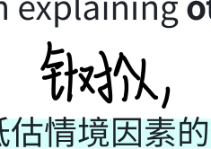

<!-- Source: page 76 -->

- 📝 Example/Key Point: "我拿A是因为我聪明又努力"（成功→内部）；"我挂了是因为老师出题不公平"（失败→外部）。

  - 适度时是适应性的（保护动机与心理健康）；过度则妨碍自我反思、不公平地指责他人。

  - ⚠️ 与解释风格联动：乐观型解释风格的人自利偏差更强。

## 四、Locus of Control 控制点

### 10. Locus of Control（控制点） ⭐

- English Definition: The extent to which individuals believe they have control over the events and outcomes in their lives. A stable individual difference in attribution style, existing on a continuum from internal to external.

- 中文释义： 个体在多大程度上相信自己能掌控生活中的事件与结果；是一种稳定的个体差异，呈内控 ↔ 外控连续谱。

- 📝 答题线索（Skill 1.B）：看人物把结果归因于"自己的努力与选择"还是"运气、命运、他人"。

### 11. Internal Locus of Control（内控型）

- English Definition: The belief that outcomes are largely the result of one's own actions, effort, and decisions; seeing oneself as an active agent in shaping one's life.

- 中文释义： 相信结果主要由自身行动、努力和决定决定；视自己为塑造人生的主动者。

- 📝 Example/Key Point: "If I study hard, I will do well." 与更高的动机与坚持、更好的学业/职业成就、更积极的心理健康相关。常与乐观解释风格相连。

### 12. External Locus of Control（外控型）

- English Definition: The belief that outcomes are determined by external forces such as luck, fate, other people, or the system; feeling that outcomes are largely beyond one's control.

- 中文释义： 相信结果由运气、命运、他人或体制等外部力量决定；感到结果基本不受自己掌控。

- 📝 Example/Key Point: "No matter how much I study, it depends on luck." 与更低的动机与坚持、更易陷入习得性无助、更差的心理健康相关。常与悲观解释风格相连。

## 五、Person Perception 人际知觉

### 13. Person Perception（人际知觉）

<!-- Source: page 77 -->

- English Definition: The processes by which we form impressions and make judgments about others, and about ourselves in relation to others. These judgments are not purely objective, but are shaped by cognitive shortcuts, prior expectations, and social context.

- 中文释义： 我们对他人（以及与他人关系中的自己）形成印象和判断的过程。这些判断并非纯客观，而是受认知捷径、先前期望和社会情境影响。

### 14. Mere Exposure Effect（多看效应 / 纯粹接触效应） ⭐

- English Definition: The tendency to develop a preference for stimuli simply because we are exposed to them repeatedly. Familiarity increases liking, even without any direct positive experience. Operates largely outside conscious awareness.

- 中文释义： 仅仅因为反复接触就对刺激产生偏好的倾向——熟悉度提升好感，即使没有任何直接的正面体验；多在意识觉知之外运作。

- 📝 Example/Key Point:

  - 更偏爱常看到的糖果品牌、偏爱自己名字里的字母、偏爱自己的镜像（而他人偏爱你的照片）。

  - ⭐ 广告应用：反复曝光品牌提升消费者偏好；社交中常见面的邻居/同学/同事印象更正面。

  - 答题线索：驱动力是熟悉度而非真实评价。

### 15. Self-Fulfilling Prophecy（自证预言 / 自我实现预言） ⭐⭐

- English Definition: Occurs when expectations about a person lead to behaviors that cause those expectations to come true. The expectation shapes behavior, which then produces the expected outcome, reinforcing the original belief.

- 中文释义： 对某人的期望引发相应行为，最终使期望成真的过程——期望塑造行为，行为产出预期结果，反过来强化原信念。

- 📝 Example/Key Point:

  - 老师认为某学生有潜力 → 给予更多关注鼓励 → 学生成绩真的提升。

  - ⭐ Rosenthal & Jacobson (1968) 罗森塔尔实验（必考）： 随机告诉老师某些学生"即将快速进步"，学年末这些学生真的取得更大进步——教师期望影响了对待方式。又称"皮格马利翁效应 Pygmalion effect"。

  - 双向性：高期望→更好结果；低期望→更差结果。

  - ⭐ 教育不平等考点（Skill 4.A）：教师对特定群体学生的低期望会造成低产出，强化既有不平等。

### 16. Social Comparison（社会比较） ⭐

<!-- Source: page 78 -->

- English Definition: The process of evaluating ourselves by comparing to others. Festinger (1954) proposed that people have a natural drive to assess their abilities and opinions, especially when objective standards are unavailable.

- 中文释义： 通过与他人比较来评价自己的过程。Festinger（1954）提出，当缺乏客观标准时，人们有评估自身能力与观点的天然驱力。

- 📝 两种方向：

  - Upward Comparison（向上比较）： 与比自己强/好的人比 → 可激励进步，但也产生不足感、嫉妒、低自尊。例：把成绩跟班里第一名比。

  - Downward Comparison（向下比较）： 与比自己差的人比 → 通常提升自尊、产生积极感受，但也可能自满。例：把成绩跟班里最后一名比。

### 17. Relative Deprivation（相对剥夺感） ⭐

- English Definition: The perception that one is worse off compared to others, even if one's objective situation is adequate. It is a subjective social comparison, not absolute need.

- 中文释义： 即使客观处境尚可，主观上感到自己比别人差的知觉；是一种主观社会比较，而非绝对匮乏。

- 📝 Example/Key Point: 薪水不错的人，如果周围人都赚得更多，仍会感到相对剥夺。可引发不满、怨恨乃至社会动荡——即使社会客观生活水平很高。

# Part 2 · 人格 / 动机 / 情绪 FRQ 术语

## 一、Defense Mechanisms 防御机制（Freud 精神分析）

### 18. Repression（压抑） ⭐

- English Definition: A psychological defense mechanism that involves unconsciously banishing unacceptable thoughts, feelings, or painful memories from consciousness.

- 中文释义： 一种防御机制，将不可接受的想法、情感或痛苦记忆无意识地逐出意识之外。

- 📝 Example/Key Point: 一个人10岁时遭遇惨烈车祸，到17岁几乎不记得任何细节——心灵把痛苦记忆压抑了。⚠️ 关键词是unconsciously（无意识），不是主动"忘记"。

### 19. Projection（投射） ⭐

- English Definition: A defense mechanism where people disguise their own threatening impulses or flaws by attributing them to others.

- 中文释义： 把自己身上令人不安的冲动或缺点，归咎到别人身上，以此掩饰自己。

<!-- Source: page 79 -->

- 📝 Example/Key Point: 经常出轨的人，反而毫无根据地指责伴侣冷落自己。⚠️ 核心："把自己的问题安到别人头上"。

### 20. Rationalization（合理化 / 文饰作用） ⭐

- English Definition: A defense mechanism that offers self-justifying explanations in place of the real, more threatening, unconscious reasons for one's actions.

- 中文释义： 用自我辩解的解释，取代真实的、更具威胁性的无意识行为理由。

- 📝 Example/Key Point: 学生被老师批评后，不说"我惹老师生气了"，而说"老师今天心情不好"。

- ⚠️ 三种防御机制对比（必考）：

  - Repression = 把痛苦记忆压下去（不记得）

  - Projection = 把自己的缺点甩给别人

  - Rationalization = 给行为找一个好听的借口

## 二、Humanistic Theory 人本主义

### 21. Unconditional Positive Regard（无条件积极关注） ⭐

- English Definition: A concept developed by Carl Rogers meaning basic acceptance and support of a person regardless of what the person says or does.

- 中文释义： Carl Rogers（罗杰斯）提出的概念，指无论一个人说什么、做什么，都给予基本的接纳与支持。

- 📝 Example/Key Point: 父母明确表示，即使孩子在学校犯了大错，他们依然完全爱他、支持他。 ⭐ 与"有条件积极关注"相对；是健康自我发展的关键条件。

### 22. Self-Actualization（自我实现） ⭐

- English Definition: The highest level of Maslow's hierarchy of needs, referring to the motivation to fulfill one's potential and talents; describing a person whose basic needs are met and who can pursue higher-level needs to reach full potential.

- 中文释义： Maslow（马斯洛）需求层次的最高层，指实现自身潜能与天赋的动机；基本需求满足后才能追求。

- 📝 Example/Key Point: 只有当生理、安全、归属、尊重等低层需求被满足，人才会追求自我实现。⚠️ 注意顺序：必须从底层开始满足。

## 三、Big Five Personality Traits 大五人格（OCEAN）

<!-- Source: page 80 -->

- 中文释义： 生理需求产生唤醒紧张状态（驱力），驱动有机体去满足需求、恢复体内平衡。

- 📝 Example/Key Point: 身体缺水→产生口渴的不适感（drive）→驱动喝水→口渴消除，恢复平衡。⭐ 关键词：homeostasis 体内平衡。

### 27. Incentive Theory（诱因理论） ⭐

- English Definition: A theory stating that external stimuli (rewards or punishments) pull or push behavior, motivating individuals to act in certain ways.

- 中文释义： 外部刺激（奖励或惩罚）"拉"或"推"着行为，驱动人以特定方式行动。

- 📝 Example/Key Point: 销售员每天加班给客户打电话，因为想赢得公司提供的夏威夷豪华之旅。

- ⚠️ Drive Reduction vs Incentive 对比： drive reduction 是从内部需求往外推（push，内因）；incentive 是外部目标往里拉（pull，外因）。

### 28. Optimum Arousal（最佳唤醒理论） ⭐

- English Definition: The theory that human motivation aims not to eliminate arousal but to seek optimum levels of arousal. Too little or too much arousal leads to discomfort.

- 中文释义： 动机的目标不是消除唤醒，而是寻求最佳唤醒水平；太低或太高都不舒服。

- 📝 Example/Key Point: 疲惫一周后决定去演唱会放松、"充电"。⭐ 与 Yerkes-Dodson Law（耶克斯-多德森定律） 联动：中等唤醒水平表现最佳。

### 29. Approach-Approach Conflict（双趋冲突） ⭐

- English Definition: A psychological conflict that occurs when an individual must make a choice between two desirable but mutually exclusive options.

- 中文释义： 必须在两个都想选、但又只能选其一的目标之间做决定时产生的心理冲突。

- 📝 Example/Key Point: 毕业生同时拿到两家梦想公司的高薪offer，但只能选一家。

- ⚠️ 三种冲突对比：

  - Approach-approach（双趋）： 两个都想要 → 选哪个都不错，冲突较轻。

  - Avoidance-avoidance（双避）： 两个都不想要 → 必须选一个。

  - Approach-avoidance（趋避）： 同一个目标既想又怕（如想吃蛋糕又怕胖）。

## 五、Emotion Theories 情绪

### 30. Cognitive Appraisal（认知评价） ⭐⭐

- English Definition: The theory that one's personal interpretation (appraisal) of a situation ultimately determines one's emotional response to it.

#### 本页手写批注

<!-- Handwritten annotation: p80-01 -->

**原位置：27. Incentive Theory 标题右侧。**

> 外界诱因。

<!-- Handwritten annotation: p80-02 -->

**原位置：28. Optimum Arousal 的例子右下。**

> 累的时候找出口。

<!-- Source discontinuity: page 79 ends with the Big Five heading; page 80 begins with a Chinese definition and then item 27. Items 23-26 are not present as complete entries in the supplied PDF. -->

<!-- Source: page 81 -->

- 中文释义： 个体对情境的主观解释（评价）最终决定其情绪反应。

- 📝 Example/Key Point（FRQ 万能例子）：

  - 两人在树林里遇到大狗：A 把狗评价为"危险威胁"→ 极度恐惧、逃跑；B（训狗师）把狗评价为"迷路的友好宠物"→ 同情、喜悦、上前接近。

  - ⭐ 核心：同一刺激，不同评价 → 不同情绪。这是情绪认知理论（Lazarus）的核心。

### 31. Display Rules（表达规则 / 表露规则） ⭐

- English Definition: A social group or culture's informal norms about how and when it is appropriate to express emotions.

- 中文释义： 某一社会群体或文化中，关于何时、以何种方式表达情绪才恰当的非正式规范。

- 📝 Example/Key Point: 很多文化中，收到不喜欢的生日礼物时要掩饰失望、礼貌微笑表示感谢。 ⭐ 具有文化差异，是跨文化情绪研究考点。

# Part 3 · 神经肌肉与动作电位术语表

## 一、Muscle Structure 肌肉结构

### 32. Myofilaments（肌丝）

- English Definition: Protein filaments inside muscle fibers, including thin actin filaments and thick myosin filaments.

- 中文释义： 肌纤维内的蛋白细丝，分为细肌丝（actin）和粗肌丝（myosin）两种。

### 33. Actin（肌动蛋白 / 细肌丝） ⭐

- English Definition: Protein that forms thin myofilaments in muscle cells. Acts as the passive "track."

- 中文释义： 构成细肌丝的蛋白质；像被动的"轨道"，myosin 在上面滑行。

### 34. Myosin（肌球蛋白 / 粗肌丝） ⭐

- English Definition: Protein that forms thick myofilaments in muscle cells; has small "head" motors that grab actin and pull it.

- 中文释义： 构成粗肌丝的蛋白质；带小马达"脑袋"，能抓住 actin 并拉动。

### 35. Sarcomere（肌节） ⭐⭐

- English Definition: The basic contractile unit of skeletal muscle, located between two Z disks.

<!-- Source ends here after the English definition of item 35, Sarcomere. No following Chinese definition or later neuromuscular entries are present in the supplied PDF. -->
