# AP Statistics Handwritten Notes

## U1 Exploring One Variable Data and Collecting Data

### 1.0 Introduction Statistics

**Observational Unit**: An object described in a set of data. Can be people, animals, or things. Individual: mostly refer to people.

**Categorical (Qualitative) Variable**: Assigns labels that place each individual into a particular group, called a category.

**Quantitative Variable**: Takes number values that are quantities — counts or measurements.

**Identifier Variable**: Categorical variable with exactly one individual in each category.

### 1.1 Analyzing Categorical Data

#### Frequency Table

| Preferred method | Frequency | Relative Frequency |
|---|---:|---|
| Cell phone | 2 | $2/10=0.2$ or $20\%$ |
| Facebook | 1 | $1/10=0.1$ or $10\%$ |
| In person | 3 | $3/10=0.3$ or $30\%$ |
| Text messaging | 4 | $4/10=0.4$ or $40\%$ |

The source gives a Frequency Table and a separate Relative Frequency Table with these same categories.

#### Bar Graph

Left graph: vertical axis Number of Students, heights 2, 1, 3, 4. Right graph: vertical axis Percent, heights 20, 10, 30, 40. Both horizontal axes list Cell Phone, Facebook, In person, Text messaging.

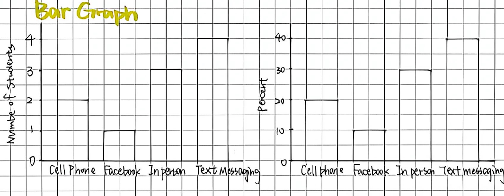

#### Pie Chart

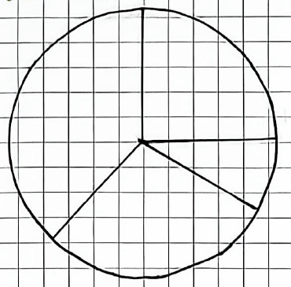

### 1.2 Analyzing Quantitative Data

#### Dotplot

Data:
$$\begin{matrix}5&5&1&10&5&2&1&1&2&3\\3&2&1&4&2&1&2&1&9&3\end{matrix}$$

Spreadsheet icon → Data → Quick Graph.

The dotplot has values 0 through 10, with counts: 1: 6; 2: 5; 3: 3; 4: 1; 5: 3; 9: 1; 10: 1.

#### Stemplot

F: 50, 26, 26, 31, 57, 19, 24, 22, 23, 38.

M: 13, 50, 13, 34, 23, 30, 49, 13, 15, 51.

| Stem | Leaves |
|---|---|
| 1 | 3 3 3 5 9 |
| 2 | 2 3 3 4 6 6 |
| 3 | 0 1 4 8 |
| 4 | 9 |
| 5 | 0 0 1 7 |

Key: $4\mid9$ represents a male student who reported having 49 pairs of shoes.

Back to back stemplot:

| Left leaves | Stem | Right leaves |
|---|---|---|
| 9 | 1 | 3 3 3 5 |
| 6 6 4 3 2 | 2 | 3 |
| 8 1 | 3 | 0 4 |
| | 4 | 9 |
| 7 0 | 5 | 0 1 |

Key: $4\mid9$ represents a student who reported having 49 pairs of shoes.

#### Histogram

Menu → Plot type → Histogram. Vertical axis Frequency (or relative frequency).

| Class | Count |
|---|---:|
| $0\le x<5$ | 20 |
| $5\le x<10$ | 13 |
| $10\le x<15$ | 9 |
| $15\le x<20$ | 5 |
| $20\le x<25$ | 2 |
| $25\le x<30$ | 1 |
| Total | 50 |

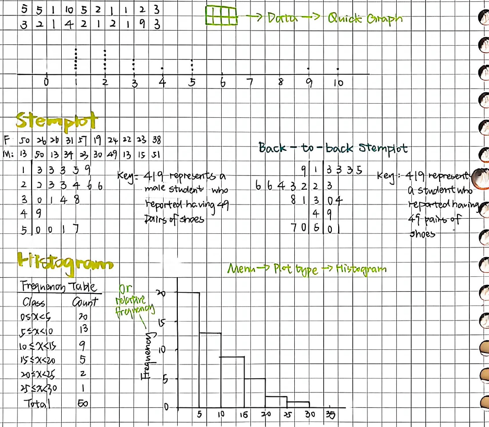

**Bimodal**: two clear peaks; two centers; gap.

**Uniform**: each bar height is approximately the same; no prominent peaks.

#### Describing Distribution

- Shape: Unimodal (symmetric, skew to left, skew to right); Bimodal; Uniform.
- Center: Mean/median.
- Variability: Range/IQR.
- Unusual features: Gaps/Clusters; Outliers.

#### Comparing Distributions

Use comparative words: same/different/more/less.

### 1.4 Describing Location in a Distribution

**Percentiles**: The $p$th percentile is interpreted as the value that has $p\%$ of the data less than or equal to it.

**Z Scores (Standardized Scores)**: Tells how many standard deviations from the mean an observation falls, and in what direction.
$$z=\frac{x-\mu}{\sigma}.$$
→ “'s … is … standard deviations above/below the mean of …”

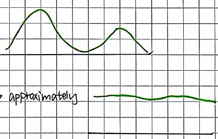

#### Boxplot

Spreadsheet icon → data → quick graph → menu → plot type → boxplot.

Labels: Outliers; Min; $Q_1$; Median; $Q_3$; Max; Outlier; Whisker.

Five number Summary: min, $Q_1$, median, $Q_3$, max.

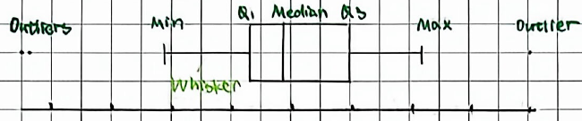

### 1.3 Describing Quantitative Data with Numbers

#### Measuring Center

**Mean**: $\bar x$; sensitive to extreme.

Spreadsheet icon → menu → statistics → calculation → one variable → $\bar x$.

**Median**: resistant to extreme.

#### Measuring Variability

**Range**: Range = Maximum − Minimum. Sensitive to extreme. A single number.

**Standard Deviation**: sensitive to extreme. The typical distance of the values in a distribution of … from the mean …

**IQR (Interquartile Range)**:
$$\mathrm{IQR}=Q_3-Q_1.$$
$Q_1$: 左四分位点；$Q_3$: 右四分位点。

**Identifying Outliers — The $1.5\times\mathrm{IQR}$ Rule**:

- Lower outliers $<Q_1-1.5\times\mathrm{IQR}$.
- Higher outliers $>Q_3+1.5\times\mathrm{IQR}$.

#### Describing Shape

Unimodal: single peak.

- Symmetric: mean ≈ median.
- Skew to left: mean $<$ median.
- Skew to right: mean $>$ median.

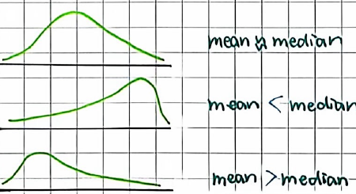

### 1.5 Sampling and Surveys

**Population**: the entire group of individuals we want information about.

#### Statistic vs Parameter

| Name | Statistic (sample) | Parameter (population) |
|---|---|---|
| Mean | $\bar x$ | $\mu$ |
| Standard Deviation | $s$ | $\sigma$ |
| Correlation | $r$ | $\rho$ |
| Regression Coefficient | $b_1$ | $\beta_1$ |
| Proportion | $\hat p$ | $p$ |

#### Sampling Methods

**Simple Random Sample (SRS)**: every group of a given size has an equal chance of being chosen.

How?

- Label: give each individual in the population a distinct numerical label from 1 to $N$.
- Randomize: use a random number generator to obtain $n$ different integers from 1 to $N$.
- Select: choose the individuals that correspond to the randomly selected integers.

**Stratified Random Sample**: the division of population into separate groups, called strata, based on shared attribute or characteristics (homogeneous grouping).

**Cluster Random Sample**: the division of a population into smaller groups, called cluster, each cluster similar to each other (heterogeneous grouping).

**Systematic Random Sample**: Sample members from a population are selected according to a random starting point and a fixed periodic interval. i.e. 11 → 16 → 21 → 26 (increments of 5 in the sketch).

**Census**: select all items/subjects in a population.

#### Sampling Bias

Bias; Sampling variability.

**Voluntary Response Bias**: When a sample is comprised entirely of volunteers or people who choose to participate, the sample will typically not be representative of the population. Only people who … will participate, so it will over/underestimate the result.

**Undercoverage Bias**: When part of the population has a reduced chance of being in the sample, …

**Nonresponse Bias**: Individuals chosen for the sample for whom data cannot be obtained (or who refuse to respond) may differ from those for whom data can be obtained.

**Response Bias**: Problems in the data gathering instrument or process result in response bias. i.e. misleading framing of questions.

**Convenience Sample Bias**: Nonrandom sampling methods introduce potential for bias because they do not use chance to select the individual.

### 1.6 Experiments

**Observational Study**: Treatments are NOT imposed.

- Retrospective（已有）: examine data for a sample of individuals.
- Prospective（未来）: follow a sample of individuals into the future collecting data.

**Experiment**: Treatments are imposed; manipulate factor levels; compare responses.

**Treatment**: the levels or combination of levels of the explanatory variable(s) are called treatments.

**Experimental units**: the individuals (which may be people or other objects of study).

**Explanatory Variable** = Independent Variable: A variable whose levels are manipulated intentionally.

**Response Variable** = Dependent Variable: The outcome from the experimental units that is measured after the treatments have been administered.

**Extraneous Variable**: Known/of believed to affect the response but is not an explanatory variable.

**Confounding Variable**: A variable that is related to the explanatory variable and influences the response variable.

Diagram: a circle “Confounding” lies inside a larger circle “extraneous.”

#### Other Terminology

**Blinding**: Any individual associated with an experiment who is not aware of how subjects have been allocated to treatment groups.

- Single blind: Subjects do not know, researchers know.
- Double blind: Subjects & researchers don't know.

**Placebo**: A treatment known to have no effect.

**Placebo Effect**: Occurs when experimental units have a response to a placebo.

**Control Group**: A collection of experimental units either not given a treatment of interest or given a treatment with placebo.

#### Four Principles of a Well designed Experiment

**Comparison**: Comparisons of at least 2 experiment.

**Random Assignment**: Equalize the effects of unknown/uncontrollable sources of variation; allow for causation conclusions.

**Replication**: enough experimental units (multiple for each treatment).

**Control**: making conditions as similar as possible to control potential confounding variables.

#### Experimental Design

**Completely Randomized Design**: Treatments are assigned to experimental units completely at random.

**Randomized (Complete) Block Design**: Blocking ensures that at the beginning of the experiment within each block are similar to each other with respect to at least one variable. Help to separate natural variability from differences due to the blocking variable. Blocking separate the variation in the response to allow for a more precise comparison of the treatments.

**Matched Pairs Design**:

- Special case of randomized block design.
- Using a blocking variable, subjects are arranged in pairs matched on relevant factors.
- Each pair receives both treatments by randomly assigning one treatment to one member of the pair.

## U2 Probability Random Variables and Probability Distributions

### 2.1 Analyzing Data on Two Categorical Variables

#### Two Way Tables Contingency Table

A table of counts that summarizes data on the relationship between two categorical variables for some group of individuals.

Environmental Club:

| Snowmobile Use | No | Yes | Total |
|---|---:|---:|---:|
| Never used | 445 | 212 | 657 |
| Snowmobile renter | 497 | 77 | 574 |
| Snowmobile owner | 279 | 16 | 295 |
| Total | 1221 | 305 | 1526 |

**Marginal Frequency**: row and column totals divided by the total for the entire table.
$$\frac{\text{Row (Column) Total}}{\text{Total}},\qquad\text{i.e. }\frac{657}{1526}.$$

**Joint Relative Frequency**: a cell frequency divided by the total for the entire table. i.e. Yes + Owner $=16/1526$.

**Conditional Relative Frequency**: a relative frequency for a specific part of the table. i.e. Owner$\mid$Yes $=16/305$.

#### Side by side Bar Graph

Horizontal axis Environmental Club Membership: No/Yes. Vertical axis Percent (0–100). Legend Snowmobile Use: Never (blue), Rent (green), Own (yellow).

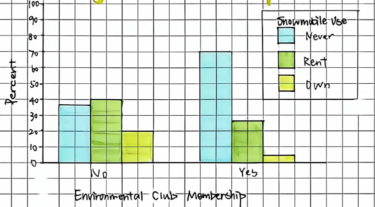

#### Segmented Bar Graph

Displays the same information as a pie chart. Horizontal axis Environmental Club Membership (No/Yes), vertical axis Percent (0–100). Legend Snowmobile Use: Never (blue), Rent (green), Own (yellow).

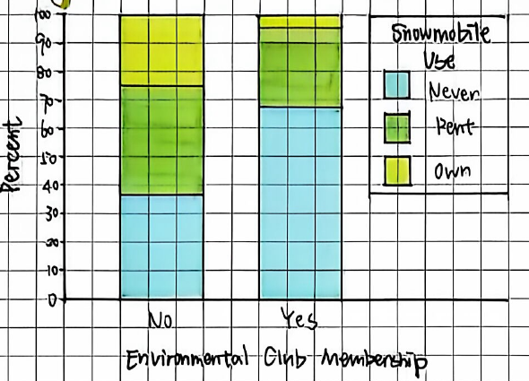

#### Mosaic Plot

Horizontal axis Environmental Club Membership (No/Yes), vertical axis Percent (0–100). Legend Snowmobile Use: Never (blue), Rent (green), Own (yellow). The No column is wider than the Yes column.

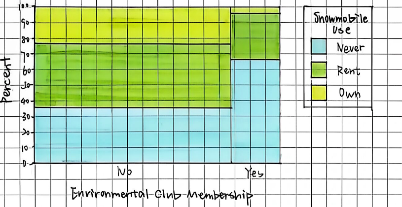

### 2.2 Density Curves and Normal Distributions

**Density Curves**: is always on or above the horizontal axis; has area exactly 1 underneath it.

Positively skewed distribution: Mode, Median, Mean from left to right. Negatively skewed distribution: Mean, Median, Mode from left to right. Vertical axes Frequencies.

Mean: $\mu$. Standard Deviation: $\sigma$.

#### Normal Distributions

- Shape: symmetric, single peaked, bell shaped.
- Center: $\mu=$ median, located at the midpoint of the symmetric curve.
- Variability: $\sigma$ measures the variability (width) of a normal distribution.

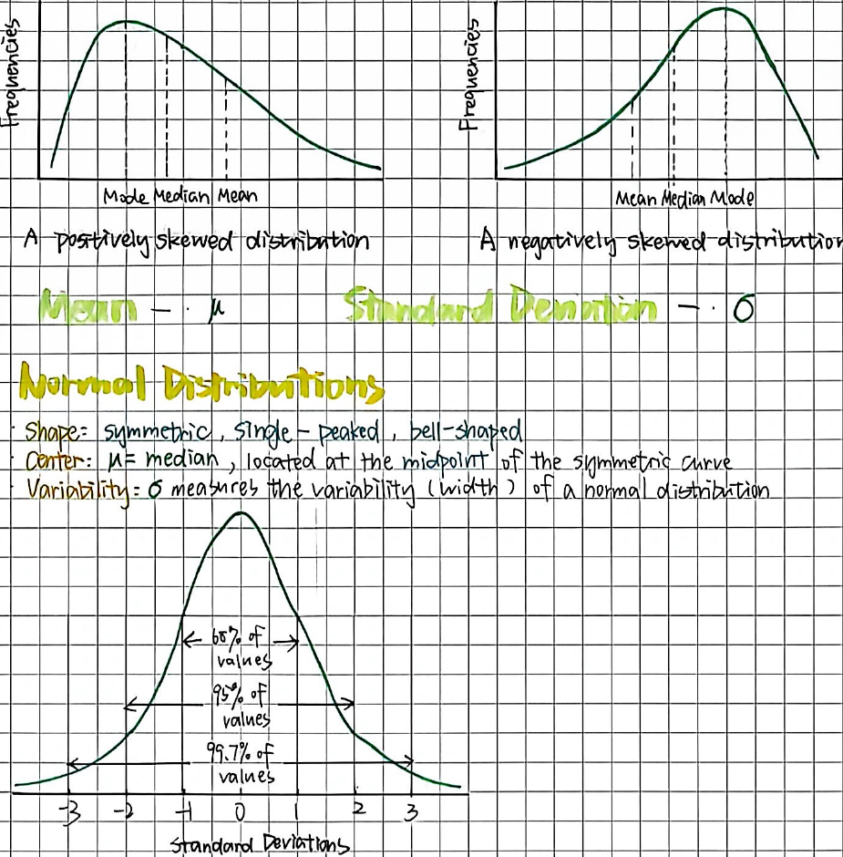

#### The 68–95–99.7 Rule

In a Normal distribution with mean $\mu$ and standard deviation $\sigma$:

- Approximately 68% of the observations fall within $\sigma$ of the mean $\mu$.
- Approximately 95% of the observations fall within $2\sigma$ of the mean $\mu$.
- Approximately 99.7% of the observations fall within $3\sigma$ of the mean $\mu$.

The curve labels intervals from −1 to 1, −2 to 2, −3 to 3 standard deviations, respectively 68%, 95%, 99.7% of values.

#### Standard Normal Distribution

$$z=\frac{x-\mu}{\sigma}.$$
Margin: 一个 observation 距离 mean 相几个 SD; tells Distance & direction.

#### Finding Areas in a Normal Distribution

Area: Calculate → menu → stats → Distribution → normalCDF(lower, upper, $\mu$, $\sigma$).

Bound ($x$): same menu → Inverse Norm (Area, $\mu$, $\sigma$).

#### Normality

Normal probability plot: If the points on a Normal Probability Plot lie close to a straight line, the data are approximately NORMALLY distributed.

The three sketches are labeled approximately Normal; not Normal; approximately Normal (outlier).

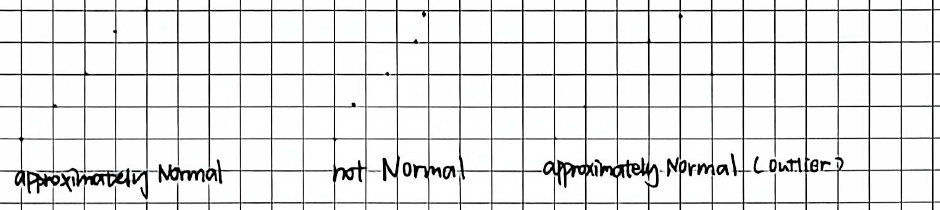

### 2.3 Probability

#### Permutation and Combination

**Factorial**: For any positive integer $n$, $n!=n(n-1)(n-2)\cdots2\cdot1$. $0!=1$.

**Permutation（排列）**: the number of ways a set of elements can be ordered.
$$ {}_nP_r=\frac{n!}{(n-r)!}\longrightarrow A_n^r.$$

**Combination（组合）**: the number of combinations of $r$ elements chosen from a set of $n$ elements.
$$ {}_nC_r=\frac{{}_nP_r}{r!}=\frac{n!}{r!(n-r)!}\longrightarrow C_n^r.$$

#### Probability

Definition: long run proportion of times an outcome/event $A$ occurs, $P(A)$.

Range: $0\le P(A)\le1$.

- $P(A)=0$: impossible.
- $P(A)=1$: certain.

#### Simulation

- Definition: using a random process to model real world random events.
- Trial = one complete repetition of the simulation.
- Outcome = result of a trial.
- Empirical probability = probability estimated from simulation/data.

$$\hat P(A)=\frac{\#\text{ trials in which }A\text{ occurs}}{\#\text{ total trials}}.$$

Process:

1. Assign numbers to possible outcomes according to their probabilities.
2. Generate random numbers to imitate the chance process.
3. Record the result of one complete trial.
4. Repeat many trials.
5. Calculate the proportion of trials where the event occurs.

#### Law of Large Numbers

As the number of trials increases, empirical probability tends to get closer to the true probability.

### 2.4 Probability Rules

**Probability Model**: A description of some chance process: a list of possible outcomes + probability for each outcome.

**Sample Space**: List of all possible outcomes. $S=\{a,b,c\}$.

**Event**: A collection of outcomes. Event $\in$ Sample Space.

**Equally Likely Outcomes**: If all outcomes in the sample space are equally likely,
$$P(A)=\frac{\#\text{ of outcomes in event }A}{\text{total }\#\text{ of outcomes in sample space}}.$$

**Complement Rule**: Complement of Event $A$: $A^c$.
$$P(A^c)=1-P(A).$$

#### Disjoint Events Mutually Exclusive

Two events have no outcomes in common and so can never occur together.
$$P(A\text{ and }B)=0\quad/\quad P(A\cap B)=0.$$

Addition Rule for Mutually Exclusive Events:
$$P(A\text{ or }B)=P(A)+P(B)\quad/\quad P(A\cup B)=P(A)+P(B).$$

#### General Additional Rule

$$P(A\cup B)=P(A)+P(B)-P(A\cap B).$$
Margin: $\cup=$ or (union); $\cap=$ and (intersection).

#### Venn Diagrams and Probability

Complement $A^c$: outside of $A$ shaded, $S$ rectangle. Union $A\cup B$: both overlapping circles shaded. Intersect $A\cap B$: only the overlap shaded. Margin under complement: $c=$ mutually exclusive.

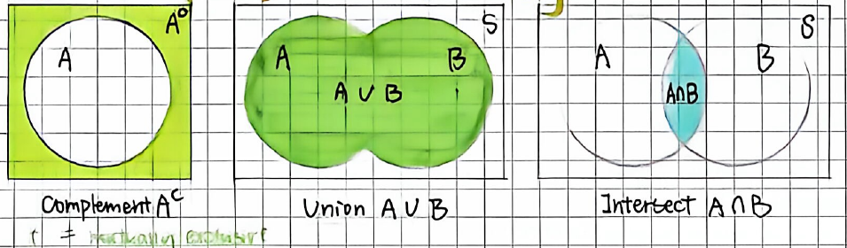

### 2.5 Conditional Probability and Independence

**Conditional Probability**: The probability that one event happens given that another event is known to have happened.
$$P(A\mid B)=\frac{P(A\cap B)}{P(B)}.$$

**General Multiplication Rule**:
$$P(A\cap B)=P(A)\times P(B\mid A)=P(B)\times P(A\mid B).$$

**Independent Events**: whether or not one event has occurred does not change the probability that the other event will happen.
$$P(A\mid B)=P(A\mid B^c)=P(A),$$
$$P(B\mid A)=P(B\mid A^c)=P(B).$$

Multiplication Rule for Independent Events:
$$P(A\cap B)=P(A)\cdot P(B).$$

With replacement: independent. Without replacement: dependent.

#### Tree Diagram

Shows the sample space of a chance process involving multiple stages.

First branches: $A$, $P(A)$ and $B$, $P(B)$. The $A$ branch splits into $A_1$, $P(A_1)$ and $A_2$, $P(A_2)$; $B$ splits into $B_1$, $P(B_1)$ and $B_2$, $P(B_2)$.

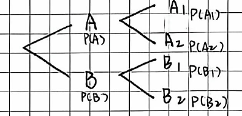

### 2.6 Random Variables

**Random Variable**: numerical value describing the outcome of a chance process. $X$. Define $X=$ number of …

**Discrete Random Variable**: countable values. Usually comes from counting.

**Probability Distribution**: lists all possible values of $X$ and their probabilities.
$$0\le p_i\le1,\qquad\sum p_i=1.$$

**Mean/Expected Value**:

- represents the long run average value of $X$.
- $E(X)$ does NOT have to be a possible value of $X$.
$$\mu_X=E(X)=\sum x_ip_i.$$

Calculator: spreadsheet → $x_1$ List: Values; frequency list = probabilities.

**Standard Deviation of a Random Variable**:

- measures the typical distance of $X$ from its mean.
- larger $\sigma_X$ → more variability.
$$\sigma_X=\sqrt{\sum(x_i-\mu_X)^2p_i}.$$

**Continuous Random Variables**:

- can take any value in an interval.
- usually comes from measuring.
- probability = area under the density curve.

### 2.7 Binomial Distribution

#### Binomial Setting BINS

A setting is binomial if:

- B — Binary: success/failure.
- I — Independent: trials are independent.
- N — Number: fixed number of trials $n$ in advance. 提前定局数。
- S — Same probability: same $p$ for every trial (success probability).

Define: $X=$ number of success. Possible values: $X=0,1,2,\ldots,n$.

#### Binomial Probability Formula

$$P(X=k)=\binom nkp^k(1-p)^{n-k}.$$

- $n=$ number of trials.
- $p=$ probability of success.
- $k=$ number of successes.
- $\binom nk=\frac{n!}{k!(n-k)!}=$ ways to arrange $k$ successes.

Calculator:
$$\operatorname{binompdf}(n,p,k)=P(X=k)\quad\text{exactly},$$
$$\operatorname{binomcdf}(n,p,k)=P(X\le k)\quad\text{cumulative},$$
$$1-\operatorname{binomcdf}(n,p,k-1)=P(X\ge k).$$

#### Mean and SD of a Binomial Random Variable

Mean: $\mu_X=np$.

In many repetitions, the average number of successes will be about …

SD: $\sigma_X=\sqrt{np(1-p)}$.

The number of success typically differs from the mean by about …

#### Normal Approximation to Binomial

**10% Condition**: When sampling WITHOUT replacement from a population of size $N$:
$$n\le0.10N.$$
→ trials can be treated as approximately independent.

→ allows us to use a Binomial model.

**Large Counts Condition**: The binomial distribution can be approximated by a Normal distribution if:
$$np\ge10\quad\text{and}\quad n(1-p)\ge10.$$
These are labeled expected number of success and expected number of failures.

**Normal Approximation**: If Large Counts is satisfied:
$$X\approx N\left(np,\sqrt{np(1-p)}\right).$$
Therefore $\mu=np$, $\sigma=\sqrt{np(1-p)}$ → normalcdf.
