# Calculus BC Comprehensive Review Notes

## 三角函数与基本公式

### 三角函数的导数

| 函数 | 导数 |
| --- | --- |
| $\sin x$ | $\cos x$ |
| $\cos x$ | $-\sin x$ |
| $\tan x$ | $\sec^2 x$ |
| $\sec x$ | $\sec x\tan x$ |
| $\cot x$ | $-\csc^2 x$ |
| $\csc x$ | $-\csc x\cot x$ |
| $\arcsin x$ | $\dfrac{1}{\sqrt{1-x^2}}$ |
| $\arccos x$ | $-\dfrac{1}{\sqrt{1-x^2}}$ |
| $\arctan x$ | $\dfrac{1}{1+x^2}$ |
| $\operatorname{arccot}x$ | $-\dfrac{1}{1+x^2}$ |
| $\operatorname{arcsec}x$ | $\dfrac{1}{\lvert x\rvert\sqrt{x^2-1}}$ |
| $\operatorname{arccsc}x$ | $-\dfrac{1}{\lvert x\rvert\sqrt{x^2-1}}$ |

### 常用极限

$$
\lim_{x\to0}\frac{\sin x}{x}=1,\qquad
\lim_{x\to\infty}\frac{\sin x}{x}=0,
$$

$$
\lim_{x\to0}\frac{1-\cos x}{x}=0,\qquad
\lim_{x\to0}\frac{\tan x}{x}=1.
$$

### 恒等式、降幂与二倍角

$$
\sin^2x+\cos^2x=1,\qquad
1+\tan^2x=\sec^2x,\qquad
1+\cot^2x=\csc^2x.
$$

$$
\sin^2x=\frac{1-\cos2x}{2},\qquad
\cos^2x=\frac{1+\cos2x}{2},\qquad
\sin2x=2\sin x\cos x.
$$

## 反函数、指数与对数求导

### 反函数导数定理

若 $f^{-1}(a)=b$，且 $f'(b)\ne0$，则

$$
(f^{-1})'(a)=\frac{1}{f'(b)}.
$$

先由 $f(b)=a$ 求 $b$，再计算 $f'(b)$ 并取倒数。

例：$f(x)=x^5+2x^3+x-1$，求 $(f^{-1})'(3)$。

$$
f(1)=3,\qquad f'(x)=5x^4+6x^2+1,\qquad f'(1)=12,
$$

所以 $(f^{-1})'(3)=1/12$。

若表格给出 $f(3)=-1$、$f'(3)=-4$，令 $g=f^{-1}$，则 $g'(-1)=-1/4$。

### 指数函数

$$
\frac{d}{dx}e^x=e^x,\qquad
\frac{d}{dx}e^{u(x)}=e^u u',
$$

$$
a^x=e^{x\ln a},\qquad
\frac{d}{dx}a^x=a^x\ln a,\qquad
\frac{d}{dx}a^{u(x)}=a^u\ln a\cdot u'.
$$

例：

$$
\frac{d}{dx}e^{x^2+3x}=e^{x^2+3x}(2x+3),
$$

$$
\frac{d}{dx}3^{\csc x}
=3^{\csc x}\ln3\,(-\csc x\cot x).
$$

### 对数函数与对数求导

$$
\frac{d}{dx}\ln x=\frac1x,\qquad
\frac{d}{dx}\ln u=\frac{u'}{u}.
$$

对于 $y=u(x)^{v(x)}$、$u>0$，两边取对数：

$$
\ln y=v\ln u,\qquad
\frac{y'}y=v'\ln u+v\frac{u'}u,
$$

从而

$$
y'=u^v\left(v'\ln u+v\frac{u'}u\right).
$$

例：

$$
\frac{d}{dx}x^x=x^x(\ln x+1)\quad(x>0),
$$

$$
\frac{d}{dx}\ln(\ln x)=\frac{1}{x\ln x},
$$

$$
\frac{d}{dx}\log_3(1+x\ln3)
=\frac{\ln3}{(1+x\ln3)\ln3}
=\frac{1}{1+x\ln3}.
$$

## Related Rates

先定义随时间变化的量，写出几何关系，再对时间求导，最后代入该时刻的数值。

### 圆锥形水箱

水以 $0.25\ \mathrm{m^3/min}$ 注入倒置圆锥形水箱。水箱高 $3\ \mathrm m$，底面半径 $1.5\ \mathrm m$；求水深 $h=1.8\ \mathrm m$ 时的上升速度。

由相似三角形，

$$
\frac rh=\frac{1.5}{3}=\frac12,\qquad
V=\frac13\pi r^2h=\frac{\pi}{12}h^3.
$$

$$
\frac{dV}{dt}=\frac{\pi}{4}h^2\frac{dh}{dt},
\qquad
\frac{dh}{dt}
=\frac{4}{\pi h^2}\frac{dV}{dt}
=\frac{1}{3.24\pi}
\approx0.098\ \mathrm{m/min}.
$$

### 追踪热气球

测距仪离热气球起飞点 $150\ \mathrm m$，仰角 $\theta=\pi/4$ 时，以 $0.14\ \mathrm{rad/min}$ 增大。若气球高度为 $y$，

$$
\tan\theta=\frac y{150},\qquad y=150\tan\theta,
$$

$$
\frac{dy}{dt}
=150\sec^2\theta\frac{d\theta}{dt}
=150(2)(0.14)=42\ \mathrm{m/min}.
$$

## Local Linearity and Linearization

在 $x=a$ 处的线性化为

$$
L(x)=f(a)+f'(a)(x-a).
$$

当 $x$ 接近 $a$ 时，$f(x)\approx L(x)$。它就是切线方程

$$
y-f(a)=f'(a)(x-a).
$$

若邻域内 $f''>0$，图像凹向上，切线在图像下方，线性化给出低估；若 $f''<0$，图像凹向下，线性化给出高估。

例：$f(x)=\sqrt{1+x}$，在 $a=3$ 处线性化。

$$
f(3)=2,\qquad f'(x)=\frac{1}{2\sqrt{1+x}},\qquad f'(3)=\frac14,
$$

$$
L(x)=2+\frac14(x-3),\qquad
\sqrt{4.2}=f(3.2)\approx L(3.2)=2.05.
$$

因为

$$
f''(x)=-\frac{1}{4(1+x)^{3/2}}<0\quad(x>-1),
$$

该近似是高估。

## L'Hôpital's Rule 与未定式

### $0/0$ 与 $\infty/\infty$

在相应的去心邻域内，$f,g$ 可导，$g'\ne0$。当 $\lim f=\lim g=0$ 或分子、分母都趋于无穷，并满足洛必达法则条件时，

$$
\lim_{x\to a}\frac{f(x)}{g(x)}
=\lim_{x\to a}\frac{f'(x)}{g'(x)}.
$$

若求导后的商仍为适用的未定式，可再次检查条件并应用法则。

### 其他形式的转化

| 未定式 | 转化方法 |
| --- | --- |
| $0\cdot\infty$ | 改为 $f/(1/g)$ 或 $g/(1/f)$，得到 $0/0$ 或 $\infty/\infty$ |
| $\infty-\infty$ | 通分或有理化 |
| $1^\infty,\ 0^0,\ \infty^0$ | 设 $y=f^g$，先求 $\ln y=g\ln f$ 的极限，再用 $y=e^{\ln y}$ |

幂指函数取对数时要求底数为正；$0^0$ 形式中底数从正侧趋于零。

例：

$$
\sqrt{x^2+2x}-x
=\frac{2x}{\sqrt{x^2+2x}+x},
$$

因此

$$
\lim_{x\to+\infty}\left(\sqrt{x^2+2x}-x\right)
=\lim_{x\to+\infty}\frac2{\sqrt{1+2/x}+1}=1.
$$

## 常用定理

| 定理 | 条件 | 结论 |
| --- | --- | --- |
| Mean Value Theorem | $f$ 在 $[a,b]$ 连续，在 $(a,b)$ 可导 | 存在 $c\in(a,b)$，使 $f'(c)=\dfrac{f(b)-f(a)}{b-a}$ |
| Rolle's Theorem | 同上，且 $f(a)=f(b)$ | 存在 $c\in(a,b)$，使 $f'(c)=0$ |
| Cauchy's Mean Value Theorem | $f,g$ 在 $[a,b]$ 连续，在 $(a,b)$ 可导，且 $g'\ne0$ | 存在 $c$，使 $\dfrac{f(b)-f(a)}{g(b)-g(a)}=\dfrac{f'(c)}{g'(c)}$ |
| Intermediate Value Theorem | $f$ 在 $[a,b]$ 连续，$N$ 介于 $f(a)$ 与 $f(b)$ 之间 | 存在 $c\in[a,b]$，使 $f(c)=N$；若 $f(a)f(b)<0$，则 $(a,b)$ 内存在零点 |
| Extreme Value Theorem | $f$ 在闭区间 $[a,b]$ 上连续 | $f$ 在该区间达到绝对最大值与绝对最小值 |

## 极值、凹凸与拐点

### 一阶导数测试

候选点 $c$ 满足 $f'(c)=0$ 或 $f'(c)$ 不存在，并要求函数在 $c$ 附近连续、除 $c$ 外可导。

- $f'$ 从负变正：local minimum。
- $f'$ 从正变负：local maximum。
- $f'$ 不变号：不是局部极值点，仍需检查是否为拐点。

### 二阶导数测试

若 $f'(c)=0$，且 $f''$ 在 $c$ 附近连续：

- $f''(c)>0$：local minimum，凹向上。
- $f''(c)<0$：local maximum，凹向下。
- $f''(c)=0$：该测试不能判断，可改用一阶导数测试。

### 拐点

拐点要求函数在该点连续，且凹凸性在两侧改变。$f''(c)=0$ 或 $f''(c)$ 不存在都不能单独保证拐点。

- $y=x^{5/3}$：原点两侧凹凸性改变，原点是拐点。
- $y=x^4$：$f''(0)=0$，但两侧均凹向上，原点不是拐点。
- $y=x^{1/3}$：原点处二阶导数不存在，但凹凸性改变，仍有拐点。

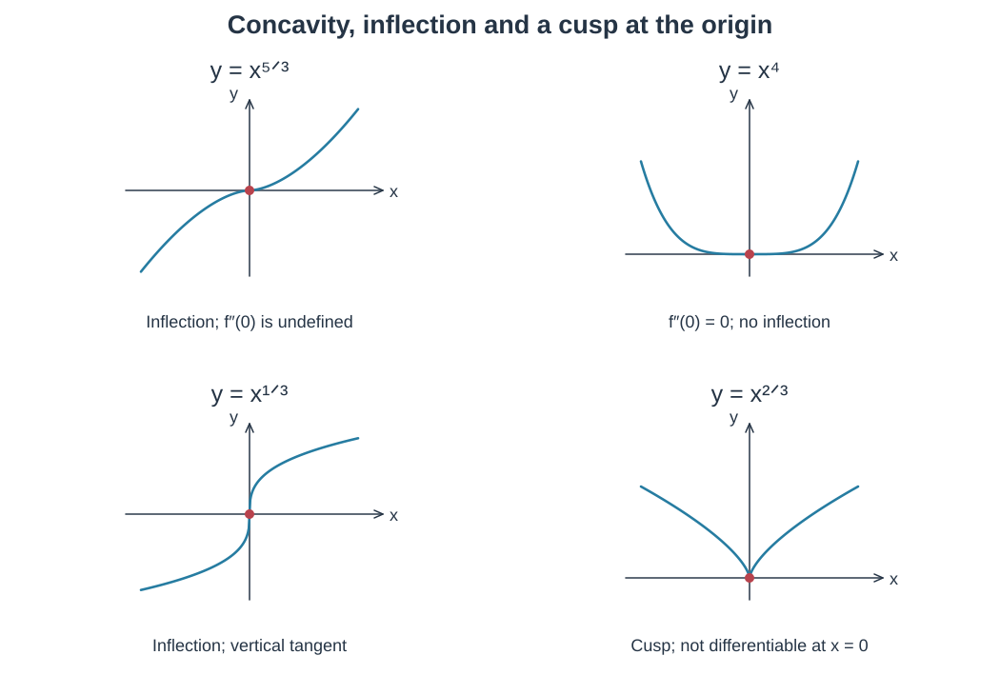

## Graph Sketching

分析图像时依次检查定义域、值域、横纵截距、对称性、极限与渐近线、单调性及局部极值、一阶导数和二阶导数给出的信息。

$y=x^{2/3}$ 的图像在原点有尖点，原点处不可导。

### $f(x)=\sin x/x$

函数为偶函数，原定义域为 $\mathbb R\setminus\{0\}$。有

$$
\lim_{x\to\pm\infty}\frac{\sin x}{x}=0,\qquad
\lim_{x\to0}\frac{\sin x}{x}=1.
$$

原点是可去间断点；补定义 $f(0)=1$ 后连续。横截距为 $x=n\pi$，其中 $n$ 是非零整数。

$$
f'(x)=\frac{x\cos x-\sin x}{x^2}.
$$

临界点可由 $x\cos x=\sin x$ 求出；在 $\cos x\ne0$ 处可写为 $x=\tan x$。辅助函数

$$
g(x)=\tan x-x,\qquad g'(x)=\sec^2x-1=\tan^2x\ge0
$$

在每个连续分支内单调不减。分析时需分别考虑 $\tan x$ 的各个连续区间。

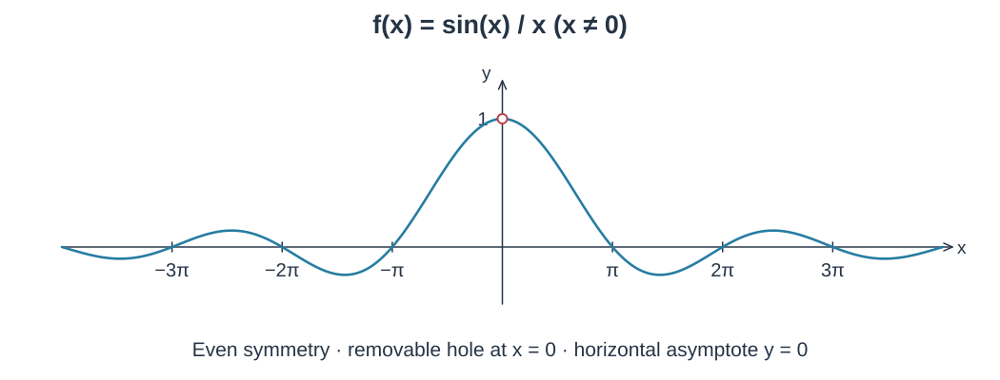

### 从导数图像判断函数图像

$f'$ 的正负决定 $f$ 的增减，$f'$ 的增减决定 $f$ 的凹凸。若导数图像在 $-3,2,6$ 处过横轴，符号依次为负、正、负、正，则 $f$ 在 $-3,6$ 处为局部最小值，在 $2$ 处为局部最大值。

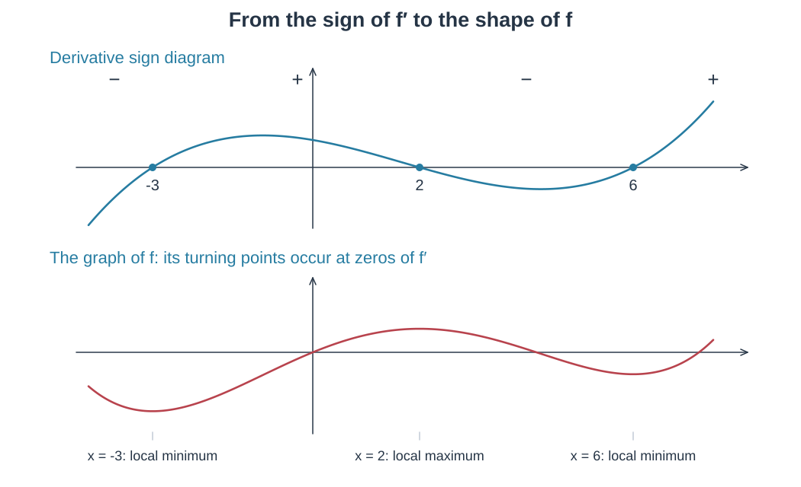

### 导数符号表例题

若

$$
f'(x)=4x^3-12x^2=4x^2(x-3),
$$

则临界数为 $0,3$。$f'$ 在 $0$ 两侧均为负，在 $3$ 处由负变正，所以 $0$ 处没有局部极值，$3$ 处为局部最小值。$f$ 在 $(-\infty,3)$ 递减，在 $(3,\infty)$ 递增。

同时 $f''(x)=12x(x-2)$：图像在 $(-\infty,0)$、$(2,\infty)$ 凹向上，在 $(0,2)$ 凹向下；拐点的横坐标为 $0,2$。

优化问题还需根据实际情境决定答案取小数还是整数。

## 定积分的性质

$$
\int_a^a f(x)\,dx=0,\qquad
\int_a^b f(x)\,dx+\int_b^c f(x)\,dx=\int_a^c f(x)\,dx,
$$

$$
\int_b^a f(x)\,dx=-\int_a^b f(x)\,dx,\qquad
\int_a^b kf(x)\,dx=k\int_a^b f(x)\,dx,
$$

$$
\int_a^b(f\pm g)\,dx
=\int_a^b f\,dx\pm\int_a^b g\,dx.
$$

对于 $a<b$：

$$
\min_{[a,b]}f\,(b-a)\le\int_a^b f(x)\,dx
\le\max_{[a,b]}f\,(b-a).
$$

若 $f\ge g$，则 $\int_a^b f\ge\int_a^b g$；特别地，$f\ge0$ 时 $\int_a^b f\ge0$。

## The Fundamental Theorem of Calculus

### 累积函数求导

若 $f$ 在 $[a,b]$ 连续，定义

$$
F(x)=\int_a^x f(t)\,dt,
$$

则 $F'(x)=f(x)$。

由导数定义，

$$
F'(x)=\lim_{h\to0}\frac{F(x+h)-F(x)}h
=\lim_{h\to0}\frac1h\int_x^{x+h}f(t)\,dt.
$$

利用短区间内的最大、最小值夹住积分平均值，并由 $f$ 的连续性及夹逼定理，得到极限为 $f(x)$。

具体地，若短区间两端为 $x$ 与 $x+h$，其间最小值、最大值分别为 $m_h,M_h$，则

$$
m_h\le\frac1h\int_x^{x+h}f(t)\,dt\le M_h.
$$

当 $h\to0$ 时，两端均趋于 $f(x)$。

例：$F(x)=\int_6^x(-t^2-t+6)\,dt$，则

$$
F'(x)=-x^2-x+6=-(x+3)(x-2)>0
\iff -3<x<2.
$$

### 图像与累积函数例题

定义 $F(x)=\int_2^x f(t)\,dt$。$f$ 的图像由两段线段及四分之一圆组成：左段从 $(-2,-2)$ 到 $(2,2)$，圆弧从 $(2,2)$ 到 $(4,0)$，右段从 $(4,0)$ 到 $(6,4)$。

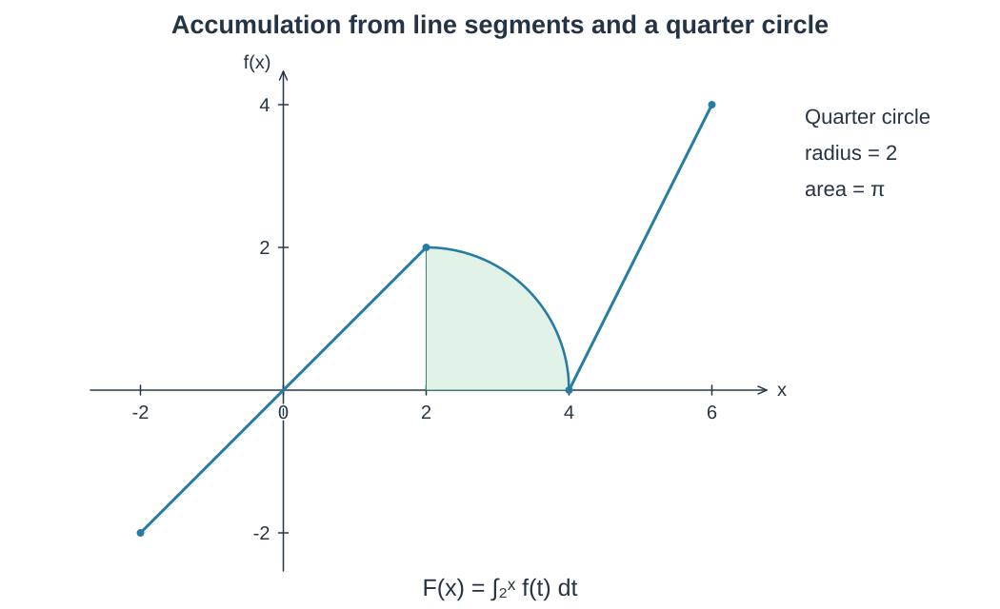

$$
F(0)=-2,\quad F(4)=\pi,\quad F(-2)=0,\quad F(6)=\pi+4.
$$

$F'(x)=f(x)$ 在 $(0,4)$ 与 $(4,6)$ 为正，在 $(-2,0)$ 为负。临界数为 $0,4$：$0$ 处为相对最小值；$4$ 两侧不变号，不是相对极值。比较端点与临界点，绝对最小值为 $F(0)=-2$，绝对最大值为 $F(6)=\pi+4$。

$F''=f'$，因此拐点横坐标为 $2,4$，凹向下区间为 $(2,4)$。

### 累积函数与链式法则

$$
\frac{d}{dx}\int_a^{g(x)}f(t)\,dt=f(g(x))g'(x),
$$

$$
\frac{d}{dx}\int_{u(x)}^{v(x)}f(t)\,dt
=f(v(x))v'(x)-f(u(x))u'(x).
$$

例：

$$
y=\int_x^5 3t\sin t\,dt
\quad\Longrightarrow\quad y'=-3x\sin x.
$$

$$
y=\int_{2x}^{x^2}\frac{dt}{2+e^t}
\quad\Longrightarrow\quad
y'=\frac{2x}{2+e^{x^2}}-\frac2{2+e^{2x}}.
$$

### 用原函数计算定积分

若 $F'=f$，则

$$
\int_a^b f(x)\,dx=F(b)-F(a).
$$

例：

$$
\int_{-1}^2\frac{|x|(x^2-1)}x\,dx
=\int_{-1}^0(1-x^2)\,dx+\int_0^2(x^2-1)\,dx
=\frac43.
$$

## 净变化与不定积分

变化率的积分给出净变化。若速度 $v(t)=49-9.8t$，则在 $0\le t\le8$ 内：

$$
\text{displacement}=\int_0^8(49-9.8t)\,dt,\qquad
\text{total distance}=\int_0^8|49-9.8t|\,dt.
$$

求总路程时在 $v(t)=0$ 的时刻 $t=5$ 分段。

### 基本原函数

$$
\int f(x)\,dx=F(x)+C,\qquad
\int kf\,dx=k\int f\,dx,\qquad
\int(f\pm g)\,dx=\int f\,dx\pm\int g\,dx.
$$

| 被积函数 | 原函数 |
| --- | --- |
| $u^n,\ n\ne-1$ | $\dfrac{u^{n+1}}{n+1}+C$ |
| $1/u$ | $\ln\lvert u\rvert+C$ |
| $\cos u$ | $\sin u+C$ |
| $\sin u$ | $-\cos u+C$ |
| $\sec^2u$ | $\tan u+C$ |
| $\csc^2u$ | $-\cot u+C$ |
| $\sec u\tan u$ | $\sec u+C$ |
| $\csc u\cot u$ | $-\csc u+C$ |
| $e^u$ | $e^u+C$ |
| $a^u$ | $\dfrac{a^u}{\ln a}+C$ |

## Substitution

选择 $u$ 后同时求出 $du$，把整个积分改为 $u$ 的式子；不定积分求完后换回原变量并加常数 $C$。

| 积分 | 换元 | 结果 |
| --- | --- | --- |
| $\int8x\sqrt{4x^2+1}\,dx$ | $u=4x^2+1,\ du=8x\,dx$ | $\dfrac23(4x^2+1)^{3/2}+C$ |
| $\int x(x^2+2)^3\,dx$ | $u=x^2+2,\ du=2x\,dx$ | $\dfrac18(x^2+2)^4+C$ |
| $\int\dfrac{\ln x}{x}\,dx$ | $u=\ln x,\ du=dx/x$ | $\dfrac12(\ln x)^2+C$ |
| $\int(3x^2+1)e^{x^3}e^x\,dx$ | $u=x^3+x,\ du=(3x^2+1)\,dx$ | $e^{x^3+x}+C$ |
| $\int\dfrac{e^{3t}}{3+e^{3t}}\,dt$ | $u=3+e^{3t},\ du=3e^{3t}\,dt$ | $\dfrac13\ln(3+e^{3t})+C$ |
| $\int\cos^4x\sin x\,dx$ | $u=\cos x,\ du=-\sin x\,dx$ | $-\dfrac15\cos^5x+C$ |
| $\int x\cos(x^2)(\sin(x^2)+5)\,dx$ | $u=\sin(x^2)+5,\ du=2x\cos(x^2)\,dx$ | $\dfrac14(\sin(x^2)+5)^2+C$ |
| $\int\sin x\,e^{\cos x}\,dx$ | $u=\cos x,\ du=-\sin x\,dx$ | $-e^{\cos x}+C$ |

## 换元积分续例

### i. $\int\cot 7x\,dx$

Let $u=\sin7x$，$du=7\cos7x\,dx$。

$$
\begin{aligned}
I&=\frac17\int\frac1u\,du\\
 &=\frac17\ln|u|+C\\
 &=\frac17\ln|\sin7x|+C.
\end{aligned}
$$

### j. $\int\cot^2 3x\,dx$

$$
\begin{aligned}
\int\cot^2 3x\,dx
 &=\int(\csc^2 3x-1)\,dx\\
 &=-\frac13\cot3x-x+C.
\end{aligned}
$$

## Substitution in Definite Integrals

$$
\int_a^b f(g(x))g'(x)\,dx
=\int_{g(a)}^{g(b)}f(u)\,du.
$$

## 分子次数低于分母次数的积分

提示：numerator's degree is less than the denominator。

### a. $\int\dfrac{dx}{5+4x^2}$

对应形式：$\int\dfrac{1}{a^2+x^2}\,dx$。基本公式：

$$
\int\frac{dx}{1+x^2}=\tan^{-1}x+C.
$$

$$
\begin{aligned}
I&=\int\frac{1}{5+(2x)^2}\,dx\\
 &=\int\frac{1}{5\left(1+\frac{(2x)^2}{5}\right)}\,dx\\
 &=\frac15\int\frac{1}{1+\left(\frac{2x}{\sqrt5}\right)^2}\,dx.
\end{aligned}
$$

Let $u=\dfrac{2}{\sqrt5}x$，$du=\dfrac{2}{\sqrt5}\,dx$。

$$
\begin{aligned}
I&=\frac15\cdot\frac{\sqrt5}{2}\int\frac1{1+u^2}\,du\\
 &=\frac{\sqrt5}{10}\tan^{-1}u+C\\
 &=\frac{\sqrt5}{10}\tan^{-1}\left(\frac2{\sqrt5}x\right)+C.
\end{aligned}
$$

### b. $\int\dfrac1{\sqrt{4-x^2}}\,dx$

对应形式：$\int\dfrac1{\sqrt{a^2-x^2}}\,dx$。基本公式：

$$
\int\frac1{\sqrt{1-x^2}}\,dx=\sin^{-1}x+C.
$$

$$
\begin{aligned}
I&=\int\frac1{\sqrt{4\left(1-(x/2)^2\right)}}\,dx\\
 &=\frac12\int\frac1{\sqrt{1-(x/2)^2}}\,dx.
\end{aligned}
$$

Let $u=x/2$，$du=\frac12\,dx$。

$$
I=\int\frac1{\sqrt{1-u^2}}\,du
=\sin^{-1}u+C
=\sin^{-1}\frac{x}{2}+C.
$$

## 配方与反三角函数积分练习

### c. $\int\dfrac1{x^2+12x+37}\,dx$

Practice；completing the square（配方）。

$$
I=\int\frac1{(x+6)^2+1}\,dx.
$$

Let $u=x+6$，$du=dx$。

$$
\begin{aligned}
I&=\int\frac1{u^2+1}\,du\\
 &=\tan^{-1}u+C\\
 &=\tan^{-1}(x+6)+C.
\end{aligned}
$$

### d. $\int\dfrac1{\sqrt{4-6x-9x^2}}\,dx$

Practice。

$$
\begin{aligned}
I&=\int\frac1{\sqrt{4-[(3x+1)^2-1]}}\,dx\\
 &=\int\frac1{\sqrt{5-(3x+1)^2}}\,dx\\
 &=\frac1{\sqrt5}\int\frac1{\sqrt{1-\left(\frac{3x+1}{\sqrt5}\right)^2}}\,dx.
\end{aligned}
$$

Let $u=\dfrac{3x+1}{\sqrt5}$，$du=\dfrac3{\sqrt5}\,dx$。

$$
\begin{aligned}
I&=\frac1{\sqrt5}\cdot\frac{\sqrt5}{3}\int\frac1{\sqrt{1-u^2}}\,du\\
 &=\frac13\int\frac1{\sqrt{1-u^2}}\,du\\
 &=\frac13\sin^{-1}u+C\\
 &=\frac13\sin^{-1}\left(\frac{3x+1}{\sqrt5}\right)+C.
\end{aligned}
$$

### e. $\int\dfrac8{\sqrt{12-x^2-4x}}\,dx$

$$
\begin{aligned}
I&=\int\frac8{\sqrt{16-(x+2)^2}}\,dx\\
 &=\frac14\int\frac8{\sqrt{1-\left(\frac{x+2}{4}\right)^2}}\,dx\\
 &=2\int\frac1{\sqrt{1-\left(\frac{x+2}{4}\right)^2}}\,dx.
\end{aligned}
$$

Let $u=\dfrac{x+2}{4}$，$du=\frac14\,dx$。

$$
\begin{aligned}
I&=8\int\frac1{\sqrt{1-u^2}}\,du\\
 &=8\sin^{-1}u+C\\
 &=8\sin^{-1}\left(\frac{x+2}{4}\right)+C.
\end{aligned}
$$

## Factorization 与 Partial Fraction

### f. $\int\dfrac1{x^2-1}\,dx$

Factorization $\Rightarrow$ partial fraction。

$$
\begin{aligned}
I&=\int\frac1{(x+1)(x-1)}\,dx\\
 &=\int\frac{A(x-1)+B(x+1)}{(x+1)(x-1)}\,dx.
\end{aligned}
$$

$$
A(x-1)+B(x+1)=1.
$$

令 $A(x-1)=0$，即 $x=1$：$2B=1$，$B=\frac12$。

令 $B(x+1)=0$，即 $x=-1$：$-2A=1$，$A=-\frac12$。

$$
\begin{aligned}
I&=\int\left(-\frac12\cdot\frac1{x+1}+\frac12\cdot\frac1{x-1}\right)\,dx\\
 &=-\frac12\ln|x+1|+\frac12\ln|x-1|+C.
\end{aligned}
$$

### g. $\int\dfrac{x^2+2x-1}{2x^3+3x^2-2x}\,dx$

$$
\begin{aligned}
I&=\int\frac{x^2+2x-1}{x(2x-1)(x+2)}\,dx\\
 &=\int\left(\frac Ax+\frac B{2x-1}+\frac C{x+2}\right)\,dx\\
 &=\int\frac{A(2x-1)(x+2)+Bx(x+2)+Cx(2x-1)}{x(2x-1)(x+2)}\,dx.
\end{aligned}
$$

- Let $x=-2$：$4-4-1=C(-2)(-5)$，$C=-\frac1{10}$。
- Let $x=\frac12$：$\frac14+1-1=\frac12\cdot\frac52 B$，$B=\frac15$。
- Let $x=0$：$A=\frac12$。

$$
\begin{aligned}
I&=\int\left(\frac{1/2}{x}+\frac{1/5}{2x-1}-\frac{1/10}{x+2}\right)\,dx\\
 &=\frac12\int\frac1x\,dx+\frac15\int\frac1{2x-1}\,dx-\frac1{10}\int\frac1{x+2}\,dx\\
 &=\frac12\ln|x|+\frac15\cdot\frac12\ln|2x-1|-\frac1{10}\ln|x+2|+C.
\end{aligned}
$$

## Improper Rational Functions — Long Division

### a.

$$
\int\frac{3x^3+8x^2-10x+5}{x+4}\,dx
=\int\left(3x^2-4x+6-\frac{19}{x+4}\right)\,dx.
$$

Long Division。

### b.

$$
\int\frac{x^3+x}{x-1}\,dx
=\int\left(x^2+x+2+\frac2{x-1}\right)\,dx.
$$

### c.

$$
\int\frac{12x^2}{2x+1}\,dx
=\int\left(6x-\frac{6x}{2x+1}\right)\,dx.
$$

### d.

$$
\int\frac{4x^3}{2x+3}\,dx
=\int\left(2x^2-3x+\frac92-\frac{27}{4x+6}\right)\,dx.
$$

### e.

$$
\begin{aligned}
\int_3^5\frac{2x^2+x+4}{x-1}\,dx
 &=\int_3^5\left(2x+3+\frac7{x-1}\right)\,dx\\
 &=\left[x^2+3x+7\ln|x-1|\right]_3^5.
\end{aligned}
$$

## Integration by Parts

### a. $\int xe^x\,dx$

乘积求导与积分：

$$
\begin{aligned}
(uv)'&=u'v+uv',\\
\int(uv)'\,dx&=\int(u'v+uv')\,dx,\\
uv&=\int u'v\,dx+\int uv'\,dx.
\end{aligned}
$$

取 $u=x$，$v=e^x$：

$$
\begin{aligned}
uv&=\int1\cdot e^x\,dx+\int xe^x\,dx\\
 &=e^x+\int xe^x\,dx.
\end{aligned}
$$

$$
\int xe^x\,dx=uv-e^x+C=xe^x-e^x+C.
$$

### b. $\int x\cos x\,dx$

① $uv=\int u'v\,dx+\int uv'\,dx$。

② 分部积分公式：

$$
\int uv'\,dx=uv-\int u'v\,dx,
\qquad
\int u\,dv=uv-\int v\,du.
$$

③ 取 $u=x$，$v'=\cos x$，$u'=1$，$v=\sin x$：

$$
\int x\cos x\,dx=x\sin x-\int\sin x\,dx
=x\sin x+\cos x+C.
$$

## 分部积分续例

### c. $\int x^2e^x\,dx$

$$
\int u\,dv=uv-\int v\,du.
$$

Let $u=x^2$，$v'=e^x$，$u'=2x$，$v=e^x$。

$$
\begin{aligned}
I&=x^2e^x-\int2xe^x\,dx\\
 &=x^2e^x-2\int xe^x\,dx\\
 &=x^2e^x-2xe^x+2e^x+C.
\end{aligned}
$$

### d. $\int x\sin\dfrac x2\,dx$

$$
\int u\,dv=uv-\int v\,du.
$$

Let $u=x$，$v'=\sin\frac x2$，$u'=1$，$v=-2\cos\frac x2$。

$$
\begin{aligned}
I&=-2x\cos\frac x2-\int\left(-2\cos\frac x2\right)\,dx\\
 &=-2x\cos\frac x2+2\int\cos\frac x2\,dx\\
 &=-2x\cos\frac x2+4\sin\frac x2+C.
\end{aligned}
$$

### e. $\int t^2\cos t\,dt$

$$
\int u\,dv=uv-\int v\,du.
$$

Let $u=t^2$，$v'=\cos t$，$u'=2t$，$v=\sin t$。

$$
\begin{aligned}
I&=t^2\sin t-\int2t\sin t\,dt\\
 &=t^2\sin t-2\int t\sin t\,dt.
\end{aligned}
$$

继续处理 $\int t\sin t\,dt$：取 $u=t$，$v'=\sin t$，$u'=1$，$v=-\cos t$。

$$
\begin{aligned}
\int t\sin t\,dt
 &=-t\cos t-\int(-\cos t)\,dt\\
 &=-t\cos t+\sin t+C.
\end{aligned}
$$

代回：

$$
I=t^2\sin t+2t\cos t-2\sin t+C.
$$

### f. $\int\ln x\,dx$

$$
\int\ln x\,dx=\int1\cdot\ln x\,dx.
$$

Let $u=\ln x$，$v'=1$，$u'=1/x$，$v=x$。

$$
\begin{aligned}
I&=x\ln x-\int\frac1x\,x\,dx\\
 &=x\ln x-x+C.
\end{aligned}
$$

### g. $\int\sin^{-1}x\,dx$

$$
\int\sin^{-1}x\,dx=\int1\cdot\sin^{-1}x\,dx.
$$

Let $u=\sin^{-1}x$，$v'=1$，$u'=\dfrac1{\sqrt{1-x^2}}$，$v=x$。

$$
I=x\sin^{-1}x-\int\frac{x}{\sqrt{1-x^2}}\,dx.
$$

对子积分，令 $u=1-x^2$，$du=-2x\,dx$：

$$
\begin{aligned}
\int\frac{x}{\sqrt{1-x^2}}\,dx
 &=-\frac12\int\frac1{\sqrt u}\,du\\
 &=-\frac12\cdot2u^{1/2}+C\\
 &=-u^{1/2}+C\\
 &=-(1-x^2)^{1/2}+C.
\end{aligned}
$$

$$
I=x\sin^{-1}x+(1-x^2)^{1/2}+C.
$$

### h. $\int\tan^{-1}x\,dx$

$\int\tan^{-1}x\,dx=\int1\cdot\tan^{-1}x\,dx$。

Let $u=\tan^{-1}x$，$v'=1$，$u'=\dfrac1{1+x^2}$，$v=x$。

$$
I=x\tan^{-1}x-\int\frac{x}{1+x^2}\,dx.
$$

对子积分，令 $u=1+x^2$，$du=2x\,dx$：

$$
\begin{aligned}
\int\frac{x}{1+x^2}\,dx
 &=\frac12\int\frac1u\,du\\
 &=\frac12\ln|u|+C\\
 &=\frac12\ln|1+x^2|+C.
\end{aligned}
$$

$$
I=x\tan^{-1}x-\frac12\ln|1+x^2|+C.
$$

练习：$\int\tan^{-1}y\,dy$。

## Repeated Integration by Parts

### a. 定积分与函数值表

If $\int_2^5f(x)\,dx=14$，求 $\int_2^5x f'(x)\,dx$。

| $x$ | $2$ | $5$ |
| --- | --- | --- |
| $f(x)$ | $4$ | $7$ |
| $f'(x)$ | $2$ | $3$ |

Let $u=x$，$v'=f'(x)$，$u'=1$，$v=f(x)$。

$$
\begin{aligned}
\int_2^5xf'(x)\,dx
 &=[xf(x)]_2^5-\int_2^5f(x)\,dx\\
 &=35-8-14\\
 &=13.
\end{aligned}
$$

### b. $\int e^x\cos x\,dx$

第一种取法：$u=e^x$，$v'=\cos x$，$u'=e^x$，$v=\sin x$。

$$
I=e^x\sin x-\int e^x\sin x\,dx.
$$

另一种取法：$u=\cos x$，$v'=e^x$，$u'=-\sin x$，$v=e^x$。

$$
I=e^x\cos x+\int e^x\sin x\,dx.
$$

合并两种表达：

$$
\begin{aligned}
I&=\frac12\left(e^x\sin x-\int e^x\sin x\,dx+e^x\cos x+\int e^x\sin x\,dx\right)\\
 &=\frac12e^x(\sin x+\cos x)+C.
\end{aligned}
$$

也可继续处理 $\int e^x\sin x\,dx$：取 $u=e^x$，$v'=\sin x$，$u'=e^x$，$v=-\cos x$。

$$
\begin{aligned}
\int e^x\sin x\,dx&=-e^x\cos x+\int e^x\cos x\,dx,\\
I&=e^x\sin x+e^x\cos x-\int e^x\cos x\,dx,\\
2I&=e^x\sin x+e^x\cos x,\\
I&=\frac12e^x(\sin x+\cos x)+C.
\end{aligned}
$$

## Improper Integrals

$$
\begin{aligned}
1.\quad\int_a^\infty f(x)\,dx
 &=\lim_{b\to\infty}\int_a^b f(x)\,dx,\\
2.\quad\int_{-\infty}^b f(x)\,dx
 &=\lim_{a\to-\infty}\int_a^b f(x)\,dx,\\
3.\quad\int_{-\infty}^\infty f(x)\,dx
 &=\int_{-\infty}^c f(x)\,dx+\int_c^\infty f(x)\,dx.
\end{aligned}
$$

有限极限存在 $\Rightarrow$ integral converges。

### a. $\int_1^\infty\dfrac{\ln x}{x^2}\,dx$

$$
I=\lim_{b\to\infty}\int_1^b\frac{\ln x}{x^2}\,dx.
$$

Let $u=\ln x$，$v'=1/x^2$，$u'=1/x$，$v=-1/x$。

$$
\begin{aligned}
I&=\lim_{b\to\infty}\left(\left[-\frac1x\ln x\right]_1^b-\int_1^b\left(-\frac1{x^2}\right)\,dx\right)\\
 &=\lim_{b\to\infty}\left(-\frac{\ln b}{b}-\left[\frac1x\right]_1^b\right)\\
 &=\lim_{b\to\infty}\left(-\frac{\ln b}{b}-\left(\frac1b-1\right)\right)\\
 &=\lim_{b\to\infty}\left(-\frac{\ln b}{b}-\frac1b+1\right)\\
 &=\lim_{b\to\infty}\left(-\frac{1/b}{1}-0\right)+1\\
 &=1.
\end{aligned}
$$

L'Hospital Rule。

### b. $\int_1^\infty\dfrac1x\,dx$

$$
\begin{aligned}
\int_1^\infty\frac1x\,dx
 &=\lim_{b\to\infty}\int_1^b\frac1x\,dx\\
 &=\lim_{b\to\infty}(\ln|b|-\ln1)\\
 &=\lim_{b\to\infty}\ln|b|\\
 &=\infty.
\end{aligned}
$$

因此 $\infty$，diverge。

### $p$ 型积分

当 $p\ne1$ 时：

$$
\begin{aligned}
\int_1^\infty\frac1{x^p}\,dx
 &=\int_1^\infty x^{-p}\,dx\\
 &=\lim_{b\to\infty}\int_1^b x^{-p}\,dx\\
 &=\lim_{b\to\infty}\left[\frac{x^{1-p}}{1-p}\right]_1^b\\
 &=\lim_{b\to\infty}\left(\frac{b^{1-p}}{1-p}-\frac1{1-p}\right).
\end{aligned}
$$

- If $p<1$：$I=\infty$，diverge。
- If $p>1$：$I=\dfrac1{p-1}$，converge。

## Integrals of Functions That Become Infinite at a Point

### 端点或区间内部不连续

1. Continuous on $(a,b]$，discontinuous at $a$：

$$
\int_a^b f(x)\,dx=\lim_{c\to a^+}\int_c^b f(x)\,dx.
$$

2. Continuous on $[a,b)$，discontinuous at $b$：

$$
\int_a^b f(x)\,dx=\lim_{c\to b^-}\int_a^c f(x)\,dx.
$$

3. Discontinuous at $c$，continuous on $[a,c)\cup(c,b]$：

$$
\int_a^b f(x)\,dx=\int_a^c f(x)\,dx+\int_c^b f(x)\,dx.
$$

反常积分拆成两项后，只要一项发散，原积分就发散；不能用 $\infty-\infty$ 抵消两项发散。

### a. $\int_1^2\dfrac1{x-2}\,dx$

$$
\begin{aligned}
\int_1^2\frac1{x-2}\,dx
 &=\lim_{b\to2^-}\int_1^b\frac{dx}{x-2}\\
 &=\lim_{b\to2^-}\left[\ln|x-2|\right]_1^b\\
 &=\lim_{b\to2^-}(\ln|b-2|-\ln1)\\
 &=\lim_{b\to2^-}\ln|b-2|\\
 &=-\infty.
\end{aligned}
$$

### b. $\int_0^3\dfrac{dx}{(x-1)^{2/3}}$

$$
\begin{aligned}
I&=\int_0^1\frac{dx}{(x-1)^{2/3}}+\int_1^3\frac{dx}{(x-1)^{2/3}}\\
 &=\lim_{b\to1^-}\int_0^b\frac{dx}{(x-1)^{2/3}}+\lim_{a\to1^+}\int_a^3\frac{dx}{(x-1)^{2/3}}\\
 &=\lim_{b\to1^-}\left[3(x-1)^{1/3}\right]_0^b+\lim_{a\to1^+}\left[3(x-1)^{1/3}\right]_a^3\\
 &=\lim_{b\to1^-}\left[3(b-1)^{1/3}-3(0-1)^{1/3}\right]\\
 &\qquad+\lim_{a\to1^+}\left[3(2)^{1/3}-3(a-1)^{1/3}\right]\\
 &=3\sqrt[3]2+3.
\end{aligned}
$$

### Example 5

$$
\begin{aligned}
\int_5^\infty\frac1{x-5}\,dx
 &=\int_5^6\frac1{x-5}\,dx+\int_6^\infty\frac1{x-5}\,dx\\
 &=\lim_{a\to5^+}\int_a^6\frac1{x-5}\,dx+\lim_{b\to\infty}\int_6^b\frac1{x-5}\,dx\\
 &=\lim_{a\to5^+}\left[\ln(x-5)\right]_a^6+\lim_{b\to\infty}\left[\ln(x-5)\right]_6^b\\
 &=\lim_{a\to5^+}(\ln1-\ln(a-5))+\lim_{b\to\infty}(\ln(b-5)-\ln1).
\end{aligned}
$$

$$
\lim_{a\to5^+}(\ln1-\ln(a-5))=+\infty,\qquad
\lim_{b\to\infty}(\ln(b-5)-\ln1)=+\infty.
$$

两端积分均发散，因此 $\int_5^\infty\frac1{x-5}\,dx$ 发散。

### d. $\int_1^\infty xe^{-x}\,dx$

Let $u=x$，$v'=e^{-x}$，$u'=1$，$v=-e^{-x}$。

$$
\begin{aligned}
\int_1^\infty xe^{-x}\,dx
 &=\lim_{b\to\infty}\int_1^b xe^{-x}\,dx\\
 &=\lim_{b\to\infty}\left(\left[-xe^{-x}\right]_1^b-\int_1^b-e^{-x}\,dx\right)\\
 &=\lim_{b\to\infty}\left[-xe^{-x}-e^{-x}\right]_1^b\\
 &=\lim_{b\to\infty}\left(-be^{-b}-e^{-b}+e^{-1}+e^{-1}\right)\\
 &=2e^{-1}=\frac2e.
\end{aligned}
$$

## 反常积分续例

### e. $\int_0^\infty\dfrac2{x^2+4x+3}\,dx$

$$
\begin{aligned}
I&=2\int_0^\infty\frac1{(x+1)(x+3)}\,dx\\
 &=2\lim_{b\to\infty}\int_0^b\frac1{(x+1)(x+3)}\,dx.
\end{aligned}
$$

$$
A(x+3)+B(x+1)=1.
$$

Let $x=-1$：$A=\frac12$。Let $x=-3$：$B=-\frac12$。

$$
\begin{aligned}
I&=2\lim_{b\to\infty}\left(\frac12\int\frac1{x+1}\,dx-\frac12\int\frac1{x+3}\,dx\right)\bigg|_0^b\\
 &=\lim_{b\to\infty}\left[\ln|x+1|-\ln|x+3|\right]_0^b\\
 &=\lim_{b\to\infty}\left(\ln|b+1|-\ln|b+3|-\ln1+\ln3\right)\\
 &=\lim_{b\to\infty}\left(\ln\left|\frac{b+1}{b+3}\right|+\ln3\right)\\
 &=\lim_{b\to\infty}(\ln1+\ln3)\\
 &=\ln3.
\end{aligned}
$$

### f. $\int_0^1\dfrac1{1-x}\,dx$

$$
\begin{aligned}
\int_0^1\frac1{1-x}\,dx
 &=\lim_{b\to1^-}\int_0^b\frac1{1-x}\,dx\\
 &=\lim_{b\to1^-}\left[-\ln|1-x|\right]_0^b\\
 &=\lim_{b\to1^-}(-\ln|1-b|+\ln1)\\
 &=\lim_{b\to1^-}(-\ln(1-b))\\
 &=+\infty.
\end{aligned}
$$

因此该积分发散（趋向 $+\infty$）。

## Unit 7 — Differential Equations

### a. General solution

$$
\frac{dy}{dx}=\sec^2x+2x+5.
$$

General solution: a family of solutions。

### b. Particular solution

$$
\frac{dy}{dx}=e^x-6x^2,
\qquad\text{through point }(1,0).
$$

$$
\begin{aligned}
y&=e^x-2x^3+C,\\
0&=e-2+C,\\
C&=2-e,\\
y&=e^x-2x^3+2-e.
\end{aligned}
$$

Particular solution: only 1 solution。

### c. 检验解并求参数

$k=?$，使 $y=k\sin(5x)+2\cos(4x)$ 是下式的解：

$$
y''+16y=-27\sin(5x).
$$

$$
\begin{aligned}
y'&=5k\cos(5x)-8\sin(4x) &&\text{first derivative},\\
y''&=-25k\sin(5x)-32\cos(4x) &&\text{second derivative},\\
y''+16y&=-25k\sin(5x)-32\cos(4x)+16k\sin(5x)+32\cos(4x)\\
 &=-9k\sin(5x),\\
k&=3.
\end{aligned}
$$

### d. Which are the solutions?

$$
y''-10y'+9y=0.
$$

- ✗ I. $y=2\sin(3x)$。
- ✓ II. $y=5e^x$。
- ✓ III. $y=Ce^{9x}$，$C=\text{constant}$。

### Practice 1

1. Find the general solution to the differential equation：

$$
\frac{dy}{dx}=5x^4-\sec^2x,
$$

$$
\frac{dy}{dx}=\sin x-e^{-x}+8x^3,
$$

$$
\frac{dy}{dx}=\frac1{\sqrt{1-x^2}}-\frac1{\sqrt x}.
$$

2. Solve the initial value problem：

$$
\frac{dy}{dt}=\frac1{1+t^2}+2^t\ln2,
\qquad y=3\text{ when }t=0.
$$

## Approximating Solutions Using Euler's Method

### Euler's Method for Graphing a Solution to an Initial Value Problem

1. Begin at the point $(x,y)$ specified by the initial condition. This point will be on the graph, as required.
2. Use the differential equation to find the slope $dy/dx$ at the point.
3. Increase $x$ by a small amount, $\Delta x$. Increase $y$ by a small amount, $\Delta y$, where $\Delta y=(dy/dx)\Delta x$. This defines a new point $(x+\Delta x,y+\Delta y)$ that lies along the linearization (Figure 7.7).
4. Using this new point, return to step 2. Repeating the process constructs the graph to the right of the initial point.
5. To construct the graph moving to the left from the initial point, repeat the process using negative values for $\Delta x$.

### a. 五个等步长

$$
\frac{dy}{dx}=2x-y,
\qquad y=3\text{ when }x=2.
$$

Five equal steps，求 $x=1.5$ 时的 $y$。

| $(x_0,y_0)$ | $\Delta x$ | $dy/dx$ | $\Delta y$ | $(x_i,y_i)$ |
| --- | --- | --- | --- | --- |
| $(2,3)$ | $-0.1$ | $1$ | $-0.1$ | $(1.9,2.9)$ |
| $(1.9,2.9)$ | $-0.1$ | $0.9$ | $-0.09$ | $(1.8,2.81)$ |
| $(1.8,2.81)$ | $-0.1$ | $0.79$ | $-0.079$ | $(1.7,2.731)$ |
| $(1.7,2.731)$ | $-0.1$ | $0.669$ | $-0.0669$ | $(1.6,2.6641)$ |
| $(1.6,2.6641)$ | $-0.1$ | $0.5359$ | $-0.05359$ | $(1.5,2.61051)$ |

$$
y(1.5)\approx2.61051.
$$

## Separable Differential Equation

Separate variables：

$$
\frac1{f(y)}\,dy=g(x)\,dx.
$$

### a. $\dfrac{dy}{dx}=2xy$

$$
\begin{aligned}
\frac{dy}{y}&=2x\,dx,\\
\int\frac{dy}{y}&=\int2x\,dx,\\
\ln|y|&=x^2+C,\\
|y|&=e^{x^2+C},\\
y&=Ce^{x^2},\qquad C\in\mathbb R.
\end{aligned}
$$

### b. $\dfrac{dy}{dx}=(\cos x)e^{y+\sin x}$

$$
\frac{dy}{e^y}=(\cos x)e^{\sin x}\,dx.
$$

Add integral（两边积分）：

$$
\int\frac{dy}{e^y}=\int\cos x\,e^{\sin x}\,dx.
$$

Let $u=\sin x$，$du=\cos x\,dx$。

$$
\int\cos x\,e^{\sin x}\,dx
=\int e^u\,du=e^u+C=e^{\sin x}+C.
$$

$$
\begin{aligned}
-e^{-y}&=e^{\sin x}+C,\\
e^{-y}&=-e^{\sin x}+C,\\
-y&=\ln(C-e^{\sin x}),\\
y&=-\ln(C-e^{\sin x}),\qquad C-e^{\sin x}>0.
\end{aligned}
$$

## 可分离微分方程与初始条件续例

### c. $\dfrac{dy}{dx}=(xy)^2$，$y=1$，$x=1$

$$
\begin{aligned}
\frac1{y^2}\,dy&=x^2\,dx,\\
\int\frac1{y^2}\,dy&=\int x^2\,dx,\\
-\frac1y&=\frac{x^3}{3}+C.
\end{aligned}
$$

When $y=1$，$x=1$，代入 initial condition：

$$
-1=\frac13+C,
\qquad C=-\frac43.
$$

Find value of $C$ 后：

$$
-\frac1y=\frac{x^3}{3}-\frac43,
\qquad y=\frac3{4-x^3}.
$$

### d. $\dfrac{dy}{dx}=\dfrac{1+x}{xy}$，$y(1)=-4$

$$
\begin{aligned}
y\,dy&=\frac{1+x}{x}\,dx,\\
\int y\,dy&=\int\left(\frac1x+1\right)\,dx,\\
\frac12y^2&=\ln|x|+x+C,\\
\frac12\cdot16&=0+1+C,\\
C&=7,\\
\frac12y^2&=\ln|x|+x+7,\\
y^2&=2(\ln|x|+x+7),\\
y&=\pm\sqrt{2(\ln|x|+x+7)}.
\end{aligned}
$$

Find the sign：$y=\pm\sqrt{16}$。由 initial condition $y(1)=-4$：

$$
y=-\sqrt{2(\ln|x|+x+7)}.
$$

### e. $\dfrac{dy}{dx}=\dfrac{y-1}{x^2}$

Find $y=f(x)$，$f(2)=0$。

$$
\begin{aligned}
\frac1{y-1}\,dy&=\frac1{x^2}\,dx,\\
\int\frac1{y-1}\,dy&=\int\frac1{x^2}\,dx,\\
\ln|y-1|&=-\frac1x+C.
\end{aligned}
$$

由 $f(2)=0$：

$$
0=-\frac12+C,
\qquad C=\frac12.
$$

$$
\begin{aligned}
|y-1|&=e^{-1/x+1/2},\\
y&=1\pm e^{-1/x+1/2}.
\end{aligned}
$$

由于 $f(2)=0$，取：

$$
y=1-e^{-1/x+1/2}.
$$

## 可分离微分方程：进一步练习

### $y'=(y+5)(x+2)$，$y(0)=1$

分离变量并积分：

$$
\frac{dy}{y+5}=(x+2)\,dx,
\qquad \ln|y+5|=\frac{x^2}{2}+2x+C.
$$

初始条件给出 $C=\ln6$，所以

$$
\ln\left|\frac{y+5}{6}\right|=\frac{x^2}{2}+2x,
\qquad y=\pm6e^{x^2/2+2x}-5.
$$

由 $y(0)=1$ 选择正号：

$$
y=6e^{x^2/2+2x}-5.
$$

### $y'=\cos^2 y$，$y(0)=0$

$$
\sec^2 y\,dy=dx,
\qquad \tan y=x+C.
$$

代入 $(0,0)$ 得 $C=0$。满足初始条件的分支为

$$
y=\arctan x.
$$

### $y'=-2xy^2$，$y(1)=0.25$

$$
\begin{aligned}
y^{-2}\,dy&=-2x\,dx,\\
-\frac1y&=-x^2+C,\\
-4&=-1+C,\qquad C=-3.
\end{aligned}
$$

因此

$$
y=\frac1{x^2+3}.
$$

## 指数增长与 Logistic Growth

### 增长速率与现有数量成正比

$$
\frac{dy}{dx}=ky,
\qquad y=Ce^{kx}.
$$

若 $y(0)=y_0$，则 $C=y_0$，即 $y=y_0e^{kx}$。

### Logistic 模型

$$
\frac{dP}{dt}=kP(M-P),
\qquad P(t)=\frac{M}{1+Ae^{-Mkt}}.
$$

$M$ 是环境承载量（carrying capacity），$k$ 是 Logistic 增长常数，$A$ 由初始条件决定。

## Average Value 与净变化

函数 $f$ 在 $[a,b]$ 上的平均值为

$$
f_{\mathrm{avg}}=\frac1{b-a}\int_a^b f(x)\,dx.
$$

导数的积分给出函数的净变化：

$$
F(b)-F(a)=\int_a^b F'(x)\,dx,
\qquad F(b)=F(a)+\int_a^b F'(x)\,dx.
$$

## Area Between Curves

竖直切片使用“上减下”，水平切片使用“右减左”：

$$
A=\int_a^b[f(x)-g(x)]\,dx,
\qquad A=\int_c^d[x_{\mathrm{right}}(y)-x_{\mathrm{left}}(y)]\,dy.
$$

边界的相对位置改变时，要分段积分。

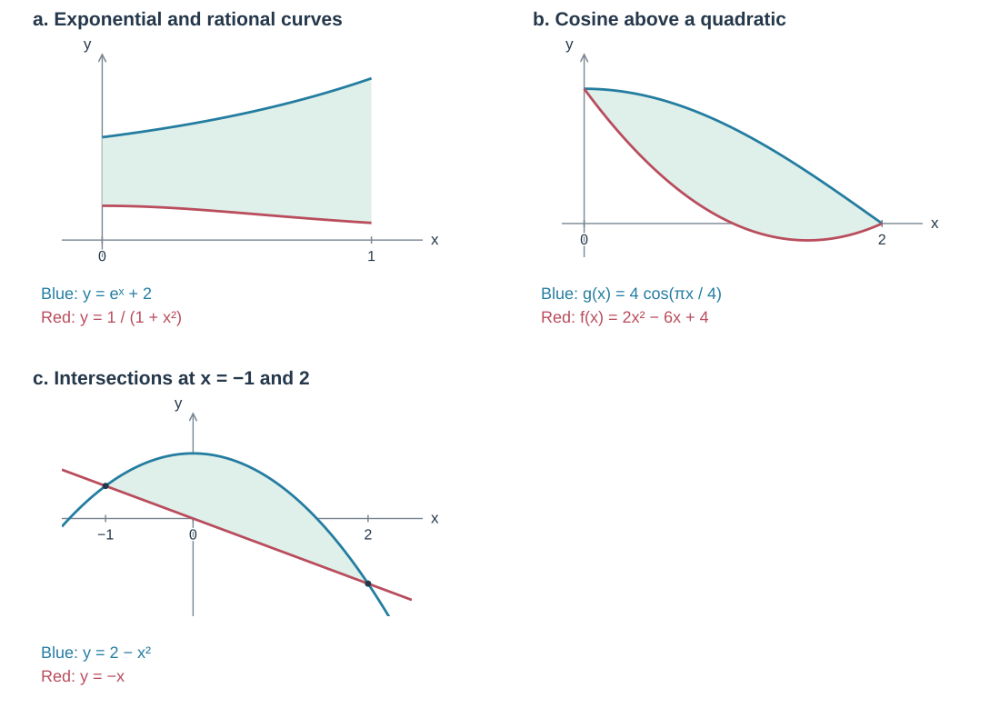

### a. $y=e^x+2$ 与 $y=1/(1+x^2)$，$0\le x\le1$

$$
\begin{aligned}
A&=\int_0^1\left(e^x+2-\frac1{1+x^2}\right)\,dx\\
 &=[e^x+2x-\arctan x]_0^1\\
 &=(e+2-\pi/4)-1=e+1-\frac\pi4.
\end{aligned}
$$

### b. $f(x)=2x^2-6x+4$ 与 $g(x)=4\cos(\pi x/4)$，$0\le x\le2$

在该区间内 $g\ge f$：

$$
\begin{aligned}
A&=\int_0^2[g(x)-f(x)]\,dx\\
 &=\left[\frac{16}{\pi}\sin\frac{\pi x}{4}-\frac23x^3+3x^2-4x\right]_0^2\\
 &=\frac{16}{\pi}-\frac{16}{3}+12-8
 =\frac{16}{\pi}-\frac43.
\end{aligned}
$$

### c. $y=2-x^2$ 与 $y=-x$

由 $2-x^2=-x$ 得交点横坐标 $-1,2$：

$$
\begin{aligned}
A&=\int_{-1}^2(2-x^2+x)\,dx\\
 &=\left[2x-\frac{x^3}{3}+\frac{x^2}{2}\right]_{-1}^2\\
 &=\left(4-\frac83+2\right)-\left(-2+\frac13+\frac12\right)
 =\frac92.
\end{aligned}
$$

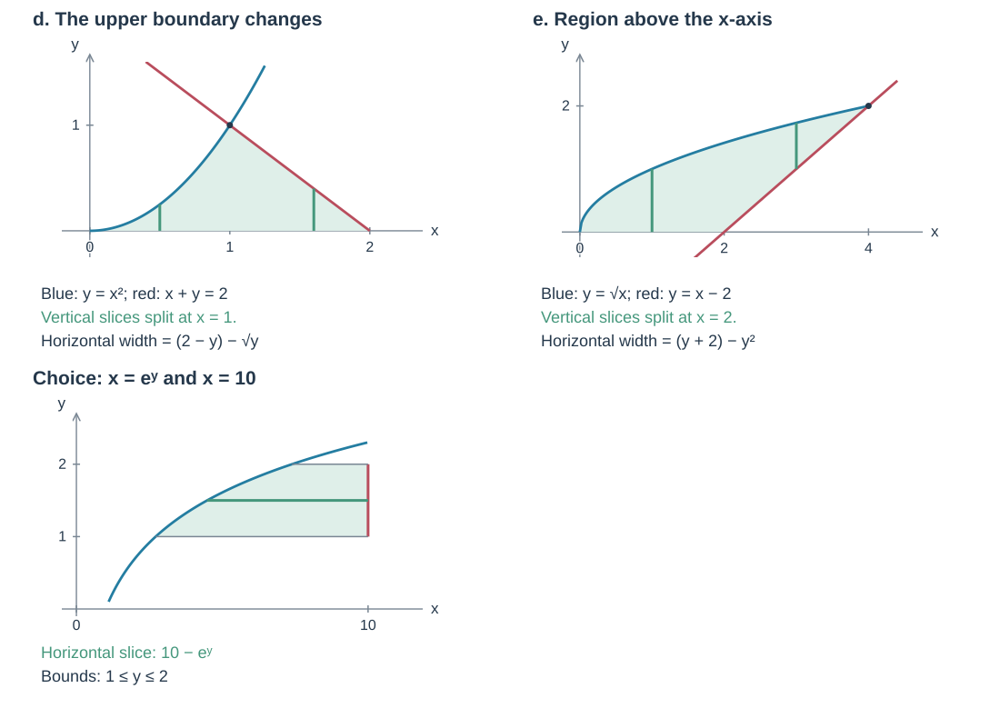

### d. $y=x^2$、$x+y=2$ 与 $x$ 轴围成的第一象限区域

两曲线相交于 $(1,1)$。竖直切片在 $x=1$ 处更换上边界：

$$
A=\int_0^1x^2\,dx+\int_1^2(2-x)\,dx.
$$

水平切片右边界始终是 $x=2-y$，左边界是 $x=\sqrt y$：

$$
A=\int_0^1[(2-y)-\sqrt y]\,dy=\frac56.
$$

### e. $y=\sqrt x$、$y=x-2$ 与 $x$ 轴围成的区域

取 $x$ 轴上方的区域，曲线与直线的交点为 $(4,2)$。水平切片为

$$
A=\int_0^2[(y+2)-y^2]\,dy.
$$

竖直切片须在 $x=2$ 处分段：

$$
A=\int_0^2\sqrt x\,dx+\int_2^4[\sqrt x-(x-2)]\,dx=\frac{10}{3}.
$$

### 选择题：$x=e^y$、$x=10$、$y=1$ 与 $y=2$

求这些边界围成的区域 $R$ 的面积。选项为

- A. $\displaystyle\int_1^2e^y\,dy$
- B. $\displaystyle\int_e^{e^2}\ln x\,dx$
- C. $\displaystyle\int_1^2(10-e^y)\,dy$
- D. $\displaystyle\int_e^{10}(\ln x-1)\,dx$
- E. $\displaystyle\int_e^{e^2}(\ln x-1)\,dx+10-e^2$

水平切片宽度为 $10-e^y$，所以 C 正确。E 将区域改用竖直切片分段，给出相同的面积，也是等价表达：

$$
A=\int_1^2(10-e^y)\,dy=10-e^2+e.
$$

## 用横截面积求体积

设 $A(x)$ 为垂直于 $x$ 轴的截面积，第 $k$ 个薄片的体积近似为

$$
V_k\approx A(x_k^*)\Delta x_k.
$$

将薄片相加并取极限：

$$
V=\lim_{n\to\infty}\sum_{k=1}^n A(x_k^*)\Delta x_k
=\int_a^b A(x)\,dx.
$$

若截面垂直于 $y$ 轴，则 $V=\int_c^d A(y)\,dy$。

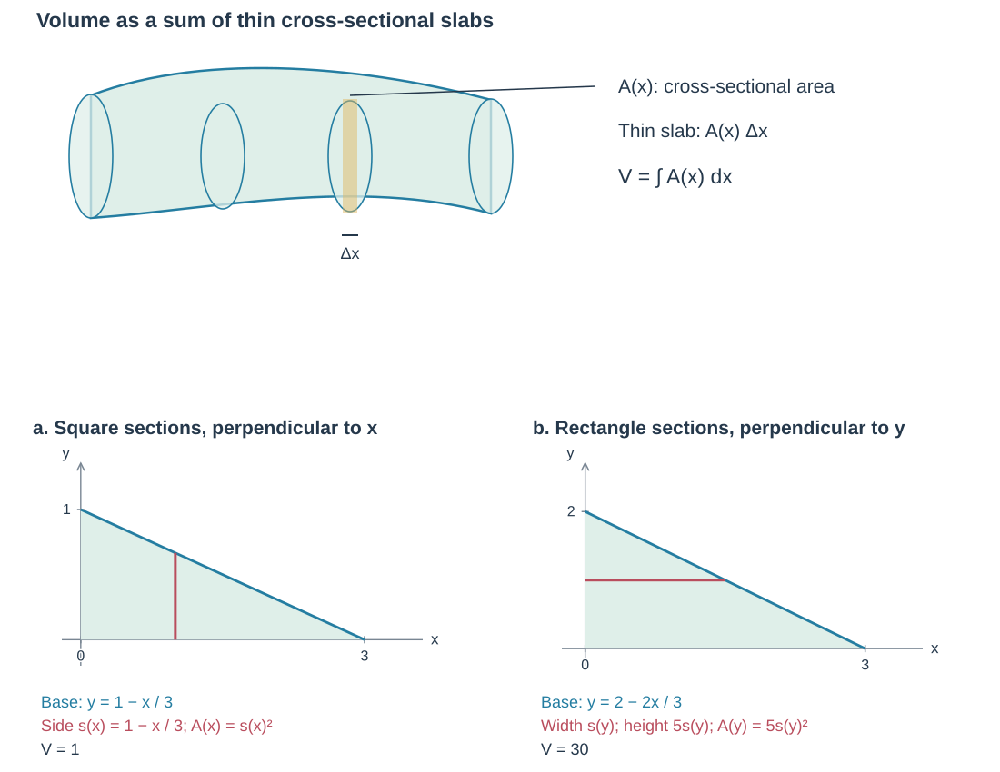

### a. 正方形截面：$y=1-x/3$ 与两坐标轴

截面垂直于 $x$ 轴，边长 $s(x)=1-x/3$，所以

$$
\begin{aligned}
A(x)&=(1-x/3)^2,\\
V&=\int_0^3(1-x/3)^2\,dx
=\left[-(1-x/3)^3\right]_0^3=1.
\end{aligned}
$$

### b. 矩形截面：$y=2-2x/3$ 与两坐标轴

截面垂直于 $y$ 轴，底面中的宽度为 $s(y)=\frac32(2-y)$；矩形的另一边长为 $5s(y)$，因此

$$
\begin{aligned}
A(y)&=5[s(y)]^2=\frac{45}{4}(2-y)^2,\\
V&=\frac{45}{4}\int_0^2(2-y)^2\,dy\\
 &=-\frac{15}{4}[(2-y)^3]_0^2=30.
\end{aligned}
$$

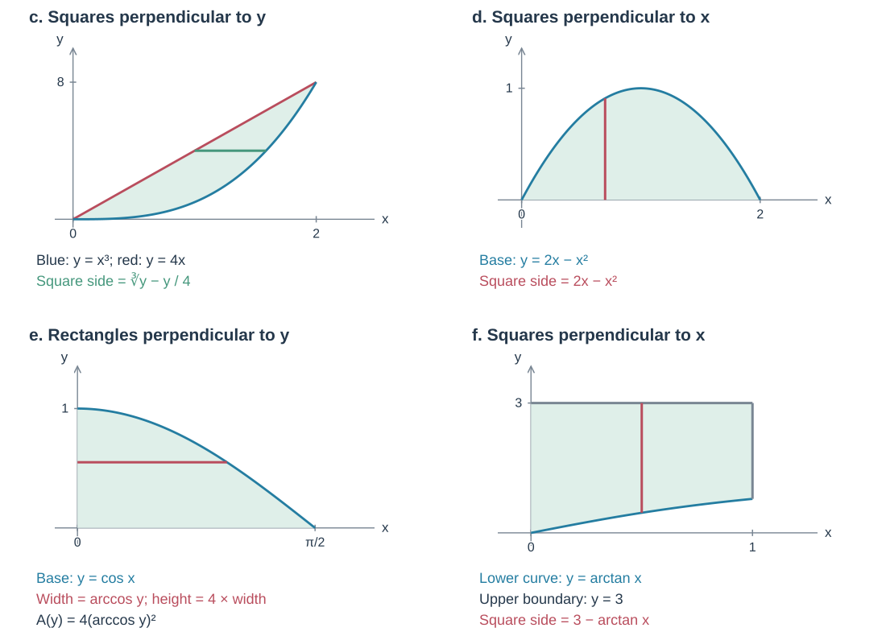

### c. 正方形截面：$y=4x$ 与 $y=x^3$

取第一象限内的区域，两曲线在 $(0,0)$、$(2,8)$ 相交。截面垂直于 $y$ 轴，边长为

$$
s(y)=\sqrt[3]y-\frac y4,
\qquad A(y)=\left(\sqrt[3]y-\frac y4\right)^2,
\qquad V=\int_0^8 A(y)\,dy.
$$

### d. 正方形截面：$y=2x-x^2$ 与 $x$ 轴

截面垂直于 $x$ 轴：

$$
\begin{aligned}
A(x)&=(2x-x^2)^2=4x^2-4x^3+x^4,\\
V&=\int_0^2(4x^2-4x^3+x^4)\,dx\\
 &=\left[\frac43x^3-x^4+\frac15x^5\right]_0^2\\
 &=\frac{32}{3}-16+\frac{32}{5}=\frac{16}{15}.
\end{aligned}
$$

### e. 矩形截面：$y=\cos x$ 与两坐标轴，$0\le x\le\pi/2$

截面垂直于 $y$ 轴，矩形的高度是底面宽度的四倍。由 $x=\arccos y$，

$$
A(y)=4(\arccos y)^2,
\qquad V=\int_0^1 4(\arccos y)^2\,dy=4\pi-8\approx4.566.
$$

### f. 正方形截面：$y=\arctan x$、$y$ 轴、$y=3$ 与 $x=1$

截面垂直于 $x$ 轴：

$$
s(x)=3-\arctan x,
\qquad A(x)=(3-\arctan x)^2,
$$

$$
V=\int_0^1(3-\arctan x)^2\,dx\approx6.612.
$$

## 三角形、半圆与四分之一圆截面

若底面中的线段长度为 $s$，正三角形截面积为 $\sqrt3s^2/4$；若线段为半圆直径 $d$，则

$$
A=\frac12\pi\left(\frac d2\right)^2=\frac\pi8d^2.
$$

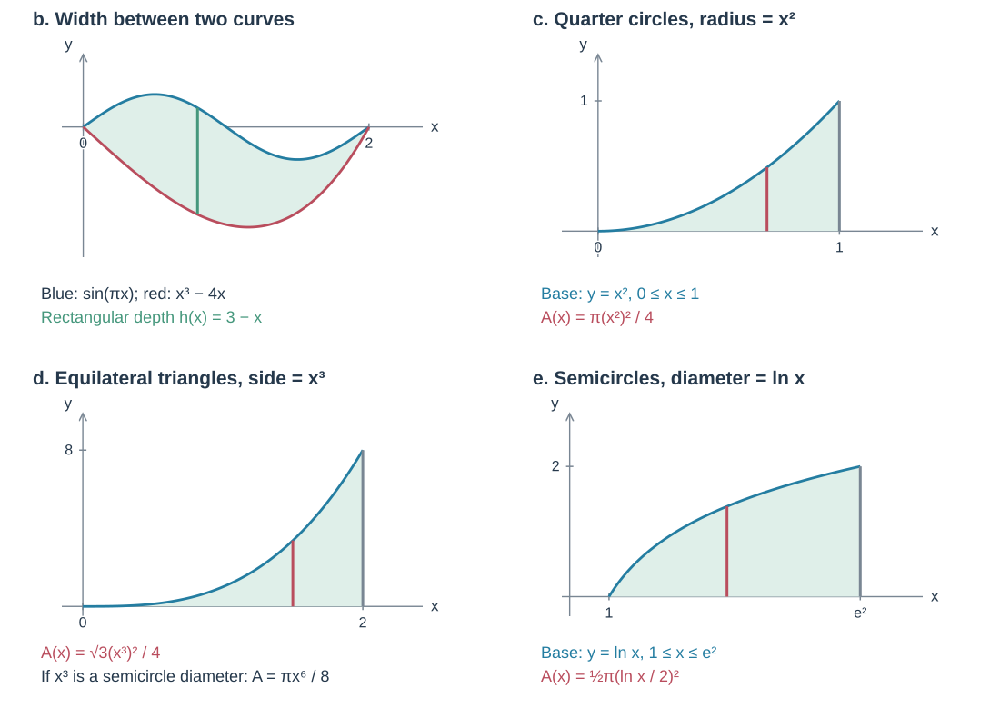

### a. $y=x^2$、$x=4$ 与 $x$ 轴，正三角形截面

截面垂直于 $x$ 轴，三角形边长为 $x^2$，因此

$$
V=\int_0^4\frac{\sqrt3}{4}(x^2)^2\,dx.
$$

### b. $y=x^3-4x$ 与 $y=\sin(\pi x)$，深度 $h(x)=3-x$

取 $0\le x\le2$ 内两曲线之间的底面。截面的宽为上下两曲线之差，深度为 $3-x$：

$$
V=\int_0^2[\sin(\pi x)-(x^3-4x)](3-x)\,dx.
$$

### c. $y=x^2$ 与 $x$ 轴，$0\le x\le1$，四分之一圆截面

截面垂直于 $x$ 轴，圆心在 $x$ 轴上，一条半径位于 $xy$ 平面内，半径 $r=x^2$：

$$
V=\int_0^1\frac\pi4(x^2)^2\,dx.
$$

### d. 第一象限中 $y=x^3$、$x=2$ 与 $x$ 轴，正三角形截面

截面垂直于 $x$ 轴，$s(x)=x^3$：

$$
\begin{aligned}
V&=\int_0^2\frac12(x^3)^2\sin60^\circ\,dx\\
 &=\frac{\sqrt3}{4}\left[\frac{x^7}{7}\right]_0^2
=\frac{32\sqrt3}{7}.
\end{aligned}
$$

半圆截面若以 $d(x)=x^3$ 为直径，则 $A(x)=\pi x^6/8$。

### e. $y=\ln x$ 与 $x$ 轴，$1\le x\le e^2$，半圆截面

截面直径为 $\ln x$：

$$
V=\int_1^{e^2}\frac12\pi\left(\frac{\ln x}{2}\right)^2\,dx.
$$

## Disk Method

绕 $x$ 轴旋转时，截面是半径为 $R(x)$ 的圆盘：

$$
A(x)=\pi[R(x)]^2,
\qquad V=\pi\int_a^b[R(x)]^2\,dx.
$$

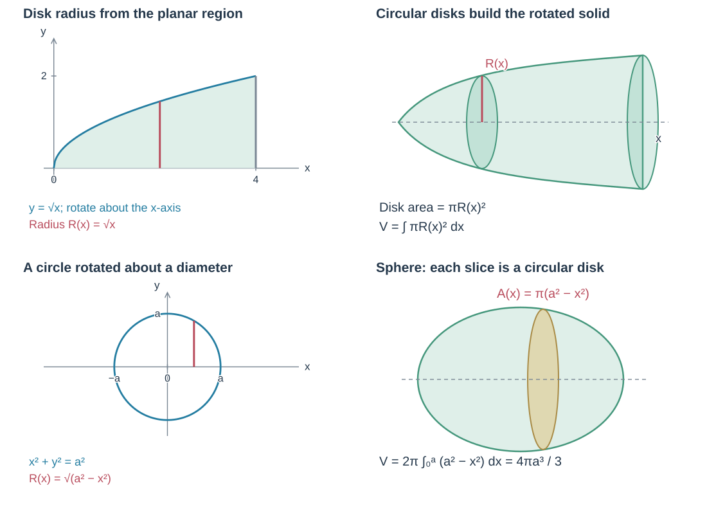

例如 $y=\sqrt x$ 与 $x$ 轴、$x=4$ 围成的区域绕 $x$ 轴旋转，半径为 $R(x)=\sqrt x$。

### 圆绕直径旋转：球体

圆 $x^2+y^2=a^2$ 绕 $x$ 轴旋转，截面半径为 $R(x)=\sqrt{a^2-x^2}$：

$$
\begin{aligned}
V&=\int_{-a}^a\pi\left(\sqrt{a^2-x^2}\right)^2\,dx\\
 &=2\pi\int_0^a(a^2-x^2)\,dx
=\frac43\pi a^3.
\end{aligned}
$$

### a. $R(x)=2x$，$0\le x\le3$

$$
V=\int_0^3\pi(2x)^2\,dx
=4\pi\left[\frac{x^3}{3}\right]_0^3=36\pi.
$$

### b. $R(x)=e^x$，$0\le x\le\ln2$

$$
V=\pi\int_0^{\ln2}e^{2x}\,dx
=\frac\pi2[e^{2x}]_0^{\ln2}=\frac{3\pi}{2}.
$$

### c. 三角形旋转形成圆锥

三角形顶点为 $(0,0),(a,0),(0,b)$，其中 $a,b>0$。绕 $x$ 轴旋转：

$$
y=-\frac ba x+b.
$$

$$
\begin{aligned}
V&=\pi\int_0^a\left(-\frac ba x+b\right)^2\,dx\\
 &=-\frac{\pi a}{3b}\left[\left(-\frac ba x+b\right)^3\right]_0^a\\
 &=\frac13\pi ab^2.
\end{aligned}
$$

这与圆锥公式 $V=\pi r^2h/3$ 相同。

## 绕 $y$ 轴及其他直线旋转

绕竖直轴旋转时，使用水平圆盘：

$$
V=\pi\int_c^d[R(y)]^2\,dy.
$$

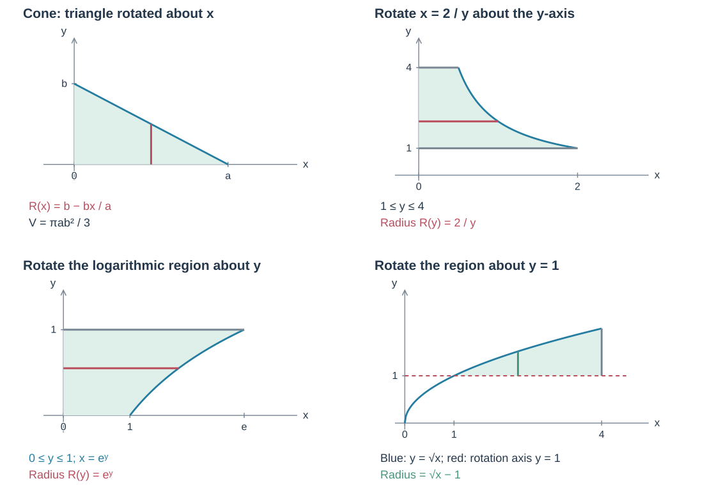

### 绕 $y$ 轴：$x=2/y$，$1\le y\le4$

区域位于曲线与 $y$ 轴之间，圆盘半径为 $R(y)=2/y$：

$$
V=\pi\int_1^4\left(\frac2y\right)^2\,dy.
$$

### 绕 $y$ 轴：$y=\ln x$、$y=1$ 与两坐标轴

由 $x=e^y$，圆盘半径为 $e^y$，所以

$$
V=\pi\int_0^1(e^y)^2\,dy.
$$

### a. 绕 $y=1$：$y=\sqrt x$、$y=1$ 与 $x=4$

半径是曲线到旋转轴的距离 $\sqrt x-1$：

$$
V=\pi\int_1^4(\sqrt x-1)^2\,dx.
$$

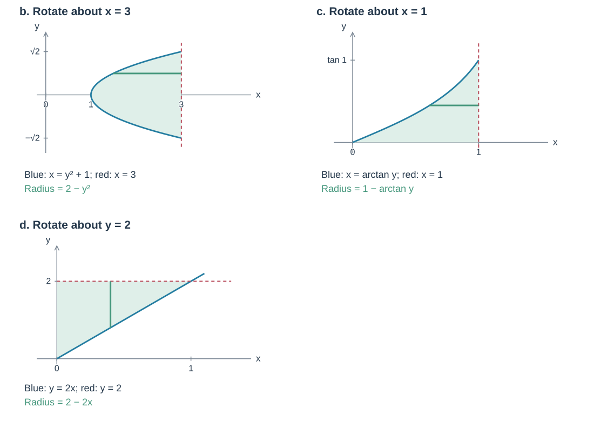

### b. 绕 $x=3$：$x=y^2+1$ 与 $x=3$

交点的纵坐标为 $\pm\sqrt2$，半径为 $R(y)=3-(y^2+1)=2-y^2$：

$$
V=\pi\int_{-\sqrt2}^{\sqrt2}(2-y^2)^2\,dy
=2\pi\int_0^{\sqrt2}(2-y^2)^2\,dy.
$$

### c. 绕 $x=1$：$x=\arctan y$ 与 $x=1$，$0\le y\le\tan1$

$$
V=\pi\int_0^{\tan1}(1-\arctan y)^2\,dy.
$$

### d. 绕 $y=2$：$y=2x$、$x=0$ 与 $y=2$

$$
V=\pi\int_0^1(2-2x)^2\,dx.
$$

## Washer Method

当截面中心有孔时，使用垫片（圆环）截面。外半径为 $R$，内半径为 $r$，且 $R\ge r\ge0$：

$$
A=\pi(R^2-r^2),
\qquad V=\pi\int_a^b[R(x)^2-r(x)^2]\,dx.
$$

若使用水平截面，将积分变量改为 $y$。

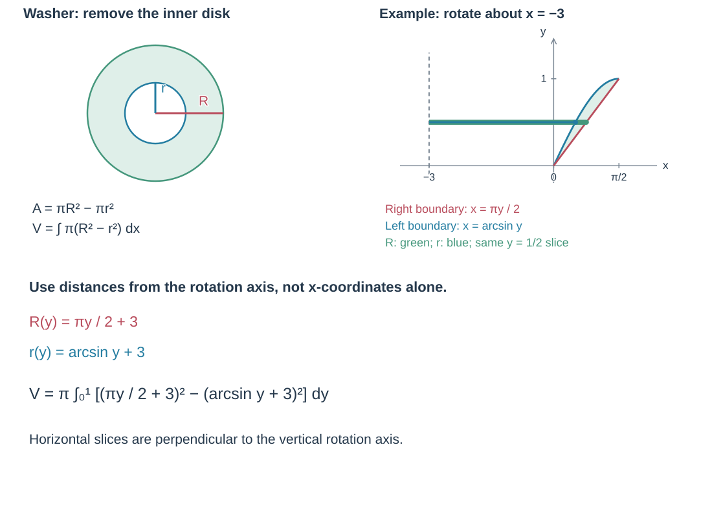

### $y=2x/\pi$ 与 $y=\sin x$ 围成的第一象限区域，绕 $x=-3$ 旋转

使用 $0\le y\le1$ 的水平截面。右边界为 $x=\pi y/2$，左边界为 $x=\arcsin y$。到旋转轴的距离分别为

$$
R(y)=\frac\pi2y+3,
\qquad r(y)=\arcsin y+3.
$$

所以

$$
V=\pi\int_0^1\left[\left(\frac\pi2y+3\right)^2-(\arcsin y+3)^2\right]\,dy.
$$

## Arc Length

若 $y=f(x)$ 在 $[a,b]$ 上足够光滑，弧长为

$$
L=\int_a^b\sqrt{1+\left(\frac{dy}{dx}\right)^2}\,dx.
$$

若写成 $x=g(y)$，$c\le y\le d$，则

$$
L=\int_c^d\sqrt{1+\left(\frac{dx}{dy}\right)^2}\,dy.
$$

### a. $y=\dfrac{4\sqrt2}{3}x^{3/2}-1$，$0\le x\le1$

$$
\begin{aligned}
y'&=2\sqrt{2x},\\
L&=\int_0^1\sqrt{1+(2\sqrt{2x})^2}\,dx\\
 &=\int_0^1\sqrt{1+8x}\,dx\\
 &=\frac1{12}[(1+8x)^{3/2}]_0^1
=\frac{27-1}{12}=\frac{13}{6}.
\end{aligned}
$$

### b. 由弧长被积式恢复函数

若弧长写为

$$
L=\int_1^4\sqrt{1+16x^6}\,dx,
$$

可取 $y'=4x^3$，从而 $y=x^4+C$。曲线经过 $(0,3)$ 时，$C=3$，得到 $y=x^4+3$。

### c. $x=4(2-y)^2$，$3/2\le y\le3$

$$
\frac{dx}{dy}=-8(2-y),
\qquad L=\int_{3/2}^3\sqrt{1+64(2-y)^2}\,dy.
$$

### d. $y=x+2\sin x$，$0\le x\le3\pi$

$$
\begin{aligned}
L&=\int_0^{3\pi}\sqrt{1+(1+2\cos x)^2}\,dx\\
 &=\int_0^{3\pi}\sqrt{2+4\cos x+4\cos^2x}\,dx
 \approx17.4.
\end{aligned}
$$

### e. 区域周长练习

区域 $R$ 由 $f(x)=e^{2x}$、直线 $x=k$（$k>0$）及 $x$、$y$ 两轴围成，求 $R$ 的周长。
