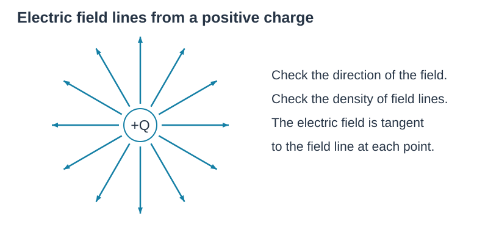
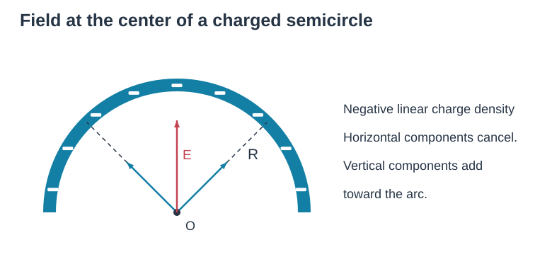
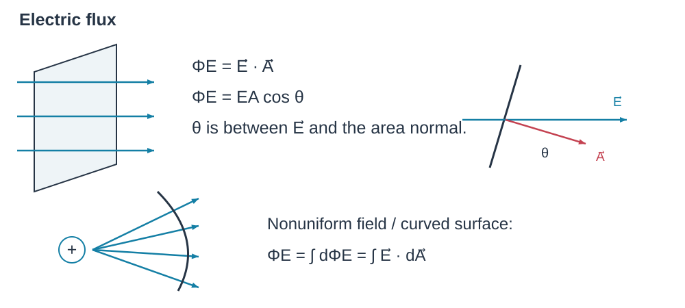
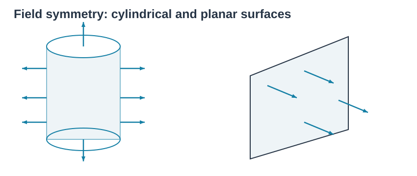
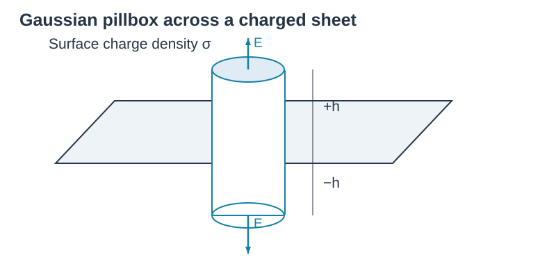
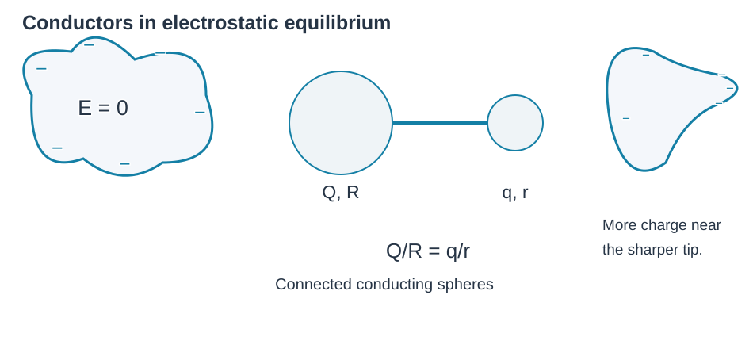
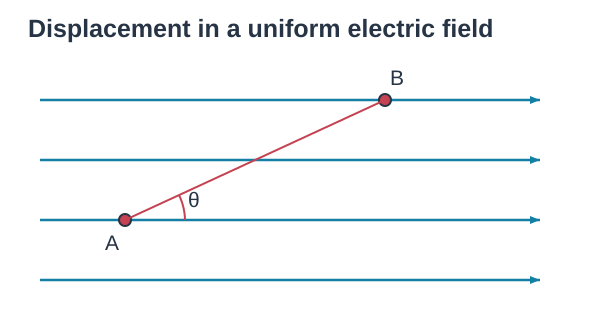
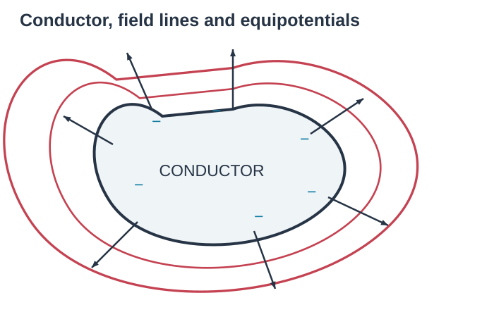

# Electric Field and Potential Notes

## 1 Charge is quantized

$$|e|=1.6\times10^{-19}\ \mathrm C.$$
Smallest amount of charge, cannot be divided.

## 2 Coulomb's law

Like charges repel; unlike charges attract.
$$\vec F=k\left|\frac{q_1q_2}{r^2}\right|.$$
$$k=9\times10^9\ \mathrm{N\,m^2/C^2},\qquad k=\frac1{4\pi\varepsilon_0},\quad\varepsilon_0=8.85\times10^{-12}\ \mathrm{C^2/(N\,m^2)}.$$

Coulomb's law and electric fields: **vector superposition**.

## 3 Electric Field

$$\vec E=\frac{\vec F}{q},$$
the force a unit charge will experience in electric field.
$$E=\frac1{4\pi\varepsilon_0}\frac Q{r^2}.$$

Electric field vector is tangent to every field line drawn. Check its (1) direction; (2) density (strength).

### Example

A negatively charged semicircular arc, radius $R$, with linear charge density $\lambda$. Find $\vec E$ at the center.

Due to symmetry, we should only calculate the sum of field in vertical direction due to cancellation of horizontal field.
$$E=\int_0^\pi\frac{k\,dQ}{R^2}\sin\theta
=\int_0^\pi\frac{k\sin\theta}{R}\lambda\,d\theta.$$
$$dQ=\lambda\,d\ell=\lambda R\,d\theta,\qquad
\left[-\frac{k\lambda}{R}\cos\theta\right]_0^\pi=\frac{2k\lambda}{R}=\frac{\lambda}{2\pi\varepsilon_0R}.$$

## 3 Gauss Law

### 1 Electric Flux

Amount of electric field passing through surface.
$$\Phi_E=\vec E\cdot\vec A=EA\cos\theta.$$
$$\Phi_E=\int d\Phi_E=\int E\,dA.$$
The diagram labels a field vector and area vector; $\theta$ is their angle.

### 2 Symmetry of electric field

几何对称会推出电场对称。

### 3 Gauss Law

闭合曲面的电通量只与包围的电量有关。
$$\Phi_{\mathrm{en}}=\oint E\,dA=\frac{Q_{\mathrm{en}}}{\varepsilon_0}.$$

### 4 Applicance（单个平行板）

面密度 $\sigma$。By symmetry, electric field of the plate is perpendicular to the plate itself.
$$\Phi_{\mathrm{en}}=EA\times2=\frac{Q_{\mathrm{en}}}{\varepsilon_0}=\frac{\sigma A}{\varepsilon_0},\qquad E=\frac\sigma{2\varepsilon_0}.$$
The Gaussian cylinder passes through the plate; arrows $E$ point away from both faces; the figure labels $r$ on each side.

## 4 Conductor and insulator

1. Insulator does not allow charge to move freely.
2. Conductors allow charge to move freely.

Within a conductor, electric field $=0$ because electrons will move until no force (net) exerted to them (electrostatic equilibrium).

If conductors are connected, charge will redistribute so that inner electric field equals zero. The connected-spheres diagram gives $Q/R=q/r$.

Charge will distribute to the surface. By Gauss law:
$$\bar E=0=\frac{0\text{ enclosed }q}{\varepsilon_0}.$$
Density of charge depends on radius of curvature.

Electric field will $\perp$ to surface.

## 5 Electric Potential Energy

### 1 By definition of potential energy

$$\Delta U=-W_{\mathrm{CF}},\qquad\Delta U_E=-W_E.$$
$$\therefore W_{A\to B}=\int_A^B\frac{kQ_1Q_2}{r^2}\,dr=-\frac{kQQ_2}{r_B}+\frac{kQQ_2}{r_A}.$$
$$U_B-U_A=-W_{A\to B}=\frac{kQQ_2}{r_B}-\frac{kQQ_2}{r_A}.$$
$$\therefore U=\frac{kQQ_2}{r}\qquad(\text{thus when }r\to\infty,\ U=0).$$

### 2 In uniform electric field

$$W=Eqd=F_ed=qEr\cos\theta,$$
$$\therefore\Delta U=-Eqd=-qEr\cos\theta.$$
The displacement $A\to B$ makes angle $\theta$ to the horizontal field.

### 3 In a system

Three charges 1, 2, 3 form a triangle.
$$\mathrm{EPE}=\sum U_{\text{all combination}}=U_{12}+U_{23}+U_{13}.$$

### 4 Electric potential

Electric potential is electric potential energy per unit charge.
$$V=\frac Uq,\qquad\Delta V=\frac{\Delta U}q.$$
Since $F_E=-\frac{dU}{dx}$,
$$\bar E=\frac Fq=-\frac{dV}{dx}=-\frac{d(U/q)}{dx}.$$
$$V=k\frac Qr.$$
In uniform field, $\Delta V=-Ed$.

Scalar quantity. To calculate the potential in a certain point:
$$V=\frac1{4\pi\varepsilon_0}\sum\frac{q_i}{r_i}.$$

Equipotential surface: perpendicular to all electric field lines.

（因为 $q$ 在等势面移动时不做功，无沿力方向的位移。）

