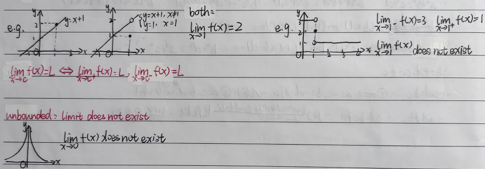
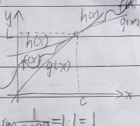
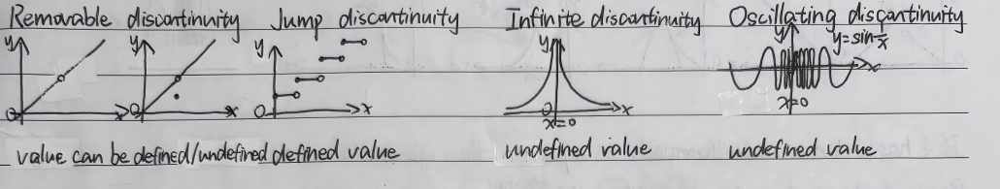
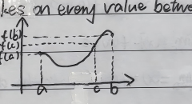
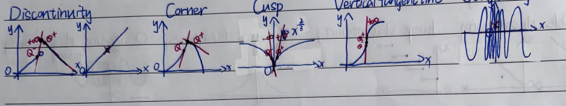
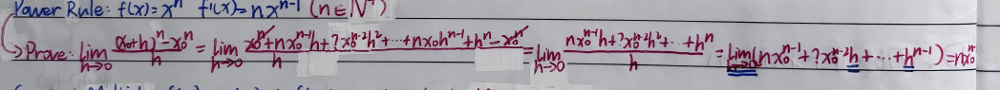
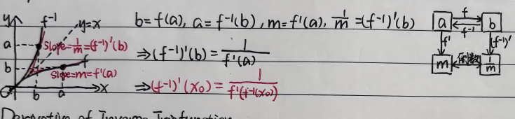
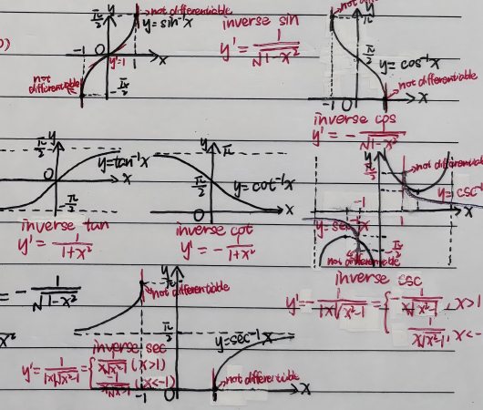

# G10 Calculus BC Midterm Notes

## Limits

Why is the equation of $PQ$
$$y-y_1=\frac{y_2-y_1}{x_2-x_1}(x-x_1)?$$
Suppose that there's a moving point $(x,y)$. Definition of slope:
$$\frac{y-y_1}{x-x_1}=\frac{y_2-y_1}{x_2-x_1}\quad\therefore\quad y-y_1=\frac{y_2-y_1}{x_2-x_1}(x-x_1).$$

$$\lim_{x\to c}f(x)=L.$$
If $f(x)$ is arbitrarily close to the number $L$ for all $x$ sufficiently close to $c$ (other than $c$ itself), we say that $f$ approaches the limit $L$ as $x$ approaches $c$.

The function value doesn't matter; the trend matters. $\lim_{x\to c}f(x)\ne f(c)$.

$$\lim_{n\to\infty}\left(1+\frac1n\right)^n=e.$$

Examples: $y=x+1$ and $y=\begin{cases}x+1,&x\ne1\\1,&x=1\end{cases}$ both have $\lim_{x\to1}f(x)=2$.

The third graph has $\lim_{x\to1^-}f(x)=3$, $\lim_{x\to1^+}f(x)=1$; $\lim_{x\to1}f(x)$ does not exist. A solid point at $(1,2)$ does not change those limits.

$$\lim_{x\to c}f(x)=L\iff\lim_{x\to c^+}f(x)=L,\quad\lim_{x\to c^-}f(x)=L.$$

Unbounded: limit does not exist. The graph tends upward on both sides of $x=0$; $\lim_{x\to0}f(x)$ does not exist.

## Limit Laws

If $\lim_{x\to c}f(x)=L$, $\lim_{x\to c}g(x)=M$, then:

1. $\lim_{x\to c}[f(x)\pm g(x)]=L\pm M$.
2. $\lim_{x\to c}[k f(x)]=kL$.
3. $\lim_{x\to c}[f(x)g(x)]=LM$.
4. $\lim_{x\to c}\frac{f(x)}{g(x)}=\frac LM$ ($M\ne0$).
5. $\lim_{x\to c}[f(x)]^n=L^n$.
6. $\lim_{x\to c}\sqrt[n]{f(x)}=\sqrt[n]L=L^{1/n}$.

Polynomial Function Limits Law:
$$f(x)=a_1x^n+a_2x^{n+1}+a_3x^{n+2}+\cdots+a_{n+1},\qquad\lim_{x\to c}f(x)=f(c).$$

Rational Functions Limits Law: $p(x),q(x)$ are polynomials.
$$f(x)=\frac{p(x)}{q(x)}\text{ (rational function)},\ q(x)\ne0,\quad\lim_{x\to c}f(x)=f(c).$$

$$\lim_{x\to c}f(g(x))=f\left(\lim_{x\to c}g(x)\right)\quad\left(\lim_{x\to c}g(x)\text{ exists}\right).$$
$$\lim_{x\to c^+}f(g(x))=f\left(\lim_{x\to c^+}g(x)\right),\qquad\lim_{x\to c^-}f(g(x))=f\left(\lim_{x\to c^-}g(x)\right).$$
If $\lim_{x\to c^+}g(x)\ne\lim_{x\to c^-}g(x)$ ($\Rightarrow\lim_{x\to c}g(x)$ does not exist),
$$f\left(\lim_{x\to c^+}g(x)\right)=f\left(\lim_{x\to c^-}g(x)\right),$$
then
$$\lim_{x\to c}f(g(x))=\lim_{x\to c^+}f(g(x))=\lim_{x\to c^-}f(g(x))=f\left(\lim_{x\to c^+}g(x)\right)=f\left(\lim_{x\to c^-}g(x)\right).$$

## The Squeeze Theorem

If $g(x)\le f(x)\le h(x)$ for all $x$ in the interval containing $c$ (except $c$ itself),
$$\lim_{x\to c}g(x)=\lim_{x\to c}h(x)=L,$$
then $\lim_{x\to c}f(x)=L$.

Two Important Trigonometric Limits:
$$\lim_{\theta\to0}\frac{\sin\theta}{\theta}=1,\qquad\lim_{\theta\to0}\frac{1-\cos\theta}{\theta}=0.$$
$$\lim_{\theta\to0}\frac{\tan\theta}{\theta}=\lim_{\theta\to0}\frac{\sin\theta}{\theta}\frac1{\cos\theta}=\lim_{\theta\to0}\frac{\sin\theta}{\theta}\cdot\lim_{\theta\to0}\frac1{\cos\theta}=1\cdot1.$$

The line $y=b$ is a horizontal asymptote of $f(x)$ if $\lim_{x\to\infty}f(x)=b$ or $\lim_{x\to-\infty}f(x)=b$.

The line $x=a$ is a vertical asymptote of $f(x)$ if $\lim_{x\to a^+}f(x)=\pm\infty$ or $\lim_{x\to a^-}f(x)=\pm\infty$.

## End behavior model

The function $g$ is a right end behavior model if and only if $\lim_{x\to\infty}\frac{f(x)}{g(x)}=1$.

The function $g$ is a left end behavior model if and only if $\lim_{x\to-\infty}\frac{f(x)}{g(x)}=1$.

The function $g$ is an end behavior model of $f$.

### Continuity

$a,b,c$ is interior points of in the domain of $f(x)$.

$$\lim_{x\to c}f(x)=f(c)\Rightarrow f(x)\text{ is continuous at }c.$$
$$\lim_{x\to a^+}f(x)=f(a)\Rightarrow f(x)\text{ is continuous at left endpoint }a.$$
$$\lim_{x\to b^-}f(x)=f(b)\Rightarrow f(x)\text{ is continuous at right endpoint }b.$$

Discontinuity = not continuous.

Four types of discontinuity:

| Type | Note under graph |
|---|---|
| Removable discontinuity | value can be defined/undefined |
| Jump discontinuity | defined value |
| Infinite discontinuity | undefined value |
| Oscillating discontinuity ($y=\sin\frac1x$, $x=0$) | undefined value |

### IVT Intermediate Value Theorem for Continuous Functions

A function $f$ that is continuous on a closed interval 闭区间 $[a,b]$ takes on every value between $f(a)$ and $f(b)$.

(In other words, we can find some $c$ in $[a,b]$ that $f(a)\le f(c)\le f(b)$.)

Prove:

1. $f$ is continuous on the interval $[a,b]$.
2. $f(a)<f(c)<f(b)$.
3. $\therefore$ + conclusion.

## Differentiation

The slope of the curve at $x=a$ = the slope of the tangent line to the curve at $x=a$:
$$\lim_{h\to0}\frac{f(a+h)-f(a)}h.$$

The derivative of a function $f$ at a point $x_0$ is
$$f'(x_0)=\lim_{h\to0}\frac{f(x_0+h)-f(x_0)}h,$$
provided the limit exists.

Differentiation = the process of finding derivatives.

Alternate form of the definition of derivative (at point $c$):
$$\lim_{x\to c}\frac{f(x)-f(c)}{x-c},$$
provided the limit exists.

The derivative of a function is a function $f'$:
$$f'=\lim_{h\to0}\frac{f(x+h)-f(x)}h.$$

The domain of $f'$ may be smaller than the domain of $f$.

If $f'(x_0)$ exists, we say that $f$ is differentiable at point $x=x_0$.

A function is differentiable if every point on its domain is differentiable.

Five Types of functions without a derivative at a point:

Discontinuity; Corner; Cusp ($x^{2/3}$); Vertical tangent line; Oscillating.

If $f$ has a derivative (differentiable) at a point $a$, then it is continuous at $a$.

Prove: if $f$ has a derivative at $a$, $f'(a)=\lim_{x\to a}\frac{f(x)-f(a)}{x-a}$ exists.
$$\begin{aligned}
\therefore\lim_{x\to a}[f(x)-f(a)]&=\lim_{x\to a}\frac{f(x)-f(a)}{x-a}\cdot\lim_{x\to a}(x-a)=f'(a)\cdot0=0,\\
\therefore\lim_{x\to a}f(x)-\lim_{x\to a}f(a)&=0,\\
\therefore\lim_{x\to a}f(x)-f(a)&=0,\\
\therefore\lim_{x\to a}f(x)&=f(a)\quad\text{(that's the definition of continuity).}
\end{aligned}$$

## Differentiation Rule for Evaluation

Constant Function: $f(x)=c$, $f'(x)=0$.

Power Rule: $f(x)=x^n$, $f'(x)=nx^{n-1}$ ($n\in\mathbb N^+$).

Prove (binomial expansion as written):
$$\begin{aligned}
\lim_{h\to0}\frac{(x_0+h)^n-x_0^n}{h}
&=\lim_{h\to0}\frac{x_0^n+nx_0^{n-1}h+2x_0^{n-2}h^2+\cdots+nx_0h^{n-1}+h^n-x_0^n}{h}\\
&=\lim_{h\to0}\frac{nx_0^{n-1}h+2x_0^{n-2}h^2+\cdots+h^n}{h}\\
&=\lim_{h\to0}\left(nx_0^{n-1}+2x_0^{n-2}h+\cdots+h^{n-1}\right)=nx_0^{n-1}.
\end{aligned}$$

Constant Multiple: $f(x)=cu(x)\Rightarrow f'(x)=cu'(x)$ ($u$ is differentiable).

Sum/Difference: $f(x)=u(x)\pm v(x)\Rightarrow f'(x)=u'(x)\pm v'(x)$ ($u,v$ are differentiable).

Product: $f(x)=u(x)v(x)\Rightarrow f'(x)=u'(x)v(x)+u(x)v'(x)$.

Quotient: $f(x)=\frac{u(x)}{v(x)}\Rightarrow f'(x)=\frac{u'(x)v(x)-u(x)v'(x)}{v^2(x)}$ ($v(x)\ne0$).

## Derivatives for trigonometric functions

| $f(x)$ | $f'(x)$ |
|---|---|
| $\sin x$ | $\cos x$ |
| $\cos x$ | $-\sin x$ |
| $\tan x=\frac{\sin x}{\cos x}$ | $\frac1{\cos^2x}=\sec^2x$ |
| $\cot x=\frac{\cos x}{\sin x}$ | $-\frac1{\sin^2x}=-\csc^2x$ |
| $\sec x=\frac1{\cos x}$ | $\frac{\sin x}{\cos^2x}=\sec x\tan x$ |
| $\csc x=\frac1{\sin x}$ | $-\frac{\cos x}{\sin^2x}=-\csc x\cot x$ |

### The Chain Rule for Derivatives

If $g$ is differentiable at $x$, and $f$ is differentiable at $g(x)$,
$$ (f\circ g)'=f'(g(x))\,g'(x),$$
$$ (f\circ g\circ h)'=f'(g(h(x)))\,g'(h(x))\,h'(x).$$

## Derivative of Inverse Function

$$b=f(a),\quad a=f^{-1}(b),\quad m=f'(a),\quad\frac1m=(f^{-1})'(b).$$
$$\Rightarrow(f^{-1})'(b)=\frac1{f'(a)}\Rightarrow(f^{-1})'(x_0)=\frac1{f'(f^{-1}(x_0))}.$$

Diagram: $a\xrightarrow{f}b$, $b\xrightarrow{f^{-1}}a$; the two slopes are reciprocal (倒数). Curves reflect across $y=x$.

### Derivative of Inverse Trig function

1. $y=\sin^{-1}x$, domain $[-1,1]$, range $[-\pi/2,\pi/2]$ ($\cos y\ge0$).

推导:
$$y=\sin^{-1}x\Rightarrow x=\sin y,$$
$$1=\cos y\cdot y',\qquad\frac{dy}{dx}=\frac1{\cos y}.$$
$(\cos y\ne0\Rightarrow y\ne\pm\pi/2\Rightarrow x\ne\pm1)$.
$$\because\sin^2y+\cos^2y=1,\quad x^2+\cos^2y=1,\quad\therefore\cos^2y=1-x^2.$$
$$\because\cos y\ge0,\quad\therefore\frac{dy}{dx}=\frac1{\sqrt{1-x^2}}.$$

2. $y=\cos^{-1}x$, domain $[-1,1]$, range $[0,\pi]$ $\Rightarrow y'=-\frac1{\sqrt{1-x^2}}$.
3. $y=\tan^{-1}x$, domain $\mathbb R$, range $(-\pi/2,\pi/2)$ $\Rightarrow y'=\frac1{1+x^2}$.

Derivative formulas:

- inverse sin: $y'=\frac1{\sqrt{1-x^2}}$; endpoints not differentiable.
- inverse cos: $y'=-\frac1{\sqrt{1-x^2}}$; endpoints not differentiable.
- inverse tan: $y'=\frac1{1+x^2}$.
- inverse cot: $y'=-\frac1{1+x^2}$.
- inverse csc: $y'=-\frac1{|x|\sqrt{x^2-1}}=\begin{cases}-\frac1{x\sqrt{x^2-1}},&x>1\\\frac1{x\sqrt{x^2-1}},&x<-1\end{cases}$.
- inverse sec: $y'=\frac1{|x|\sqrt{x^2-1}}=\begin{cases}\frac1{x\sqrt{x^2-1}},&x>1\\-\frac1{x\sqrt{x^2-1}},&x<-1\end{cases}$.

## Derivative of Exponential and Logarithmic Functions

$$f(x)=e^x\Rightarrow f'(x)=e^x.$$
$$f(x)=a^x\Rightarrow f'(x)=a^x\ln a.$$
Proof: $f(x)=a^x=(e^{\ln a})^x=e^{(\ln a)x}$;
$$\therefore f'(x)=e^{(\ln a)x}\ln a=a^x\ln a\quad(a>0,a\ne1).$$
$$f(x)=\ln x\Rightarrow f'(x)=\frac1x.$$
$$f(x)=\log_ax\Rightarrow f'(x)=\frac1{x\ln a}.$$
Proof: $f(x)=\log_ax=\frac{\ln x}{\ln a}$,
$$\therefore f'(x)=\frac{1/x}{\ln a}=\frac1{x\ln a}.$$

Example $y=x^x$:
$$\ln y=\ln x^x=x\ln x,$$
$$\frac1y\,y'=1\cdot\ln x+x\cdot\frac1x,\qquad y'=y(\ln x+1)=x^x(\ln x+1).$$
