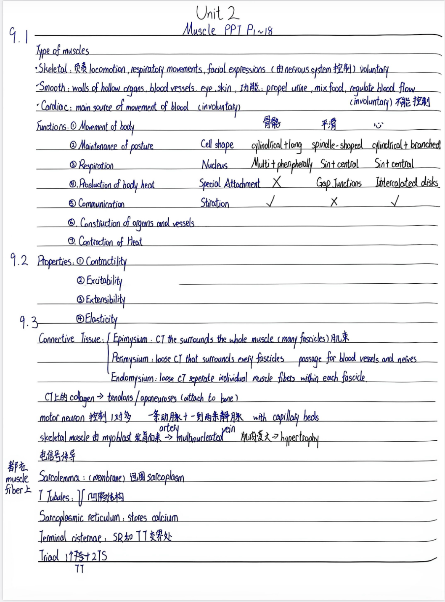
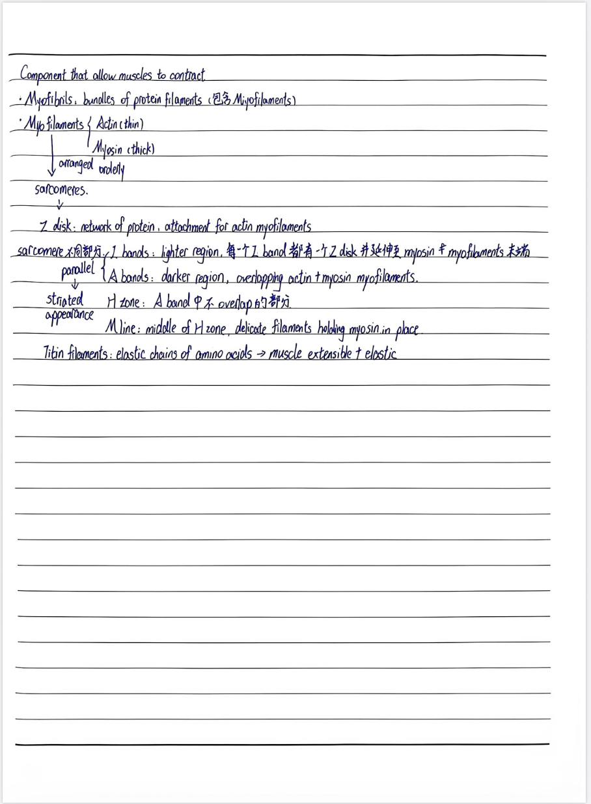
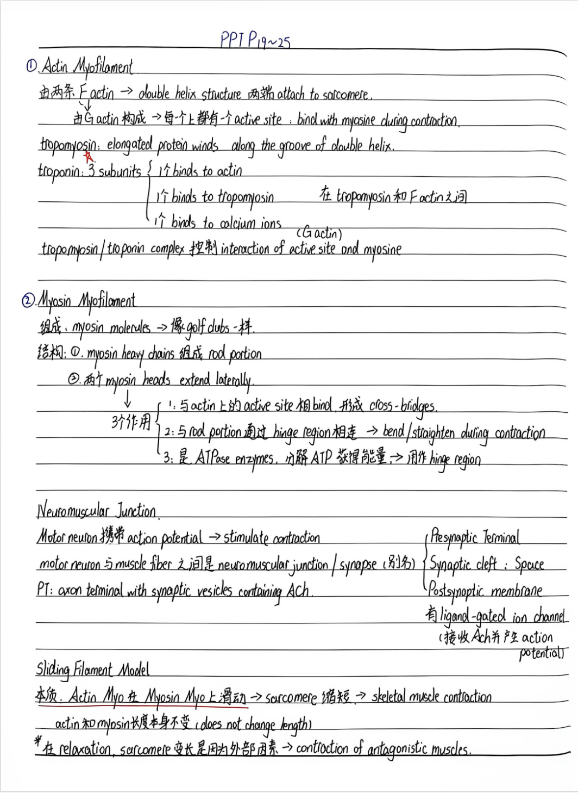
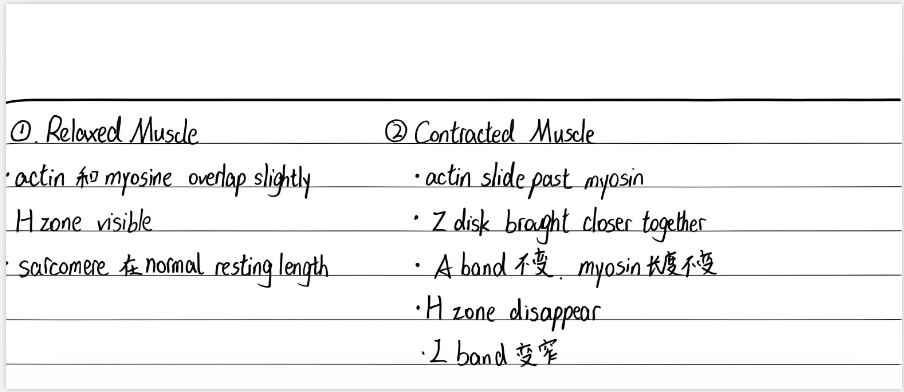
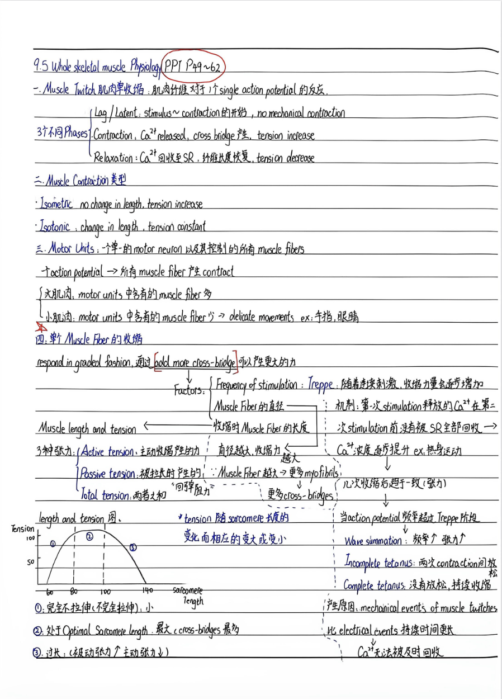
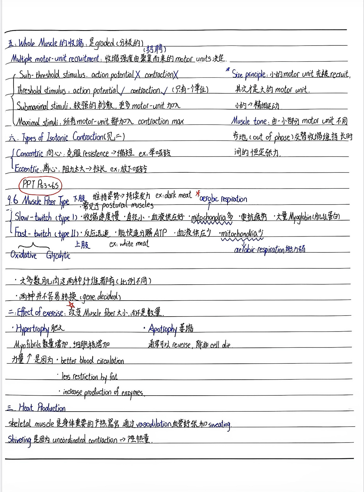
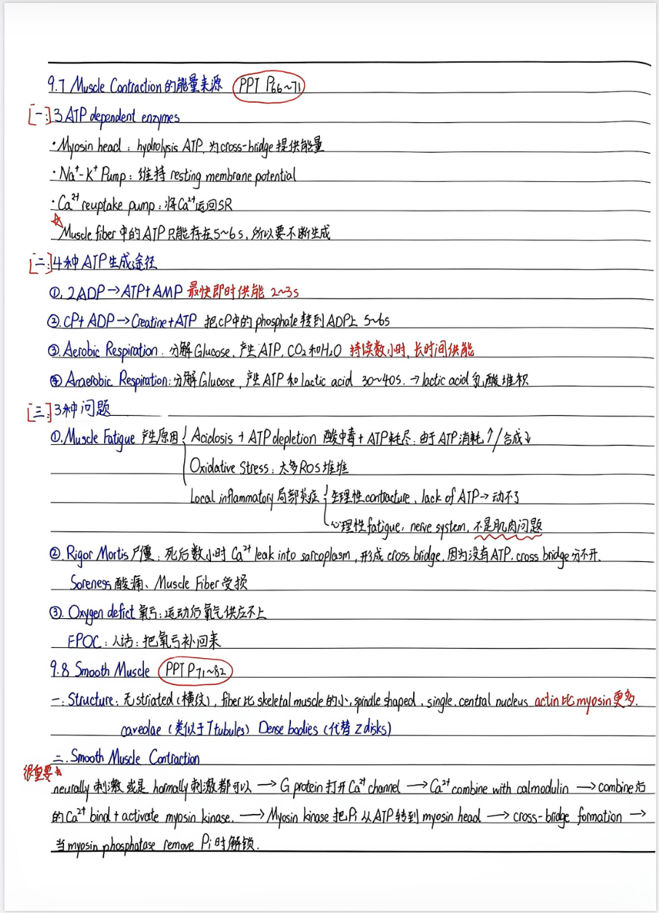
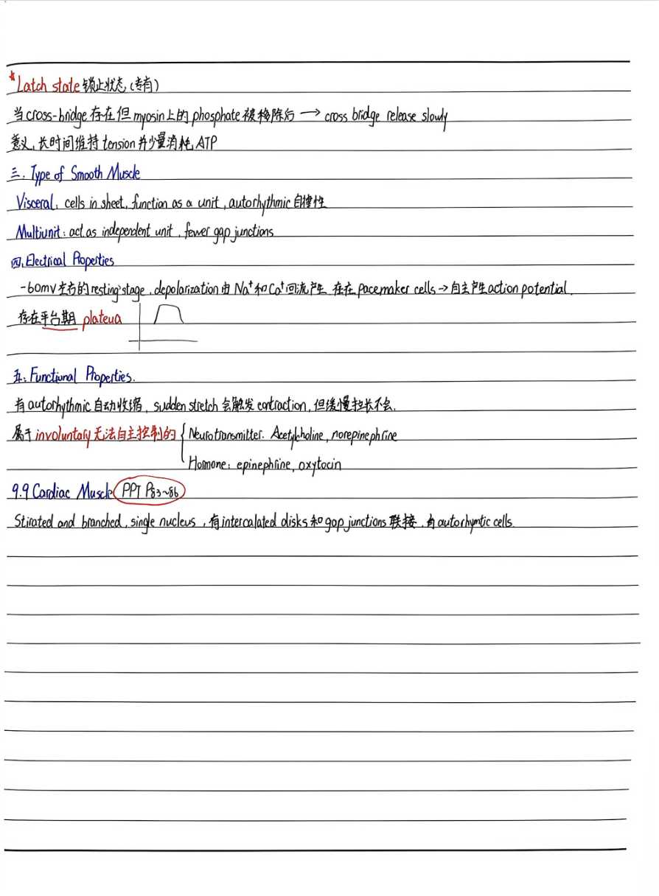
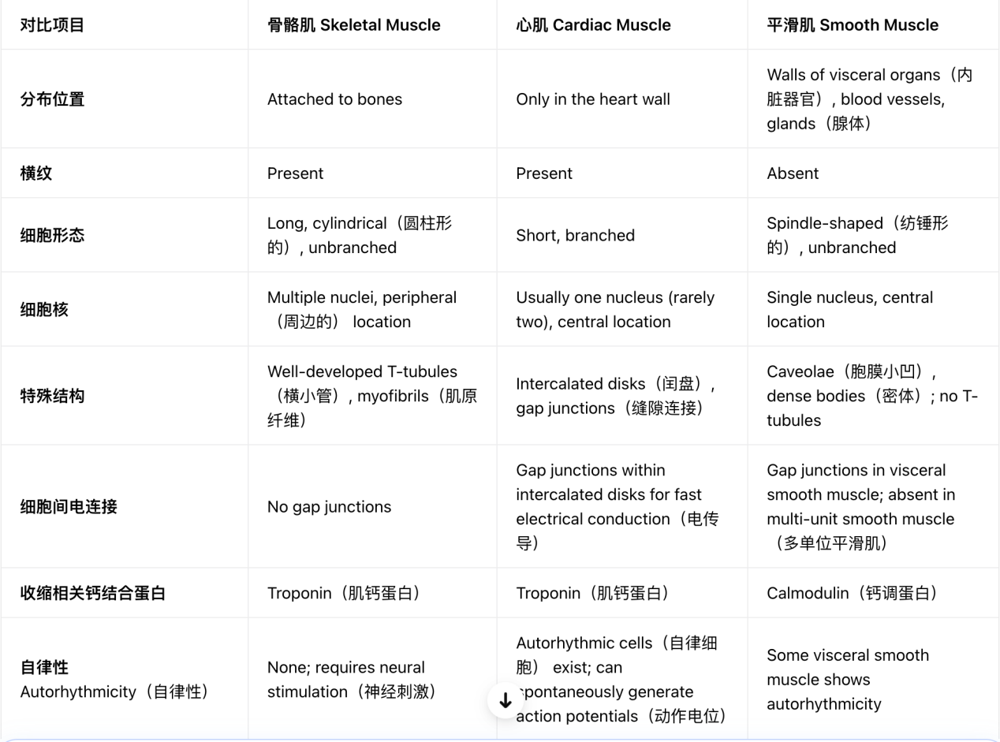
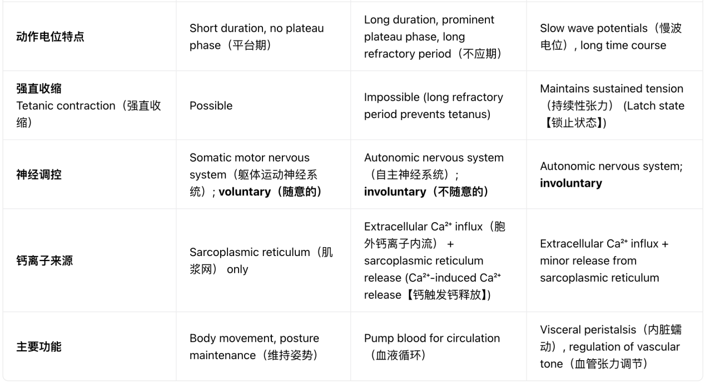

# Anatomy Unit 2 部分笔记

## Unit 2 — Muscle PPT P1–18

### 9.1 Type of muscles

- **Skeletal**：负责 locomotion, respiratory movements, facial expressions（由 nervous system 控制），voluntary。
- **Smooth**：walls of hollow organs, blood vessels, eye, skin。功能：propel urine, mix food, regulate blood flow。（involuntary）不能控制。
- **Cardiac**：main source of movement of blood（involuntary）。

Functions：

1. Movement of body
2. Maintenance of posture
3. Respiration
4. Production of body heat
5. Communication
6. Constriction of organs and vessels
7. Contraction of Heat

| | 骨骼 | 平滑 | 心 |
| --- | --- | --- | --- |
| Cell shape | cylindrical + long | spindle-shaped | cylindrical + branched |
| Nucleus | Multi + peripherally | Sin + central | Sin + central |
| Special Attachment | × | Gap Junctions | Intercalated disks |
| Striation | ✓ | × | ✓ |

### 9.2 Properties

1. Contractility
2. Excitability
3. Extensibility
4. Elasticity

### 9.3 Connective Tissue

- **Epimysium**：CT the surrounds the whole muscle (many fascicles) 肌束。
- **Perimysium**：loose CT that surrounds every fascicles；passage for blood vessels and nerves。
- **Endomysium**：loose CT separate individual muscle fibers within each fascicle。
- CT 上的 collagen → tendons / aponeuroses（attach to bone）。
- motor neuron 控制 1 对多。
- 一条动脉（artery）+ 一到两条静脉（vein），with capillary beds。
- skeletal muscle 由 myoblast 发育而来 → multinucleated。
- 肌肉变大 → hypertrophy。

电信号传导（都在 muscle fiber 上）：

- **Sarcolemma**：(membrane) 包围 sarcoplasm。
- **T Tubules**：凹陷结构。
- **Sarcoplasmic reticulum**：stores calcium。
- **Terminal cisternae**：SR 和 TT 交界处。
- **Triad**：1 个 TT + 2 TS。

### Component that allow muscles to contract

- **Myofibrils**：bundles of protein filaments（包含 Myofilaments）。
- **Myofilaments**：Actin (thin)；Myosin (thick)。
- arranged orderly → sarcomeres。
- **Z disk**：network of protein，attachment for actin myofilaments。
- sarcomere 不同部分；parallel → striated appearance。
- **I bands**：lighter region，每一个 I band 都有一个 Z disk，并延伸到 myosin myofilaments 末端。
- **A bands**：darker region，overlapping actin + myosin myofilaments。
- **H zone**：A band 中不 overlap 的部分。
- **M line**：middle of H zone，delicate filaments holding myosin in place。
- **Titin filaments**：elastic chains of amino acids → muscle extensible + elastic。

## PPT P19–25

### ① Actin Myofilament

- 由两条 F actin → double helix structure，两端 attach to sarcomere。
- 由 G actin 构成 → 每一个上都有一个 active site：bind with myosine during contraction。
- **tropomyosin**：elongated protein winds along the groove of double helix。
- **troponin**：3 subunits（在 tropomyosin 和 F actin 之间）：1 个 binds to actin；1 个 binds to tropomyosin；1 个 binds to calcium ions。
- tropomyosin / troponin complex 控制 interaction of active site（G actin）and myosine。

### ② Myosin Myofilament

组成：myosin molecules → 像 golf clubs 一样。

结构：

1. myosin heavy chains 组成 rod portion。
2. 两个 myosin heads extend laterally。

myosin heads 三个作用：

1. 与 actin 上的 active site 相 bind，形成 cross-bridges。
2. 与 rod portion 通过 hinge region 相连 → bend / straighten during contraction。
3. 是 ATPase enzymes，分解 ATP 获得能量 → 用作 hinge region。

### Neuromuscular Junction

- Motor neuron 携带 action potential → stimulate contraction。
- motor neuron 与 muscle fiber 之间是 neuromuscular junction / synapse（别称）。
- P1：axon terminal with synaptic vesicles containing ACh。
- 结构：Presynaptic Terminal；Synaptic cleft: Space；Postsynaptic membrane。
- Postsynaptic membrane 有 ligand-gated ion channel（接收 ACh 并产生 action potential）。

### Sliding Filament Model

本质：Actin Myo 在 Myosin Myo 上滑动 → sarcomeres 缩短 → skeletal muscle contraction。

actin 和 myosin 长度本身不变（does not change length）。

在 relaxation，sarcomere 变长是因为外部因素 → contraction of antagonistic muscles。

| ① Relaxed Muscle | ② Contracted Muscle |
| --- | --- |
| actin 和 myosine overlap slightly | actin slide past myosin |
| H zone visible | Z disk brought close together |
| sarcomere 在 normal resting length | A band 不变，myosin 长度不变 |
| | H zone disappear |
| | I band 变窄 |

## 9.5 Whole skeletal muscle Physiology — PPT P49–62

### 一、Muscle Twitch 肌肉单收缩

肌肉纤维对于一个 single action potential 的反应。

3 个不同 phases：

1. **Lag / Latent**：stimulus 至 contraction 的开始，no mechanical contraction。
2. **Contraction**：$Ca^{2+}$ released，cross bridge 产生，tension increase。
3. **Relaxation**：$Ca^{2+}$ 回收至 SR，纤维长度恢复，tension decrease。

### 二、Muscle Contraction 类型

- **Isometric**：no change in length，tension increase。
- **Isotonic**：change in length，tension constant。

### 三、Motor Units

一单一的 motor neuron，以及其控制的所有 muscle fibers。

一个 action potential → 所有 muscle fiber 产生 contract。

- 大肌肉：motor units 中含有的 muscle fiber 多。
- 小肌肉：motor units 中含有的 muscle fiber 少 → delicate movements，ex：手指、眼睛。

### 四、单个 Muscle Fiber 的收缩

respond in graded fashion，通过 add more cross-bridge 可以产生更大的力。

Factors：

- Frequency of stimulation
- Muscle Fiber 的直径
- 收缩时 Muscle Fiber 的长度

**Frequency of stimulation**：

- **Treppe**：随着持续刺激，收缩力量会渐渐增加。
- 机制：第一次 stimulation 释放的 $Ca^{2+}$ 在第二次 stimulation 前，没有被 SR 全部回收 → $Ca^{2+}$ 浓度逐渐提升，ex：热身活动。
- 几次收缩后趋于一致（张力）。
- 当 action potential 频率超过 Treppe 阶段：
  - **Wave summation**：张力 ↑。
  - **Incomplete tetanus**：两次 contraction 间放松。
  - **Complete tetanus**：没有放松，持续收缩。
- 产生原因：mechanical events of muscle twitches 比 electrical events 持续时间更长 → $Ca^{2+}$ 无法被及时回收。

直径越大，收缩力越大。

**Muscle length and tension**：

3 种张力：

- **Active tension**：主动收缩产生的力。
- **Passive tension**：被拉长时产生的“回弹阻力”。
- **Total tension**：两者之和。

力量 ↑ 是因为：Muscle Fiber 越大 → 更多 myofibrils → 更多 cross-bridges。

**Length and tension 图**：

- 纵轴 Tension，刻度 50、100；横轴 Sarcomere length，标示 60、80、100、140。
- ① 完全不拉伸（被动拉伸）小。
- ② 处于 Optimal Sarcomere length，最大 cross-bridges 接触。
- ③ 过长：（被动张力 ↑，主动张力 ↓）。
- tension 随 sarcomere 长度的变长而相应的变大或变小。

### 五、Whole Muscle 的收缩

是 graded（分级的）。

**Multiple motor-unit recruitment**：收缩强度由聚集而来的（招聘）motor units 决定。

- **Sub-threshold stimulus**：action potential ×，contraction ×。
- **Threshold stimulus**：action potential ✓，contraction ✓（只有一个单位）。
- **Submaximal stimuli**：较强的刺激，更多 motor-unit 加入。
- **Maximal stimuli**：所有 motor-unit 都加入，contraction max。

**Size principle**：小的 motor unit 先被 recruit，其次才是大的 motor unit。

小的 → 精细运动。

**Muscle tone**：由一小部分 motor unit（不同步地，out of phase）交替收缩，维持长时间的恒定张力。

### 六、Types of Isotonic Contraction（见二）

- **Concentric，向心**：克服 resistance → 缩短。ex：举哑铃。
- **Eccentric，离心**：阻力太大 → 拉长。ex：放下哑铃。

## 9.6 Muscle Fiber Type — PPT P63–65

### 一、肌纤维类型

- **Slow-twitch（type I）**：收缩速度慢；直径小；血液供应好；mitochondria 多；更抗疲劳；大量 Myoglobin（肌红蛋白）。下肢：维持姿势 → 持续发力，ex：dark meat，常见于 postural muscles。aerobic respiration。
- **Fast-twitch（type II）**：反应迅速；能快速分解 ATP；血液供应少；mitochondria 少；aerobic respiration 能力弱。上肢，ex：white meat。下分 Oxidative、Glycolytic。
- 大多数肌肉这两种纤维都有（比例不同）。
- 两种并不容易转换（gene decided）。

### 二、Effect of exercise

改变 Muscle fiber 大小，而不是数量。

- **Hypertrophy 肥大**：Myofibrils 数量增加，细胞核增加。
- **Atotrophy 萎缩**：通常可以 reverse，除非 cell die。

力量 ↑ 是因为：better blood circulation；less restriction by fat；increase production of enzymes。

### 三、Heat Production

skeletal muscle 是身体重要的产热器官，通过 vasodilation 血管舒张和 sweating。

Shivering 是因为：uncoordinated contraction → 产生热量。

## 9.7 Muscle Contraction 的能量来源 — PPT P66–71

### 一、3 ATP dependent enzymes

- **Myosin head**：hydrolysis ATP，为 cross-bridge 提供能量。
- **Na⁺–K⁺ Pump**：维持 resting membrane potential。
- **Ca²⁺ reuptake pump**：将 $Ca^{2+}$ 泵回 SR。
- Muscle fiber 中的 ATP 只能存在 5–6 s，所以要不断生成。

### 二、4 种 ATP 生成途径

1. $2ADP\to ATP+AMP$：最快即时供能，2–3 s。
2. $CP+ADP\to Creatine+ATP$：把 CP 中的 phosphate 转到 ADP 上，5–6 s。
3. **Aerobic Respiration**：分解 Glucose，产生 ATP、CO₂ 和 H₂O；持续数小时，长时间供能。
4. **Anaerobic Respiration**：分解 Glucose，产生 ATP 和 lactic acid；30–40 s → lactic acid 乳酸堆积。

### 三、3 种问题

1. **Muscle Fatigue**：
   - 产生原因：Acidosis + ATP depletion，酸中毒 + ATP 耗尽。由于 ATP 消耗 ↑ / 合成 ↓。
   - Oxidative Stress：太多 ROS 堆积。
   - Local inflammatory，局部炎症。
   - 痉挛性 contracture：lack of ATP → 动不了。
   - 心理性 fatigue：nerve system，不是肌肉问题。
2. **Rigor Mortis 尸僵**：死后数小时，$Ca^{2+}$ leak into sarcoplasm，形成 cross bridge；因为没有 ATP，cross bridge 分不开。
   - Soreness 酸痛：Muscle Fiber 受损。
3. **Oxygen deficit 氧亏**：运动后氧气供应不上。
   - EPOC：人话：把氧气补回来。

## 9.8 Smooth Muscle — PPT P71–82

### 一、Structure

无 striated（横纹）；fiber 比 skeletal muscle 的小；spindle shaped；single, central nucleus；actin 比 myosin 更多。

caveolae（类似于 T tubules）；Dense bodies（代替 Z disks）。

### 二、Smooth Muscle Contraction

（很重要）neurally 刺激或者 hormonally 刺激都可以 → G protein 打开 $Ca^{2+}$ channel → $Ca^{2+}$ combine with calmodulin → combine 后的 $Ca^{2+}$ bind + activate myosin kinase → Myosin kinase 把 Pi 从 ATP 转到 myosin head → cross-bridge formation → 当 myosin phosphatase remove Pi 时解锁。

**Latch state 锁止状态（考）**：当 cross-bridge 存在，但 myosin 上的 phosphate 被移除后 → cross bridge release slowly。所以长时间维持 tension 并少量消耗 ATP。

### 三、Type of Smooth Muscle

- **Visceral**：cells in sheet，function as a unit，autorhythmic 自律性。
- **Multiunit**：act as independent unit，fewer gap junctions。

### 四、Electrical Properties

- −60 mV 左右的 resting stage。
- depolarization 由 Na⁺ 和 Ca²⁺ 内流产生。
- 存在 pacemaker cells → 自主产生 action potential。
- 存在平台期 plateau。

### 五、Functional Properties

有 autorhythmic 自动收缩；sudden stretch 会触发 contraction，但缓慢拉长不会。

属于 involuntary，无法自主控制的：

- Neurotransmitter：Acetylcholine，norepinephrine。
- Hormone：epinephrine，oxytocin。

## 9.9 Cardiac Muscle — PPT P83–86

Striated and branched，single nucleus，有 intercalated disks 和 gap junctions 联接，有 autorhythmic cells。

这一部分有点杂而且讲的比较快，可以搭配这张表格参考一下。

| 对比项目 | 骨骼肌 Skeletal Muscle | 心肌 Cardiac Muscle | 平滑肌 Smooth Muscle |
| --- | --- | --- | --- |
| 分布位置 | Attached to bones | Only in the heart wall | Walls of visceral organs（内脏器官）, blood vessels, glands（腺体） |
| 横纹 | Present | Present | Absent |
| 细胞形态 | Long, cylindrical（圆柱形的）, unbranched | Short, branched | Spindle-shaped（纺锤形的）, unbranched |
| 细胞核 | Multiple nuclei, peripheral（周边的）location | Usually one nucleus (rarely two), central location | Single nucleus, central location |
| 特殊结构 | Well-developed T-tubules（横小管）, myofibrils（肌原纤维） | Intercalated disks（闰盘）, gap junctions（缝隙连接） | Caveolae（胞膜小凹）, dense bodies（密体）；no T-tubules |
| 细胞间电连接 | No gap junctions | Gap junctions within intercalated disks for fast electrical conduction（电传导） | Gap junctions in visceral smooth muscle; absent in multi-unit smooth muscle（多单位平滑肌） |
| 收缩相关钙结合蛋白 | Troponin（肌钙蛋白） | Troponin（肌钙蛋白） | Calmodulin（钙调蛋白） |
| 自律性 Autorhythmicity（自律性） | None; requires neural stimulation（神经刺激） | Autorhythmic cells（自律细胞）exist; can spontaneously generate action potentials（动作电位） | Some visceral smooth muscle shows autorhythmicity |

| 对比项目 | 骨骼肌 Skeletal Muscle | 心肌 Cardiac Muscle | 平滑肌 Smooth Muscle |
| --- | --- | --- | --- |
| 动作电位特点 | Short duration, no plateau phase（平台期） | Long duration, prominent plateau phase, long refractory period（不应期） | Slow wave potentials（慢波电位）, long time course |
| 强直收缩 Tetanic contraction（强直收缩） | Possible | Impossible (long refractory period prevents tetanus) | Maintains sustained tension（持续性张力）(Latch state【锁止状态】) |
| 神经调控 | Somatic motor nervous system（躯体运动神经系统）；voluntary（随意的） | Autonomic nervous system（自主神经系统）；involuntary（不随意的） | Autonomic nervous system; involuntary |
| 钙离子来源 | Sarcoplasmic reticulum（肌浆网）only | Extracellular Ca²⁺ influx（胞外钙离子内流）+ sarcoplasmic reticulum release (Ca²⁺-induced Ca²⁺ release【钙触发钙释放】) | Extracellular Ca²⁺ influx + minor release from sarcoplasmic reticulum |
| 主要功能 | Body movement, posture maintenance（维持姿势） | Pump blood for circulation（血液循环） | Visceral peristalsis（内脏蠕动）, regulation of vascular tone（血管张力调节） |

