# G11 S1-Mid

### WLSA 2026–2027 学年第 1 学期 SG G11 语文期中考试说明

**一、考试题型及说明**

| 序号 | 题型 | 分值 | 说明 |
| --- | --- | --- | --- |
| 一 | 选择题 | 10分 | 每题2分，请将答案填到答题卡相应区域内 |
| 二 | 填空题 | 20分 | 每空2分，字迹清晰，请将答案填到答题卡相应区域内 |
| 三 | 判断题 | 10分 | 请将答案（“√”或“×”）填到题目下方的相应区域内 |
| 四 | 问答题 | 8分+7分=15分 | 1. 认真审题，根据文章内容，按照题目要求答题；2. 答案有组织、有层次、有逻辑；3. 只涉及《茶馆》相关内容 |
| 五 | 写作表达 | 45分 | 1. 写作与所学文章有关；2. 观点表达式文章，300–350字 |
| 总分 | | 100分（60min） | |

**二、考试复习重点难点**

1. 熟悉《氓》，明确：
   - 通读全诗，所有字音均能朗读准确；
   - 结合诗歌下注释，了解重点字词的含义；
   - 了解《诗经》相关信息（内容、分类、手法等），了解《氓》所反映的先秦时期的社会文化知识；
   - 明确文中角色特征，能理解和分析不同人物特点；
   - 能够理解并阐释“赋”“比”“兴”等手法在《氓》中的体现；
   - 对比《氓》《美狄亚》，了解中西方文学审美差异。
2. 熟悉《茶馆》，明确：
   - 通读第一幕，了解基本剧情和人物；
   - 结合当时的时代背景，分析戏剧剧情背后的含义；
   - 熟知基本人物的身份和性格特征，结合台词学会人物分析；
   - 了解关于老舍和话剧的相关文学常识；
   - 掌握文中部分台词背后的潜台词含义。

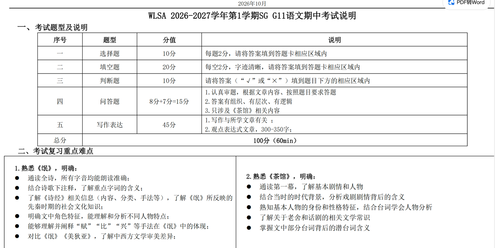

这次需要关注的是问答题他只考茶馆的内容 但是氓的复习重点却不少 所以我们可以推测选择题填空题对于氓的考察有可能比茶馆多

记得要写书名号！

## 先看《氓》-叙事诗

（讲述了她从恋爱结婚，到婚变，再到决裂的婚恋悲剧）

首先它出自啥？-\> 《诗经•卫风》

(《诗经注析》是现代人整理、注释《诗经》的一本书，这个需要分清楚)

## 现在来聊一下《诗经》的相关信息

《诗经》是我国**第一部**诗歌总集。 汉代以前，别称为**“诗”和“诗三百”**。

《诗经》收录了从**西周初年到春秋中叶**的诗歌，共计**305篇**

（考别称在填空中概率很大，考从。。到。。。感觉如果在填空就有点难，有可能更多的在判断题，比如说改成什么西周末年之类的）

《诗经》分为风雅颂三个部分

风- 大都为周王室派专人收集的**民间歌谣**

雅-（分为小雅和大雅）大多是**宫廷乐曲**歌辞，为贵族统治阶级所作

颂- 是**宗庙祭祀的乐歌**

《诗经》的诗篇形式以**四言**为主。主要表现手法是**赋比兴。**

赋-铺陈其事而直言之，直接**铺叙陈述。**

比-是“以彼物比此物”，即**比喻**。

兴-是 “先言他物，以引起所咏之辞” 先写**别的景物，在引出要写的人/情感**

结构上多采用**重章叠句**的形式增强抒情效果。

六义”即：**风、雅、颂、赋、比、兴**

**先秦的文化：**

1.  **媒妁制度**

原文：**匪我愆期，子无良媒** 先秦礼法：男女成婚必须有**媒人**做中介，没有良媒，婚姻不合礼。女子不肯草率答应婚期，不是故意拖延，是遵从当时的礼俗。 注意：民间自由恋爱是存在的（二人私下相会），**但正式结婚仍然要走媒聘程序**。恋爱自由 ≠ 婚姻自由。

2.  **占卜定吉凶**

原文：**尔卜尔筮，体无咎言。** 春秋贵族、平民结婚前常用龟甲（卜）、蓍草（筮）占卜，看卦象吉凶。卦象无凶辞，才可以迎娶。是当时流行的巫术婚俗。

3.  **聘娶婚**

原文：**以尔车来，以我贿迁。** 男方驾车来迎娶，女子带上**贿（嫁妆财物）**嫁到男方家。女子婚后入男方家庭，属于**从夫居**。

## 背景搞定了-现在来搞文章本身

### 《氓》原文与注音图

氓之蚩蚩，抱布贸丝。匪来贸丝，来即我谋。送子涉淇，至于顿丘。匪我愆期，子无良媒。将子无怒，秋以为期。

乘彼垝垣，以望复关。不见复关，泣涕涟涟。既见复关，载笑载言。尔卜尔筮，体无咎言。以尔车来，以我贿迁。

桑之未落，其叶沃若。于嗟鸠兮，无食桑葚！于嗟女兮，无与士耽！士之耽兮，犹可说也。女之耽兮，不可说也！

桑之落矣，其黄而陨。自我徂尔，三岁食贫。淇水汤汤，渐车帷裳。女也不爽，士贰其行。士也罔极，二三其德。

三岁为妇，靡室劳矣。夙兴夜寐，靡有朝矣。言既遂矣，至于暴矣。兄弟不知，咥其笑矣。静言思之，躬自悼矣。

及尔偕老，老使我怨。淇则有岸，隰则有泮。总角之宴，言笑晏晏。信誓旦旦，不思其反。反是不思，亦已焉哉！

图中注音：蚩 chī；淇 qí；匪 fēi；愆 qiān；将 qiāng；垝垣 guǐ yuán；涟 lián；筮 shì；于嗟鸠 xū jiē jiū；耽 dān；说 tuō；陨 yǔn；徂 cú；汤汤 shāng shāng；渐 jiān；贰 èr；罔 wǎng；靡 mǐ；朝 zhāo；咥 xì；隰 xí。

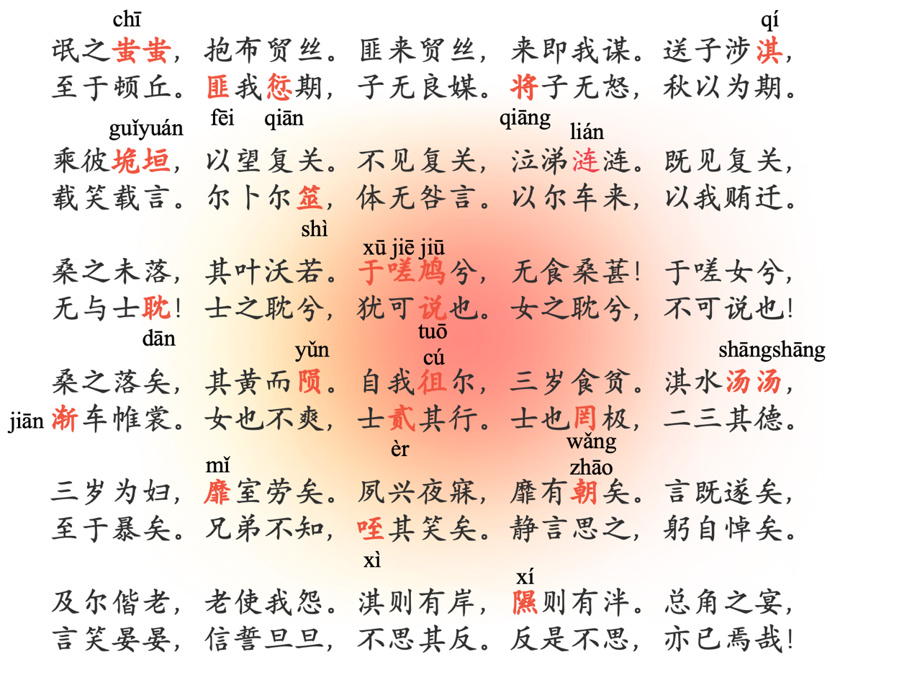

**需要注意的点：**

1.  **匪**来贸丝和**匪**我愆期 他读的是fei第三声！一定要注意 他只是同“非” 他不是第一声！！！！！！！！！！！！！！

2.  

| **词句**         | **拼音**            |
|:-----------------|:--------------------|
| **蚩蚩**         | chī chī             |
| 送子**涉淇**     | shè qí              |
| **匪我愆期**     | fěi wǒ qiān qī      |
| **将**子无怒     | qiāng zǐ wú nù      |
| 乘**彼垝垣**     | chéng bǐ guǐ yuán   |
| 尔卜尔**筮**     | ěr bǔ ěr shì        |
| 体无**咎**言     | tǐ wú jiù yán       |
| 于嗟**鸠兮**     | xū jiē jiū xī       |
| 犹可**说**也     | yóu kě tuō yě       |
| 自我**徂**尔     | zì wǒ cú ěr         |
| 淇水**汤汤**     | qí shuǐ shāng shāng |
| **渐**车**帷裳** | jiān chē wéi cháng  |
| 士**贰**其行     | shì èr qí xíng      |
| 士也**罔**极     | shì yě wǎng jí      |
| **靡**室劳矣     | mǐ shì láo yǐ       |
| **夙**兴夜**寐** | sù xīng yè mèi      |
| 靡有**朝**矣     | mǐ yǒu zhāo yǐ      |
| **咥**其笑矣     | xì qí xiào yǐ       |
| **隰**则有泮     | xí zé yǒu pàn       |

**重点释义：**

氓之**蚩蚩（憨厚的样子）**，抱布贸丝。**匪（不是）**来贸丝，来即我谋。送子涉淇，至于顿丘。匪我**愆（拖延）**期，子无良**媒（专门负责男女婚姻的官员）**。**将（请）**子无怒，秋以为期。

**乘（登上）**彼**垝垣（这里垝指的是损坏，垝垣指的是残破的墙）**，以望**复关（氓所住的地方）**。不见复关，泣涕涟涟。既见复关，**载（助词！）**笑载言。尔卜尔**筮（占卜）**，体无**咎（灾祸）**言。以尔车来，以我**贿（财物，这里指的是嫁妆）**迁。

桑之未落，其叶**沃若（润泽的样子）**。于嗟鸠兮，**无（不要）**食桑葚！于嗟女兮，无与士**耽（沉醉）**！士之耽兮，犹可**说（同“脱”，摆脱）**也。女之耽兮，不可说也。

桑之落矣，其黄而**陨（陨落）**。自我**徂（往）**尔，**三岁（指的是多年）食贫（过着贫苦的日子）**。淇水**汤汤（水流盛大）**，**渐（浸湿）**车帷裳。女也不**爽（过错）**，士**贰（不专一）**其行。士也**罔极（没有准则）**，**二三（反复无常）**其**德（心意）**。

三岁为妇，**靡（没有）**室劳矣。夙兴夜寐，靡有**朝（日）**矣。**言（助词）**既**遂（如愿）**矣，至于暴矣。兄弟不知，**咥（讥笑）**其笑矣。静言思之，躬自**悼（哀伤）**矣。

及尔偕老，老使我怨。淇则有岸，隰则有**泮（同“畔”，边）**。总角之**宴（快乐）**，言笑**晏晏（和悦的样子）**。信誓旦旦，不思其**反（违背）**。反是不思，亦**已（了解）**焉哉！

## 男主人公和女主人公的性格特征：

**女主人公：**

**婚前：纯真热情，勇敢痴情**

<u>氓之蚩蚩，抱布贸丝；送子涉淇，至于顿丘。</u>

她和氓自由相恋，主动送别，深情期待婚事；面对婚期争执，温柔体谅，愿意等待。

<u>乘彼垝垣，以望复关。不见复关，泣涕涟涟。既见复关，载笑载言。</u>

日夜登高盼望爱人，喜怒哀乐都因对方，天真痴情。

**婚后：吃苦耐劳，任劳任怨**

<u>夙兴夜寐，靡有朝矣。</u>

嫁过去之后早起晚睡，承担全部家务，辛苦持家。

**被弃之后：清醒刚烈，决绝自尊**

静言思之，躬自悼矣。……反是不思，亦已焉哉！

<u>遭遇丈夫家暴、变心，娘家兄弟还嘲笑她。她悲伤反思，但**没有一味哀求和隐忍**，看透男子虚伪，断然和这段感情决裂。</u>

**男主人公**

**婚前：虚伪狡黠，假意忠厚**

氓之蚩蚩，抱布贸丝。匪来贸丝，来即我谋。

<u>表面老实憨厚（蚩蚩），借口买丝来接近女子，刻意接近，有心计。急于成婚，女子推迟婚期他就发怒（将子无怒），性情急躁。</u>

**婚后：薄情寡义，反复无常，粗暴负心**

士贰其行，二三其德；言既遂矣，至于暴矣。

<u>心愿达成娶到女子之后，性情大变，德行不专一，甚至对女子施暴。昔日誓言全部背弃。</u>

## 赋比兴在文章当中的运用：

赋：

氓之蚩蚩，抱布贸丝……秋以为期------ 直接交代男子上门求婚、约定婚期，交代故事起因。

三岁为妇，靡室劳矣。夙兴夜寐，靡有朝矣-----直陈婚后日夜操劳，不加渲染，**却让女子辛苦的处境自然浮现。**

静言思之，躬自悼矣-------直抒悲伤，把隐忍到最后的哀痛直接说出来。

作用：赋使叙事完整、脉络清晰；越是不加修饰的直陈，越显得真实可信，反衬女子处境之悲。

比：

桑之落矣，其黄而陨 -------- 用桑叶枯黄飘落，**比喻女子容颜衰老、青春不再、爱情走向衰败**。比的是女子当下的处境。

于嗟鸠兮，无食桑葚----- 斑鸠贪食桑葚会沉醉昏头，**比喻女子不要沉溺于爱情而失却理智**。比的是女子应吸取的教训。

淇则有岸，隰则有泮 ------ 淇水、低湿之地都有边际，**反衬男子的感情没有限度、反复无常、不可捉摸**。用有界反衬无界，深化对男子负心的控诉。

作用：桑叶、斑鸠、淇水都是眼前日常景物，却精准对应人物的处境与情感，使抽象的 "变心、衰老、沉溺" 变得可感可触。

兴：

**桑之未落，其叶沃若**------- 先写桑叶鲜嫩润泽，引出下文女子青春貌美、恋情甜蜜。这里的 "桑叶" 既是起兴，又与女子青春形成**比喻**，是典型的**比兴并用**。

于嗟鸠兮，无食桑------- 借斑鸠先起兴，再引出告诫之辞 "女兮，无与士耽"。同为比兴结合。

作用：兴让情感有铺垫、有氛围，先言他物、渐入正题，避免直白说教 桑叶的由盛而衰，与女子爱情的由浓转淡形成暗合，增强全诗悲凉感。

最后一个考点是《氓》和《美狄亚》中西文学的差异（这个是AI做的，看一些重点就好）：

### 《氓》的女主人公（卫国普通民间女子）

婚前痴情勇敢，婚后任劳任怨；被抛弃后，悲伤自省，**最终选择理性决裂、抽身离开**。

她的反抗是**向内的、克制的**：看清男子二三其德，发出慨叹 “亦已焉哉”，不再纠缠，但**没有报复、没有伤害他人**。**

身份：底层劳动妇女，普通人，有凡人的悲欢。

### 《美狄亚》（科尔基斯公主，女巫）

深爱伊阿宋，为他背叛家族、杀害亲弟；被伊阿宋抛弃后，**激烈、毁灭性复仇**：毒杀新妇，亲手杀死自己两个孩子，让伊阿宋承受永久痛苦。

**她的反抗是**向外的、爆发式**，以极端暴力毁灭仇人最珍视之物。**

身份：半神、公主，带有超自然力量，英雄式悲剧人物。

## 二、核心冲突

- **《氓》**：**伦理、家庭内部的情感悲剧**。矛盾藏在日常婚恋、家庭劳作、人情世态里。冲突温和内敛，是普通人在父权社会下的命运困境。

- **《美狄亚》**：**强烈的个人激情与命运的冲突**。爱恨走向极致，激情压倒一切，冲突宏大、血腥，属于命运悲剧。

## 三、中西方审美差异（答题核心要点）

1. **悲剧审美：哀而不伤 vs 强烈震撼**

**<u>中国传统审美：**温柔敦厚，哀而不伤**。《氓》的悲剧重在抒发哀怨、反思人情，悲剧止于自我决断，不走向极端暴力。追求情感节制，符合儒家 “中和之美”。</u>**

西方古希腊悲剧审美：**怜悯与恐惧（亚里士多德悲剧净化说）**。**<u>用极端惨烈情节冲击观众，通过巨大苦难引发震撼，实现情感的宣泄净化。</u>**

2. **反抗方式：内敛自省 vs 激烈复仇**

中方：面对不公，**向内反思，守住自身人格尊严**。女子控诉、自省，终止关系，但不毁灭对方。**强调克制、理性、守分寸。**

西方：当个人被背叛，**把痛苦转化为向外的激烈反抗**，把**个人尊严放在最高位置，不惜一切代价捍卫自己，哪怕代价惨烈。**

3. **叙事视角：世俗日常 vs 宏大神话**

《氓》取材**民间现实生活**，写普通人的婚恋，质朴写实，用赋比兴含蓄抒情；审美偏向朴素、含蓄，意在言外。

《美狄亚》**取材**神话传说**，**人物身份高贵、拥有神力，戏剧冲突激烈外放，直抒强烈爱恨，情感毫不遮掩。

4. **价值取向：群体伦理 vs 个体意志**

先秦中国：**重视家庭、人伦、社会评价（诗中 “兄弟不知，咥其笑矣”，女子在意家族看法）**，个人情感要置于人伦秩序之下。

古希腊悲剧：**凸显个体意志**。美狄亚优先维护个人尊严与爱恨**，哪怕破坏人伦、牺牲亲子，个体情感高于家族伦理。

## 接下来是茶馆

首先我认为他的2个大题多半是这样子

1.  给一段话 要么是判断人物性格和特征 要么是关于潜台词的分析结合文章内容

2.  分析文章的时代背景，这个剧的背后含义/或者是讲述艺术特色

首先不管你是读过还是没读过 你都得去再仔细读一遍了解他的角色+情节！！！这个很重要！

### 剧情流水线

常四爷议论群架被而二德子找茬→ 马五爷施威 → 康六卖女儿 → 常四爷锐评洋货 → 鸽子之争 → 秦仲义出场跟王利发商量房租 → 乡妇进茶馆卖女儿 → 秦仲义表明实业救国的梦想 → 庞太监与秦仲义过招 → 众人纷纷议论戊戌变法 → 常四爷被特务带走 → 乡妇带着女儿离开、康顺子晕过去、众人离场。

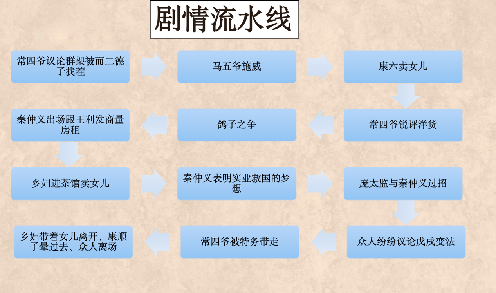

大体故事时间线（不能只看这个） 这个我盲猜填空+判断都会考一次情节

## 文学常识：

1.  老舍原名**舒庆春 生于北京旗人底层家族**

2.  因为《龙须沟》被授予了**人民艺术家**的称号

3.  1946-1949 **赴美期间**完成了《四世同堂》第三部

### 代表作品

一生写了约计800万字的作品。

| 类别 | 作品 |
| --- | --- |
| 长篇小说 | 《老张的哲学》、《离婚》、《骆驼祥子》、《四世同堂》…… |
| 中篇小说 | 《月牙儿》、《我这一辈子》…… |
| 短篇小说 | 《柳家大院》、《断魂枪》…… |
| 剧本 | 《龙须沟》、《茶馆》、《方珍珠》…… |

他的作品以独特的幽默风格和浓郁的民族色彩以及从内容到形式的雅俗共赏而赢得了广大读者的喜爱。

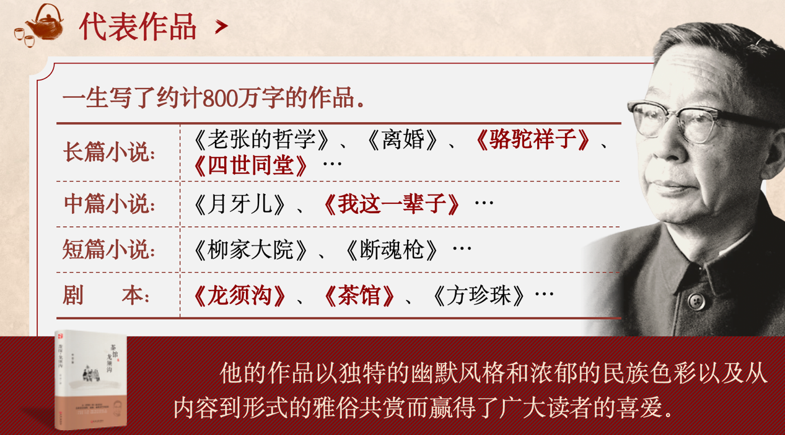

最后每个分类记住一个：

长篇小说：骆驼祥子

中篇小说：我这一辈子

短篇小说：断魂枪

剧本：龙须沟

## 相关常识：

### 相关常识

**话剧**：以演员的对话和动作为主要表现手段的戏剧形式，具有舞台性、直观性、综合性、对话性等特点。

**剧本**：文学作品中的一种体裁，指戏剧艺术的文学部分，它直接规定了戏剧的题材、主题、人物、情节、语言和结构，是戏剧演出的基础和依据。

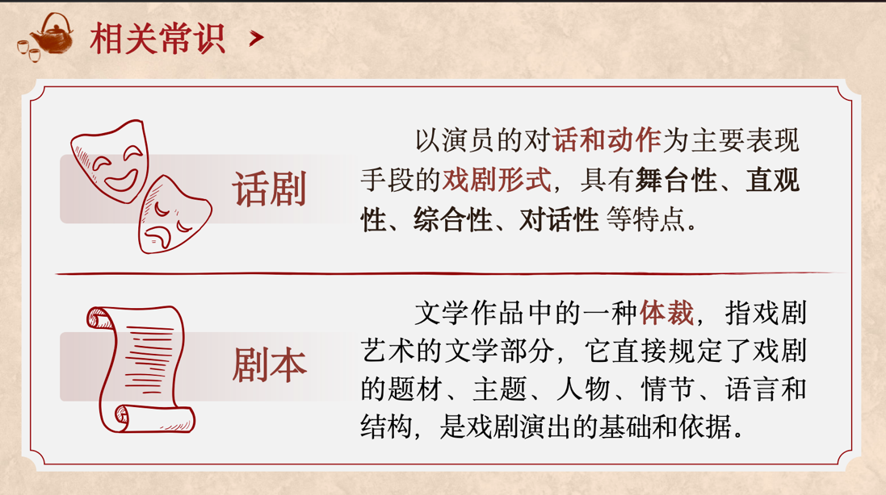

剧本是由这几个组成的

①台词对话、独白、旁白和唱词。

②舞台指示人物形象特征、心理活动、情感变化和场景、气氛的描写，时间、地点、人物上下场和动作的说明，对灯光、布景、效果等艺术处理的要求等。

### 剧本分类

| 分类依据 | 类别 |
| --- | --- |
| 按题材分类 | 历史剧 · 纪实剧 · 儿童剧 |
| 按剧作长度分类 | 独幕剧 · 多幕剧 · 短剧 |
| 按创作方法分类 | 古典主义戏剧 · 浪漫主义戏剧 |
| 按矛盾冲突性质与人物命运的结局呈现出的价值取向分类 | 喜剧 · 悲剧 · 正剧 |

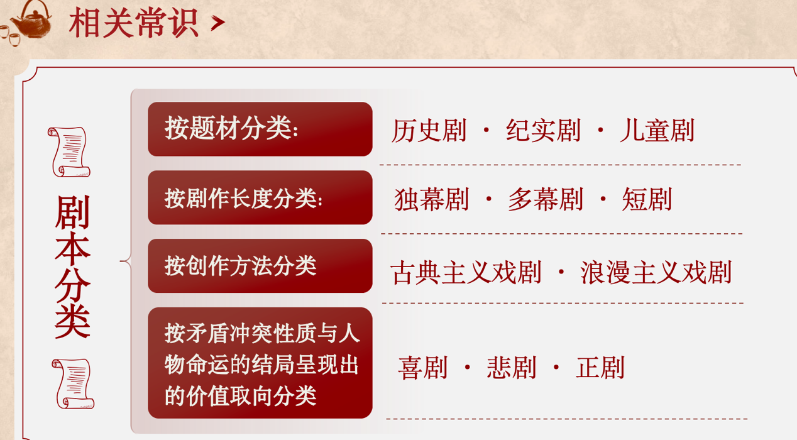

并且剧本也是有分类的 这些大概有个印象就好

我觉得考试是不会考你他是不是悲剧或者正剧因为我觉得有点争议

而且他不是古典主义戏剧也不是浪漫主义戏剧他是------**现实主义戏剧**

### 话剧结构有哪些？

| 结构 | 涵义 | 典型 |
| --- | --- | --- |
| 锁闭式结构（“内省式”或“回顾式”） | 从事件接近高潮的地方写起，之前所涉及的人物、所发生的事件则随着情节的发展通过人物回顾来补充交代。 | 《俄狄浦斯王》（索福克勒斯）、《群鬼》（易卜生）、《雷雨》（曹禺） |
| 开放式结构（“线性式”） | 将事件按照发生发展的顺序的从头写到尾，作品反映事件的始末，风格较为洒脱。 | 《奥赛罗》（莎士比亚） |
| 人像展览式结构 | 以人物呈现为中心的结构，以刻画形形色色的人物表现时代的社会风貌，剧情往往在一个比较特殊的地点展开，作为一个平台。 | 《茶馆》（老舍）、《日出》（曹禺） |

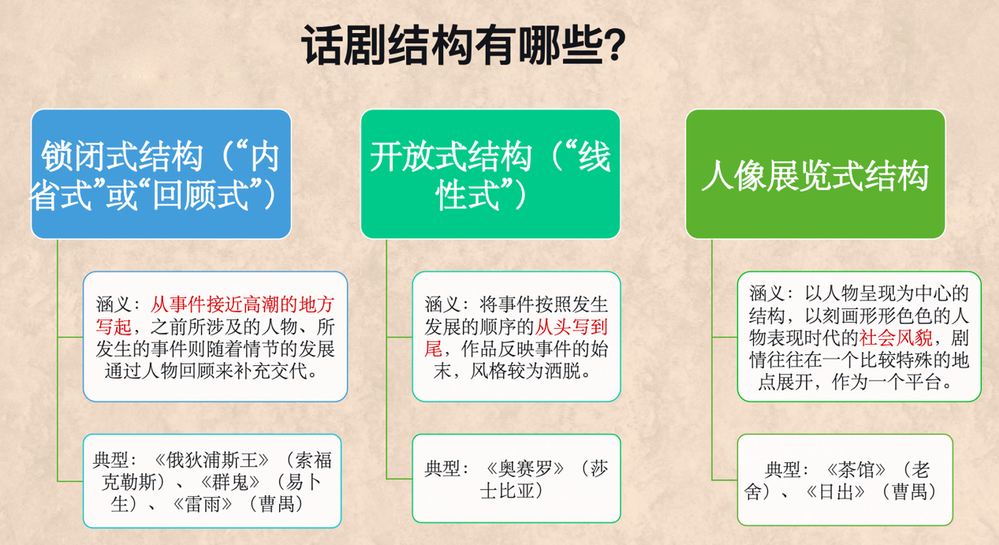

话剧也是由分类的分为

锁闭式结构-《雷雨》 从事件高潮的地方开始写起

开放式结构- 《奥赛罗》从头写到尾

人像展览式结构-《茶馆》是这个！！！！！！ 日出也是 以人物为中心，刻画形形色色的人物表现时代的社会风貌

这三要素老生常谈了还有鉴赏方法也最好记住！

### 相关常识

三要素：矛盾冲突（基本要素）、人物台词、舞台说明。

鉴赏方法：把握戏剧冲突；分析人物形象；揣摩戏剧语言。

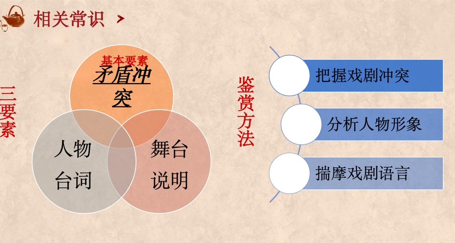

### 创作背景

老舍说：“茶馆是三教九流会面之处，可以容纳各色人物，一个大茶馆就是一个小社会。这出戏虽只有三幕，可是写了五十来年的变迁。我不熟悉政治舞台上的高官大人，没法子正面描写他们的促进与促退。我也不十分懂政治，只认识一些小人物，这些人是经常下茶馆的。那么，我要是把他们集合到一个茶馆里，用他们生活上的变迁反映社会的变迁，不就侧面地透露出一些政治消息么？这样，我就决定了去写《茶馆》。”

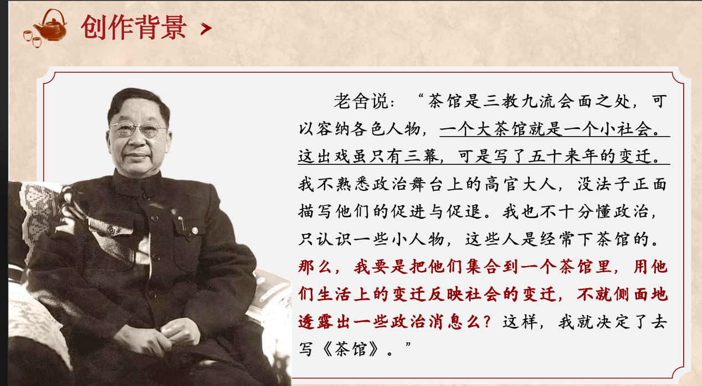

创作背景：

作者借由这些人物，展现了**清末社会的众生相**，深刻反映了**帝国主义的渗透、侵略和封建统治的荒淫、腐败**所造成的**农民破产、市民贫困和社会黑暗**，表明了中国封建社会的末日即将来临

### 大茶馆，小社会！

清末整个社会黑暗腐朽，不可救药。

在小小的茶馆里，没有一句写政治，却通过人事展现了那个时代的政治全貌。

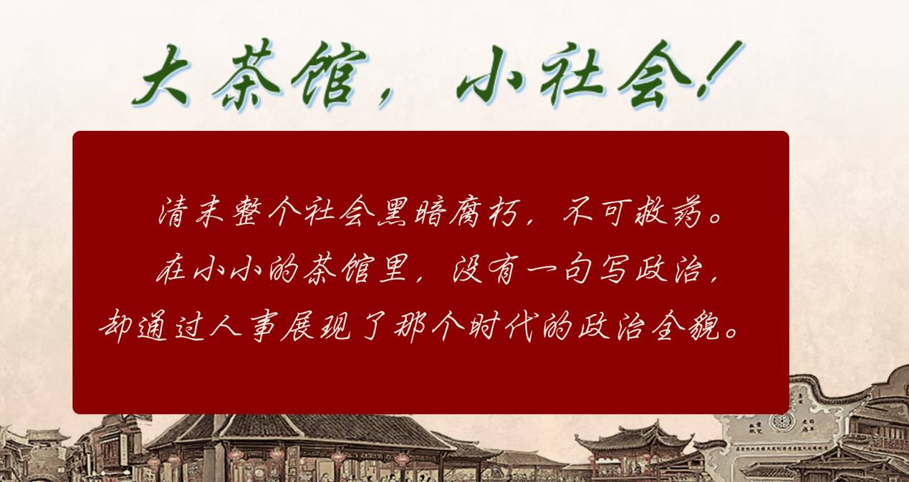

大茶馆小社会是核心，通过了一件件事情展示了时代的政治全貌

马五爷示威-------帝国主义的实力庞大

康六卖女---------农村经济衰落

常四爷骂洋货---------帝国主义对中国经济的掠夺

鸽子之争----------达官贵人的精神空虚

秦仲义梦想实业救国--------名族资本家兴起机会十分渺茫

秦仲义vs庞太监---------民族资产阶级vs. 封建王朝

茶客对话---------维新运动脱离群众

常四爷被抓----高压政策，言论不自由

庞太监娶妻------封建统治的荒淫

角色分类要记清楚！

要仔细看清楚某些关键角色的特征

### 角色分类

1. 下层劳动人民：王利发、李三、康六、老人、乡妇、小妞、康顺子。
2. 有闲阶级：松二爷、常四爷。
3. 民族资本家：秦仲义。
4. 反动统治阶级的走狗：二德子、马五爷、庞太监、宋恩子、吴祥子。
5. 社会渣滓：唐铁嘴、刘麻子、黄胖子。

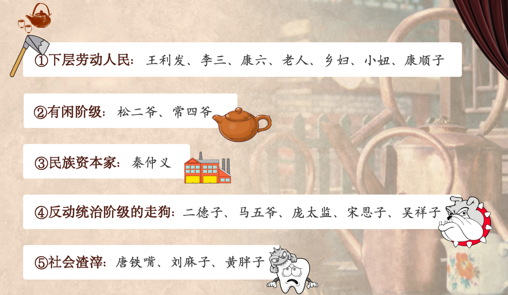

### 王利发：裕泰茶馆的掌柜（线索人物）

- **圆滑机灵**：继承了父亲的处世哲学，多说好话，多请安，讨人人的喜欢。“我知道您多么照应我，心疼我，决不会叫我挑着大茶壶，到街上卖热茶去！”
- **善于应酬**：“那么多的买卖，您的小手指头都比我的腰还粗。”
- **精明干练**：在动荡年代经营茶馆，后来也曾试图改良以顺应时代，善于经营。
- **胆小自私**：茶馆的规矩“莫谈国事”表明他想避开政治，维持生计自保为上。常四爷赏乡妇母女面吃，他说“我告诉您，这路事儿太多了，太多了！谁也管不了！”反映出他自私自利的一面。

旧社会小商人的代表，广大市民的典型，乱世底层商贩维生之艰难。

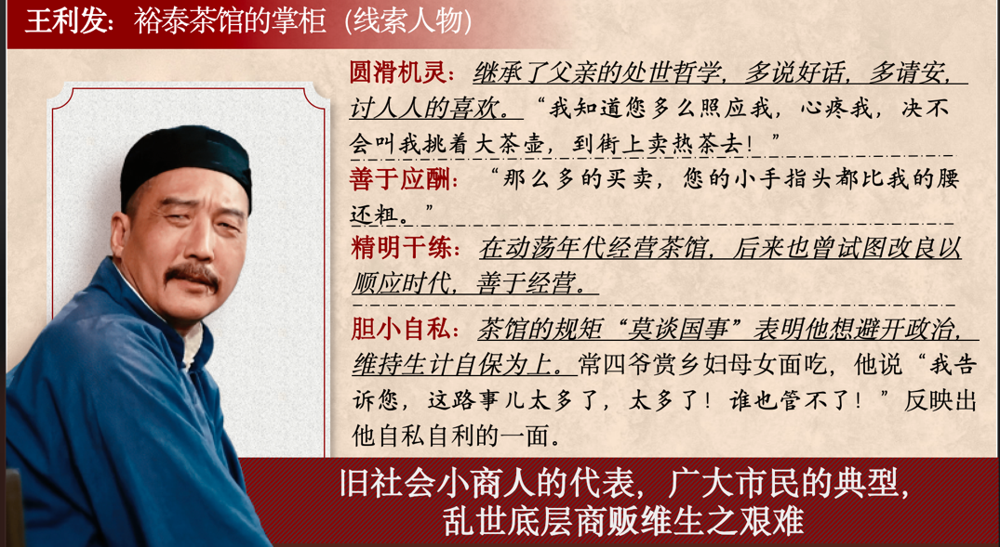

### 常四爷：正义爱国的晚清旗人

- **忧国忧民**：看到刘麻子身上的洋货，他忧虑“这得往外流多少银子啊！”康六卖女儿，他忧虑“乡下是怎么了？会弄得这么卖儿卖女的！”乡妇卖女儿，他感叹“大清国要完！”
- **爱憎分明，敢作敢当**：爱国的同时，痛恨洋鬼子和洋人的走狗，“我就不佩服吃洋饭的！”被宋、恩二人抓走时也坦言“我爱大清国，我怕她完了”，说“甭锁，我跑不了！”
- **硬气仗义，有正义感**：当面训斥二德子，“尊家吃着官饷，可没见您去冲锋打仗！”还斥责伤天害理的纤手刘麻子“您可真有个狠劲儿，给拉拢这路事！”同情受苦受难、啼饥号寒的乡妇小孩，叫了烂肉面给她们吃。

晚清遗老中的正义爱国之士。

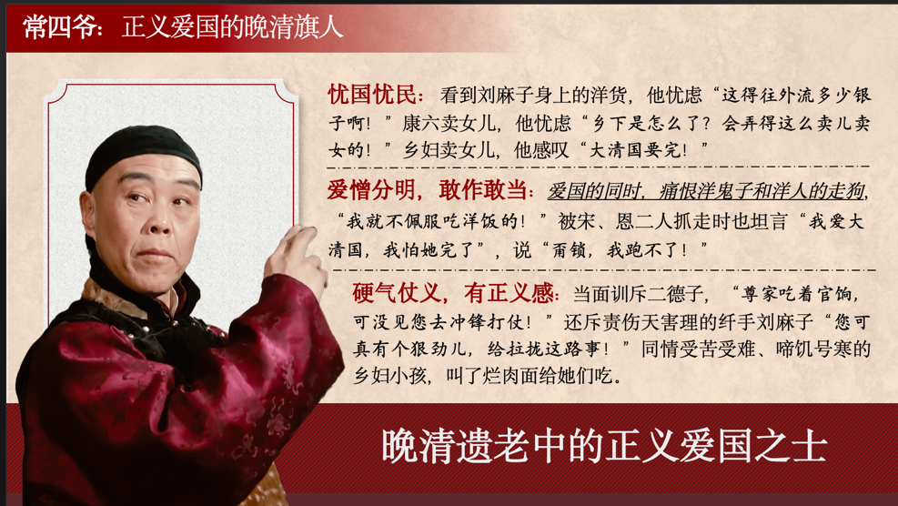

### 松二爷：懒散无能、善良却胆小怯懦的晚清旗人

- **懒散无能**：爱鸟、爱表，悠哉度日。清朝灭亡前，他游手好闲，整日喝茶玩鸟。清亡后，“铁杆庄稼”没有了，但他仍然留恋过去的生活，不愿自食其力。
- **善良却胆小怯懦**：心眼好，但胆小怕事。前面试着调节常四爷与二德子的争执，结尾也有常四爷解围，但最终也承认了“我听见了，他是说……”。

从全剧来看，他将全部精神寄托在鸟儿身上，宁愿自己挨饿，也不让鸟儿饿着，一提到鸟就有精神，最后终于饿死，表明他是一个没有谋生能力的旗人的典型，反映了中国封建社会的腐朽与落没。

缺乏谋生能力、留恋旧时代、无力适应新时代的晚清遗老。

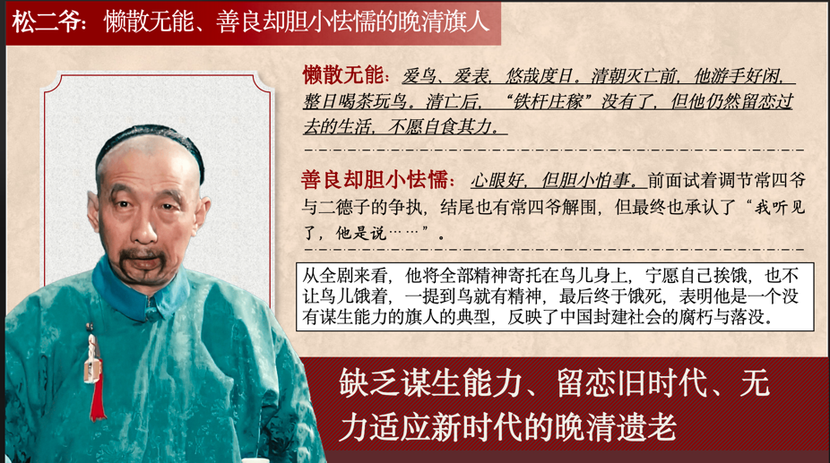

### 秦仲义：裕泰茶馆的房东、维新浪潮中成长起来的民族资本家

- **胸怀实业救国理想**：开玩笑说要收回房子办实业，他梦想通过办大工厂搞民族工业来救国，胸怀理想，要做大事，最后却没有逃脱破产的厄运。
- **敢于反抗**：在于庞太监的交锋中，言语犀利，分寸不让，体现了对封建势力的反抗，也体现了民族资产阶级的发展和成长。

这个形象反映了半封建半殖民地社会民族资本家的命运，同时也证明办实业拯救不了中国灭亡的命运。

黑暗中的一道微光。

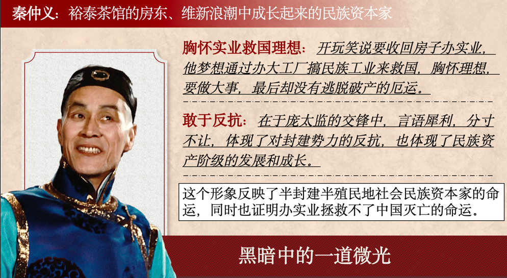

| 人物 | 特征 |
| --- | --- |
| 唐铁嘴 | 麻衣相士，算命骗人混吃混喝（反映社会中的迷信落后思想） |
| 刘麻子 | 说媒拉纤、拐卖人口赚昧心钱（社会中地痞流氓为非作歹的代表） |
| 宋恩子、吴祥子 | 封建势力的走狗，衙门的侦缉（特务），顺风倒的奸邪小人，坑害别人，钻营偷生 |

一群社会底层的地痞无赖，反映出社会的畸形与病态。

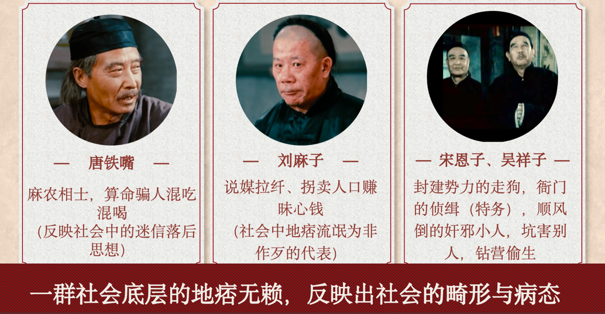

| 人物 | 特征 |
| --- | --- |
| 庞太监 | 晚清宫廷生活的糜烂与荒唐 |
| 二德子 | 营子里的打手；鱼肉百姓的典型 |
| 黄胖子 | 专门调解“官厅儿”不管的纠纷，地痞流氓的典型 |

一群社会底层的地痞无赖，反映出社会的畸形与病态。

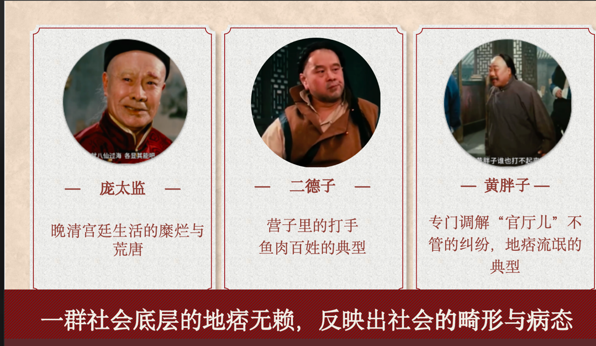

围绕着文章的一个关键词出现了：

**散点式矛盾冲突**

这个指的是在这个文章当中从来没有一个贯穿全剧始终的冲突矛盾，而是由众多**独立的事件**构成各自的戏剧冲突。虽然冲突不集中，但各个人物之间的**小冲突又组成全剧最大的冲突——人民与时代的冲突**，由此反映社会的本质！

一看文章当中有那么多矛盾并且都揭示了不同的冲突 但是围绕在一起就是人民与时代的冲突

### 主题思想

| 情节 | 揭示主题 |
| --- | --- |
| 唐铁嘴讨茶 | 大烟残害百姓，迷信思想盛行 |
| 二德子打人 | 官府残酷迫害百姓 |
| 马五爷施威 | 帝国主义的势力庞大 |
| 康六卖女 | 农村经济破产，农民走投无路 |
| 刘麻子卖洋货 | 洋货大量倾销、帝国主义的经济侵略 |
| 鸽子之争 | 豪门骄奢，人不如鸽，百姓生活在水深火热中 |
| 秦仲义梦想实业救国 | 民族资本家兴起，但力量薄弱 |
| 秦庞交锋 | 民族资本家和封建势力的博弈、斗争 |
| 茶客对话 | 百姓对变法漠不关心，维新运动脱离群众 |
| 常四爷被抓走 | 封建统治下的言论不自由，好人遭殃 |
| 庞太监买妻 | 封建势力腐朽没落，荒淫无耻 |

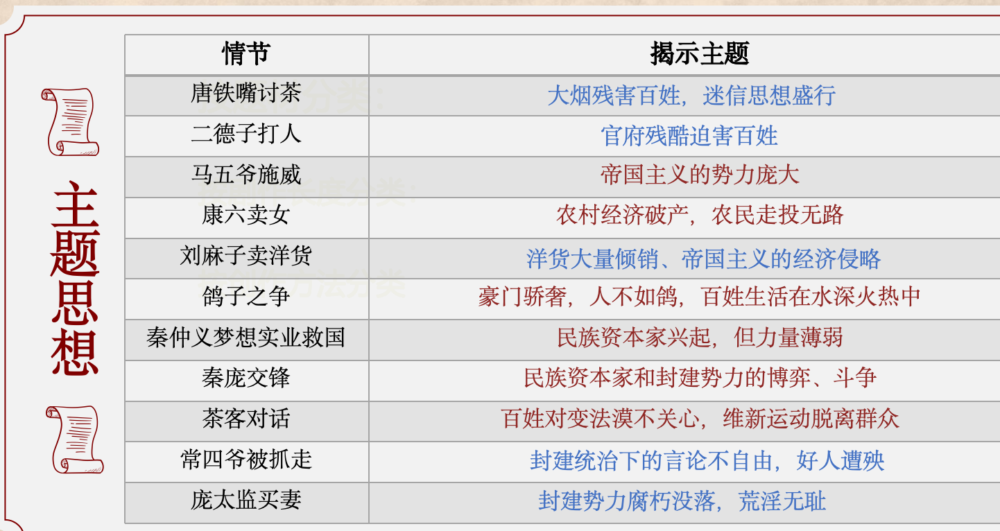

## 潜台词

我觉得他如果要考就从这几句里面出所以主要是看这几句我觉得ppt上的蛮重要的直接搬过来了这个很重要！这个绝对会考：

### 品读台词

**① 马五爷：“二德子，你威风啊！”**

这句话把马五爷的威势凸显出来，而这威势不过是依仗洋教的庇护，暗示当时帝国主义在中国的威风。

**② 王利发：“坐下！我告诉你，你要是不戒了大烟，就永远交不了好运！这是我的相法，比你的更灵验！”**

侧面交代了一个社会现实：清朝末年，鸦片战争失败，清政府腐败，大量鸦片流入中国，腐蚀着中国人民的身体和灵魂。

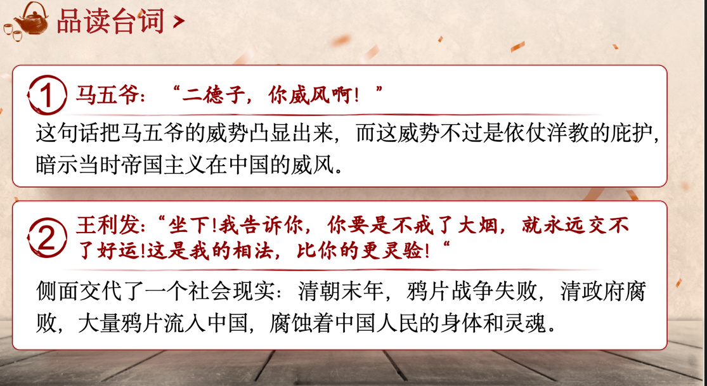

### 品读台词

**③ 常四爷：“要抖威风，跟洋人干去，洋人厉害！英法联军烧了圆明园，尊家吃着官饷，可没见您去冲锋打仗！”**

常四爷言辞犀利地回敬对方，明里讽刺二德子，暗中指责腐败政府，一针见血，咄咄逼人。

**④ 康六：“那不是因为乡下种地的都没法子混了吗？一家大小要是一天能吃上一顿粥，我要还想卖女儿，我就不是人！”**

一种社会现象：农村破产，民不聊生。农民已经无法生存下去，只能靠卖儿卖女以维持暂时的生计。

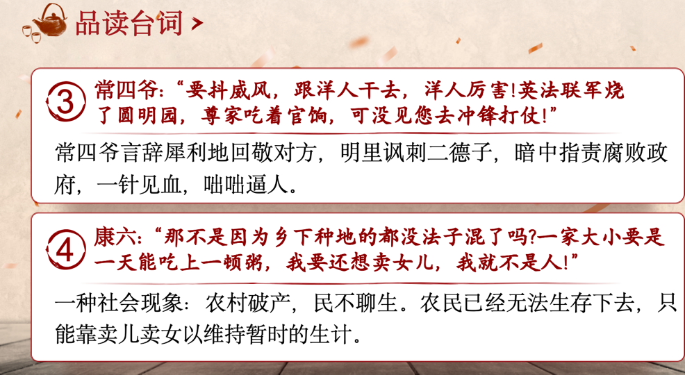

### 品读台词

**⑤ 庞太监：“我要活的，可不要死的！”**

庞太监对买来的“妻子”没有任何同情，在他心中，这只是一个活的玩物而已。再次写出庞太监荒淫无耻、狠毒奸诈，没有一点人性和同情心。

**⑥ 茶客甲：“将！你完啦！”**

这是一句典型的一语双关的台词，它既表示一局棋已经下完，也更点明了一个时代的终结：封建社会已经走到尽头。

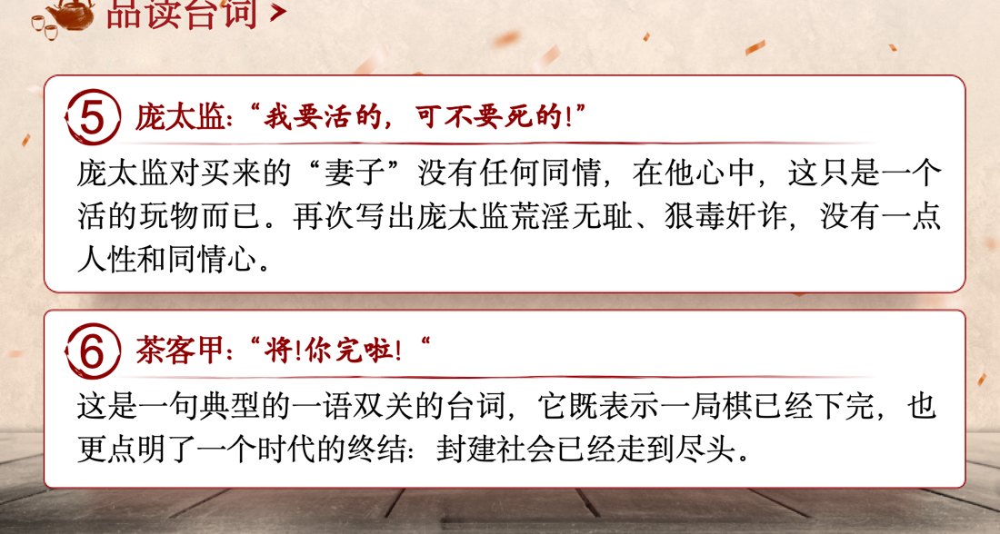

## 最后的总结：

这个文章描写了裕泰茶馆里形形色色的人物的种种活动，通过众多角色的对话，自然形成戏剧冲突，展现人物与时代的矛盾，透视了**戊戌变法**（别不会写这个）发生与失败的前因后果，描绘了**帝国主义扩张渗透、流氓地痞横行、农民破产、宫廷生活腐败荒淫、爱国者横遭迫害的社会现实**，逼真地勾勒出晚清统治的真实图景，揭示其必然败亡的命运。

## 最后是一些艺术特色：

### 赏析艺术特色

曹禺曾称赞《茶馆》第一幕说“这第一幕是古今中外剧作中罕见的第一幕”。对于这“罕见”，有人认为是说老舍“大茶馆小社会”的构思，有人认为是说老舍“召之即来，挥之即去”的编剧手法，有人认为是说老舍对事件与情节的处理。

你赞成哪一种观点？为什么？

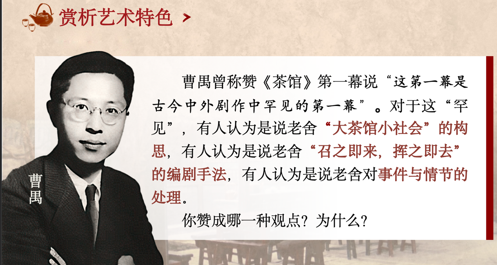

我赞成“大茶馆，小社会”的观点。老舍以**裕泰茶馆作为时代缩影**，在**狭小空间汇集清末各阶层人物，用众生百态展现社会危机**。这种**以小见大**的独特构思，突破传统戏剧叙事，正是第一幕的罕见之处，其余手法只是实现构思的手段。

（这种以刻画人物多方面反映社会风貌为目标而不是追求我那猴子呢个故事情节的的编剧手法叫做**散文化**！）

### 艺术特色 — ①卷轴画式的平面结构

没有统一的情节，也没有一个中心人物，一个个人物的展出，一个个情节的嵌入，使舞台呈现出社会生活的一个横截面，如同画卷逐渐展开。人物虽多，但大多单线联系，故事较为独立。

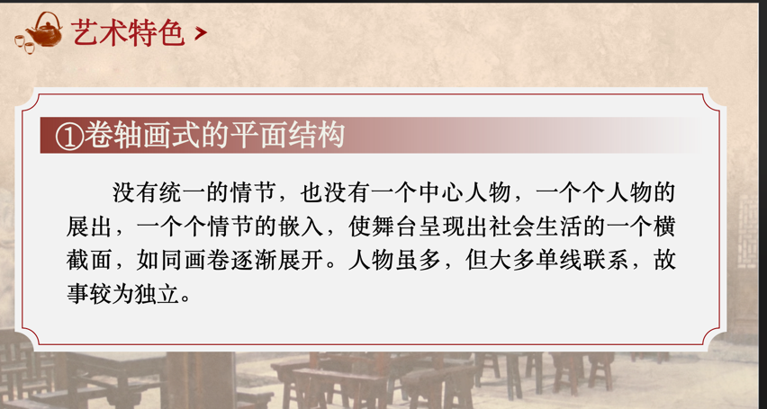

### ②特殊的戏剧冲突

全剧没有一个贯穿始终的戏剧冲突，但每个小故事小矛盾又不约而同指向时代与社会的黑暗与腐朽，展现不同阶层的人们的生存状态，都在为主题服务。

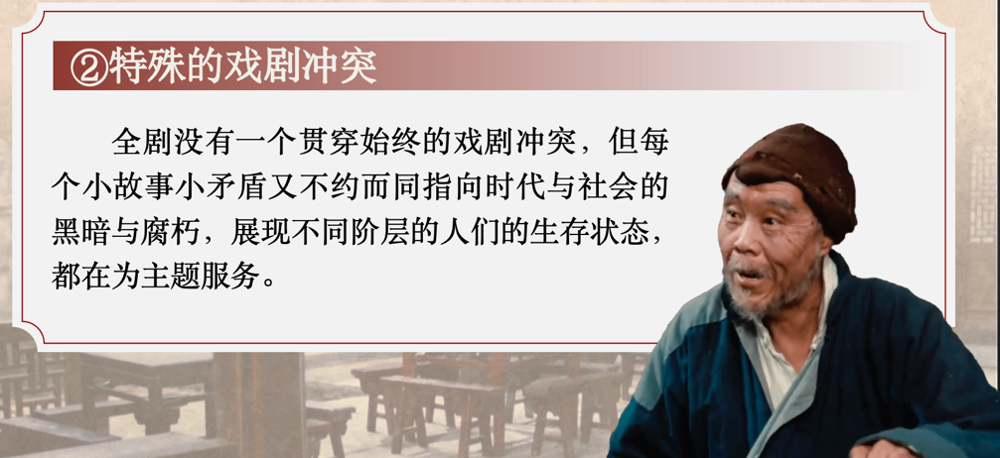

### 艺术特色 — ③充满幽默的语言风格

王利发说：您怕什么呢？那么多的买卖，您的小手指头都比我的腰还粗。作者把对黑暗社会的讽刺批判与强烈的爱国热情、对劳动人民的同情联系起来，在微笑中蕴藏着严肃和悲哀，寓庄于谐的幽默风格，给读者留下了深长的回味和思考。

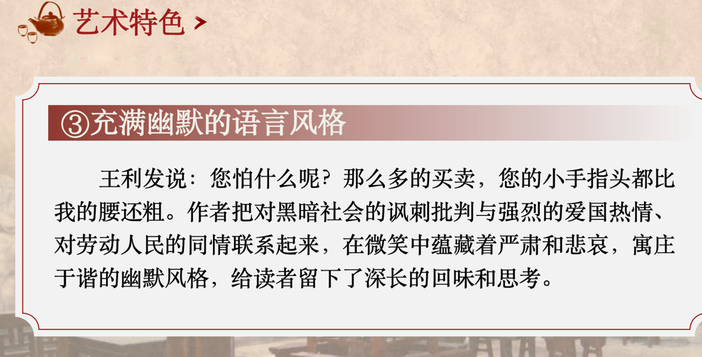

### 艺术特色 — ④京味儿语言

1. 你外边蹓蹓吧。
2. 你就甭卖那套生意口了。
3. 你这是对谁甩闲话呢？
4. 尊家吃着官饷。
5. 我可眼拙，没看见您！
6. 这位爷，您圣明，您给评评理！
7. 也甜不到哪儿去，弄好了，赚个元宝。
8. 我老觉乎着咱们的大缎子，川绸，更体面。

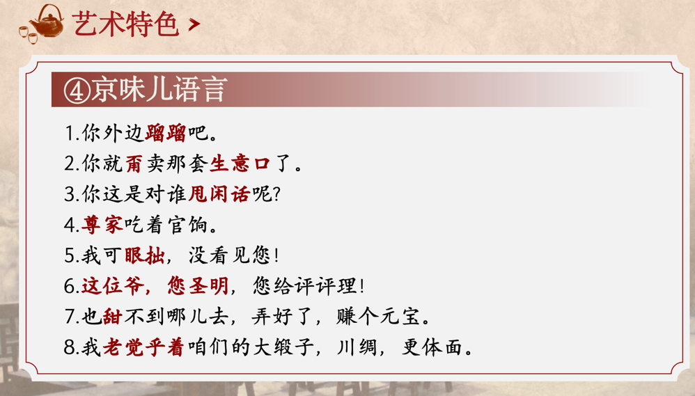
