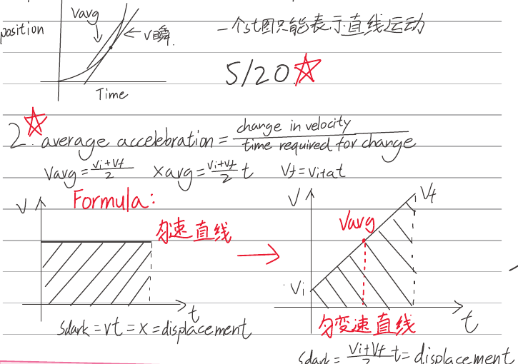
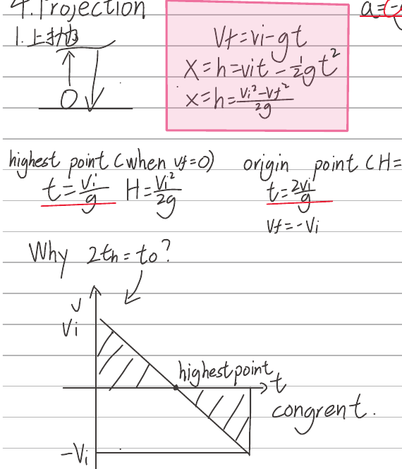
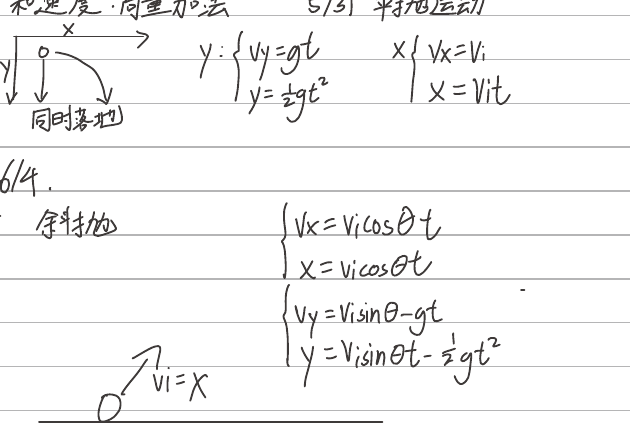
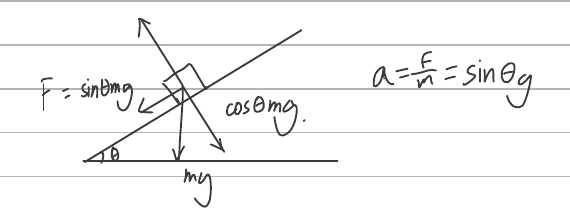
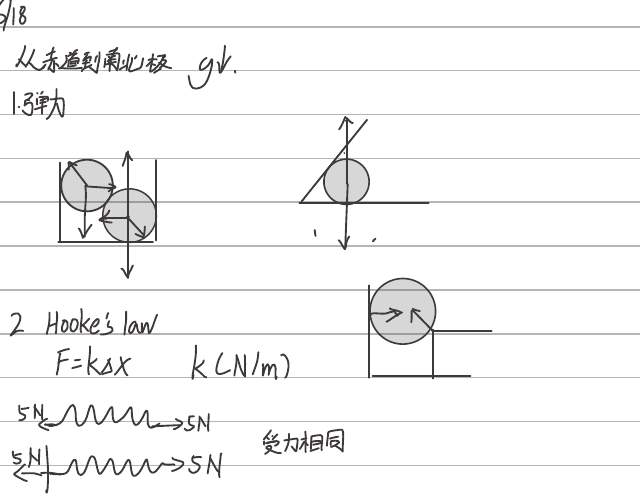
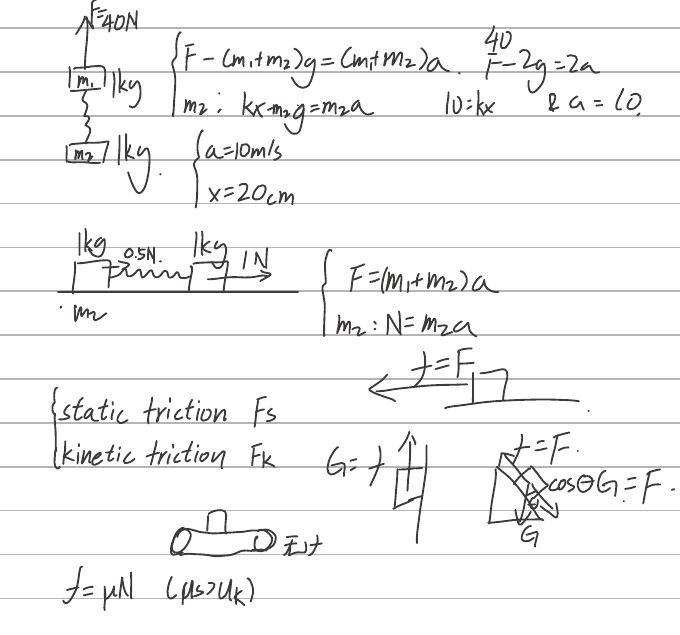
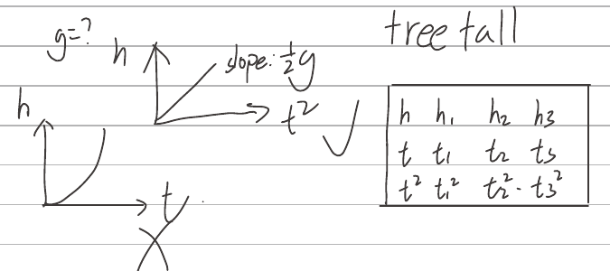
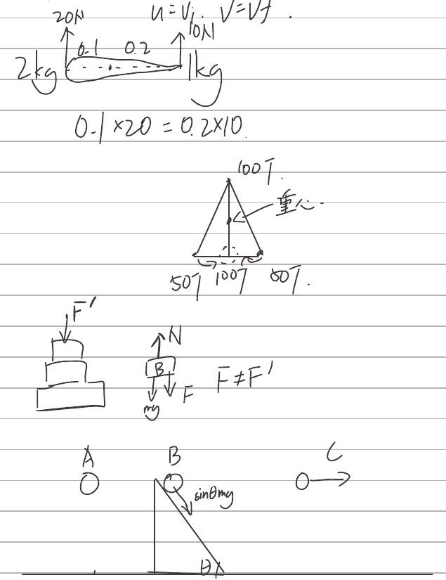
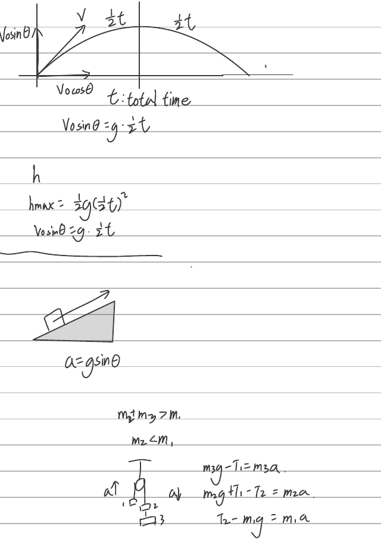
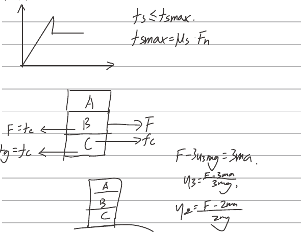

# Physics Kinematics Review Notes

<!-- Source: page 1 -->

## 1 Definition

Acceleration: the rate of change in velocity. $a=\Delta v/\Delta t$.

Displacement: change in position.

Distance: length of route.

Velocity: the rate of change in displacement.

Speed: the rate of change in displacement.〔按原文保留。〕

Position–Time graph: secant slope $v_{\rm avg}$; tangent slope $v_{\text{瞬}}$。一个 $s$–$t$ 图只能表示直线运动。

5/20 ★

## 2 Average acceleration

$$\text{average acceleration}=\frac{\text{change in velocity}}{\text{time required for change}}.$$
$$v_{\rm avg}=\frac{v_i+v_f}{2},\qquad x=v_{\rm avg}t=\frac{v_i+v_f}{2}t,\qquad v_f=v_i+at.$$

Formula:

- 匀速直线: $v$–$t$ graph is horizontal; shaded area $S_{\rm dark}=vt=x=\text{displacement}$.
- 匀变速直线: $v$–$t$ graph is a rising line, from $v_i$ to $v_f$, with $v_{\rm avg}$ at the midpoint; $S_{\rm dark}=\frac{v_i+v_f}{2}t=\text{displacement}$.

$$v_{\rm avg}=\frac{v_i+v_f}{2},\quad v_f=v_i+at,\quad x=\frac{v_i+v_f}{2}t.$$

| Cancel | Formula |
|---|---|
| $v_f$ | $x=v_it+\frac12at^2$ |
| $v_i$ | $x=v_ft-\frac12at^2$ |
| $t$ | $x=\frac{v_f^2-v_i^2}{2a}$ |

Calculus: 分割成无限多个正方形。

Example sketch: initial velocity $83.9\ \mathrm{m/s}$, stopping distance $195\ \mathrm m$.
$$195=-\frac{83.9^2}{2a}\Rightarrow390a=-83.9^2,\qquad a=-\frac{83.9^2}{390}=18.0\ \mathrm{m/s^2}.$$
〔末尾正号按原稿保留。〕

<!-- Source: page 2 -->

Practice:

## 3 Free Fall（大 G）

$$a=g=9.8\ \mathrm{m/s^2}.$$
Assume no air resistance.
$$v_i=0,\quad v_f=at=gt,$$
$$x=h=\frac12at^2=\frac12gt^2,$$
$$x=h=\frac{v_f^2}{2a}=\frac{v_f^2}{2g},\qquad v_f^2=2gh.$$
均根据匀变速直线运动公式推导。

## 4 Projection

### 1 上抛

$$a=-g=9.8\ \mathrm{m/s^2}.$$
〔数值前未写负号，按原稿保留。〕
$$v_f=v_i-gt,$$
$$x=h=v_it-\frac12gt^2,$$
$$x=h=\frac{v_i^2-v_f^2}{2g}.$$

Highest point (when $v_f=0$): $t=v_i/g$, $H=v_i^2/(2g)$.

Origin point ($H=0$): $t=2v_i/g$, $v_f=-v_i$.

Why $2t_h=t_0$? In the $v$–$t$ graph, the shaded triangles above and below the time axis are congruent; the line crosses at the highest point.

<!-- Source: page 3 -->

## 5 下抛

$$a=g,\qquad v_f=v_i+gt,$$
$$h=v_it+\frac12gt^2,\qquad h=\frac{v_f^2-v_i^2}{2g}.$$
The diagram takes downward $v$ as positive.

5/23 practice. 51.

1. Bearing.
2. N 85.92° E.
3. North of east.

相对运动：向量减法。

和速度：向量加法。

### 5/31 平抛运动

Simultaneous landing（同时落地）diagram: one object falls vertically, one travels horizontally; $x$ points right, $y$ points down.

$$y:\begin{cases}v_y=gt\\y=\frac12gt^2\end{cases}\qquad
x:\begin{cases}v_x=v_i\\x=v_it\end{cases}.$$

### 6/4 斜抛

$$\begin{cases}v_x=v_i\cos\theta\,t\\x=v_i\cos\theta\,t\end{cases}\qquad
\begin{cases}v_y=v_i\sin\theta-gt\\y=v_i\sin\theta\,t-\frac12gt^2\end{cases}.$$
〔第一行 $v_x$ 后原稿写有 $t$，照录。〕

斜抛图中初速度旁写有 $v_i=x$。

<!-- Source: page 4 -->

### Range

$$\begin{cases}
t=\frac{2v_i\sin\theta}{g},\\
x=v_i\cos\theta\frac{2v_i\sin\theta}{g},\\
x=\frac{v_i^2\sin(2\theta)}g.
\end{cases}$$
$$\sin2\theta=2\cos\theta\sin\theta.$$

## Force Dynamics

1. Contact force; Field forces.
2. Newton's law.

### 1 Newton's first law law of inertia

Tendency of an object not to accelerate.

Mass is the only measure of inertia.

### 2 Newton's second law

$$F_{\rm net}=\sum F=ma.$$
The acceleration of an object is directly proportional to the net force acting on the object, and inversely proportional to the subject's mass.

Inclined plane: gravity $mg$, perpendicular component $mg\cos\theta$, parallel component $F=mg\sin\theta$.
$$a=\frac Fm=g\sin\theta.$$

<!-- Source: page 5 -->

### 3 Newton's second law

〔标题按原文保留。〕

If two objects interact, the magnitude of the force exerted on object 1 by object 2 is equal to the magnitude of the force simultaneously.

Action and reaction: 作用力；反作用力。

a. 大小相等，方向相反，同一直线。Equal and opposite.

b. 不同物体。Exerted on different objects.

c. 同类型。

d. 同时存在，同时消失。

### 6/18

〔原文此处无法辨认〕。该行末尾可见“gv.”，见原图。

1. 弹力。

The contact diagrams draw the force normals at a wall, a floor, an inclined surface, and the contact between two spheres.

2. Hooke's law.
$$F=k\Delta x,\qquad k\ (\mathrm{N/m}).$$

Two spring sketches: each has $5\ \mathrm N$ outward at both ends. 受力相同。

<!-- Source: page 6 -->

## 3 连接体

先整体，后隔离。

First sketch: $m_1=1\ \mathrm{kg}$ above $m_2=1\ \mathrm{kg}$, joined by a spring; upward $F=40\ \mathrm N$.
$$\begin{cases}F-(m_1+m_2)g=(m_1+m_2)a,\\m_2:\ kx-m_2g=m_2a,\\a=10\ \mathrm{m/s},\\x=20\ \mathrm{cm}.
\end{cases}$$
$$\frac{40}{1}-2g=2a,\qquad10=kx,\qquad ka=20.$$
〔右侧草算按原稿照录，见图。〕

Second sketch: two $1\ \mathrm{kg}$ blocks joined by a spring, a marked $0.5\ \mathrm N$ by the spring, and $1\ \mathrm N$ to the right of the right block.
$$\begin{cases}F=(m_1+m_2)a,\\m_2:\ N=m_2a.\end{cases}$$

Static friction $F_s$; kinetic friction $F_k$.

Sketches: horizontal push with $f=F$; vertical wall with $G=f$; inclined plane with $f=F$, $G\cos\theta=F$; wheeled cart labeled 无力。
$$f=\mu N\quad(\mu_s>\mu_k).$$

### Free fall

$g=?$ Compare plots of $h$ versus $t$ and $h$ versus $t^2$. The $h$–$t^2$ plot is a line with slope $\frac12g$ (tick); the $h$–$t$ plot curves upward (cross).

| | 1 | 2 | 3 |
|---|---|---|---|
| $h$ | $h_1$ | $h_2$ | $h_3$ |
| $t$ | $t_1$ | $t_2$ | $t_3$ |
| $t^2$ | $t_1^2$ | $t_2^2$ | $t_3^2$ |

<!-- Source: page 7 -->

$u=v_i$, $v=v_f$.

Lever sketch: $2\ \mathrm{kg}$ on the left, $1\ \mathrm{kg}$ on the right, upward $20\ \mathrm N$ and $10\ \mathrm N$ respectively, distances $0.1$ and $0.2$ from the marked center.
$$0.1\times20=0.2\times10.$$

Triangle diagram: $100\ \mathrm T$ at the top, $50\ \mathrm T$ at each bottom corner, $100\ \mathrm T$ along the base; 重心 marked on vertical centerline.

Stacked-body sketch: downward $F'$ on stack; isolated $B$ has upward $N$, downward $mg$ and $F$.
$$F\ne F'.$$

Three objects: $A$ drops vertically; $B$ moves down an incline at angle $\theta$; $C$ travels horizontally from the same height.
$$t_B>t_A=t_C,\qquad v_A=v_B=v_C.$$
$$mg\sin\theta=ma,\qquad s=vt+\frac12at^2,$$
$$\frac h{\sin\theta}=\frac12g\sin\theta\,t_B^2.$$
$$v_A=gt=g\sqrt{\frac{2h}g}=\sqrt{2gh},$$
$$v_B=at_B=g\sin\theta\sqrt{\frac{2h}{g\sin^2\theta}}=\sqrt{2gh}.$$

<!-- Source: page 8 -->

Projectile trajectory: initial $v_0\sin\theta$ vertically, $v_0\cos\theta$ horizontally, vector $v$; the two halves of flight are each $\frac12t$.

$t$: total time.
$$v_0\sin\theta=g\cdot\frac12t,$$
$$h_{\max}=\frac12g\left(\frac12t\right)^2,$$
$$v_0\sin\theta=g\cdot\frac12t.$$

Incline sketch with block accelerating up slope:
$$a=g\sin\theta.$$

Pulley sketch, with mass 1 moving up and masses 2 and 3 down:
$$m_2+m_3>m_1,\qquad m_2<m_1,$$
$$m_3g-T_1=m_3a,$$
$$m_2g+T_1-T_2=m_2a,$$
$$T_2-m_1g=m_1a.$$

<!-- Source: page 9 -->

10/7

## 1 Fictional force

〔标题按原文保留。〕

Graph: friction rises to a peak, drops, then is constant.
$$f_s\le f_{s\max},\qquad f_{s\max}=\mu_sF_n.$$

Three blocks $A,B,C$ in a vertical stack: $B$ pulled right by $F$; leftward $F=f_s$ on $B$; rightward $f_c$ on $C$; leftward $f_g=f_c$ at the ground.
$$F-\mu_3mg=3ma,$$
$$\mu_3=\frac{F-3ma}{3mg},$$
$$\mu_2=\frac{F-2ma}{2mg}.$$
Second stack sketch sits on a curved ground line.

